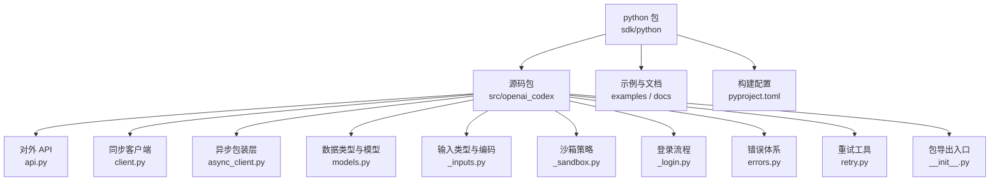
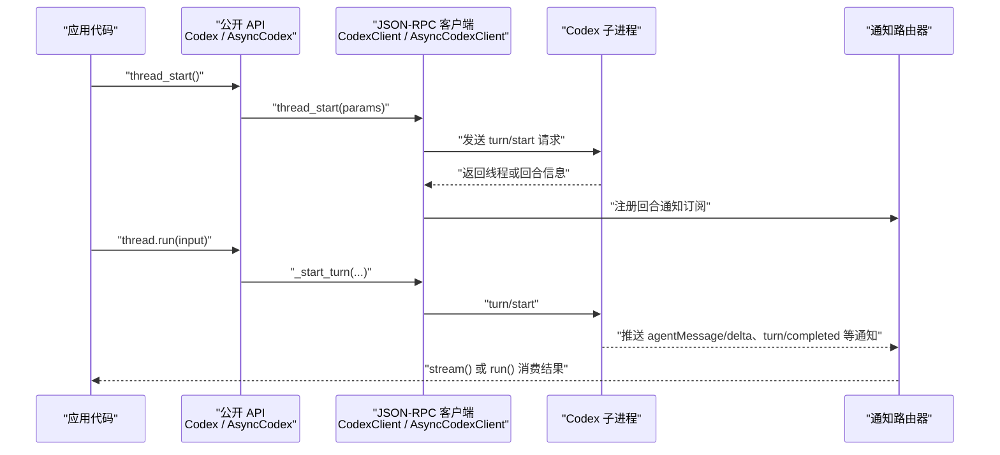
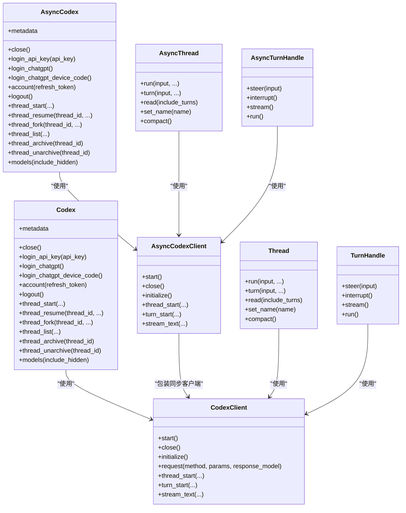
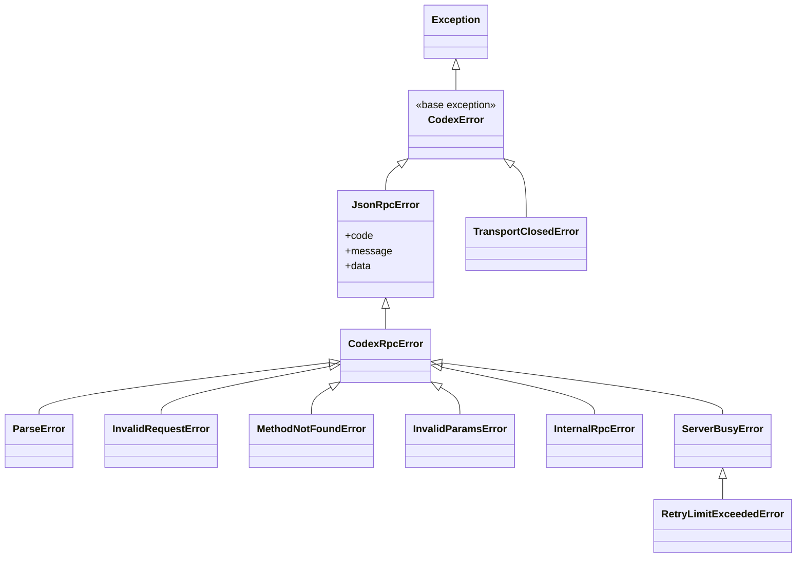

# Python SDK

<cite>
**本文引用的文件**
- [sdk/python/README.md](file://sdk/python/README.md)
- [sdk/python/pyproject.toml](file://sdk/python/pyproject.toml)
- [sdk/python/src/openai_codex/__init__.py](file://sdk/python/src/openai_codex/__init__.py)
- [sdk/python/src/openai_codex/api.py](file://sdk/python/src/openai_codex/api.py)
- [sdk/python/src/openai_codex/client.py](file://sdk/python/src/openai_codex/client.py)
- [sdk/python/src/openai_codex/async_client.py](file://sdk/python/src/openai_codex/async_client.py)
- [sdk/python/src/openai_codex/errors.py](file://sdk/python/src/openai_codex/errors.py)
- [sdk/python/src/openai_codex/retry.py](file://sdk/python/src/openai_codex/retry.py)
- [sdk/python/src/openai_codex/models.py](file://sdk/python/src/openai_codex/models.py)
- [sdk/python/src/openai_codex/_inputs.py](file://sdk/python/src/openai_codex/_inputs.py)
- [sdk/python/src/openai_codex/_sandbox.py](file://sdk/python/src/openai_codex/_sandbox.py)
- [sdk/python/src/openai_codex/_login.py](file://sdk/python/src/openai_codex/_login.py)
</cite>

## 目录
1. [简介](#简介)
2. [项目结构](#项目结构)
3. [安装与导入](#安装与导入)
4. [核心架构](#核心架构)
5. [核心组件参考](#核心组件参考)
6. [详细组件分析](#详细组件分析)
7. [依赖关系分析](#依赖关系分析)
8. [性能与并发模型](#性能与并发模型)
9. [错误处理与重试](#错误处理与重试)
10. [调试与故障排除](#调试与故障排除)
11. [API 版本兼容性与迁移](#api-版本兼容性与迁移)
12. [结论](#结论)

## 简介
本仓库中的 Python SDK 包名为 `openai-codex`，用于通过 Python 程序启动 Codex 会话、创建对话线程、执行回合、流式消费代理消息，并控制沙箱访问权限。SDK 底层通过标准输入输出与本地绑定的 Codex 运行时进程通信，使用 JSON-RPC 风格的消息协议。

它同时提供同步和异步两套入口：
- 同步入口：`Codex`、`Thread`、`TurnHandle`
- 异步入口：`AsyncCodex`、`AsyncThread`、`AsyncTurnHandle`

SDK 默认复用已存在的 Codex 登录状态；也支持显式浏览器登录、设备码登录和 API Key 登录。

**章节来源**
- [sdk/python/README.md:1-75](file://sdk/python/README.md#L1-L75)
- [sdk/python/src/openai_codex/__init__.py:1-95](file://sdk/python/src/openai_codex/__init__.py#L1-L95)

## 项目结构
Python SDK 代码位于 `sdk/python` 目录，核心包为 `openai_codex`：



**图示来源**
- [sdk/python/pyproject.toml:1-77](file://sdk/python/pyproject.toml#L1-L77)
- [sdk/python/src/openai_codex/__init__.py:1-95](file://sdk/python/src/openai_codex/__init__.py#L1-L95)
- [sdk/python/src/openai_codex/api.py:1-901](file://sdk/python/src/openai_codex/api.py#L1-L901)
- [sdk/python/src/openai_codex/client.py:1-924](file://sdk/python/src/openai_codex/client.py#L1-L924)
- [sdk/python/src/openai_codex/async_client.py:1-413](file://sdk/python/src/openai_codex/async_client.py#L1-L413)
- [sdk/python/src/openai_codex/models.py:1-76](file://sdk/python/src/openai_codex/models.py#L1-L76)
- [sdk/python/src/openai_codex/_inputs.py:1-103](file://sdk/python/src/openai_codex/_inputs.py#L1-L103)
- [sdk/python/src/openai_codex/_sandbox.py:1-78](file://sdk/python/src/openai_codex/_sandbox.py#L1-L78)
- [sdk/python/src/openai_codex/_login.py:1-172](file://sdk/python/src/openai_codex/_login.py#L1-L172)
- [sdk/python/src/openai_codex/errors.py:1-121](file://sdk/python/src/openai_codex/errors.py#L1-L121)
- [sdk/python/src/openai_codex/retry.py:1-41](file://sdk/python/src/openai_codex/retry.py#L1-L41)

**章节来源**
- [sdk/python/pyproject.toml:1-77](file://sdk/python/pyproject.toml#L1-L77)
- [sdk/python/src/openai_codex/__init__.py:1-95](file://sdk/python/src/openai_codex/__init__.py#L1-L95)

## 安装与导入

### 包信息
- 包名：`openai-codex`
- 最低 Python 版本：3.10
- 运行时依赖：Pydantic、packaging、`openai-codex-cli-bin`
- 许可证：Apache-2.0

**章节来源**
- [sdk/python/pyproject.toml:1-77](file://sdk/python/pyproject.toml#L1-L77)

### pip 安装
推荐方式是通过 PyPI 安装稳定构建：

```bash
pip install openai-codex
```

该命令会安装 SDK 包以及绑定的 Codex 运行时二进制依赖。

**章节来源**
- [sdk/python/README.md:1-75](file://sdk/python/README.md#L1-L75)
- [sdk/python/pyproject.toml:1-77](file://sdk/python/pyproject.toml#L1-L77)

### 源码安装
由于 SDK 绑定特定版本的 `openai-codex-cli-bin`，直接源码安装时可能遇到二进制依赖解析问题。推荐优先使用预发布包；如果必须从源码开发，请确保当前环境满足 Python 3.10+，并在可安装的上下文中运行构建系统。

注意事项：
- SDK 的构建后端是 `uv_build`。
- 源码中 `version` 在开发模式下为 `0.0.0-dev`，实际发行版本由发布流程生成。
- 若需要指定本地 Codex 可执行文件，可通过 `CodexConfig.codex_bin` 设置路径。

**章节来源**
- [sdk/python/pyproject.toml:1-77](file://sdk/python/pyproject.toml#L1-L77)
- [sdk/python/src/openai_codex/client.py:201-240](file://sdk/python/src/openai_codex/client.py#L201-L240)

### 基础导入语法
最常用导入如下：

```python
from openai_codex import Codex, AsyncCodex, Thread, TurnResult
```

公开导出的主要名称包括：
- 客户端：`Codex`、`AsyncCodex`
- 线程：`Thread`、`AsyncThread`
- 回合句柄：`TurnHandle`、`AsyncTurnHandle`
- 结果：`TurnResult`
- 输入类型：`Input`、`InputItem`、`TextInput`、`ImageInput`、`LocalImageInput`、`SkillInput`、`MentionInput`、`ExternalMessage`、`RunInput`
- 沙箱：`Sandbox`
- 认证模式：`ApprovalMode`
- 登录句柄：`ChatgptLoginHandle`、`DeviceCodeLoginHandle`、`AsyncChatgptLoginHandle`、`AsyncDeviceCodeLoginHandle`
- 错误类：`CodexError`、`JsonRpcError`、`ServerBusyError`、`RetryLimitExceededError` 等
- 重试函数：`retry_on_overload`、`is_retryable_error`

**章节来源**
- [sdk/python/src/openai_codex/__init__.py:1-95](file://sdk/python/src/openai_codex/__init__.py#L1-L95)

### 快速开始
典型同步用法：

```python
from openai_codex import Codex

with Codex() as codex:
    thread = codex.thread_start()
    result = thread.run("用三个要点解释这个仓库。")
    print(result.final_response)
```

异步等价写法使用 `AsyncCodex`，并通过 `async with` 管理生命周期。

**章节来源**
- [sdk/python/README.md:1-75](file://sdk/python/README.md#L1-L75)
- [sdk/python/src/openai_codex/api.py:1-200](file://sdk/python/src/openai_codex/api.py#L1-L200)

## 核心架构

SDK 的核心调用链可以理解为四层：

1. **用户 API 层**：`Codex`、`AsyncCodex`、`Thread`、`AsyncThread`、`TurnHandle`、`AsyncTurnHandle`
2. **JSON-RPC 客户端层**：`CodexClient`（同步）、`AsyncCodexClient`（异步包装）
3. **子进程传输层**：通过 `subprocess.Popen` 启动本地 Codex 运行时，使用 stdin/stdout 收发 JSON-RPC 消息
4. **通知路由层**：`MessageRouter` 将全局通知、登录通知、回合通知按主题分发到队列



**图示来源**
- [sdk/python/src/openai_codex/api.py:201-901](file://sdk/python/src/openai_codex/api.py#L201-L901)
- [sdk/python/src/openai_codex/client.py:201-862](file://sdk/python/src/openai_codex/client.py#L201-L862)
- [sdk/python/src/openai_codex/async_client.py:1-413](file://sdk/python/src/openai_codex/async_client.py#L1-L413)

**章节来源**
- [sdk/python/src/openai_codex/client.py:201-450](file://sdk/python/src/openai_codex/client.py#L201-L450)
- [sdk/python/src/openai_codex/async_client.py:1-200](file://sdk/python/src/openai_codex/async_client.py#L1-L200)

## 核心组件参考

### 同步入口 `Codex`
`Codex` 是面向同步应用的顶层客户端。构造时会尝试启动本地运行时并完成初始化。推荐作为上下文管理器使用，以便及时释放子进程资源。

主要能力：
- 初始化元数据：`metadata`
- 生命周期：`close()`
- 账号操作：`login_api_key()`、`account()`、`logout()`
- 浏览器登录：`login_chatgpt()`
- 设备码登录：`login_chatgpt_device_code()`
- 线程管理：`thread_start()`、`thread_resume()`、`thread_fork()`、`thread_list()`、`thread_archive()`、`thread_unarchive()`
- 模型列表：`models()`

**章节来源**
- [sdk/python/src/openai_codex/api.py:1-200](file://sdk/python/src/openai_codex/api.py#L1-L200)

### 异步入口 `AsyncCodex`
`AsyncCodex` 是 `Codex` 的异步镜像。它采用懒初始化：首次进入 `async with` 或首次等待 API 时完成初始化。所有方法均为 `async def`。

主要行为：
- `_ensure_initialized()` 保证只初始化一次
- 登录、账号、线程、模型方法与 `Codex` 对应，但返回异步句柄或异步结果
- `metadata` 在未初始化时抛出运行时错误，提示应优先使用 `async with`

**章节来源**
- [sdk/python/src/openai_codex/api.py:201-600](file://sdk/python/src/openai_codex/api.py#L201-L600)

### 线程对象 `Thread` 与 `AsyncThread`
线程代表一次 Codex 对话。线程可以：
- 运行完整回合：`run()`
- 启动或加入活跃回合：`turn()`
- 读取历史：`read()`
- 设置名称：`set_name()`
- 压缩上下文：`compact()`

`Thread` 是同步版本，`AsyncThread` 是异步版本。两者最终都会把用户输入转换为 wire 格式，并调用底层 `turn/start` 请求。

**章节来源**
- [sdk/python/src/openai_codex/api.py:601-901](file://sdk/python/src/openai_codex/api.py#L601-L901)

### 回合句柄 `TurnHandle` 与 `AsyncTurnHandle`
回合句柄表示一个正在运行的回合。它提供：
- 追加输入：`steer()`
- 中断回合：`interrupt()`
- 流式消费通知：`stream()`
- 阻塞等待完成并收集结果：`run()`

同步句柄使用迭代器，异步句柄使用异步迭代器。它们都依赖订阅机制，在收到匹配的 `turn/completed` 通知后结束流。

**章节来源**
- [sdk/python/src/openai_codex/api.py:601-901](file://sdk/python/src/openai_codex/api.py#L601-L901)

### 输入类型
SDK 对轮次输入做了统一封装：

| 类型 | 用途 | 关键属性 |
|---|---|---|
| `TextInput` | 文本输入 | `text` |
| `ImageInput` | 图片 URL 输入 | `url` |
| `LocalImageInput` | 本地图片路径输入 | `path` |
| `SkillInput` | 技能引用 | `name`、`path` |
| `MentionInput` | 命名资源提及 | `name`、`path` |
| `ExternalMessage` | 不受信任的外部内容 | `tool_name`、`content`、`namespace` |

`RunInput` 可以是字符串、单个输入项、输入项列表，或 `ExternalMessage`。

**章节来源**
- [sdk/python/src/openai_codex/_inputs.py:1-103](file://sdk/python/src/openai_codex/_inputs.py#L1-L103)

### 沙箱策略
`Sandbox` 枚举提供三种预设文件系统访问级别：

| 值 | 含义 |
|---|---|
| `read_only` | 只读，允许读取但不写入 |
| `workspace_write` | 工作区写权限，适合有信任记录的项目 |
| `full_access` | 完全访问，移除文件系统限制 |

这些值会被映射到底层 `SandboxMode` 和 `SandboxPolicy`。

**章节来源**
- [sdk/python/src/openai_codex/_sandbox.py:1-78](file://sdk/python/src/openai_codex/_sandbox.py#L1-L78)

### 登录句柄
SDK 支持三类登录：

| 登录方式 | 同步句柄 | 异步句柄 | 主要方法 |
|---|---|---|---|
| ChatGPT 浏览器登录 | `ChatgptLoginHandle` | `AsyncChatgptLoginHandle` | `wait()`、`cancel()` |
| 设备码登录 | `DeviceCodeLoginHandle` | `AsyncDeviceCodeLoginHandle` | `wait()`、`cancel()` |
| API Key 登录 | 无句柄 | 无句柄 | `login_api_key(api_key)` |

**章节来源**
- [sdk/python/src/openai_codex/_login.py:1-172](file://sdk/python/src/openai_codex/_login.py#L1-L172)

## 详细组件分析

### 同步客户端 `CodexClient`
`CodexClient` 是 SDK 的实际 JSON-RPC 客户端，负责：
- 启动本地 Codex 子进程
- 维护 stdin/stdout 读写线程
- 初始化会话
- 发送请求并解析响应
- 路由通知
- 管理账号、线程、回合、目标逻辑
- 流式文本输出

#### 生命周期
- `start()`：启动子进程、读取 stderr、启动 reader 线程
- `initialize()`：发送 `initialize` 请求，保存运行时版本和用户代理信息
- `close()`：关闭 stdin、终止子进程、回收线程

#### 请求与通知
- `request(method, params, response_model)`：发送带类型校验的请求
- `_request_raw(method, params)`：底层 JSON-RPC 请求
- `notify(method, params)`：发送无需响应的通知
- `next_notification()`：获取下一个非回合级全局通知
- `register_login_notifications()` / `next_login_notification()`：登录通知通道
- `register_turn_notifications()` / `next_turn_notification()`：回合通知通道

#### 线程与回合
- `thread_start()` / `thread_resume()` / `thread_fork()` / `thread_read()` / `thread_list()`
- `turn_start()` / `turn_interrupt()` / `turn_steer()`
- `_start_turn()`：注册订阅并避免与“逻辑目标”冲突
- `stream_text()`：流式返回 `AgentMessageDeltaNotification`

#### 逻辑目标
- `register_goal_operation()` / `unregister_goal_operation()`
- `pause_goal()` / `cancel_goal_operation()`
- `start_goal_operation()`：等待第一个回合启动，失败时清理状态

**章节来源**
- [sdk/python/src/openai_codex/client.py:201-862](file://sdk/python/src/openai_codex/client.py#L201-L862)

### 异步客户端包装层 `AsyncCodexClient`
`AsyncCodexClient` 不实现网络逻辑，而是把 `CodexClient` 的所有阻塞调用放到线程池中执行，从而不阻塞异步事件循环。

关键设计：
- `_call_sync(fn, *args, **kwargs)`：通过 `asyncio.to_thread` 调度
- `_TURN_START_EXECUTOR`：专用线程池执行回合启动
- 取消保护：`_start_turn` 在异步取消时清理未认领的订阅
- `stream_text()`：将同步迭代器转为异步迭代器

**章节来源**
- [sdk/python/src/openai_codex/async_client.py:1-413](file://sdk/python/src/openai_codex/async_client.py#L1-L413)

### 配置选项 `CodexConfig`
`CodexConfig` 控制本地 Codex 运行时的启动方式和标识信息：

| 字段 | 类型 | 默认值 | 说明 |
|---|---|---|---|
| `codex_bin` | `str | None` | 空 | 指定本地 Codex 可执行文件路径 |
| `launch_args_override` | `tuple[str, ...] | None` | 空 | 覆盖启动参数 |
| `config_overrides` | `tuple[str, ...]` | 空元组 | 传递给运行时的 `--config` 参数 |
| `cwd` | `str | None` | 空 | 子进程工作目录 |
| `env` | `dict[str, str] | None` | 空 | 子进程环境变量 |
| `client_name` | `str` | `codex_python_sdk` | 客户端名称 |
| `client_title` | `str` | `Codex Python SDK` | 客户端标题 |
| `client_version` | `str` | SDK 版本 | 客户端版本 |
| `experimental_api` | `bool` | `True` | 是否启用实验性 API 能力 |

当未设置 `codex_bin` 时，SDK 会从 `openai-codex-cli-bin` 包中查找绑定的 Codex 运行时。

**章节来源**
- [sdk/python/src/openai_codex/client.py:201-240](file://sdk/python/src/openai_codex/client.py#L201-L240)

### 环境变量与路径注入
SDK 在启动子进程时会复制当前环境变量，并合并 `CodexConfig.env`。它还根据平台向 PATH 前缀插入绑定的二进制目录，使子进程更容易找到依赖工具。

注意：
- Windows 上会保留大小写敏感的 `Path` 键
- 重复路径条目会被去重
- 如果使用了 `launch_args_override`，则不会自动计算 checkout 能力

**章节来源**
- [sdk/python/src/openai_codex/client.py:241-320](file://sdk/python/src/openai_codex/client.py#L241-L320)

## 依赖关系分析



**图示来源**
- [sdk/python/src/openai_codex/api.py:1-901](file://sdk/python/src/openai_codex/api.py#L1-L901)
- [sdk/python/src/openai_codex/client.py:201-862](file://sdk/python/src/openai_codex/client.py#L201-L862)
- [sdk/python/src/openai_codex/async_client.py:1-413](file://sdk/python/src/openai_codex/async_client.py#L1-L413)

**章节来源**
- [sdk/python/src/openai_codex/api.py:1-901](file://sdk/python/src/openai_codex/api.py#L1-L901)
- [sdk/python/src/openai_codex/client.py:201-862](file://sdk/python/src/openai_codex/client.py#L201-L862)
- [sdk/python/src/openai_codex/async_client.py:1-413](file://sdk/python/src/openai_codex/async_client.py#L1-L413)

## 性能与并发模型

### 同步模型
- `CodexClient` 内部使用多线程：stderr 读取线程、stdout 读取线程
- 每个线程的启动操作有细粒度锁，避免同一线程 ID 上的并发启动冲突
- `stream_text()` 使用同步迭代器，适合简单脚本和阻塞式流水线

### 异步模型
- `AsyncCodexClient` 将所有阻塞调用委托给 `asyncio.to_thread`
- `_TURN_START_EXECUTOR` 是独立的线程池，避免大量回合启动阻塞共享事件循环
- 异步取消会清理未认领的订阅，防止泄漏

### 建议
- 高并发场景优先使用 `AsyncCodex` 和 `AsyncThread.stream()`
- 长连接服务建议使用 `async with AsyncCodex()` 管理生命周期
- 批量短任务可使用同步 `Codex`，但应避免在异步事件循环中直接调用同步 SDK

**章节来源**
- [sdk/python/src/openai_codex/client.py:201-450](file://sdk/python/src/openai_codex/client.py#L201-L450)
- [sdk/python/src/openai_codex/async_client.py:1-200](file://sdk/python/src/openai_codex/async_client.py#L1-L200)

## 错误处理与重试

### 异常层次
SDK 定义了清晰的异常继承关系：



**图示来源**
- [sdk/python/src/openai_codex/errors.py:1-121](file://sdk/python/src/openai_codex/errors.py#L1-L121)

### 常见错误
| 异常 | 触发条件 | 处理方式 |
|---|---|---|
| `ParseError` | JSON-RPC 解析失败 | 检查请求/响应格式 |
| `InvalidRequestError` | 运行时拒绝请求形状 | 检查参数和方法 |
| `MethodNotFoundError` | 方法不可用 | 检查 API 版本 |
| `InvalidParamsError` | 参数无效 | 检查输入类型和必填字段 |
| `InternalRpcError` | 运行时内部错误 | 查看日志和子进程 stderr |
| `ServerBusyError` | 服务器过载 | 使用重试 |
| `RetryLimitExceededError` | 重试预算耗尽 | 降低频率或扩大重试间隔 |

### 重试工具
`retry_on_overload(op, max_attempts, initial_delay_s, max_delay_s, jitter_ratio)` 会对瞬态过载错误进行指数退避加抖动重试。

`is_retryable_error(exc)` 可用于判断异常是否适合重试。

**章节来源**
- [sdk/python/src/openai_codex/errors.py:1-121](file://sdk/python/src/openai_codex/errors.py#L1-L121)
- [sdk/python/src/openai_codex/retry.py:1-41](file://sdk/python/src/openai_codex/retry.py#L1-L41)

## 调试与故障排除

### 常见问题
1. **找不到 Codex 二进制**
   - 现象：安装正常但无法定位本地运行时
   - 原因：未通过推荐方式安装 SDK，或未安装 `openai-codex-cli-bin`
   - 解决：重新 `pip install openai-codex`，或通过 `CodexConfig.codex_bin` 指定路径

2. **子进程意外退出**
   - 现象：出现传输关闭或 RPC 错误
   - 排查：检查 SDK 捕获的 stderr 行缓冲、运行时日志、命令行参数和环境变量

3. **回合未结束**
   - 现象：`stream()` 或 `run()` 一直阻塞
   - 排查：确认订阅是否正确注册，是否收到 `turn/completed` 通知

4. **外部消息报错**
   - 现象：`ExternalMessage.tool_name` 为空或非字符串时报错
   - 解决：确保 `tool_name` 是非空字符串

5. **沙箱权限错误**
   - 现象：写入被拒绝
   - 排查：确认使用的是 `Sandbox.read_only`、`Sandbox.workspace_write` 还是 `Sandbox.full_access`

### 调试技巧
- 使用 `help(openai_codex)`、`help(Codex)` 或 `python -m pydoc openai_codex` 查看内置帮助
- 使用 `Codex.metadata` 查看初始化和运行时元数据
- 使用 `stream()` 消费通知，观察 `agentMessage/delta`、`item/*`、`turn/completed` 等事件
- 通过 `CodexConfig.env` 注入调试环境变量，例如运行时日志级别
- 通过 `CodexConfig.cwd` 固定子进程工作目录，便于复现问题

**章节来源**
- [sdk/python/README.md:1-75](file://sdk/python/README.md#L1-L75)
- [sdk/python/src/openai_codex/client.py:201-450](file://sdk/python/src/openai_codex/client.py#L201-L450)
- [sdk/python/src/openai_codex/_inputs.py:1-103](file://sdk/python/src/openai_codex/_inputs.py#L1-L103)
- [sdk/python/src/openai_codex/_sandbox.py:1-78](file://sdk/python/src/openai_codex/_sandbox.py#L1-L78)

## API 版本兼容性与迁移

### 版本检测
SDK 在 `initialize()` 后缓存运行时版本，并在某些高级字段使用时进行兼容性检查：
- 如果运行时版本不可用且使用了自定义启动命令，SDK 会通过 checkout 能力检查字段支持情况
- 否则，SDK 要求运行时版本满足最小要求

### 向后兼容
- 部分字段如 `excludeTurns`、`toolOutput`、`serviceTierForTurn` 会根据方法名动态检查
- 过时的 `Model.supports_personality` 在当前 app-server 上始终为假
- 通知模型通过生成的通知注册表解析，未知通知会以 `UnknownNotification` 形式返回

### 升级建议
- 保持 `openai-codex-cli-bin` 与 SDK 的绑定版本一致
- 升级前先测试 `thread/read`、`turn/start`、`model/list` 等基础接口
- 关注 `InitializeResponse.serverInfo.version` 和 `userAgent`
- 对重载和临时错误使用 `retry_on_overload` 或 `is_retryable_error`

**章节来源**
- [sdk/python/src/openai_codex/client.py:201-450](file://sdk/python/src/openai_codex/client.py#L201-L450)
- [sdk/python/src/openai_codex/models.py:1-76](file://sdk/python/src/openai_codex/models.py#L1-L76)
- [sdk/python/src/openai_codex/api.py:201-300](file://sdk/python/src/openai_codex/api.py#L201-L300)

## 结论
`openai-codex` Python SDK 提供了一个清晰的分层架构：高层 API 暴露 `Codex` 与 `AsyncCodex`，中层封装 JSON-RPC 客户端，底层通过子进程与本地 Codex 运行时通信。它同时支持同步和异步编程模型，并提供完整的输入类型、沙箱策略、登录流程、错误分类和重试工具。

对于大多数用户，推荐做法是：
- 使用 `pip install openai-codex` 安装
- 同步脚本使用 `Codex`，异步服务使用 `AsyncCodex`
- 使用 `thread.run()` 执行一次性任务，使用 `thread.turn().stream()` 消费增量输出
- 对网络或服务器过载错误使用 `retry_on_overload`
- 通过 `CodexConfig` 和 `Sandbox` 精确控制运行时行为和文件系统权限