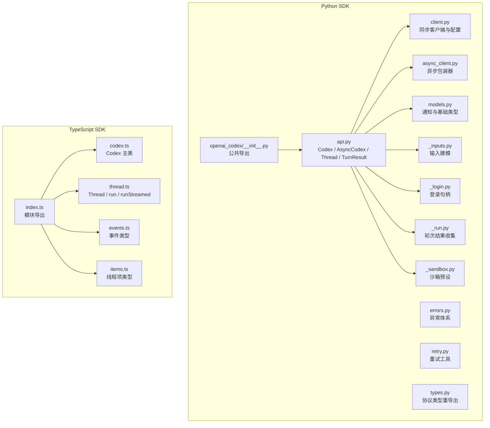
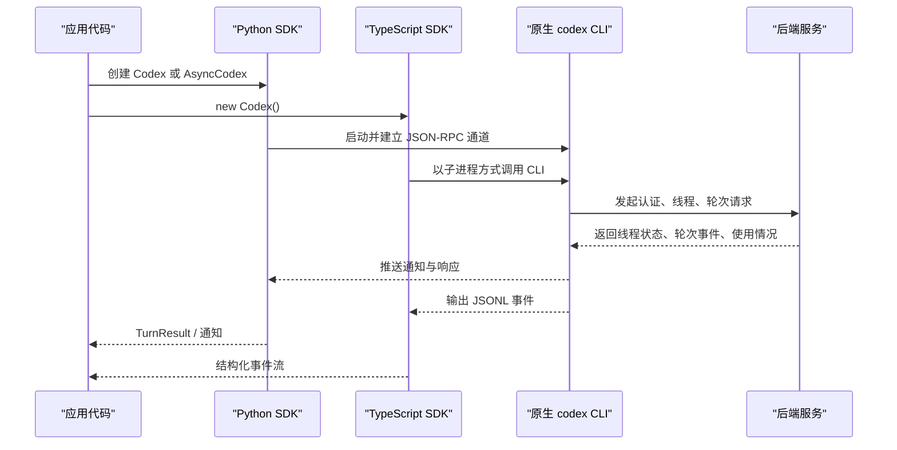
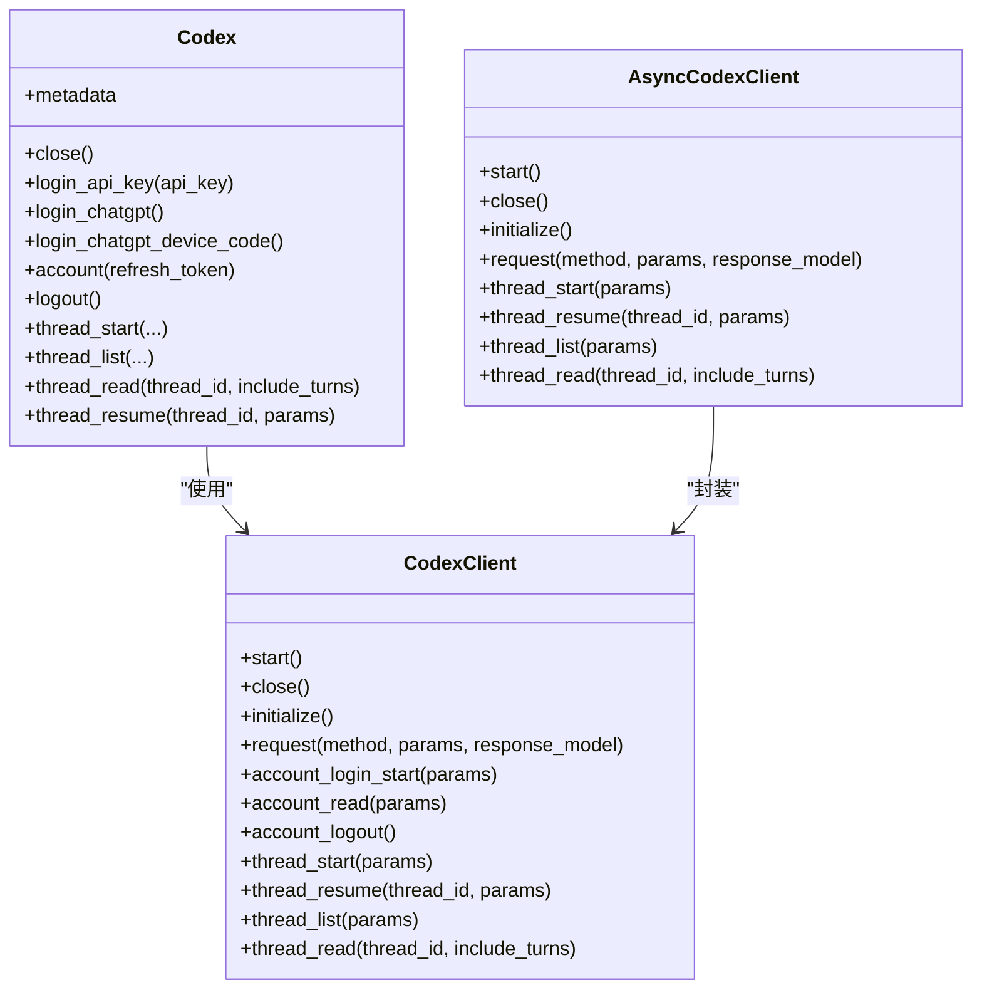
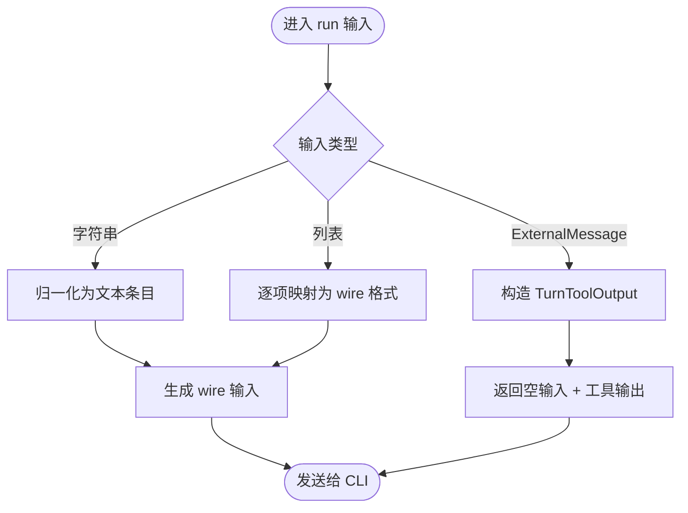
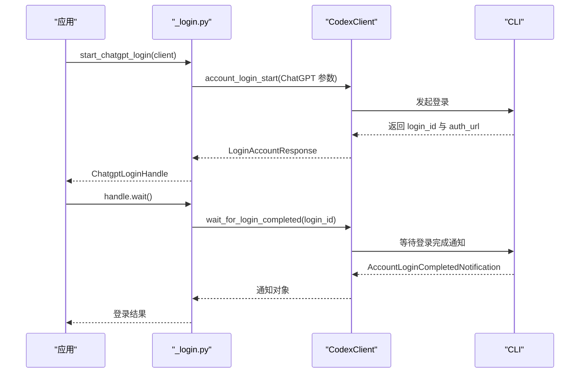
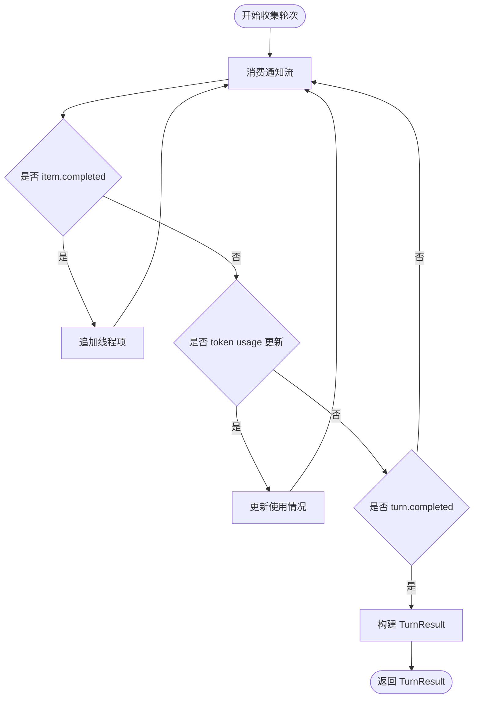
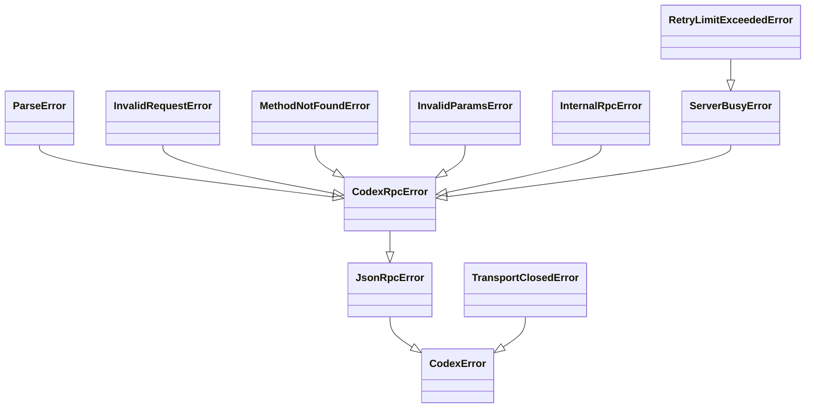
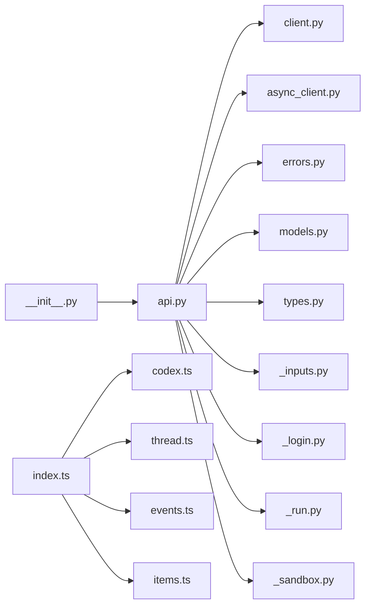

# SDK 参考

<cite>
**本文引用的文件**   
- [sdk/python/README.md](file://sdk/python/README.md)
- [sdk/python/pyproject.toml](file://sdk/python/pyproject.toml)
- [sdk/python/src/openai_codex/__init__.py](file://sdk/python/src/openai_codex/__init__.py)
- [sdk/python/src/openai_codex/api.py](file://sdk/python/src/openai_codex/api.py)
- [sdk/python/src/openai_codex/client.py](file://sdk/python/src/openai_codex/client.py)
- [sdk/python/src/openai_codex/async_client.py](file://sdk/python/src/openai_codex/async_client.py)
- [sdk/python/src/openai_codex/errors.py](file://sdk/python/src/openai_codex/errors.py)
- [sdk/python/src/openai_codex/retry.py](file://sdk/python/src/openai_codex/retry.py)
- [sdk/python/src/openai_codex/models.py](file://sdk/python/src/openai_codex/models.py)
- [sdk/python/src/openai_codex/types.py](file://sdk/python/src/openai_codex/types.py)
- [sdk/python/src/openai_codex/_inputs.py](file://sdk/python/src/openai_codex/_inputs.py)
- [sdk/python/src/openai_codex/_login.py](file://sdk/python/src/openai_codex/_login.py)
- [sdk/python/src/openai_codex/_run.py](file://sdk/python/src/openai_codex/_run.py)
- [sdk/python/src/openai_codex/_sandbox.py](file://sdk/python/src/openai_codex/_sandbox.py)
- [sdk/python/examples/README.md](file://sdk/python/examples/README.md)
- [sdk/typescript/README.md](file://sdk/typescript/README.md)
- [sdk/typescript/package.json](file://sdk/typescript/package.json)
- [sdk/typescript/src/index.ts](file://sdk/typescript/src/index.ts)
- [sdk/typescript/src/codex.ts](file://sdk/typescript/src/codex.ts)
- [sdk/typescript/src/thread.ts](file://sdk/typescript/src/thread.ts)
- [sdk/typescript/src/events.ts](file://sdk/typescript/src/events.ts)
- [sdk/typescript/src/items.ts](file://sdk/typescript/src/items.ts)
</cite>

## 目录
1. [简介](#简介)
2. [项目结构](#项目结构)
3. [核心组件](#核心组件)
4. [架构总览](#架构总览)
5. [详细组件分析](#详细组件分析)
6. [依赖关系分析](#依赖关系分析)
7. [性能考虑](#性能考虑)
8. [故障排除指南](#故障排除指南)
9. [结论](#结论)
10. [附录：版本兼容与升级指南](#附录版本兼容与升级指南)

## 简介
本参考文档面向同时使用 Python SDK 与 TypeScript SDK 的开发者，目标是帮助你在应用中以线程和轮次的方式启动 Codex、发送文本或图像输入、流式消费中间事件、处理错误、控制沙箱与工作目录，并通过原生 CLI 与后端服务进行交互。

Python SDK 提供同步 `Codex` 与异步 `AsyncCodex` 两套入口；TypeScript SDK 通过进程方式封装 `codex` CLI，暴露基于事件的异步 API。两者都围绕“会话—线程—轮次”的数据模型展开。

## 项目结构
仓库中多语言 SDK 位于 `sdk/python` 与 `sdk/typescript`：

**图表来源**
- [sdk/python/src/openai_codex/__init__.py:1-95](file://sdk/python/src/openai_codex/__init__.py#L1-L95)
- [sdk/python/src/openai_codex/api.py:1-200](file://sdk/python/src/openai_codex/api.py#L1-L200)
- [sdk/typescript/src/index.ts:1-40](file://sdk/typescript/src/index.ts#L1-L40)

**章节来源**
- [sdk/python/README.md:1-75](file://sdk/python/README.md#L1-L75)
- [sdk/typescript/README.md:1-160](file://sdk/typescript/README.md#L1-L160)

## 核心组件

### Python SDK 安装与导入
- 包名：`openai-codex`
- 最低 Python 版本：3.10
- 安装命令：`pip install openai-codex`
- 顶层导出的主要符号包括：
  - 客户端：`Codex`、`AsyncCodex`
  - 线程与轮次：`Thread`、`AsyncThread`、`TurnHandle`、`AsyncTurnHandle`、`TurnResult`
  - 输入类型：`Input`、`InputItem`、`TextInput`、`ImageInput`、`LocalImageInput`、`SkillInput`、`MentionInput`、`ExternalMessage`
  - 运行时设置：`Sandbox`、`ApprovalMode`、`CodexConfig`
  - 错误与重试：`CodexError`、`JsonRpcError`、`ServerBusyError`、`RetryLimitExceededError`、`is_retryable_error`、`retry_on_overload`

常见用法是创建上下文管理器形式的 `Codex`，调用 `thread_start()` 获得线程，再调用 `thread.run(...)` 执行轮次并得到 `TurnResult`。

**章节来源**
- [sdk/python/README.md:1-75](file://sdk/python/README.md#L1-L75)
- [sdk/python/src/openai_codex/__init__.py:1-95](file://sdk/python/src/openai_codex/__init__.py#L1-L95)
- [sdk/python/pyproject.toml:1-20](file://sdk/python/pyproject.toml#L1-L20)

### TypeScript SDK 安装与导入
- 包名：`@openai/codex-sdk`
- Node.js 要求：18+
- 安装命令：`npm install @openai/codex-sdk`
- 默认导出：
  - 类：`Codex`、`Thread`
  - 类型：`ThreadEvent`、`ThreadStartedEvent`、`TurnCompletedEvent`、`ThreadError`、`Usage`、`ThreadItem`、`AgentMessageItem`、`CommandExecutionItem`、`FileChangeItem`、`McpToolCallItem`、`WebSearchItem`、`TodoListItem`、`ErrorItem`、`CodexOptions`、`ThreadOptions`、`TurnOptions`、`RunResult`、`RunStreamedResult`、`Input`、`UserInput`

TypeScript SDK 的核心流程是实例化 `Codex`，调用 `startThread()` 或 `resumeThread()` 获取 `Thread`，再调用 `run()` 或 `runStreamed()` 执行轮次。

**章节来源**
- [sdk/typescript/README.md:1-160](file://sdk/typescript/README.md#L1-L160)
- [sdk/typescript/package.json:1-30](file://sdk/typescript/package.json#L1-L30)
- [sdk/typescript/src/index.ts:1-40](file://sdk/typescript/src/index.ts#L1-L40)

## 架构总览

### 运行时交互模型
Python SDK 与 TypeScript SDK 都不是直接连接远程 LLM，而是通过本地原生 CLI 完成工作：

**图表来源**
- [sdk/python/src/openai_codex/client.py:1-200](file://sdk/python/src/openai_codex/client.py#L1-L200)
- [sdk/typescript/src/thread.ts:1-159](file://sdk/typescript/src/thread.ts#L1-L159)

### Python 同步与异步入口
- `Codex`：同步入口，构造时启动底层客户端并完成初始化元数据校验。
- `AsyncCodexClient`：异步包装器，将阻塞型 `CodexClient` 操作卸载到线程池，从而不阻塞异步事件循环。
- `Thread` 与 `AsyncThread`：分别负责同步和异步线程生命周期、轮次启动、轮次控制、事件订阅。

**章节来源**
- [sdk/python/src/openai_codex/api.py:1-200](file://sdk/python/src/openai_codex/api.py#L1-L200)
- [sdk/python/src/openai_codex/async_client.py:1-200](file://sdk/python/src/openai_codex/async_client.py#L1-L200)

### TypeScript 模块化组织
- `codex.ts`：`Codex` 类，管理 `CodexExec` 和全局选项。
- `thread.ts`：`Thread` 类，封装 `run()` 与 `runStreamed()`，解析 JSONL 事件。
- `events.ts`：定义线程级事件类型。
- `items.ts`：定义线程内具体项类型。
- `index.ts`：统一导出对外 API。

**章节来源**
- [sdk/typescript/src/codex.ts:1-39](file://sdk/typescript/src/codex.ts#L1-L39)
- [sdk/typescript/src/thread.ts:1-159](file://sdk/typescript/src/thread.ts#L1-L159)
- [sdk/typescript/src/events.ts:1-84](file://sdk/typescript/src/events.ts#L1-L84)
- [sdk/typescript/src/items.ts:1-128](file://sdk/typescript/src/items.ts#L1-L128)
- [sdk/typescript/src/index.ts:1-40](file://sdk/typescript/src/index.ts#L1-L40)

## 详细组件分析

### Python 客户端与配置

#### `CodexConfig`
`CodexConfig` 用于控制本地 Codex 可执行文件的查找行为。默认情况下，SDK 从已安装的 `openai-codex-cli-bin` 依赖中定位二进制文件；也可通过 `codex_bin` 指定自定义路径。

关键职责：
- 解析 `codex_bin`。
- 注入捆绑 CLI 所在目录到进程 `PATH`。
- 验证二进制是否存在。

**章节来源**
- [sdk/python/src/openai_codex/client.py:1-200](file://sdk/python/src/openai_codex/client.py#L1-L200)

#### 同步客户端 `CodexClient`
同步客户端负责：
- 启动和关闭本地 CLI 进程。
- 发送 JSON-RPC 请求。
- 接收通知并路由到线程、轮次和登录句柄。
- 提供账户读取、登出、线程列表、线程恢复等能力。

该实现还包含对生成协议的适配层，把 Pydantic 模型转换为 wire 参数。

**章节来源**
- [sdk/python/src/openai_codex/client.py:1-200](file://sdk/python/src/openai_codex/client.py#L1-L200)

#### 异步客户端 `AsyncCodexClient`
异步客户端并不重新实现网络层，而是封装 `CodexClient`，通过 `asyncio.to_thread` 在后台线程运行同步方法，避免阻塞事件循环。它还维护一个线程池，专门用于非流式轮次启动等可能短暂阻塞的操作。

**章节来源**
- [sdk/python/src/openai_codex/async_client.py:1-200](file://sdk/python/src/openai_codex/async_client.py#L1-L200)

#### 公共 API 入口 `Codex`
`Codex` 类是同步用户入口：
- 构造时创建 `CodexClient`，调用 `start()` 与 `initialize()`。
- 支持 API Key 登录、浏览器 ChatGPT 登录、设备码登录。
- 暴露 `thread_start()`、`thread_list()`、`thread_read()`、`thread_resume()`、`account()`、`logout()` 等方法。
- 将 `ApprovalMode`、`Sandbox`、`Personality`、`ReasoningEffort` 等高层选项映射为生成的协议参数。

**图表来源**
- [sdk/python/src/openai_codex/api.py:1-200](file://sdk/python/src/openai_codex/api.py#L1-L200)
- [sdk/python/src/openai_codex/client.py:1-200](file://sdk/python/src/openai_codex/client.py#L1-L200)
- [sdk/python/src/openai_codex/async_client.py:1-200](file://sdk/python/src/openai_codex/async_client.py#L1-L200)

**章节来源**
- [sdk/python/src/openai_codex/api.py:1-200](file://sdk/python/src/openai_codex/api.py#L1-L200)

### 输入与外部消息

#### 输入建模
Python SDK 的输入分为：
- 简单字符串。
- 文本、图片、技能引用、提及等多模态条目。
- 不受信任的外部消息，由其他 agent、工具或应用产出。

**图表来源**
- [sdk/python/src/openai_codex/_inputs.py:1-103](file://sdk/python/src/openai_codex/_inputs.py#L1-L103)

**章节来源**
- [sdk/python/src/openai_codex/_inputs.py:1-103](file://sdk/python/src/openai_codex/_inputs.py#L1-L103)

#### 外部消息语义
`ExternalMessage` 表示工具级别的受控内容，它不会建立用户授权或审批。典型场景是另一个 agent 或工具将结果交给 Codex 继续处理。

**章节来源**
- [sdk/python/src/openai_codex/_inputs.py:1-103](file://sdk/python/src/openai_codex/_inputs.py#L1-L103)
- [sdk/python/examples/README.md:1-97](file://sdk/python/examples/README.md#L1-L97)

### 登录与会话

#### 登录流程
Python SDK 提供三种登录方式：
- API Key：直接调用账户登录接口。
- 浏览器登录：返回 `ChatgptLoginHandle`，等待完成或取消。
- 设备码登录：返回 `DeviceCodeLoginHandle`，显示验证链接和用户代码，等待完成或取消。

**图表来源**
- [sdk/python/src/openai_codex/_login.py:1-172](file://sdk/python/src/openai_codex/_login.py#L1-L172)

**章节来源**
- [sdk/python/src/openai_codex/_login.py:1-172](file://sdk/python/src/openai_codex/_login.py#L1-L172)

### 沙箱与工作目录

#### Python 沙箱预设
`Sandbox` 提供三个公开级别：
- `read_only`：只读文件系统访问。
- `workspace_write`：允许在工作区与已信任写入根目录内写入。
- `full_access`：移除文件系统访问限制。

这些预设会被映射到底层协议中的 `SandboxMode` 与 `SandboxPolicy`。

**章节来源**
- [sdk/python/src/openai_codex/_sandbox.py:1-78](file://sdk/python/src/openai_codex/_sandbox.py#L1-L78)

#### TypeScript 工作目录与 CLI 环境
TypeScript SDK 默认在当前工作目录运行 CLI，并要求该目录为 Git 仓库；可通过 `skipGitRepoCheck` 跳过检查。此外可以传入 `env` 控制 CLI 环境变量，以及通过 `baseUrl` 覆盖后端地址。

**章节来源**
- [sdk/typescript/README.md:1-160](file://sdk/typescript/README.md#L1-L160)
- [sdk/typescript/src/thread.ts:1-159](file://sdk/typescript/src/thread.ts#L1-L159)

### 轮次结果与事件

#### Python 轮次结果
`TurnResult` 聚合一次轮次的最终回复、事件项、状态、错误、时间戳与 token 使用情况。内部收集逻辑会遍历通知流，匹配 `item.completed`、`turn.completed` 与 `token_usage_updated` 等事件。

**图表来源**
- [sdk/python/src/openai_codex/_run.py:1-135](file://sdk/python/src/openai_codex/_run.py#L1-L135)

**章节来源**
- [sdk/python/src/openai_codex/_run.py:1-135](file://sdk/python/src/openai_codex/_run.py#L1-L135)

#### TypeScript 事件模型
TypeScript SDK 通过 JSONL 事件暴露更细粒度的过程：
- `thread.started`：新线程创建，包含 `thread_id`。
- `turn.started`：轮次开始。
- `item.started` / `item.updated` / `item.completed`：线程项生命周期。
- `turn.completed`：轮次完成，附带 `usage`。
- `turn.failed`：轮次失败，附带 `ThreadError`。
- `error`：不可恢复的流级错误。

`Thread.run()` 内部消费这些事件，缓冲直到轮次结束；`Thread.runStreamed()` 则直接暴露异步生成器。

**章节来源**
- [sdk/typescript/src/events.ts:1-84](file://sdk/typescript/src/events.ts#L1-L84)
- [sdk/typescript/src/thread.ts:1-159](file://sdk/typescript/src/thread.ts#L1-L159)

### 错误处理与重试

#### Python 异常体系
Python SDK 定义了分层异常：
- `CodexError`：所有 SDK 异常的基类。
- `JsonRpcError`：原始 JSON-RPC 错误包装。
- `CodexRpcError`：RPC 层面的类型化错误基类。
- `ParseError`、`InvalidRequestError`、`MethodNotFoundError`、`InvalidParamsError`、`InternalRpcError`：标准 JSON-RPC 错误映射。
- `ServerBusyError`：服务器过载或暂时不可用。
- `RetryLimitExceededError`：超过内部重试预算。
- `TransportClosedError`：传输意外关闭。

`map_jsonrpc_error` 根据 JSON-RPC code 和 data 字段决定具体异常类型；`is_retryable_error` 判断是否为可重试的瞬时过载错误。

**图表来源**
- [sdk/python/src/openai_codex/errors.py:1-121](file://sdk/python/src/openai_codex/errors.py#L1-L121)

**章节来源**
- [sdk/python/src/openai_codex/errors.py:1-121](file://sdk/python/src/openai_codex/errors.py#L1-L121)

#### 重试策略
`retry_on_overload` 提供指数退避加抖动的重试机制：
- 默认最多尝试 3 次。
- 初始延迟约 0.25 秒，最大延迟 2 秒。
- 只对 `is_retryable_error` 返回 true 的异常重试。
- 达到最大尝试次数后抛出原异常。

**章节来源**
- [sdk/python/src/openai_codex/retry.py:1-41](file://sdk/python/src/openai_codex/retry.py#L1-L41)

### TypeScript 结构化输出与输入
TypeScript SDK 支持：
- 通过 `outputSchema` 传递 JSON Schema，让 agent 返回结构化 JSON。
- 结合 Zod 与 `zod-to-json-schema` 生成 OpenAI 目标 schema。
- 通过 `Input` 数组附加本地图片。
- 通过 `resumeThread()` 恢复持久化的线程。
- 通过 `config` 和 `configOverrides` 向 CLI 传递 TOML 配置覆盖。

**章节来源**
- [sdk/typescript/README.md:1-160](file://sdk/typescript/README.md#L1-L160)
- [sdk/typescript/src/thread.ts:1-159](file://sdk/typescript/src/thread.ts#L1-L159)

## 依赖关系分析

### Python 包依赖
`openai-codex` 的关键依赖：
- `pydantic>=2.12`：Pydantic v2 模型序列化与校验。
- `packaging>=26.2`：版本与包信息处理。
- `openai-codex-cli-bin==0.153.4`：绑定的原生 CLI 运行时。

构建系统使用 `uv_build`，测试使用 pytest，格式化使用 ruff。

**章节来源**
- [sdk/python/pyproject.toml:1-77](file://sdk/python/pyproject.toml#L1-L77)

### TypeScript 包依赖
`@openai/codex-sdk` 的运行时依赖较少，开发依赖包括 Jest、TypeScript、tsup、ESLint、Prettier、Zod 和 zod-to-json-schema。Node.js 引擎要求 18+。

**章节来源**
- [sdk/typescript/package.json:1-68](file://sdk/typescript/package.json#L1-L68)

### 模块依赖图

**图表来源**
- [sdk/python/src/openai_codex/__init__.py:1-95](file://sdk/python/src/openai_codex/__init__.py#L1-L95)
- [sdk/typescript/src/index.ts:1-40](file://sdk/typescript/src/index.ts#L1-L40)

## 性能考虑

### Python SDK
- 异步模式优先：在 asyncio 应用中应使用 `AsyncCodex` 或 `AsyncCodexClient`，避免阻塞事件循环。
- 重试上限合理：默认三次重试适合短时过载，生产环境可根据业务容忍度调整。
- 流式消费减少内存压力：大量事件场景下优先消费通知流，而不是等待整轮结束。
- 沙箱选择影响 I/O：`full_access` 虽然灵活但风险更高；日常项目推荐 `workspace_write`。

### TypeScript SDK
- `runStreamed()` 更适合长轮次：可以在工具调用、文件变更、模型推理过程中逐步渲染进度。
- 结构化输出会增加解析开销：仅在需要强约束响应时使用 `outputSchema`。
- 图片输入会触发额外 I/O：尽量复用路径，避免重复加载大文件。
- 环境变量隔离：在 Electron 等受限环境中显式传入 `env`，避免继承过多变量导致 CLI 行为不稳定。

[本节为通用指导，不直接分析具体源码]

## 故障排除指南

### Python 常见问题

| 现象 | 可能原因 | 建议处理 |
|---|---|---|
| 找不到 Codex 二进制 | 未安装 SDK 内置依赖或未正确安装 `openai-codex-cli-bin` | 使用 `pip install openai-codex`，或通过 `CodexConfig.codex_bin` 指定有效路径 |
| 登录无响应 | 浏览器登录未完成或已取消 | 调用登录句柄的 `wait()` 并检查成功标志，必要时调用 `cancel()` |
| 出现 `ServerBusyError` | 后端过载或速率限制 | 使用 `retry_on_overload` 或捕获 `ServerBusyError` 后自行重试 |
| 出现 `RetryLimitExceededError` | 超过 SDK 或后端重试预算 | 检查网络、凭证、模型可用性，并降低并发 |
| JSON-RPC 报 `InvalidParamsError` | 参数结构与生成协议不一致 | 检查线程或轮次参数是否符合 `ThreadStartParams`、`TurnStartParams` 等 |
| 轮次完成但未收到完成事件 | 传输关闭或通知丢失 | 捕获 `TransportClosedError`，记录诊断信息，必要时重建客户端 |

**章节来源**
- [sdk/python/src/openai_codex/client.py:1-200](file://sdk/python/src/openai_codex/client.py#L1-L200)
- [sdk/python/src/openai_codex/errors.py:1-121](file://sdk/python/src/openai_codex/errors.py#L1-L121)
- [sdk/python/src/openai_codex/retry.py:1-41](file://sdk/python/src/openai_codex/retry.py#L1-L41)

### TypeScript 常见问题

| 现象 | 可能原因 | 建议处理 |
|---|---|---|
| 轮次立即失败 | CLI 无法解析输入或 schema 无效 | 检查 `Input` 是否为字符串或合法 `{type:"text"| "local_image"}` 数组 |
| 结构化输出未生效 | 未正确传递 `outputSchema` | 确认 schema 是合法 JSON Schema，并使用 `createOutputSchemaFile` 相关逻辑 |
| 工作目录报错 | 当前目录不是 Git 仓库且未跳过检查 | 设置 `workingDirectory` 或传入 `skipGitRepoCheck: true` |
| 环境变量缺失 | 宿主进程继承了不合适的 `PATH` 或密钥 | 显式传入 `env`，仅保留必要变量 |
| 流式事件无法消费 | 未遍历 `events` 异步生成器 | 使用 `for await` 消费 `runStreamed()` 返回的 `events` |

**章节来源**
- [sdk/typescript/src/thread.ts:1-159](file://sdk/typescript/src/thread.ts#L1-L159)
- [sdk/typescript/src/events.ts:1-84](file://sdk/typescript/src/events.ts#L1-L84)
- [sdk/typescript/README.md:1-160](file://sdk/typescript/README.md#L1-L160)

### 错误码对照表（Python）

| JSON-RPC 错误码 | SDK 异常 | 含义 | 是否可重试 |
|---|---|---|---|
| `-32700` | `ParseError` | 解析失败 | 通常不可重试 |
| `-32600` | `InvalidRequestError` | 请求形状无效 | 通常不可重试 |
| `-32601` | `MethodNotFoundError` | 方法不存在 | 通常不可重试 |
| `-32602` | `InvalidParamsError` | 参数无效 | 通常不可重试 |
| `-32603` | `InternalRpcError` | RPC 内部错误 | 视 data 而定 |
| `-32099` 至 `-32000` | 可能是 `ServerBusyError` 或 `CodexRpcError` | 服务端错误或过载 | 若标记为过载则可重试 |
| 包含 “retry limit” 或 “too many failed attempts” | `RetryLimitExceededError` | 重试预算耗尽 | 不应继续自动重试 |

**章节来源**
- [sdk/python/src/openai_codex/errors.py:1-121](file://sdk/python/src/openai_codex/errors.py#L1-L121)

## 结论
Python SDK 与 TypeScript SDK 提供了同一套 Codex 能力的两种语言封装：Python 侧重类型化协议、同步与异步双入口、细粒度异常与重试；TypeScript 侧重进程封装、JSONL 事件流、结构化输出与 CLI 配置注入。对于大多数应用，建议：

- 使用 Python 同步 SDK 编写脚本和简单工具。
- 使用 Python 异步 SDK 集成到异步 Web 框架。
- 使用 TypeScript SDK 在 Node.js、Electron 或其他 JS 生态中嵌入 agent。
- 在生产环境启用合理的超时、重试与日志记录。
- 明确沙箱权限，避免不必要的 `full_access`。
- 通过示例目录理解完整用法，并在复杂场景中优先消费流式事件。

[本节为总结性内容，不直接分析具体源码]

## 附录：版本兼容与升级指南

### Python SDK
- 最低 Python：3.10。
- 包版本：由 `pyproject.toml` 的 `[project] version` 控制。
- 运行时绑定：依赖 `openai-codex-cli-bin==0.153.4`，说明 Python SDK 与特定 CLI 版本绑定。
- 构建依赖：`uv_build>=0.13.0,<0.14`。
- 升级建议：
  - 升级 `openai-codex` 时应同时注意 CLI 绑定版本的兼容性。
  - 如果自定义 `CodexConfig.codex_bin`，确保其与 SDK 期望的协议版本一致。
  - 使用 `python -m pydoc openai_codex` 或 `help(openai_codex)` 查看当前 SDK 文档。

**章节来源**
- [sdk/python/pyproject.toml:1-77](file://sdk/python/pyproject.toml#L1-L77)
- [sdk/python/README.md:1-75](file://sdk/python/README.md#L1-L75)

### TypeScript SDK
- Node.js：18+。
- 包版本：由 `package.json` 的 `version` 控制。
- 入口：`dist/index.js`，类型声明在 `dist/index.d.ts`。
- 升级建议：
  - 升级 `@openai/codex-sdk` 后关注 `Thread.run()` 与 `Thread.runStreamed()` 的事件变化。
  - 如果使用结构化输出，确认 `outputSchema` 仍符合最新 JSON Schema 规范。
  - 在 CI 中固定 Node 版本，避免 18 以下环境误用。

**章节来源**
- [sdk/typescript/package.json:1-68](file://sdk/typescript/package.json#L1-L68)
- [sdk/typescript/README.md:1-160](file://sdk/typescript/README.md#L1-L160)

### 示例与最佳实践
Python SDK 示例目录展示了多种常见场景：
- 快速启动构造函数。
- 查看完整轮次输出。
- 流式消费事件。
- 发现可用模型。
- 恢复已有线程。
- 线程生命周期与控制。
- 图文混合输入。
- 异步对称用法。
- 错误处理与重试。
- CLI 迷你应用。
- 结构化输出。
- 模型选择与推理强度。
- 轮次控制。
- 登录与账户。
- 外部消息。

建议首次运行官方示例，再根据自身需求扩展。

**章节来源**
- [sdk/python/examples/README.md:1-97](file://sdk/python/examples/README.md#L1-L97)