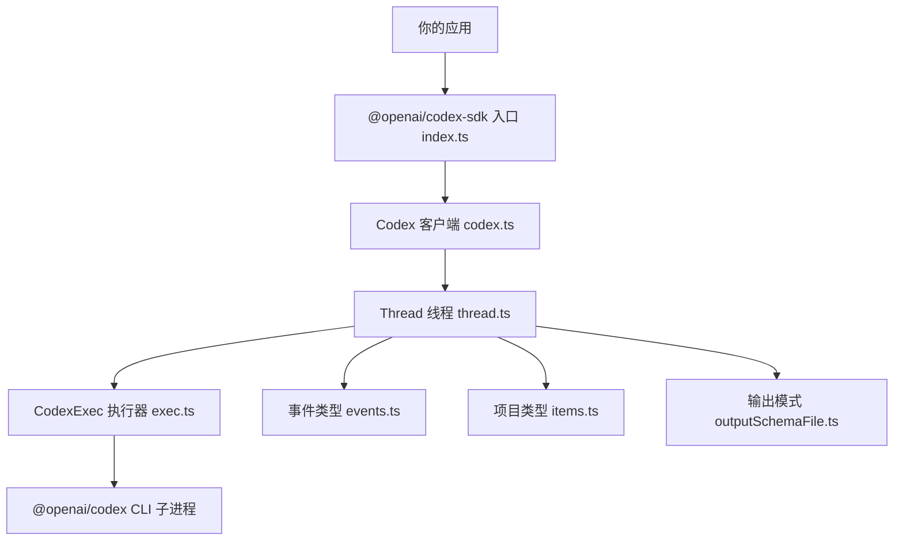
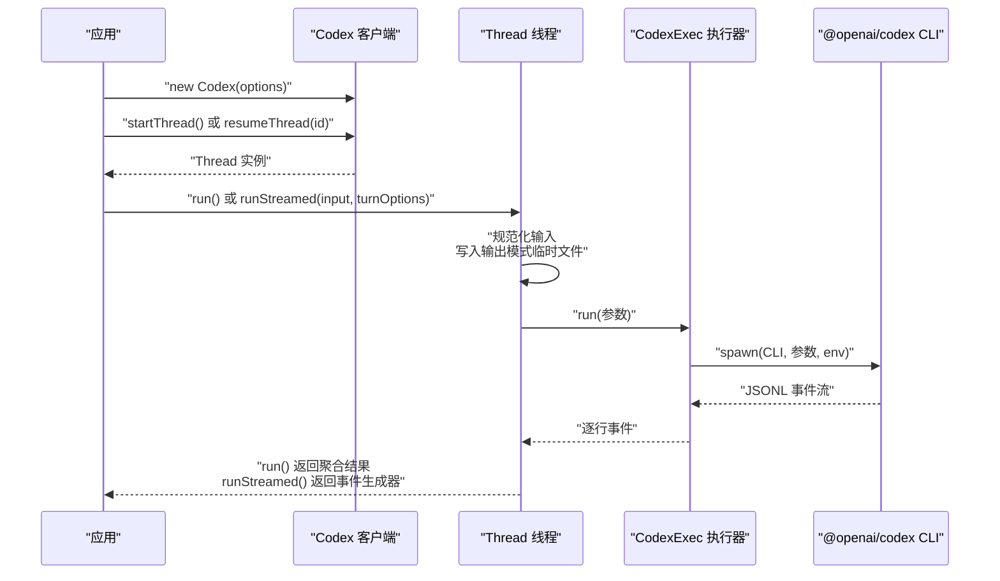
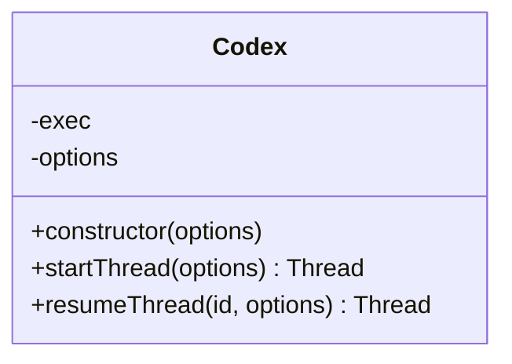
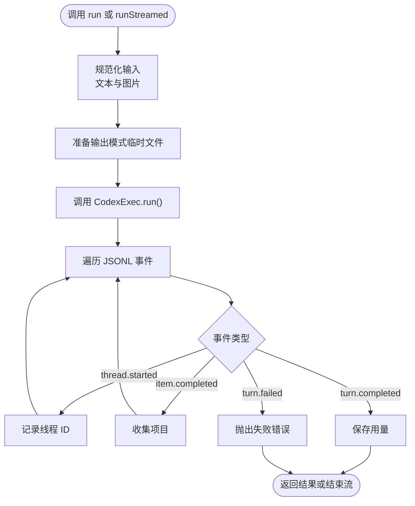
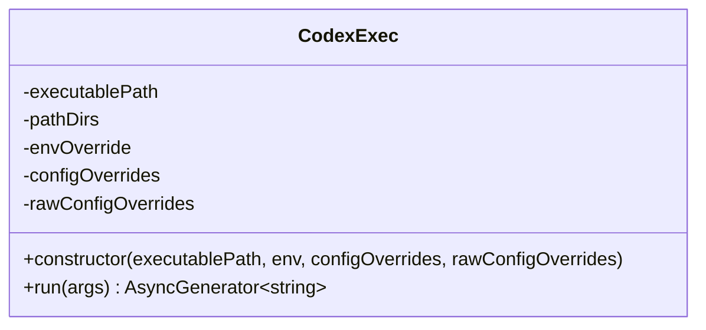
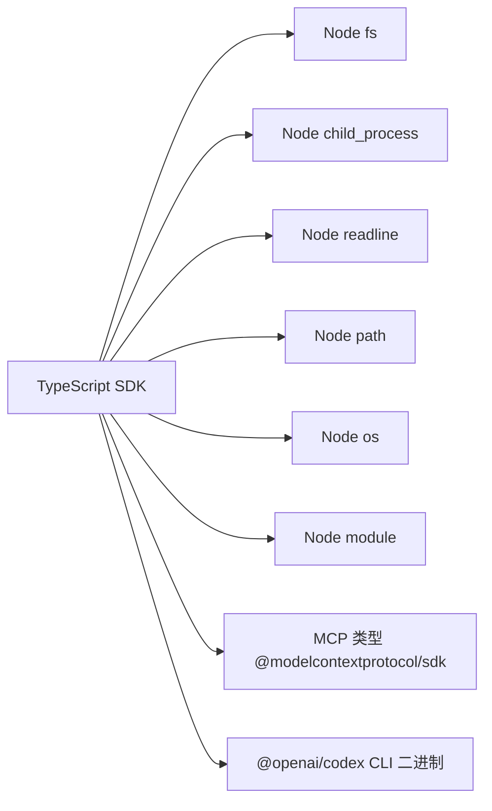

# TypeScript SDK

<cite>
**本文引用的文件**   
- [package.json](file://sdk/typescript/package.json)
- [README.md](file://sdk/typescript/README.md)
- [index.ts](file://sdk/typescript/src/index.ts)
- [codex.ts](file://sdk/typescript/src/codex.ts)
- [codexOptions.ts](file://sdk/typescript/src/codexOptions.ts)
- [events.ts](file://sdk/typescript/src/events.ts)
- [thread.ts](file://sdk/typescript/src/thread.ts)
- [threadOptions.ts](file://sdk/typescript/src/threadOptions.ts)
- [turnOptions.ts](file://sdk/typescript/src/turnOptions.ts)
- [items.ts](file://sdk/typescript/src/items.ts)
- [exec.ts](file://sdk/typescript/src/exec.ts)
- [outputSchemaFile.ts](file://sdk/typescript/src/outputSchemaFile.ts)
- [basic_streaming.ts](file://sdk/typescript/samples/basic_streaming.ts)
- [structured_output.ts](file://sdk/typescript/samples/structured_output.ts)
- [structured_output_zod.ts](file://sdk/typescript/samples/structured_output_zod.ts)
- [run.test.ts](file://sdk/typescript/tests/run.test.ts)
- [runStreamed.test.ts](file://sdk/typescript/tests/runStreamed.test.ts)
- [abort.test.ts](file://sdk/typescript/tests/abort.test.ts)
</cite>

## 目录
1. [简介](#简介)
2. [项目结构](#项目结构)
3. [核心组件](#核心组件)
4. [架构总览](#架构总览)
5. [详细组件分析](#详细组件分析)
6. [依赖关系分析](#依赖关系分析)
7. [性能与可观测性](#性能与可观测性)
8. [调试技巧](#调试技巧)
9. [兼容性说明](#兼容性说明)
10. [常见问题排查](#常见问题排查)
11. [版本演进与向后兼容](#版本演进与向后兼容)
12. [结论](#结论)

## 简介
@openai/codex-sdk 是 Codex 的 TypeScript SDK，用于在 Node.js 应用中嵌入 Codex 智能体。SDK 通过子进程调用 `@openai/codex` CLI，并以 JSONL 事件流的形式交换结构化数据。它提供两类主要接口：
- 阻塞式调用：`Thread.run()` 返回最终结果、工具执行项和用量统计。
- 流式调用：`Thread.runStreamed()` 返回异步生成器，逐个产出线程、回合、项目和错误事件。

SDK 还暴露了类型定义、枚举值和配置选项，便于实现类型安全的调用、事件处理和结构化输出。

## 项目结构
该包位于 `sdk/typescript`，采用按职责划分的模块组织方式：
- `src/index.ts`：统一导出公共 API。
- `src/codex.ts`：客户端类，负责创建或恢复对话线程。
- `src/thread.ts`：线程类，封装单次“轮次”的同步与流式执行。
- `src/exec.ts`：底层执行器，负责启动 CLI、组装参数、读写标准输入输出并解析 JSONL 事件。
- `src/events.ts`、`src/items.ts`：事件与项目（item）的类型定义。
- `src/codexOptions.ts`、`src/threadOptions.ts`、`src/turnOptions.ts`：客户端、线程和轮次的配置选项。
- `src/outputSchemaFile.ts`：将结构化输出模式写入临时文件后传给 CLI。
- `samples/`：示例代码，演示流式响应、结构化输出以及基于 Zod 的模式转换。
- `tests/`：Jest 测试，覆盖基本流程、流式处理、中断行为和选项传递。

**图示来源**
- [index.ts:1-40](file://sdk/typescript/src/index.ts#L1-L40)
- [codex.ts:1-39](file://sdk/typescript/src/codex.ts#L1-L39)
- [thread.ts:1-159](file://sdk/typescript/src/thread.ts#L1-L159)
- [exec.ts:1-200](file://sdk/typescript/src/exec.ts#L1-L200)
- [events.ts:1-84](file://sdk/typescript/src/events.ts#L1-L84)
- [items.ts:1-128](file://sdk/typescript/src/items.ts#L1-L128)
- [outputSchemaFile.ts:1-40](file://sdk/typescript/src/outputSchemaFile.ts#L1-L40)

**章节来源**
- [package.json:1-68](file://sdk/typescript/package.json#L1-L68)
- [README.md:1-160](file://sdk/typescript/README.md#L1-L160)

## 核心组件
本节概述 SDK 对外暴露的主要类型和类。

| 名称 | 类别 | 作用 | 关键行为 |
|---|---|---|---|
| `Codex` | 类 | SDK 主入口 | 构造时接收客户端级配置；提供 `startThread()` 和 `resumeThread()`。 |
| `Thread` | 类 | 一次会话上下文 | 维护线程 ID 和已发生的项目；提供 `run()` 与 `runStreamed()`。 |
| `CodexExec` | 类 | CLI 子进程执行器 | 构建命令行参数、设置环境变量、读取 JSONL 行、处理退出码和信号。 |
| `ThreadEvent` | 联合类型 | 顶层事件 | 包括线程开始、回合开始、完成、失败、项目开始/更新/完成、错误。 |
| `ThreadItem` | 联合类型 | 智能体活动项 | 包括助手消息、推理、命令执行、文件变更、MCP 工具调用、网络搜索、待办列表、错误项。 |
| `Usage` | 类型 | 用量统计 | 包含输入、缓存输入、缓存写入、输出和推理输出 token 计数。 |
| `Input` / `UserInput` | 类型 | 用户输入 | 支持纯文本字符串，或文本与本地图片的结构化数组。 |
| `RunResult` / `RunStreamedResult` | 类型别名 | 方法返回值 | 前者为聚合结果，后者为事件异步生成器包装。 |

**章节来源**
- [index.ts:1-40](file://sdk/typescript/src/index.ts#L1-L40)
- [codex.ts:1-39](file://sdk/typescript/src/codex.ts#L1-L39)
- [thread.ts:1-159](file://sdk/typescript/src/thread.ts#L1-L159)
- [events.ts:1-84](file://sdk/typescript/src/events.ts#L1-L84)
- [items.ts:1-128](file://sdk/typescript/src/items.ts#L1-L128)

## 架构总览
SDK 的工作流程大致如下：
1. 应用导入 `Codex` 并传入可选的客户端配置。
2. 调用 `startThread()` 创建新线程，或使用 `resumeThread(id)` 恢复已有线程。
3. 调用 `run()` 或 `runStreamed()` 发送输入。
4. `Thread` 将输入规范化为提示文本和图片路径，并将结构化输出模式写入临时文件。
5. `CodexExec` 使用 Node.js 子进程启动 `@openai/codex` CLI，组装 `--config`、`--model`、`--image`、`--cd`、`--sandbox` 等参数。
6. CLI 通过标准输出逐行返回 JSONL 事件；SDK 解析为 `ThreadEvent`。
7. `run()` 聚合事件并抛出失败错误；`runStreamed()` 直接透传事件供上层消费。

**图示来源**
- [codex.ts:1-39](file://sdk/typescript/src/codex.ts#L1-L39)
- [thread.ts:1-159](file://sdk/typescript/src/thread.ts#L1-L159)
- [exec.ts:1-200](file://sdk/typescript/src/exec.ts#L1-L200)

## 详细组件分析

### 安装与导入
- 包名：`@openai/codex-sdk`。
- 安装方式：可使用 npm、yarn 或 pnpm。仓库脚本使用 pnpm，但包本身没有强制包管理器约束。
- Node.js 要求：引擎限制为 Node.js 18 及以上。
- 模块格式：ES Module，`module` 指向 `dist/index.js`，类型声明指向 `dist/index.d.ts`。
- 入口导出：从 `@openai/codex-sdk` 默认导入 `Codex`，并可选择导入 `Thread`、事件类型、项目类型、配置类型等。

常见导入形式：
- 导入客户端：`import { Codex } from "@openai/codex-sdk"`。
- 导入线程类型：`import type { ThreadEvent, ThreadItem, Usage } from "@openai/codex-sdk"`。
- 导入配置类型：`import type { CodexOptions, ThreadOptions, TurnOptions } from "@openai/codex-sdk"`。

**章节来源**
- [package.json:1-68](file://sdk/typescript/package.json#L1-L68)
- [index.ts:1-40](file://sdk/typescript/src/index.ts#L1-L40)

### 客户端类 `Codex`
- 构造函数参数：
  - `codexPathOverride`：可选，覆盖 CLI 二进制路径。
  - `baseUrl`：可选，作为 CLI 配置项传入。
  - `apiKey`：可选，注入到子进程环境变量 `CODEX_API_KEY`。
  - `config`：可选，结构化配置对象，会被扁平化为 CLI 的 `--config key=value`。
  - `configOverrides`：可选，原始 TOML 风格配置覆盖字符串数组。
  - `env`：可选，完全控制传递给 CLI 的环境变量；未提供时会继承当前进程环境。
- 主要方法：
  - `startThread(options = {})`：创建新线程。
  - `resumeThread(id, options = {})`：根据持久化的线程 ID 恢复线程。

**图示来源**
- [codex.ts:1-39](file://sdk/typescript/src/codex.ts#L1-L39)

**章节来源**
- [codex.ts:1-39](file://sdk/typescript/src/codex.ts#L1-L39)
- [codexOptions.ts:1-27](file://sdk/typescript/src/codexOptions.ts#L1-L27)

### 线程类 `Thread`
- 属性：
  - `id`：线程标识符，首次收到 `thread.started` 事件后填充。
- 方法：
  - `run(input, turnOptions = {})`：阻塞式执行，返回 `Turn`，包含 `items`、`finalResponse` 和 `usage`。
  - `runStreamed(input, turnOptions = {})`：流式执行，返回 `{ events: AsyncGenerator<ThreadEvent> }`。
- 输入类型：
  - `Input`：可以是字符串，也可以是 `UserInput[]`。
  - `UserInput`：支持 `text` 和 `local_image` 两种条目。
- 内部逻辑：
  - 将结构化输入拼接为提示文本，收集本地图片路径。
  - 将 `outputSchema` 写入临时 JSON 文件并传给 CLI。
  - 遍历 CLI 事件流，更新线程 ID、补齐用量字段、聚合项目与最终回复。
  - 若收到 `turn.failed`，则抛出包含错误信息的异常。

**图示来源**
- [thread.ts:1-159](file://sdk/typescript/src/thread.ts#L1-L159)
- [outputSchemaFile.ts:1-40](file://sdk/typescript/src/outputSchemaFile.ts#L1-L40)

**章节来源**
- [thread.ts:1-159](file://sdk/typescript/src/thread.ts#L1-L159)

### 执行器 `CodexExec`
- 职责：
  - 查找本机 CLI 二进制文件。
  - 组装 CLI 参数，包括模型、沙箱模式、工作目录、附加目录、跳过 Git 检查、输出模式文件、网络访问、Web 搜索、审批策略等。
  - 设置环境变量，包括 `CODEX_INTERNAL_ORIGINATOR_OVERRIDE` 和 `CODEX_API_KEY`。
  - 使用 `node:child_process.spawn` 启动子进程。
  - 使用 `readline` 逐行读取 stdout，yield JSONL 事件。
  - 捕获 stderr、进程退出码和信号，并在非零退出或收到信号时抛出错误。
  - 清理子进程监听器，确保资源释放。
- 平台与目标三元组：
  - 支持 Linux x64/arm64、macOS x64/arm64、Windows x64/arm64。
  - 通过 `@openai/codex` 包的可选依赖定位各平台的二进制包。
- 路径与环境：
  - 将 SDK 提供的 `pathDirs` 插入 PATH，以便子进程找到依赖工具。
  - Windows 下会处理大小写不敏感的 PATH 键名。

**图示来源**
- [exec.ts:1-200](file://sdk/typescript/src/exec.ts#L1-L200)
- [exec.ts:201-506](file://sdk/typescript/src/exec.ts#L201-L506)

**章节来源**
- [exec.ts:1-506](file://sdk/typescript/src/exec.ts#L1-L506)

### 事件类型与消息格式
`ThreadEvent` 是顶层联合类型，包括：
- `thread.started`：包含 `thread_id`。
- `turn.started`：表示一轮处理开始。
- `item.started` / `item.updated` / `item.completed`：携带 `ThreadItem`。
- `turn.completed`：携带 `Usage`。
- `turn.failed`：携带 `ThreadError`。
- `error`：不可恢复的流错误，携带 `message`。

`ThreadItem` 是智能体活动的联合类型，包括：
- `agent_message`：助手自然语言消息或结构化输出文本。
- `reasoning`：推理摘要。
- `command_execution`：命令执行状态、输出和退出码。
- `file_change`：补丁变更集合及状态。
- `mcp_tool_call`：MCP 工具调用，含服务器、工具名、参数、结果或错误。
- `web_search`：网络搜索查询。
- `todo_list`：待办列表项。
- `error`：非致命错误项。

```mermaid
classDiagram
  class ThreadEvent {
    <<union>>
  }
  class ThreadItem {
    <<union>>
  }
  class AgentMessageItem
  class ReasoningItem
  class CommandExecutionItem
  class FileChangeItem
  class McpToolCallItem
  class WebSearchItem
  class TodoListItem
  class ErrorItem

  ThreadEvent <|-- ThreadStartedEvent
  ThreadEvent <|-- TurnStartedEvent
  ThreadEvent <|-- TurnCompletedEvent
  ThreadEvent <|-- TurnFailedEvent
  ThreadEvent <|-- ItemStartedEvent
  ThreadEvent <|-- ItemUpdatedEvent
  ThreadEvent <|-- ItemCompletedEvent
  ThreadEvent <|-- ThreadErrorEvent

  ThreadItem <|-- AgentMessageItem
  ThreadItem <|-- ReasoningItem
  ThreadItem <|-- CommandExecutionItem
  ThreadItem <|-- FileChangeItem
  ThreadItem <|-- McpToolCallItem
  ThreadItem <|-- WebSearchItem
  ThreadItem <|-- TodoListItem
  ThreadItem <|-- ErrorItem
```

**图示来源**
- [events.ts:1-84](file://sdk/typescript/src/events.ts#L1-L84)
- [items.ts:1-128](file://sdk/typescript/src/items.ts#L1-L128)

**章节来源**
- [events.ts:1-84](file://sdk/typescript/src/events.ts#L1-L84)
- [items.ts:1-128](file://sdk/typescript/src/items.ts#L1-L128)

### 配置选项与枚举值
- 客户端配置 `CodexOptions`：
  - `codexPathOverride`、`baseUrl`、`apiKey`、`config`、`configOverrides`、`env`。
- 线程配置 `ThreadOptions`：
  - `model`、`threadSource`、`sandboxMode`、`workingDirectory`、`skipGitRepoCheck`、`modelReasoningEffort`、`networkAccessEnabled`、`webSearchMode`、`webSearchEnabled`、`approvalPolicy`、`additionalDirectories`。
- 轮次配置 `TurnOptions`：
  - `cyberAccessProgram`、`outputSchema`、`signal`。
- 枚举值：
  - `ApprovalMode`：`never`、`on-request`、`on-failure`、`untrusted`。
  - `SandboxMode`：`read-only`、`workspace-write`、`danger-full-access`。
  - `ModelReasoningEffort`：`minimal`、`low`、`medium`、`high`、`xhigh`、`max`、`ultra`、`persistent`。
  - `WebSearchMode`：`disabled`、`cached`、`live`。
  - `CyberAccessProgram`：`standard`、`daybreak_blue`、`daybreak_red`。

这些枚举值被转换为 CLI 的 `--config` 参数或直接作为 CLI 参数传递。例如：
- `model_reasoning_effort` 转为 CLI 配置项。
- `web_search` 根据 `webSearchMode` 或 `webSearchEnabled` 映射。
- `approval_policy` 直接映射。
- `sandbox_workspace_write.network_access` 由 `networkAccessEnabled` 控制。

**章节来源**
- [codexOptions.ts:1-27](file://sdk/typescript/src/codexOptions.ts#L1-L27)
- [threadOptions.ts:1-30](file://sdk/typescript/src/threadOptions.ts#L1-L30)
- [turnOptions.ts:1-13](file://sdk/typescript/src/turnOptions.ts#L1-L13)
- [exec.ts:1-200](file://sdk/typescript/src/exec.ts#L1-L200)

### 代码示例参考
以下示例展示了 SDK 的典型用法，具体实现请参考对应文件：
- 流式交互示例：[basic_streaming.ts](file://sdk/typescript/samples/basic_streaming.ts)。
- 结构化输出示例：[structured_output.ts](file://sdk/typescript/samples/structured_output.ts)。
- 使用 Zod 生成 OpenAI 模式的示例：[structured_output_zod.ts](file://sdk/typescript/samples/structured_output_zod.ts)。
- 快速入门与配置说明：[README.md](file://sdk/typescript/README.md)。

典型实践要点：
- 使用 `run()` 获取最终回复和项目集合。
- 使用 `runStreamed()` 处理中间进度，如工具调用、文件变更、待办列表更新。
- 使用 `outputSchema` 请求结构化 JSON 输出。
- 使用 `AbortSignal` 取消长时间运行的轮次。
- 使用 `resumeThread(id)` 恢复已持久化的线程。
- 通过 `env`、`baseUrl`、`config`、`configOverrides` 控制 CLI 运行环境和配置。

**章节来源**
- [basic_streaming.ts:1-90](file://sdk/typescript/samples/basic_streaming.ts#L1-L90)
- [structured_output.ts:1-22](file://sdk/typescript/samples/structured_output.ts#L1-L22)
- [structured_output_zod.ts:1-19](file://sdk/typescript/samples/structured_output_zod.ts#L1-L19)
- [README.md:1-160](file://sdk/typescript/README.md#L1-L160)

## 依赖关系分析
SDK 的运行时依赖主要集中在 Node.js 内置模块和外部 CLI：
- Node.js 内置模块：
  - `node:child_process`：启动 CLI 子进程。
  - `node:fs`：读取文件和写入输出模式临时文件。
  - `node:path`：路径拼接。
  - `node:readline`：逐行读取 CLI 输出。
  - `node:os`：临时目录创建。
  - `node:module`：动态 require 解析平台包。
- 外部依赖：
  - `@modelcontextprotocol/sdk/types.js`：MCP 工具调用的内容块类型。
  - `zod` 与 `zod-to-json-schema`：仅出现在示例中，用于将 Zod schema 转换为 JSON schema。

**图示来源**
- [exec.ts:1-200](file://sdk/typescript/src/exec.ts#L1-L200)
- [outputSchemaFile.ts:1-40](file://sdk/typescript/src/outputSchemaFile.ts#L1-L40)
- [items.ts:1-128](file://sdk/typescript/src/items.ts#L1-L128)

**章节来源**
- [exec.ts:1-506](file://sdk/typescript/src/exec.ts#L1-L506)
- [outputSchemaFile.ts:1-40](file://sdk/typescript/src/outputSchemaFile.ts#L1-L40)
- [items.ts:1-128](file://sdk/typescript/src/items.ts#L1-L128)

## 性能与可观测性
- 流式优先：对于需要实时反馈的工具调用、文件变更和推理过程，应优先使用 `runStreamed()`，避免等待整轮结束。
- 用量统计：`turn.completed` 中的 `Usage` 可用于监控 token 消耗、缓存命中和推理输出量。
- 资源清理：`runStreamed()` 会在 finally 中清理输出模式临时文件；`CodexExec` 会关闭 readline、移除监听器并尝试终止子进程。
- 子进程稳定性：如果 CLI 以非零退出码退出或接收到系统信号，SDK 会抛出包含 stderr 内容的错误。
- 输入优化：将多段文本合并为一条提示可减少上下文切换开销；图片通过 `--image` 单独传递。

[本节为通用指导，无需特定文件引用]

## 调试技巧
- 启用原始代理日志：可通过 `baseUrl` 指向本地代理服务器，观察 SDK 实际发出的请求。测试用例中使用了响应代理来模拟后端。
- 使用 `codexPathOverride`：在开发环境中指定 CLI 二进制路径，便于断点和单测隔离。
- 观察 JSONL 事件：在 `runStreamed()` 的事件循环中加入日志，跟踪 `item.started`、`item.updated`、`item.completed`、`turn.completed`、`turn.failed`。
- 查看 CLI 标准错误：当 CLI 非正常退出时，SDK 会将 stderr 拼接到错误信息中，便于定位 CLI 侧问题。
- 环境变量调试：通过 `env` 显式控制 CLI 环境变量，排除宿主环境差异影响。

**章节来源**
- [runStreamed.test.ts:1-200](file://sdk/typescript/tests/runStreamed.test.ts#L1-L200)
- [exec.ts:201-506](file://sdk/typescript/src/exec.ts#L201-L506)

## 兼容性说明
- Node.js 版本：要求 Node.js 18 及以上。
- 操作系统与架构：
  - Linux x64、Linux arm64。
  - macOS x64、macOS arm64。
  - Windows x64、Windows arm64。
- 浏览器支持：
  - SDK 使用 Node.js 内置模块，不适合直接在浏览器中使用。
  - 如需在浏览器环境中集成，应通过后端服务转发，而不是直接引入 SDK。
- 包管理器：
  - 仓库使用 pnpm，但包本身对包管理器无强制要求；npm、yarn 同样可用。

**章节来源**
- [package.json:1-68](file://sdk/typescript/package.json#L1-L68)
- [exec.ts:201-506](file://sdk/typescript/src/exec.ts#L201-L506)

## 常见问题排查
- 找不到 CLI 二进制：
  - 现象：抛出无法定位 `@openai/codex` 可选依赖的错误。
  - 原因：未安装 `@openai/codex` 的可选依赖，或平台三元组不支持。
  - 解决：确保安装 `@openai/codex` 及其可选依赖，或使用 `codexPathOverride` 指定二进制路径。
- 子进程无 stdin/stdout：
  - 现象：抛出子进程缺少标准输入或标准输出的错误。
  - 原因：CLI 启动失败或权限问题。
  - 解决：检查 CLI 是否可执行、路径是否正确、操作系统权限是否足够。
- 配置值非法：
  - 现象：抛出关于配置键为空、值为 null、数值非有限或非受支持类型的错误。
  - 原因：`config` 或 `configOverrides` 中包含无效结构或值。
  - 解决：确保配置对象只包含受支持的类型，避免 null 和无限数值。
- 线程失败：
  - 现象：`run()` 抛出包含 `turn.failed` 消息的错误。
  - 原因：CLI 或后端返回失败事件。
  - 解决：在 `runStreamed()` 中捕获 `turn.failed`，或在 `run()` 外层 try/catch 处理。
- 中断行为：
  - 现象：传入 `AbortSignal` 后，迭代或等待调用抛出异常。
  - 原因：信号已被中止或正在中止。
  - 解决：合理管理 `AbortController`，避免在已完成或已结束流上继续迭代。

**章节来源**
- [exec.ts:201-506](file://sdk/typescript/src/exec.ts#L201-L506)
- [thread.ts:1-159](file://sdk/typescript/src/thread.ts#L1-L159)
- [abort.test.ts:1-165](file://sdk/typescript/tests/abort.test.ts#L1-L165)

## 版本演进与向后兼容
- 包版本：当前 package.json 中版本为开发占位符，表明该 SDK 处于开发阶段。
- API 稳定性：
  - 公共导出集中在 `index.ts`，新增能力应先扩展此处再逐步稳定。
  - 类型定义位于独立模块，有利于保持向后兼容。
  - 测试覆盖 `run()`、`runStreamed()`、中断、线程恢复和选项传递，有助于防止破坏性变更。
- 建议：
  - 升级前检查 `ThreadEvent` 和 `ThreadItem` 的联合类型是否新增分支。
  - 注意 `ThreadOptions`、`TurnOptions`、`CodexOptions` 的可选字段变化。
  - 关注 CLI 参数映射逻辑，尤其是 `webSearchMode`、`webSearchEnabled`、`approvalPolicy`、`modelReasoningEffort` 的行为。

**章节来源**
- [package.json:1-68](file://sdk/typescript/package.json#L1-L68)
- [index.ts:1-40](file://sdk/typescript/src/index.ts#L1-L40)
- [run.test.ts:1-200](file://sdk/typescript/tests/run.test.ts#L1-L200)
- [runStreamed.test.ts:1-200](file://sdk/typescript/tests/runStreamed.test.ts#L1-L200)

## 结论
@openai/codex-sdk 提供了清晰的 TypeScript API，将复杂的 CLI 子进程交互抽象为 `Codex`、`Thread` 和类型安全的事件流。开发者可以：
- 使用 `run()` 快速获取完整结果。
- 使用 `runStreamed()` 实现实时 UI 反馈和细粒度监控。
- 借助 `ThreadItem` 和 `ThreadEvent` 构建可靠的业务逻辑。
- 通过 `CodexOptions`、`ThreadOptions`、`TurnOptions` 精确控制模型、沙箱、网络和搜索行为。
- 在 Node.js 18+ 环境中稳定运行，并通过 CLI 可选依赖适配主流平台。

建议在项目中优先使用流式接口，结合事件类型进行类型安全编程，并利用测试样例和调试技巧提高可观测性与可维护性。