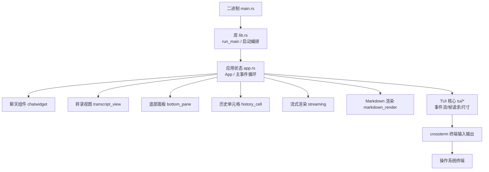
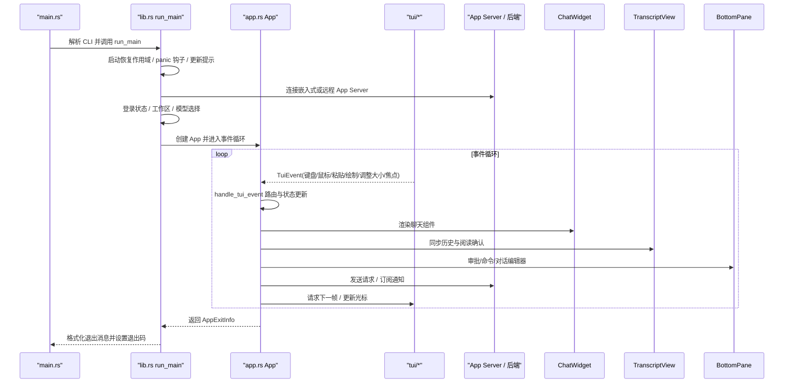
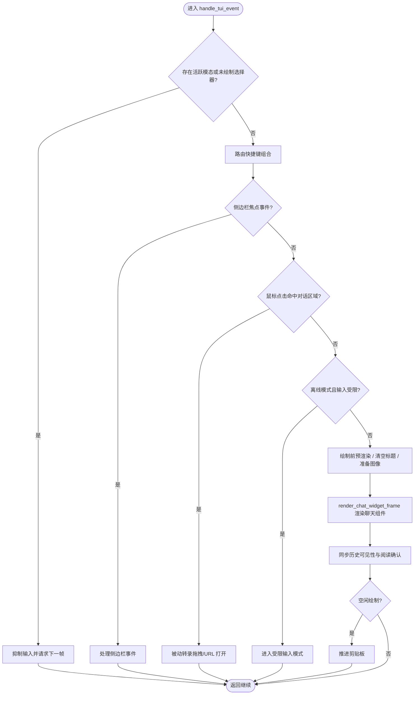
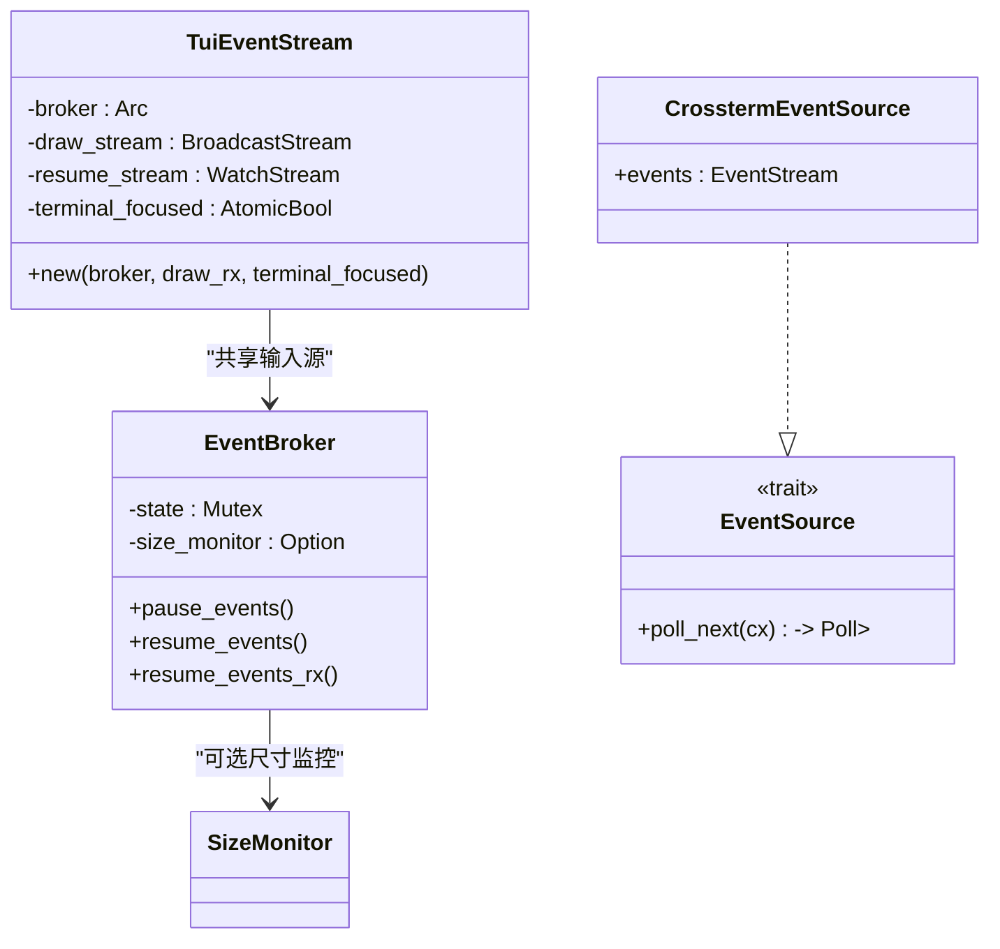

# TUI 架构设计

<cite>
**本文引用的文件**   
- [main.rs](file://codex-rs/tui/src/main.rs)
- [lib.rs](file://codex-rs/tui/src/lib.rs)
- [app.rs](file://codex-rs/tui/src/app.rs)
- [event_stream.rs](file://codex-rs/tui/src/tui/event_stream.rs)
- [frame_requester.rs](file://codex-rs/tui/src/tui/frame_requester.rs)
- [screen_size.rs](file://codex-rs/tui/src/tui/screen_size.rs)
- [Cargo.toml](file://codex-rs/tui/Cargo.toml)
</cite>

## 目录
1. [引言](#引言)
2. [项目结构](#项目结构)
3. [核心组件](#核心组件)
4. [架构总览](#架构总览)
5. [详细组件分析](#详细组件分析)
6. [依赖关系分析](#依赖关系分析)
7. [性能与渲染特性](#性能与渲染特性)
8. [终端适配与响应式设计](#终端适配与响应式设计)
9. [扩展点与自定义组件指南](#扩展点与自定义组件指南)
10. [故障排查](#故障排查)
11. [结论](#结论)

## 引言
本文面向 codex-rs 的 `codex-tui` 模块，系统梳理基于 ratatui 的终端用户界面架构。重点说明应用生命周期、事件循环、组件树组织、主入口与核心应用模块的职责划分、初始化流程、渲染循环、事件处理机制、状态管理、通信模式、终端适配策略以及扩展点。文档在技术细节和可读性之间保持平衡，既适合深入源码的开发者，也适合希望理解整体行为的使用者。

## 项目结构
`codex-tui` 是一个 Rust crate，同时提供二进制可执行文件和库接口：
- 二进制入口：`src/main.rs`，负责命令行解析、调用库层启动函数、输出退出消息。
- 库根：`src/lib.rs`，暴露 `run_main`、`Cli`、`ExitReason`、`AppExitInfo` 等公共接口，并编排启动阶段、嵌入式/远程 App Server、会话恢复、日志、遥测、更新提示等。
- 顶层应用状态与主循环：`src/app.rs`，定义 `App` 结构体、`handle_tui_event`、渲染协调、键盘/鼠标/粘贴事件分发、侧边栏与会话状态协调等。
- TUI 基础设施：`src/tui/` 下包含事件流、帧请求器、屏幕尺寸、备用屏幕、tmux/WSL/Vim 兼容、Windows 输入序列等。
- 业务组件：`src/chatwidget/`、`src/transcript_view/`、`src/bottom_pane/`、`src/history_cell/`、`src/streaming/`、`src/markdown_render/` 等，构成以聊天为中心的交互视图。
- 构建与依赖：`Cargo.toml` 声明 ratatui、crossterm、tokio、tracing、app-server-client、config、state 等关键依赖。

**图表来源**
- [main.rs:1-59](file://codex-rs/tui/src/main.rs#L1-L59)
- [lib.rs:1180-1420](file://codex-rs/tui/src/lib.rs#L1180-L1420)
- [app.rs:817-1483](file://codex-rs/tui/src/app.rs#L817-L1483)
- [event_stream.rs:1-200](file://codex-rs/tui/src/tui/event_stream.rs#L1-L200)

**章节来源**
- [Cargo.toml:1-196](file://codex-rs/tui/Cargo.toml#L1-L196)

## 核心组件
- **二进制入口 main.rs**：解析顶层 CLI，合并配置覆盖项，调用 `run_main`，根据 `ExitReason` 决定退出码并格式化退出消息。
- **库层 lib.rs**：
  - 暴露 `run_main`，封装启动恢复作用域、错误恢复、致命退出时终端还原。
  - 内部 `run_ratatui_app` 完成颜色支持、panic 钩子、更新提示、会话日志、App Server 连接、登录状态、工作区与模型选择、会话恢复等。
  - 导出 `AppExitInfo`、`ExitReason`、`TokenUsage`、`Terminal`、`ComposerAction`、`ComposerInput` 等供上层使用。
- **应用状态 app.rs**：
  - `App` 持有聊天组件、转录视图、底部面板、历史单元格、键绑定、重连状态、回退浏览状态、后台语音任务等。
  - `handle_tui_event` 是主事件循环中的统一处理器，负责事件路由、模态优先、快捷键组合、离线模式、侧边栏交互、粘贴归一化、绘制前预渲染、历史可见性同步等。
  - `render_chat_widget_frame` 负责按当前上下文（独立终端或内联）渲染聊天组件，并协调光标位置、图像放置、视口重排。
- **TUI 核心 tui/**：
  - `event_stream.rs`：抽象事件源、共享 crossterm 输入、暂停/恢复事件流、draw 广播、tmux 尺寸监控。
  - `frame_requester.rs`：异步帧调度器，用于按需刷新 UI。
  - `screen_size.rs`：屏幕尺寸计算与延迟刷新策略。

**章节来源**
- [main.rs:1-59](file://codex-rs/tui/src/main.rs#L1-L59)
- [lib.rs:1180-1420](file://codex-rs/tui/src/lib.rs#L1180-L1420)
- [app.rs:817-1483](file://codex-rs/tui/src/app.rs#L817-L1483)
- [event_stream.rs:1-200](file://codex-rs/tui/src/tui/event_stream.rs#L1-L200)

## 架构总览
TUI 采用分层架构：
- 入口层：`main.rs` 负责 CLI 与进程退出。
- 编排层：`lib.rs` 的 `run_main` 和 `run_ratatui_app` 负责环境初始化、App Server 连接、会话恢复、日志与遥测、更新提示、登录与工作区协商。
- 应用层：`app.rs` 的 `App` 作为状态机与事件中枢，协调聊天、转录、底部面板、历史、侧边栏、语音、重连等子系统。
- 组件层：`chatwidget`、`transcript_view`、`bottom_pane`、`history_cell`、`streaming`、`markdown_render` 等实现具体视图逻辑。
- TUI 基础层：`tui/*` 封装终端事件、帧调度、尺寸、备用屏幕、平台差异。

**图表来源**
- [main.rs:1-59](file://codex-rs/tui/src/main.rs#L1-L59)
- [lib.rs:1180-1420](file://codex-rs/tui/src/lib.rs#L1180-L1420)
- [app.rs:817-1483](file://codex-rs/tui/src/app.rs#L817-L1483)

## 详细组件分析

### 主应用入口 main.rs
职责：
- 解析顶层 CLI，合并配置覆盖项。
- 调用 `run_main`，获得 `ExitInfo`。
- 根据 `ExitReason` 判断是否致命错误，打印退出消息，设置退出码。

关键点：
- 使用 `supports_color` 控制颜色输出。
- 将 `ExitReason::Fatal` 映射为非零退出码。

**章节来源**
- [main.rs:1-59](file://codex-rs/tui/src/main.rs#L1-L59)

### 核心库 lib.rs 与运行入口
职责：
- 暴露 `run_main`，包装启动恢复作用域，捕获致命错误并恢复终端。
- 内部 `run_ratatui_app` 完成：
  - 颜色支持与 panic 钩子链式注册。
  - 更新提示（非 debug 构建）。
  - 高保真会话事件日志。
  - 启动 App Server（嵌入式/本地守护/远程/云端），并根据目标设置遥测标签。
  - 登录状态获取、工作区信任、OSS Provider 写入、模型提供者覆盖。
  - 会话恢复、重新连接、侧边栏与回放、外部编辑器启动。
  - 最终返回 `AppExitInfo`，包括 token 用量、线程 ID、断开信息、更新动作、退出原因。

关键数据结构与流程：
- `AppServerTarget` 枚举：Embedded / Cloud / LocalDaemon / Remote。
- `start_embedded_app_server` 与 `init_state_db_for_app_server_target` 负责嵌入式服务与状态数据库初始化。
- `run_ratatui_app` 中多次通过 `startup_draft.run_until` 与 UI 协作进行耗时操作。

**章节来源**
- [lib.rs:1180-1420](file://codex-rs/tui/src/lib.rs#L1180-L1420)

### 应用状态与主事件循环 app.rs
职责：
- `App` 聚合聊天组件、转录视图、底部面板、历史单元格、键绑定、重连状态、回退浏览、语音任务、Agent 概览等。
- `handle_tui_event` 是统一事件处理器，负责：
  - 模态优先与焦点边界：确保未绘制的选择器不抢占模态输入。
  - 快捷键组合与全局短键：如工作区 leader、语音切换、Vim 插入 Esc 恢复。
  - 离线模式限制：限制部分输入，允许特定视图继续交互。
  - 侧边栏与被动转录交互：点击、拖拽、URL 打开。
  - 粘贴文本规范化：CRLF 到 LF。
  - 绘制前预渲染：清空标题、准备图像、同步警告、调度重排。
  - 历史可见性与阅读确认：根据焦点与遮罩决定是否订阅历史。
  - 空闲绘制时的剪贴板推进与外部编辑器触发。

渲染流程：
- `render_chat_widget_frame` 区分独立终端与内联视图。
- 当处于独立终端时直接渲染“拥有转录”；否则准备图像、暂停空状态动画、同步警告、计算期望高度、调用 `draw_with_resize_reflow` 绘制聊天组件，并设置光标位置与图像放置。
- 在非仪表盘模式下可能触发即时重排，避免全屏内联遮罩导致历史滚动异常。

**图表来源**
- [app.rs:817-1483](file://codex-rs/tui/src/app.rs#L817-L1483)

**章节来源**
- [app.rs:817-1483](file://codex-rs/tui/src/app.rs#L817-L1483)

### TUI 基础设施 tui/*
事件流与帧调度：
- `event_stream.rs` 定义 `EventBroker`、`TuiEventStream`、`EventSource`：
  - 共享 crossterm 输入源，支持暂停/恢复，避免 stdin 被其他进程窃取。
  - 将 crossterm 事件映射为 `TuiEvent`，并提供 draw 广播通道。
  - tmux 尺寸监控会在尺寸变化时唤醒 draw 订阅，使其成为 resize 事件。
  - Windows 上需要确保控制台输入记录模式，避免导航键以转义字节到达。
- `frame_requester.rs` 提供异步帧调度器，允许组件请求下一帧而不阻塞事件循环。
- `screen_size.rs` 负责屏幕尺寸计算与延迟刷新，结合 `frame_requester.schedule_frame_in` 平滑过渡。

**图表来源**
- [event_stream.rs:1-200](file://codex-rs/tui/src/tui/event_stream.rs#L1-L200)

**章节来源**
- [event_stream.rs:1-200](file://codex-rs/tui/src/tui/event_stream.rs#L1-L200)
- [frame_requester.rs:96-120](file://codex-rs/tui/src/tui/frame_requester.rs#L96-L120)
- [screen_size.rs:20-70](file://codex-rs/tui/src/tui/screen_size.rs#L20-L70)

## 依赖关系分析
- 构建依赖：ratatui（启用滚动区域、不稳定渲染器行信息、不稳定 widget 引用）、crossterm（启用 bracketed-paste、event-stream）、tokio（多核运行时、信号、时间、IO）、tracing（日志）、syntect/two-face（语法高亮）、image（图片解码）、arboard（剪贴板，排除 Android）、platform-specific 依赖（macOS accessibility、Linux zbus、Windows sys）。
- 运行时依赖：
  - `codex-app-server-client`：嵌入或连接 App Server，发送请求、接收通知。
  - `codex-config` / `codex-cloud-config`：加载配置、云端配置包。
  - `codex-state` / `codex-rollout`：状态数据库、灰度与发布相关。
  - `codex-login`：认证与账户信息。
  - `codex-exec-server`：执行服务器与环境管理。
  - `codex-history` / `codex-message-history`：历史与消息持久化。
  - `codex-model-provider` / `codex-models-manager`：模型与预设。
  - `codex-terminal-detection`：终端检测与 UA。
  - `codex-worktree`：工作区管理。
  - `codex-utils-*`：路径、缓存、沙箱摘要、睡眠抑制等工具。

耦合与内聚：
- `lib.rs` 与 `app.rs` 强耦合于 App Server 协议与配置模型，但通过 `AppServerSession` 与 `AppServerClient` 解耦底层通信。
- `app.rs` 对 `tui/*` 弱耦合，仅通过 `TuiEvent`、`frame_requester`、屏幕尺寸等接口交互。
- 组件之间通过 `AppEvent` 与 `AppEventSender` 进行跨模块通信，避免直接相互引用。

潜在循环依赖：
- 组件层尽量通过 trait 与事件总线解耦，避免直接双向依赖。
- `tui/*` 不依赖业务组件，保证基础设施稳定。

外部集成点：
- App Server（嵌入式/本地守护/远程/云端）
- 文件系统与工作区
- 终端输入输出（crossterm）
- 剪贴板（arboard）
- 图片解码（image/syntect）
- 日志与遥测（tracing/opentelemetry）

**章节来源**
- [Cargo.toml:1-196](file://codex-rs/tui/Cargo.toml#L1-L196)
- [lib.rs:1180-1420](file://codex-rs/tui/src/lib.rs#L1180-L1420)
- [app.rs:817-1483](file://codex-rs/tui/src/app.rs#L817-L1483)

## 性能与渲染特性
- 帧调度：通过 `frame_requester.schedule_frame()` 与 `schedule_frame_in` 精确控制刷新时机，避免无谓重绘。
- 滚动区域与渲染优化：ratatui 的 `scrolling-regions` 与 `unstable-rendered-line-info` 提升大文档渲染性能。
- 图像放置：在聊天组件渲染后注入图像布局，减少重复计算。
- 粘贴批处理：`paste_burst_tick` 合并短时大量粘贴，降低频繁重排。
- 尺寸重排：`draw_with_resize_reflow` 仅在必要时触发重排，避免全屏遮罩导致的无限重绘。
- 历史记录可见性：仅在终端聚焦且无遮罩时订阅历史，减少不必要的数据传输与渲染。

**章节来源**
- [app.rs:1365-1483](file://codex-rs/tui/src/app.rs#L1365-L1483)
- [screen_size.rs:20-70](file://codex-rs/tui/src/tui/screen_size.rs#L20-L70)

## 终端适配与响应式设计
- 备用屏幕与独立终端：在独立终端模式下，TUI 接管整个屏幕；在内联模式中，TUI 以固定高度渲染，避免干扰宿主终端。
- tmux 与 WSL：尺寸监控与键盘模式检测确保在不同终端环境中正确响应 resize 与特殊键序列。
- Vim 与 VSCode 终端：Esc 行为与按键映射在 Vim 插入模式与 VSCode 终端中有特殊处理，避免误消费导航键。
- Windows 控制台：确保输入记录模式，避免 VT 输入继承导致键值异常。
- 响应式布局：根据屏幕尺寸动态计算聊天组件期望高度，并在仪表盘与内容高度之间切换，避免历史滚动错位。

**章节来源**
- [event_stream.rs:1-200](file://codex-rs/tui/src/tui/event_stream.rs#L1-L200)
- [app.rs:1365-1483](file://codex-rs/tui/src/app.rs#L1365-L1483)

## 扩展点与自定义组件指南
扩展点：
- 组件树扩展：在 `app.rs` 的 `render_chat_widget_frame` 中，通过 `chat_widget.render(area, frame.buffer)` 注入自定义组件逻辑。
- 事件路由扩展：在 `handle_tui_event` 中添加新的事件分支，处理自定义快捷键或鼠标行为。
- App Event 扩展：新增 `AppEvent` 变体并通过 `AppEventSender` 发送，供其他组件订阅。
- TUI 基础设施扩展：在 `tui/*` 中增加新的事件源、尺寸监控或帧调度策略。

自定义组件开发步骤：
1. 定义组件状态与渲染逻辑，实现 `Renderable` 或 ratatui `Widget`。
2. 在 `App` 中持有组件实例，并在 `render_chat_widget_frame` 中调用其渲染方法。
3. 如需处理用户输入，在 `handle_tui_event` 中分派到组件的事件处理方法。
4. 使用 `AppEventSender` 与其他模块通信，避免直接耦合。
5. 在测试中使用 `test_support` 提供的辅助函数构造 `Tui` 与 `Buffer`，验证渲染快照。

最佳实践：
- 保持组件职责单一，避免在单个组件中混合过多状态。
- 使用 `frame_requester` 按需刷新，避免全局频繁重绘。
- 对大文档与长列表使用分页与虚拟滚动策略。
- 对图像与 Markdown 渲染进行懒加载与缓存。

**章节来源**
- [app.rs:1365-1483](file://codex-rs/tui/src/app.rs#L1365-L1483)
- [lib.rs:201-450](file://codex-rs/tui/src/lib.rs#L201-L450)

## 故障排查
常见问题与定位：
- 终端无法恢复：检查 `restore_terminal_before_fatal_exit` 与 panic 钩子是否正确安装。
- 输入被其他进程窃取：确认 `EventBroker.pause_events` 与 `resume_events` 调用时机，避免 crossterm 事件流常驻 stdin。
- 键盘行为异常：检查 Windows 控制台输入记录模式与 tmux/WSL/Vim 键盘模式检测。
- 渲染卡顿：检查 `frame_requester.schedule_frame_in` 是否过度频繁，图像放置是否重复计算。
- 历史不更新：确认历史可见性条件满足，阅读确认是否成功发送。

建议日志：
- 启用 tracing 与 session log，记录 App Server 连接、登录状态、历史请求、渲染帧数。
- 在关键分支添加 trace/warn/error，便于快速定位问题。

**章节来源**
- [lib.rs:1180-1420](file://codex-rs/tui/src/lib.rs#L1180-L1420)
- [event_stream.rs:1-200](file://codex-rs/tui/src/tui/event_stream.rs#L1-L200)

## 结论
`codex-tui` 以 `main.rs` 为入口、`lib.rs` 为编排中心、`app.rs` 为核心状态与事件循环、`tui/*` 为基础设施、组件层实现具体视图的方式，构建了可扩展、高性能、终端友好的 TUI 架构。通过事件驱动、帧调度、响应式布局与终端适配策略，系统在复杂交互场景下仍保持流畅与稳定。扩展点清晰，便于开发者在不破坏现有结构的前提下添加新功能或自定义组件。