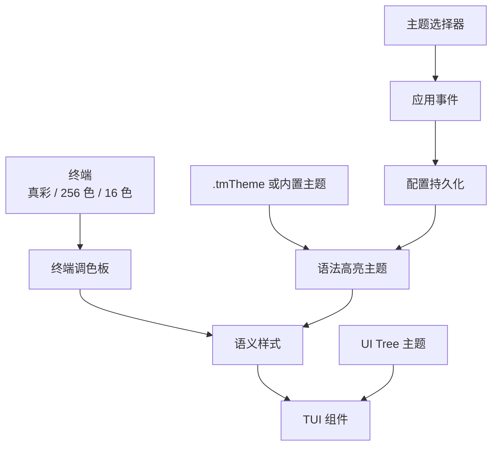
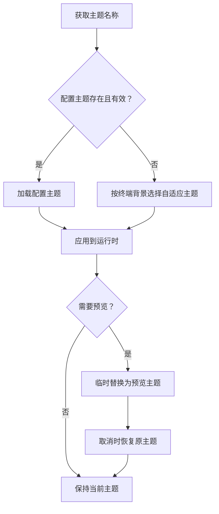
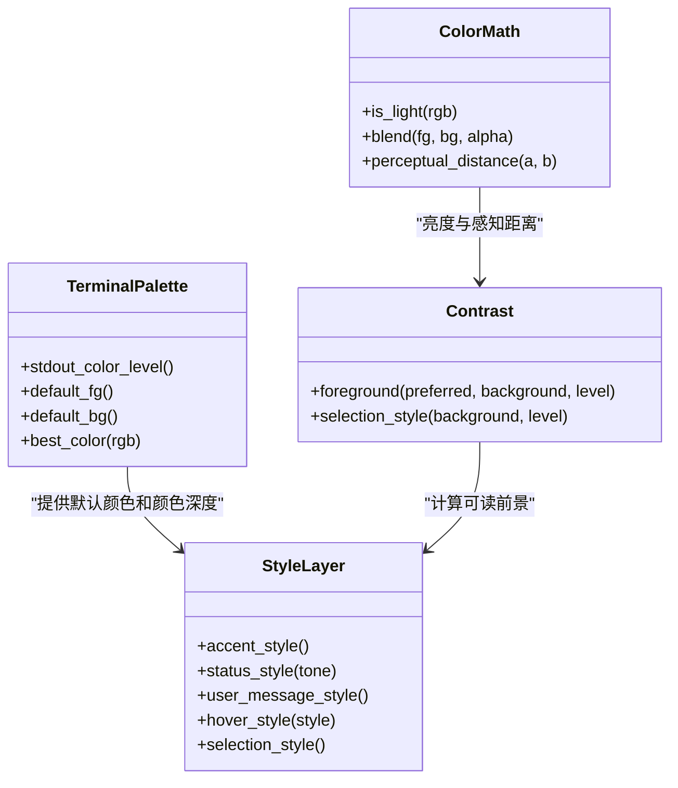
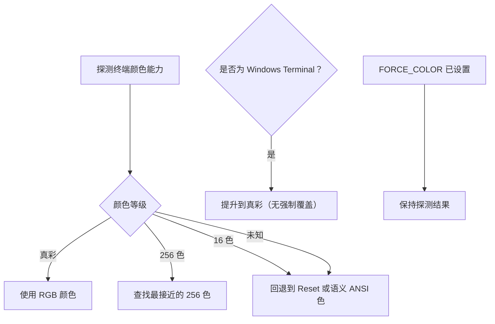
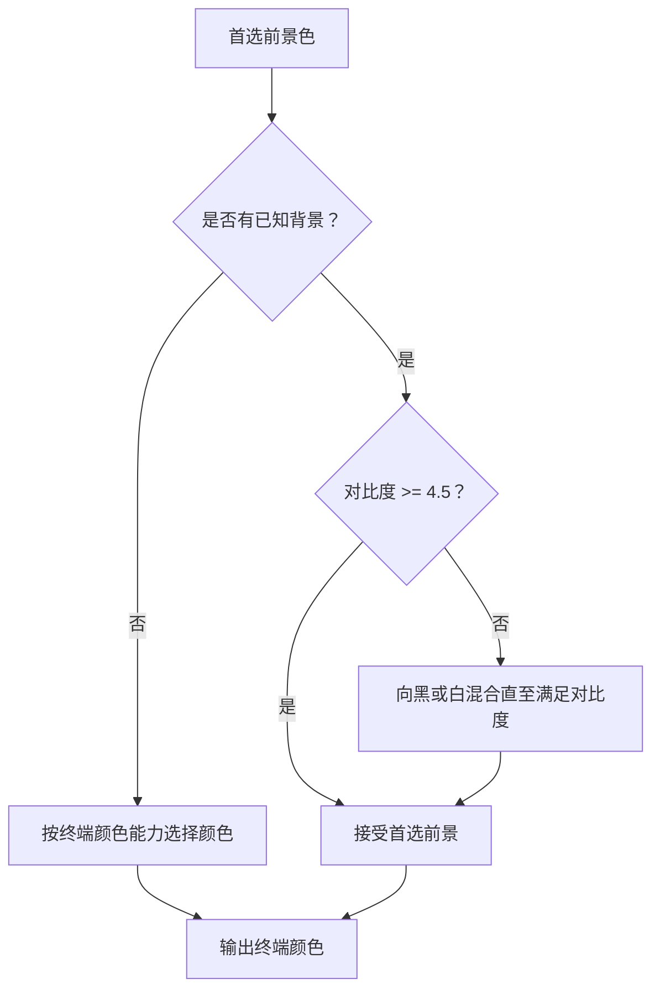
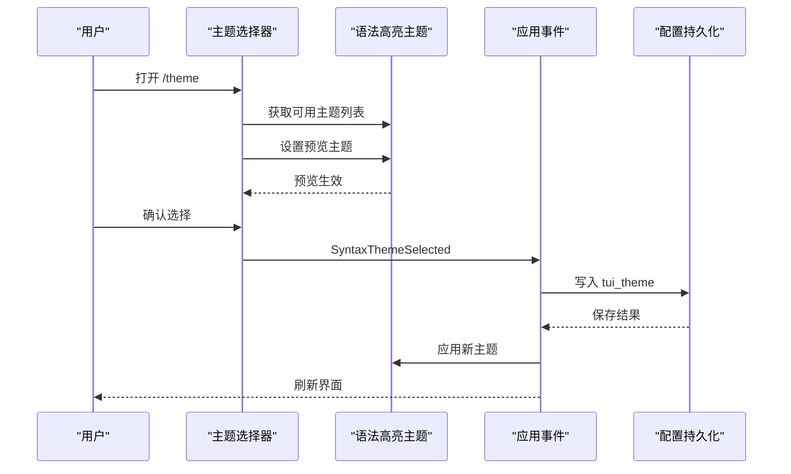
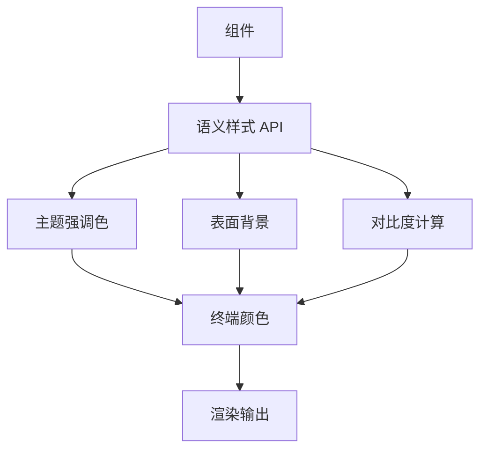
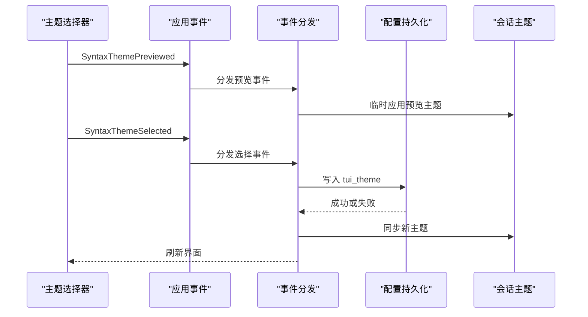

# 主题与样式定制

<cite>
**本文引用的文件**   
- [codex-rs/tui/styles.md](file://codex-rs/tui/styles.md)
- [codex-rs/tui/src/style.rs](file://codex-rs/tui/src/style.rs)
- [codex-rs/tui/src/style/contrast.rs](file://codex-rs/tui/src/style/contrast.rs)
- [codex-rs/tui/src/color.rs](file://codex-rs/tui/src/color.rs)
- [codex-rs/tui/src/terminal_palette.rs](file://codex-rs/tui/src/terminal_palette.rs)
- [codex-rs/tui/src/theme_picker.rs](file://codex-rs/tui/src/theme_picker.rs)
- [codex-rs/tui/src/render/highlight.rs](file://codex-rs/tui/src/render/highlight.rs)
- [codex-rs/tui/src/ui_tree/theme.rs](file://codex-rs/tui/src/ui_tree/theme.rs)
- [codex-rs/tui/src/app/event_dispatch.rs](file://codex-rs/tui/src/app/event_dispatch.rs)
- [codex-rs/tui/src/app/config_persistence.rs](file://codex-rs/tui/src/app/config_persistence.rs)
</cite>

## 目录

1. [简介](#简介)
2. [项目结构与职责划分](#项目结构与职责划分)
3. [内置主题系统](#内置主题系统)
4. [颜色方案与语义样式](#颜色方案与语义样式)
5. [终端兼容性与颜色降级](#终端兼容性与颜色降级)
6. [暗色模式与对比度优化](#暗色模式与对比度优化)
7. [主题选择器与自定义主题](#主题选择器与自定义主题)
8. [样式扩展点与组件集成](#样式扩展点与组件集成)
9. [主题切换流程](#主题切换流程)
10. [样式指南与设计规范](#样式指南与设计规范)
11. [故障排查](#故障排查)
12. [结论](#结论)

## 简介

本项目的 TUI 界面采用“终端调色板 + 运行时语法高亮主题 + 语义样式”的三层结构：

- **终端调色板层**负责探测终端能力、读取默认前景/背景，并将 RGB 颜色映射到终端可显示的颜色。
- **运行时语法高亮主题层**基于 TextMate `.tmTheme` 和内置主题集合，提供语言高亮、语义作用域和主题切换。
- **语义样式层**定义 UI 通用样式，例如强调色、状态色、选中态、辅助文本、消息背景和提示面板背景。

这套设计的目标是：

- 在不直接硬编码大量 ANSI 颜色的前提下，适配浅色、深色和有限色彩终端。
- 让用户通过 `/theme` 命令选择或预览主题，并持久化到配置中。
- 让新增组件优先使用语义样式函数，而不是自行决定前景/背景颜色。

## 项目结构与职责划分

| 模块 | 主要职责 | 关键文件 |
|---|---|---|
| 终端调色板 | 检测真彩、256 色、16 色；查询默认前景/背景；RGB 到终端颜色降级 | `terminal_palette.rs` |
| 颜色数学 | 亮度判断、颜色混合、感知距离 | `color.rs` |
| 对比度计算 | 保证文本可读性、选中态填充、最小对比度阈值 | `style/contrast.rs` |
| 语义样式 | 强调色、状态色、消息背景、悬浮态、辅助文本等 | `style.rs` |
| 语法高亮主题 | 加载内置主题、自定义 `.tmTheme`、运行时切换主题 | `render/highlight.rs` |
| 主题选择器 | `/theme` 交互列表、实时预览、取消恢复、确认保存 | `theme_picker.rs` |
| UI Tree 主题 | 将 Wire 颜色映射为终端颜色，支持主题作用域 | `ui_tree/theme.rs` |
| 应用事件与持久化 | 处理主题选择事件、写入配置、同步会话主题 | `app/event_dispatch.rs`、`app/config_persistence.rs` |
| 样式指南文档 | 颜色、前景、菜单文案和禁用规则 | `styles.md` |

**图表来源**
- [codex-rs/tui/src/terminal_palette.rs:1-120](file://codex-rs/tui/src/terminal_palette.rs#L1-L120)
- [codex-rs/tui/src/render/highlight.rs:1-120](file://codex-rs/tui/src/render/highlight.rs#L1-L120)
- [codex-rs/tui/src/style.rs:1-80](file://codex-rs/tui/src/style.rs#L1-L80)
- [codex-rs/tui/src/theme_picker.rs:1-40](file://codex-rs/tui/src/theme_picker.rs#L1-L40)

**章节来源**
- [codex-rs/tui/styles.md:1-44](file://codex-rs/tui/styles.md#L1-L44)
- [codex-rs/tui/src/terminal_palette.rs:1-120](file://codex-rs/tui/src/terminal_palette.rs#L1-L120)
- [codex-rs/tui/src/render/highlight.rs:1-120](file://codex-rs/tui/src/render/highlight.rs#L1-L120)
- [codex-rs/tui/src/style.rs:1-80](file://codex-rs/tui/src/style.rs#L1-L80)
- [codex-rs/tui/src/theme_picker.rs:1-40](file://codex-rs/tui/src/theme_picker.rs#L1-L40)

## 内置主题系统

### 主题来源

TUI 的主题来源分为三类：

1. **内置主题**：由 `two_face` 提供的嵌入主题集合，包括 Dracula、Nord、Gruvbox、Monokai、Solarized、Catppuccin 等。
2. **自定义 `.tmTheme` 文件**：放在 `$CODEX_HOME/themes/<name>.tmTheme`。
3. **模型主题映射**：代码中还维护了额外的主题名称解析入口，用于兼容历史或模型相关主题名。

### 主题解析顺序

主题解析遵循以下优先级：

1. 用户配置中的主题名称是否有效。
2. 是否存在同名的自定义 `.tmTheme` 文件。
3. 回退到自适应默认主题：浅色终端背景选择浅色主题，深色终端背景选择深色主题。

### 自适应默认主题

当没有有效的用户配置时，系统会根据终端默认背景判断明暗：

- 浅色背景 → Catppuccin Latte。
- 其他情况 → Catppuccin Mocha。

这保证了首次启动时不会出现低对比度的高亮结果。

### 主题生命周期

- `set_theme_override`：在最终配置确定后设置一次，同时记录用户偏好和自定义主题目录。
- `resolve_theme_with_override`：根据配置、自定义文件和自适应策略构建主题。
- `set_syntax_theme`：运行时替换当前主题，用于预览。
- `current_syntax_theme`：克隆当前主题，供取消恢复使用。
- `syntax_theme_revision`：变更主题时递增版本，用于失效渲染缓存。

**图表来源**
- [codex-rs/tui/src/render/highlight.rs:120-220](file://codex-rs/tui/src/render/highlight.rs#L120-L220)
- [codex-rs/tui/src/render/highlight.rs:260-340](file://codex-rs/tui/src/render/highlight.rs#L260-L340)
- [codex-rs/tui/src/render/highlight.rs:407-480](file://codex-rs/tui/src/render/highlight.rs#L407-L480)

**章节来源**
- [codex-rs/tui/src/render/highlight.rs:1-120](file://codex-rs/tui/src/render/highlight.rs#L1-L120)
- [codex-rs/tui/src/render/highlight.rs:120-220](file://codex-rs/tui/src/render/highlight.rs#L120-L220)
- [codex-rs/tui/src/render/highlight.rs:260-340](file://codex-rs/tui/src/render/highlight.rs#L260-L340)
- [codex-rs/tui/src/render/highlight.rs:394-480](file://codex-rs/tui/src/render/highlight.rs#L394-L480)

## 颜色方案与语义样式

### 颜色层次

TUI 不鼓励在业务组件中直接使用任意 ANSI 颜色，而是通过语义样式函数统一输出：

| 类别 | 推荐用法 | 行为说明 |
|---|---|---|
| 默认文本 | 不指定前景色 | 使用终端默认前景色 |
| 强调控件 | `accent_style()` | 从主题作用域或终端调色板选择强调色 |
| 表面上的强调文本 | `readable_color_on(preferred, background)` | 根据实际背景计算可读前景 |
| 状态信息 | `status_style(StatusTone)` | 成功绿色、失败红色、警告谨慎使用黄色 |
| 次要文本 | `secondary_text_style()` | 避免依赖终端 dim，改用前景背景混合 |
| 用户消息背景 | `user_message_style()` | 根据终端背景生成浅色或深色填充 |
| 悬浮态 | `hover_style(style)` | 加深表面并保证前景可读 |
| 选中态 | `selection_style()` | 使用蓝色系填充，并满足最小对比度 |

### 语义颜色定义

- 强调色来自主题作用域 `codex.accent`，并在终端能力允许时保留该颜色。
- 浅色背景下的强调色与深色背景下的强调色可能不同，以保证可读性。
- 成功、失败等语义状态优先使用终端语义色，而不是随意 RGB。

### 样式函数分类

| 函数 | 用途 |
|---|---|
| `accent_style()` | 活跃控件和输入强调 |
| `accent_color_on(background)` | 在已知表面上输出强调前景 |
| `readable_color_on(preferred, background)` | 根据背景调整可读前景 |
| `status_style(tone)` | 成功、注意、失败状态 |
| `secondary_text_style()` | 次要描述文本 |
| `user_message_style()` | 用户消息背景 |
| `proposed_plan_style()` | 计划区域背景 |
| `hover_style(style)` | 悬浮增强 |
| `quiet_workspace_style()` | 降低工作区视觉强度 |
| `shortcut_hud_style()` | 快捷键浮窗背景 |
| `warning_notice_style()` | 被动警告提示 |

**图表来源**
- [codex-rs/tui/src/terminal_palette.rs:1-120](file://codex-rs/tui/src/terminal_palette.rs#L1-L120)
- [codex-rs/tui/src/style/contrast.rs:1-120](file://codex-rs/tui/src/style/contrast.rs#L1-L120)
- [codex-rs/tui/src/color.rs:1-75](file://codex-rs/tui/src/color.rs#L1-L75)
- [codex-rs/tui/src/style.rs:1-120](file://codex-rs/tui/src/style.rs#L1-L120)

**章节来源**
- [codex-rs/tui/src/style.rs:1-200](file://codex-rs/tui/src/style.rs#L1-L200)
- [codex-rs/tui/src/style.rs:201-506](file://codex-rs/tui/src/style.rs#L201-L506)
- [codex-rs/tui/src/style/contrast.rs:1-155](file://codex-rs/tui/src/style/contrast.rs#L1-L155)
- [codex-rs/tui/src/color.rs:1-75](file://codex-rs/tui/src/color.rs#L1-L75)

## 终端兼容性与颜色降级

### 颜色能力等级

终端颜色能力被归为四类：

| 等级 | 含义 | 降级策略 |
|---|---|---|
| 真彩 | 支持 1600 万色 | 尽量使用原始 RGB |
| 256 色 | 支持 xterm 扩展色表 | 使用感知距离匹配最接近索引色 |
| 16 色 | 仅基础 ANSI 颜色 | 回退到 Reset 或语义 ANSI 色 |
| 未知 | 无法判断能力 | 保守回退，避免不可读 |

### Windows Terminal 特殊处理

Windows Terminal 在某些情况下会被提升为真彩支持，即使底层探测只报告 16 色。这样可以避免 Windows 环境下主题颜色被过度量化。

### FORCE_COLOR 的影响

如果设置了强制颜色环境变量，则不会自动提升颜色能力等级，从而允许测试或脚本控制输出行为。

### 默认前景与背景

系统尝试通过终端查询获取默认前景和背景。如果失败，则返回空值，并由样式层回退到终端默认行为。测试路径支持覆盖默认颜色，以便在不同主题背景下验证对比度。

**图表来源**
- [codex-rs/tui/src/terminal_palette.rs:1-120](file://codex-rs/tui/src/terminal_palette.rs#L1-L120)
- [codex-rs/tui/src/terminal_palette.rs:420-558](file://codex-rs/tui/src/terminal_palette.rs#L420-L558)

**章节来源**
- [codex-rs/tui/src/terminal_palette.rs:1-200](file://codex-rs/tui/src/terminal_palette.rs#L1-L200)
- [codex-rs/tui/src/terminal_palette.rs:201-558](file://codex-rs/tui/src/terminal_palette.rs#L201-L558)

## 暗色模式与对比度优化

### 明暗背景判断

系统通过亮度公式判断背景是否偏亮：

- 浅色背景：减少黑色混合比例，提高浅色表面的可见性。
- 深色背景：增加白色混合比例，使阴影更明显。

### 最小对比度阈值

可读文本对比度至少为 4.5:1。当首选前景色与背景对比不足时，系统会向黑或白方向逐步混合，直到满足对比度要求。

### 选中态对比度

选中态填充优先使用较浅蓝调，但会检查其是否与背景过于接近。若对比度过低，则切换到备用蓝色填充，确保选中行仍然清晰可辨。

### 状态色与暗色模式

- 成功状态始终使用绿色。
- 失败状态始终使用红色。
- 警告状态在浅色背景上不使用黄色，因为黄色在浅色主题中容易消失；在深色背景上才使用黄色。

### 表格分隔符

表格分隔符使用前景和背景的混合色，使其既可见又不抢内容。在 16 色或未知终端上，改为淡化显示。

**图表来源**
- [codex-rs/tui/src/style/contrast.rs:60-150](file://codex-rs/tui/src/style/contrast.rs#L60-L150)
- [codex-rs/tui/src/style.rs:120-240](file://codex-rs/tui/src/style.rs#L120-L240)

**章节来源**
- [codex-rs/tui/src/style/contrast.rs:1-155](file://codex-rs/tui/src/style/contrast.rs#L1-L155)
- [codex-rs/tui/src/style.rs:120-240](file://codex-rs/tui/src/style.rs#L120-L240)
- [codex-rs/tui/src/style.rs:240-506](file://codex-rs/tui/src/style.rs#L240-L506)

## 主题选择器与自定义主题

### `/theme` 选择器功能

主题选择器提供以下能力：

- 列出所有内置主题和自定义 `.tmTheme` 主题。
- 实时预览：移动光标时即时切换语法高亮主题。
- 取消恢复：关闭选择器时恢复打开前的主题快照。
- 确认保存：确认后持久化到 `tui_theme` 配置，并刷新界面。

### 预览布局

选择器支持两种预览布局：

- 宽屏侧边预览：适合宽度足够的终端，显示完整 diff 片段。
- 窄屏堆叠预览：空间不足时显示四行紧凑示例，包含上下文、添加和删除行。

### 自定义主题位置

自定义主题应放在 `$CODEX_HOME/themes/<name>.tmTheme`。选择器标题会提示该目录位置；当路径过长或不可展示时，回退为通用提示文本。

### 可用性保障

- 如果用户配置的 theme 不存在，选择器会回退到当前可用主题。
- 如果自定义主题文件格式无效，会给出启动警告并回退到默认主题。
- 选择器搜索值与最终条目顺序保持一致，便于预览映射。

**图表来源**
- [codex-rs/tui/src/theme_picker.rs:1-120](file://codex-rs/tui/src/theme_picker.rs#L1-L120)
- [codex-rs/tui/src/theme_picker.rs:300-631](file://codex-rs/tui/src/theme_picker.rs#L300-L631)
- [codex-rs/tui/src/app/event_dispatch.rs:3815-3845](file://codex-rs/tui/src/app/event_dispatch.rs#L3815-L3845)

**章节来源**
- [codex-rs/tui/src/theme_picker.rs:1-200](file://codex-rs/tui/src/theme_picker.rs#L1-L200)
- [codex-rs/tui/src/theme_picker.rs:201-631](file://codex-rs/tui/src/theme_picker.rs#L201-L631)
- [codex-rs/tui/src/app/event_dispatch.rs:3815-3845](file://codex-rs/tui/src/app/event_dispatch.rs#L3815-L3845)
- [codex-rs/tui/src/app/config_persistence.rs:1190-1210](file://codex-rs/tui/src/app/config_persistence.rs#L1190-L1210)

## 样式扩展点与组件集成

### 主题作用域扩展

TUI 通过 `codex.accent` 作用域暴露一个可被主题覆盖的强调色。样式层会优先读取该作用域的前景色，并将其转换为终端颜色。

### UI Tree 主题映射

UI Tree 将 Wire 层的颜色抽象为语义颜色，例如主色、表面色、强调色、状态色和十六进制 RGB。这些颜色会：

- 映射到当前主题的对应字段。
- 经过终端颜色能力降级。
- 对状态色使用作用域解析或回退颜色。

### 组件集成建议

新增组件应遵循：

1. 优先使用语义样式函数。
2. 不在业务逻辑中硬编码前景/背景。
3. 对需要覆盖的背景，传入实际背景给 `readable_color_on`。
4. 对 diff 或合成表面，使用差异渲染器的风格上下文。
5. 对自定义颜色，使用终端调色板的 `best_color` 进行降级。

**图表来源**
- [codex-rs/tui/src/ui_tree/theme.rs:1-154](file://codex-rs/tui/src/ui_tree/theme.rs#L1-L154)
- [codex-rs/tui/src/style.rs:1-120](file://codex-rs/tui/src/style.rs#L1-L120)
- [codex-rs/tui/src/terminal_palette.rs:1-120](file://codex-rs/tui/src/terminal_palette.rs#L1-L120)

**章节来源**
- [codex-rs/tui/src/ui_tree/theme.rs:1-154](file://codex-rs/tui/src/ui_tree/theme.rs#L1-L154)
- [codex-rs/tui/src/style.rs:1-120](file://codex-rs/tui/src/style.rs#L1-L120)

## 主题切换流程

### 用户操作路径

1. 用户打开 `/theme`。
2. 选择器列出内置主题和自定义主题。
3. 用户移动光标时，选择器调用主题解析并临时设置预览主题。
4. 用户按下确认键后，应用事件处理器写入配置。
5. 配置同步后，会话主题更新，界面刷新。
6. 如果保存失败，恢复运行时主题并报告错误。

### 配置字段

主题选择最终写入 `tui_theme` 配置项。该字段表示当前 TUI 使用的语法高亮主题名称。

### 取消路径

用户在取消时，选择器会恢复打开前保存的主题快照，并通知界面刷新预览状态。

**图表来源**
- [codex-rs/tui/src/theme_picker.rs:300-631](file://codex-rs/tui/src/theme_picker.rs#L300-L631)
- [codex-rs/tui/src/app/event_dispatch.rs:3815-3845](file://codex-rs/tui/src/app/event_dispatch.rs#L3815-L3845)
- [codex-rs/tui/src/app/config_persistence.rs:1190-1210](file://codex-rs/tui/src/app/config_persistence.rs#L1190-L1210)

**章节来源**
- [codex-rs/tui/src/theme_picker.rs:300-631](file://codex-rs/tui/src/theme_picker.rs#L300-L631)
- [codex-rs/tui/src/app/event_dispatch.rs:3815-3845](file://codex-rs/tui/src/app/event_dispatch.rs#L3815-L3845)
- [codex-rs/tui/src/app/config_persistence.rs:1190-1210](file://codex-rs/tui/src/app/config_persistence.rs#L1190-L1210)

## 样式指南与设计规范

### 文本层级

- 标题使用加粗。
- 主要文本使用默认前景。
- 次要文本使用 `secondary_text_style()`，避免依赖终端 dim。
- 键盘提示使用统一的键提示辅助函数。

### 前景色规则

- 大多数场景使用默认前景。
- 活跃控件和输入强调使用强调色。
- 语义状态使用状态样式。
- 成功和添加使用绿色。
- 错误、失败和删除使用红色。
- Codex 品牌强调使用品红。

### 禁止事项

- 不要使用未校验的自定义前景色。
- 不要在未知背景上猜测主题颜色。
- 不要直接使用 ANSI black 或 white 作为前景。
- 避免使用 blue 和 yellow，除非有明确理由。

### 菜单描述

- 内置选项描述要简洁。
- 禁用选项解释要保持清晰。
- 外部提供的描述应保持原样。

**章节来源**
- [codex-rs/tui/styles.md:1-44](file://codex-rs/tui/styles.md#L1-L44)

## 故障排查

### 主题未生效

检查项：

1. 配置中的 `tui_theme` 是否指向有效主题。
2. 自定义 `.tmTheme` 文件路径是否正确。
3. 自定义主题文件格式是否有效。
4. 终端是否处于非彩色模式。

### 颜色不可见

可能原因：

- 终端只支持 16 色。
- 背景与前景对比不足。
- 使用了 ANSI black、white、blue 或 yellow。
- 主题作用域颜色未被终端正确支持。

### 主题保存失败

现象：

- 界面仍显示旧主题。
- 出现保存失败的错误提示。
- 运行时主题被恢复为配置中的主题。

处理建议：

- 检查配置文件权限。
- 检查主题名称是否仍存在。
- 查看日志中的保存错误信息。

### 浅色主题下黄色不可见

这是预期行为：浅色背景上黄色对比度较低，因此警告状态会回退到终端默认前景，而不是强行使用黄色。

**章节来源**
- [codex-rs/tui/src/render/highlight.rs:180-260](file://codex-rs/tui/src/render/highlight.rs#L180-L260)
- [codex-rs/tui/src/theme_picker.rs:300-631](file://codex-rs/tui/src/theme_picker.rs#L300-L631)
- [codex-rs/tui/src/style.rs:80-160](file://codex-rs/tui/src/style.rs#L80-L160)

## 结论

该 TUI 的主题与样式系统以终端能力为基础，以语义样式为核心，以运行时语法高亮主题为外观载体。它不是简单的“配色方案替换”，而是一个包含终端探测、对比度计算、主题解析、交互预览和配置持久化的完整子系统。

对于开发者而言，最重要的实践是：

- 使用语义样式函数，而不是硬编码颜色。
- 对自定义前景使用 `readable_color_on`。
- 尊重终端颜色能力，不假设真彩可用。
- 将主题选择交给 `/theme` 选择器，避免绕过配置持久化。
- 在自定义主题中优先使用标准 TextMate 作用域，并通过 `codex.accent` 提供强调色。

对于用户而言，最重要的是：

- 使用 `/theme` 浏览和预览主题。
- 将自定义 `.tmTheme` 放入 `$CODEX_HOME/themes`。
- 如果颜色不可读，优先更换主题或终端配色，而不是手动修改配置中的颜色值。