# 交互式终端界面

<cite>
**本文引用的文件**   
- [main.rs](file://codex-rs/tui/src/main.rs)
- [lib.rs](file://codex-rs/tui/src/lib.rs)
- [app.rs](file://codex-rs/tui/src/app.rs)
- [keymap.rs](file://codex-rs/tui/src/keymap.rs)
- [theme_picker.rs](file://codex-rs/tui/src/theme_picker.rs)
- [style.rs](file://codex-rs/tui/src/style.rs)
- [styles.md](file://codex-rs/tui/styles.md)
- [screen_reader.rs](file://codex-rs/tui/src/screen_reader.rs)
- [transcript_view.rs](file://codex-rs/tui/src/transcript_view.rs)
- [highlight.rs](file://codex-rs/tui/src/render/highlight.rs)
- [session_archive_commands.rs](file://codex-rs/tui/src/session_archive_commands.rs)
- [model_catalog.rs](file://codex-rs/tui/src/model_catalog.rs)
- [mermaid lib.rs](file://codex-rs/mermaid/src/lib.rs)
- [Cargo.toml](file://codex-rs/tui/Cargo.toml)
</cite>

## 目录

1. [引言](#引言)
2. [项目结构](#项目结构)
3. [核心组件](#核心组件)
4. [架构总览](#架构总览)
5. [详细组件分析](#详细组件分析)
6. [依赖关系分析](#依赖关系分析)
7. [性能考虑](#性能考虑)
8. [故障排查指南](#故障排查指南)
9. [结论](#结论)
10. [附录](#附录)

## 引言

本文件面向最终用户和集成者，系统性说明交互式终端用户界面的整体设计、会话管理、模型选择与切换、工具输出展示、快捷键系统、主题定制、无障碍支持以及响应式布局。该界面由 Rust 编写的 `codex-tui` 提供，基于 Ratatui 在终端中绘制富交互界面，并通过应用服务器协议与后端服务协作完成会话、权限、插件、动态工具和可视化渲染等能力。

从用户视角，TUI 的主要职责是：

- 启动并维护一个可交互的终端界面。
- 创建、恢复、切换、归档或删除会话。
- 选择和切换对话使用的模型。
- 展示消息、代码、图表、文件预览、审批请求和工具输出。
- 响应用户键盘、鼠标、粘贴和窗口尺寸变化。
- 提供主题选择、快捷键配置和无障碍适配。

## 项目结构

TUI 是一个独立的 Rust crate，同时暴露二进制入口和库接口：

| 路径 | 职责 |
|---|---|
| `codex-rs/tui/src/main.rs` | 解析顶层命令行参数，调用 TUI 主入口，处理退出信息和错误输出 |
| `codex-rs/tui/src/lib.rs` | 导出 TUI 公共类型、命令、会话归档操作、流式行构建器、终端包装器等高层 API |
| `codex-rs/tui/src/app.rs` | 顶层应用状态、事件循环、子模块协调、会话与线程管理、侧边栏、覆盖层等 |
| `codex-rs/tui/src/transcript_view.rs` | 会话转录区视图，负责行布局、滚动、选择、搜索、提示头、活动分组等 |
| `codex-rs/tui/src/keymap.rs` | 运行时快捷键解析、上下文键绑定、组合键匹配和冲突检测 |
| `codex-rs/tui/src/theme_picker.rs` | `/theme` 主题选择器，支持实时预览和持久化 |
| `codex-rs/tui/src/style.rs` | 语义颜色、状态样式、强调色、辅助样式 |
| `codex-rs/tui/src/screen_reader.rs` | 屏幕阅读器探测、动画默认值初始化 |
| `codex-rs/tui/src/render/highlight.rs` | 语法高亮主题加载、当前主题访问、渲染期主题查询 |
| `codex-rs/mermaid/src/lib.rs` | 受限制的 Mermaid 图表渲染，输出 Unicode 文本或语义跨度 |
| `codex-rs/tui/Cargo.toml` | TUI 依赖、Ratatui、Crossterm、Syntect、Mermaid 等特性开关 |

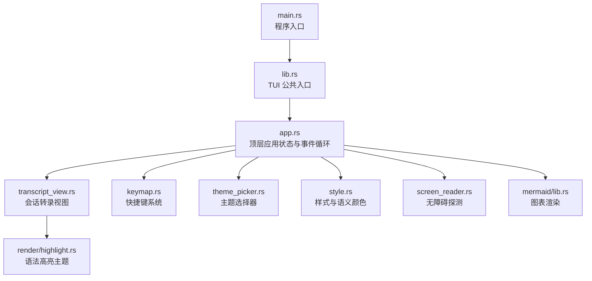

**图表来源**   
- [main.rs:1-59](file://codex-rs/tui/src/main.rs#L1-L59)
- [lib.rs:1-200](file://codex-rs/tui/src/lib.rs#L1-L200)
- [app.rs:1-200](file://codex-rs/tui/src/app.rs#L1-L200)
- [transcript_view.rs:160-320](file://codex-rs/tui/src/transcript_view.rs#L160-L320)
- [keymap.rs:1-150](file://codex-rs/tui/src/keymap.rs#L1-L150)
- [theme_picker.rs:1-150](file://codex-rs/tui/src/theme_picker.rs#L1-L150)
- [style.rs:1-150](file://codex-rs/tui/src/style.rs#L1-L150)
- [screen_reader.rs:1-150](file://codex-rs/tui/src/screen_reader.rs#L1-L150)
- [highlight.rs:17-118](file://codex-rs/tui/src/render/highlight.rs#L17-L118)
- [mermaid lib.rs:1-80](file://codex-rs/mermaid/src/lib.rs#L1-L80)

**章节来源**   
- [main.rs:1-59](file://codex-rs/tui/src/main.rs#L1-L59)
- [lib.rs:1-200](file://codex-rs/tui/src/lib.rs#L1-L200)
- [Cargo.toml:1-196](file://codex-rs/tui/Cargo.toml#L1-L196)

## 核心组件

### 程序入口与应用生命周期

`main.rs` 负责：

1. 初始化构建信息。
2. 使用 `clap` 解析顶层 CLI 参数和配置覆盖。
3. 调用 `run_main` 启动 TUI。
4. 根据退出原因决定是否需要打印错误并返回非零退出码。
5. 将格式化后的退出消息写入标准输出。

`lib.rs` 作为库入口，导出：

- `run_main`：TUI 主运行入口。
- `ExitReason`：退出原因类型。
- `AppExitInfo`：退出时携带的使用统计、线程 ID、恢复提示、断开连接信息等。
- 会话归档命令、队列命令、流式行构建器、终端包装器、插入历史行等高层 API。

它还对库部分禁用直接 stdout/stderr 打印，强制通过 TUI 内部日志和 UI 输出。

**章节来源**   
- [main.rs:1-59](file://codex-rs/tui/src/main.rs#L1-L59)
- [lib.rs:1-200](file://codex-rs/tui/src/lib.rs#L1-L200)

### 顶层应用状态

`app.rs` 中的 `App` 是 TUI 的核心状态容器，持有：

- 模型目录、会话遥测、终端尺寸标签。
- 事件发送通道和聊天组件。
- 工作区命令执行器。
- 配置与本地设置。
- 后端偏好上下文。
- 转录单元格、历史 UI、转录视图、对话帧。
- 覆盖层、分析视图、延迟历史行。
- 回放重排状态、滚动历史。
- 增强键支持、运行时快捷键、组合键匹配器。
- 提交动画、状态行警告标记、技能加载警告状态。
- 回退状态、反馈、环境管理器。
- 应用服务器目标、重连状态。
- 右键粘贴状态、更新动作、守护进程重启句柄。
- 线程事件通道、语音回放、标题生成、侧边栏、缩放线程、分隔线拖拽。
- 活跃线程、主要线程、会话配置、动态工具任务。
- 启动保护边界、权限审核策略、MCP 登录状态、插件和钩子启用写操作去重。
- 摘要状态和测试夹具。

`App` 还提供：

- 为分叉或恢复线程初始化聊天组件的方法。
- 处理 TUI 事件的主方法，包括焦点模态保护、按键抑制、帧调度等。

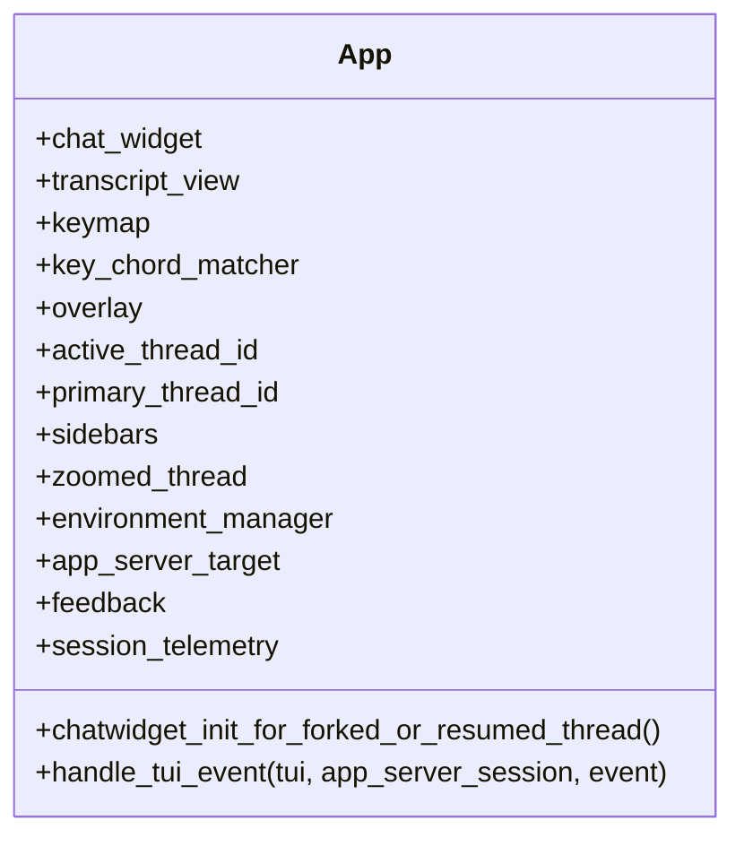

**图表来源**   
- [app.rs:540-874](file://codex-rs/tui/src/app.rs#L540-L874)

**章节来源**   
- [app.rs:1-200](file://codex-rs/tui/src/app.rs#L1-L200)
- [app.rs:540-874](file://codex-rs/tui/src/app.rs#L540-L874)

## 架构总览

TUI 的整体流程如下：

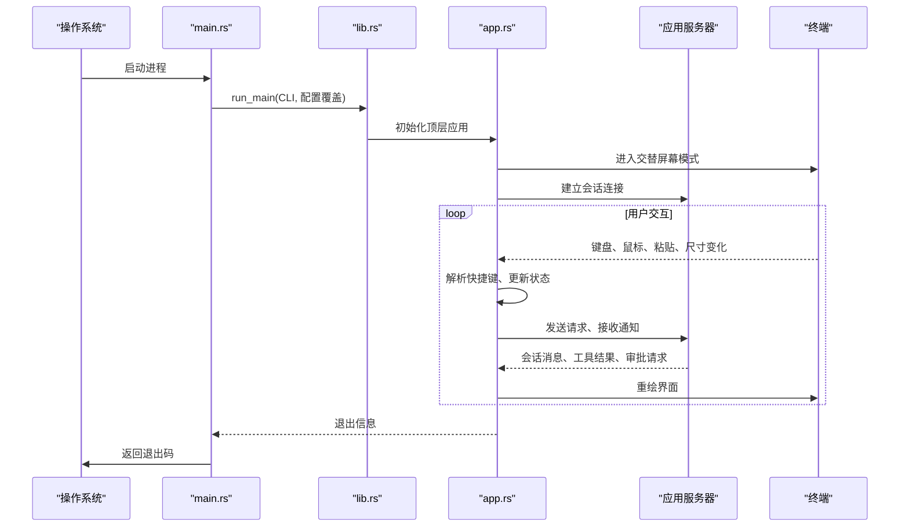

**图表来源**   
- [main.rs:1-59](file://codex-rs/tui/src/main.rs#L1-L59)
- [lib.rs:1-200](file://codex-rs/tui/src/lib.rs#L1-L200)
- [app.rs:817-900](file://codex-rs/tui/src/app.rs#L817-L900)

## 详细组件分析

### 会话操作：创建、切换、删除

#### 会话创建与恢复

TUI 支持从命令行或界面内创建新会话，也支持恢复已有会话。恢复场景通常涉及：

- 解析当前工作目录。
- 读取会话上下文。
- 决定是否保留或替换工作目录。
- 启动或附加到现有线程。
- 在侧边栏或主转录区域展示会话内容。

这些逻辑由 `lib.rs` 和 `app.rs` 共同协作：`lib.rs` 暴露会话恢复相关类型和启动入口，`app.rs` 维护活跃线程、主要线程、侧边栏线程、缩放线程和会话配置。

#### 会话归档、删除、取消归档

CLI 层面的会话归档、删除和取消归档由 `session_archive_commands.rs` 提供：

| 操作 | 行为 |
|---|---|
| 归档 | 将指定会话标记为归档状态 |
| 删除 | 可选确认对话框后删除会话 |
| 取消归档 | 将归档会话恢复为活跃会话 |

关键类型：

| 类型 | 说明 |
|---|---|
| `DeleteConfirmation` | 删除确认策略：提示或跳过 |
| `SessionArchiveAction` | 归档、删除、取消归档三种动作 |
| `SessionArchiveCommandOptions` | CLI、arg0 路径、显式远程端点等选项 |
| `run_session_archive_command` | 启动应用服务器会话并执行归档类操作 |

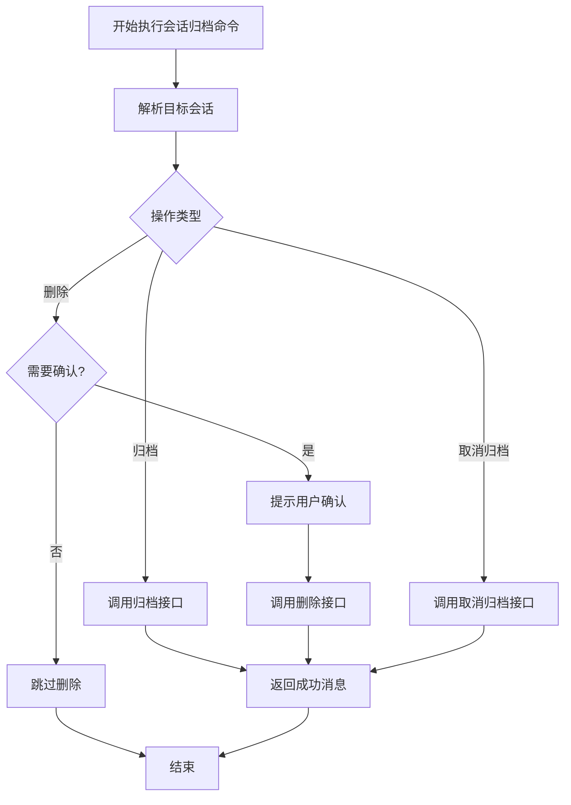

**图表来源**   
- [session_archive_commands.rs:43-150](file://codex-rs/tui/src/session_archive_commands.rs#L43-L150)

**章节来源**   
- [session_archive_commands.rs:1-150](file://codex-rs/tui/src/session_archive_commands.rs#L1-L150)

### 模型选择界面与动态模型切换

模型目录 `ModelCatalog` 负责管理可用模型集合。其构造函数接收一组模型预设，并提供后续查询、过滤和切换能力。TUI 中模型选择通常表现为：

- 从后端或本地配置加载可用模型。
- 在会话设置、模型选择面板或快速拨号中展示模型列表。
- 用户选择后触发模型切换。
- 切换结果同步到聊天组件和会话配置。

动态模型切换机制的关键点是：

- 模型数据与 UI 解耦，由 `ModelCatalog` 集中管理。
- 会话级模型状态由聊天组件维护。
- 主题、语法高亮、工具输出等渲染层按需读取当前模型上下文。

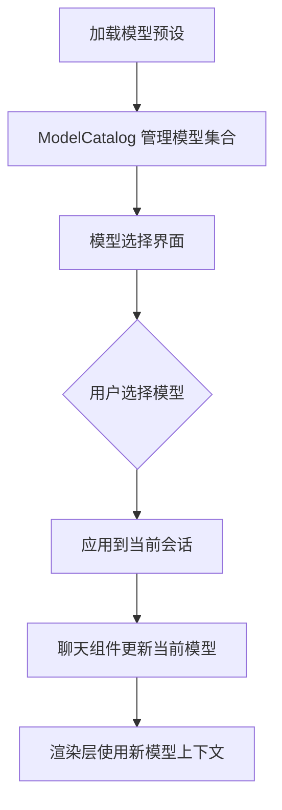

**图表来源**   
- [model_catalog.rs:35-50](file://codex-rs/tui/src/model_catalog.rs#L35-L50)
- [app.rs:817-900](file://codex-rs/tui/src/app.rs#L817-L900)

**章节来源**   
- [model_catalog.rs:1-50](file://codex-rs/tui/src/model_catalog.rs#L1-L50)
- [app.rs:817-900](file://codex-rs/tui/src/app.rs#L817-L900)

### 工具输出展示：代码高亮、图表渲染、文件预览

#### 转录视图

`TranscriptView` 是会话输出的核心渲染组件，负责：

- 计算可见区域。
- 同步历史尾部。
- 快照当前单元格。
- 清理缓冲区并重绘。
- 预留提示头行。
- 遍历条目布局。
- 渲染活动分组、选择、搜索、跟随状态。
- 收集图片位置供外部图像组件使用。

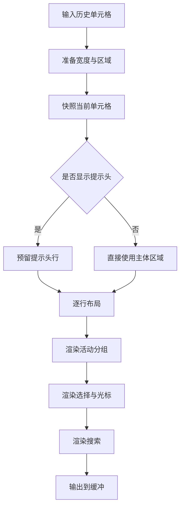

**图表来源**   
- [transcript_view.rs:160-320](file://codex-rs/tui/src/transcript_view.rs#L160-L320)

**章节来源**   
- [transcript_view.rs:160-320](file://codex-rs/tui/src/transcript_view.rs#L160-L320)

#### 代码高亮

语法高亮由 `render/highlight.rs` 管理：

- 启动时解析并设置语法主题。
- 提供全局主题设置和当前主题访问。
- 使用修订号追踪主题变更。
- 渲染器在绘制代码块时查询当前主题。

#### Mermaid 图表渲染

Mermaid 渲染位于独立 crate，提供受限但终端友好的图表输出：

| 能力 | 说明 |
|---|---|
| 流程图 | 有限节点和边的流程图 |
| 时序图 | 序列图 |
| 状态图 | 状态图和类图 |
| ER 图 | 实体关系图 |
| 限制 | 不支持任意复杂语法；超出宽度返回错误 |

`render` 返回纯文本，`render_spans` 返回带语义跨度的行，便于上层应用自行着色。

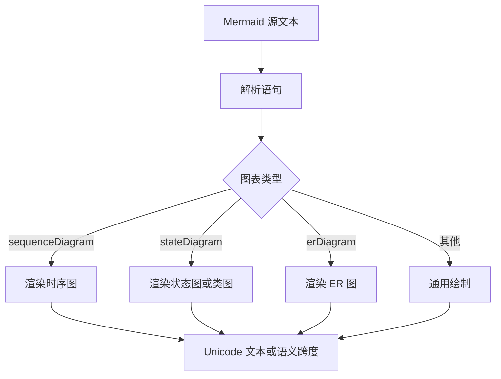

**图表来源**   
- [mermaid lib.rs:1-80](file://codex-rs/mermaid/src/lib.rs#L1-L80)

**章节来源**   
- [highlight.rs:17-118](file://codex-rs/tui/src/render/highlight.rs#L17-L118)
- [mermaid lib.rs:1-80](file://codex-rs/mermaid/src/lib.rs#L1-L80)

### 快捷键系统与用户自定义配置

快捷键系统由 `keymap.rs` 实现，核心职责：

1. 将配置中的 `TuiKeymap` 转换为运行时 `RuntimeKeymap`。
2. 按优先级解析键绑定：上下文绑定、全局后备、内置默认。
3. 解析规范键字符串为 `KeyBinding`。
4. 在同一聚焦输入路径上禁止重复键触发。
5. 提供用户可读的错误消息，包含配置路径和下一步建议。
6. 支持组合键、Vim 模式、查找、分页、代理、审批、编辑器等上下文。

`RuntimeKeymap` 包含多个子键表：

| 子键表 | 用途 |
|---|---|
| `AppKeymap` | 应用级操作，如打开代理中心、转录覆盖层、复制、清除终端、切换 Vim 模式 |
| `ChatKeymap` | 聊天交互 |
| `ComposerKeymap` | 编辑器输入框 |
| `EditorKeymap` | 编辑器模式 |
| `VimNormalKeymap` | Vim 普通模式 |
| `VimOperatorKeymap` | Vim 操作符模式 |
| `VimSearchKeymap` | Vim 搜索模式 |
| `VimTextObjectKeymap` | Vim 文本对象 |
| `PagerKeymap` | 分页查看 |
| `ListKeymap` | 列表导航 |
| `AgentsKeymap` | 代理相关操作 |
| `ApprovalKeymap` | 审批请求 |

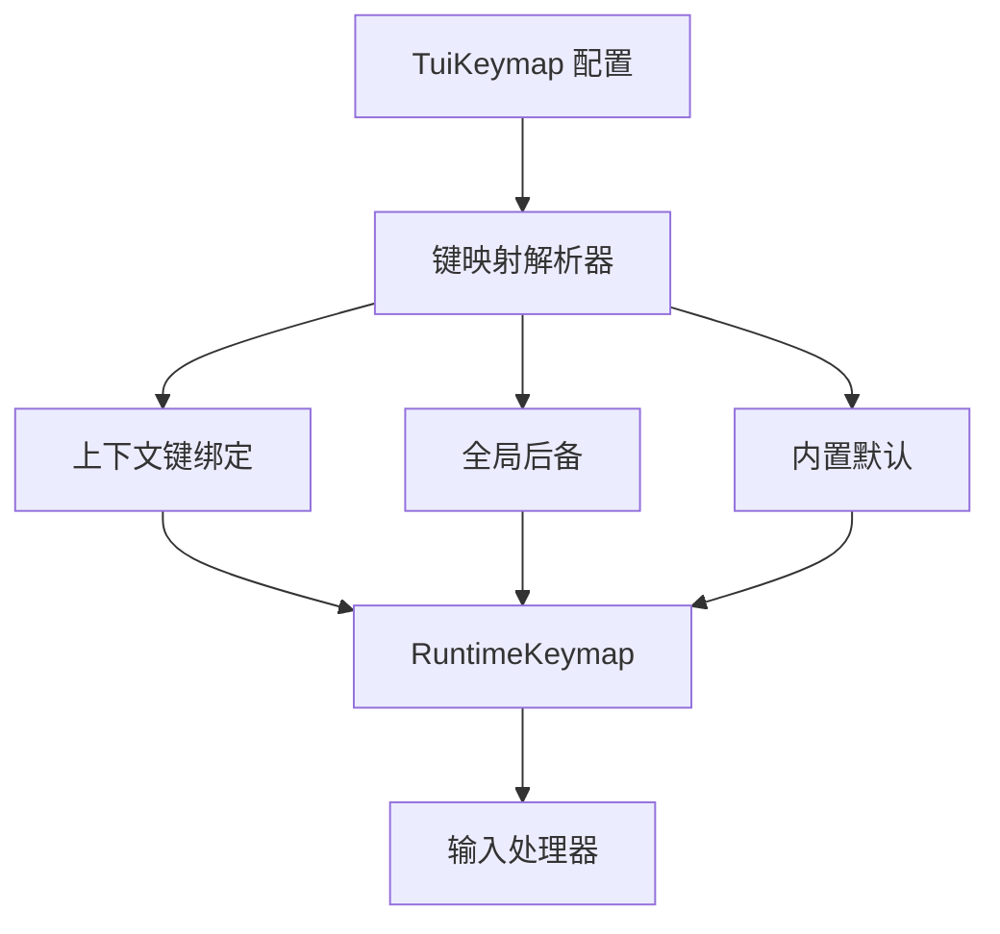

**图表来源**   
- [keymap.rs:1-150](file://codex-rs/tui/src/keymap.rs#L1-L150)

**章节来源**   
- [keymap.rs:1-150](file://codex-rs/tui/src/keymap.rs#L1-L150)

### 界面主题定制与样式修改

主题选择器 `theme_picker.rs` 提供：

- 列出内置主题和 `{CODEX_HOME}/themes/` 下的 `.tmTheme` 自定义主题。
- 实时预览：移动选择项时即时切换运行时语法主题。
- 取消恢复：关闭选择器时恢复打开时的主题快照。
- 确认持久化：将 `[tui] theme = "..."` 写入 `config.toml`。
- 两种预览布局：宽屏侧边预览和窄屏堆叠预览。

样式体系由 `style.rs` 和 `styles.md` 共同约束：

| 类别 | 规则 |
|---|---|
| 标题 | 使用粗体；Markdown 标题保留 `#` 符号 |
| 主文本 | 使用默认前景色 |
| 次要文本 | 使用共享次要文本样式，自动处理可读性和修饰符 |
| 快捷键提示 | 使用统一加粗快捷键标签 |
| 强调色 | 使用主题导出的强调色或背景对比色 |
| 语义状态 | 成功绿色、失败红色、注意黄色（深色背景更可靠） |
| 避免 | 随意自定义前景色、滥用 ANSI black/white/blue/yellow |

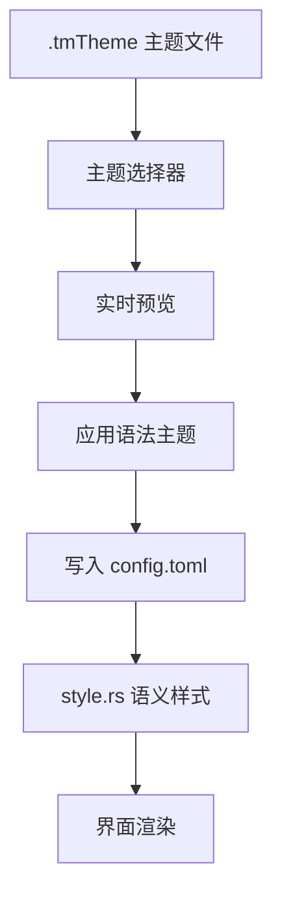

**图表来源**   
- [theme_picker.rs:1-150](file://codex-rs/tui/src/theme_picker.rs#L1-L150)
- [style.rs:1-150](file://codex-rs/tui/src/style.rs#L1-L150)
- [styles.md:1-44](file://codex-rs/tui/styles.md#L1-L44)

**章节来源**   
- [theme_picker.rs:1-150](file://codex-rs/tui/src/theme_picker.rs#L1-L150)
- [style.rs:1-150](file://codex-rs/tui/src/style.rs#L1-L150)
- [styles.md:1-44](file://codex-rs/tui/styles.md#L1-L44)

### 无障碍访问与屏幕阅读器兼容性

`screen_reader.rs` 负责：

- 首次启动时探测屏幕阅读器是否启用。
- 若检测到屏幕阅读器且未显式配置动画，则默认关闭动画。
- 将检测结果写入用户配置，避免重复探测。
- 在 macOS 上使用 VoiceOver 探测。
- 在 Windows 上使用系统 SPI 或 Narrator 探测。
- 在 Linux 上通过 AT-SPI 总线探测。

该机制保证：

- 屏幕阅读器用户不会因过度动画影响可读性。
- 用户手动配置的动画偏好优先于自动探测。
- 探测完成后不再反复修改配置。

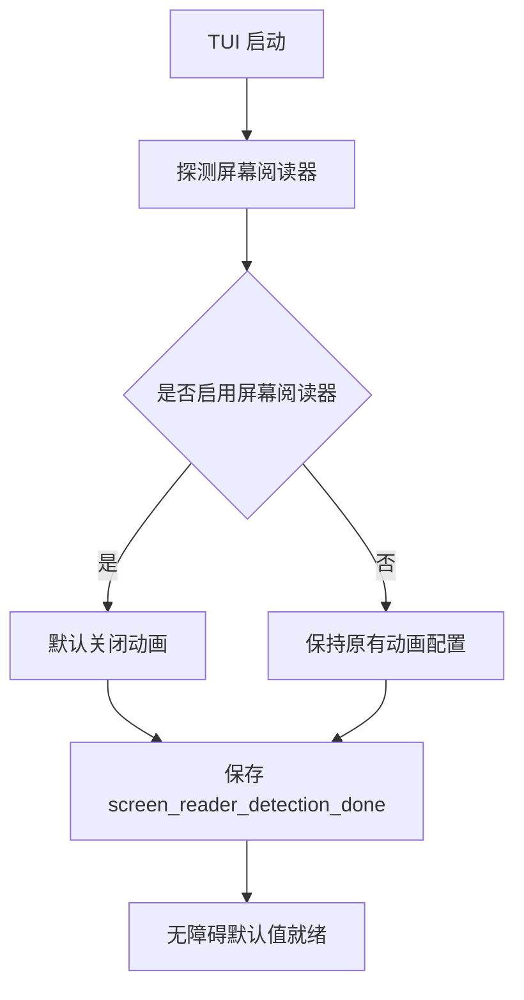

**图表来源**   
- [screen_reader.rs:1-150](file://codex-rs/tui/src/screen_reader.rs#L1-L150)

**章节来源**   
- [screen_reader.rs:1-150](file://codex-rs/tui/src/screen_reader.rs#L1-L150)

### 响应式布局与终端适配

TUI 的响应式能力体现在：

- 使用 Ratatui 和 Crossterm 进行终端绘制。
- `TranscriptView` 根据终端宽高调整布局、提示头和主体区域。
- 主题选择器根据侧边栏宽度切换宽屏或窄屏预览。
- 应用状态跟踪终端尺寸遥测标签。
- 转录视图在尺寸变化时重新计算可见区域、图片和选择上下文。

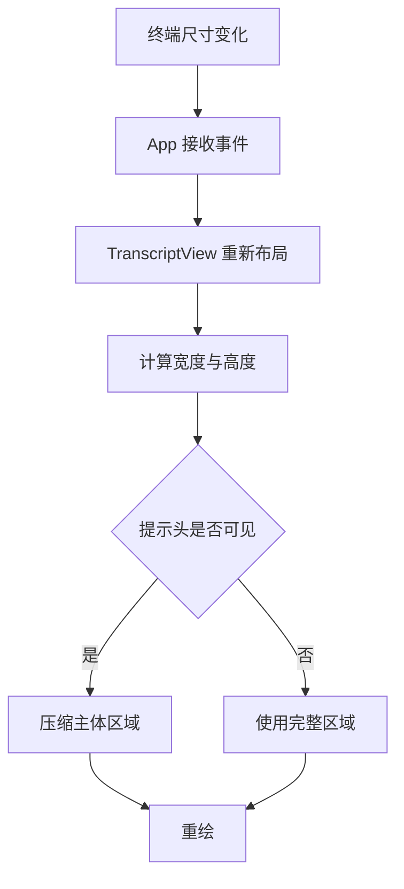

**图表来源**   
- [transcript_view.rs:160-320](file://codex-rs/tui/src/transcript_view.rs#L160-L320)
- [theme_picker.rs:1-150](file://codex-rs/tui/src/theme_picker.rs#L1-L150)
- [app.rs:540-874](file://codex-rs/tui/src/app.rs#L540-L874)

**章节来源**   
- [transcript_view.rs:160-320](file://codex-rs/tui/src/transcript_view.rs#L160-L320)
- [theme_picker.rs:1-150](file://codex-rs/tui/src/theme_picker.rs#L1-L150)
- [app.rs:540-874](file://codex-rs/tui/src/app.rs#L540-L874)

## 依赖关系分析

TUI 的外部依赖与其功能对应关系如下：

| 依赖 | 用途 |
|---|---|
| `ratatui` | 终端 UI 框架 |
| `crossterm` | 终端事件、鼠标、粘贴、交替屏幕 |
| `syntect` | 语法高亮 |
| `two-face` | Syntect 与 ratatui 风格桥接 |
| `pulldown-cmark` | Markdown 解析 |
| `image` | 图像解码 |
| `tokio` | 异步运行时 |
| `toml` / `toml_edit` | 配置文件读写 |
| `tracing` | 结构化日志 |
| `mermaid crate` | 终端友好图表渲染 |
| `webbrowser` | 打开外部链接 |
| `uuid` | 会话 ID 生成与处理 |

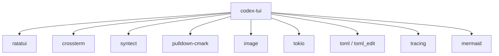

**图表来源**   
- [Cargo.toml:1-196](file://codex-rs/tui/Cargo.toml#L1-L196)

**章节来源**   
- [Cargo.toml:1-196](file://codex-rs/tui/Cargo.toml#L1-L196)

## 性能考虑

TUI 的性能关注点包括：

- **转录视图增量渲染**：只重绘可见区域，避免整屏重建。
- **历史尾部同步**：仅追加最新内容，减少旧历史重算。
- **语法主题缓存**：通过主题修订号避免频繁刷新。
- **Mermaid 渲染限制**：限制源长度、节点数、边数和标签长度，防止大图表阻塞终端。
- **流式提交动画**：使用固定间隔控制感知打字速度，避免过度刷新。
- **配置写操作去重**：插件和钩子启用状态序列化写入，避免竞态覆盖。
- **事件通道容量**：线程事件通道有容量上限，防止内存膨胀。

[本节为通用性能指导，不直接分析具体文件]

## 故障排查指南

常见问题与定位方向：

| 现象 | 可能原因 | 排查建议 |
|---|---|---|
| 快捷键无效 | 上下文键绑定冲突或未生效 | 检查 `RuntimeKeymap` 解析、上下文优先级、组合键超时 |
| 主题未持久化 | 主题选择器取消或未确认 | 确认 `/theme` 选择器已保存 `config.toml` |
| 动画影响阅读体验 | 屏幕阅读器未正确探测 | 检查 `screen_reader_detection_done` 和 `animations` |
| 代码无高亮 | 语法主题未加载或主题无效 | 检查 `set_syntax_theme` 和当前主题 |
| 图表无法渲染 | Mermaid 语法不受支持或超出宽度 | 查看 `RenderError`，简化图表或增大终端宽度 |
| 会话删除失败 | 目标不存在或未确认 | 检查会话解析、确认策略和服务器响应 |
| 界面卡顿 | 大转录或大量活动分组 | 缩小视图范围、减少长图表、检查流式提交频率 |

**章节来源**   
- [keymap.rs:1-150](file://codex-rs/tui/src/keymap.rs#L1-L150)
- [theme_picker.rs:1-150](file://codex-rs/tui/src/theme_picker.rs#L1-L150)
- [screen_reader.rs:1-150](file://codex-rs/tui/src/screen_reader.rs#L1-L150)
- [highlight.rs:17-118](file://codex-rs/tui/src/render/highlight.rs#L17-L118)
- [mermaid lib.rs:1-80](file://codex-rs/mermaid/src/lib.rs#L1-L80)
- [session_archive_commands.rs:43-150](file://codex-rs/tui/src/session_archive_commands.rs#L43-L150)

## 结论

交互式终端界面以 `App` 为核心，围绕会话、模型、转录视图、快捷键、主题和无障碍能力组织。它既适合日常对话和代码协作，也适合需要精确控制快捷键、主题、图表和会话生命周期的高级用户。通过分层设计和明确的责任划分，TUI 能够扩展新的工具输出、视图模式和交互方式，同时保持终端环境的轻量与可移植。

[本节为总结性内容，不直接分析具体文件]

## 附录

### 用户常用操作流程

| 操作 | 入口 | 说明 |
|---|---|---|
| 启动 TUI | `main.rs` 调用 `run_main` | 解析 CLI 并进入交互界面 |
| 创建会话 | 聊天输入或会话选择器 | 根据当前模型和权限配置启动新线程 |
| 恢复会话 | 会话选择器或 `/cd` | 恢复历史转录并可选择工作目录 |
| 归档会话 | `codex archive` | 将会话标记为归档 |
| 删除会话 | `codex delete` | 可确认删除 |
| 取消归档 | `codex unarchive` | 恢复归档会话 |
| 切换模型 | 模型选择界面 | 更新当前会话模型 |
| 切换主题 | `/theme` | 选择内置或自定义 `.tmTheme` |
| 自定义快捷键 | `tui.keymap.*` | 配置上下文、全局和默认键绑定 |
| 关闭动画 | 屏幕阅读器探测或手动配置 | 提升无障碍体验 |

[本节为概念性补充，不直接分析具体文件]