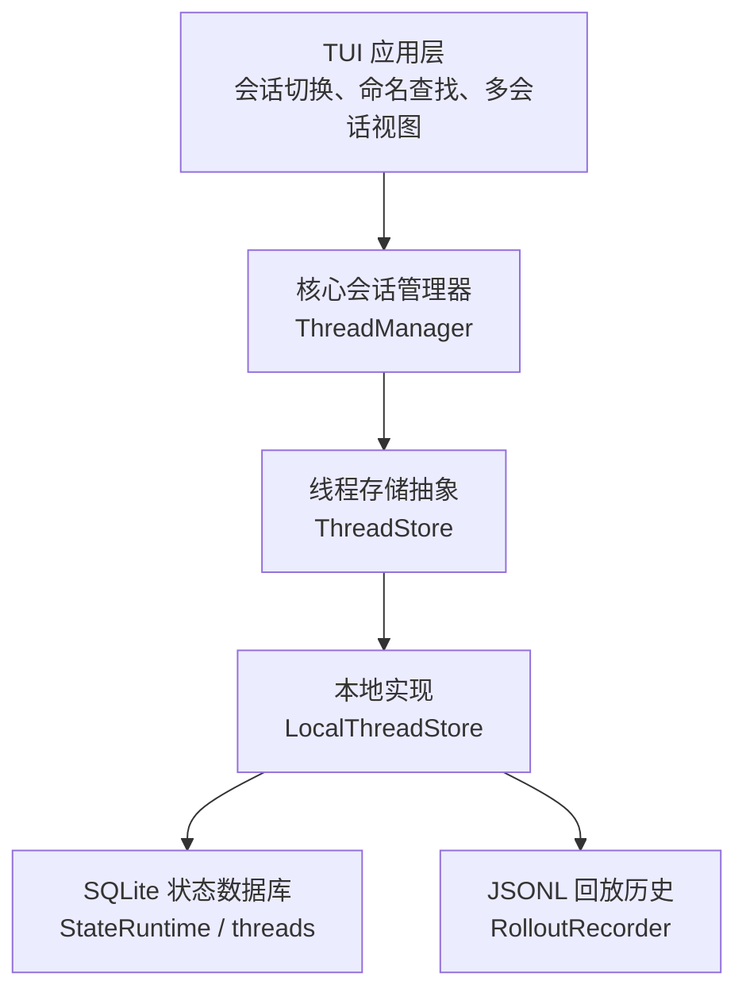
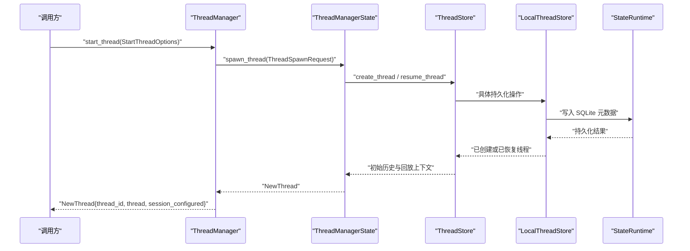
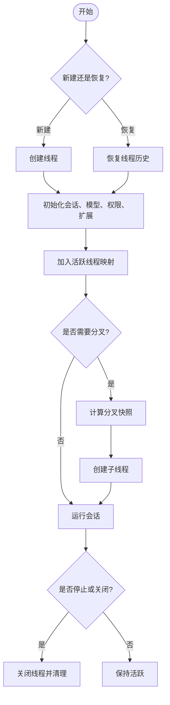
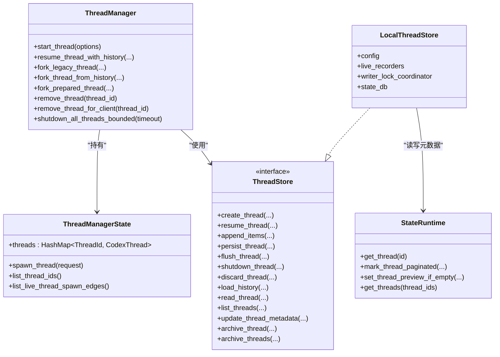
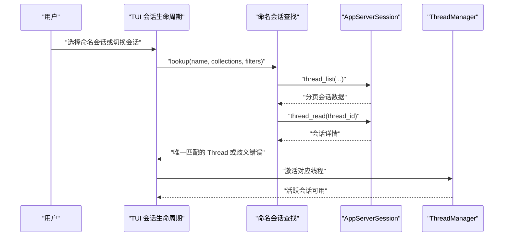
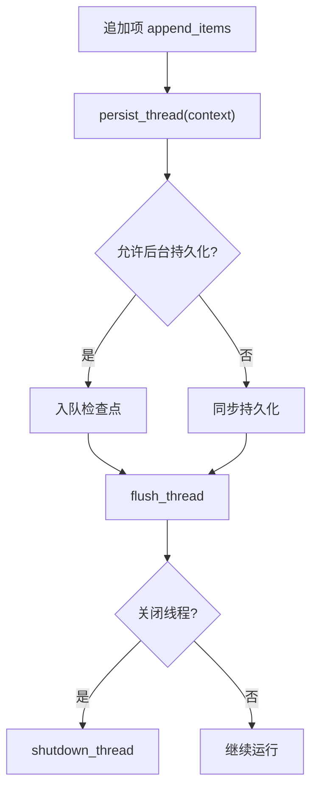
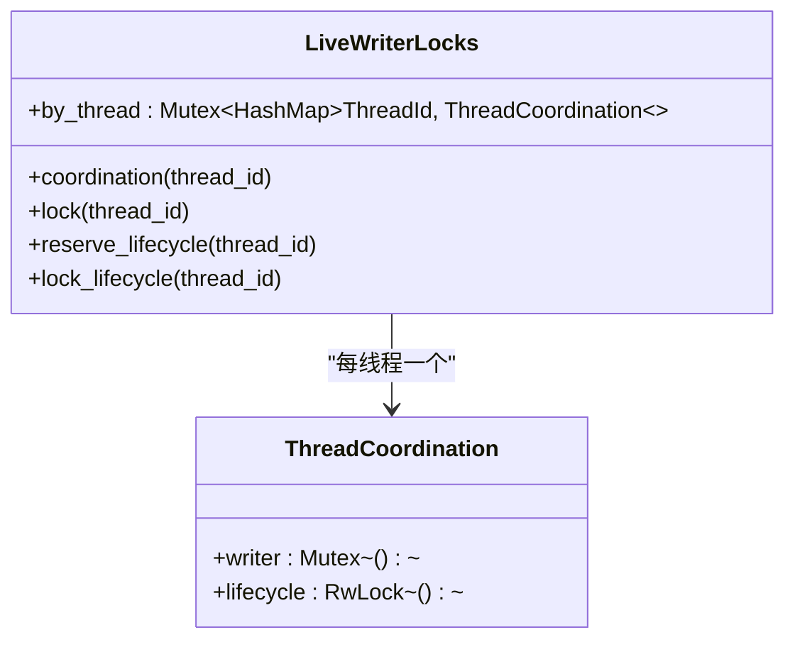
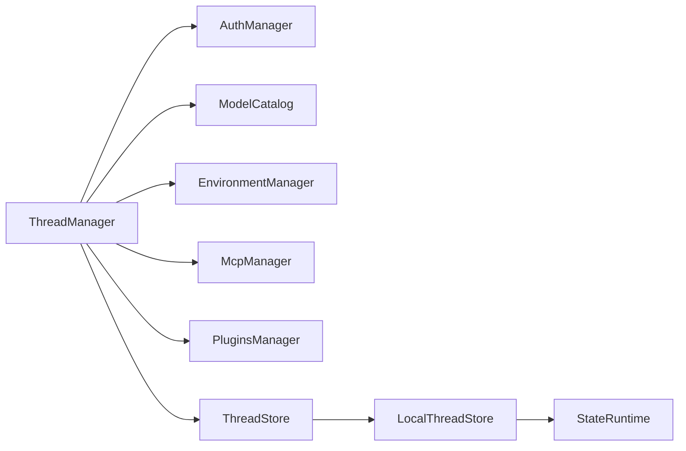

# 会话管理

<cite>
**本文引用的文件**   
- [codex-rs/core/src/thread_manager.rs](file://codex-rs/core/src/thread_manager.rs)
- [codex-rs/thread-store/src/lib.rs](file://codex-rs/thread-store/src/lib.rs)
- [codex-rs/thread-store/src/store.rs](file://codex-rs/thread-store/src/store.rs)
- [codex-rs/thread-store/src/local/mod.rs](file://codex-rs/thread-store/src/local/mod.rs)
- [codex-rs/state/src/runtime/threads.rs](file://codex-rs/state/src/runtime/threads.rs)
- [codex-rs/state/src/runtime/thread_metadata.rs](file://codex-rs/state/src/runtime/thread_metadata.rs)
- [codex-rs/tui/src/named_session_lookup.rs](file://codex-rs/tui/src/named_session_lookup.rs)
- [codex-rs/tui/src/app/session_lifecycle.rs](file://codex-rs/tui/src/app/session_lifecycle.rs)
</cite>

## 目录
1. [引言](#引言)
2. [项目结构](#项目结构)
3. [核心组件](#核心组件)
4. [架构总览](#架构总览)
5. [详细组件分析](#详细组件分析)
6. [依赖关系分析](#依赖关系分析)
7. [性能与并发特性](#性能与并发特性)
8. [故障排查指南](#故障排查指南)
9. [结论](#结论)
10. [附录：会话管理 API 参考](#附录会话管理-api-参考)

## 引言
本文围绕 Codex 工程中的“会话”概念进行系统化说明。在该代码库中，“会话”以线程（thread）为基本单元，由核心层的 `ThreadManager` 负责创建、恢复、分叉、停止和清理；`ThreadStore` 抽象及其本地实现负责持久化、历史回放、元数据索引和并发写入；TUI 层负责用户可见的活跃会话切换、命名会话查找、多会话导航与会话状态展示。

需要特别说明的是：
- 当前仓库没有统一的“暂停会话”API；会话的生命周期主要由“启动/恢复/分叉/停止/删除”构成。
- “活跃会话”通常指 TUI 当前选中的主会话；“历史会话”则通过存储层列出、读取和归档。
- 命名会话查找是面向用户友好名称的查询，最终仍落回到稳定的线程 ID。
- 多会话支持体现在：进程内同时维护多个 `CodexThread`，并通过事件通道、代理控制和子代理图进行上下文隔离与协作。

## 项目结构
会话管理涉及三层：
- 核心业务层：`core::thread_manager` 提供线程生命周期、模型上下文、权限继承、分叉策略等。
- 存储抽象层：`thread-store` 定义跨实现的 `ThreadStore`，并提供 SQLite + JSONL 本地实现。
- 界面与应用层：`tui` 负责 UI 会话选择、命名会话解析、活跃会话切换以及历史回显。

图示来源
- [codex-rs/core/src/thread_manager.rs:1370-1720](file://codex-rs/core/src/thread_manager.rs#L1370-L1720)
- [codex-rs/thread-store/src/lib.rs:1-126](file://codex-rs/thread-store/src/lib.rs#L1-L126)
- [codex-rs/thread-store/src/local/mod.rs:1-250](file://codex-rs/thread-store/src/local/mod.rs#L1-L250)
- [codex-rs/state/src/runtime/threads.rs:1-200](file://codex-rs/state/src/runtime/threads.rs#L1-L200)

章节来源
- [codex-rs/core/src/thread_manager.rs:1370-1720](file://codex-rs/core/src/thread_manager.rs#L1370-L1720)
- [codex-rs/thread-store/src/lib.rs:1-126](file://codex-rs/thread-store/src/lib.rs#L1-L126)
- [codex-rs/thread-store/src/local/mod.rs:1-250](file://codex-rs/thread-store/src/local/mod.rs#L1-L250)
- [codex-rs/state/src/runtime/threads.rs:1-200](file://codex-rs/state/src/runtime/threads.rs#L1-L200)

## 核心组件
- `ThreadManager`：进程内会话容器，维护活跃线程映射、会话创建参数、代理控制工厂、认证、模型目录、扩展注册表、附件存储、线程存储、分析事件客户端等。
- `ThreadManagerState`：被 `Arc` 共享的内部状态，包含线程表、广播通道、ID 生成器、执行策略、MCP 管理等。
- `ThreadStore`：存储无关的线程持久化接口，定义创建、恢复、追加、持久化、刷新、关闭、丢弃、历史加载、上下文加载、分叉准备、归档、搜索、列表、元数据更新等操作。
- `LocalThreadStore`：基于本地文件系统 JSONL 回放与 SQLite 状态索引的实现，负责并发写入协调、延迟物化、迁移、分区、附件、项目等能力。
- `StateRuntime`：SQLite 状态运行时，提供线程元数据查询、分页模式标记、父子边、预览字段更新等。
- `named_session_lookup`：将用户可见的会话名称解析为稳定线程 ID，并处理歧义与分页验证。
- `session_lifecycle`：TUI 应用级会话生命周期，包括打开代理选择器、活跃线程切换、历史回显、主会话清理等。

章节来源
- [codex-rs/core/src/thread_manager.rs:201-596](file://codex-rs/core/src/thread_manager.rs#L201-L596)
- [codex-rs/thread-store/src/store.rs:1-200](file://codex-rs/thread-store/src/store.rs#L1-L200)
- [codex-rs/thread-store/src/local/mod.rs:1-250](file://codex-rs/thread-store/src/local/mod.rs#L1-L250)
- [codex-rs/state/src/runtime/thread_metadata.rs:1-50](file://codex-rs/state/src/runtime/thread_metadata.rs#L1-L50)
- [codex-rs/tui/src/named_session_lookup.rs:1-173](file://codex-rs/tui/src/named_session_lookup.rs#L1-L173)
- [codex-rs/tui/src/app/session_lifecycle.rs:1-200](file://codex-rs/tui/src/app/session_lifecycle.rs#L1-L200)

## 架构总览
下图展示一次典型“启动新会话”的控制流：上层请求进入 `ThreadManager`，构建 `StartThreadOptions`，经过内部校验后进入 `ThreadManagerState.spawn_thread`，最终由存储层创建或恢复线程，并向调用方返回 `NewThread`。

图示来源
- [codex-rs/core/src/thread_manager.rs:1370-1720](file://codex-rs/core/src/thread_manager.rs#L1370-L1720)
- [codex-rs/thread-store/src/store.rs:1-200](file://codex-rs/thread-store/src/store.rs#L1-L200)
- [codex-rs/thread-store/src/local/mod.rs:1-250](file://codex-rs/thread-store/src/local/mod.rs#L1-L250)
- [codex-rs/state/src/runtime/threads.rs:1-200](file://codex-rs/state/src/runtime/threads.rs#L1-L200)

## 详细组件分析

### 会话生命周期：创建、启动、恢复、分叉、停止、删除
- 创建与启动
  - `ThreadManager::start_thread` 接收 `StartThreadOptions`，封装会话源、线程源、初始历史、指令提供者、环境、插件、追踪上下文等，然后委托给内部状态创建线程。
  - 内部还会区分普通根线程、内部子会话、从父线程派生的内部会话、以及从历史分叉的内部会话。
- 恢复
  - `resume_thread_with_history` 使用已加载的历史重建会话；对于旧式 rollout 路径，还提供 `resume_legacy_thread_from_rollout`。
  - 恢复流程依赖 `ThreadStore::resume_thread` 或带预准备的恢复路径。
- 分叉
  - 支持从 rollup 历史快照分叉：`fork_legacy_thread`、`fork_thread_from_history`、`fork_prepared_thread`。
  - 分叉语义由 `ForkSnapshot` 决定：按第 n 个用户消息截断，或模拟中断。
- 停止与批量关闭
  - 单线程移除：`remove_thread`、`remove_thread_for_client`、`remove_thread_if_matches`。
  - 批量关闭：`shutdown_all_threads_bounded` 并行等待所有线程关闭，并按完成、提交失败、超时分类汇总。
- 删除
  - 存储层提供归档与删除能力，例如 `archive_thread`、`archive_threads`，以及通用删除参数类型。实际删除行为由具体 `ThreadStore` 实现决定。

图示来源
- [codex-rs/core/src/thread_manager.rs:1370-1720](file://codex-rs/core/src/thread_manager.rs#L1370-L1720)
- [codex-rs/core/src/thread_manager.rs:1719-2050](file://codex-rs/core/src/thread_manager.rs#L1719-L2050)

章节来源
- [codex-rs/core/src/thread_manager.rs:1370-1720](file://codex-rs/core/src/thread_manager.rs#L1370-L1720)
- [codex-rs/core/src/thread_manager.rs:1719-2050](file://codex-rs/core/src/thread_manager.rs#L1719-L2050)
- [codex-rs/thread-store/src/store.rs:201-631](file://codex-rs/thread-store/src/store.rs#L201-L631)

### 会话状态管理：活跃会话与历史会话
- 活跃会话
  - `ThreadManagerState` 使用 `RwLock<HashMap<ThreadId, Arc<CodexThread>>>` 保存进程内活跃线程。
  - TUI 层通过 `active_thread_id` 跟踪当前选中主会话，并在切换时激活事件通道、回放通道和历史状态。
- 历史会话
  - 历史会话由 `ThreadStore::list_threads`、`search_threads`、`read_thread` 暴露。
  - 本地实现使用 SQLite 表 `threads` 作为可查询元数据索引，并结合 JSONL rollout 历史进行回放。
  - `StateRuntime` 提供单条查询、分页模式标记、预览字段更新、父子边维护等能力。

图示来源
- [codex-rs/core/src/thread_manager.rs:201-596](file://codex-rs/core/src/thread_manager.rs#L201-L596)
- [codex-rs/core/src/thread_manager.rs:1719-2050](file://codex-rs/core/src/thread_manager.rs#L1719-L2050)
- [codex-rs/thread-store/src/store.rs:1-200](file://codex-rs/thread-store/src/store.rs#L1-L200)
- [codex-rs/thread-store/src/local/mod.rs:1-250](file://codex-rs/thread-store/src/local/mod.rs#L1-L250)
- [codex-rs/state/src/runtime/threads.rs:1-200](file://codex-rs/state/src/runtime/threads.rs#L1-L200)
- [codex-rs/state/src/runtime/thread_metadata.rs:1-50](file://codex-rs/state/src/runtime/thread_metadata.rs#L1-L50)

章节来源
- [codex-rs/core/src/thread_manager.rs:201-596](file://codex-rs/core/src/thread_manager.rs#L201-L596)
- [codex-rs/thread-store/src/store.rs:1-200](file://codex-rs/thread-store/src/store.rs#L1-L200)
- [codex-rs/thread-store/src/local/mod.rs:1-250](file://codex-rs/thread-store/src/local/mod.rs#L1-L250)
- [codex-rs/state/src/runtime/threads.rs:1-200](file://codex-rs/state/src/runtime/threads.rs#L1-L200)
- [codex-rs/state/src/runtime/thread_metadata.rs:1-50](file://codex-rs/state/src/runtime/thread_metadata.rs#L1-L50)

### 命名会话查找与切换
- 命名会话查找
  - `named_session_lookup::lookup` 遍历活动会话与归档会话集合，分页拉取服务器端会话列表，匹配显示名称。
  - 对远程工作区和本地路径做额外校验，避免误匹配不存在的 rollout。
  - 若发现多个不同线程匹配同一名称，返回歧义错误；如果分页游标不可靠，也返回需使用 UUID 消歧的错误。
- 会话切换
  - TUI 在 `session_lifecycle` 中维护 `active_thread_id`，切换前检查是否已是当前线程、是否存在未决权限根、Windows 沙箱设置是否允许切换。
  - 切换成功后，替换事件接收通道、回放快照、摘要状态，并记录焦点变化。

图示来源
- [codex-rs/tui/src/named_session_lookup.rs:1-173](file://codex-rs/tui/src/named_session_lookup.rs#L1-L173)
- [codex-rs/tui/src/app/session_lifecycle.rs:617-748](file://codex-rs/tui/src/app/session_lifecycle.rs#L617-L748)

章节来源
- [codex-rs/tui/src/named_session_lookup.rs:1-173](file://codex-rs/tui/src/named_session_lookup.rs#L1-L173)
- [codex-rs/tui/src/app/session_lifecycle.rs:617-748](file://codex-rs/tui/src/app/session_lifecycle.rs#L617-L748)

### 多会话支持与上下文保持
- 进程内多会话
  - `ThreadManagerState.threads` 维护活跃线程映射，允许同时存在多个会话。
  - 每个会话拥有独立代理控制、认证、模型目录、扩展、附件、MCP 运行时等上下文。
- 子代理与父子关系
  - 支持内部会话、子代理会话、从父会话继承认证与代理控制。
  - 存储层可记录父子边，便于后续恢复和导航。
- 上下文保持
  - 会话配置、环境、指令提供者、插件禁用列表、追踪上下文等均可随创建或分叉传递。
  - 历史恢复时保留会话源、线程源、原始作者、多代理版本等上下文信息。

章节来源
- [codex-rs/core/src/thread_manager.rs:201-596](file://codex-rs/core/src/thread_manager.rs#L201-L596)
- [codex-rs/core/src/thread_manager.rs:1370-1720](file://codex-rs/core/src/thread_manager.rs#L1370-L1720)
- [codex-rs/state/src/runtime/threads.rs:1-200](file://codex-rs/state/src/runtime/threads.rs#L1-L200)

### 会话持久化机制与数据同步策略
- 持久化边界
  - `ThreadStore` 定义 `create_thread`、`resume_thread`、`append_items`、`persist_thread`、`flush_thread`、`shutdown_thread`、`discard_thread` 等边界。
  - `PersistContext` 区分线程准备、标准持久化、子代理启动、回合开始、引导用户输入等场景，部分场景允许后台持久化。
- 本地实现
  - `LocalThreadStore` 使用 JSONL rollout 作为可回放格式，SQLite 作为快速查询索引。
  - 通过 `LiveRecorderEntry`、`WriterLockCoordinator`、`LiveWriterLocks` 协调并发写入与生命周期锁。
- 数据同步
  - 元数据可能先于完整会话头持久化，因此本地实现会缓存历史模式等信息，以便缺失行仍可补种。
  - `StateRuntime` 提供批量化元数据读取，避免单个无效记录阻塞整页。

图示来源
- [codex-rs/thread-store/src/store.rs:201-631](file://codex-rs/thread-store/src/store.rs#L201-L631)
- [codex-rs/thread-store/src/local/mod.rs:1-250](file://codex-rs/thread-store/src/local/mod.rs#L1-L250)
- [codex-rs/state/src/runtime/thread_metadata.rs:1-50](file://codex-rs/state/src/runtime/thread_metadata.rs#L1-L50)

章节来源
- [codex-rs/thread-store/src/store.rs:201-631](file://codex-rs/thread-store/src/store.rs#L201-L631)
- [codex-rs/thread-store/src/local/mod.rs:1-250](file://codex-rs/thread-store/src/local/mod.rs#L1-L250)
- [codex-rs/state/src/runtime/thread_metadata.rs:1-50](file://codex-rs/state/src/runtime/thread_metadata.rs#L1-L50)

### 会话锁机制与并发访问控制
- 进程内线程注册表
  - `ThreadManagerState.threads` 使用 `tokio::sync::RwLock<HashMap>`，读多写少，适合频繁枚举活跃线程。
- 存储层写入锁
  - `LocalThreadStore.LiveWriterLocks` 为每个线程维护 writer 互斥锁与 lifecycle 读写锁。
  - writer 序列化追加与一致快照；lifecycle 用于归档、删除、解档等强一致性操作。
  - 获取顺序要求：需要同时访问两者的操作必须优先获取 lifecycle 锁，再获取 writer 锁。
- 批量关闭并发
  - `shutdown_all_threads_bounded` 并行等待所有线程关闭，避免串行阻塞，同时保证报告结果排序稳定。

图示来源
- [codex-rs/thread-store/src/local/mod.rs:1-250](file://codex-rs/thread-store/src/local/mod.rs#L1-L250)
- [codex-rs/core/src/thread_manager.rs:1719-2050](file://codex-rs/core/src/thread_manager.rs#L1719-L2050)

章节来源
- [codex-rs/thread-store/src/local/mod.rs:1-250](file://codex-rs/thread-store/src/local/mod.rs#L1-L250)
- [codex-rs/core/src/thread_manager.rs:1719-2050](file://codex-rs/core/src/thread_manager.rs#L1719-L2050)

## 依赖关系分析
- `ThreadManager` 依赖：
  - 认证管理器、运行时认证槽、模型目录、Git 根发现、环境管理器、MCP 管理器、技能服务、插件管理器、扩展注册表、图片附件存储、线程存储、代理图存储、时间提供者、分析客户端等。
- `ThreadStore` 依赖：
  - 协议中的线程 ID、历史模式、rollout 项、错误类型等。
- `LocalThreadStore` 依赖：
  - 本地配置、SQLite 池、状态数据库句柄、writer 锁协调器、历史记录信号量、数据清理钩子等。
- `StateRuntime` 依赖：
  - sqlx、SQLite 连接池、协议线程 ID、状态模型等。

图示来源
- [codex-rs/core/src/thread_manager.rs:201-596](file://codex-rs/core/src/thread_manager.rs#L201-L596)
- [codex-rs/thread-store/src/store.rs:1-200](file://codex-rs/thread-store/src/store.rs#L1-L200)
- [codex-rs/thread-store/src/local/mod.rs:1-250](file://codex-rs/thread-store/src/local/mod.rs#L1-L250)
- [codex-rs/state/src/runtime/thread_metadata.rs:1-50](file://codex-rs/state/src/runtime/thread_metadata.rs#L1-L50)

章节来源
- [codex-rs/core/src/thread_manager.rs:201-596](file://codex-rs/core/src/thread_manager.rs#L201-L596)
- [codex-rs/thread-store/src/store.rs:1-200](file://codex-rs/thread-store/src/store.rs#L1-L200)
- [codex-rs/thread-store/src/local/mod.rs:1-250](file://codex-rs/thread-store/src/local/mod.rs#L1-L250)
- [codex-rs/state/src/runtime/thread_metadata.rs:1-50](file://codex-rs/state/src/runtime/thread_metadata.rs#L1-L50)

## 性能与并发特性
- 并发读取活跃线程：`RwLock<HashMap>` 允许多读者同时枚举线程 ID。
- 并发关闭：`FuturesUnordered` 并行等待线程关闭，减少整体关闭耗时。
- 存储写入串行化：每个线程的 writer 互斥锁确保追加操作线性化，避免回放历史损坏。
- 生命周期锁分离：lifecycle 读写锁允许在初始化期间共享持有，但归档、删除等强一致性操作需要独占。
- 元数据批量读取：`StateRuntime.get_threads` 分批查询，避免单次 SQL 绑定过多导致失败。
- 延迟物化：本地历史写入者可能延迟物化，减少冷启动压力。

[本节为通用性能讨论，不直接分析具体文件]

## 故障排查指南
- 命名会话歧义
  - 当多个会话具有相同显示名称时，命名查找会报错，建议使用线程 UUID 消除歧义。
  - 如果分页游标来自旧服务器且可能跳过相等时间戳，也会提示分页不可靠。
- 线程未加载或元数据不一致
  - 若服务端返回“线程未加载”或元数据期望不一致，命名查找会跳过该条目；若其他错误则直接上抛。
- 内部会话只能由所有者移除
  - 尝试通过通用客户端移除内部会话会返回无效请求错误。
- 批量关闭超时
  - 如果某些线程未在超时内完成关闭，`shutdown_all_threads_bounded` 会将它们标记为超时，调用方可重试或检查。
- 历史恢复失败
  - 恢复失败应检查 `ThreadStore::resume_thread` 或 `resume_thread_with_preparation` 的返回值，确认是否因历史损坏、迁移失败或 writer 资源未释放导致。

章节来源
- [codex-rs/tui/src/named_session_lookup.rs:1-173](file://codex-rs/tui/src/named_session_lookup.rs#L1-L173)
- [codex-rs/core/src/thread_manager.rs:1719-2050](file://codex-rs/core/src/thread_manager.rs#L1719-L2050)
- [codex-rs/thread-store/src/store.rs:201-631](file://codex-rs/thread-store/src/store.rs#L201-L631)

## 结论
Codex 的会话管理以 `ThreadManager` 为核心，以 `ThreadStore` 为持久化抽象，结合 TUI 的用户交互逻辑，形成清晰的会话生命周期、多会话上下文、命名查找与并发控制体系。虽然当前仓库没有统一的“暂停”操作，但通过创建、恢复、分叉、追加、持久化、刷新、关闭与归档，已经覆盖了绝大多数生产场景。未来若引入更细粒度的会话状态机，可在现有 `ThreadStore` 与 `ThreadManagerState` 基础上扩展，而不破坏既有 API 契约。

[本节为总结性内容，不直接分析具体文件]

## 附录：会话管理 API 参考

### 核心层 ThreadManager
- 创建与启动
  - `start_thread(options)`
  - `spawn_internal_session(parent_thread_id, options)`
  - `fork_internal_session(parent_thread_id, options, history)`
- 恢复
  - `resume_thread_with_history(config, initial_history, auth_manager, parent_trace, client_mcp_extensions)`
  - `resume_legacy_thread_from_rollout(...)`
- 分叉
  - `fork_legacy_thread(snapshot, options, path)`
  - `fork_thread_from_history(snapshot, options, history)`
  - `fork_prepared_thread(options, prepared)`
- 管理与清理
  - `remove_thread(thread_id)`
  - `remove_thread_for_client(thread_id)`
  - `remove_thread_if_matches(thread_id, expected)`
  - `shutdown_all_threads_bounded(timeout)`
  - `fork_options_from_parent(source_thread_id)`

章节来源
- [codex-rs/core/src/thread_manager.rs:1370-1720](file://codex-rs/core/src/thread_manager.rs#L1370-L1720)
- [codex-rs/core/src/thread_manager.rs:1719-2050](file://codex-rs/core/src/thread_manager.rs#L1719-L2050)

### 存储层 ThreadStore
- 生命周期
  - `create_thread(params)`
  - `resume_thread(params)`
  - `resume_thread_with_preparation(params, preparation)`
  - `append_items(params)`
  - `persist_thread(thread_id, context)`
  - `flush_thread(thread_id)`
  - `shutdown_thread(thread_id)`
  - `discard_thread(thread_id)`
- 历史与上下文
  - `load_history(params)`
  - `read_original_history(thread_id, request)`
  - `load_latest_model_context(params)`
  - `is_model_context_current(params, revision)`
  - `prepare_fork(params)`
- 查询与管理
  - `read_thread(params)`
  - `read_thread_by_rollout_path(params)`
  - `list_threads(params)`
  - `search_threads(params)`
  - `search_thread_occurrences(params)`
  - `list_turns(params)`
  - `list_items(params)`
  - `list_timeline(params)`
  - `update_thread_metadata(params)`
  - `move_thread_to_section(params)`
  - `archive_thread(params)`
  - `archive_threads(params)`

章节来源
- [codex-rs/thread-store/src/store.rs:1-200](file://codex-rs/thread-store/src/store.rs#L1-L200)
- [codex-rs/thread-store/src/store.rs:201-631](file://codex-rs/thread-store/src/store.rs#L201-L631)

### 本地实现 LocalThreadStore
- 并发与协调
  - 每线程 writer 互斥锁
  - lifecycle 读写锁
  - writer 锁获取顺序：lifecycle 优先，再 writer
- 持久化策略
  - JSONL 回放历史
  - SQLite 元数据索引
  - 延迟物化与队列化写入
  - 迁移与兼容性处理

章节来源
- [codex-rs/thread-store/src/local/mod.rs:1-250](file://codex-rs/thread-store/src/local/mod.rs#L1-L250)

### 状态层 StateRuntime
- 元数据查询
  - `get_thread(id)`
  - `get_threads(thread_ids)`
- 元数据更新
  - `mark_thread_paginated(thread_id, legacy_name)`
  - `set_thread_preview_if_empty(thread_id, preview)`
- 父子关系
  - `upsert_thread_spawn_edge(parent, child, status)`
  - `set_thread_spawn_edge_status(child, status)`
  - `list_thread_spawn_children_with_status(parent, status)`

章节来源
- [codex-rs/state/src/runtime/threads.rs:1-200](file://codex-rs/state/src/runtime/threads.rs#L1-L200)
- [codex-rs/state/src/runtime/thread_metadata.rs:1-50](file://codex-rs/state/src/runtime/thread_metadata.rs#L1-L50)

### TUI 层会话管理
- 命名会话查找
  - `named_session_lookup::lookup(app_server, codex_home, name, collections, source_kind_filters, model_providers)`
- 活跃会话切换
  - `session_lifecycle` 中维护 `active_thread_id`、`active_thread_rx`、历史回放与焦点状态。

章节来源
- [codex-rs/tui/src/named_session_lookup.rs:1-173](file://codex-rs/tui/src/named_session_lookup.rs#L1-L173)
- [codex-rs/tui/src/app/session_lifecycle.rs:617-748](file://codex-rs/tui/src/app/session_lifecycle.rs#L617-L748)