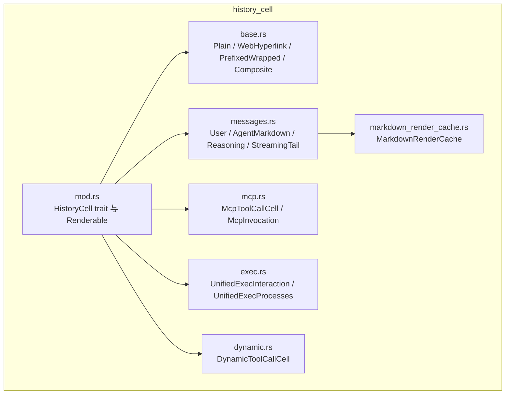
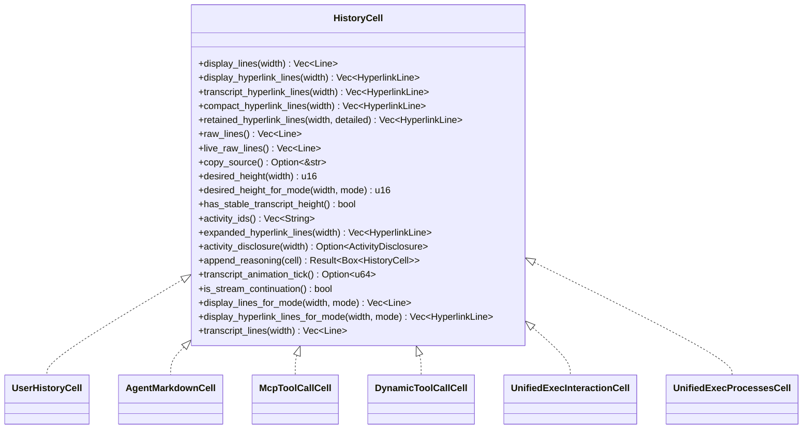
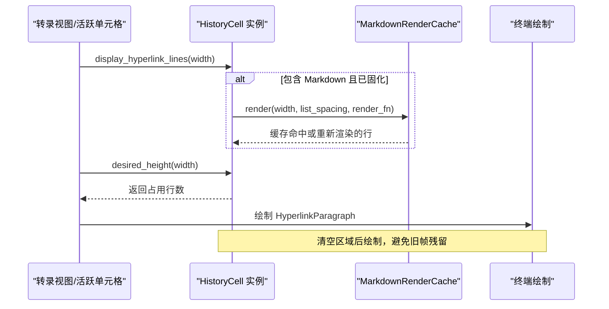
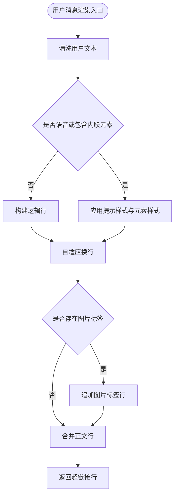
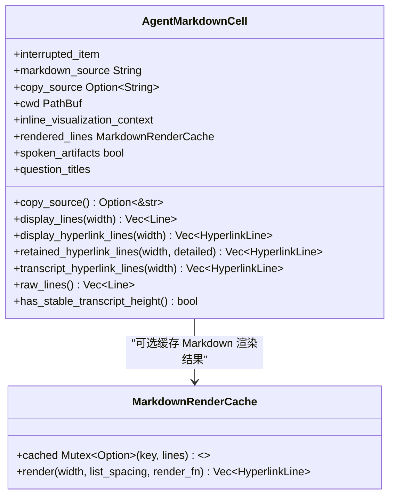
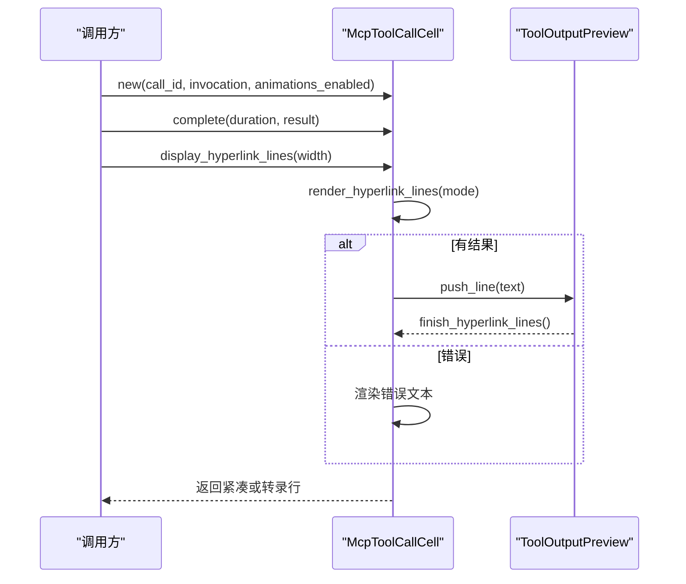
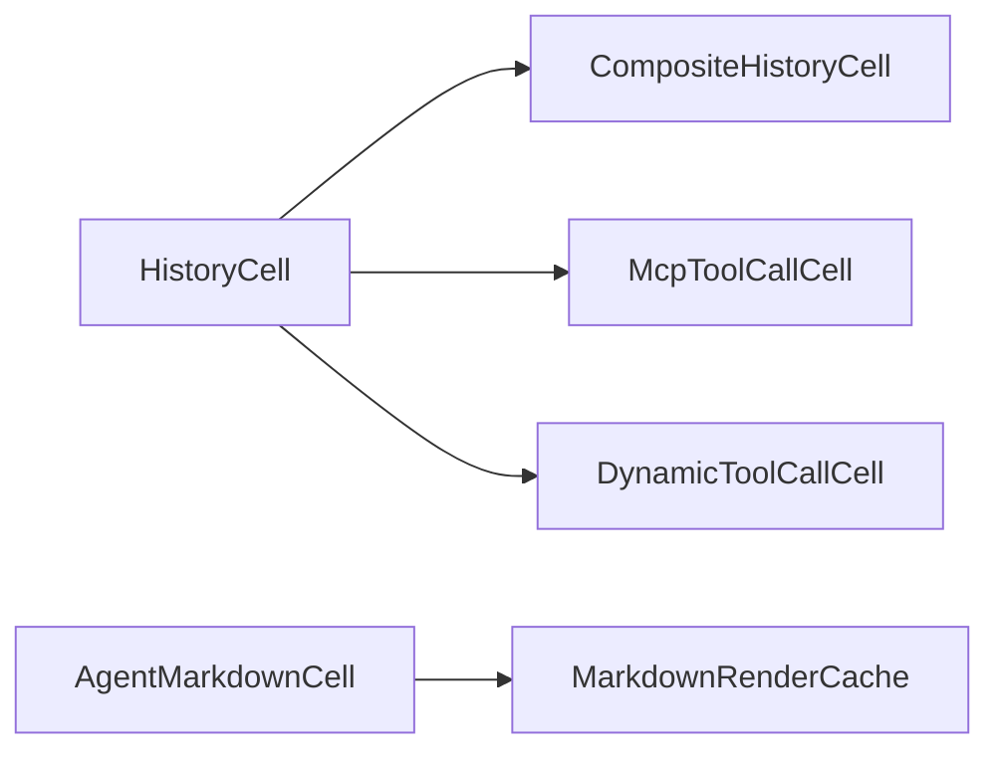

# 历史记录单元格渲染

<cite>
**本文引用的文件**   
- [history_cell/mod.rs](file://codex-rs/tui/src/history_cell/mod.rs)
- [history_cell/base.rs](file://codex-rs/tui/src/history_cell/base.rs)
- [history_cell/messages.rs](file://codex-rs/tui/src/history_cell/messages.rs)
- [history_cell/markdown_render_cache.rs](file://codex-rs/tui/src/history_cell/markdown_render_cache.rs)
- [history_cell/exec.rs](file://codex-rs/tui/src/history_cell/exec.rs)
- [history_cell/mcp.rs](file://codex-rs/tui/src/history_cell/mcp.rs)
- [history_cell/dynamic.rs](file://codex-rs/tui/src/history_cell/dynamic.rs)
</cite>

## 目录
1. [引言](#引言)
2. [项目结构](#项目结构)
3. [核心组件](#核心组件)
4. [架构总览](#架构总览)
5. [详细组件分析](#详细组件分析)
6. [依赖关系分析](#依赖关系分析)
7. [性能与缓存](#性能与缓存)
8. [异步加载与懒渲染](#异步加载与懒渲染)
9. [内存管理与垃圾回收](#内存管理与垃圾回收)
10. [故障排查指南](#故障排查指南)
11. [结论](#结论)

## 引言
本文聚焦于 TUI 中“历史记录单元格”的渲染机制。该子系统负责把会话历史中的用户消息、助手消息、工具调用、执行交互、计划更新、补丁变更等数据，统一转换为终端可绘制的逻辑行、超链接行和布局高度，并支持富模式、原始模式、转录视图、紧凑展示等多种显示策略。

关键目标包括：
- 明确历史消息的数据结构，包括消息类型、元数据和内容存储字段。
- 解释单元格的渲染生命周期：初始化、显示、转录、高度计算、销毁。
- 说明不同类型消息的差异化渲染策略。
- 梳理内容缓存、样式缓存、布局计算缓存等性能优化手段。
- 说明异步流式输出、懒渲染和动画 tick 的行为。
- 讨论内存管理和垃圾回收策略。

## 项目结构
`history_cell` 模块是 TUI 历史渲染的核心。它对外暴露一个统一的 `HistoryCell` trait，并把不同历史条目拆分为多个具体实现：
- 基础构件：纯文本、带前缀换行、组合单元格、Web 超链接包装等。
- 消息类：用户消息、助手 Markdown 消息、推理摘要、流式尾部。
- 工具与执行：动态工具调用、MCP 工具调用、后台终端交互与进程列表。
- 其他：补丁、计划、搜索、会话头、通知、警告等。

图表来源
- [history_cell/mod.rs:159-390](file://codex-rs/tui/src/history_cell/mod.rs#L159-L390)
- [history_cell/base.rs:1-233](file://codex-rs/tui/src/history_cell/base.rs#L1-L233)
- [history_cell/messages.rs:26-926](file://codex-rs/tui/src/history_cell/messages.rs#L26-L926)
- [history_cell/mcp.rs:74-450](file://codex-rs/tui/src/history_cell/mcp.rs#L74-L450)
- [history_cell/exec.rs:1-200](file://codex-rs/tui/src/history_cell/exec.rs#L1-L200)
- [history_cell/dynamic.rs:150-260](file://codex-rs/tui/src/history_cell/dynamic.rs#L150-L260)
- [history_cell/markdown_render_cache.rs:1-53](file://codex-rs/tui/src/history_cell/markdown_render_cache.rs#L1-L53)

章节来源
- [history_cell/mod.rs:1-200](file://codex-rs/tui/src/history_cell/mod.rs#L1-L200)

## 核心组件
### HistoryCell 统一接口
`HistoryCell` 是所有历史单元格的抽象基类。它定义了一组能力：
- 显示逻辑：`display_lines`、`display_hyperlink_lines`、`transcript_hyperlink_lines`、`compact_hyperlink_lines`、`retained_hyperlink_lines`。
- 原始文本：`raw_lines`、`live_raw_lines`、`copy_source`。
- 布局与可见性：`desired_height`、`desired_height_for_mode`、`has_stable_transcript_height`。
- 活动与细节：`activity_ids`、`expanded_hyperlink_lines`、`activity_disclosure`、`append_reasoning`。
- 动画与流式延续：`transcript_animation_tick`、`is_stream_continuation`。
- 渲染模式：`HistoryRenderMode::Rich` 与 `HistoryRenderMode::Raw`。

这些方法共同构成单元格的渲染契约：上层不需要关心单元格内部是用户消息还是工具调用，只需要调用这些方法即可得到可视化结果。

图表来源
- [history_cell/mod.rs:201-390](file://codex-rs/tui/src/history_cell/mod.rs#L201-L390)
- [history_cell/messages.rs:230-772](file://codex-rs/tui/src/history_cell/messages.rs#L230-L772)
- [history_cell/mcp.rs:358-450](file://codex-rs/tui/src/history_cell/mcp.rs#L358-L450)
- [history_cell/dynamic.rs:175-260](file://codex-rs/tui/src/history_cell/dynamic.rs#L175-L260)
- [history_cell/exec.rs:26-200](file://codex-rs/tui/src/history_cell/exec.rs#L26-L200)

章节来源
- [history_cell/mod.rs:201-390](file://codex-rs/tui/src/history_cell/mod.rs#L201-L390)

## 架构总览
历史记录渲染的总体流程如下：
1. 上游（如 transcript view、active cell）根据历史事件构造具体的 `HistoryCell` 实例。
2. 渲染层调用 `display_hyperlink_lines` 或 `display_lines`，得到可视化的逻辑行。
3. 布局层通过 `desired_height` 计算单元格占用的终端行数。
4. 转录视图通过 `transcript_lines` 或 `transcript_hyperlink_lines` 获取更完整的历史快照。
5. 原始复制通过 `raw_lines` 或 `live_raw_lines` 提供无样式的纯文本。
6. 对于时间相关动画，`transcript_animation_tick` 用于让转录缓存感知帧变化。
7. 对于 Markdown 内容，`AgentMarkdownCell` 使用 `MarkdownRenderCache` 缓存按宽度渲染的结果。

图表来源
- [history_cell/mod.rs:201-390](file://codex-rs/tui/src/history_cell/mod.rs#L201-L390)
- [history_cell/messages.rs:747-772](file://codex-rs/tui/src/history_cell/messages.rs#L747-L772)
- [history_cell/markdown_render_cache.rs:1-53](file://codex-rs/tui/src/history_cell/markdown_render_cache.rs#L1-L53)

## 详细组件分析

### 用户消息单元格
用户消息由 `UserHistoryCell` 表示，其数据结构包含：
- `message`：原始用户输入文本。
- `text_elements`：结构化文本元素，例如带字节范围的强调片段。
- `local_image_paths`：本地图片路径。
- `remote_image_urls`：远程图片 URL。
- `presentation`：呈现方式，包括普通打字输入、语音转写、异步问答回复。

渲染策略：
- 对控制字符进行清洗，保留换行和制表符。
- 根据是否使用 Markdown、是否语音输入、是否有内联元素，选择不同的正文构建方式。
- 对长 URL 使用自适应换行，并在必要时强制拆分超长 token，同时保留 OSC-8 超链接目的地址。
- 图片标签作为独立行显示，确保即使只有图片也能保持可见。
- 在富模式下应用 prompt 风格，并处理背景色与前景色的关系。

图表来源
- [history_cell/messages.rs:26-200](file://codex-rs/tui/src/history_cell/messages.rs#L26-L200)
- [history_cell/messages.rs:230-480](file://codex-rs/tui/src/history_cell/messages.rs#L230-L480)

章节来源
- [history_cell/messages.rs:26-200](file://codex-rs/tui/src/history_cell/messages.rs#L26-L200)
- [history_cell/messages.rs:230-480](file://codex-rs/tui/src/history_cell/messages.rs#L230-L480)

### 助手消息与 Markdown 渲染
助手消息有两种主要形式：
- `AgentMessageCell`：基于已经渲染好的逻辑行，主要用于流式过程中的片段。
- `AgentMarkdownCell`：保存原始 Markdown 源，在需要时重新渲染；适合最终化后的持久化消息。

关键点：
- `AgentMarkdownCell` 持有 `markdown_source`、`copy_source`、`cwd`、可选的可视化上下文、以及 `MarkdownRenderCache`。
- Markdown 渲染会根据当前宽度、列表间距、主题版本和终端颜色决定是否复用缓存。
- 如果内容包含内联可视化指令，则绕过普通 Markdown 缓存，因为文件系统状态可能发生变化。
- 语音助手消息会额外标注语音产物。
- 异步问题标题会通过 `async_questions::title_ranges` 注入到渲染过程中。

图表来源
- [history_cell/messages.rs:533-772](file://codex-rs/tui/src/history_cell/messages.rs#L533-L772)
- [history_cell/markdown_render_cache.rs:1-53](file://codex-rs/tui/src/history_cell/markdown_render_cache.rs#L1-L53)

章节来源
- [history_cell/messages.rs:533-772](file://codex-rs/tui/src/history_cell/messages.rs#L533-L772)
- [history_cell/markdown_render_cache.rs:1-53](file://codex-rs/tui/src/history_cell/markdown_render_cache.rs#L1-L53)

### 流式尾部与流式延续
`StreamingAgentTailCell` 表示尚未提交到滚动历史的流式尾部。它的特点：
- 不重新包裹已渲染行，避免破坏表格边框。
- 通过 `is_stream_continuation` 标记是否为流式延续行。
- 在转录视图中直接复用显示行的结构。

这保证了流式渲染的稳定性，同时减少重复布局开销。

章节来源
- [history_cell/messages.rs:808-860](file://codex-rs/tui/src/history_cell/messages.rs#L808-L860)

### MCP 工具调用
`McpToolCallCell` 表示 MCP 工具调用，其数据结构包括：
- `call_id`：调用标识。
- `invocation`：服务器名、工具名、参数。
- `start_time`、`duration`：计时信息。
- `result`：成功或失败的调用结果。
- `animations_enabled`：是否启用动画。

渲染策略：
- 区分正常对话历史和 Ctrl+T 转录视图。
- 根据是否成功、是否节点 REPL、是否紧凑模式决定标题和详情展示。
- 结果预览共享三行预算，但转录视图保留完整内容。
- 通过 `activity_ids` 为活动分组提供稳定身份。
- 未完成的调用通过动画 tick 驱动转录缓存刷新。

图表来源
- [history_cell/mcp.rs:74-450](file://codex-rs/tui/src/history_cell/mcp.rs#L74-L450)

章节来源
- [history_cell/mcp.rs:74-450](file://codex-rs/tui/src/history_cell/mcp.rs#L74-L450)

### 动态工具调用
`DynamicToolCallCell` 表示动态工具调用，特点：
- 不保证转录高度稳定，因此不适合长期缓存。
- 通过 `activity_ids` 提供稳定活动身份。
- 紧凑模式下限制输出预览行数，并显示隐藏行数提示。
- 转录模式展示完整参数和输出。
- 输出读取使用同步读锁保护共享数据。

章节来源
- [history_cell/dynamic.rs:150-260](file://codex-rs/tui/src/history_cell/dynamic.rs#L150-L260)

### 执行交互与进程列表
`UnifiedExecInteractionCell` 表示后台终端交互记录，包括等待命令或交互式输入。
`UnifiedExecProcessesCell` 表示后台进程摘要，限制最多显示进程数，并对长命令做截断。

它们主要在转录模式中显示，而普通聊天视图更关注命令输出和后台状态。

章节来源
- [history_cell/exec.rs:1-200](file://codex-rs/tui/src/history_cell/exec.rs#L1-L200)

## 依赖关系分析
历史单元格之间的依赖关系具有以下特征：
- `HistoryCell` 是中心抽象，所有具体单元格都依赖它提供的渲染接口。
- `CompositeHistoryCell` 聚合多个子单元格，常用于组合复杂历史块。
- `AgentMarkdownCell` 依赖 Markdown 渲染器和 `MarkdownRenderCache`。
- `McpToolCallCell` 依赖工具输出预览和协议模型。
- `DynamicToolCallCell` 依赖共享数据的读锁，用于安全访问动态输出。

图表来源
- [history_cell/base.rs:119-233](file://codex-rs/tui/src/history_cell/base.rs#L119-L233)
- [history_cell/messages.rs:747-772](file://codex-rs/tui/src/history_cell/messages.rs#L747-L772)
- [history_cell/markdown_render_cache.rs:1-53](file://codex-rs/tui/src/history_cell/markdown_render_cache.rs#L1-L53)
- [history_cell/mcp.rs:358-450](file://codex-rs/tui/src/history_cell/mcp.rs#L358-L450)
- [history_cell/dynamic.rs:175-260](file://codex-rs/tui/src/history_cell/dynamic.rs#L175-L260)

章节来源
- [history_cell/base.rs:119-233](file://codex-rs/tui/src/history_cell/base.rs#L119-L233)
- [history_cell/messages.rs:747-772](file://codex-rs/tui/src/history_cell/messages.rs#L747-L772)
- [history_cell/mcp.rs:358-450](file://codex-rs/tui/src/history_cell/mcp.rs#L358-L450)
- [history_cell/dynamic.rs:175-260](file://codex-rs/tui/src/history_cell/dynamic.rs#L175-L260)

## 性能与缓存
### Markdown 渲染缓存
`MarkdownRenderCache` 使用单宽缓存策略：
- 缓存键包含终端宽度、列表间距、语法主题版本、终端前景色、背景色和颜色级别。
- 命中时直接返回已渲染行；未命中时重新渲染并替换旧缓存。
- 由于只保留最新条目，切换宽度或主题时会自然淘汰旧结果。

这种设计避免了每次重排都重新解析和渲染 Markdown，尤其对大段助手消息有明显收益。

### 布局计算缓存
`HistoryCell` 默认通过 `Paragraph::line_count` 计算所需行数，并使用 `Wrap { trim: false }`，从而准确反映超长 URL 的实际占用行数。
- `AgentMarkdownCell` 在已缓存 Markdown 渲染时返回 `has_stable_transcript_height = true`。
- 动态工具调用返回 `false`，因为它的输出可能随时变化。

### 显示与转录分离
单元格可以分别提供：
- `display_hyperlink_lines`：主聊天视图。
- `transcript_hyperlink_lines`：Ctrl+T 转录视图。
- `compact_hyperlink_lines`：紧凑展示。
- `raw_lines` 或 `live_raw_lines`：原始文本。

这样可以在不同视图间复用渲染逻辑，同时避免不必要的详细内容进入紧凑视图。

章节来源
- [history_cell/markdown_render_cache.rs:1-53](file://codex-rs/tui/src/history_cell/markdown_render_cache.rs#L1-L53)
- [history_cell/mod.rs:201-390](file://codex-rs/tui/src/history_cell/mod.rs#L201-L390)
- [history_cell/messages.rs:747-772](file://codex-rs/tui/src/history_cell/messages.rs#L747-L772)
- [history_cell/dynamic.rs:175-180](file://codex-rs/tui/src/history_cell/dynamic.rs#L175-L180)

## 异步加载与懒渲染
### 流式输出
流式助手消息通过 `StreamingAgentTailCell` 和 `AgentMessageCell` 协同：
- 流式尾部不重新包裹，避免破坏表格结构。
- 流式延续行通过 `is_stream_continuation` 标记，帮助上层识别连续输出。

### 动画 Tick
MCP 工具调用在未完成时通过 `transcript_animation_tick` 返回递增 tick：
- 当动画启用且结果未到达时，tick 随时间变化。
- 转录视图可以据此刷新缓存尾行，避免 Ctrl+T 预览“冻结”。

### 懒渲染
Markdown 渲染采用按需渲染策略：
- 仅在 `display_hyperlink_lines` 或 `retained_hyperlink_lines` 被调用时触发渲染。
- 如果包含内联可视化指令，则跳过普通缓存，因为后续文件系统状态可能变化。

章节来源
- [history_cell/messages.rs:808-860](file://codex-rs/tui/src/history_cell/messages.rs#L808-L860)
- [history_cell/mcp.rs:430-450](file://codex-rs/tui/src/history_cell/mcp.rs#L430-L450)
- [history_cell/messages.rs:747-772](file://codex-rs/tui/src/history_cell/messages.rs#L747-L772)

## 内存管理与垃圾回收
### 字符串与行缓存
- `AgentMarkdownCell` 保留原始 Markdown 源，以便窗口尺寸变化时重新渲染，而不是缓存固定宽度的渲染结果。
- `MarkdownRenderCache` 仅保留最新渲染结果，避免无限增长。
- `CompositeHistoryCell` 在组合多个子单元格时插入空行分隔，但不会保留冗余样式。

### 共享数据访问
- `DynamicToolCallCell` 使用读锁访问共享输出数据，避免并发读写导致崩溃。
- 动态输出的预览会限制最大字符边界，防止超大输出造成分配爆炸。

### 清理行为
- 单元格本身没有显式析构逻辑，主要依赖 Rust 所有权和引用计数释放。
- 流式尾部会在流完成时被替换或删除，从而释放临时渲染状态。
- 转录视图中的活跃单元格缓存基于 revision key 失效，旧单元格不再被引用时可被垃圾回收。

章节来源
- [history_cell/messages.rs:533-772](file://codex-rs/tui/src/history_cell/messages.rs#L533-L772)
- [history_cell/markdown_render_cache.rs:1-53](file://codex-rs/tui/src/history_cell/markdown_render_cache.rs#L1-L53)
- [history_cell/dynamic.rs:175-260](file://codex-rs/tui/src/history_cell/dynamic.rs#L175-L260)

## 故障排查指南
常见问题及定位建议：
1. **转录视图与主视图不一致**
   - 检查单元格是否实现了 `transcript_hyperlink_lines` 而非仅 `display_hyperlink_lines`。
   - 确认 `has_stable_transcript_height` 是否正确反映内容稳定性。

2. **Markdown 表格或代码块在流式中错位**
   - 流式尾部不应重新包裹，应复用控制器已渲染的行。
   - 检查 `StreamingAgentTailCell` 的 `is_stream_continuation` 是否正确设置。

3. **Markdown 缓存未生效或频繁重渲染**
   - 检查终端主题、颜色级别或宽度是否变化。
   - 如果包含内联可视化指令，缓存会被绕过，这是预期行为。

4. **MCP 工具调用未显示动画**
   - 检查 `animations_enabled` 和 `result` 是否为空。
   - 确认 `transcript_animation_tick` 返回了递增 tick。

5. **用户消息 URL 被错误截断**
   - 检查是否启用了 URL 保留换行逻辑。
   - 确认超链接目的地址在强制拆分后仍被映射。

章节来源
- [history_cell/messages.rs:230-480](file://codex-rs/tui/src/history_cell/messages.rs#L230-L480)
- [history_cell/messages.rs:808-860](file://codex-rs/tui/src/history_cell/messages.rs#L808-L860)
- [history_cell/markdown_render_cache.rs:1-53](file://codex-rs/tui/src/history_cell/markdown_render_cache.rs#L1-L53)
- [history_cell/mcp.rs:430-450](file://codex-rs/tui/src/history_cell/mcp.rs#L430-L450)

## 结论
历史记录单元格渲染以 `HistoryCell` 为核心抽象，将不同类型的历史消息统一为可显示、可转录、可复制、可布局的单元。它通过 Markdown 渲染缓存、显示与转录分离、流式尾部保护和动画 tick 等机制，在保证正确性的前提下提升性能和用户体验。未来扩展新消息类型时，应优先实现 `HistoryCell` 的关键方法，并明确其在富模式、原始模式、转录模式和紧凑模式下的行为差异。