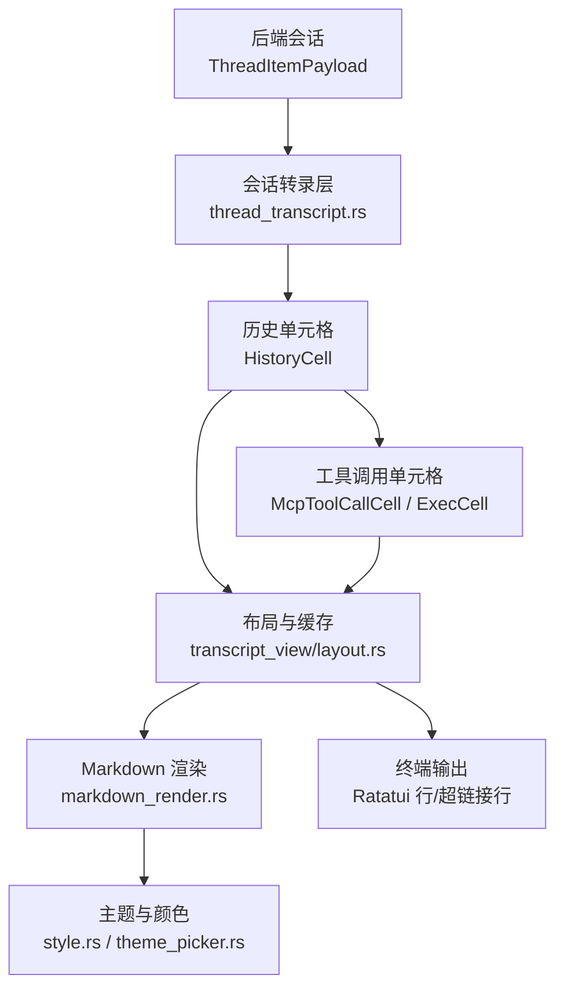
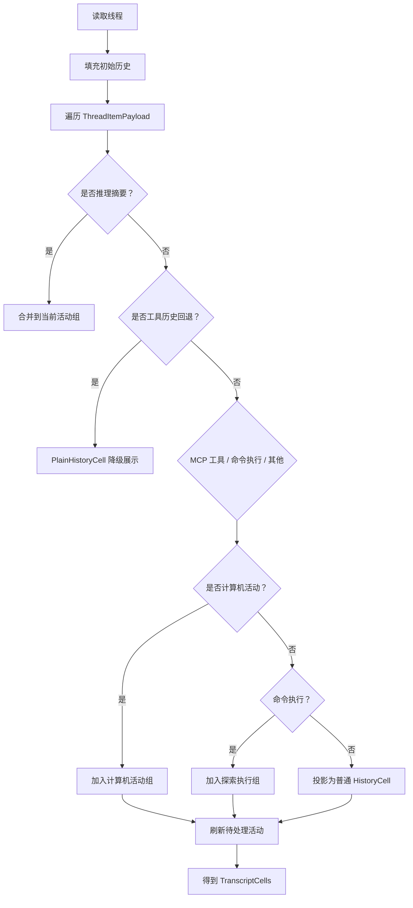
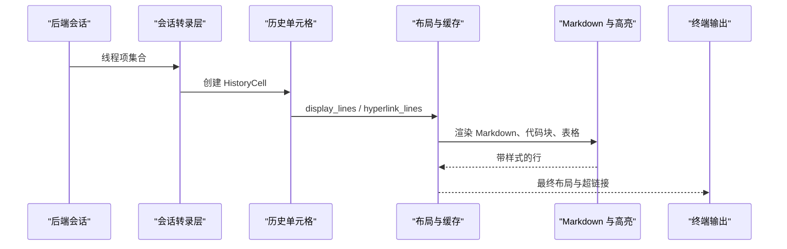
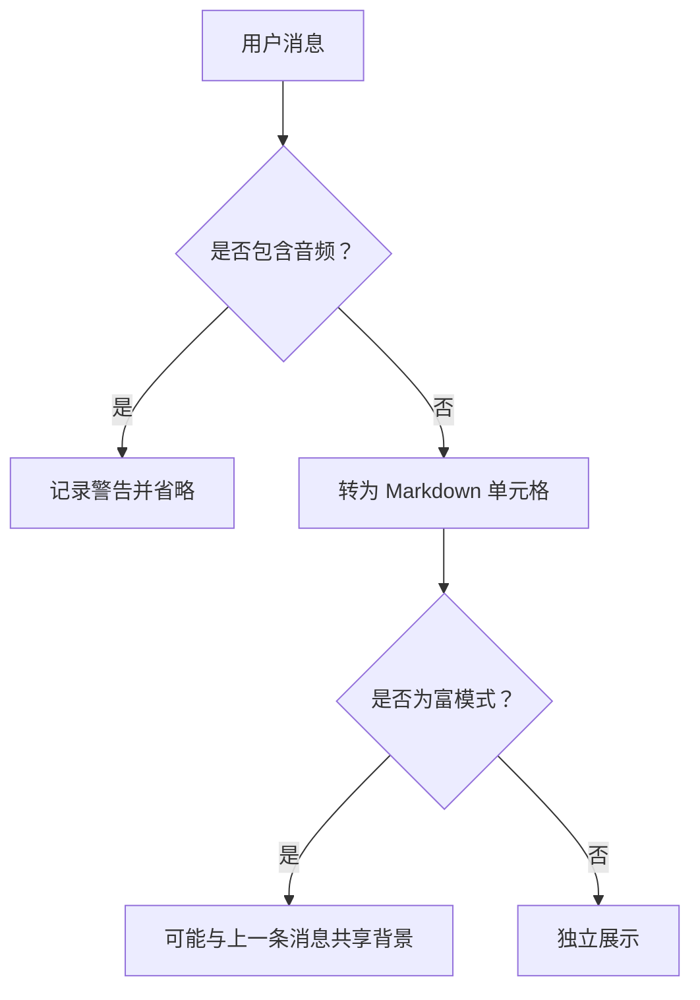
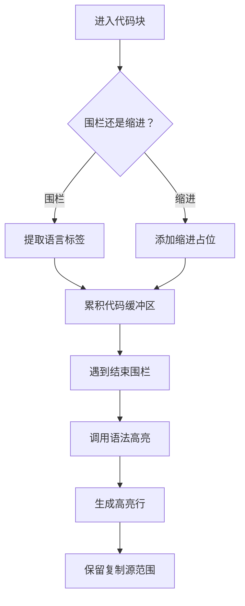
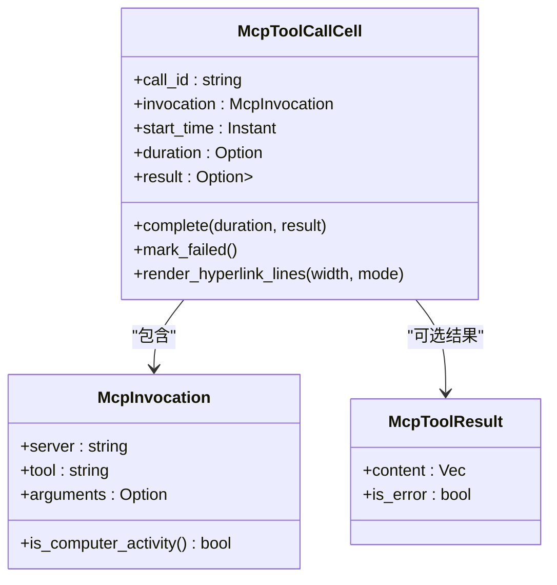
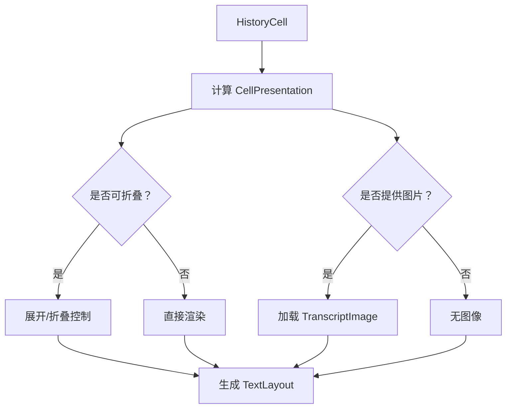
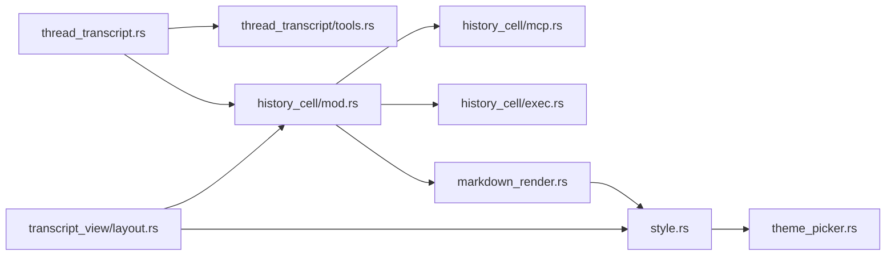

# 对话内容展示

<cite>
**本文引用的文件**   
- [layout.rs](file://codex-rs/tui/src/transcript_view/layout.rs)
- [thread_transcript.rs](file://codex-rs/tui/src/thread_transcript.rs)
- [tools.rs](file://codex-rs/tui/src/thread_transcript/tools.rs)
- [mod.rs](file://codex-rs/tui/src/history_cell/mod.rs)
- [exec.rs](file://codex-rs/tui/src/history_cell/exec.rs)
- [mcp.rs](file://codex-rs/tui/src/history_cell/mcp.rs)
- [markdown_render.rs](file://codex-rs/tui/src/markdown_render.rs)
- [style.rs](file://codex-rs/tui/src/style.rs)
- [theme_picker.rs](file://codex-rs/tui/src/theme_picker.rs)
</cite>

## 目录

1. [引言](#引言)
2. [项目结构](#项目结构)
3. [核心组件](#核心组件)
4. [架构总览](#架构总览)
5. [详细组件分析](#详细组件分析)
6. [依赖关系分析](#依赖关系分析)
7. [性能与长文本处理](#性能与长文本处理)
8. [平台差异与适配](#平台差异与适配)
9. [自定义样式与主题配置](#自定义样式与主题配置)
10. [故障排查指南](#故障排查指南)
11. [结论](#结论)

## 引言

本文聚焦于 Codex TUI 的“对话内容展示”能力，解释从后端会话数据到终端渲染的完整链路。重点包括：

- 用户输入和 AI 回复的消息类型识别方式；
- Markdown 文本高亮、代码块渲染、表格、链接、列表等富文本表现；
- 工具调用的可视化表示，包括执行状态、输出结果、错误信息和历史回放降级；
- 消息时间线布局、角色标识、头像/图像、展开折叠、分隔背景等视觉元素；
- 大段文本的截断、折叠、滚动优化策略；
- 不同终端环境下的颜色、宽度、动画差异及适配方案；
- 如何通过内置主题选择器与样式系统定制外观。

该文档既适合需要理解渲染机制的开发者，也适合希望了解界面行为、扩展样式和排错的使用者。

## 项目结构

对话展示相关代码主要位于 `codex-rs/tui` 下，可大致分为四层：

| 层次 | 职责 | 关键路径 |
|---|---|---|
| 会话转录层 | 将后端线程事件投影为历史单元格序列 | `thread_transcript.rs`、`thread_transcript/tools.rs` |
| 历史单元格层 | 定义每条消息的显示逻辑、原始行、超链接元数据和图片 | `history_cell/mod.rs`、`history_cell/mcp.rs`、`history_cell/exec.rs` |
| 布局与缓存层 | 根据终端宽度、模式、展开状态计算最终布局并缓存 | `transcript_view/layout.rs` |
| 渲染与主题层 | Markdown 解析、语法高亮、主题、颜色、主题选择器 | `markdown_render.rs`、`style.rs`、`theme_picker.rs` |

**图表来源**
- [thread_transcript.rs:1-120](file://codex-rs/tui/src/thread_transcript.rs#L1-L120)
- [mod.rs:120-220](file://codex-rs/tui/src/history_cell/mod.rs#L120-L220)
- [layout.rs:1-120](file://codex-rs/tui/src/transcript_view/layout.rs#L1-L120)
- [markdown_render.rs:1-80](file://codex-rs/tui/src/markdown_render.rs#L1-L80)

**章节来源**
- [thread_transcript.rs:1-120](file://codex-rs/tui/src/thread_transcript.rs#L1-L120)
- [layout.rs:1-120](file://codex-rs/tui/src/transcript_view/layout.rs#L1-L120)
- [markdown_render.rs:1-80](file://codex-rs/tui/src/markdown_render.rs#L1-L80)

## 核心组件

### 历史单元格接口

`HistoryCell` 是对话 UI 的基本展示单元。它既是已提交的历史条目，也是流式更新中的活跃单元格。其关键职责包括：

| 方法或属性 | 作用 | 对展示的影响 |
|---|---|---|
| `display_lines(width)` | 生成主视图逻辑行 | 控制普通聊天窗口中可见内容 |
| `raw_lines()` | 生成原始纯文本行 | 用于原始滚动模式和复制场景 |
| `display_hyperlink_lines(width)` | 生成带超链接元数据的逻辑行 | 支持点击跳转、复制源范围 |
| `compact_hyperlink_lines(width)` | 紧凑展示 | 用于精简历史面板 |
| `image_path()` | 提供本地图片路径 | 在富模式下展示头像或图像工件 |
| `transcript_animation_tick()` | 暴露基于时间的动态变化 | 驱动加载动画、进度指示器 |
| `copy_source()` | 返回语义化 Markdown 源码 | 支持按段落、代码块、表格等语义复制 |

**章节来源**
- [mod.rs:120-220](file://codex-rs/tui/src/history_cell/mod.rs#L120-L220)

### 会话转录投影层

`thread_to_transcript_cells` 和 `thread_items_to_transcript_cells` 负责把后端线程项转换为 `HistoryCell` 列表。重要规则包括：

- 推理摘要会根据配置隐藏或合并进活动组；
- MCP 工具调用可能进入“计算机活动”分组，也可能作为普通工具调用；
- 命令执行会被聚合成探索组，并在满足条件时刷新；
- 不支持的用户音频输入会记录警告并被忽略；
- 空会话会显示无内容的提示。

**图表来源**
- [thread_transcript.rs:60-210](file://codex-rs/tui/src/thread_transcript.rs#L60-L210)

**章节来源**
- [thread_transcript.rs:60-210](file://codex-rs/tui/src/thread_transcript.rs#L60-L210)

## 架构总览

对话展示的端到端流程如下：

**图表来源**
- [thread_transcript.rs:60-210](file://codex-rs/tui/src/thread_transcript.rs#L60-L210)
- [layout.rs:120-240](file://codex-rs/tui/src/transcript_view/layout.rs#L120-L240)
- [markdown_render.rs:500-1250](file://codex-rs/tui/src/markdown_render.rs#L500-L1250)

## 详细组件分析

### 消息类型识别与展示

#### 用户消息

用户消息通常通过 `UserMessage` 投影为 Markdown 内容。TUI 会：

- 检查是否包含音频输入；
- 若包含不支持的音频类型，则记录警告并省略；
- 否则将其转为普通 Markdown 单元格；
- 在富模式下，用户消息可能共享上一条消息的背景色，以形成更紧凑的时间线。

**图表来源**
- [thread_transcript.rs:210-260](file://codex-rs/tui/src/thread_transcript.rs#L210-L260)
- [layout.rs:160-240](file://codex-rs/tui/src/transcript_view/layout.rs#L160-L240)

#### AI 回复

AI 回复由助手 Markdown 内容、计划、补丁、警告、推理摘要等组成。它们最终都归一化为 `HistoryCell`，由布局层决定：

- 是否启用展开折叠；
- 是否使用详细模式；
- 是否展示图片；
- 是否与上一条用户消息共享背景。

**章节来源**
- [thread_transcript.rs:210-260](file://codex-rs/tui/src/thread_transcript.rs#L210-L260)
- [layout.rs:120-240](file://codex-rs/tui/src/transcript_view/layout.rs#L120-L240)

### 文本高亮与代码块渲染

Markdown 渲染模块是富文本展示的核心。它消费底层 Markdown 事件，并输出带样式、超链接、复制源的 `ratatui` 行。

关键特性：

| 特性 | 实现要点 |
|---|---|
| 标题 | 映射到 Markdown 主题中的 heading 作用域，加粗、斜体、下划线等修饰 |
| 强调与删除线 | 分别对应斜体和删除线样式 |
| 列表 | 有序和无序列表标记使用主题颜色，列表间距在流式和历史场景中有所不同 |
| 引用块 | 默认绿色并通过主题作用域增强 |
| 链接 | 使用强调色并下划线，同时保留 Web 目标地址 |
| 内联代码 | 使用主题原始标记前景色或强调色 |
| 代码块 | 分围栏代码块与缩进代码块，支持语言高亮 |
| 表格 | 列宽自适应，必要时退化为键值记录形式 |
| Mermaid 数学公式 | 有专门的预览和回退逻辑 |

代码块渲染流程如下：

**图表来源**
- [markdown_render.rs:500-1250](file://codex-rs/tui/src/markdown_render.rs#L500-L1250)

**章节来源**
- [markdown_render.rs:1-80](file://codex-rs/tui/src/markdown_render.rs#L1-L80)
- [markdown_render.rs:500-1250](file://codex-rs/tui/src/markdown_render.rs#L500-L1250)

### 工具调用的可视化表示

工具调用主要分为两类：

1. **MCP 工具调用**：由 `McpToolCallCell` 表示；
2. **命令执行**：由 `ExecCell` 及相关历史结构表示。

#### 状态表示

| 状态 | 展示方式 |
|---|---|
| 执行中 | 使用活动指示符，标题显示“正在调用”，不展示完整结果 |
| 已完成且成功 | 绿色圆点，标题显示“已调用”，展示结果预览 |
| 失败 | 红色圆点，标题显示“已调用”，展示错误信息 |
| 历史回放未完成 | 降级为简洁文本，如“最后更新时仍在进行中” |
| 被拒绝 | 命令执行降级为“已拒绝”，不模拟运行 |

#### 结果展示

- 正常模式下，工具结果采用有限行数预览；
- 转录模式或展开模式下，展示完整内容；
- 图像结果会在 Node REPL 场景中显示“返回图像”提示；
- 错误结果统一以“错误：...”形式呈现；
- 所有结果都保留超链接元数据和复制源。

**图表来源**
- [mcp.rs:1-120](file://codex-rs/tui/src/history_cell/mcp.rs#L1-L120)

#### 历史回退

当回放无法重建完整的富单元格时，`historical_tool_fallback` 会生成简洁的 `PlainHistoryCell`：

- 命令执行：显示 `$ 命令`、状态、退出码和聚合输出；
- MCP 工具：显示服务器、工具名和状态；
- 协作代理工具：显示工具类型和状态。

**章节来源**
- [tools.rs:1-180](file://codex-rs/tui/src/thread_transcript/tools.rs#L1-L180)
- [mcp.rs:120-300](file://codex-rs/tui/src/history_cell/mcp.rs#L120-L300)

### 时间线布局、角色标识与头像

#### 时间线布局

布局层维护以下关键概念：

- `ActivityTranscriptLines`：活动主内容与辅助内容；
- `TextLayout`：最终可渲染布局；
- `LayoutCache`：按帧和渲染状态缓存布局，避免重复计算；
- `CellPresentation`：描述单元格是否分离、是否共享背景、是否展开、是否详细、是否展示图片。

#### 角色标识

- 用户消息和 AI 回复通过不同 `HistoryCell` 类型区分；
- 工具调用通过“已调用/正在调用/错误”等前缀和图标表达角色行为；
- 计算机活动和命令执行通过分组和缩进体现执行上下文；
- 未加载历史会插入占位布局，确保会话信息始终在历史之前。

#### 头像与图像

- 如果单元格提供 `image_path()`，布局层会在富模式下尝试加载图像；
- 图像加载受终端尺寸、协议和展示模式影响；
- 未展开活动时，图像默认不显示；
- 手动展开或详细模式下允许显示图像。

**图表来源**
- [layout.rs:1-120](file://codex-rs/tui/src/transcript_view/layout.rs#L1-L120)
- [layout.rs:120-240](file://codex-rs/tui/src/transcript_view/layout.rs#L120-L240)

**章节来源**
- [layout.rs:1-240](file://codex-rs/tui/src/transcript_view/layout.rs#L1-L240)
- [mod.rs:120-220](file://codex-rs/tui/src/history_cell/mod.rs#L120-L220)

## 依赖关系分析

**图表来源**
- [thread_transcript.rs:1-120](file://codex-rs/tui/src/thread_transcript.rs#L1-L120)
- [tools.rs:1-120](file://codex-rs/tui/src/thread_transcript/tools.rs#L1-L120)
- [mod.rs:1-120](file://codex-rs/tui/src/history_cell/mod.rs#L1-L120)
- [layout.rs:1-120](file://codex-rs/tui/src/transcript_view/layout.rs#L1-L120)
- [markdown_render.rs:1-80](file://codex-rs/tui/src/markdown_render.rs#L1-L80)
- [style.rs:1-100](file://codex-rs/tui/src/style.rs#L1-L100)
- [theme_picker.rs:1-60](file://codex-rs/tui/src/theme_picker.rs#L1-L60)

### 耦合与内聚

- `thread_transcript` 与 `history_cell` 解耦良好：前者只负责投影，后者负责展示；
- `McpToolCallCell` 内部封装了调用、结果、状态和渲染细节，内聚性较高；
- `markdown_render` 依赖主题和语法高亮，但通过 `MarkdownStyles` 抽象主题作用域；
- `layout` 依赖历史单元格接口，而不是具体实现，便于扩展新消息类型。

### 潜在循环依赖风险

- 渲染层不应反向依赖会话转录层；
- 历史单元格不应直接持有后端会话对象；
- 主题选择器仅影响渲染层，不应侵入业务逻辑。

当前代码结构基本遵循单向依赖：会话 → 单元格 → 布局 → 渲染 → 主题。

**章节来源**
- [thread_transcript.rs:1-120](file://codex-rs/tui/src/thread_transcript.rs#L1-L120)
- [tools.rs:1-120](file://codex-rs/tui/src/thread_transcript/tools.rs#L1-L120)
- [mod.rs:1-120](file://codex-rs/tui/src/history_cell/mod.rs#L1-L120)
- [layout.rs:1-120](file://codex-rs/tui/src/transcript_view/layout.rs#L1-L120)
- [markdown_render.rs:1-80](file://codex-rs/tui/src/markdown_render.rs#L1-L80)
- [theme_picker.rs:1-60](file://codex-rs/tui/src/theme_picker.rs#L1-L60)

## 性能与长文本处理

### 布局缓存

布局层维护最近最多 64 个条目的布局缓存，并限制缓存字节数上限。缓存键包含：

- 历史单元格引用；
- 终端宽度；
- 展示模式；
- 帧编号；
- 主题版本；
- 终端前景/背景色；
- 终端颜色级别；
- 单元格尺寸。

当主题、颜色或终端尺寸变化时，缓存会被清空，保证一致性。

**章节来源**
- [layout.rs:1-120](file://codex-rs/tui/src/transcript_view/layout.rs#L1-L120)

### 折叠与展开

- 非详细模式下，具有活动 ID 的内容默认折叠；
- 用户可手动展开；
- 折叠时使用“显示详情”“隐藏详情”“+ N 行”等提示；
- 快捷键提示会尽量附加在折叠标签上；
- 展开后才会渲染详细内容，避免不必要的布局开销。

**章节来源**
- [layout.rs:1-120](file://codex-rs/tui/src/transcript_view/layout.rs#L1-L120)

### 文本截断

- 背景进程命令片段最多取 80 个 Unicode 字符；
- 超出部分用省略号后缀；
- 命令和输出块都有宽度预算计算，避免溢出终端；
- 工具调用结果在普通模式下使用有限行数预览；
- 原始滚动模式优先使用 `raw_lines()`，减少样式计算。

**章节来源**
- [exec.rs:60-180](file://codex-rs/tui/src/history_cell/exec.rs#L60-L180)
- [mcp.rs:120-300](file://codex-rs/tui/src/history_cell/mcp.rs#L120-L300)

### 滚动优化

- 布局只在每帧重新测量一次；
- 稳定单元格在主题、颜色、动画 tick 变化时才失效；
- 搜索匹配的结果可以复用布局；
- 快照模式下，已固定布局不会因实时变更而重算。

**章节来源**
- [layout.rs:1-120](file://codex-rs/tui/src/transcript_view/layout.rs#L1-L120)

## 平台差异与适配

### 终端宽度与换行

- 所有渲染都基于终端宽度计算；
- 长 URL、路径和命令使用自适应换行；
- 表格列宽会根据叙事内容、Token 密集内容和紧凑值动态分配；
- 窄终端下表格可能退化为键值记录形式。

**章节来源**
- [markdown_render.rs:1-80](file://codex-rs/tui/src/markdown_render.rs#L1-L80)
- [layout.rs:120-240](file://codex-rs/tui/src/transcript_view/layout.rs#L120-L240)

### 颜色深度与明暗背景

- 样式系统检测终端背景亮度；
- 浅色背景使用专门的高对比度强调色；
- 状态色在浅色背景下避免使用低对比度颜色；
- 主题衍生的前景色会进行可读性修正；
- 表格分隔线会向深色或浅色背景融合。

**章节来源**
- [style.rs:1-100](file://codex-rs/tui/src/style.rs#L1-L100)

### 动画与减少动效

- 活动指示器支持静态、动画和减少动效模式；
- 历史回放禁用动画；
- 工具调用单元格可通过冻结快照关闭动画；
- 减少动效会影响加载点和进度指示器的表现形式。

**章节来源**
- [mcp.rs:120-220](file://codex-rs/tui/src/history_cell/mcp.rs#L120-L220)
- [mod.rs:120-220](file://codex-rs/tui/src/history_cell/mod.rs#L120-L220)

### 平台无关的数据到展示映射

- 用户音频输入不被 TUI 支持，记录警告并省略；
- 历史回放缺失 stdin 时不会误判为等待交互；
- 工具调用历史回退不启动任务、不改变编辑器状态；
- 所有平台共享同一套 `HistoryCell` 接口。

**章节来源**
- [thread_transcript.rs:210-260](file://codex-rs/tui/src/thread_transcript.rs#L210-L260)
- [tools.rs:1-120](file://codex-rs/tui/src/thread_transcript/tools.rs#L1-L120)

## 自定义样式与主题配置

### 内置主题选择器

TUI 提供 `/theme` 主题选择器，功能包括：

- 列出内置主题；
- 扫描 `{CODEX_HOME}/themes/` 下的自定义 `.tmTheme` 文件；
- 提供实时预览；
- 取消时恢复打开前的主题；
- 确认后持久化 `[tui] theme = "..."` 到配置文件。

预览面板支持两种布局：

| 模式 | 行为 |
|---|---|
| 宽屏侧边栏 | 垂直居中、左右留白，展示语法高亮的差异示例 |
| 窄屏堆叠 | 在列表下方展示 4 行精简预览 |

**章节来源**
- [theme_picker.rs:1-120](file://codex-rs/tui/src/theme_picker.rs#L1-L120)
- [theme_picker.rs:120-250](file://codex-rs/tui/src/theme_picker.rs#L120-L250)

### Markdown 主题样式

Markdown 渲染使用当前语法主题的作用域映射样式：

| Markdown 元素 | 主题映射 |
|---|---|
| 一级标题 | `markup.heading.1.markdown` 或通用 heading 作用域 |
| 二级至六级标题 | 对应层级作用域 |
| 内联代码 | `markup.inline.raw.string.markdown` 或 `markup.raw.inline.markdown` |
| 强调 | `markup.italic.markdown` |
| 加粗 | 加粗修饰 |
| 链接 | 强调色 + `markup.underline.link.markdown` |
| 引用块 | 绿色 + `markup.quote.markdown` |
| 有序列表标记 | 浅蓝 + `markup.list.numbered.markdown` |
| 无序列表标记 | `markup.list.unlisted.markdown` 或 bullet 作用域 |

**章节来源**
- [markdown_render.rs:80-180](file://codex-rs/tui/src/markdown_render.rs#L80-L180)

### 全局样式与状态色

`style.rs` 提供：

- 背景亮度判断；
- 浅色背景专用强调 RGB；
- 状态色调与终端颜色深度的适配；
- 浮层 HUD 透明度调整；
- 提交提示的浅色背景填充；
- 主题强调色与终端 ANSI 颜色的兼容处理。

**章节来源**
- [style.rs:1-100](file://codex-rs/tui/src/style.rs#L1-L100)

### 如何扩展自定义样式

推荐方式：

1. 通过主题选择器安装自定义 `.tmTheme`；
2. 覆盖 Markdown 相关作用域，如 heading、code、link、list；
3. 避免直接修改业务渲染逻辑，优先使用主题作用域；
4. 对于应用级强调色，优先使用 `style.rs` 提供的可读性函数；
5. 如需新增主题设置项，应通过配置编辑器和持久化机制写入。

## 故障排查指南

### 工具调用只显示降级文本

可能原因：

- 历史回放无法重建富单元格；
- 工具调用仍处于“进行中”；
- 命令来自统一执行交互，缺少标准参数；
- MCP 工具没有结果也没有错误。

排查建议：

- 检查是否是历史回放场景；
- 查看工具调用状态字段；
- 确认命令参数是否可还原；
- 查看 `historical_tool_fallback` 分支。

**章节来源**
- [tools.rs:1-120](file://codex-rs/tui/src/thread_transcript/tools.rs#L1-L120)

### 工具结果不完整

可能原因：

- 普通模式限制预览行数；
- 结果块较多，采用共享预览；
- 节点 REPL 图像结果只显示提示；
- 错误结果以字符串形式展示。

排查建议：

- 切换到详细模式或转录模式；
- 展开工具调用；
- 检查结果块类型；
- 确认是否处于 Node REPL 场景。

**章节来源**
- [mcp.rs:120-300](file://codex-rs/tui/src/history_cell/mcp.rs#L120-L300)

### Markdown 代码块未高亮

可能原因：

- 代码块未正确闭合；
- 语言标签缺失或不被识别；
- 缩进代码块不使用语言高亮；
- 主题未正确加载；
- 终端颜色深度不足。

排查建议：

- 检查围栏是否成对；
- 确认语言标签；
- 切换主题；
- 检查终端颜色能力和主题作用域映射。

**章节来源**
- [markdown_render.rs:500-1250](file://codex-rs/tui/src/markdown_render.rs#L500-L1250)
- [style.rs:1-100](file://codex-rs/tui/src/style.rs#L1-L100)

### 布局闪烁或重复计算

可能原因：

- 频繁改变主题或终端大小；
- 动画导致活跃单元格 revision 变化；
- 缓存键发生变化；
- 搜索临时展开影响布局匹配。

排查建议：

- 观察布局缓存是否被清空；
- 减少频繁主题切换；
- 检查动画开关；
- 确认搜索模式是否临时替换布局。

**章节来源**
- [layout.rs:1-120](file://codex-rs/tui/src/transcript_view/layout.rs#L1-L120)

### 用户消息背景异常

可能原因：

- 上一条消息不是富模式用户消息；
- 上一条消息没有可见内容；
- 搜索快照覆盖了当前布局；
- 消息流式续写改变了边界判断。

排查建议：

- 检查上一条历史单元格的类型；
- 确认富模式和详细模式；
- 查看 `shares_prompt_background` 的计算逻辑；
- 检查布局缓存命中情况。

**章节来源**
- [layout.rs:160-240](file://codex-rs/tui/src/transcript_view/layout.rs#L160-L240)

## 结论

Codex TUI 的对话内容展示采用清晰的分层设计：会话转录层负责数据结构投影，历史单元格层负责语义化展示，布局层负责宽度与交互状态，渲染层负责 Markdown、语法高亮和主题。这种结构使得：

- 用户输入和 AI 回复能够统一接入 Markdown 渲染；
- 工具调用具备一致的状态、结果和错误展示；
- 长文本通过缓存、折叠、截断和预览保持性能；
- 主题和样式可配置，同时兼顾浅色/深色终端和不同颜色深度；
- 历史回放具备稳健的降级策略。

如果需要进一步扩展对话展示，建议优先扩展 `HistoryCell` 类型，并通过 Markdown 主题和 `style.rs` 中的可读性函数完成视觉适配，而不是直接修改底层渲染管线。