# 对话转录视图

<cite>
**本文引用的文件**   
- [transcript_view.rs](file://codex-rs/tui/src/transcript_view.rs)
- [layout.rs](file://codex-rs/tui/src/transcript_view/layout.rs)
- [text.rs](file://codex-rs/tui/src/transcript_view/text.rs)
- [input.rs](file://codex-rs/tui/src/transcript_view/input.rs)
- [search.rs](file://codex-rs/tui/src/transcript_view/search.rs)
- [footer.rs](file://codex-rs/tui/src/transcript_view/footer.rs)
- [follow_control.rs](file://codex-rs/tui/src/transcript_view/follow_control.rs)
- [composer_gap.rs](file://codex-rs/tui/src/transcript_view/composer_gap.rs)
- [mod.rs](file://codex-rs/tui/src/history_cell/mod.rs)
- [messages.rs](file://codex-rs/tui/src/history_cell/messages.rs)
- [exec.rs](file://codex-rs/tui/src/history_cell/exec.rs)
- [tools.rs](file://codex-rs/tui/src/thread_transcript/tools.rs)
- [thread_transcript.rs](file://codex-rs/tui/src/thread_transcript.rs)
- [session_transcript_tests.rs](file://codex-rs/tui/src/history_cell/session_transcript_tests.rs)
- [mod.rs](file://codex-rs/tui/src/streaming/mod.rs)
</cite>

## 目录
1. [引言](#引言)
2. [项目结构](#项目结构)
3. [核心组件](#核心组件)
4. [架构总览](#架构总览)
5. [详细组件分析](#详细组件分析)
6. [依赖关系分析](#依赖关系分析)
7. [性能与大文本优化](#性能与大文本优化)
8. [交互模式与功能](#交互模式与功能)
9. [历史单元格的数据结构与渲染逻辑](#历史单元格的数据结构与渲染逻辑)
10. [转录数据导出与备份](#转录数据导出与备份)
11. [实时流式显示更新机制](#实时流式显示更新机制)
12. [故障排查指南](#故障排查指南)
13. [结论](#结论)

## 引言
本文件面向 Codex TUI 的“对话转录视图”，解释该视图如何展示用户输入、AI 回复和工具调用，并说明线程转录的滚动浏览、历史记录查看、消息编辑与复制分享等交互行为。同时给出历史单元格的数据结构、大文本处理、虚拟滚动/可见行缓存策略、转录导出与备份方式，以及实时流式更新的内部机制。

## 项目结构
转录视图相关代码主要分布在以下模块：
- `transcript_view`：负责视口布局、可见行缓存、选择、搜索、跟随最新、提示头、底部状态栏、输入事件和快照回放。
- `history_cell`：定义可渲染的历史单元格抽象及具体实现，包括用户消息、助手消息、命令执行、MCP 工具调用、后台终端交互等。
- `thread_transcript`：将后端线程持久化数据转换为 TUI 使用的历史单元格序列。
- `streaming`：提供流式输出队列、分片消费、提交节拍等通用流式基础设施。

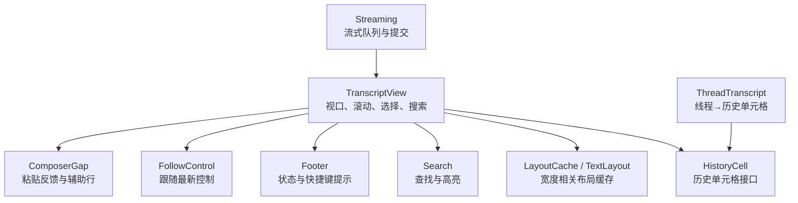

**图表来源**
- [transcript_view.rs:1-120](file://codex-rs/tui/src/transcript_view.rs#L1-L120)
- [layout.rs:1-60](file://codex-rs/tui/src/transcript_view/layout.rs#L1-L60)
- [text.rs:1-40](file://codex-rs/tui/src/transcript_view/text.rs#L1-L40)
- [mod.rs:1-60](file://codex-rs/tui/src/history_cell/mod.rs#L1-L60)
- [thread_transcript.rs:1-40](file://codex-rs/tui/src/thread_transcript.rs#L1-L40)
- [mod.rs:1-40](file://codex-rs/tui/src/streaming/mod.rs#L1-L40)

**章节来源**
- [transcript_view.rs:1-120](file://codex-rs/tui/src/transcript_view.rs#L1-L120)
- [mod.rs:1-60](file://codex-rs/tui/src/history_cell/mod.rs#L1-L60)
- [thread_transcript.rs:1-40](file://codex-rs/tui/src/thread_transcript.rs#L1-L40)
- [mod.rs:1-40](file://codex-rs/tui/src/streaming/mod.rs#L1-L40)

## 核心组件
- TranscriptView：会话视口的核心控制器，管理可见行、锚点定位、跟随最新、搜索、选择、活动折叠、图片放置、历史分页加载状态等。
- HistoryCell：每个对话单元（用户消息、助手消息、命令执行、MCP 工具调用、警告、计划等）的统一渲染接口。
- LayoutCache 与 TextLayout：按终端宽度缓存每行的逻辑行与视觉行映射，支持重排、披露控件插入和图片叠加。
- Search：在转录中查找匹配项，保持选择上下文。
- Footer：根据当前活动、搜索、选择模式输出底部操作提示。
- FollowControl：决定视图是否自动跟随最新内容。
- ComposerGap：为粘贴反馈或辅助信息预留空间，不影响源文本选择。
- ThreadTranscript：把后端 Thread/ThreadItemPayload 转成 HistoryCell 序列，用于回放或加载历史。
- Streaming：维护 Markdown 流收集器与已提交行队列，供上层控制器增量刷新。

**章节来源**
- [transcript_view.rs:1-120](file://codex-rs/tui/src/transcript_view.rs#L1-L120)
- [layout.rs:1-120](file://codex-rs/tui/src/transcript_view/layout.rs#L1-L120)
- [text.rs:1-80](file://codex-rs/tui/src/transcript_view/text.rs#L1-L80)
- [mod.rs:60-180](file://codex-rs/tui/src/history_cell/mod.rs#L60-L180)
- [thread_transcript.rs:1-80](file://codex-rs/tui/src/thread_transcript.rs#L1-L80)
- [mod.rs:1-131](file://codex-rs/tui/src/streaming/mod.rs#L1-L131)

## 架构总览
转录视图不直接持有完整渲染树，而是基于“历史单元格数组 + 当前活跃尾部”进行绘制：
- 历史由应用层维护；视图只保留读取/选择状态和有限布局缓存。
- 锚点以“单元格键 + 偏移”表示，历史前置不会改变已有锚点编号，换行也不会让阅读位置漂移。
- 视图通过 snapshot_cells 支持历史回放快照；真实渲染时使用当前 cells 或快照。
- 活动条目在紧凑模式下可折叠，展开后显示更丰富内容。
- 图片与富媒体作为附加层叠加到文本布局之上。

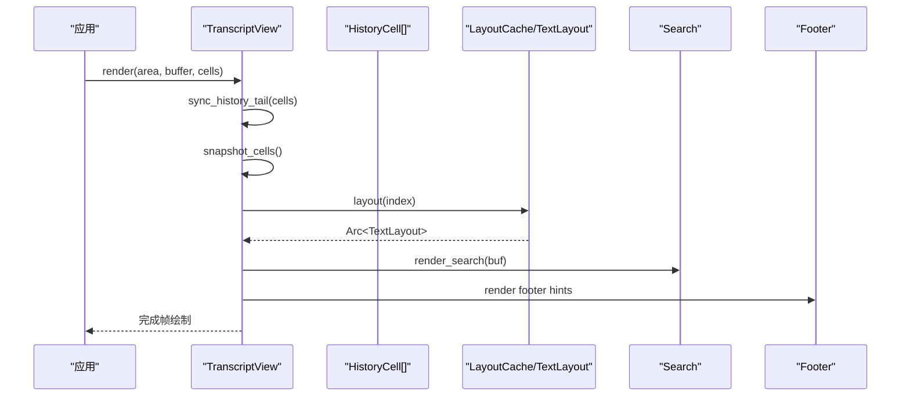

**图表来源**
- [transcript_view.rs:120-360](file://codex-rs/tui/src/transcript_view.rs#L120-L360)
- [layout.rs:120-220](file://codex-rs/tui/src/transcript_view/layout.rs#L120-L220)
- [search.rs:1-40](file://codex-rs/tui/src/transcript_view/search.rs#L1-L40)
- [footer.rs:1-40](file://codex-rs/tui/src/transcript_view/footer.rs#L1-L40)

**章节来源**
- [transcript_view.rs:120-360](file://codex-rs/tui/src/transcript_view.rs#L120-L360)
- [layout.rs:120-220](file://codex-rs/tui/src/transcript_view/layout.rs#L120-L220)

## 详细组件分析

### 转录视图 TranscriptView
- 职责
  - 维护当前位置（最新或阅读锚点）、跟随控制、选择范围、选择模式、复制模式、搜索状态、详细/紧凑模式、历史加载状态。
  - 同步历史尾部，计算可见行，渲染提示头、正文、选择、搜索高亮、底部提示。
  - 为图片放置计算坐标，支持全屏图片预览。
  - 提供跳转到开头/最新、开始/取消搜索、切换呈现模式等方法。
- 关键数据结构
  - EntryKey：区分普通单元格和当前活跃尾部。
  - Anchor：包含单元格键、索引、偏移和行偏置，保证历史变更时阅读位置稳定。
  - VisibleRow：记录可见行对应的逻辑索引、屏幕行号、布局、单元格键和活动 ID。
- 渲染流程要点
  - 每帧先清理区域、同步历史尾部、取快照、准备宽度、规范化选择。
  - 从起始位置逐行布局，遇到空条目跳过，记录 activity_ids 用于折叠控制。
  - 若处于复制模式且发生尺寸变化，调整复制上下文以保留选中块。
  - 最后渲染选择、选择光标、搜索高亮。

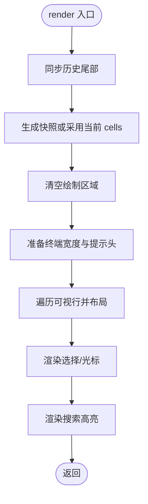

**图表来源**
- [transcript_view.rs:120-320](file://codex-rs/tui/src/transcript_view.rs#L120-L320)

**章节来源**
- [transcript_view.rs:1-260](file://codex-rs/tui/src/transcript_view.rs#L1-L260)
- [transcript_view.rs:260-520](file://codex-rs/tui/src/transcript_view.rs#L260-L520)

### 布局与文本布局 LayoutCache 与 TextLayout
- LayoutCache
  - 限制缓存条目数量与字节大小，避免长期占用内存。
  - 按宽度、主题、前景/背景色、单元格尺寸、动画 tick 等条件失效。
- TextLayout
  - 将 HyperlinkLine 序列解析为逻辑行、可视化行、源文本偏移映射。
  - 支持披露控件插入、前导分隔符、隐藏空白行、图片叠加。
  - 提供 rewrap、visible_plaintext、copy_block_ranges 等方法，确保选择、复制、截图一致性。
- 活动布局
  - 根据是否展开、是否有更多详情，插入“显示详情/隐藏详情”等控制行。
  - 控制行不参与源文本选择，避免破坏复制语义。

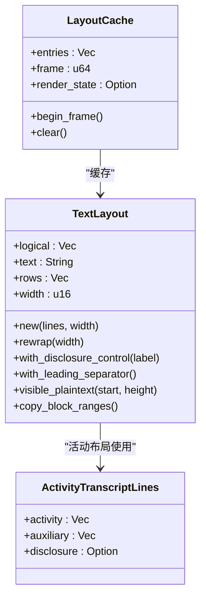

**图表来源**
- [layout.rs:1-120](file://codex-rs/tui/src/transcript_view/layout.rs#L1-L120)
- [text.rs:1-120](file://codex-rs/tui/src/transcript_view/text.rs#L1-L120)

**章节来源**
- [layout.rs:1-220](file://codex-rs/tui/src/transcript_view/layout.rs#L1-L220)
- [text.rs:1-180](file://codex-rs/tui/src/transcript_view/text.rs#L1-L180)

### 历史单元格 HistoryCell 抽象
- 统一接口
  - display_lines：主视图显示逻辑行。
  - raw_lines：原始滚动模式下的纯文本行。
  - transcript_lines/transcript_hyperlink_lines：转录覆盖层使用的行。
  - desired_height/desired_height_for_mode：按宽度计算所需行数。
  - activity_ids/activity_disclosure/expanded_hyperlink_lines：活动折叠与展开详情。
  - has_stable_transcript_height/is_stream_continuation/transcript_animation_tick：缓存稳定性与流式更新。
- 默认实现
  - 使用 Paragraph::line_count 计算高度，适配长 URL、自适应换行。
  - Renderable 实现负责清除旧像素、滚动溢出、渲染超链接段落。

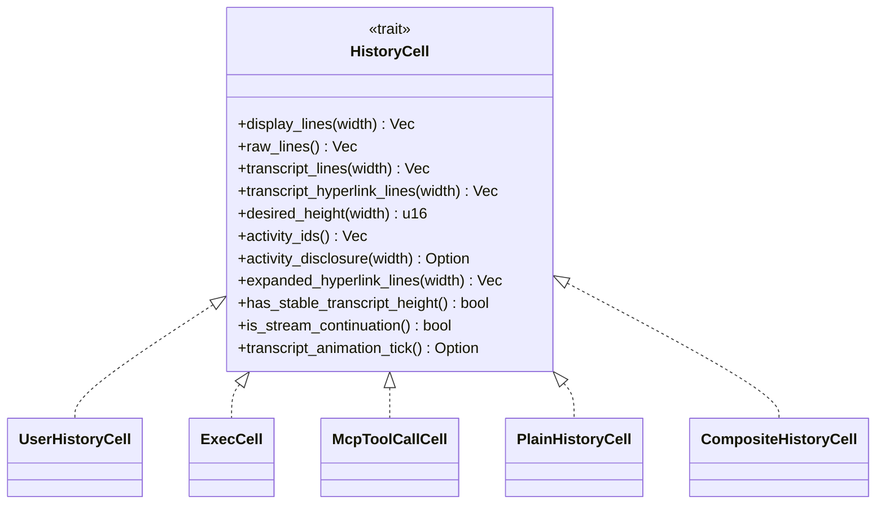

**图表来源**
- [mod.rs:180-390](file://codex-rs/tui/src/history_cell/mod.rs#L180-L390)

**章节来源**
- [mod.rs:180-390](file://codex-rs/tui/src/history_cell/mod.rs#L180-L390)

### 线程转录 ThreadTranscript
- 作用
  - 将后端 Thread 中的 turns 与 items 投影为 HistoryCell 序列。
  - 对 Reasoning、UserMessage、AgentMessage、Plan、CommandExecution、McpToolCall 等进行分类转换。
  - 对工具调用进行分组（计算机活动、探索组），并在无法重建富单元格时回退为 PlainHistoryCell。
- 关键点
  - 音频用户输入不支持 TUI，会发出警告并省略。
  - 无转录内容时显示占位提示。
  - 历史命令与 MCP 工具调用分别构造 ExecCell 与 McpToolCallCell，状态来自持久化字段。

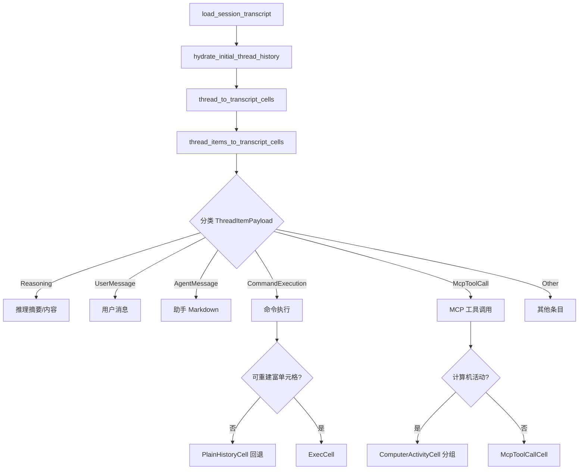

**图表来源**
- [thread_transcript.rs:1-120](file://codex-rs/tui/src/thread_transcript.rs#L1-L120)
- [thread_transcript.rs:260-352](file://codex-rs/tui/src/thread_transcript.rs#L260-L352)
- [tools.rs:1-120](file://codex-rs/tui/src/thread_transcript/tools.rs#L1-L120)

**章节来源**
- [thread_transcript.rs:1-352](file://codex-rs/tui/src/thread_transcript.rs#L1-L352)
- [tools.rs:1-248](file://codex-rs/tui/src/thread_transcript/tools.rs#L1-L248)

## 依赖关系分析
- TranscriptView 依赖
  - history_cell::HistoryCell：所有内容的渲染与高度计算。
  - layout::LayoutCache：宽度过渡与布局缓存。
  - search::Search：查找与高亮。
  - follow_control::FollowControl：跟随最新行为。
  - composer_gap::CopyFeedback：粘贴反馈与辅助行。
  - prompt_header：顶部提示头行。
- HistoryCell 具体类型
  - UserHistoryCell：用户输入，支持语音、Markdown、异步问答。
  - ExecCell：命令执行与后台终端交互。
  - McpToolCallCell：MCP 工具调用结果。
  - PlainHistoryCell：简单文本回退。
  - CompositeHistoryCell：组合多个子单元格。
- ThreadTranscript 依赖
  - app_server_session：读取线程与 hydration。
  - protocol 模型：ThreadItemPayload、UserInput、Plan 等。
  - dynamic_tools：解析委托工具输出。
  - thread_transcript/tools：历史命令/MCP 回退与构建。

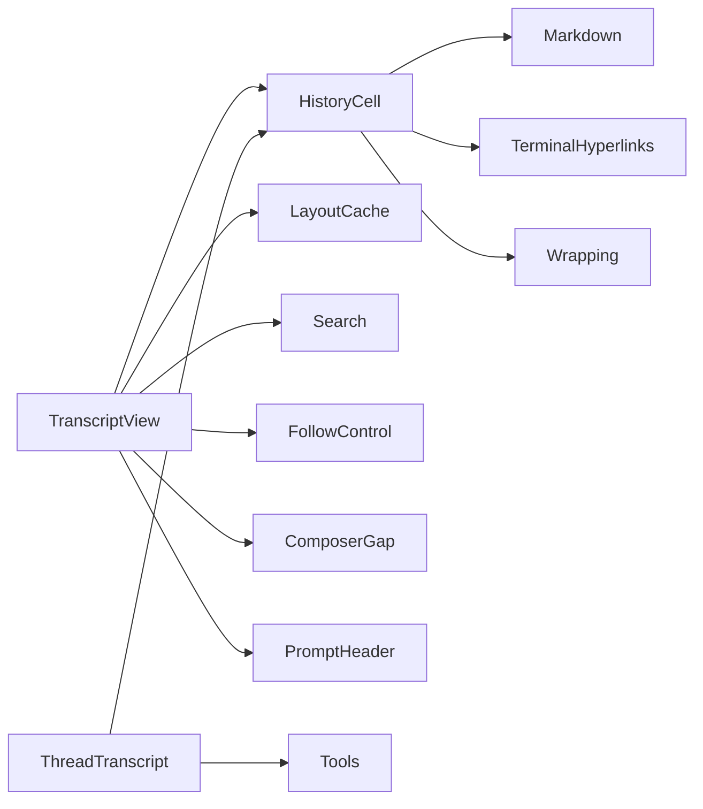

**图表来源**
- [transcript_view.rs:1-120](file://codex-rs/tui/src/transcript_view.rs#L1-L120)
- [mod.rs:1-120](file://codex-rs/tui/src/history_cell/mod.rs#L1-L120)
- [thread_transcript.rs:1-80](file://codex-rs/tui/src/thread_transcript.rs#L1-L80)
- [tools.rs:1-60](file://codex-rs/tui/src/thread_transcript/tools.rs#L1-L60)

**章节来源**
- [transcript_view.rs:1-120](file://codex-rs/tui/src/transcript_view.rs#L1-L120)
- [mod.rs:1-120](file://codex-rs/tui/src/history_cell/mod.rs#L1-L120)
- [thread_transcript.rs:1-80](file://codex-rs/tui/src/thread_transcript.rs#L1-L80)
- [tools.rs:1-60](file://codex-rs/tui/src/thread_transcript/tools.rs#L1-L60)

## 性能与大文本优化
- 可见行与布局缓存
  - 仅缓存最近展示的条目布局，限制条目数量和字节大小。
  - 换行、主题、颜色、单元格尺寸变化会触发部分失效。
  - 活跃尾部使用独立缓存 key，避免频繁重排影响历史。
- 文本布局与选择
  - TextLayout 维护逻辑行、可视化行与源偏移映射，避免重复计算。
  - visible_plaintext 用于冻结视图片段，裁剪选择范围，减少大文本选择开销。
  - copy_block_ranges 识别代码块与引用块，提升复制准确性。
- 历史分页与滚动
  - jump_to_beginning 在存在未加载历史时进入加载状态，而不是立即拉取全部。
  - tail_visible/unseen_activity 标记尾部可见性与未读活动，减少不必要重绘。
- 流式输出
  - StreamState 维护 FIFO 队列，按时间戳与队列深度做节流与分片消费。
  - transcript_animation_tick 允许动画类单元格周期性刷新转录覆盖层。

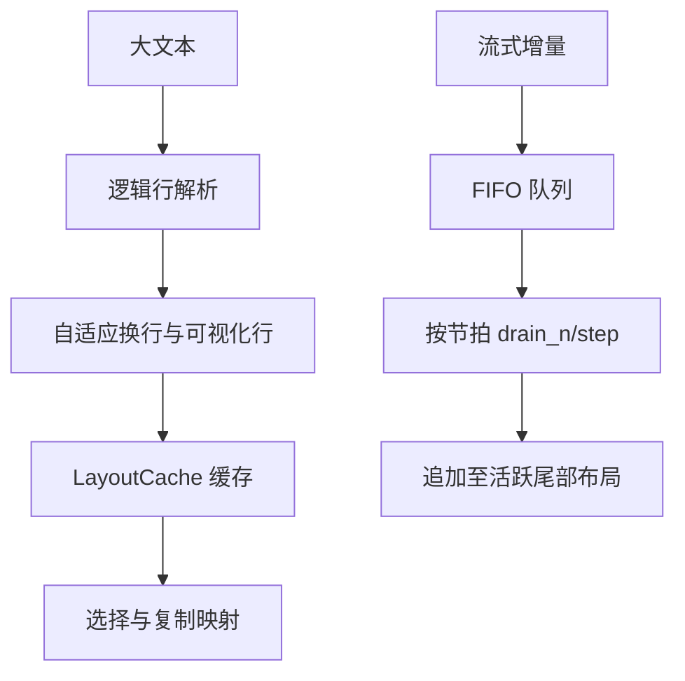

**图表来源**
- [text.rs:1-180](file://codex-rs/tui/src/transcript_view/text.rs#L1-L180)
- [layout.rs:1-120](file://codex-rs/tui/src/transcript_view/layout.rs#L1-L120)
- [mod.rs:1-131](file://codex-rs/tui/src/streaming/mod.rs#L1-L131)

**章节来源**
- [text.rs:1-180](file://codex-rs/tui/src/transcript_view/text.rs#L1-L180)
- [layout.rs:1-120](file://codex-rs/tui/src/transcript_view/layout.rs#L1-L120)
- [mod.rs:1-131](file://codex-rs/tui/src/streaming/mod.rs#L1-L131)

## 交互模式与功能
- 滚动浏览与历史记录
  - 支持跳转到开头、跳转到最新、翻页加载历史。
  - 在加载开头历史时保持跟随状态，必要时滚动到首行。
  - 锚点以 EntryKey+Anchor 表示，历史前置不会重新编号。
- 消息编辑
  - 输入事件处理位于 input.rs，支持点击、双击、Shift 扩展选择、鼠标滚轮速度等。
  - 用户消息支持 typed/spoken/async replies 三种呈现，便于编辑与展示。
- 复制与分享
  - 支持整段复制、代码块复制、表格复制、Markdown 复制。
  - right_click_copy_tests 与 markdown_copy_tests 表明右键复制保留选择与超链接。
  - 复制过程使用 copy_block_ranges 与 source mapping 保证边界准确。
- 搜索
  - search.rs 提供查询、上下文跳转、高亮与选择优先权控制。
  - 搜索激活时暂停自动跟随，避免被新消息推走。
- 活动折叠与详情
  - 活动条目在紧凑模式下提供“显示详情/隐藏详情”控制。
  - 展开后可见 expanded_hyperlink_lines，未展开则仅 compact 展示。

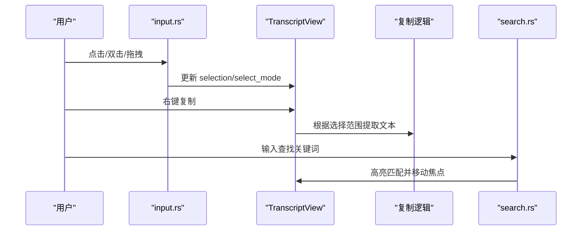

**图表来源**
- [input.rs:1-60](file://codex-rs/tui/src/transcript_view/input.rs#L1-L60)
- [transcript_view.rs:260-520](file://codex-rs/tui/src/transcript_view.rs#L260-L520)
- [search.rs:1-60](file://codex-rs/tui/src/transcript_view/search.rs#L1-L60)

**章节来源**
- [transcript_view.rs:260-520](file://codex-rs/tui/src/transcript_view.rs#L260-L520)
- [input.rs:1-60](file://codex-rs/tui/src/transcript_view/input.rs#L1-L60)
- [search.rs:1-60](file://codex-rs/tui/src/transcript_view/search.rs#L1-L60)

## 历史单元格的数据结构与渲染逻辑
- 用户消息 UserHistoryCell
  - 支持 typed/spoken/async_replies 三种呈现。
  - sanitize_user_text 去除控制字符，保留换行与制表符。
  - build_user_message_lines_with_elements 将元素 span 与原始消息交错，容错无效 UTF-8 范围。
  - 支持本地图片路径与远程图片 URL，保证图像标签不重复。
- 命令执行 ExecCell 与后台终端
  - UnifiedExecInteractionCell：展示等待或交互的后台终端，缩进显示输入。
  - UnifiedExecProcessesCell：列出后台进程，限制最大进程数与长度截断。
- 工具调用
  - CommandHistory/McpHistory：从持久化 item 重建 ExecCell/McpToolCallCell，关闭动画。
  - historical_tool_fallback：当无法重建富单元格时输出状态与摘要。
- 其他
  - Plan、DelegatedMessage、Warnings、StartupWarnings 等均有对应 HistoryCell。

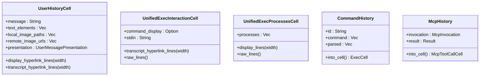

**图表来源**
- [messages.rs:1-120](file://codex-rs/tui/src/history_cell/messages.rs#L1-L120)
- [exec.rs:1-120](file://codex-rs/tui/src/history_cell/exec.rs#L1-L120)
- [tools.rs:120-248](file://codex-rs/tui/src/thread_transcript/tools.rs#L120-L248)

**章节来源**
- [messages.rs:1-260](file://codex-rs/tui/src/history_cell/messages.rs#L1-L260)
- [exec.rs:1-261](file://codex-rs/tui/src/history_cell/exec.rs#L1-L261)
- [tools.rs:1-248](file://codex-rs/tui/src/thread_transcript/tools.rs#L1-L248)

## 转录数据导出与备份
- 导出方法
  - 视图层提供复制能力：支持整段复制、代码块复制、表格复制、Markdown 复制。
  - HistoryCell 暴露 copy_source、raw_lines、transcript_lines 等接口，便于获取结构化或纯文本内容。
  - TextLayout.copy_block_ranges 能识别代码块与引用块的源范围，提高复制质量。
- 备份建议
  - 使用会话归档命令或应用层提供的会话存档功能（例如 session_archive_commands）进行整体备份。
  - 对于需要全文检索或外部处理的场景，可从 HistoryCell.raw_lines 或 transcript_lines 聚合出纯文本，再写入文件或数据库。
  - 图片与富媒体需结合 image_path 与 transcript_image 进行单独保存。

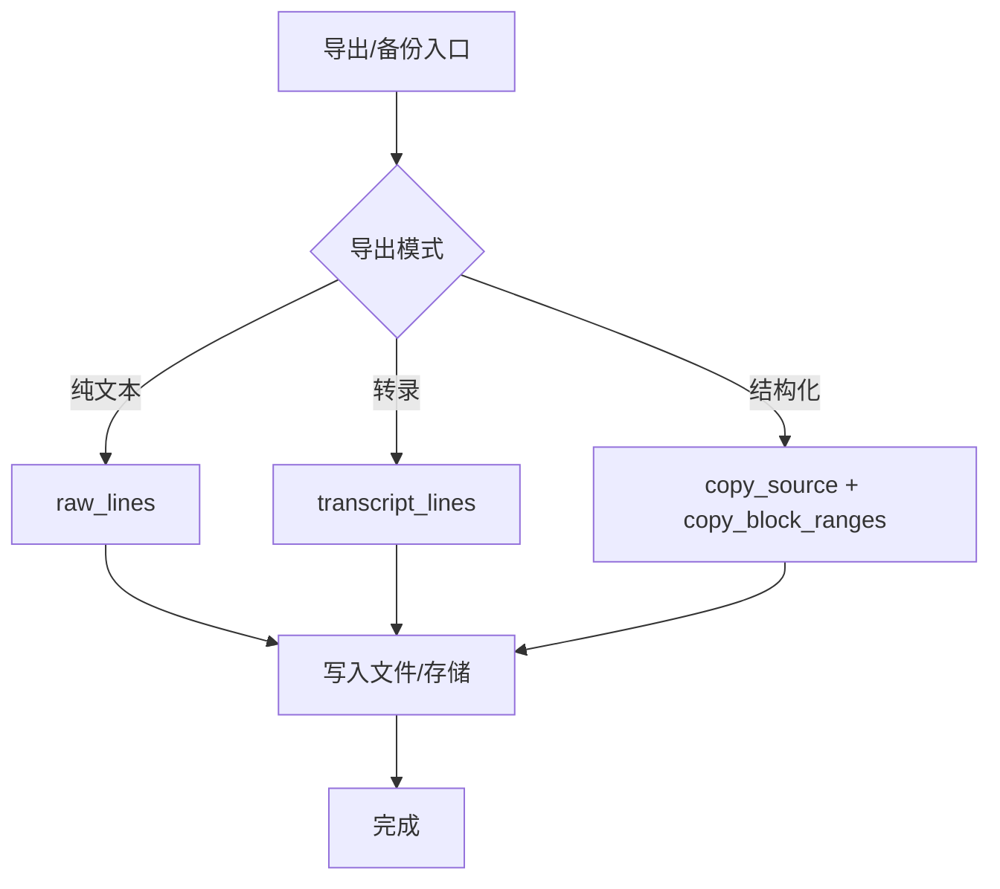

**图表来源**
- [mod.rs:200-320](file://codex-rs/tui/src/history_cell/mod.rs#L200-L320)
- [text.rs:120-220](file://codex-rs/tui/src/transcript_view/text.rs#L120-L220)

**章节来源**
- [mod.rs:200-320](file://codex-rs/tui/src/history_cell/mod.rs#L200-L320)
- [text.rs:120-220](file://codex-rs/tui/src/transcript_view/text.rs#L120-L220)

## 实时流式显示更新机制
- 流式基础设施
  - StreamState 维护 MarkdownStreamCollector 与 FIFO 队列，enqueue 带时间戳，step/drain_n 控制消费速率。
  - 控制器根据队列压力与时间差决定每次提交的行数。
- 视图侧更新
  - sync_live_layout/sync_live_activity_tail 根据 ActiveCellTranscriptKey 判断是否需要重算活跃尾部。
  - live_key 包含 revision 与 is_stream_continuation，避免被动绘制误判为未读活动。
  - unseen_activity 在未跟随且有新修订时标记未读活动。
- 活跃单元格
  - 活跃单元格通过 transcript_animation_tick 通知视图刷新动画内容。
  - 在紧凑模式下，活动可折叠；展开后显示 expanded_hyperlink_lines。

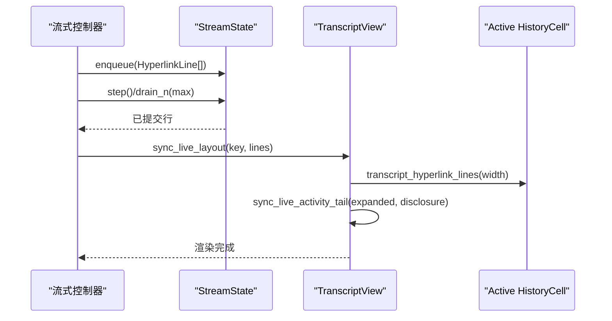

**图表来源**
- [mod.rs:1-131](file://codex-rs/tui/src/streaming/mod.rs#L1-L131)
- [transcript_view.rs:320-520](file://codex-rs/tui/src/transcript_view.rs#L320-L520)
- [mod.rs:300-390](file://codex-rs/tui/src/history_cell/mod.rs#L300-L390)

**章节来源**
- [mod.rs:1-131](file://codex-rs/tui/src/streaming/mod.rs#L1-L131)
- [transcript_view.rs:320-520](file://codex-rs/tui/src/transcript_view.rs#L320-L520)
- [mod.rs:300-390](file://codex-rs/tui/src/history_cell/mod.rs#L300-L390)

## 故障排查指南
- 视图未跟随最新
  - 检查 is_following 条件：未在选择模式、未进行选择、position 为 Latest。
  - 确认 follow_control 状态与 Position::Latest。
- 历史开头加载卡住
  - 检查 TranscriptHistoryState::LoadingBeginning 与 has_unloaded_history。
  - 确认 jump_to_beginning 与 scroll(0) 的调用时机。
- 复制范围异常
  - 检查 copy_block_ranges 与 source mapping 是否正确。
  - 确认 TextLayout.visible_plaintext 裁剪范围与选择边界一致。
- 流式内容不刷新
  - 检查 ActiveCellTranscriptKey.revision 是否变化。
  - 确认 transcript_animation_tick 是否返回随时间变化的 tick。
- 音频用户输入缺失
  - 线程转录会对音频输入发出警告并省略，属预期行为。

**章节来源**
- [transcript_view.rs:420-520](file://codex-rs/tui/src/transcript_view.rs#L420-L520)
- [text.rs:120-220](file://codex-rs/tui/src/transcript_view/text.rs#L120-L220)
- [thread_transcript.rs:260-352](file://codex-rs/tui/src/thread_transcript.rs#L260-L352)

## 结论
对话转录视图通过 TranscriptView、HistoryCell、LayoutCache/TextLayout、Search、Footer、FollowControl、ComposerGap 等组件协作，实现了稳定的历史浏览、灵活的交互、准确的复制与搜索、以及高效的流式更新。线程转录层将后端数据转换为统一的 HistoryCell 序列，使视图专注于表现与交互。在大文本与长时间会话中，布局缓存、可见行管理与流式队列共同保障性能与用户体验。导出与备份可通过复制接口与会话归档机制实现，满足个人与团队需求。