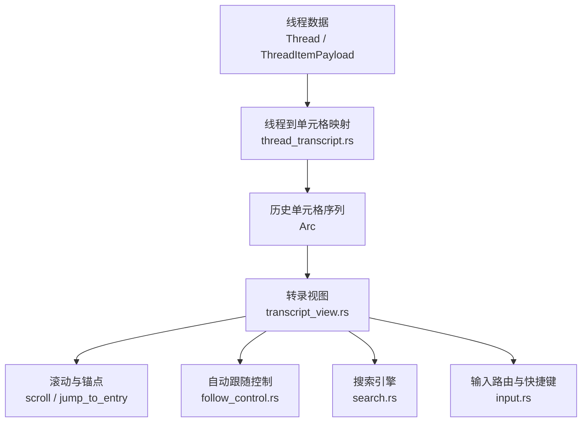
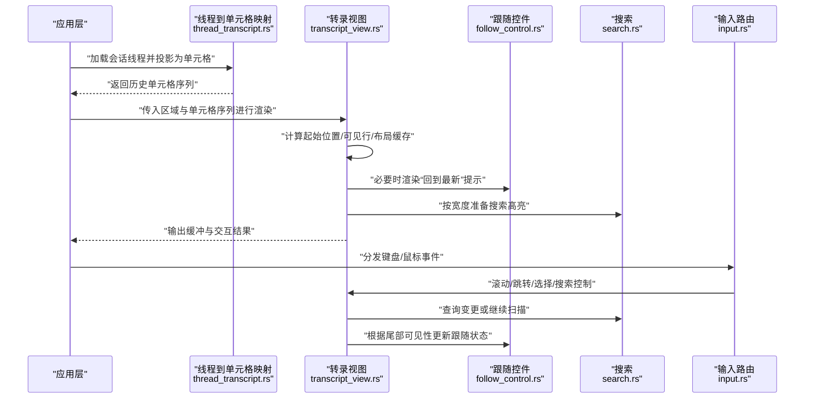
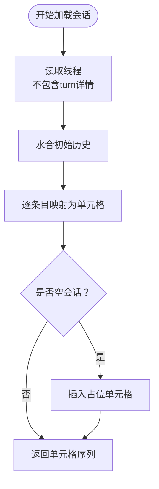
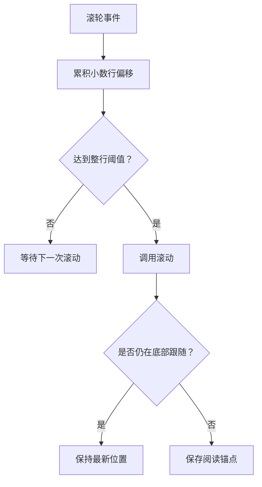
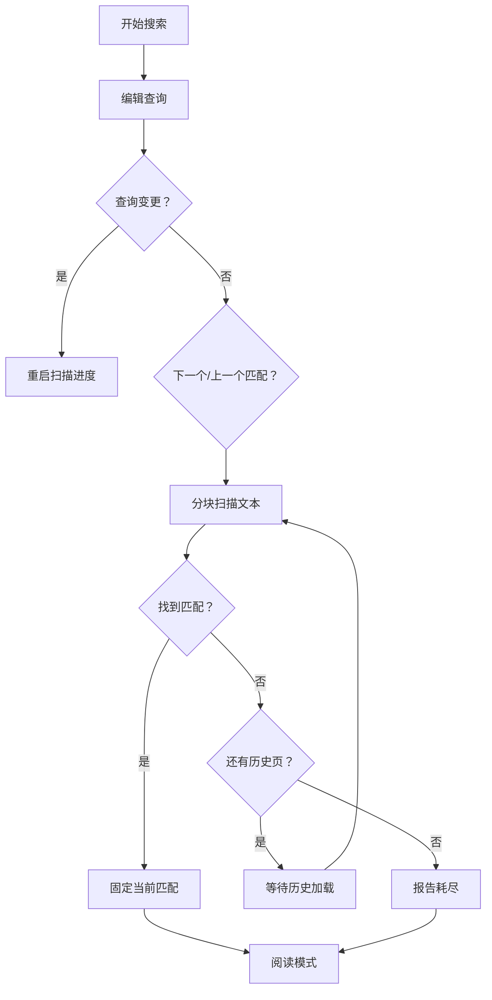
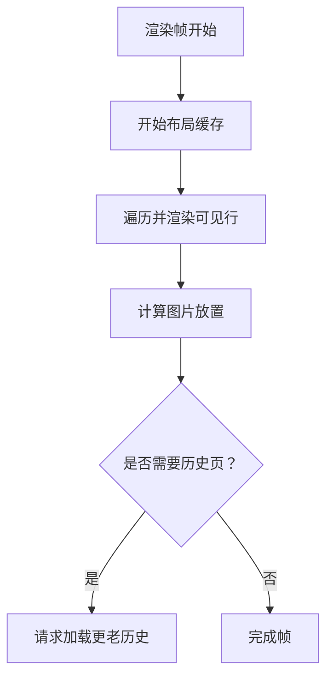
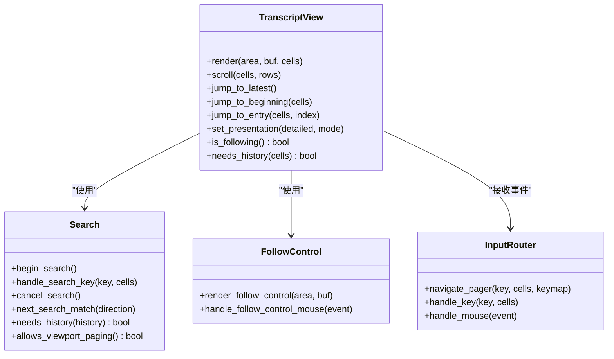

# 线程导航与浏览

<cite>
**本文引用的文件**   
- [thread_transcript.rs](file://codex-rs/tui/src/thread_transcript.rs)
- [transcript_view.rs](file://codex-rs/tui/src/transcript_view.rs)
- [follow_control.rs](file://codex-rs/tui/src/transcript_view/follow_control.rs)
- [search.rs](file://codex-rs/tui/src/transcript_view/search.rs)
- [input.rs](file://codex-rs/tui/src/transcript_view/input.rs)
</cite>

## 目录
1. [引言](#引言)
2. [项目结构](#项目结构)
3. [核心组件](#核心组件)
4. [架构总览](#架构总览)
5. [详细组件分析](#详细组件分析)
6. [依赖关系分析](#依赖关系分析)
7. [性能考量](#性能考量)
8. [故障排查指南](#故障排查指南)
9. [结论](#结论)

## 引言
本文面向终端用户和开发者，系统化说明 Codex TUI 中的“线程导航与浏览”能力。内容覆盖：
- 会话线程切换与历史加载；
- 当前线程状态管理；
- 转录视图滚动策略（平滑滚动、锚点定位、自动跟随新消息）；
- 搜索与过滤（关键词搜索、分页式历史扫描、选择模式下的搜索延续）；
- 键盘快捷键（上下移动、翻页、跳转顶部/底部、快速跳转等）；
- 长会话性能优化（布局缓存、可见行渲染、增量搜索窗口、避免重复重排）。

## 项目结构
与线程导航与浏览直接相关的代码集中在 `codex-rs/tui/src` 下的两个模块：
- `thread_transcript.rs`：负责把后端线程数据投影为可渲染的历史单元格序列。
- `transcript_view/`：负责视图层交互、滚动、锚点、搜索、跟随、选择等。

**图表来源**
- [thread_transcript.rs:1-352](file://codex-rs/tui/src/thread_transcript.rs#L1-L352)
- [transcript_view.rs:1-786](file://codex-rs/tui/src/transcript_view.rs#L1-L786)
- [follow_control.rs:1-111](file://codex-rs/tui/src/transcript_view/follow_control.rs#L1-L111)
- [search.rs:1-957](file://codex-rs/tui/src/transcript_view/search.rs#L1-L957)
- [input.rs:1-569](file://codex-rs/tui/src/transcript_view/input.rs#L1-L569)

**章节来源**
- [thread_transcript.rs:1-352](file://codex-rs/tui/src/thread_transcript.rs#L1-L352)
- [transcript_view.rs:1-120](file://codex-rs/tui/src/transcript_view.rs#L1-L120)

## 核心组件
- 线程到单元格映射器：将后端线程的 turn 与 item 转换为 `HistoryCell` 序列，处理工具调用、命令执行、计划、推理摘要、用户输入等。
- 转录视图：维护阅读位置、跟随状态、可见行、选择、搜索、布局缓存等；负责渲染、滚动、锚点恢复。
- 跟随控件：在偏离底部时提供“回到最新”入口。
- 搜索子系统：支持增量字面量搜索、分页历史扫描、选择模式继承搜索上下文。
- 输入路由：统一鼠标滚轮、按键、链接点击、选择模式、搜索编辑等行为。

**章节来源**
- [thread_transcript.rs:20-60](file://codex-rs/tui/src/thread_transcript.rs#L20-L60)
- [transcript_view.rs:100-170](file://codex-rs/tui/src/transcript_view.rs#L100-L170)
- [follow_control.rs:1-40](file://codex-rs/tui/src/transcript_view/follow_control.rs#L1-L40)
- [search.rs:1-120](file://codex-rs/tui/src/transcript_view/search.rs#L1-L120)
- [input.rs:1-60](file://codex-rs/tui/src/transcript_view/input.rs#L1-L60)

## 架构总览
下图展示从线程加载到视图渲染、交互的主流程：

**图表来源**
- [thread_transcript.rs:40-120](file://codex-rs/tui/src/thread_transcript.rs#L40-L120)
- [transcript_view.rs:200-360](file://codex-rs/tui/src/transcript_view.rs#L200-L360)
- [follow_control.rs:15-111](file://codex-rs/tui/src/transcript_view/follow_control.rs#L15-L111)
- [search.rs:110-220](file://codex-rs/tui/src/transcript_view/search.rs#L110-L220)
- [input.rs:180-340](file://codex-rs/tui/src/transcript_view/input.rs#L180-L340)

## 详细组件分析

### 1. 会话线程切换与历史加载
- 线程加载通过读取线程对象并执行初始历史水合，再转换为 `TranscriptCells`。
- 转换过程对每个 turn 的 items 逐项投影为 `HistoryCell`，并聚合工具活动、探索组、命令执行等。
- 空会话会插入“无转录内容”提示单元格。

关键行为：
- 异步加载线程后，立即水合完整历史并构建单元格列表。
- 推理内容可按配置隐藏或展开。
- 音频用户输入不被 TUI 支持，会被记录警告并省略。

**图表来源**
- [thread_transcript.rs:40-120](file://codex-rs/tui/src/thread_transcript.rs#L40-L120)
- [thread_transcript.rs:201-352](file://codex-rs/tui/src/thread_transcript.rs#L201-L352)

**章节来源**
- [thread_transcript.rs:40-120](file://codex-rs/tui/src/thread_transcript.rs#L40-L120)
- [thread_transcript.rs:201-352](file://codex-rs/tui/src/thread_transcript.rs#L201-L352)

### 2. 当前线程状态管理
转录视图维护以下关键状态：
- `position`：当前位置，可以是“最新”或“阅读中”的锚点。
- `visible`：当前可见行集合，用于仅渲染可视区域。
- `history`：历史分页状态，如空闲、加载中、部分加载、失败等。
- `follow_control`：是否处于自动跟随、是否有未读活动。
- `selection/select_mode/copy_mode`：文本选择、选择模式、复制模式。
- `cache`：布局缓存，避免重复排版。

这些状态共同决定渲染起点、滚动方向、是否自动跟随、是否需要加载更老历史。

**章节来源**
- [transcript_view.rs:100-170](file://codex-rs/tui/src/transcript_view.rs#L100-L170)

### 3. 转录视图滚动行为
#### 3.1 平滑滚动
- 鼠标滚轮事件累积小数行偏移，方向反转时清零，达到整数阈值才触发滚动。
- 速度由 `mouse_scroll_speed` 控制，保留分数部分以适配不同速率。

#### 3.2 锚点定位
- “阅读中”位置使用 `Anchor` 记录条目键、索引、字节偏移与行偏差。
- 预追加历史不会改变已存在条目的编号，因此锚点稳定。
- 换行变化时，通过 `row_bias` 补偿行号偏移，保持阅读位置一致。

#### 3.3 自动跟随新消息
- 当位于最新且没有显式选择或搜索编辑时，视图被视为“跟随”。
- 有新活动且尾部不可见时，显示“回到最新”提示。
- 用户点击提示或按下退出键会跳回最新。

**图表来源**
- [input.rs:260-360](file://codex-rs/tui/src/transcript_view/input.rs#L260-L360)
- [transcript_view.rs:300-420](file://codex-rs/tui/src/transcript_view.rs#L300-L420)
- [follow_control.rs:15-111](file://codex-rs/tui/src/transcript_view/follow_control.rs#L15-L111)

**章节来源**
- [input.rs:240-360](file://codex-rs/tui/src/transcript_view/input.rs#L240-L360)
- [transcript_view.rs:300-420](file://codex-rs/tui/src/transcript_view.rs#L300-L420)
- [follow_control.rs:15-111](file://codex-rs/tui/src/transcript_view/follow_control.rs#L15-L111)

### 4. 搜索与过滤
- 搜索是字面量匹配，支持大小写折叠比较。
- 每次帧只扫描固定字节窗口，避免一次性解析超长文本。
- 到达已加载内容的边界时，若仍需向更老方向查找，则标记需要历史页。
- 接受搜索结果后进入“阅读模式”，取消或返回时恢复原位置和快照。
- 在“选择模式”下，搜索可以继承选择范围与光标偏好列，并在退出选择模式后恢复。

**图表来源**
- [search.rs:110-220](file://codex-rs/tui/src/transcript_view/search.rs#L110-L220)
- [search.rs:650-849](file://codex-rs/tui/src/transcript_view/search.rs#L650-L849)
- [search.rs:850-957](file://codex-rs/tui/src/transcript_view/search.rs#L850-L957)

**章节来源**
- [search.rs:110-220](file://codex-rs/tui/src/transcript_view/search.rs#L110-L220)
- [search.rs:650-849](file://codex-rs/tui/src/transcript_view/search.rs#L650-L849)
- [search.rs:850-957](file://codex-rs/tui/src/transcript_view/search.rs#L850-L957)

### 5. 键盘快捷键操作
转录视图支持的导航与快捷操作包括：
- 翻页：PageUp/PageDown，使用 pager keymap 配置的步长。
- 半页滚动：HalfPageUp/HalfPageDown。
- 单行滚动：ScrollUp/ScrollDown。
- 跳转到顶部：Home 或替代组合键。
- 跳转到最新：End 或替代组合键。
- 回到最新：Esc（当可以返回最新时）。
- 选择模式内：方向键、空格、回车、复制键、Esc 结束选择。
- 搜索模式内：Enter 确认、Ctrl+C 取消、Ctrl+N/Ctrl+P 下一个/上一个匹配。

输入路由优先处理选择、复制、搜索、披露等交互，再回退到通用滚动。

**章节来源**
- [input.rs:180-340](file://codex-rs/tui/src/transcript_view/input.rs#L180-L340)
- [input.rs:340-569](file://codex-rs/tui/src/transcript_view/input.rs#L340-L569)
- [search.rs:184-220](file://codex-rs/tui/src/transcript_view/search.rs#L184-L220)

### 6. 长会话性能优化
- 布局缓存：每帧开始时刷新缓存，避免重复计算行高与折行。
- 可见行渲染：仅渲染当前视口内的行，并跟踪图片放置区域。
- 历史分页：视图不自行分页，而是通过 `TranscriptHistoryState` 请求更老页面。
- 搜索窗口：限制每次扫描的字节数与每帧条目数，降低 CPU 压力。
- 锚点稳定性：基于单元格指针与索引的稳定键值，减少重排导致的位移。

**图表来源**
- [transcript_view.rs:200-360](file://codex-rs/tui/src/transcript_view.rs#L200-L360)
- [search.rs:1-60](file://codex-rs/tui/src/transcript_view/search.rs#L1-L60)

**章节来源**
- [transcript_view.rs:200-360](file://codex-rs/tui/src/transcript_view.rs#L200-L360)
- [search.rs:1-60](file://codex-rs/tui/src/transcript_view/search.rs#L1-L60)

## 依赖关系分析
转录视图依赖以下子系统：
- 历史单元格类型与渲染模式；
- 分页历史状态；
- 超链接行与图像协议；
- 选择与复制模型；
- 密钥映射与运行时快捷键。

**图表来源**
- [transcript_view.rs:100-220](file://codex-rs/tui/src/transcript_view.rs#L100-L220)
- [search.rs:110-220](file://codex-rs/tui/src/transcript_view/search.rs#L110-L220)
- [follow_control.rs:15-111](file://codex-rs/tui/src/transcript_view/follow_control.rs#L15-L111)
- [input.rs:180-340](file://codex-rs/tui/src/transcript_view/input.rs#L180-L340)

**章节来源**
- [transcript_view.rs:100-220](file://codex-rs/tui/src/transcript_view.rs#L100-L220)
- [search.rs:110-220](file://codex-rs/tui/src/transcript_view/search.rs#L110-L220)
- [follow_control.rs:15-111](file://codex-rs/tui/src/transcript_view/follow_control.rs#L15-L111)
- [input.rs:180-340](file://codex-rs/tui/src/transcript_view/input.rs#L180-L340)

## 性能考量
- 布局缓存：避免重复折行与行高计算。
- 可见行裁剪：仅渲染视口内行，减少绘制开销。
- 搜索分块：限制每帧扫描字节与条目数量。
- 锚点稳定：基于条目键与偏移恢复位置，减少因历史增删造成的跳动。
- 图片放置：仅在可见行上收集图片区域，避免全表扫描。

[本节为通用性能建议，不直接分析具体文件]

## 故障排查指南
常见问题与定位思路：
- 滚动卡顿：检查布局缓存是否频繁清空，确认是否在切换呈现模式或宽度变化时触发了大量重排。
- 搜索无结果：确认查询长度未超过上限，检查是否已进入“等待历史”状态，以及是否需要请求更老历史页。
- 自动跟随失效：确认是否存在选择、搜索编辑或活动焦点，这些状态会禁用自动跟随。
- 锚点错位：检查是否在历史分页后恢复了高亮或选择，确保锚点键与当前单元格匹配。

**章节来源**
- [search.rs:850-957](file://codex-rs/tui/src/transcript_view/search.rs#L850-L957)
- [transcript_view.rs:600-786](file://codex-rs/tui/src/transcript_view.rs#L600-L786)
- [follow_control.rs:60-111](file://codex-rs/tui/src/transcript_view/follow_control.rs#L60-L111)

## 结论
Codex TUI 的线程导航与浏览能力由线程到单元格的映射、转录视图的状态机、搜索引擎与输入路由共同构成。其设计强调：
- 稳定的阅读锚点与可见行渲染；
- 渐进式搜索与分页历史加载；
- 智能跟随与“回到最新”的用户反馈；
- 统一的输入路由与快捷键体验。

通过这些机制，系统能够在长会话、复杂内容与频繁交互场景下，仍保持流畅与可预测的浏览体验。