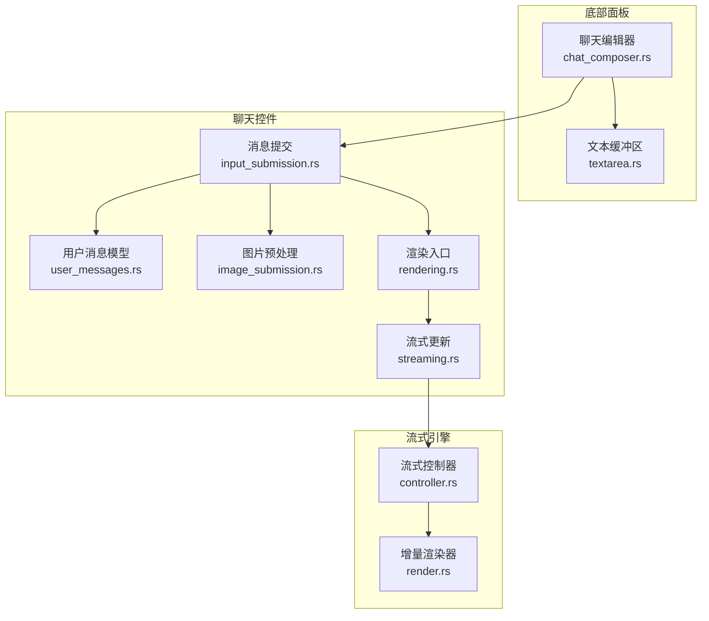
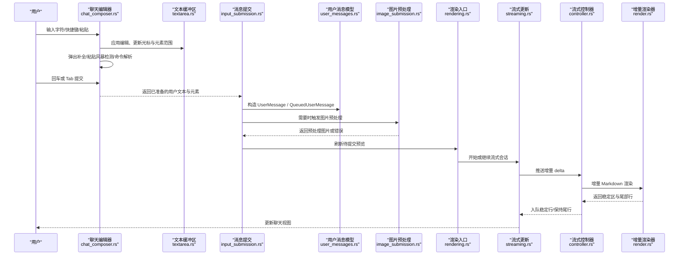
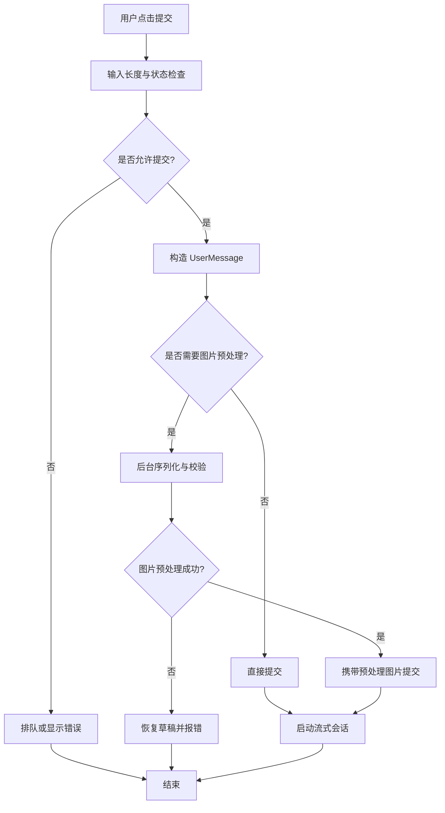
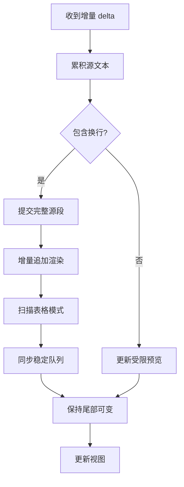

# 聊天组件交互

<cite>
**本文引用的文件**   
- [chat_composer.rs](file://codex-rs/tui/src/bottom_pane/chat_composer.rs)
- [textarea.rs](file://codex-rs/tui/src/bottom_pane/textarea.rs)
- [input_submission.rs](file://codex-rs/tui/src/chatwidget/input_submission.rs)
- [user_messages.rs](file://codex-rs/tui/src/chatwidget/user_messages.rs)
- [image_submission.rs](file://codex-rs/tui/src/chatwidget/image_submission.rs)
- [rendering.rs](file://codex-rs/tui/src/chatwidget/rendering.rs)
- [streaming.rs](file://codex-rs/tui/src/chatwidget/streaming.rs)
- [controller.rs](file://codex-rs/tui/src/streaming/controller.rs)
- [render.rs](file://codex-rs/tui/src/streaming/render.rs)
</cite>

## 目录
1. [简介](#简介)
2. [项目结构与定位](#项目结构与定位)
3. [核心组件总览](#核心组件总览)
4. [架构与数据流](#架构与数据流)
5. [编辑器与输入交互](#编辑器与输入交互)
6. [消息发送流程](#消息发送流程)
7. [复制、分享与删除操作](#复制分享与删除操作)
8. [实时流式显示机制](#实时流式显示机制)
9. [富媒体支持：文件上传、图片预览与代码片段](#富媒体支持文件上传图片预览与代码片段)
10. [自定义命令与快捷操作配置](#自定义命令与快捷操作配置)
11. [性能与优化要点](#性能与优化要点)
12. [故障排查](#故障排查)
13. [结论](#结论)

## 简介
本文面向 TUI 聊天界面中的“聊天组件”，围绕用户输入编辑、消息发送、消息后处理、流式渲染和富媒体能力进行系统化说明。该实现位于 `codex-rs/tui`，核心由底部面板的聊天编辑器、聊天控件的消息提交与流式更新、以及通用流式控制器共同构成。文档既给出高层流程，也提供对应源码路径，帮助读者从用户行为追踪到具体模块。

## 项目结构与定位
聊天组件交互涉及两个主要层次：
- 底部面板层：负责文本编辑、快捷键、弹出补全、附件展示、粘贴风暴检测等。
- 聊天控件层：负责把编辑器内容构造成用户消息、排队并提交、接收后端响应并驱动流式渲染。

**图示来源**
- [chat_composer.rs:1-221](file://codex-rs/tui/src/bottom_pane/chat_composer.rs#L1-L221)
- [textarea.rs:1-260](file://codex-rs/tui/src/bottom_pane/textarea.rs#L1-L260)
- [input_submission.rs:1-200](file://codex-rs/tui/src/chatwidget/input_submission.rs#L1-L200)
- [user_messages.rs:1-200](file://codex-rs/tui/src/chatwidget/user_messages.rs#L1-L200)
- [image_submission.rs:1-174](file://codex-rs/tui/src/chatwidget/image_submission.rs#L1-L174)
- [rendering.rs:1-200](file://codex-rs/tui/src/chatwidget/rendering.rs#L1-L200)
- [streaming.rs:1-200](file://codex-rs/tui/src/chatwidget/streaming.rs#L1-L200)
- [controller.rs:1-220](file://codex-rs/tui/src/streaming/controller.rs#L1-L220)
- [render.rs:1-220](file://codex-rs/tui/src/streaming/render.rs#L1-L220)

**章节来源**
- [chat_composer.rs:1-221](file://codex-rs/tui/src/bottom_pane/chat_composer.rs#L1-L221)
- [textarea.rs:1-260](file://codex-rs/tui/src/bottom_pane/textarea.rs#L1-L260)
- [input_submission.rs:1-200](file://codex-rs/tui/src/chatwidget/input_submission.rs#L1-L200)
- [user_messages.rs:1-200](file://codex-rs/tui/src/chatwidget/user_messages.rs#L1-L200)
- [image_submission.rs:1-174](file://codex-rs/tui/src/chatwidget/image_submission.rs#L1-L174)
- [rendering.rs:1-200](file://codex-rs/tui/src/chatwidget/rendering.rs#L1-L200)
- [streaming.rs:1-200](file://codex-rs/tui/src/chatwidget/streaming.rs#L1-L200)
- [controller.rs:1-220](file://codex-rs/tui/src/streaming/controller.rs#L1-L220)
- [render.rs:1-220](file://codex-rs/tui/src/streaming/render.rs#L1-L220)

## 核心组件总览
- **聊天编辑器**：维护可编辑文本、光标、换行、Vim 模式、粘贴风暴检测、弹出菜单（命令、文件、技能、提及）、远程图片行选择与删除。
- **文本缓冲区**：维护原始 UTF-8 文本、原子元素范围、单行/多行模式、换行缓存、鼠标选择、剪贴板粘贴目标、Vim 键位映射。
- **消息提交**：将编辑器状态转换为 `UserMessage`，处理本地/远程图片、引用绑定、队列策略、安全恢复、Shell 命令前缀。
- **用户消息模型**：定义消息文本、图片、文本元素、引用绑定、队列项、线程输入状态、投递语义。
- **图片预处理**：在后台序列化本地图片、校验大小限制、取消或失败时恢复草稿。
- **渲染入口**：组合活跃单元格、外部写入提示、实时待处理历史单元、准备编辑器图片协议。
- **流式更新**：聚合助手回答、计划与推理流，合并完成态，控制滚动回滚重排、使用状态指示、停止提交动画。
- **流式控制器**：双区域流式模型（稳定区 + 尾部），表格延迟提交、增量 Markdown 渲染、宽度变化重建。
- **增量渲染器**：按顶层 Markdown 块边界保留已稳定部分，仅对最后块增量重渲染，处理数学公式、参考链接、Mermaid 图、代码围栏。

**章节来源**
- [chat_composer.rs:1-221](file://codex-rs/tui/src/bottom_pane/chat_composer.rs#L1-L221)
- [textarea.rs:1-260](file://codex-rs/tui/src/bottom_pane/textarea.rs#L1-L260)
- [input_submission.rs:1-200](file://codex-rs/tui/src/chatwidget/input_submission.rs#L1-L200)
- [user_messages.rs:1-200](file://codex-rs/tui/src/chatwidget/user_messages.rs#L1-L200)
- [image_submission.rs:1-174](file://codex-rs/tui/src/chatwidget/image_submission.rs#L1-L174)
- [rendering.rs:1-200](file://codex-rs/tui/src/chatwidget/rendering.rs#L1-L200)
- [streaming.rs:1-200](file://codex-rs/tui/src/chatwidget/streaming.rs#L1-L200)
- [controller.rs:1-220](file://codex-rs/tui/src/streaming/controller.rs#L1-L220)
- [render.rs:1-220](file://codex-rs/tui/src/streaming/render.rs#L1-L220)

## 架构与数据流
聊天交互的整体数据流如下：

**图示来源**
- [chat_composer.rs:2027-2380](file://codex-rs/tui/src/bottom_pane/chat_composer.rs#L2027-L2380)
- [textarea.rs:1-260](file://codex-rs/tui/src/bottom_pane/textarea.rs#L1-L260)
- [input_submission.rs:1-200](file://codex-rs/tui/src/chatwidget/input_submission.rs#L1-L200)
- [user_messages.rs:1-200](file://codex-rs/tui/src/chatwidget/user_messages.rs#L1-L200)
- [image_submission.rs:1-174](file://codex-rs/tui/src/chatwidget/image_submission.rs#L1-L174)
- [rendering.rs:1-200](file://codex-rs/tui/src/chatwidget/rendering.rs#L1-L200)
- [streaming.rs:1-200](file://codex-rs/tui/src/chatwidget/streaming.rs#L1-L200)
- [controller.rs:1-220](file://codex-rs/tui/src/streaming/controller.rs#L1-L220)
- [render.rs:1-220](file://codex-rs/tui/src/streaming/render.rs#L1-L220)

## 编辑器与输入交互

### 多行输入与换行行为
- 编辑器支持多行文本；单行输入模式忽略换行并水平滚动。
- 换行缓存包含每行逻辑范围的映射，便于快速渲染与鼠标选择。
- 软换行时内部分隔符不进入可编辑文本，但保留可见插入点，避免光标跳出编辑器区域。
- 长文本粘贴时使用占位符防止 UI 卡顿，随后异步展开。

相关实现位置：
- [textarea.rs:1-260](file://codex-rs/tui/src/bottom_pane/textarea.rs#L1-L260)

### 撤销与重做
- 编辑器维护 Vim 模式、操作状态、插入状态与搜索状态，并在普通模式和插入模式下分别路由键盘事件。
- 注释明确说明 Vim 撤销/重做会记录完整草稿快照，并与 Vim 事务分组直接编辑结合。
- 普通模式下的 Ctrl+R 用于重做；插入模式下的 Ctrl+R 保留提示历史搜索行为。

相关实现位置：
- [textarea.rs:1-260](file://codex-rs/tui/src/bottom_pane/textarea.rs#L1-L260)
- [chat_composer.rs:90-110](file://codex-rs/tui/src/bottom_pane/chat_composer.rs#L90-L110)

### 自动补全与弹出菜单
- 支持命令补全、文件搜索、技能补全、新式提及补全。
- 补全候选列表渲染在编辑器上方，不会遮挡底部提示栏。
- 选中补全值后，编辑器会在原子文本边界处插入结果，必要时插入空格或分隔符，避免与原子元素粘连。
- Esc 关闭补全时会记录当前 token，从而在相同 token 下抑制重复弹出。

相关实现位置：
- [chat_composer.rs:55-90](file://codex-rs/tui/src/bottom_pane/chat_composer.rs#L55-L90)
- [chat_composer.rs:2027-2380](file://codex-rs/tui/src/bottom_pane/chat_composer.rs#L2027-L2380)

### 语法高亮
- 编辑器本身是纯文本缓冲区和键位处理器，不进行 Markdown 语法高亮。
- 聊天内容的 Markdown 高亮、代码围栏、表格、Mermaid 图、数学公式等由流式渲染器和 Markdown 渲染管线处理。
- 主题修订通过统一接口参与流式渲染，确保颜色一致。

相关实现位置：
- [textarea.rs:1-260](file://codex-rs/tui/src/bottom_pane/textarea.rs#L1-L260)
- [render.rs:1-220](file://codex-rs/tui/src/streaming/render.rs#L1-L220)
- [controller.rs:1-220](file://codex-rs/tui/src/streaming/controller.rs#L1-L220)

### 粘贴风暴与非方括号粘贴检测
- Windows 等终端可能以快速字符事件形式发送粘贴内容。
- 编辑器先短暂持有第一个 ASCII 字符或技能补全标点，判断是否为粘贴风暴。
- 非 ASCII 输入走专用路径，避免误判 IME 输入为粘贴。
- 粘贴风暴被识别后，文本被批量插入，而不是逐字触发快捷键 UI。

相关实现位置：
- [chat_composer.rs:260-308](file://codex-rs/tui/src/bottom_pane/chat_composer.rs#L260-L308)
- [chat_composer.rs:2027-2380](file://codex-rs/tui/src/bottom_pane/chat_composer.rs#L2027-L2380)

### 快捷键与回车、Tab 行为
- 回车立即提交；任务运行中 Tab 请求排队，未运行任务时 Tab 同样提交，避免输入丢失。
- 输入禁用状态下编辑器只渲染占位提示，不接受编辑。
- 空编辑器且启用斜杠命令时，普通模式 `/` 进入插入并打开命令补全。
- 大量快捷键分发集中在 `handle_key_event` 与内部路由函数。

相关实现位置：
- [chat_composer.rs:140-147](file://codex-rs/tui/src/bottom_pane/chat_composer.rs#L140-L147)
- [chat_composer.rs:308-358](file://codex-rs/tui/src/bottom_pane/chat_composer.rs#L308-L358)
- [chat_composer.rs:2027-2380](file://codex-rs/tui/src/bottom_pane/chat_composer.rs#L2027-L2380)

## 消息发送流程

### 用户消息构造
编辑器提交后，聊天控件调用消息构造方法，将以下信息合并为用户消息：
- 编辑器文本
- 本地图片附件
- 远程图片 URL
- 文本元素范围
- 最近使用的提及绑定

关键路径：
- [input_submission.rs:1-200](file://codex-rs/tui/src/chatwidget/input_submission.rs#L1-L200)
- [user_messages.rs:1-200](file://codex-rs/tui/src/chatwidget/user_messages.rs#L1-L200)

### 输入验证
- 用户输入超过最大字符数时生成错误提示。
- 存在对齐策略违规、速率限制恢复等待、待上传图片、安全恢复进行中时，普通提交会被拒绝或改为排队。
- Shell 命令前缀 `!` 有专门处理：空命令显示帮助，非空命令转为执行；若策略禁止 Shell 转义，则作为字面量输入。

关键路径：
- [chat_composer.rs:440-520](file://codex-rs/tui/src/bottom_pane/chat_composer.rs#L440-L520)
- [input_submission.rs:1-200](file://codex-rs/tui/src/chatwidget/input_submission.rs#L1-L200)

### 网络请求与会话状态
- 提交成功后，聊天控件清空或清理编辑器状态，同时刷新待提交预览。
- 如果图片尚未完成预处理，消息会进入待提交队列，图片完成后重新提交。
- 提交过程中，聊天控件会更新活动状态、底部状态指示、任务运行标记、代理轮次状态。

关键路径：
- [input_submission.rs:1-200](file://codex-rs/tui/src/chatwidget/input_submission.rs#L1-L200)
- [user_messages.rs:1-200](file://codex-rs/tui/src/chatwidget/user_messages.rs#L1-L200)

### 错误处理
- 图片预处理失败时，将错误消息加入聊天历史，并将原消息恢复到编辑器。
- 队列恢复标记用于后续重连或恢复流程，避免重复或丢失消息。
- 速率限制恢复期间，新输入会排队而非直接发送。

关键路径：
- [image_submission.rs:1-174](file://codex-rs/tui/src/chatwidget/image_submission.rs#L1-L174)
- [user_messages.rs:1-200](file://codex-rs/tui/src/chatwidget/user_messages.rs#L1-L200)

**图示来源**
- [input_submission.rs:1-200](file://codex-rs/tui/src/chatwidget/input_submission.rs#L1-L200)
- [image_submission.rs:1-174](file://codex-rs/tui/src/chatwidget/image_submission.rs#L1-L174)
- [user_messages.rs:1-200](file://codex-rs/tui/src/chatwidget/user_messages.rs#L1-L200)

**章节来源**
- [input_submission.rs:1-200](file://codex-rs/tui/src/chatwidget/input_submission.rs#L1-L200)
- [user_messages.rs:1-200](file://codex-rs/tui/src/chatwidget/user_messages.rs#L1-L200)
- [image_submission.rs:1-174](file://codex-rs/tui/src/chatwidget/image_submission.rs#L1-L174)

## 复制、分享与删除操作

### 复制
- 编辑器支持选中文字复制；右键复制保留选区直到确认，并保持阅读位置。
- 聊天内容的 Markdown 复制、HTML 复制、表格复制、代码块复制由转录视图与 Markdown 复制模块处理。
- 编辑器复制作出独立于撤销重做的剪贴板语义；原子元素复制会得到新标识和标签。

相关实现位置：
- [chat_composer.rs:3-9](file://codex-rs/tui/src/bottom_pane/chat_composer.rs#L3-L9)
- [transcript_view/markdown_copy_tests.rs](file://codex-rs/tui/src/transcript_view/markdown_copy_tests.rs)
- [transcript_view/right_click_copy_tests.rs](file://codex-rs/tui/src/transcript_view/right_click_copy_tests.rs)

### 分享
- 代码仓库中没有直接名为“分享”的聊天消息分享逻辑；常见的分享通常通过复制、导出对话、截图或外部系统分享完成。
- 如果需要扩展分享能力，建议基于现有复制与导出能力，增加导出为文件或调用系统分享 API。

### 删除
- 编辑器支持删除、退格、Vim 删除操作，并同步更新原子元素范围和剪贴板寄存器。
- 远程图片行支持向上导航选择并使用 Delete/Backspace 删除。
- 删除远程图片行后会重新编号本地图片占位符，保证编号连续。

相关实现位置：
- [chat_composer.rs:244-255](file://codex-rs/tui/src/bottom_pane/chat_composer.rs#L244-L255)
- [chat_composer.rs:3574-3961](file://codex-rs/tui/src/bottom_pane/chat_composer.rs#L3574-L3961)
- [textarea.rs:1-260](file://codex-rs/tui/src/bottom_pane/textarea.rs#L1-L260)

**章节来源**
- [chat_composer.rs:3-9](file://codex-rs/tui/src/bottom_pane/chat_composer.rs#L3-L9)
- [chat_composer.rs:244-255](file://codex-rs/tui/src/bottom_pane/chat_composer.rs#L244-L255)
- [chat_composer.rs:3574-3961](file://codex-rs/tui/src/bottom_pane/chat_composer.rs#L3574-L3961)
- [textarea.rs:1-260](file://codex-rs/tui/src/bottom_pane/textarea.rs#L1-L260)

## 实时流式显示机制

### 流式控制器与双区域模型
流式控制器维护两个区域：
- 稳定区：已提交到滚动历史的渲染行。
- 尾部区：可变、在活跃单元格中显示的临时流尾。

每次收到增量 delta 时：
- 累积源文本。
- 遇到换行时提交完整源段。
- 调用增量渲染器追加已稳定前缀，仅重绘最后顶层 Markdown 块。
- 扫描表格模式，决定表格内容是否延迟到尾部。
- 同步稳定区队列，避免频繁滚动重排。

相关实现位置：
- [controller.rs:1-220](file://codex-rs/tui/src/streaming/controller.rs#L1-L220)

### 增量渲染器与稳定性边界
增量渲染器按 Markdown 顶层块边界拆分：
- 已完成块保留不变。
- 最后一个块可变，随新行增量重渲染。
- 特殊结构如参考链接、内联可视化指令、Mermaid 图、数学公式会触发整源重算或尾部处理。
- 代码围栏检测可追加的开放围栏，减少不必要重渲染。

相关实现位置：
- [render.rs:1-220](file://codex-rs/tui/src/streaming/render.rs#L1-L220)

### 防抖与性能优化
- 仅在换行提交稳定区，避免部分行进入稳定队列导致表格列错位。
- 未终止的行进入受限预览，不参与稳定边界推进。
- 表格延迟提交，直到包含表格的顶层块稳定。
- 宽度变化时重建渲染并重新计算稳定区长度，避免字节级映射复杂度。
- 流式结束后统一汇总 Markdown 源，以便调整大小时可重新渲染。

相关实现位置：
- [controller.rs:1-220](file://codex-rs/tui/src/streaming/controller.rs#L1-L220)
- [render.rs:1-220](file://codex-rs/tui/src/streaming/render.rs#L1-L220)

### 流式更新与聊天控件协作
聊天控件负责：
- 保存助手答案与计划源。
- 清空活跃流尾。
- 根据是否需要滚动回滚重排，决定是否延迟提交历史单元格。
- 在流结束时停止提交动画，恢复底部状态指示。

相关实现位置：
- [streaming.rs:1-200](file://codex-rs/tui/src/chatwidget/streaming.rs#L1-L200)

**图示来源**
- [controller.rs:1-220](file://codex-rs/tui/src/streaming/controller.rs#L1-L220)
- [render.rs:1-220](file://codex-rs/tui/src/streaming/render.rs#L1-L220)

**章节来源**
- [controller.rs:1-220](file://codex-rs/tui/src/streaming/controller.rs#L1-L220)
- [render.rs:1-220](file://codex-rs/tui/src/streaming/render.rs#L1-L220)
- [streaming.rs:1-200](file://codex-rs/tui/src/chatwidget/streaming.rs#L1-L200)

## 富媒体支持：文件上传、图片预览与代码片段

### 图片上传与预览
- 编辑器支持本地图片附件与远程图片 URL。
- 本地图片在后台任务中序列化，校验传输大小上限，避免阻塞主事件循环。
- 预处理成功后，消息携带结构化图片输入；失败时恢复草稿并报错。
- 远程图片在编辑器中以 `[Image #N]` 行显示，支持导航选择与删除。

相关实现位置：
- [image_submission.rs:1-174](file://codex-rs/tui/src/chatwidget/image_submission.rs#L1-L174)
- [chat_composer.rs:244-255](file://codex-rs/tui/src/bottom_pane/chat_composer.rs#L244-L255)
- [rendering.rs:1-200](file://codex-rs/tui/src/chatwidget/rendering.rs#L1-L200)

### 文件搜索与引用
- 编辑器支持文件搜索弹出框，用户可选择文件路径插入到消息中。
- 文件路径可作为文本元素插入，避免与周围文本混排。

相关实现位置：
- [chat_composer.rs:4025-4207](file://codex-rs/tui/src/bottom_pane/chat_composer.rs#L4025-L4207)

### 代码片段与 Markdown 渲染
- 代码片段以 Markdown 代码围栏表达。
- 流式渲染器检测开放代码围栏，支持增量追加，并在稳定后进入滚动历史。
- Mermaid 图等可视化内容在流式阶段保持尾部，最终由转录视图汇总渲染。

相关实现位置：
- [render.rs:1-220](file://codex-rs/tui/src/streaming/render.rs#L1-L220)
- [controller.rs:1-220](file://codex-rs/tui/src/streaming/controller.rs#L1-L220)

**章节来源**
- [image_submission.rs:1-174](file://codex-rs/tui/src/chatwidget/image_submission.rs#L1-L174)
- [chat_composer.rs:244-255](file://codex-rs/tui/src/bottom_pane/chat_composer.rs#L244-L255)
- [chat_composer.rs:4025-4207](file://codex-rs/tui/src/bottom_pane/chat_composer.rs#L4025-L4207)
- [rendering.rs:1-200](file://codex-rs/tui/src/chatwidget/rendering.rs#L1-L200)
- [render.rs:1-220](file://codex-rs/tui/src/streaming/render.rs#L1-L220)
- [controller.rs:1-220](file://codex-rs/tui/src/streaming/controller.rs#L1-L220)

## 自定义命令与快捷操作配置

### 斜杠命令
- 编辑器支持斜杠命令解析、参数提取、本地命令历史暂存。
- 命令补全弹出框与命令验证分离：解析发生在编辑器，调度与状态检查发生在聊天控件。
- 父拥有的子代理线程中，部分命令被阻止，仅允许导航与本地显示命令。

相关实现位置：
- [chat_composer.rs:110-170](file://codex-rs/tui/src/bottom_pane/chat_composer.rs#L110-L170)
- [chat_composer.rs:518-573](file://codex-rs/tui/src/bottom_pane/chat_composer.rs#L518-L573)

### 快捷键与 Vim 模式
- 编辑器使用运行时键位映射，包括编辑器键位、Vim 普通模式、操作模式、搜索模式、文本对象模式。
- 动态配置更新时，仅替换键位缓存，不影响当前草稿、光标或 Vim 模式。
- Vim 撤销/重做与编辑器编辑历史集成，支持普通模式与插入模式的不同行为。

相关实现位置：
- [textarea.rs:1-260](file://codex-rs/tui/src/bottom_pane/textarea.rs#L1-L260)
- [chat_composer.rs:90-110](file://codex-rs/tui/src/bottom_pane/chat_composer.rs#L90-L110)

### 快捷操作配置方式
- 通过运行时键位映射注入编辑器与 Vim 键位。
- 快捷键可在不同上下文下改变行为，例如普通模式 `/` 打开命令补全。
- 快捷键提示与底部状态栏联动，帮助用户理解当前可用操作。

相关实现位置：
- [textarea.rs:1-260](file://codex-rs/tui/src/bottom_pane/textarea.rs#L1-L260)
- [chat_composer.rs:55-90](file://codex-rs/tui/src/bottom_pane/chat_composer.rs#L55-L90)

**章节来源**
- [chat_composer.rs:110-170](file://codex-rs/tui/src/bottom_pane/chat_composer.rs#L110-L170)
- [chat_composer.rs:518-573](file://codex-rs/tui/src/bottom_pane/chat_composer.rs#L518-L573)
- [textarea.rs:1-260](file://codex-rs/tui/src/bottom_pane/textarea.rs#L1-L260)
- [chat_composer.rs:90-110](file://codex-rs/tui/src/bottom_pane/chat_composer.rs#L90-L110)

## 性能与优化要点
- 编辑器避免逐字触发快捷键 UI，通过粘贴风暴检测批量插入。
- 大文本粘贴使用占位符，避免 UI 卡顿。
- 流式渲染按顶层 Markdown 块稳定化，仅重绘尾部，减少重排成本。
- 表格延迟提交，避免新增行导致全部列宽重算。
- 宽度变化时重建渲染，但避免字节级映射复杂性。
- 流式结束后统一汇总源文本，支持后续调整大小时高效重渲染。

[本节为通用性能讨论，不直接分析具体文件]

## 故障排查

### 图片上传失败
- 现象：图片过大、序列化失败或传输限制超出。
- 处理：错误消息加入聊天历史，原消息恢复到编辑器，队列恢复标记设置。
- 排查：检查本地图片路径、文件大小、远程图片 URL 大小。

相关实现位置：
- [image_submission.rs:1-174](file://codex-rs/tui/src/chatwidget/image_submission.rs#L1-L174)

### 消息未提交或重复
- 现象：输入被拒绝、排队或重复。
- 处理：检查速率限制恢复、对齐策略违规、安全恢复、待上传图片。
- 排查：查看用户消息队列、投递状态、历史记录记录类型。

相关实现位置：
- [input_submission.rs:1-200](file://codex-rs/tui/src/chatwidget/input_submission.rs#L1-L200)
- [user_messages.rs:1-200](file://codex-rs/tui/src/chatwidget/user_messages.rs#L1-L200)

### 流式渲染闪烁或错行
- 现象：表格列错位、尾部不稳定、宽度变化后布局异常。
- 处理：确认换行提交、表格延迟提交、宽度重建逻辑。
- 排查：检查流式控制器稳定区与尾部长度、增量渲染器边界。

相关实现位置：
- [controller.rs:1-220](file://codex-rs/tui/src/streaming/controller.rs#L1-L220)
- [render.rs:1-220](file://codex-rs/tui/src/streaming/render.rs#L1-L220)

**章节来源**
- [image_submission.rs:1-174](file://codex-rs/tui/src/chatwidget/image_submission.rs#L1-L174)
- [input_submission.rs:1-200](file://codex-rs/tui/src/chatwidget/input_submission.rs#L1-L200)
- [user_messages.rs:1-200](file://codex-rs/tui/src/chatwidget/user_messages.rs#L1-L200)
- [controller.rs:1-220](file://codex-rs/tui/src/streaming/controller.rs#L1-L220)
- [render.rs:1-220](file://codex-rs/tui/src/streaming/render.rs#L1-L220)

## 结论
聊天组件交互由底部面板编辑器和聊天控件共同实现：编辑器负责输入体验与快捷键，聊天控件负责消息构建、图片预处理、队列与状态管理，流式引擎负责增量渲染与性能优化。整体设计强调稳定性、可恢复性和可扩展性，适合在终端环境中提供流畅的对话体验。如需扩展分享、语法高亮或更多富媒体能力，应优先复用现有复制、Markdown 渲染和图片预处理通道，并在流式控制器中保持一致的稳定区与尾部语义。