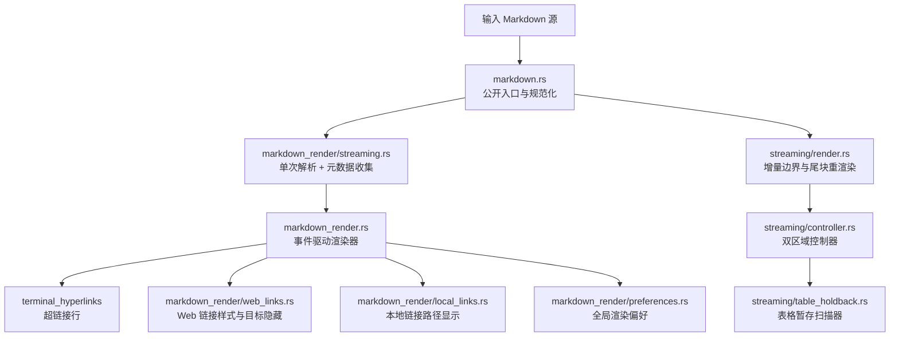
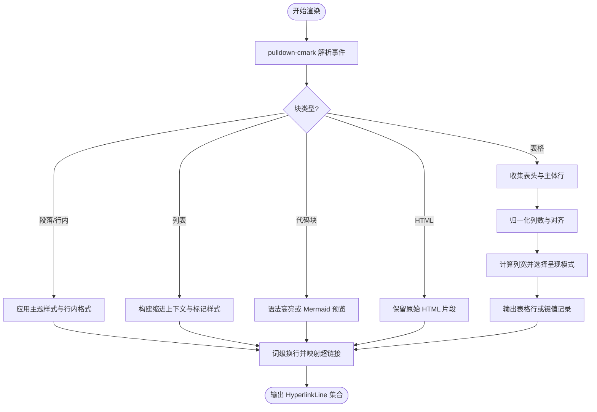
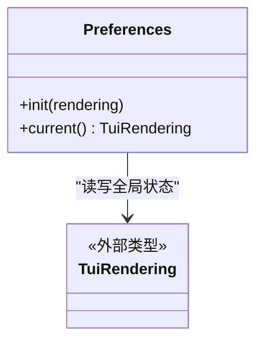
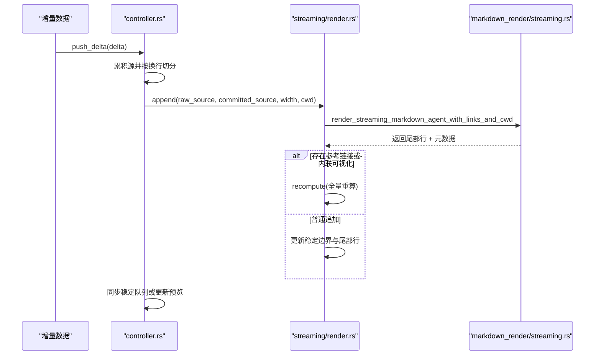
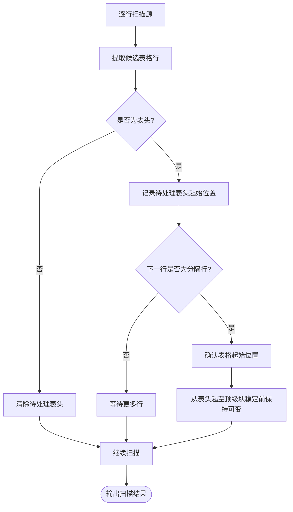
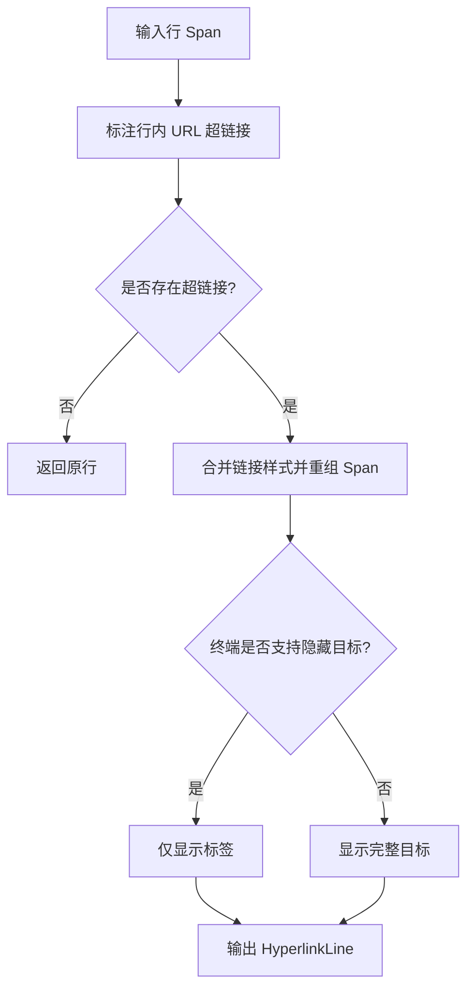
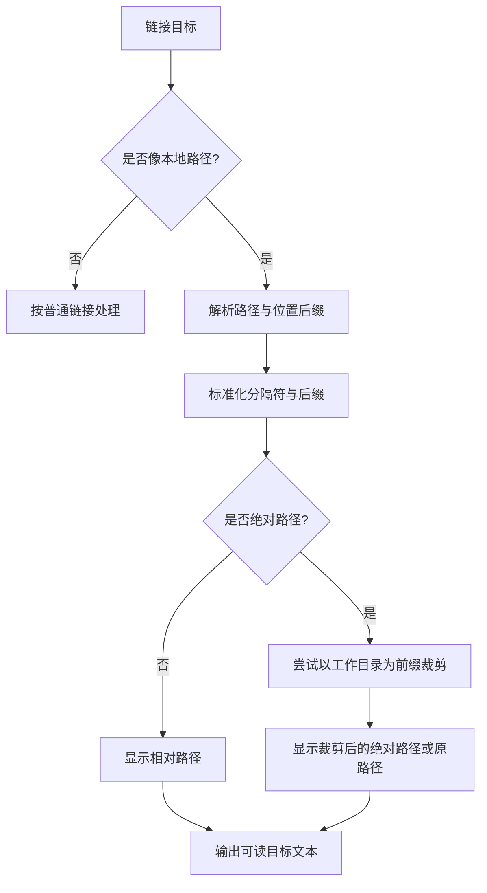
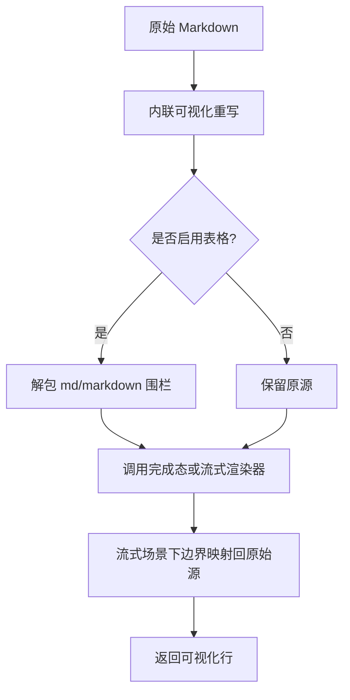
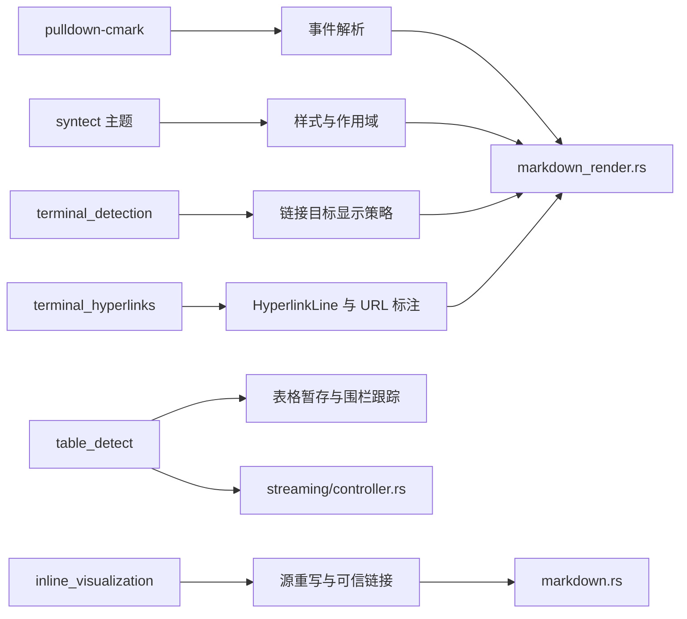

# Markdown 渲染引擎

<cite>
**本文引用的文件**   
- [markdown.rs](file://codex-rs/tui/src/markdown.rs)
- [markdown_render.rs](file://codex-rs/tui/src/markdown_render.rs)
- [preferences.rs](file://codex-rs/tui/src/markdown_render/preferences.rs)
- [web_links.rs](file://codex-rs/tui/src/markdown_render/web_links.rs)
- [local_links.rs](file://codex-rs/tui/src/markdown_render/local_links.rs)
- [streaming.rs](file://codex-rs/tui/src/markdown_render/streaming.rs)
- [render.rs](file://codex-rs/tui/src/streaming/render.rs)
- [controller.rs](file://codex-rs/tui/src/streaming/controller.rs)
- [table_holdback.rs](file://codex-rs/tui/src/streaming/table_holdback.rs)
</cite>

## 目录
1. [引言](#引言)
2. [项目结构](#项目结构)
3. [核心组件](#核心组件)
4. [架构总览](#架构总览)
5. [详细组件分析](#详细组件分析)
6. [依赖关系分析](#依赖关系分析)
7. [性能考虑](#性能考虑)
8. [故障排查指南](#故障排查指南)
9. [结论](#结论)

## 引言
本文件面向 Codex TUI 的 Markdown 渲染子系统，目标是说明从原始 Markdown 文本到终端可视行的完整流程。内容覆盖：
- 段落、列表、表格、代码块等基础元素的解析与渲染。
- 渲染偏好设置（preferences）的配置与动态刷新机制。
- 流式增量渲染：在 Agent 消息或计划流中实时追加内容，避免整篇重渲染。
- Web 链接处理：裸 URL 识别、样式、目标显示策略和点击行为。
- 本地文件链接与路径显示：相对路径、绝对路径、Windows 路径及位置后缀。
- 性能优化：缓存、懒加载、表格暂存、宽度变化回退策略。
- 错误处理与降级：无效或复杂 Markdown 的容错展示。

该子系统基于 pulldown-cmark 事件流进行解析，将结果转换为 ratatui 的 `Line`/`Span`，并通过终端超链接能力支持可点击链接。

## 项目结构
TUI 中的 Markdown 渲染由两层组成：
- 完成态渲染层：`markdown_render.*` 负责把完整 Markdown 一次性转成带样式的行集合。
- 流式渲染层：`streaming/*` 负责在流式增量到达时只重算可变尾部，保留已稳定部分。



**图表来源**
- [markdown.rs:1-120](file://codex-rs/tui/src/markdown.rs#L1-L120)
- [streaming.rs:1-152](file://codex-rs/tui/src/markdown_render/streaming.rs#L1-L152)
- [markdown_render.rs:1-120](file://codex-rs/tui/src/markdown_render.rs#L1-L120)
- [render.rs:1-120](file://codex-rs/tui/src/streaming/render.rs#L1-L120)
- [controller.rs:1-120](file://codex-rs/tui/src/streaming/controller.rs#L1-L120)
- [table_holdback.rs:1-80](file://codex-rs/tui/src/streaming/table_holdback.rs#L1-L80)
- [web_links.rs:1-108](file://codex-rs/tui/src/markdown_render/web_links.rs#L1-L108)
- [local_links.rs:1-120](file://codex-rs/tui/src/markdown_render/local_links.rs#L1-L120)

**章节来源**
- [markdown.rs:1-120](file://codex-rs/tui/src/markdown.rs#L1-L120)
- [streaming.rs:1-152](file://codex-rs/tui/src/markdown_render/streaming.rs#L1-L152)
- [markdown_render.rs:1-120](file://codex-rs/tui/src/markdown_render.rs#L1-L120)

## 核心组件
- 公开入口与规范化：`markdown.rs` 暴露面向视图与 Agent 消息的渲染函数，并负责将包裹在 `` ```md``/`` ```markdown`` 内的表格语法“解包”为真实表格，以便 pulldown-cmark 正确识别。
- 完成态渲染器：`markdown_render.rs` 消费 pulldown-cmark 事件，输出带样式和超链接的行；同时实现表格布局、任务列表、Mermaid 预览、换行、本地链接显示等。
- 流式渲染元数据：`markdown_render/streaming.rs` 在一次解析中记录最后一个顶级块的起始偏移、是否包含参考链接定义、首个块是否为 HTML、可变围栏范围等，供增量渲染复用。
- 增量渲染器：`streaming/render.rs` 维护稳定前缀与可变尾部的源边界与行边界，仅对最后一段重新渲染。
- 流式控制器：`streaming/controller.rs` 管理两区模型（稳定区 + 活动尾部）、滚动队列、宽度变化、表格暂存、数学公式与正文预览。
- 表格暂存扫描器：`streaming/table_holdback.rs` 在源级别检测表头与分隔行，决定哪些内容必须保持可变，直到其所在顶级块稳定。
- Web 链接策略：`markdown_render/web_links.rs` 根据终端能力选择是否隐藏链接目标，并为裸 URL 添加与显式链接一致的视觉强调。
- 本地链接策略：`markdown_render/local_links.rs` 解析 `file://`、绝对路径、相对路径、Windows 路径、`~/` 以及行号列号后缀，按会话工作目录显示可读路径。
- 渲染偏好：`markdown_render/preferences.rs` 提供全局读写接口，控制表格、任务列表、Mermaid 等功能开关。

**章节来源**
- [markdown.rs:1-120](file://codex-rs/tui/src/markdown.rs#L1-L120)
- [markdown_render.rs:1-120](file://codex-rs/tui/src/markdown_render.rs#L1-L120)
- [streaming.rs:1-152](file://codex-rs/tui/src/markdown_render/streaming.rs#L1-L152)
- [render.rs:1-120](file://codex-rs/tui/src/streaming/render.rs#L1-L120)
- [controller.rs:1-120](file://codex-rs/tui/src/streaming/controller.rs#L1-L120)
- [table_holdback.rs:1-80](file://codex-rs/tui/src/streaming/table_holdback.rs#L1-L80)
- [web_links.rs:1-108](file://codex-rs/tui/src/markdown_render/web_links.rs#L1-L108)
- [local_links.rs:1-120](file://codex-rs/tui/src/markdown_render/local_links.rs#L1-L120)
- [preferences.rs:1-43](file://codex-rs/tui/src/markdown_render/preferences.rs#L1-L43)

## 架构总览
下图展示一次 Agent 消息的渲染路径：入口规范化、可选的表格解包、流式元数据收集、最终事件渲染、超链接映射，以及流式增量时的边界判定与尾部重渲染。

```mermaid
sequenceDiagram
    participant Caller as "调用方"
    participant Entry as "markdown.rs"
    participant StreamMeta as "markdown_render/streaming.rs"
    participant Renderer as "markdown_render.rs"
    participant Links as "web_links.rs / local_links.rs"
    participant Pref as "preferences.rs"
    participant StreamingRender as "streaming/render.rs"
    participant Controller as "streaming/controller.rs"

    Caller->>Entry: 请求渲染 Markdown
    Entry->>Pref: 读取渲染偏好
    Entry->>StreamMeta: 构建单次解析 + 元数据
    StreamMeta->>Renderer: 运行事件渲染器
    Renderer->>Links: 处理 Web 链接与本地链接
    Renderer-->>StreamMeta: 返回行 + 元数据
    alt 首次或需要全量
        StreamMeta-->>Entry: 完成态结果
        Entry-->>Caller: 可视化行
    else 增量追加
        Entry->>StreamingRender: append(原始源, 已提交源, 宽度, cwd)
        StreamingRender->>Controller: 更新稳定区与尾部
        Controller-->>Caller: 新增行进入队列或预览
    end
```

**图表来源**
- [markdown.rs:120-220](file://codex-rs/tui/src/markdown.rs#L120-L220)
- [streaming.rs:60-152](file://codex-rs/tui/src/markdown_render/streaming.rs#L60-L152)
- [render.rs:120-291](file://codex-rs/tui/src/streaming/render.rs#L120-L291)
- [controller.rs:120-220](file://codex-rs/tui/src/streaming/controller.rs#L120-L220)
- [web_links.rs:1-108](file://codex-rs/tui/src/markdown_render/web_links.rs#L1-L108)
- [local_links.rs:1-120](file://codex-rs/tui/src/markdown_render/local_links.rs#L1-L120)
- [preferences.rs:1-43](file://codex-rs/tui/src/markdown_render/preferences.rs#L1-L43)

## 详细组件分析

### Markdown 解析与元素渲染流程
`markdown_render.rs` 是底层事件渲染器，主要职责包括：
- 使用 pulldown_cmark 的 Parser 与 Event 流解析 Markdown。
- 为标题、强调、加粗、删除线、有序/无序列表、引用块、链接等应用主题风格。
- 对表格执行四阶段管线：过滤溢出行、归一化列数、计算列宽、选择呈现形式，并在必要时将主体转为键值记录。
- 对代码块启用语法高亮；对 Mermaid 图块生成预览或回退提示。
- 对行进行词级换行，并保留超链接目标映射。
- 对本地文件链接显示可读目标，同时对裸 URL 进行样式增强。



**图表来源**
- [markdown_render.rs:1-120](file://codex-rs/tui/src/markdown_render.rs#L1-L120)

**章节来源**
- [markdown_render.rs:1-120](file://codex-rs/tui/src/markdown_render.rs#L1-L120)

### 渲染偏好配置与动态调整
渲染偏好通过 `TuiRendering` 类型集中管理，并以全局锁存储。关键特性：
- 启动前初始化偏好，随后在会话设置生效时刷新。
- 测试环境使用线程局部变量隔离并行渲染测试。
- 当前可用选项包括表格、任务列表、Mermaid 等功能的开启/关闭；这些选项影响表格渲染、任务列表解析、Mermaid 围栏识别，以及可变围栏边界判断。



**图表来源**
- [preferences.rs:1-43](file://codex-rs/tui/src/markdown_render/preferences.rs#L1-L43)

**章节来源**
- [preferences.rs:1-43](file://codex-rs/tui/src/markdown_render/preferences.rs#L1-L43)

### 流式渲染与增量更新
流式渲染的核心思想是“稳定前缀 + 可变尾部”：
- 完成态渲染器在一次解析中记录最后一个顶级块的起始偏移，从而区分已稳定部分与可能变化的尾部。
- 增量渲染器保存已完成源长度与渲染行长度边界；只有尾部被重新解析和渲染。
- 当检测到参考链接定义、内联可视化指令、主题版本变更或打开的围栏仍在继续时，采取不同策略：可能直接追加代码块行、触发全量重算，或保持尾部可变。
- 控制器在收到换行时才将内容提交到稳定区；未完成的表格行不会提前进入稳定区，避免短暂显示畸形列。



**图表来源**
- [controller.rs:120-220](file://codex-rs/tui/src/streaming/controller.rs#L120-L220)
- [render.rs:120-291](file://codex-rs/tui/src/streaming/render.rs#L120-L291)
- [streaming.rs:60-152](file://codex-rs/tui/src/markdown_render/streaming.rs#L60-L152)

**章节来源**
- [render.rs:1-120](file://codex-rs/tui/src/streaming/render.rs#L1-L120)
- [controller.rs:1-220](file://codex-rs/tui/src/streaming/controller.rs#L1-L220)
- [streaming.rs:1-152](file://codex-rs/tui/src/markdown_render/streaming.rs#L1-L152)

### 表格渲染与暂存机制
表格渲染是非增量的：新增一行可能改变所有列宽并重构先前行。因此系统采用“表格暂存”：
- 在源级别扫描表头与分隔行；若发现表头后紧跟分隔行，则将该区域标记为“确认的表格”，并将表头起始至其所属顶级块结束的内容保持可变。
- 如果表格渲染被关闭，则针对特定 fenced 信息字符串走替代逻辑，但暂存仍用于保证界面一致性。
- 在未完成表格期间，未终止的行只进入活动尾部，不进入滚动稳定区；完成后随顶部块稳定才释放到稳定区。



**图表来源**
- [table_holdback.rs:80-200](file://codex-rs/tui/src/streaming/table_holdback.rs#L80-L200)

**章节来源**
- [table_holdback.rs:1-200](file://codex-rs/tui/src/streaming/table_holdback.rs#L1-L200)

### Web 链接处理
Web 链接模块负责：
- 使用终端检测启发式策略决定是否隐藏链接目标：某些终端或多路复用器会显示完整 URL，其他终端仅显示标签。
- 对裸 URL 进行识别，并为其应用与显式 Markdown 链接一致的样式，同时保留周围文本。
- 结合终端能力与 `TERM`、`STY` 环境变量保守地决定显示策略，避免在未知终端上丢失唯一可用的 URL。



**图表来源**
- [web_links.rs:1-108](file://codex-rs/tui/src/markdown_render/web_links.rs#L1-L108)

**章节来源**
- [web_links.rs:1-108](file://codex-rs/tui/src/markdown_render/web_links.rs#L1-L108)

### 本地链接与文件链接处理
本地链接模块负责：
- 识别 `file://`、绝对路径、相对路径、`~/`、Windows 盘符路径、UNC 风格路径等。
- 解析行号/列号后缀（如 `#L12C3` 或 `:line:col`），将其作为显示后缀而非路径一部分。
- 标准化路径分隔符为正向斜杠，并根据会话工作目录裁剪绝对路径为相对路径，使显示更简洁。
- 不进行文件系统解析或符号链接展开，只做显示层面的安全转换。



**图表来源**
- [local_links.rs:1-210](file://codex-rs/tui/src/markdown_render/local_links.rs#L1-L210)

**章节来源**
- [local_links.rs:1-210](file://codex-rs/tui/src/markdown_render/local_links.rs#L1-L210)

### 入口规范化与表格解包
`markdown.rs` 提供的 Agent 渲染入口会先对源进行规范化：
- 将包裹在 `` ```md``/`` ```markdown`` 中的内容解包，使内部表格被 pulldown-cmark 识别为表格而非代码块。
- 对非 Markdown 围栏（如 `rust`、`sh`）保留原样。
- 若启用了内联可视化重写，则在渲染前对源进行改写，并收集代码块来源信息。
- 对于流式场景，还会将规范化后的边界映射回原始源，以维持增量稳定性。



**图表来源**
- [markdown.rs:120-220](file://codex-rs/tui/src/markdown.rs#L120-L220)

**章节来源**
- [markdown.rs:1-220](file://codex-rs/tui/src/markdown.rs#L1-L220)

## 依赖关系分析
渲染子系统的主要依赖如下：
- 解析层依赖 pulldown-cmark 的事件 API。
- 样式层依赖 syntect 主题与前景色作用域。
- 终端能力依赖 terminal_detection 模块与环境变量。
- 超链接依赖 terminal_hyperlinks 提供的 `HyperlinkLine` 与 URL 标注工具。
- 流式逻辑依赖 history_cell 渲染模式、inline_visualization 指令、table_detect 表格检测工具。



**图表来源**
- [markdown_render.rs:1-120](file://codex-rs/tui/src/markdown_render.rs#L1-L120)
- [web_links.rs:1-108](file://codex-rs/tui/src/markdown_render/web_links.rs#L1-L108)
- [table_holdback.rs:1-80](file://codex-rs/tui/src/streaming/table_holdback.rs#L1-L80)
- [markdown.rs:120-220](file://codex-rs/tui/src/markdown.rs#L120-L220)

**章节来源**
- [markdown_render.rs:1-120](file://codex-rs/tui/src/markdown_render.rs#L1-L120)
- [controller.rs:1-120](file://codex-rs/tui/src/streaming/controller.rs#L1-L120)
- [table_holdback.rs:1-80](file://codex-rs/tui/src/streaming/table_holdback.rs#L1-L80)
- [markdown.rs:120-220](file://codex-rs/tui/src/markdown.rs#L120-L220)

## 性能考虑
- 单次解析与元数据复用：流式渲染在一次解析中记录最后一个顶级块偏移、可变围栏范围、参考链接定义等信息，避免重复遍历。
- 稳定前缀缓存：控制器维护稳定区行计数与源起始位置的缓存，减少表格活跃时的重复渲染。
- 增量追加优先：仅在换行处提交稳定内容，未完成表格行保持在活动尾部，降低不稳定内容的抖动。
- 宽度变化回退：终端宽度变化时重新渲染，但不做字节级复杂映射；最终内容由转录整理阶段规范化。
- 懒加载与预览：数学公式与正文在未完全确定时以轻量预览形式显示，避免阻塞主渲染路径。
- 主题版本感知：代码块与高亮逻辑在主题版本变更时触发必要重算，避免不一致。
- 链接策略缓存：Web 链接的目标隐藏策略在进程内惰性初始化，减少频繁终端探测开销。

[本节为通用性能指导，无需具体文件分析]

## 故障排查指南
- 表格显示异常或列错位：检查是否处于表格暂存阶段；未完成分隔行或未闭合围栏可能导致临时畸形，等待后续行或闭合围栏后恢复。
- 链接目标被隐藏：确认终端类型、`TERM`、`STY` 环境变量；在未知终端或多路复用器中会默认显示完整 URL。
- 本地路径显示不正确：检查链接目标是否符合本地路径规则；路径标准化不进行文件系统解析，仅做显示转换。
- 流式渲染卡顿：检查是否出现参考链接定义或内联可视化指令，这类情况会触发全量重算；确认宽度变化与主题版本变更是否频繁。
- 表格无法识别：确认是否启用了表格渲染偏好；若禁用，则相关 fenced 表格会被当作代码块处理。
- 首块 HTML 拼接问题：首个顶级块为 HTML 时，渲染器会与前缀直接拼接而不插入空行，避免多余空白。

**章节来源**
- [table_holdback.rs:80-200](file://codex-rs/tui/src/streaming/table_holdback.rs#L80-L200)
- [web_links.rs:1-108](file://codex-rs/tui/src/markdown_render/web_links.rs#L1-L108)
- [local_links.rs:1-210](file://codex-rs/tui/src/markdown_render/local_links.rs#L1-L210)
- [render.rs:120-291](file://codex-rs/tui/src/streaming/render.rs#L120-L291)
- [streaming.rs:60-152](file://codex-rs/tui/src/markdown_render/streaming.rs#L60-L152)

## 结论
Codex TUI 的 Markdown 渲染引擎以 pulldown-cmark 事件为基础，结合主题样式、超链接与终端能力，提供完整的段落、列表、表格、代码块与链接渲染能力。流式渲染通过稳定前缀与可变尾部的边界控制，在 Agent 消息与计划流中实现增量更新；表格暂存机制确保活跃表格的布局一致性。Web 链接与本地链接分别提供保守而稳定的显示策略。整体设计兼顾性能与健壮性，能够在复杂或无效 Markdown 输入下保持稳定显示，并通过偏好设置与宽度变化回退机制满足多样化渲染需求。