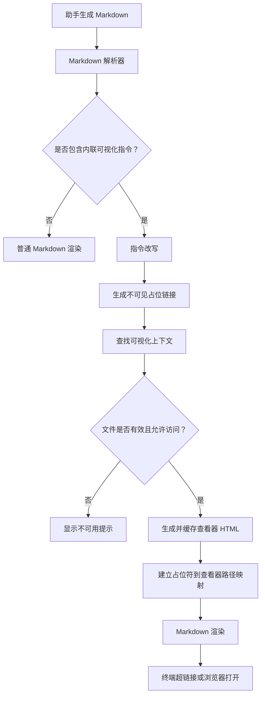
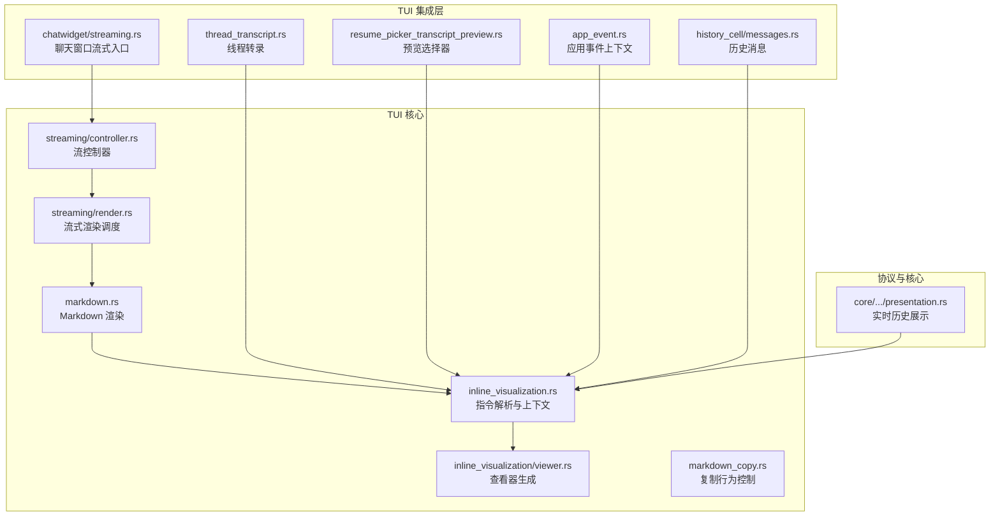
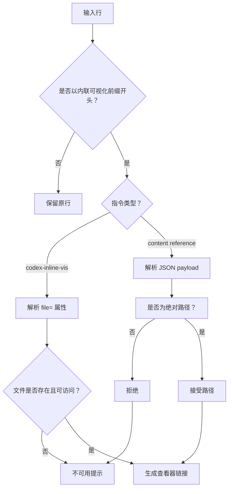
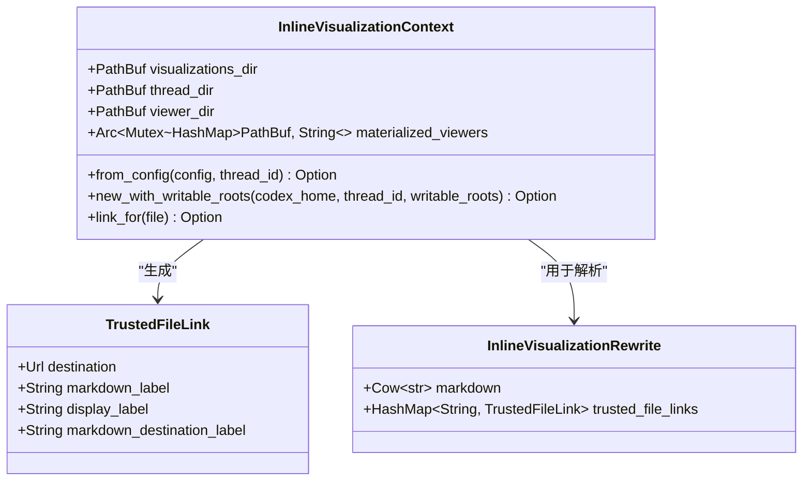
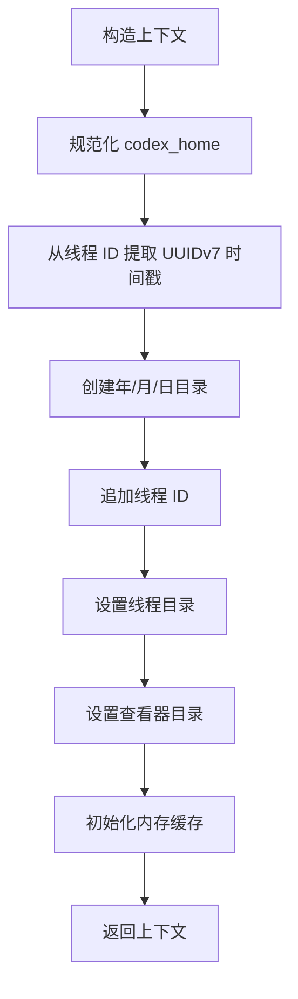
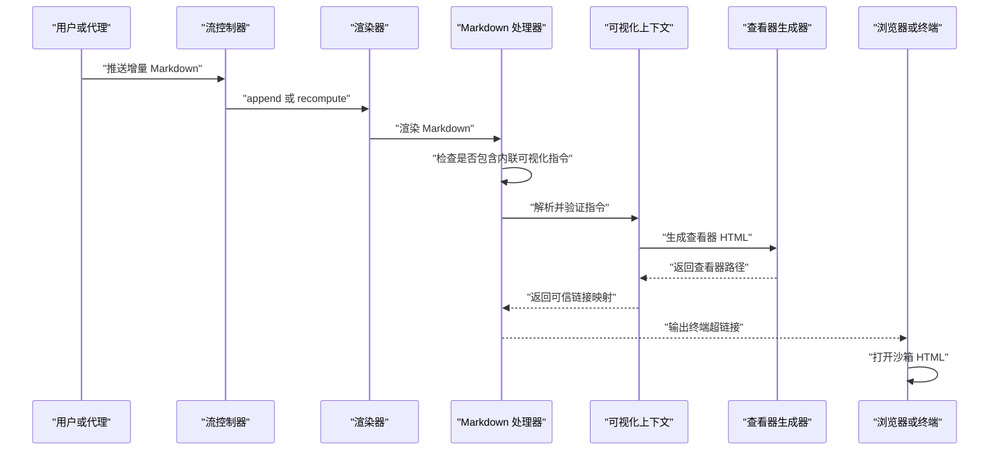
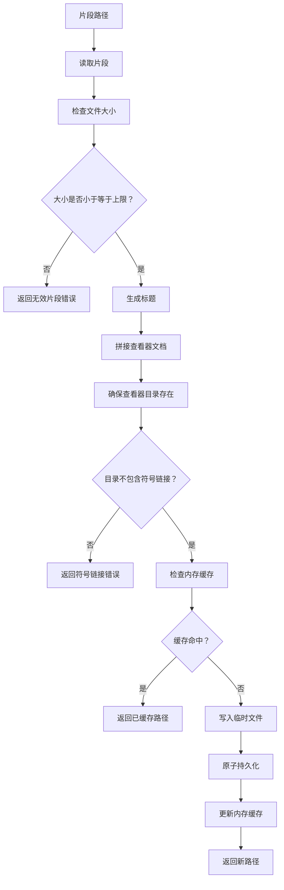
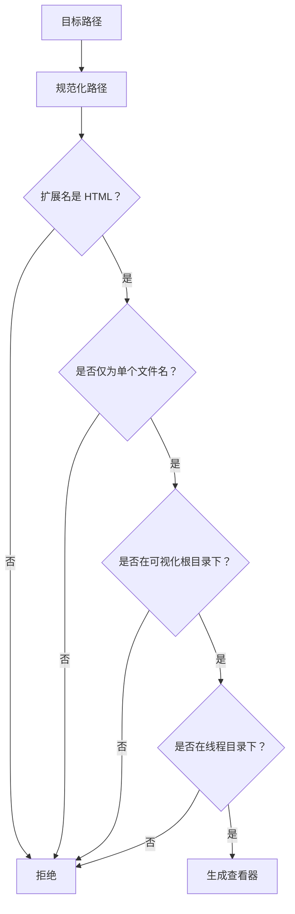
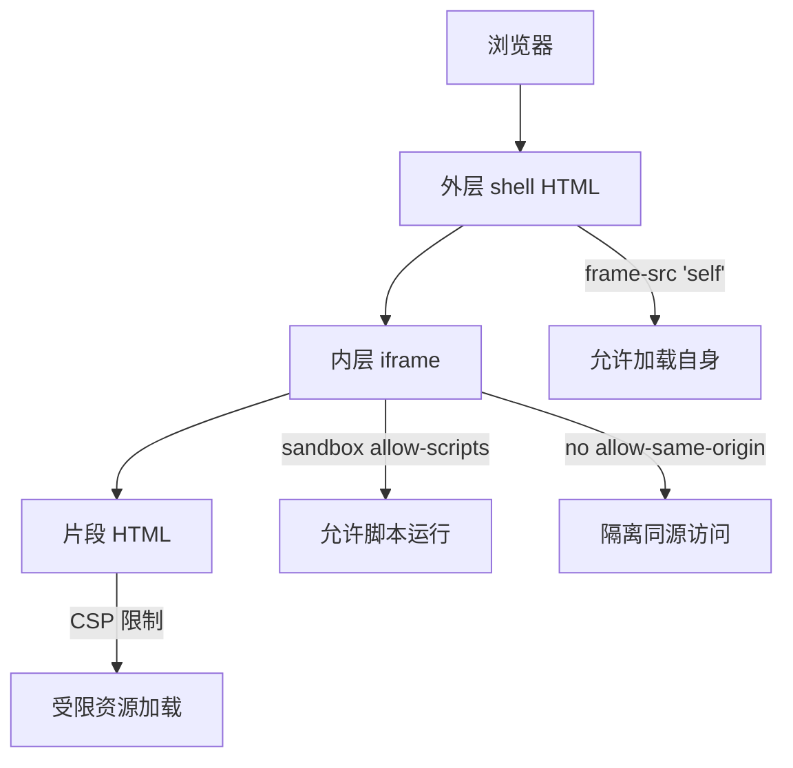
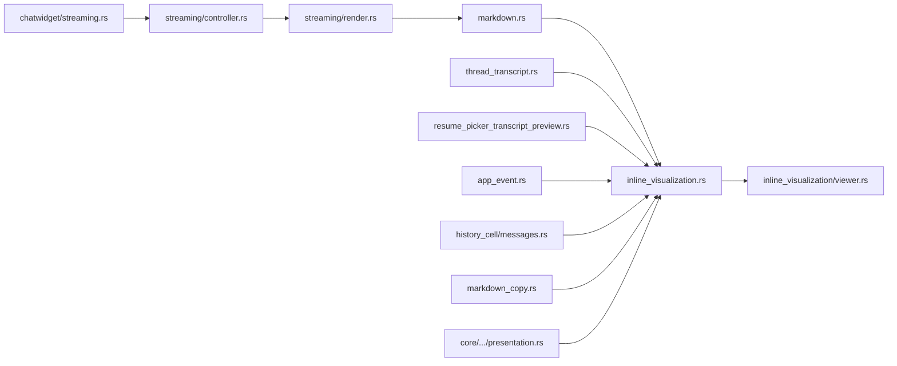

# 内联可视化

<cite>
**本文引用的文件**   
- [inline_visualization.rs](file://codex-rs/tui/src/inline_visualization.rs)
- [viewer.rs](file://codex-rs/tui/src/inline_visualization/viewer.rs)
- [controller.rs](file://codex-rs/tui/src/streaming/controller.rs)
- [render.rs](file://codex-rs/tui/src/streaming/render.rs)
- [markdown.rs](file://codex-rs/tui/src/markdown.rs)
- [markdown_copy.rs](file://codex-rs/tui/src/markdown_copy.rs)
- [chatwidget_streaming.rs](file://codex-rs/tui/src/chatwidget/streaming.rs)
- [thread_transcript.rs](file://codex-rs/tui/src/thread_transcript.rs)
- [resume_picker_transcript_preview.rs](file://codex-rs/tui/src/resume_picker_transcript_preview.rs)
- [app_event.rs](file://codex-rs/tui/src/app_event.rs)
- [messages.rs](file://codex-rs/tui/src/history_cell/messages.rs)
- [realtime_presentation.rs](file://codex-rs/core/src/realtime_history/presentation.rs)
- [inline_visualization_tests.rs](file://codex-rs/tui/src/inline_visualization_tests.rs)
</cite>

## 目录

1. [简介](#简介)
2. [项目结构与职责划分](#项目结构与职责划分)
3. [指令语法与解析机制](#指令语法与解析机制)
4. [上下文生命周期与线程隔离](#上下文生命周期与线程隔离)
5. [从 Markdown 到 HTML 的生成流程](#从-markdown-到-html-的生成流程)
6. [查看器生成与缓存机制](#查看器生成与缓存机制)
7. [安全验证策略](#安全验证策略)
8. [存储结构、清理与版本管理](#存储结构清理与版本管理)
9. [扩展指南与最佳实践](#扩展指南与最佳实践)
10. [依赖关系分析](#依赖关系分析)
11. [故障排查](#故障排查)
12. [总结](#总结)

## 简介

内联可视化是 Codex TUI 中的一项能力：当助手生成的 Markdown 包含内联可视化指令时，系统会将其解析为可信的文件链接，并在本地生成一个受内容安全策略保护的 HTML 查看器，最终通过终端超链接或外部浏览器打开。

该功能涉及五个关键层面：

| 层面 | 主要职责 | 核心实现位置 |
|---|---|---|
| 指令识别与改写 | 识别 `::codex-inline-vis{}` 和 content reference 前缀，生成占位链接 | [inline_visualization.rs](file://codex-rs/tui/src/inline_visualization.rs) |
| 上下文管理 | 维护可视化目录、线程目录、查看器目录及内存缓存 | [inline_visualization.rs](file://codex-rs/tui/src/inline_visualization.rs) |
| 查看器生成 | 将片段 HTML 包裹成带沙箱的完整文档 | [viewer.rs](file://codex-rs/tui/src/inline_visualization/viewer.rs) |
| 流式渲染集成 | 在流式 Markdown 渲染中延迟处理可视化指令 | [render.rs](file://codex-rs/tui/src/streaming/render.rs)、[controller.rs](file://codex-rs/tui/src/streaming/controller.rs) |
| Markdown 链接重写 | 把占位链接替换为真实 HTML 查看器路径 | [markdown.rs](file://codex-rs/tui/src/markdown.rs) |

**图示来源**
- [inline_visualization.rs:33-112](file://codex-rs/tui/src/inline_visualization.rs#L33-L112)
- [inline_visualization.rs:187-291](file://codex-rs/tui/src/inline_visualization.rs#L187-L291)
- [viewer.rs:21-72](file://codex-rs/tui/src/inline_visualization/viewer.rs#L21-L72)
- [markdown.rs:131-155](file://codex-rs/tui/src/markdown.rs#L131-L155)

## 项目结构与职责划分

内联可视化主要位于 TUI 模块中，按职责拆分为两个源文件和多个调用方：

**图示来源**
- [inline_visualization.rs:1-40](file://codex-rs/tui/src/inline_visualization.rs#L1-L40)
- [viewer.rs:1-20](file://codex-rs/tui/src/inline_visualization/viewer.rs#L1-L20)
- [controller.rs:48-135](file://codex-rs/tui/src/streaming/controller.rs#L48-L135)
- [render.rs:9-81](file://codex-rs/tui/src/streaming/render.rs#L9-L81)
- [markdown.rs:9-34](file://codex-rs/tui/src/markdown.rs#L9-L34)

### 核心文件职责表

| 文件 | 主要类型或函数 | 职责 |
|---|---|---|
| `inline_visualization.rs` | `InlineVisualizationContext`、`rewrite_inline_visualizations`、`contains_inline_visualization` | 指令语法、上下文构造、文件链接校验、占位符生成 |
| `viewer.rs` | `materialize_document`、`render_fragment` | 生成带 CSP 的沙箱 HTML 查看器 |
| `streaming/render.rs` | `render_source`、`append`、`recompute` | 检测指令并决定是否需要完整重算 |
| `streaming/controller.rs` | `StreamController`、`new_with_inline_visualizations` | 持有上下文并传递给渲染管线 |
| `markdown.rs` | `append_markdown_agent` | 把占位链接映射回真实查看器路径 |
| `markdown_copy.rs` | 复制逻辑中的 URL 过滤 | 防止复制查看器内部临时链接 |
| `chatwidget/streaming.rs` | `InlineVisualizationContext::from_config` | 根据配置创建上下文 |
| `thread_transcript.rs` | 转录构建 | 在转录渲染中注入上下文 |
| `resume_picker_transcript_preview.rs` | 预览渲染 | 在预览中选择器中使用上下文 |
| `app_event.rs` | 应用事件上下文 | 传递可视化上下文 |
| `history_cell/messages.rs` | 历史消息渲染 | 向消息单元格注入上下文 |
| `realtime_history/presentation.rs` | 实时历史呈现 | 与协议侧协作展示可视化 |

**章节来源**
- [inline_visualization.rs:1-40](file://codex-rs/tui/src/inline_visualization.rs#L1-L40)
- [viewer.rs:1-20](file://codex-rs/tui/src/inline_visualization/viewer.rs#L1-L20)
- [controller.rs:48-135](file://codex-rs/tui/src/streaming/controller.rs#L48-L135)
- [render.rs:9-81](file://codex-rs/tui/src/streaming/render.rs#L9-L81)
- [markdown.rs:9-34](file://codex-rs/tui/src/markdown.rs#L9-L34)

## 指令语法与解析机制

### 两种指令形式

系统支持两类内联可视化指令：

| 形式 | 语法特征 | 适用场景 |
|---|---|---|
| `::codex-inline-vis{}` | 行首以固定前缀开头，属性中包含 `file="..."` | 助手直接输出文件路径 |
| Content reference 前缀 | 使用 Unicode 控制字符包裹 JSON payload，其中必须包含绝对路径字段 | 运行时或协议层动态注入的路径引用 |

**图示来源**
- [inline_visualization.rs:187-291](file://codex-rs/tui/src/inline_visualization.rs#L187-L291)
- [inline_visualization.rs:292-314](file://codex-rs/tui/src/inline_visualization.rs#L292-L314)

### 解析规则细节

#### `::codex-inline-vis{}` 指令

指令必须满足以下条件才会被识别：

1. 行去除空白后以 `::codex-inline-vis{` 开头。
2. 指令末尾必须是 `}`。
3. 属性必须以 `file="..."` 形式出现。
4. 值不能为空。
5. 值中不能包含嵌套双引号。
6. 对应文件必须存在，且能被 `InlineVisualizationContext::link_for` 解析为安全的 HTML 查看器。

如果以上任一条件不满足，系统不会抛出错误，而是输出“在当前设备上不可用”的降级文本。

#### Content reference 前缀

Content reference 使用三个 Unicode 控制字符构成边界：

| 符号 | 作用 |
|---|---|
| 起始分隔符 | 标识内容引用开始 |
| 左括号分隔符 | 包裹 JSON payload |
| 右括号分隔符 | 结束内容引用 |

JSON payload 中只接受 `path` 字段，并且路径必须是绝对路径。相对路径会被拒绝，从而避免用户误写或助手误报导致的安全风险。

#### 代码块保护

解析器使用 Markdown 解析器扫描代码块范围。处于代码块内的行不会被当作指令处理。这是为了防止助手的解释性代码、示例代码或调试日志意外触发可视化。

#### 流式渲染保护

当指令不完整时，例如正在流式写入但尚未闭合花括号或 JSON payload，系统会隐藏该行，而不是渲染部分结果。这避免了“半截指令”污染界面。

**章节来源**
- [inline_visualization.rs:187-291](file://codex-rs/tui/src/inline_visualization.rs#L187-L291)
- [inline_visualization.rs:292-314](file://codex-rs/tui/src/inline_visualization.rs#L292-L314)
- [inline_visualization_tests.rs:100-145](file://codex-rs/tui/src/inline_visualization_tests.rs#L100-L145)
- [inline_visualization_tests.rs:147-181](file://codex-rs/tui/src/inline_visualization_tests.rs#L147-L181)

## 上下文生命周期与线程隔离

### InlineVisualizationContext 的结构

`InlineVisualizationContext` 是内联可视化的核心状态对象，它封装了四个关键信息：

| 字段 | 类型 | 含义 |
|---|---|---|
| `visualizations_dir` | `PathBuf` | 所有可视化内容的根目录 |
| `thread_dir` | `PathBuf` | 当前线程专属的可视化子目录 |
| `viewer_dir` | `PathBuf` | 当前线程对应的查看器缓存目录 |
| `materialized_viewers` | `Arc<Mutex<HashMap<PathBuf, String>>>` | 已物化查看器的内存缓存 |

**图示来源**
- [inline_visualization.rs:33-40](file://codex-rs/tui/src/inline_visualization.rs#L33-L40)
- [inline_visualization.rs:167-185](file://codex-rs/tui/src/inline_visualization.rs#L167-L185)

### 目录构造过程

上下文构造函数首先对 `codex_home` 进行规范化，然后从线程 ID 中提取 UUIDv7 时间戳，并按日期组织可视化目录：

**图示来源**
- [inline_visualization.rs:71-112](file://codex-rs/tui/src/inline_visualization.rs#L71-L112)

默认目录结构如下：

| 层级 | 内容 |
|---|---|
| `codex_home/visualizations` | 可视化根目录 |
| `visualizations/YYYY/MM/DD` | 基于 UUIDv7 时间戳的日期目录 |
| `visualizations/YYYY/MM/DD/{thread_id}` | 线程专属可视化文件 |
| `codex_home/visualization-viewers/{thread_id}/{artifact_thread_id}/.codex-viewers` | 物化查看器缓存 |

### 授予的可写根覆盖行为

测试用例表明，当通过 `new_with_writable_roots` 显式授予某个可视化目录作为可写根时，该目录可以直接作为线程目录使用。这适用于代理或上游进程已经拥有权限并向指定目录写入可视化产物的场景。

### 线程隔离

线程隔离主要通过以下机制实现：

1. 每个线程有独立的 `thread_dir`。
2. 查看器缓存目录也绑定到线程 ID。
3. `link_for` 只允许访问当前线程目录下的 HTML 文件。
4. 路径必须相对于 `thread_dir` 展开，且不能跳出该目录。
5. 文件名只能是单个普通组件，不允许包含路径分隔符或子目录。

这意味着不同线程之间无法互相读取对方的可视化产物。

**章节来源**
- [inline_visualization.rs:33-112](file://codex-rs/tui/src/inline_visualization.rs#L33-L112)
- [inline_visualization.rs:151-158](file://codex-rs/tui/src/inline_visualization.rs#L151-L158)
- [inline_visualization_tests.rs:46-68](file://codex-rs/tui/src/inline_visualization_tests.rs#L46-L68)

## 从 Markdown 到 HTML 的生成流程

整个流程可以划分为六个阶段：

**图示来源**
- [controller.rs:617-624](file://codex-rs/tui/src/streaming/controller.rs#L617-L624)
- [render.rs:70-143](file://codex-rs/tui/src/streaming/render.rs#L70-L143)
- [markdown.rs:131-155](file://codex-rs/tui/src/markdown.rs#L131-L155)
- [inline_visualization.rs:187-291](file://codex-rs/tui/src/inline_visualization.rs#L187-L291)
- [viewer.rs:21-72](file://codex-rs/tui/src/inline_visualization/viewer.rs#L21-L72)

### 第一阶段：指令检测

渲染器首先检测 Markdown 是否包含内联可视化指令。如果没有，则走普通流式渲染路径；如果有，则标记需要完整重算。

### 第二阶段：指令改写

`rewrite_inline_visualizations` 逐行扫描 Markdown，跳过代码块，并对匹配的行执行解析。成功解析后会生成一个不可见的占位链接，并把占位符与最终查看器 URL 的关系记录在 `trusted_file_links` 中。

### 第三阶段：链接映射

Markdown 渲染完成后，系统遍历渲染得到的超链接。如果链接命中占位符前缀，就替换为真实的查看器文件 URL。

### 第四阶段：查看器生成

对于每个合法的目标 HTML 片段，`materialize_document` 会生成一个外层 shell HTML，并通过 `<iframe srcdoc>` 加载内层沙箱 HTML。

### 第五阶段：终端显示

终端收到的是带有超链接的 Markdown 文本。用户点击链接后，操作系统或终端会打开浏览器，浏览器加载本地 HTML 文件。

### 第六阶段：沙箱执行

HTML 查看器使用严格的内容安全策略限制资源加载，并通过 iframe 沙箱阻止脚本访问父页面上下文。

**章节来源**
- [render.rs:70-143](file://codex-rs/tui/src/streaming/render.rs#L70-L143)
- [markdown.rs:131-155](file://codex-rs/tui/src/markdown.rs#L131-L155)
- [inline_visualization.rs:187-291](file://codex-rs/tui/src/inline_visualization.rs#L187-L291)
- [viewer.rs:21-72](file://codex-rs/tui/src/inline_visualization/viewer.rs#L21-L72)

## 查看器生成与缓存机制

### materialize_document 的工作原理

`materialize_document` 是可视化 HTML 的最终产出点。其核心步骤如下：

1. 读取目标片段文件。
2. 检查是否为普通文件且不超过最大字节数。
3. 从文件名生成标题。
4. 拼接查看器运行时模板。
5. 创建 `.codex-viewers` 子目录。
6. 禁止查看器目录本身包含符号链接。
7. 检查内存缓存是否已有相同文档。
8. 先写入临时文件，再原子持久化为最终文件。
9. 更新内存缓存。

**图示来源**
- [viewer.rs:21-72](file://codex-rs/tui/src/inline_visualization/viewer.rs#L21-L72)

### 缓存层次

查看器缓存有两层：

| 缓存层 | 位置 | 特点 |
|---|---|---|
| 内存缓存 | `InlineVisualizationContext.materialized_viewers` | 进程内共享，避免重复生成 |
| 文件系统缓存 | `visualization-viewers/{thread_id}/{artifact_thread_id}/.codex-viewers` | 跨渲染周期复用 |

内存缓存键是查看器路径，值是物化后的 HTML 字符串。这可以避免同一线程中多次请求相同片段时反复序列化查看器文档。

### 生成约束

生成过程施加了多项约束：

| 约束 | 目的 |
|---|---|
| 片段最大 2 MiB | 防止过大 HTML 阻塞渲染 |
| 查看器目录不能是符号链接 | 防止绕过路径检查 |
| 临时文件原子持久化 | 防止并发写入产生损坏文件 |
| 标题 HTML 转义 | 防止标题注入 |
| 文件名取自片段文件名 | 保证查看器输出稳定 |

**章节来源**
- [viewer.rs:21-72](file://codex-rs/tui/src/inline_visualization/viewer.rs#L21-L72)
- [inline_visualization.rs:25-33](file://codex-rs/tui/src/inline_visualization.rs#L25-L33)
- [inline_visualization.rs:106-112](file://codex-rs/tui/src/inline_visualization.rs#L106-L112)

## 安全验证策略

内联可视化的安全模型围绕“最小信任”原则设计：只有经过上下文校验的 HTML 片段才能被物化为可查看器。

### 路径验证

`link_for` 对目标文件执行多层路径检查：

1. 目标必须是 `.html` 扩展名。
2. 目标路径只能是一个普通文件名，不能包含子目录。
3. 规范化后的 `thread_dir` 必须是 `visualizations_dir` 的子路径。
4. 规范化后的目标路径必须是 `thread_dir` 的子路径。
5. 最终由 `materialize_document` 再次校验查看器目录。

**图示来源**
- [inline_visualization.rs:127-149](file://codex-rs/tui/src/inline_visualization.rs#L127-L149)

### 权限检查

上下文可以从全局配置构造。如果文件系统沙箱策略授予完全磁盘写入权限，或者查看器缓存目录可写，则直接禁用内联可视化。这是为了兼容更严格的执行环境。

具体判断包括：

- 是否允许全磁盘写入。
- 可写根列表是否与可视化根一致。
- 查看器缓存路径或其父目录是否可写。
- 可写根是否覆盖查看器缓存目录。

### 沙箱策略

查看器 HTML 使用严格的内容安全策略：

| 资源类型 | 策略 |
|---|---|
| 默认资源 | 禁止 |
| 脚本 | 允许内联脚本和内联评估，同时允许若干 CDN 和 blob/data URL |
| 样式 | 允许内联样式、blob、data 及字体/CDN 资源 |
| 图片 | 允许 blob、data 及 CDN 图片 |
| 字体 | 允许 blob、data 及字体 CDN |
| 媒体 | 仅允许 blob 和 data |
| worker | 仅允许 blob |
| frame | 禁止 |
| object | 禁止 |
| base-uri | 禁止 |
| form-action | 禁止 |

外层 shell HTML 放宽了 `frame-src`，以便能加载内层 iframe；内层 iframe 使用 `sandbox="allow-scripts"` 且没有 `allow-same-origin`，因此即使脚本运行，也无法访问父页面。

**图示来源**
- [viewer.rs:12-18](file://codex-rs/tui/src/inline_visualization/viewer.rs#L12-L18)
- [viewer.rs:58-72](file://codex-rs/tui/src/inline_visualization/viewer.rs#L58-L72)

### 复制行为防护

`markdown_copy.rs` 明确排除以内联可视化占位符前缀开头的 URL，防止用户在复制 Markdown 或链接时泄露查看器内部临时路径。

**章节来源**
- [inline_visualization.rs:60-70](file://codex-rs/tui/src/inline_visualization.rs#L60-L70)
- [inline_visualization.rs:127-149](file://codex-rs/tui/src/inline_visualization.rs#L127-L149)
- [viewer.rs:12-18](file://codex-rs/tui/src/inline_visualization/viewer.rs#L12-L18)
- [viewer.rs:37-44](file://codex-rs/tui/src/inline_visualization/viewer.rs#L37-L44)
- [markdown_copy.rs:83-83](file://codex-rs/tui/src/markdown_copy.rs#L83-L83)

## 存储结构、清理与版本管理

### 存储结构

| 路径模式 | 用途 | 所有权 |
|---|---|---|
| `codex_home/visualizations/YYYY/MM/DD/{thread_id}` | 可视化原始片段 | 由写入者创建，上下文只读访问 |
| `codex_home/visualization-viewers/{thread_id}/{artifact_thread_id}/.codex-viewers` | 物化查看器 HTML | 由查看器生成器创建 |

其中 `artifact_thread_id` 通常来自线程目录的文件名，用于在同一线程下区分不同可视化产物。

### 清理策略

当前实现中没有自动清理过期可视化文件或查看器缓存的代码。清理责任主要由文件系统生命周期、用户操作或上层进程管理承担。这意味着：

- 长时间运行的会话可能积累大量查看器文件。
- 删除 `visualizations` 根目录会影响后续可视化访问。
- 删除 `visualization-viewers` 会导致重新生成，但不会丢失原始片段。
- 进程退出后内存缓存失效，但磁盘缓存仍然存在。

### 版本管理

当前实现没有显式的版本文件或元数据索引。关键版本信息隐含在路径中：

- 线程 ID 提供唯一标识。
- UUIDv7 时间戳提供大致创建时间。
- 日期目录提供自然归档结构。
- 查看器文件名与片段文件名对应。

如果需要引入多版本可视化，建议扩展 `InlineVisualizationContext`，增加版本目录和摘要哈希，而不是直接修改现有路径语义。

**章节来源**
- [inline_visualization.rs:93-112](file://codex-rs/tui/src/inline_visualization.rs#L93-L112)
- [inline_visualization.rs:151-158](file://codex-rs/tui/src/inline_visualization.rs#L151-L158)
- [viewer.rs:35-47](file://codex-rs/tui/src/inline_visualization/viewer.rs#L35-L47)

## 扩展指南与最佳实践

### 如何添加新的可视化指令

推荐遵循以下步骤：

1. 在 `inline_visualization.rs` 中新增指令前缀常量。
2. 扩展 `contains_inline_visualization`，使其检测新指令。
3. 扩展 `parse_directive_file`，解析新指令的属性。
4. 如果新指令需要额外校验，扩展 `link_for` 或新增专用校验函数。
5. 编写单元测试，覆盖正常路径、缺失文件、非法路径和流式中断情况。
6. 检查 Markdown 复制逻辑是否需要过滤新占位符。
7. 检查流式渲染是否会在检测到新指令后正确触发完整重算。

### 如何注册自定义查看器类型

当前查看器模板通过内嵌字符串方式嵌入 CSS 和 HTML 运行时。若需扩展：

1. 新增查看器资产文件。
2. 在 `viewer.rs` 中引入新模板。
3. 保持 CSP 与资源白名单同步。
4. 确保新模板仍然使用 fragment 占位符插入片段内容。
5. 避免在模板中引入未授权的第三方资源。

### 安全最佳实践

| 实践 | 原因 |
|---|---|
| 不要放松 `link_for` 的路径校验 | 防止任意文件被物化为查看器 |
| 不要在查看器模板中启用 `allow-same-origin` | 防止脚本访问父页面 |
| 不要把查看器目录放在可写根之外 | 避免绕过沙箱策略 |
| 始终对标题和文件名做 HTML 转义 | 防止 XSS |
| 对片段大小设置上限 | 防止拒绝服务 |
| 对符号链接做拒绝策略 | 防止路径逃逸 |
| 在复制 Markdown 时排除内部查看器 URL | 防止泄露临时路径 |

### 性能最佳实践

| 实践 | 效果 |
|---|---|
| 复用 `InlineVisualizationContext` | 减少目录计算和缓存重建 |
| 避免频繁刷新上下文 | 降低内存锁竞争 |
| 尽量复用同线程片段 | 利用内存缓存 |
| 不在流式高频路径中重复解析指令 | 降低 CPU 开销 |
| 控制片段大小 | 避免大 HTML 阻塞 IO |

**章节来源**
- [inline_visualization.rs:33-112](file://codex-rs/tui/src/inline_visualization.rs#L33-L112)
- [inline_visualization.rs:187-291](file://codex-rs/tui/src/inline_visualization.rs#L187-L291)
- [viewer.rs:21-72](file://codex-rs/tui/src/inline_visualization/viewer.rs#L21-L72)
- [markdown_copy.rs:83-83](file://codex-rs/tui/src/markdown_copy.rs#L83-L83)

## 依赖关系分析

### 模块依赖图

**图示来源**
- [controller.rs:48-135](file://codex-rs/tui/src/streaming/controller.rs#L48-L135)
- [render.rs:9-81](file://codex-rs/tui/src/streaming/render.rs#L9-L81)
- [markdown.rs:9-34](file://codex-rs/tui/src/markdown.rs#L9-L34)
- [inline_visualization.rs:1-40](file://codex-rs/tui/src/inline_visualization.rs#L1-L40)
- [viewer.rs:1-20](file://codex-rs/tui/src/inline_visualization/viewer.rs#L1-L20)

### 耦合关系

- `inline_visualization.rs` 是低层基础设施，被多个 UI 模块消费。
- `viewer.rs` 是纯生成逻辑，几乎无外部副作用，仅依赖文件系统。
- `streaming/render.rs` 负责调度，耦合了渲染模式和上下文。
- `streaming/controller.rs` 持有上下文，是 UI 流式管道的入口。
- `markdown.rs` 是中间层，把占位链接转换为真实查看器 URL。
- 其他 TUI 模块只消费上下文，不直接操作底层目录。

这种分层降低了 UI 各组件与文件系统、沙箱策略之间的直接耦合。

**章节来源**
- [controller.rs:48-135](file://codex-rs/tui/src/streaming/controller.rs#L48-L135)
- [render.rs:9-81](file://codex-rs/tui/src/streaming/render.rs#L9-L81)
- [markdown.rs:9-34](file://codex-rs/tui/src/markdown.rs#L9-L34)
- [inline_visualization.rs:1-40](file://codex-rs/tui/src/inline_visualization.rs#L1-L40)

## 故障排查

### 常见现象与原因

| 现象 | 可能原因 | 处理方式 |
|---|---|---|
| 指令被忽略 | 不在行首、在代码块内、或缺少闭合花括号 | 修正指令格式，确认不在代码块中 |
| 显示“在当前设备上不可用” | 文件不存在、路径不安全、非 HTML、或上下文不可用 | 检查文件路径和扩展名 |
| 点击链接后无法打开 | 查看器目录被清理、权限不足、或路径包含符号链接 | 检查查看器缓存目录 |
| 流式过程中看不到可视化 | 指令尚未完成流式写入 | 等待指令完整后再刷新 |
| 复制 Markdown 后链接失效 | 链接是进程内占位符或临时查看器路径 | 不要复制内部占位符链接 |
| 查看器脚本无法加载资源 | CSP 白名单未包含资源域名 | 检查查看器 CSP 和资源来源 |

### 定位步骤

1. 确认 Markdown 是否包含 `::codex-inline-vis{}` 或 content reference 前缀。
2. 确认指令所在行不是代码块。
3. 确认 `file=` 指向的文件确实存在。
4. 确认目标文件扩展名是 `.html`。
5. 确认上下文没有被沙箱策略禁用。
6. 检查 `visualizations` 目录是否包含对应线程目录。
7. 检查 `visualization-viewers` 目录是否生成了查看器文件。
8. 尝试在浏览器中直接打开查看器文件，排除 Markdown 层问题。

### 测试参考

仓库测试覆盖了以下关键场景：

- 未完成流式预览使用上下文。
- 授予的可写根覆盖线程根。
- 完整指令改写为可信静态文件占位符。
- 不完整指令被隐藏。
- 不可用 content reference 有明确降级提示。
- 缺失 artifact 有明确降级提示。
- 父路径和非 HTML 文件被拒绝。

这些测试可作为扩展功能时的对照基线。

**章节来源**
- [inline_visualization_tests.rs:15-23](file://codex-rs/tui/src/inline_visualization_tests.rs#L15-L23)
- [inline_visualization_tests.rs:46-68](file://codex-rs/tui/src/inline_visualization_tests.rs#L46-L68)
- [inline_visualization_tests.rs:100-145](file://codex-rs/tui/src/inline_visualization_tests.rs#L100-L145)
- [inline_visualization_tests.rs:147-181](file://codex-rs/tui/src/inline_visualization_tests.rs#L147-L181)

## 总结

内联可视化是一个围绕 Markdown 指令、文件系统上下文和浏览器沙箱构建的功能子系统。它的核心思想是：

1. 只在 Markdown 中看到明确的可视化指令时才介入。
2. 在 TUI 层把指令改写为占位链接。
3. 通过 `InlineVisualizationContext` 校验路径、目录和权限。
4. 使用 `materialize_document` 生成带 CSP 的沙箱 HTML。
5. 通过终端超链接或外部浏览器打开最终查看器。

该实现强调安全性而非灵活性：路径校验严格、查看器沙箱保守、流式渲染对不完整指令保持静默。对于需要扩展的场景，应优先扩展解析器和查看器模板，而不是放宽路径或沙箱策略。