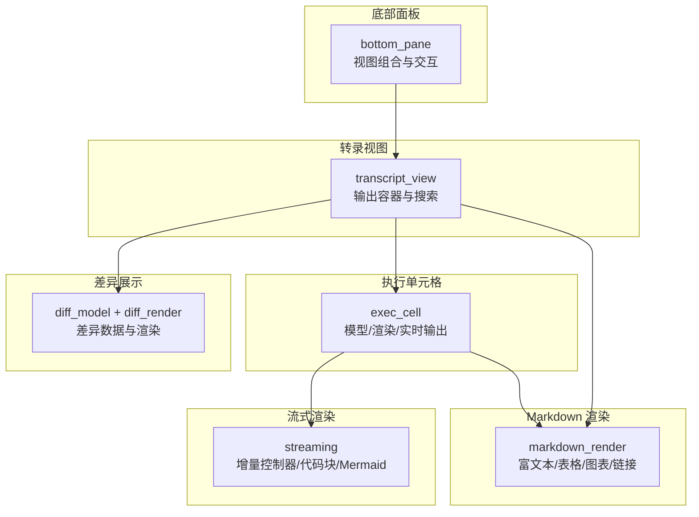
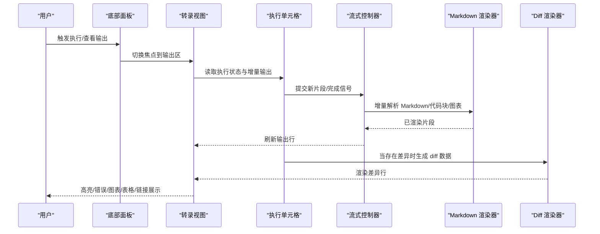
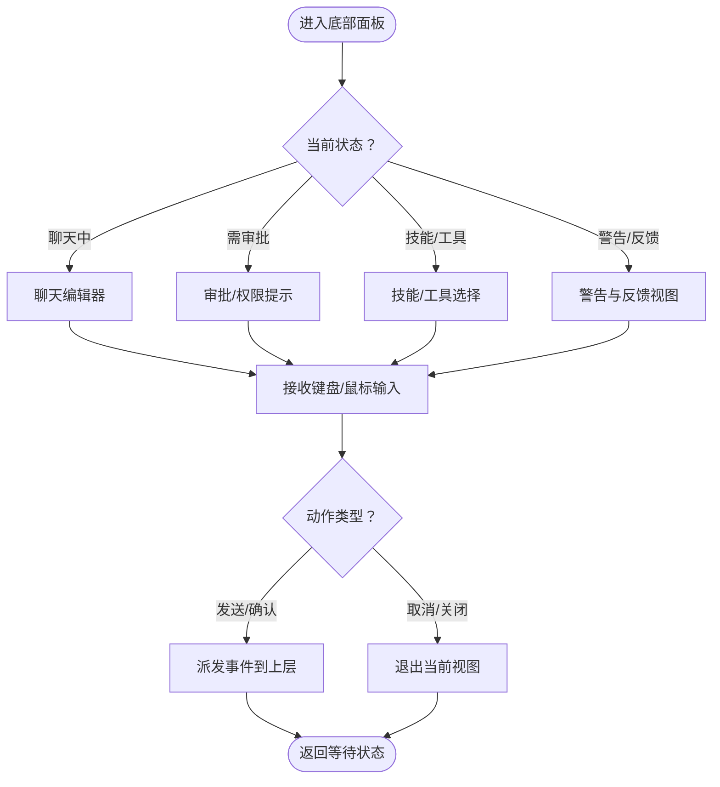
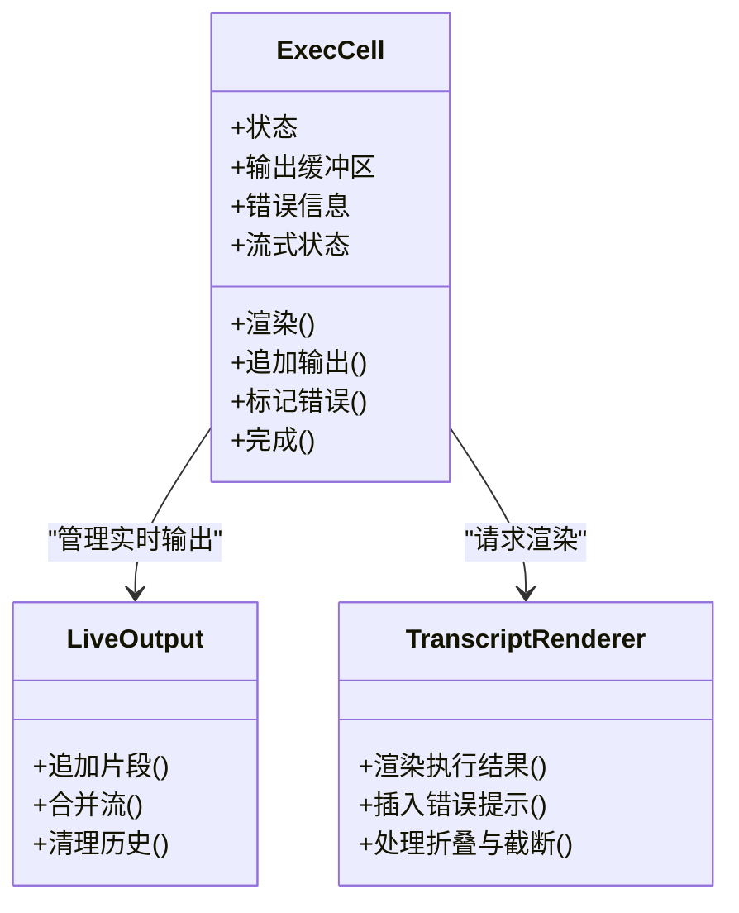
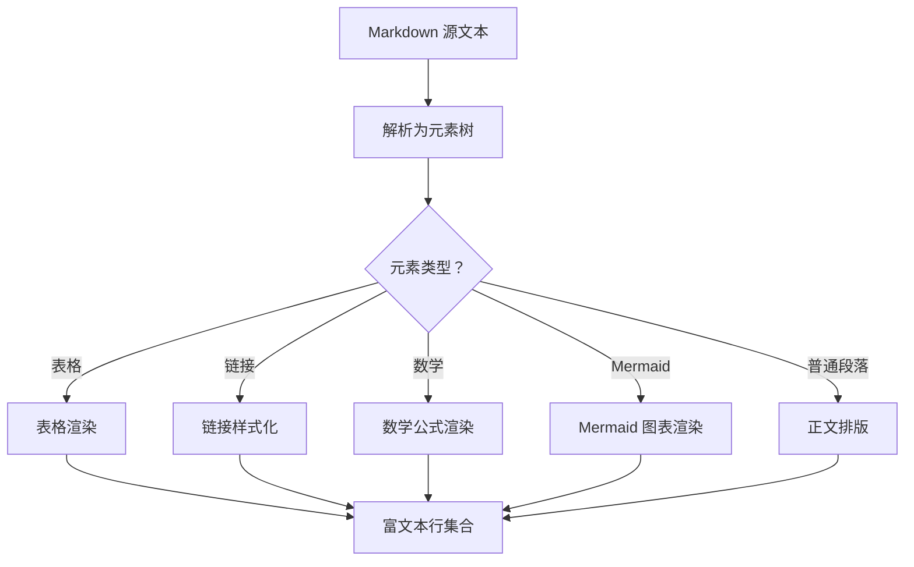
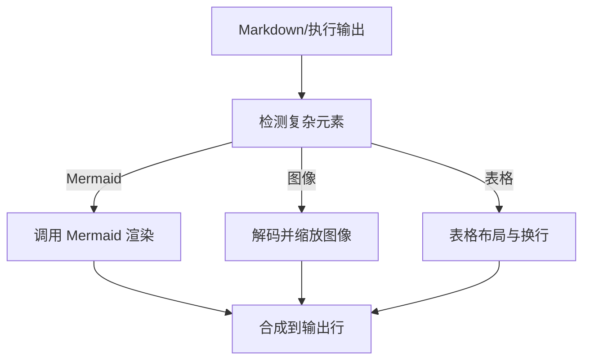
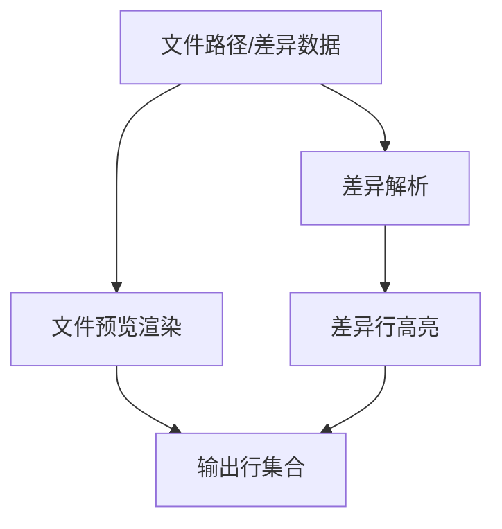
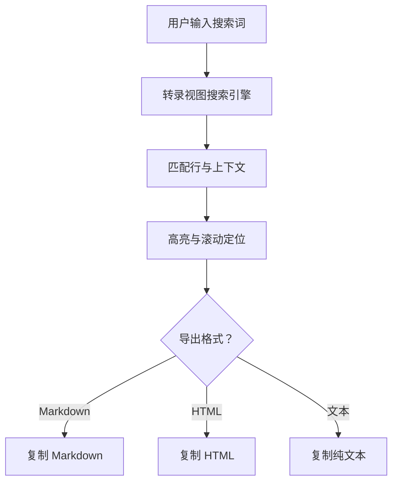
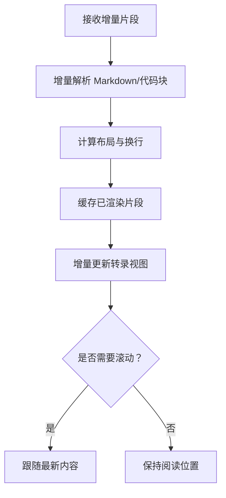
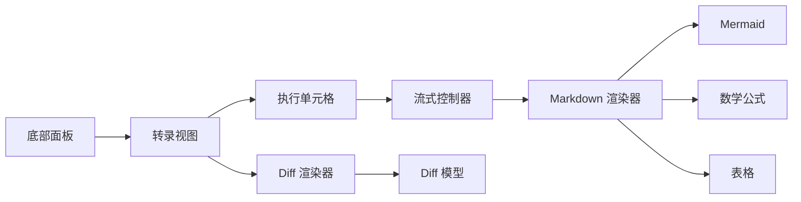

# 工具输出展示

<cite>
**本文引用的文件**   
- [bottom_pane_view.rs](file://codex-rs/tui/src/bottom_pane/bottom_pane_view.rs)
- [bottom_pane/mod.rs](file://codex-rs/tui/src/bottom_pane/mod.rs)
- [transcript_view/text.rs](file://codex-rs/tui/src/transcript_view/text.rs)
- [transcript_view/search.rs](file://codex-rs/tui/src/transcript_view/search.rs)
- [transcript_view/footer.rs](file://codex-rs/tui/src/transcript_view/footer.rs)
- [exec_cell/model.rs](file://codex-rs/tui/src/exec_cell/model.rs)
- [exec_cell/render.rs](file://codex-rs/tui/src/exec_cell/render.rs)
- [exec_cell/live_output.rs](file://codex-rs/tui/src/exec_cell/live_output.rs)
- [exec_cell/transcript.rs](file://codex-rs/tui/src/exec_cell/transcript.rs)
- [markdown_render/streaming.rs](file://codex-rs/tui/src/markdown_render/streaming.rs)
- [markdown_render/mermaid.rs](file://codex-rs/tui/src/markdown_render/mermaid.rs)
- [markdown_render/preferences.rs](file://codex-rs/tui/src/markdown_render/preferences.rs)
- [streaming/controller.rs](file://codex-rs/tui/src/streaming/controller.rs)
- [streaming/render.rs](file://codex-rs/tui/src/streaming/render.rs)
- [diff_model.rs](file://codex-rs/tui/src/diff_model.rs)
- [diff_render.rs](file://codex-rs/tui/src/diff_render.rs)
</cite>

## 目录
1. [引言](#引言)
2. [项目结构](#项目结构)
3. [核心组件](#核心组件)
4. [架构总览](#架构总览)
5. [详细组件分析](#详细组件分析)
6. [依赖关系分析](#依赖关系分析)
7. [性能考虑](#性能考虑)
8. [故障排查指南](#故障排查指南)
9. [结论](#结论)

## 引言
本文面向“工具输出展示”这一用户界面主题，聚焦终端图形界面的底部面板与执行单元格输出。内容涵盖：
- 底部面板布局与交互设计；
- 执行单元格的代码执行结果展示、代码高亮与语法着色、错误提示；
- Markdown 渲染引擎与富文本显示方式；
- 内联可视化实现，包括图表、图像、表格等复杂内容；
- 文件预览与 diff 对比展示；
- 输出内容的搜索、过滤与导出；
- 流式输出的实时更新机制。

目标是帮助开发者与高级用户理解从数据到可视化的完整链路，并在扩展或修复时快速定位相关模块。

## 项目结构
本项目采用按功能域划分的 Rust/TUI 代码组织方式。与“工具输出展示”直接相关的核心目录和文件如下：
- `bottom_pane`：底部面板的视图组合、状态机、输入与布局。
- `exec_cell`：执行单元格的数据模型、渲染与实时输出。
- `markdown_render`：Markdown、数学公式、Mermaid 图表、链接与表格的渲染与偏好控制。
- `streaming`：增量流式渲染控制器、代码块与 Mermaid 流式处理。
- `transcript_view`：会话转录视图，承载搜索结果、页脚提示、复制模式、选择模式等。
- `diff_model.rs` / `diff_render.rs`：差异数据模型与差异渲染。

**图示来源**
- [bottom_pane/mod.rs](file://codex-rs/tui/src/bottom_pane/mod.rs)
- [transcript_view/text.rs](file://codex-rs/tui/src/transcript_view/text.rs)
- [exec_cell/model.rs](file://codex-rs/tui/src/exec_cell/model.rs)
- [markdown_render/streaming.rs](file://codex-rs/tui/src/markdown_render/streaming.rs)
- [streaming/controller.rs](file://codex-rs/tui/src/streaming/controller.rs)
- [diff_model.rs](file://codex-rs/tui/src/diff_model.rs)

**章节来源**
- [bottom_pane/mod.rs](file://codex-rs/tui/src/bottom_pane/mod.rs)
- [transcript_view/text.rs](file://codex-rs/tui/src/transcript_view/text.rs)
- [exec_cell/model.rs](file://codex-rs/tui/src/exec_cell/model.rs)

## 核心组件
- 底部面板：负责把聊天编辑器、请求确认、辅助视图等组合到底部区域，并管理焦点与输入事件。
- 转录视图：作为主输出容器，承载 Markdown 输出、执行单元格、文件预览与 diff 等内容，并提供搜索、复制、选择模式。
- 执行单元格：封装单次代码执行的状态、输出、日志、错误、以及流式更新。
- Markdown 渲染器：将 Markdown、表格、数学公式、Mermaid 图、本地/外部链接等转换为 TUI 可绘制的富文本行。
- 流式控制器：对长输出进行分片、增量重排与缓存，保证编辑体验流畅。
- Diff 模型与渲染器：解析差异并高亮新增/删除/上下文行，支持语法着色与换行适配。

**章节来源**
- [bottom_pane/bottom_pane_view.rs](file://codex-rs/tui/src/bottom_pane/bottom_pane_view.rs)
- [transcript_view/text.rs](file://codex-rs/tui/src/transcript_view/text.rs)
- [exec_cell/model.rs](file://codex-rs/tui/src/exec_cell/model.rs)
- [markdown_render/streaming.rs](file://codex-rs/tui/src/markdown_render/streaming.rs)
- [streaming/controller.rs](file://codex-rs/tui/src/streaming/controller.rs)
- [diff_model.rs](file://codex-rs/tui/src/diff_model.rs)

## 架构总览
以下序列图描述一次典型的“执行单元格输出→Markdown 渲染→流式更新→转录视图展示”的流程。

**图示来源**
- [transcript_view/text.rs](file://codex-rs/tui/src/transcript_view/text.rs)
- [exec_cell/live_output.rs](file://codex-rs/tui/src/exec_cell/live_output.rs)
- [streaming/controller.rs](file://codex-rs/tui/src/streaming/controller.rs)
- [markdown_render/streaming.rs](file://codex-rs/tui/src/markdown_render/streaming.rs)
- [diff_render.rs](file://codex-rs/tui/src/diff_render.rs)

## 详细组件分析

### 底部面板布局与交互设计
底部面板是用户输入与操作的主要入口，同时承载多种子视图（如聊天编辑器、请求确认、技能选择、警告提示等）。其关键职责包括：
- 根据当前会话状态选择合适的子视图；
- 管理焦点转移与键盘/鼠标输入；
- 与上层转录视图协作，在需要时滚动到最新输出或展开详情。

底部面板通过组合多个子模块来呈现不同场景下的交互界面，并通过统一的状态机协调布局与行为。

**图示来源**
- [bottom_pane/bottom_pane_view.rs](file://codex-rs/tui/src/bottom_pane/bottom_pane_view.rs)

**章节来源**
- [bottom_pane/bottom_pane_view.rs](file://codex-rs/tui/src/bottom_pane/bottom_pane_view.rs)

### 执行单元格的代码执行结果展示
执行单元格负责封装单次执行的上下文、输出、错误、时间线与流式进度。其关键特性包括：
- 代码高亮与语法着色：在执行结果中以语法高亮的方式展示代码块，便于区分命令与输出；
- 错误提示：当执行失败或返回非零状态时，以醒目的错误样式提示用户；
- 输出折叠与截断：对超长输出提供折叠、滚动与截断策略，避免阻塞界面；
- 流式输出：逐步追加输出，保持阅读位置稳定。

**图示来源**
- [exec_cell/model.rs](file://codex-rs/tui/src/exec_cell/model.rs)
- [exec_cell/live_output.rs](file://codex-rs/tui/src/exec_cell/live_output.rs)
- [exec_cell/render.rs](file://codex-rs/tui/src/exec_cell/render.rs)

**章节来源**
- [exec_cell/model.rs](file://codex-rs/tui/src/exec_cell/model.rs)
- [exec_cell/render.rs](file://codex-rs/tui/src/exec_cell/render.rs)
- [exec_cell/live_output.rs](file://codex-rs/tui/src/exec_cell/live_output.rs)

### Markdown 渲染引擎与富文本内容
Markdown 渲染器将结构化文档转换为终端可显示的富文本行，包含：
- 段落、列表、标题、引用、链接；
- 表格与键值记录，自动换行与列宽自适应；
- 数学公式（Unicode 与 LaTeX）；
- Mermaid 图表；
- 本地文件链接与外部链接；
- 渲染偏好开关（例如禁用某些渲染器以保留原始源）。

**图示来源**
- [markdown_render/streaming.rs](file://codex-rs/tui/src/markdown_render/streaming.rs)
- [markdown_render/mermaid.rs](file://codex-rs/tui/src/markdown_render/mermaid.rs)
- [markdown_render/preferences.rs](file://codex-rs/tui/src/markdown_render/preferences.rs)

**章节来源**
- [markdown_render/streaming.rs](file://codex-rs/tui/src/markdown_render/streaming.rs)
- [markdown_render/mermaid.rs](file://codex-rs/tui/src/markdown_render/mermaid.rs)
- [markdown_render/preferences.rs](file://codex-rs/tui/src/markdown_render/preferences.rs)

### 内联可视化实现（图表、图像、表格）
- 图表：Mermaid 图表在 Markdown 中被识别并渲染为图形；若渲染失败，会回退为原始源码提示。
- 图像：转录视图支持图像行展示，并根据窗口尺寸调整缩放。
- 表格：表格渲染支持多列自适应、路径列折叠、窄屏换行与紧凑记录模式。

**图示来源**
- [markdown_render/mermaid.rs](file://codex-rs/tui/src/markdown_render/mermaid.rs)
- [transcript_view/text.rs](file://codex-rs/tui/src/transcript_view/text.rs)

**章节来源**
- [markdown_render/mermaid.rs](file://codex-rs/tui/src/markdown_render/mermaid.rs)
- [transcript_view/text.rs](file://codex-rs/tui/src/transcript_view/text.rs)

### 文件预览与 Diff 对比展示
- 文件预览：在转录视图中打开文件预览，支持语法高亮与行号导航。
- Diff 对比：差异渲染器解析变更并高亮新增、删除与上下文行，支持语法着色与换行适配。

**图示来源**
- [diff_model.rs](file://codex-rs/tui/src/diff_model.rs)
- [diff_render.rs](file://codex-rs/tui/src/diff_render.rs)
- [transcript_view/text.rs](file://codex-rs/tui/src/transcript_view/text.rs)

**章节来源**
- [diff_model.rs](file://codex-rs/tui/src/diff_model.rs)
- [diff_render.rs](file://codex-rs/tui/src/diff_render.rs)

### 输出内容的搜索、过滤与导出
转录视图提供强大的输出检索能力：
- 搜索：全文搜索匹配项，支持上下文跳转、分页与结果高亮；
- 过滤：结合选择模式与复制模式，筛选并导出选中文本；
- 导出：支持 Markdown、HTML、纯文本等多种格式的复制与导出。

**图示来源**
- [transcript_view/search.rs](file://codex-rs/tui/src/transcript_view/search.rs)
- [transcript_view/footer.rs](file://codex-rs/tui/src/transcript_view/footer.rs)

**章节来源**
- [transcript_view/search.rs](file://codex-rs/tui/src/transcript_view/search.rs)
- [transcript_view/footer.rs](file://codex-rs/tui/src/transcript_view/footer.rs)

### 流式输出的实时更新机制
流式控制器负责将长输出拆分为可管理的片段，并与 Markdown 渲染器协作，实现：
- 增量解析：边接收边解析，减少首帧延迟；
- 重排与对齐：在窗口尺寸变化或长行换行时保持视觉一致性；
- 图表与代码块处理：对 Mermaid 与代码块进行流式渲染与回退策略；
- 历史与滚动：维持用户阅读位置，必要时智能滚动。

**图示来源**
- [streaming/controller.rs](file://codex-rs/tui/src/streaming/controller.rs)
- [streaming/render.rs](file://codex-rs/tui/src/streaming/render.rs)
- [markdown_render/streaming.rs](file://codex-rs/tui/src/markdown_render/streaming.rs)

**章节来源**
- [streaming/controller.rs](file://codex-rs/tui/src/streaming/controller.rs)
- [streaming/render.rs](file://codex-rs/tui/src/streaming/render.rs)
- [markdown_render/streaming.rs](file://codex-rs/tui/src/markdown_render/streaming.rs)

## 依赖关系分析
“工具输出展示”的关键依赖链如下：
- 底部面板依赖转录视图，以提供输入与输出之间的交互；
- 转录视图依赖执行单元格与 Markdown 渲染器，以展示富文本与执行结果；
- 执行单元格依赖流式控制器，以实现增量输出；
- Markdown 渲染器依赖 Mermaid、数学公式、链接与表格子模块；
- 差异渲染依赖差异模型，以解析变更数据。

**图示来源**
- [bottom_pane/bottom_pane_view.rs](file://codex-rs/tui/src/bottom_pane/bottom_pane_view.rs)
- [transcript_view/text.rs](file://codex-rs/tui/src/transcript_view/text.rs)
- [exec_cell/model.rs](file://codex-rs/tui/src/exec_cell/model.rs)
- [streaming/controller.rs](file://codex-rs/tui/src/streaming/controller.rs)
- [markdown_render/streaming.rs](file://codex-rs/tui/src/markdown_render/streaming.rs)
- [diff_model.rs](file://codex-rs/tui/src/diff_model.rs)

**章节来源**
- [bottom_pane/bottom_pane_view.rs](file://codex-rs/tui/src/bottom_pane/bottom_pane_view.rs)
- [transcript_view/text.rs](file://codex-rs/tui/src/transcript_view/text.rs)
- [exec_cell/model.rs](file://codex-rs/tui/src/exec_cell/model.rs)
- [streaming/controller.rs](file://codex-rs/tui/src/streaming/controller.rs)
- [markdown_render/streaming.rs](file://codex-rs/tui/src/markdown_render/streaming.rs)
- [diff_model.rs](file://codex-rs/tui/src/diff_model.rs)

## 性能考虑
- 流式增量渲染：通过分片与缓存减少重复计算，降低大输出时的卡顿。
- 表格与 Mermaid 优化：在窄屏下启用紧凑模式与回退策略，避免过度渲染。
- 换行与重排：仅在必要时进行布局重算，保持滚动位置稳定。
- 差异渲染：按需解析与高亮，避免一次性加载超大差异。
- 导出与复制：优先使用已渲染结构，减少二次转换开销。

[本节为通用指导，不直接分析具体文件]

## 故障排查指南
- 输出不更新：检查流式控制器是否收到完成信号，确认 Markdown 渲染器未因偏好设置被禁用。
- Mermaid 图表不显示：确认图表源有效且渲染器可用，查看回退提示是否出现。
- 表格错位：检查列宽自适应逻辑与窄屏换行规则，验证是否有超长路径导致布局异常。
- 搜索无结果：确认搜索范围是否覆盖所有输出区域，检查正则与大小写匹配选项。
- Diff 颜色异常：验证语法着色配置与主题背景色是否一致，检查差异解析是否正确。

**章节来源**
- [streaming/controller.rs](file://codex-rs/tui/src/streaming/controller.rs)
- [markdown_render/mermaid.rs](file://codex-rs/tui/src/markdown_render/mermaid.rs)
- [markdown_render/streaming.rs](file://codex-rs/tui/src/markdown_render/streaming.rs)
- [transcript_view/search.rs](file://codex-rs/tui/src/transcript_view/search.rs)
- [diff_render.rs](file://codex-rs/tui/src/diff_render.rs)

## 结论
“工具输出展示”通过底部面板、转录视图、执行单元格、Markdown 渲染器、流式控制器与差异渲染器等模块协同工作，实现了丰富的终端输出体验。该体系支持代码高亮、错误提示、富文本、图表、图像、表格、文件预览与 diff 对比，并提供搜索、过滤与导出能力。流式渲染确保了长时间运行的任务也能获得流畅的实时更新体验。

[本节为总结性内容，不直接分析具体文件]