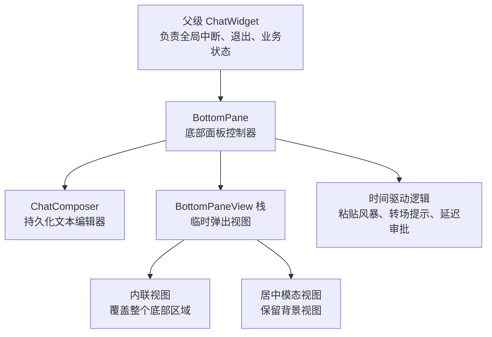
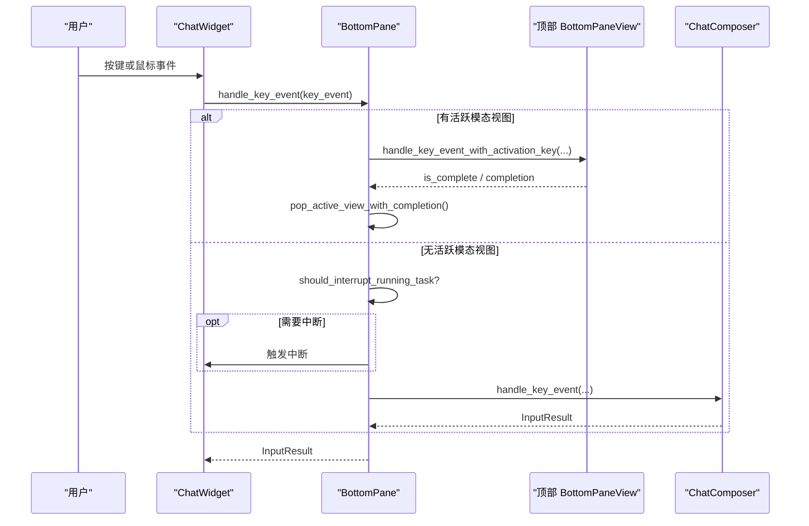
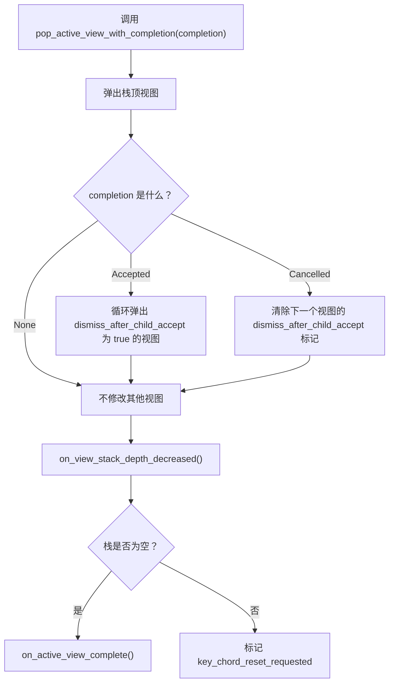
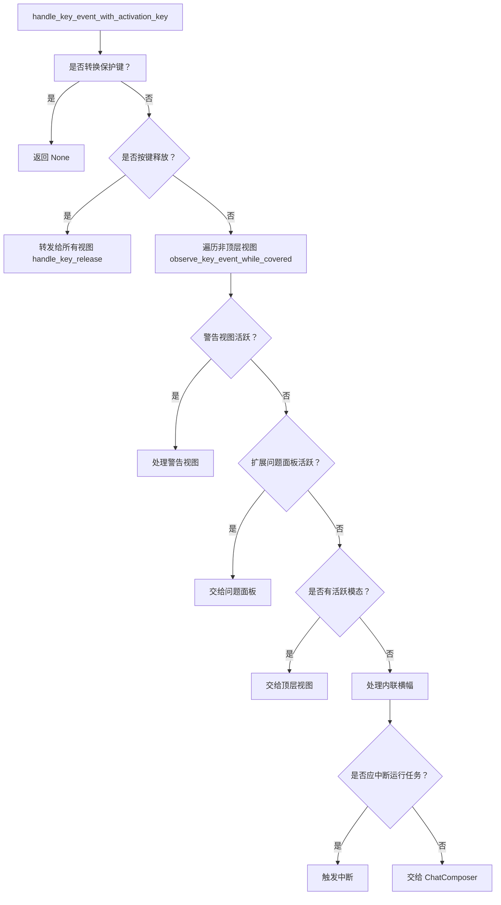
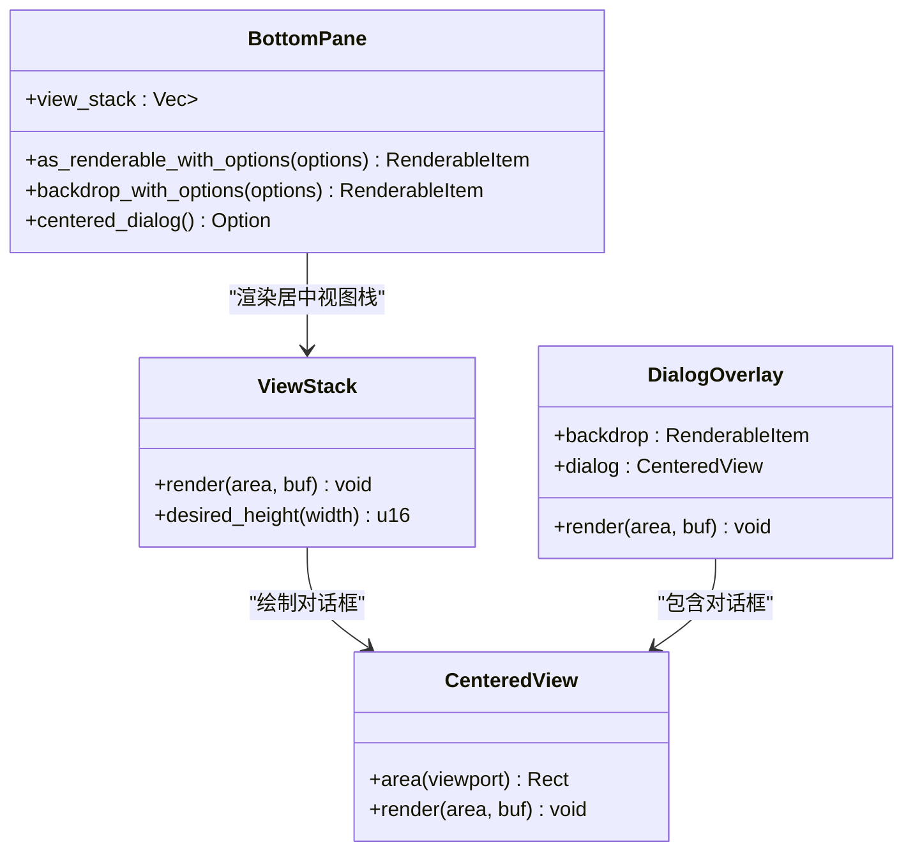
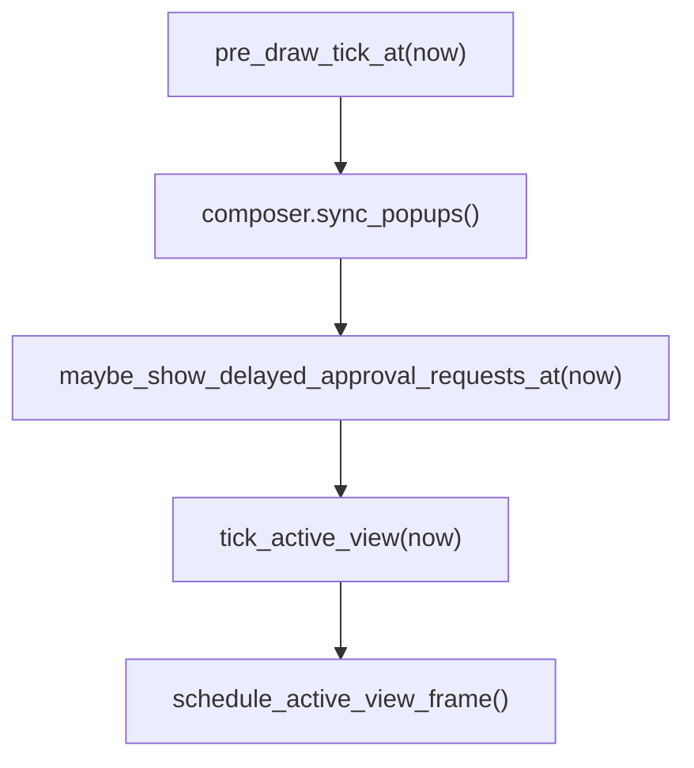
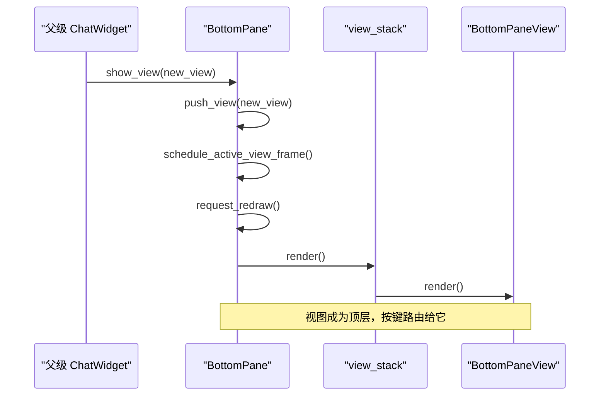
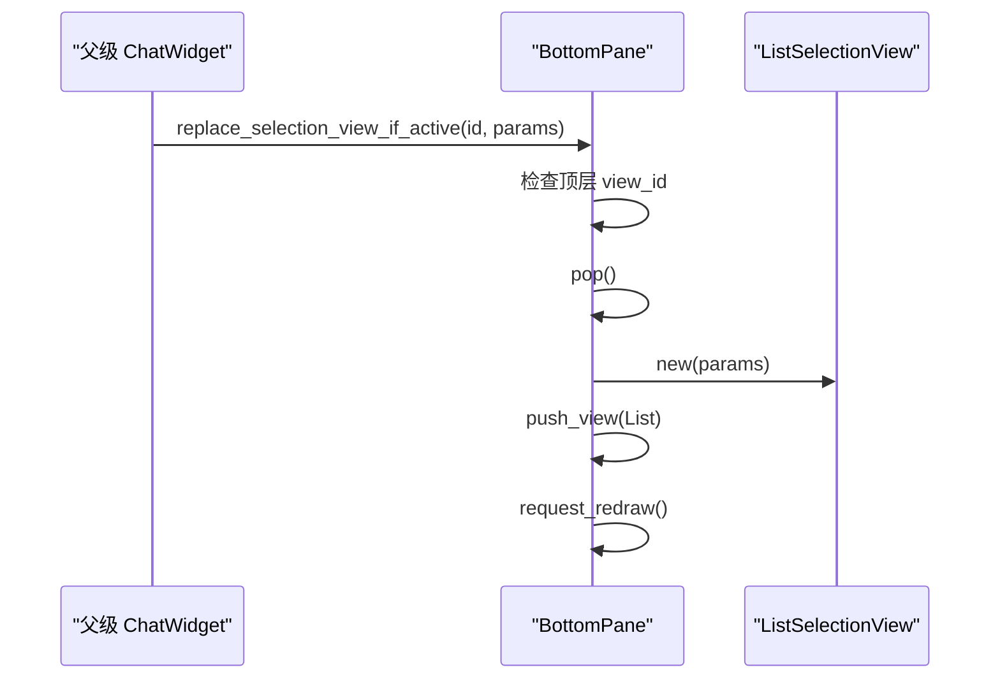
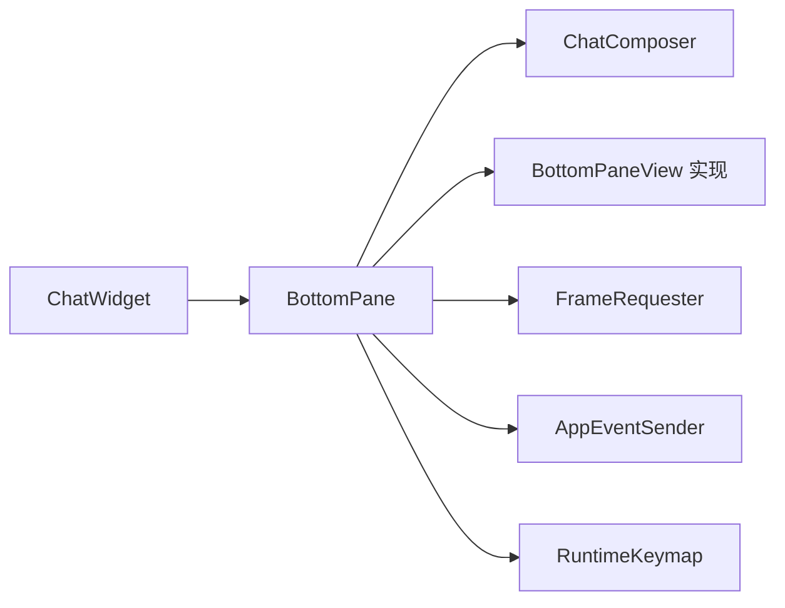

# 底部面板布局与交互

<cite>
**本文引用的文件**   
- [bottom_pane/mod.rs](file://codex-rs/tui/src/bottom_pane/mod.rs)
- [bottom_pane/bottom_pane_view.rs](file://codex-rs/tui/src/bottom_pane/bottom_pane_view.rs)
- [bottom_pane/view_stack.rs](file://codex-rs/tui/src/bottom_pane/view_stack.rs)
- [bottom_pane/chat_composer.rs](file://codex-rs/tui/src/bottom_pane/chat_composer.rs)
- [chatwidget/constructor.rs](file://codex-rs/tui/src/chatwidget/constructor.rs)
</cite>

## 目录
1. [引言](#引言)
2. [项目结构定位](#项目结构定位)
3. [核心组件](#核心组件)
4. [架构总览](#架构总览)
5. [详细组件分析](#详细组件分析)
6. [依赖关系分析](#依赖关系分析)
7. [性能与更新机制](#性能与更新机制)
8. [故障排查指南](#故障排查指南)
9. [结论](#结论)

## 引言
本文聚焦 Codex TUI 中“底部面板”的布局与交互实现。底部面板是聊天界面的可编辑输入区域，同时承载临时视图栈、内联横幅、状态行、待处理提示和快捷键系统。它由两个关键部分组成：
- `ChatComposer`：持久化的可编辑提示输入框，负责文本、附件、粘贴、历史、命令补全、Vim 模式等编辑器行为。
- `BottomPaneView`：一个 trait，定义所有可出现在底部面板中的临时视图；`BottomPane` 维护这些视图的栈，并决定按键、渲染和生命周期。

本文重点说明：
- 视图栈如何插入、替换和关闭。
- 焦点路由规则：局部表面优先，父级 `ChatWidget` 处理中断、退出等高级意图。
- 模态视图层级管理：居中对齐视图如何保留背景视图。
- 时间驱动的 UI 更新：转场提示、粘贴风暴刷新、延迟审批弹窗。
- 内联横幅和数字快捷方式的显示条件。

## 项目结构定位
底部面板位于 `codex-rs/tui/src/bottom_pane` 模块中，其顶层模块文档明确描述了职责边界：
- 底部面板拥有 `ChatComposer` 和一组临时 `BottomPaneView`。
- 模态插入、替换和关闭会失效挂起的按键序列。
- 输入路由分层：`BottomPane` 决定局部表面是否接收按键，父级 `ChatWidget` 决定中断或退出。
- 部分 UI 基于时间而非输入驱动，例如“再次按下以退出”的提示需要定时重绘。
- 内联横幅显示在 composer 上方；数字快捷方式仅在空且空闲的 composer 上生效。

图表来源
- [bottom_pane/mod.rs:1-20](file://codex-rs/tui/src/bottom_pane/mod.rs#L1-L20)
- [bottom_pane/mod.rs:301-362](file://codex-rs/tui/src/bottom_pane/mod.rs#L301-L362)

章节来源
- [bottom_pane/mod.rs:1-20](file://codex-rs/tui/src/bottom_pane/mod.rs#L1-L20)

## 核心组件
### BottomPane：底部面板控制器
`BottomPane` 是底部面板的中央控制器，持有：
- 持久化的 `ChatComposer`。
- 临时 `BottomPaneView` 栈。
- 键盘序列守卫、异步问题面板、延迟审批请求队列、活动计时器、内联横幅、统一执行摘要、待处理输入预览、线程审批、运行时键位映射等。

构造时，它会创建 `RuntimeKeymap::defaults()`，并把默认键位绑定注入到 composer 中，同时设置技能提及、帧请求器和动画效果。

章节来源
- [bottom_pane/mod.rs:301-362](file://codex-rs/tui/src/bottom_pane/mod.rs#L301-L362)
- [bottom_pane/mod.rs:362-520](file://codex-rs/tui/src/bottom_pane/mod.rs#L362-L520)

### BottomPaneView：底部面板视图接口
`BottomPaneView` 是所有底部面板视图的统一接口。每个视图可以：
- 声明展示方式：内联或居中。
- 处理按键、释放事件、粘贴。
- 暴露当前 keymap 上下文。
- 声明是否完成、完成原因、是否因子视图接受而自动关闭。
- 支持外部刷新时的稳定标识、选中项、搜索查询和切换状态。
- 提供时间驱动的 `pre_draw_tick`。
- 尝试消费审批请求和用户输入请求。

这个接口让不同类型的临时视图（选择列表、审批弹窗、异步问题、配置面板等）以统一方式参与底部面板的生命周期。

章节来源
- [bottom_pane/bottom_pane_view.rs:1-200](file://codex-rs/tui/src/bottom_pane/bottom_pane_view.rs#L1-L200)

### ChatComposer：可编辑提示输入框
`ChatComposer` 是底部面板的持久输入状态机。它负责：
- 文本编辑、附件、粘贴检测、粘贴风暴。
- 命令补全、斜杠命令、提及菜单、Vim 模式。
- 提交、排队、Shell 模式、父子线程模式。
- 历史导航、Ctrl+R 搜索、草稿恢复。
- 推理努力级别动画、Astra sparkle 资格。
- 快捷键帮助、全屏粘贴限制、转场提示。

它不是临时视图栈的一部分，而是始终保留在底部面板中；临时视图只是暂时替代它的渲染和输入处理。

章节来源
- [bottom_pane/chat_composer.rs:1-200](file://codex-rs/tui/src/bottom_pane/chat_composer.rs#L1-L200)

### ViewStack：居中模态与背景保留
`view_stack.rs` 提供共享的居中对话框几何和渲染逻辑：
- `ViewStack` 渲染栈中最顶层视图。
- 如果顶层视图是居中展示，则先渲染之前的视图作为背景，再渲染居中对话框。
- `CenteredView` 计算对话框区域并清空该区域，确保终端缓存单元格被正确覆盖。
- `DialogOverlay` 组合背景渲染项和居中对话框，用于更高层的背板渲染。

这保证了打开居中模态时，用户仍能看到底层内容，而不是整块空白。

章节来源
- [bottom_pane/view_stack.rs:1-137](file://codex-rs/tui/src/bottom_pane/view_stack.rs#L1-L137)

## 架构总览
底部面板的渲染和输入流程分为三层：
1. 父级 `ChatWidget`：负责全局中断、退出、会话状态、业务命令和事件分发。
2. `BottomPane`：决定当前按键是否由局部表面（活跃视图或 composer）处理；否则处理中断、内联横幅、状态指示器等。
3. `BottomPaneView` 栈：最顶层视图获得输入优先权；居中视图保留背景但不会改变焦点。

图表来源
- [bottom_pane/mod.rs:891-1160](file://codex-rs/tui/src/bottom_pane/mod.rs#L891-L1160)
- [chatwidget/constructor.rs:111-130](file://codex-rs/tui/src/chatwidget/constructor.rs#L111-L130)

## 详细组件分析

### 视图栈的插入、替换和关闭
#### 插入视图
当调用 `push_view` 时，`BottomPane` 会：
1. 标记需要重置按键序列。
2. 将视图压入栈。
3. 调度活跃视图帧。
4. 请求重绘。

这意味着任何模态打开都会打断当前按键序列，避免旧上下文误匹配新界面。

#### 关闭视图
关闭通过 `pop_active_view_with_completion` 完成：
- 如果是“已接受”，则继续弹出所有设置了 `dismiss_after_child_accept` 的视图。
- 如果是“已取消”，则清除下一个视图上的“因子视图接受而关闭”标记。
- 最后调用 `on_view_stack_depth_decreased`，使按键序列失效；若栈为空，则进入活跃视图完成回调。

图表来源
- [bottom_pane/mod.rs:771-800](file://codex-rs/tui/src/bottom_pane/mod.rs#L771-L800)

#### 替换视图
底部面板提供多种替换操作：
- `replace_selection_view_if_active`：替换与指定 `view_id` 匹配的活跃选择视图，保留搜索查询。
- `replace_selection_view_if_present`：替换任意位置的匹配选择视图，并继承父级清理标记。
- `replace_active_views_with_selection_view`：用通用选择视图替换多个连续匹配视图。
- `replace_view_if_present`：按 `view_id` 替换任意视图。

这些方法常用于后端数据更新后刷新列表，而不破坏用户已经打开的选择界面。

章节来源
- [bottom_pane/mod.rs:1558-1660](file://codex-rs/tui/src/bottom_pane/mod.rs#L1558-L1660)

### 焦点路由规则
`handle_key_event_with_activation_key` 是按键分发的核心：

1. 如果按键来自视图转换保护键，直接消费。
2. 按键释放事件会转发给所有视图，以便被覆盖的配置面板也能看到释放事件。
3. 当栈深度大于 1 时，除顶层外的视图会通过 `observe_key_event_while_covered` 观察按键，但不作为输入处理。
4. 如果警告视图活跃，优先处理警告视图。
5. 如果扩展的异步问题面板活跃，按键交给它。
6. 如果有活跃模态视图，按键交给顶层视图；必要时走 Esc/Ctrl+C 取消路径。
7. 如果没有活跃视图：
   - 先尝试内联横幅。
   - 再判断是否应该中断正在运行的任务。
   - 最后交给 `ChatComposer`。

图表来源
- [bottom_pane/mod.rs:891-1160](file://codex-rs/tui/src/bottom_pane/mod.rs#L891-L1160)

章节来源
- [bottom_pane/mod.rs:891-1160](file://codex-rs/tui/src/bottom_pane/mod.rs#L891-L1160)

### Ctrl+C 与退出语义
`on_ctrl_c` 明确区分“已处理的取消”和“未处理的取消”。它不会直接决定是否退出进程，而是把结果交给父级 `ChatWidget`：

- 如果警告视图活跃，关闭警告并返回已处理。
- 如果扩展问题面板活跃，交给问题面板。
- 如果有活跃模态视图，交给模态视图处理；如果模态视图返回已处理，则显示“退出快捷键提示”。
- 如果没有活跃模态：
  - 先尝试取消 Vim 搜索或历史搜索。
  - 如果 composer 为空，返回未处理，让上层决定是否退出。
  - 否则清空 composer 并显示退出快捷键提示。

因此，“Ctrl+C 是否退出”由 `ChatWidget` 的 quit/interrupt 状态机决定，`BottomPane` 只负责本地取消和提示。

章节来源
- [bottom_pane/mod.rs:1042-1160](file://codex-rs/tui/src/bottom_pane/mod.rs#L1042-L1160)

### 居中视图与背景保留
当活跃视图的 `presentation()` 返回 `Centered` 时：
- `as_renderable_with_options` 使用 `ViewStack` 渲染。
- `backdrop_with_options` 排除顶层居中视图，只渲染之前视图作为背景。
- `centered_dialog` 暴露顶层居中视图，供更高层背板绘制。
- `ViewStack` 渲染时，先渲染背景，再清空并绘制居中对话框。

这避免了居中弹窗覆盖整个底部区域时丢失背景信息。

图表来源
- [bottom_pane/view_stack.rs:1-137](file://codex-rs/tui/src/bottom_pane/view_stack.rs#L1-L137)
- [bottom_pane/mod.rs:2430-2500](file://codex-rs/tui/src/bottom_pane/mod.rs#L2430-L2500)

章节来源
- [bottom_pane/view_stack.rs:1-137](file://codex-rs/tui/src/bottom_pane/view_stack.rs#L1-L137)
- [bottom_pane/mod.rs:2430-2500](file://codex-rs/tui/src/bottom_pane/mod.rs#L2430-L2500)

### 内联横幅与数字快捷方式
- 内联横幅由 `actionable_banner::InlineBanner` 表示，保存在 `inline_banner` 字段中。
- 当任务运行或有模态视图时，横幅会被隐藏，以避免干扰。
- 普通渲染路径中，内联横幅位于状态行、待处理输入预览和 composer 之间。
- 数字快捷方式仅适用于“空且空闲”的 composer；草稿、粘贴风暴和活跃对话会保持正常输入路由。

这保证后台状态和前景输入互不抢占：繁忙时隐藏横幅，活跃模态时禁用快捷方式。

章节来源
- [bottom_pane/mod.rs:2430-2500](file://codex-rs/tui/src/bottom_pane/mod.rs#L2430-L2500)
- [bottom_pane/mod.rs:1-20](file://codex-rs/tui/src/bottom_pane/mod.rs#L1-L20)

### 快捷键处理与父级意图
`BottomPane` 的职责边界如下：
- 本地 surface：活跃视图优先；其次 composer；必要时警告视图或问题面板。
- 高级意图：中断、退出、全局快捷键由 `ChatWidget` 处理。
- `keymap_contexts` 根据当前活跃上下文返回当前可消费的 keymap 上下文集合。

这种分层使得：
- 选择列表、审批弹窗、配置面板可以有自己的快捷键。
- 全局退出和中断仍然由应用层统一管理。
- 快捷键冲突可以通过激活键和上下文控制。

章节来源
- [bottom_pane/mod.rs:1160-1230](file://codex-rs/tui/src/bottom_pane/mod.rs#L1160-L1230)

### 时间驱动的 UI 更新机制
底部面板存在多处时间驱动逻辑：

1. **粘贴风暴刷新**  
   如果活跃视图或 composer 处于粘贴风暴状态，`BottomPane` 会调度短时重绘，等待粘贴流结束。

2. **转场提示与“再次按下以退出”**  
   当有挂起的审批请求且 composer 最近有活动时，底部面板记录活动时间，并在超时后重新请求重绘；如果用户持续输入，则推迟显示。

3. **延迟审批弹窗**  
   当没有活跃视图且存在挂起审批时，`maybe_show_delayed_approval_requests_at` 会在打字空闲后弹出审批覆盖层，并按 FIFO 顺序追加后续请求。

4. **活跃视图预绘制钩子**  
   `pre_draw_tick` 会调用活跃视图的 `pre_draw_tick(now)`，允许视图基于时间改变状态，例如倒计时、闪烁、转场进度。

图表来源
- [bottom_pane/mod.rs:1132-1160](file://codex-rs/tui/src/bottom_pane/mod.rs#L1132-L1160)
- [bottom_pane/mod.rs:825-880](file://codex-rs/tui/src/bottom_pane/mod.rs#L825-L880)

章节来源
- [bottom_pane/mod.rs:1132-1160](file://codex-rs/tui/src/bottom_pane/mod.rs#L1132-L1160)
- [bottom_pane/mod.rs:825-880](file://codex-rs/tui/src/bottom_pane/mod.rs#L825-L880)

### 视图切换流程示例
下面是一个典型视图切换流程，从父级调用到底部面板内部状态变化：

另一个常见场景是替换已有选择视图：

图表来源
- [bottom_pane/mod.rs:771-780](file://codex-rs/tui/src/bottom_pane/mod.rs#L771-L780)
- [bottom_pane/mod.rs:1558-1600](file://codex-rs/tui/src/bottom_pane/mod.rs#L1558-L1600)

章节来源
- [bottom_pane/mod.rs:771-800](file://codex-rs/tui/src/bottom_pane/mod.rs#L771-L800)
- [bottom_pane/mod.rs:1558-1600](file://codex-rs/tui/src/bottom_pane/mod.rs#L1558-L1600)

## 依赖关系分析
### 组件耦合
- `BottomPane` 强依赖 `ChatComposer`：composer 是持久输入源，临时视图不能替代其全部能力。
- `BottomPane` 弱依赖具体 `BottomPaneView` 实现：通过 trait 抽象，新增视图不需要修改路由主流程。
- `ViewStack` 依赖 `BottomPaneView` 的 `presentation()` 和 `desired_height()`。
- `ChatWidget` 通过构造函数向 `BottomPane` 注入帧请求器、事件发送器、动画和键位映射。

### 外部依赖
- 帧请求器：用于驱动动画、转场、时间提示。
- 事件发送器：用于中断、连接器快照、插件能力等跨组件通信。
- 运行时键位映射：决定快捷键上下文和行为。
- 配置项：动画、TUI 效果、粘贴风暴开关、Vim 模式等。

图表来源
- [chatwidget/constructor.rs:111-130](file://codex-rs/tui/src/chatwidget/constructor.rs#L111-L130)
- [bottom_pane/mod.rs:362-520](file://codex-rs/tui/src/bottom_pane/mod.rs#L362-L520)

章节来源
- [chatwidget/constructor.rs:111-130](file://codex-rs/tui/src/chatwidget/constructor.rs#L111-L130)
- [bottom_pane/mod.rs:362-520](file://codex-rs/tui/src/bottom_pane/mod.rs#L362-L520)

## 性能与更新机制
### 渲染优化
- 当任务运行或有模态视图时，内联横幅会被隐藏，减少不必要的横幅计算。
- 居中视图使用 `Clear` 和 `CellDiffOption::AlwaysUpdate` 强制刷新对话框区域，避免终端缓存导致颜色不一致。
- `ChatComposerPresentation` 只在需要复杂选项时才包装 composer，避免多余对象分配。

### 输入去抖与防丢
- 粘贴风暴使用推荐刷新间隔，避免每次粘贴字符都触发完整重绘。
- 按键释放事件穿透所有视图，防止被覆盖的配置面板错过释放。
- 模态打开会重置按键序列，避免长组合键跨越不同界面。

### 时间驱动更新
- `pre_draw_tick` 在每个绘制前调用活跃视图的时间钩子。
- 审批弹窗延迟显示依赖最后一次 composer 活动时间，避免用户打字时被频繁打断。
- 转场提示、状态计时器、Hook 状态等也依赖帧请求器进行增量更新。

[本节为一般性性能讨论，不直接分析具体代码片段]

## 故障排查指南
### 症状：模态打开后快捷键行为异常
可能原因：
- 模态视图未正确处理 `is_complete`，导致栈无法弹出。
- 模态视图未正确设置 `dismiss_after_child_accept`，导致父级清理逻辑失效。
- 按键序列未重置，旧上下文继续匹配。

排查步骤：
1. 检查模态视图的 `is_complete` 和 `completion`。
2. 确认是否需要 `dismiss_after_child_accept`。
3. 查看 `push_view` 是否被调用，以及 `key_chord_reset_requested` 是否被设置。

章节来源
- [bottom_pane/mod.rs:771-800](file://codex-rs/tui/src/bottom_pane/mod.rs#L771-L800)

### 症状：居中模态遮挡背景
可能原因：
- 视图未声明 `ViewPresentation::Centered`。
- 渲染路径未使用 `ViewStack`。
- 背景渲染被警告视图或其他覆盖层阻断。

排查步骤：
1. 检查 `presentation()`。
2. 检查 `as_renderable_with_options` 是否进入 `ViewStack`。
3. 检查 `warnings_active()` 是否提前返回警告视图。

章节来源
- [bottom_pane/view_stack.rs:1-137](file://codex-rs/tui/src/bottom_pane/view_stack.rs#L1-L137)
- [bottom_pane/mod.rs:2430-2500](file://codex-rs/tui/src/bottom_pane/mod.rs#L2430-L2500)

### 症状：Ctrl+C 没有触发退出
可能原因：
- 活跃模态视图已消费 Ctrl+C，但并未完成。
- 扩展问题面板捕获了 Ctrl+C。
- composer 不为空，`BottomPane` 选择清空 composer 而不是向上冒泡。

排查步骤：
1. 检查活跃视图的 `on_ctrl_c`。
2. 检查 `questions.expanded`。
3. 检查 `composer_is_empty()`。

章节来源
- [bottom_pane/mod.rs:1042-1160](file://codex-rs/tui/src/bottom_pane/mod.rs#L1042-L1160)

### 症状：内联横幅不显示
可能原因：
- 任务正在运行。
- 有模态视图或 popup 活跃。
- 横幅已被显式隐藏。

排查步骤：
1. 检查 `is_task_running`。
2. 检查 `view_stack.is_empty()`。
3. 检查 `inline_banner` 生命周期。

章节来源
- [bottom_pane/mod.rs:2430-2500](file://codex-rs/tui/src/bottom_pane/mod.rs#L2430-L2500)

## 结论
底部面板采用“持久编辑器 + 临时视图栈”的分层设计：
- `ChatComposer` 承担主要编辑职责，保持稳定可用。
- `BottomPaneView` 提供统一的临时视图接口，支持内联、居中、时间驱动、审批消费、粘贴处理等能力。
- `BottomPane` 负责按键路由、视图生命周期、时间驱动更新和与父级 `ChatWidget` 的意图分离。
- `ViewStack` 保证居中模态能保留背景，提升可读性和上下文感知。

这套设计使底部面板既能处理复杂的临时交互，又能保持输入体验一致，同时把全局中断、退出等高级意图交给父级组件统一管理。