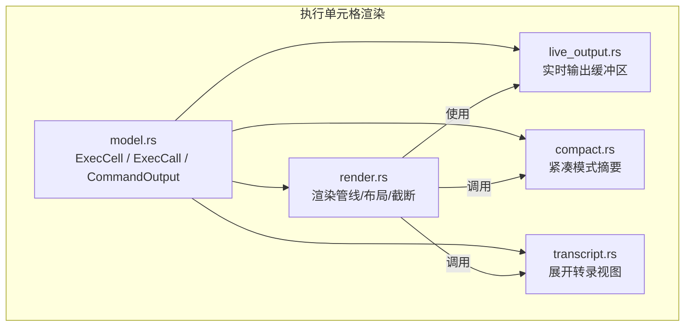
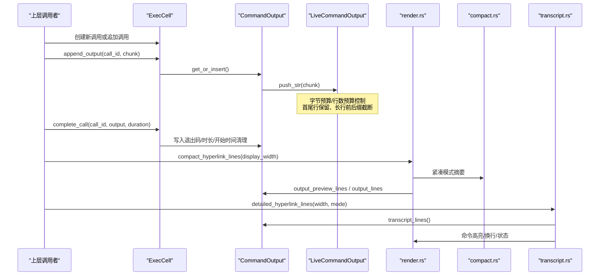
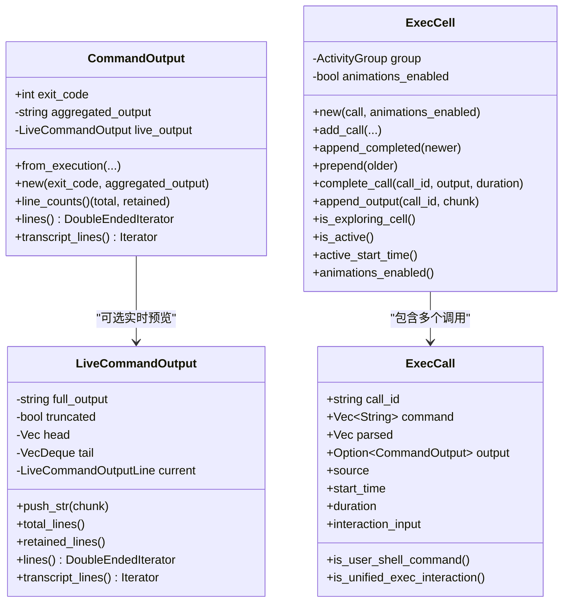
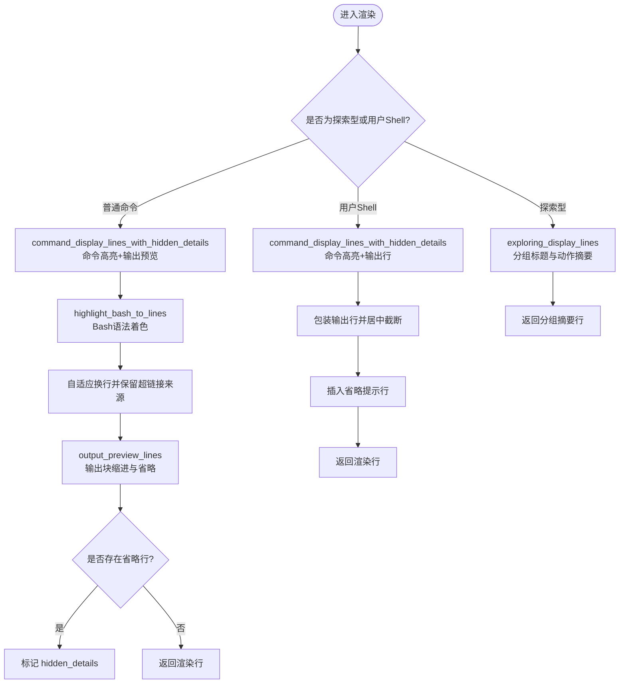
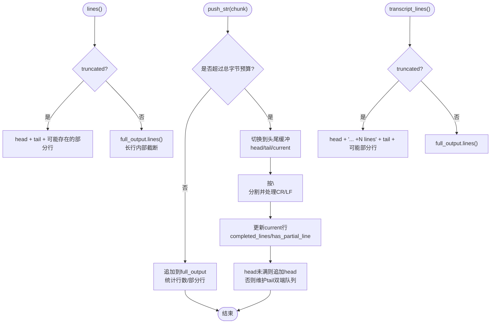
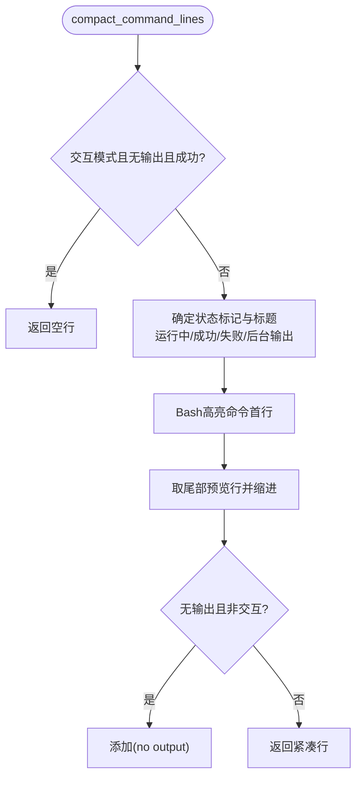
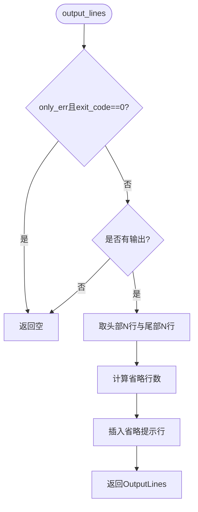
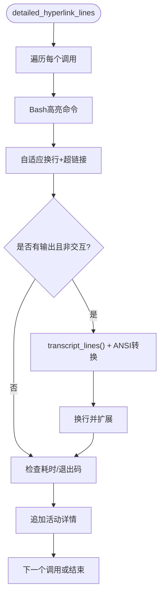

# 执行单元格渲染

<cite>
**本文引用的文件**   
- [exec_cell/mod.rs](file://codex-rs/tui/src/exec_cell/mod.rs)
- [exec_cell/model.rs](file://codex-rs/tui/src/exec_cell/model.rs)
- [exec_cell/render.rs](file://codex-rs/tui/src/exec_cell/render.rs)
- [exec_cell/live_output.rs](file://codex-rs/tui/src/exec_cell/live_output.rs)
- [exec_cell/compact.rs](file://codex-rs/tui/src/exec_cell/compact.rs)
- [exec_cell/transcript.rs](file://codex-rs/tui/src/exec_cell/transcript.rs)
</cite>

## 目录
1. [引言](#引言)
2. [项目结构](#项目结构)
3. [核心组件](#核心组件)
4. [架构总览](#架构总览)
5. [详细组件分析](#详细组件分析)
6. [依赖关系分析](#依赖关系分析)
7. [性能与缓冲特性](#性能与缓冲特性)
8. [故障排查指南](#故障排查指南)
9. [结论](#结论)
10. [附录：渲染参数与自定义格式示例](#附录渲染参数与自定义格式示例)

## 引言
本文聚焦终端界面中“执行单元格”的渲染子系统，解释执行命令如何从数据模型进入预览、实时输出、紧凑模式与完整转录展示。重点包括：
- `ExecCell` 模型结构与数据流
- `CommandOutput` 的定义和“已聚合输出 + 实时预览”双态
- 执行结果的渲染流程：代码高亮、语法着色、错误信息格式化
- 实时输出（live output）增量处理、行级截断与缓冲区管理
- 紧凑模式的输出压缩策略与展开机制
- 输出行的中间截断、预览功能及与转录（transcript）集成
- 可配置的渲染参数与扩展点

## 项目结构
执行单元格渲染位于 TUI 模块的 `exec_cell` 子模块中，职责划分清晰：
- `model.rs`：定义 `ExecCell`、`ExecCall`、`CommandOutput` 等核心数据结构，以及执行调用生命周期方法
- `render.rs`：将执行单元转换为终端可渲染的行，负责命令高亮、输出预览、布局、截断
- `live_output.rs`：维护流式输出的有界缓冲区，支持前缀/后缀保留、长行截断、转义序列闭合
- `compact.rs`：紧凑模式下的一行命令摘要、尾部预览与展开提示
- `transcript.rs`：展开后的完整转录视图，包含命令、输出、耗时与状态
- `mod.rs`：对外暴露公共类型与函数入口

**图表来源**
- [exec_cell/mod.rs:1-14](file://codex-rs/tui/src/exec_cell/mod.rs#L1-L14)
- [exec_cell/model.rs:1-274](file://codex-rs/tui/src/exec_cell/model.rs#L1-L274)
- [exec_cell/render.rs:1-900](file://codex-rs/tui/src/exec_cell/render.rs#L1-L900)
- [exec_cell/live_output.rs:1-259](file://codex-rs/tui/src/exec_cell/live_output.rs#L1-L259)
- [exec_cell/compact.rs:1-132](file://codex-rs/tui/src/exec_cell/compact.rs#L1-L132)
- [exec_cell/transcript.rs:1-75](file://codex-rs/tui/src/exec_cell/transcript.rs#L1-L75)

**章节来源**
- [exec_cell/mod.rs:1-14](file://codex-rs/tui/src/exec_cell/mod.rs#L1-L14)

## 核心组件
- `ExecCell`：一个可包含多个相关执行调用的分组容器，用于表示单个命令或一组“探索型”读/列表/搜索操作。它维护动画开关、活动状态、时间戳，并提供追加输出、完成调用、合并历史等功能。
- `ExecCall`：一次执行调用的最小单元，携带调用标识、命令字符串、解析结果、输出、来源、起止时间与交互输入。
- `CommandOutput`：命令的最终输出封装，包含退出码、最终聚合输出与可选的实时预览；提供逻辑行数统计、迭代器访问（预览/转录），以及基于活跃状态的差异返回。

关键行为要点：
- 完成时根据来源统一设置退出码，避免非已完成状态被误判为成功
- 探索型分组允许相邻的只读类命令聚合显示，同时保持展开时的位置稳定
- 实时输出通过 `LiveCommandOutput` 逐步累积，完成后被替换为聚合输出

**章节来源**
- [exec_cell/model.rs:1-120](file://codex-rs/tui/src/exec_cell/model.rs#L1-L120)
- [exec_cell/model.rs:201-274](file://codex-rs/tui/src/exec_cell/model.rs#L201-L274)

## 架构总览
执行单元格渲染的整体流程如下：

**图表来源**
- [exec_cell/model.rs:201-274](file://codex-rs/tui/src/exec_cell/model.rs#L201-L274)
- [exec_cell/live_output.rs:1-120](file://codex-rs/tui/src/exec_cell/live_output.rs#L1-L120)
- [exec_cell/render.rs:200-500](file://codex-rs/tui/src/exec_cell/render.rs#L200-L500)
- [exec_cell/compact.rs:1-132](file://codex-rs/tui/src/exec_cell/compact.rs#L1-L132)
- [exec_cell/transcript.rs:1-75](file://codex-rs/tui/src/exec_cell/transcript.rs#L1-L75)

## 详细组件分析

### 数据模型：`ExecCell`、`ExecCall`、`CommandOutput`
- `CommandOutput`
  - 字段：退出码、最终聚合输出、可选实时预览
  - 构造：根据执行状态与来源决定默认退出码；统一交互模式清空输出以隐藏后台输出
  - 接口：
    - `line_counts()`：返回总行数与可渲染保留行数
    - `lines()`：面向预览的双端迭代器，优先走实时预览
    - `transcript_lines()`：面向转录的迭代器，在截断后插入省略标记
- `ExecCall`
  - 字段：调用标识、命令数组、解析命令、输出、来源、开始时间、持续时间、交互输入
  - 辅助判断：用户 Shell 命令、统一交互模式、探索型调用
- `ExecCell`
  - 字段：活动组、动画开关
  - 生命周期：
    - `new` / `add_call`：创建或加入新的调用
    - `append_completed`：历史页面合并探索型分组
    - `complete_call`：标记最近匹配调用完成，写入输出与时长
    - `append_output`：向活动调用的实时输出追加增量
    - `should_flush` / `is_active` / `is_exploring_cell`：分组刷新与状态判断

**图表来源**
- [exec_cell/model.rs:1-274](file://codex-rs/tui/src/exec_cell/model.rs#L1-L274)
- [exec_cell/live_output.rs:1-259](file://codex-rs/tui/src/exec_cell/live_output.rs#L1-L259)

**章节来源**
- [exec_cell/model.rs:1-274](file://codex-rs/tui/src/exec_cell/model.rs#L1-L274)

### 渲染管线：命令高亮、输出预览与布局
渲染管线负责把 `ExecCell` 转为终端可见的超链接行，主要能力包括：
- 命令高亮：对命令文本进行 Bash 语法着色，并按换行符拆分为多行
- 输出预览：
  - 普通命令：优先使用 `output_preview_lines`，基于 `CommandOutput.lines()` 生成带缩进的前缀块
  - 用户 Shell 命令：采用 `output_lines`，限制最大屏幕行数并进行“头部+尾部+中间省略”的截断
- 布局常量：
  - `TOOL_CALL_MAX_LINES`：工具调用预览行数上限
  - `USER_SHELL_TOOL_CALL_MAX_LINES`：用户 Shell 命令输出最大屏幕行数
  - `EXEC_DISPLAY_LAYOUT`：命令续行与前缀、输出块前缀、最大续行数的布局配置
- 超链接与源追踪：
  - 使用 `LogicalLineSource` 记录原始行范围，便于复制与选择
  - `adaptive_wrap_hyperlink_lines` 在换行时维持超链接来源映射

关键点：
- 命令头与续行分别计算宽度，保证长 URL 不会撑满视口
- 输出块通过 `prefix_hyperlink_lines` 添加固定缩进，区分命令与输出
- 当没有输出且非交互模式时，显示 `(no output)` 占位
- 隐藏细节判定：如果存在无源信息的省略行，则标记需要展开

**图表来源**
- [exec_cell/render.rs:200-900](file://codex-rs/tui/src/exec_cell/render.rs#L200-L900)

**章节来源**
- [exec_cell/render.rs:1-200](file://codex-rs/tui/src/exec_cell/render.rs#L1-L200)
- [exec_cell/render.rs:500-900](file://codex-rs/tui/src/exec_cell/render.rs#L500-L900)

### 实时输出（live output）：增量渲染与缓冲区管理
`LiveCommandOutput` 是流式命令输出的有界缓冲区，核心设计：
- 预算上限：
  - 总字节数上限：约 1MB
  - 最大行数：50 行
  - 单行最大字节数：按行数预算分配，避免超长行无限增长
- 未截断阶段：
  - 完整保留 `full_output`，统计已完成行数与部分行标志
- 触发截断后：
  - 切换为头尾双端缓冲：保留前 50 行与后 50 行，当前未完成行也保留
  - 每行独立保存“前缀 + 省略标记 + 后缀”，以应对无换行长行
- ANSI 转义处理：
  - 正确处理 CR/LF 混合换行
  - 在省略标记前闭合未结束的 ANSI 序列，避免后续样式污染
- 迭代器：
  - `lines()`：面向预览，返回可双向遍历的逻辑行；长行会被截断为“前缀+省略+后缀”
  - `transcript_lines()`：面向转录，在未截断时返回完整行；截断后插入“… +N lines”的省略行

**图表来源**
- [exec_cell/live_output.rs:1-259](file://codex-rs/tui/src/exec_cell/live_output.rs#L1-L259)

**章节来源**
- [exec_cell/live_output.rs:1-259](file://codex-rs/tui/src/exec_cell/live_output.rs#L1-L259)

### 紧凑模式（compact mode）：输出压缩与展开机制
紧凑模式的目标是在有限空间内显示命令摘要，并在必要时提示展开：
- 摘要生成：
  - 非交互模式：显示命令的高亮首行，附带状态标记（运行中、成功、失败）
  - 交互模式：若无输出且成功，则不显示摘要
- 尾部预览：
  - 取最后若干行作为预览，带缩进前缀并降低亮度
  - 若无输出且非交互模式，显示 `(no output)`
- 展开提示：
  - 若命令过长、输出超出预览行数或存在宽行，返回 `ActivityDisclosure::Generic` 或 `ActivityDisclosure::OutputLines`
  - 对于探索型分组，额外统计非零退出次数并在标题旁标注

**图表来源**
- [exec_cell/compact.rs:1-132](file://codex-rs/tui/src/exec_cell/compact.rs#L1-L132)

**章节来源**
- [exec_cell/compact.rs:1-132](file://codex-rs/tui/src/exec_cell/compact.rs#L1-L132)

### 输出行的截断与预览
渲染层对输出行采取多层保护：
- `output_lines`：
  - 仅错误模式：退出码为 0 时直接返回空
  - 无输出时返回空
  - 头部 N 行 + 尾部 N 行，中间省略行显示“… +N lines”
- `truncate_lines_middle`：
  - 基于屏幕实际占用行数（考虑换行）进行“头部+尾部”裁剪
  - 计算省略提示行的实际占用行数，确保窄屏下仍符合预算
  - 将上游传入的省略计数向前传递，保证省略提示稳定

预览函数 `output_preview_lines`：
- 使用 `tool_output_hyperlink_preview` 对输出行做超链接预览，保持总行数与省略语义

**图表来源**
- [exec_cell/render.rs:1-200](file://codex-rs/tui/src/exec_cell/render.rs#L1-L200)
- [exec_cell/render.rs:500-900](file://codex-rs/tui/src/exec_cell/render.rs#L500-L900)

**章节来源**
- [exec_cell/render.rs:1-200](file://codex-rs/tui/src/exec_cell/render.rs#L1-L200)
- [exec_cell/render.rs:500-900](file://codex-rs/tui/src/exec_cell/render.rs#L500-L900)

### 转录（transcript）集成
展开后的转录视图由 `detailed_hyperlink_lines` 提供：
- 逐调用输出命令高亮行，带 `$ ` 前缀与缩进
- 输出行通过 `transcript_lines()` 获取，保留真实顺序与省略标记
- 非交互模式才输出命令与输出；交互模式隐藏输出以避免重复
- 成功后显示绿色勾号，失败显示红色叉号与退出码
- 若存在持续时间，附加格式化后的耗时信息
- 最后追加活动详情（如探索型分组的 reasoning）

**图表来源**
- [exec_cell/transcript.rs:1-75](file://codex-rs/tui/src/exec_cell/transcript.rs#L1-L75)

**章节来源**
- [exec_cell/transcript.rs:1-75](file://codex-rs/tui/src/exec_cell/transcript.rs#L1-L75)

## 依赖关系分析
- `ExecCell` 依赖 `ActivityGroup` 管理调用集合与详情
- 渲染层依赖：
  - Bash 高亮：`highlight_bash_to_lines`
  - 超链接与换行：`terminal_hyperlinks` 中的适配函数
  - 工具输出预览：`tool_output_hyperlink_preview`
  - 动画指示器：`motion` 模块
- 实时输出依赖：
  - `itertools::Either` 实现双端迭代器分支
  - `std::collections::VecDeque` 维护尾部双端队列

耦合与内聚：
- `model.rs` 内聚数据与生命周期，低耦合于渲染
- `render.rs` 高内聚渲染逻辑，依赖外部库进行高亮与换行
- `live_output.rs` 自包含增量缓冲算法，易于测试与替换
- `compact.rs` 与 `transcript.rs` 复用 `CommandOutput` 接口，保持展示一致性

潜在循环依赖：
- 当前模块间单向依赖，未见循环引用

**章节来源**
- [exec_cell/render.rs:1-200](file://codex-rs/tui/src/exec_cell/render.rs#L1-L200)
- [exec_cell/live_output.rs:1-120](file://codex-rs/tui/src/exec_cell/live_output.rs#L1-L120)

## 性能与缓冲特性
- 实时输出内存上限约 1MB，超过后自动切换为头尾双端缓冲，防止无限增长
- 单行最长字节数受预算约束，避免超长行导致渲染卡顿
- 输出行截断基于屏幕实际占用行数，减少窄屏下的溢出风险
- 高亮与换行仅在必要时执行，预览路径尽量轻量
- 转录路径保留完整逻辑行，适合复制与搜索，但可能更耗内存

优化建议：
- 若需更大输出量，可调大 `LIVE_COMMAND_OUTPUT_MAX_BYTES` 与 `LIVE_COMMAND_OUTPUT_MAX_LINES`
- 对频繁重绘场景，优先使用 `output_preview_lines` 而非全量转录
- 在极窄终端上，适当提高 `USER_SHELL_TOOL_CALL_MAX_LINES` 的阈值需谨慎评估

[本节为通用性能讨论，无需具体文件分析]

## 故障排查指南
常见问题与定位要点：
- 实时输出不显示或闪烁异常
  - 检查 `append_output` 是否正确路由到对应 `call_id`
  - 确认 `LiveCommandOutput.push_str` 的 CR/LF 处理与 ANSI 序列闭合
- 输出被过度截断
  - 查看 `output_lines` 的 `line_limit` 与 `truncate_lines_middle` 的屏幕行数预算
  - 检查 `EXEC_DISPLAY_LAYOUT` 的输出块前缀宽度与最大续行
- 紧凑模式不显示摘要
  - 确认交互模式且成功且无输出的特殊分支
  - 验证命令高亮首行是否超过宽度并触发省略
- 转录缺失输出
  - 确认调用非交互模式；交互模式会故意隐藏输出
  - 检查 `transcript_lines()` 是否在截断后插入省略标记

**章节来源**
- [exec_cell/model.rs:201-274](file://codex-rs/tui/src/exec_cell/model.rs#L201-L274)
- [exec_cell/render.rs:500-900](file://codex-rs/tui/src/exec_cell/render.rs#L500-L900)
- [exec_cell/live_output.rs:120-259](file://codex-rs/tui/src/exec_cell/live_output.rs#L120-L259)
- [exec_cell/compact.rs:1-132](file://codex-rs/tui/src/exec_cell/compact.rs#L1-L132)
- [exec_cell/transcript.rs:1-75](file://codex-rs/tui/src/exec_cell/transcript.rs#L1-L75)

## 结论
执行单元格渲染通过清晰的数据模型与分层渲染管线，实现了从命令高亮、输出预览到完整转录的全链路展示。实时输出采用严格的预算与双端缓冲，保障长时间运行的稳定性；紧凑模式提供高效的摘要与展开提示；转录视图则兼顾可读性与完整性。整体设计在保证性能的同时，提供了良好的可扩展性与可维护性。

[本节为总结，无需具体文件分析]

## 附录：渲染参数与自定义格式示例

### 渲染参数配置
- `OutputLinesParams`
  - `line_limit`：限制输出逻辑行数
  - `only_err`：仅错误模式，退出码为 0 时返回空
  - `include_angle_pipe`：首行添加角括号前缀
  - `include_prefix`：为每行添加缩进前缀
- `EXEC_DISPLAY_LAYOUT`
  - `command_continuation_max_lines`：命令续行最大行数
  - `command_continuation.initial_prefix` / `subsequent_prefix`：命令续行前缀
  - `output_block.initial_prefix` / `subsequent_prefix`：输出块前缀

### 自定义输出格式化示例
- 自定义输出行前缀：
  - 修改 `prefix_hyperlink_lines` 的前缀参数，例如改为 `[OUT]`
- 自定义省略提示文案：
  - 调整 `output_ellipsis_text`，例如改为“已省略 N 行（按 Ctrl+T 查看）”
- 调整实时输出预算：
  - 修改 `LIVE_COMMAND_OUTPUT_MAX_BYTES` 与 `LIVE_COMMAND_OUTPUT_MAX_LINES`
- 调整用户 Shell 输出最大屏幕行数：
  - 修改 `USER_SHELL_TOOL_CALL_MAX_LINES`

注意：上述修改会影响预览与转录的一致性，需在测试中验证不同终端宽度与长行场景。

**章节来源**
- [exec_cell/render.rs:1-200](file://codex-rs/tui/src/exec_cell/render.rs#L1-L200)
- [exec_cell/render.rs:900-1367](file://codex-rs/tui/src/exec_cell/render.rs#L900-L1367)
- [exec_cell/live_output.rs:1-120](file://codex-rs/tui/src/exec_cell/live_output.rs#L1-L120)