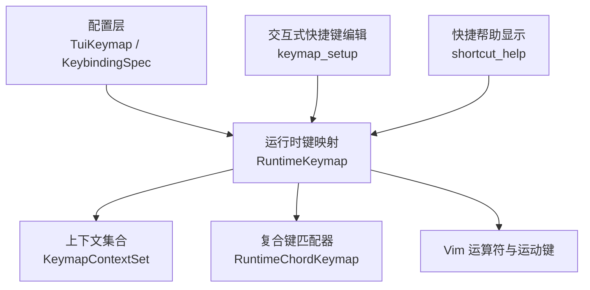
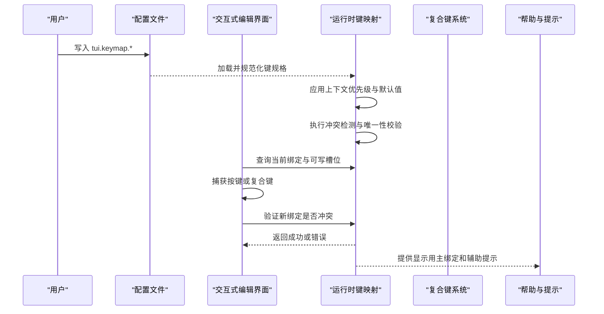
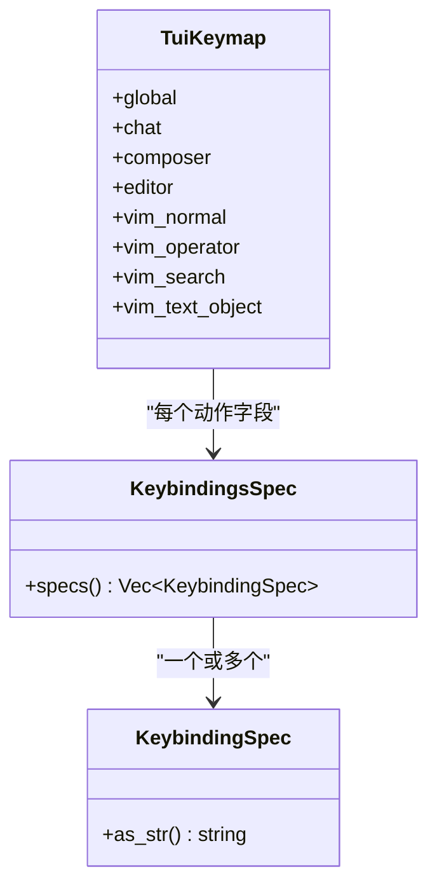
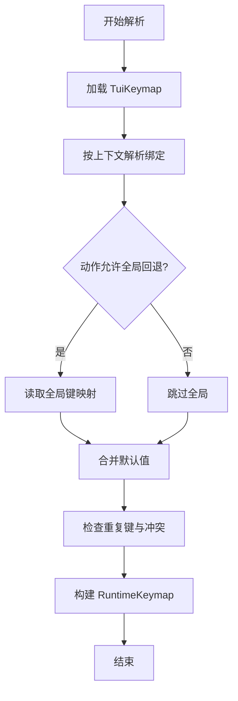
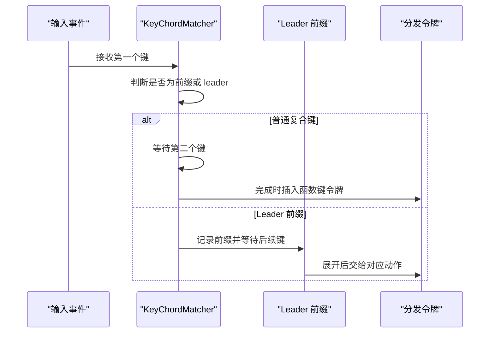
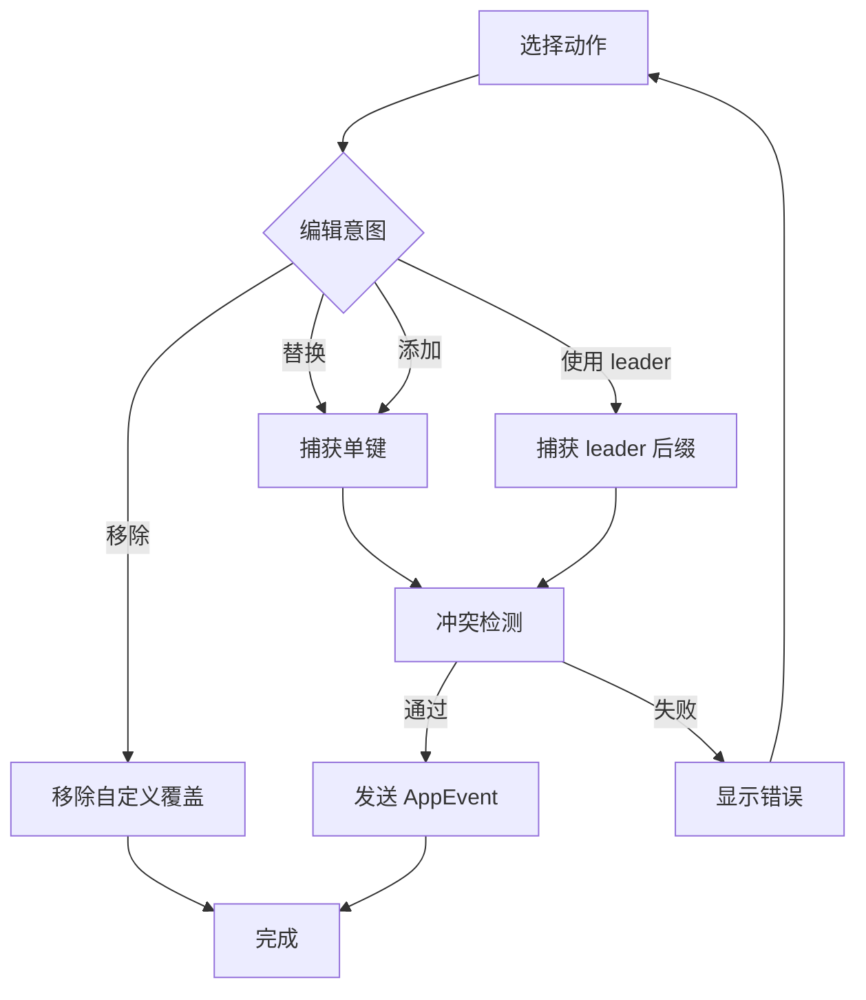
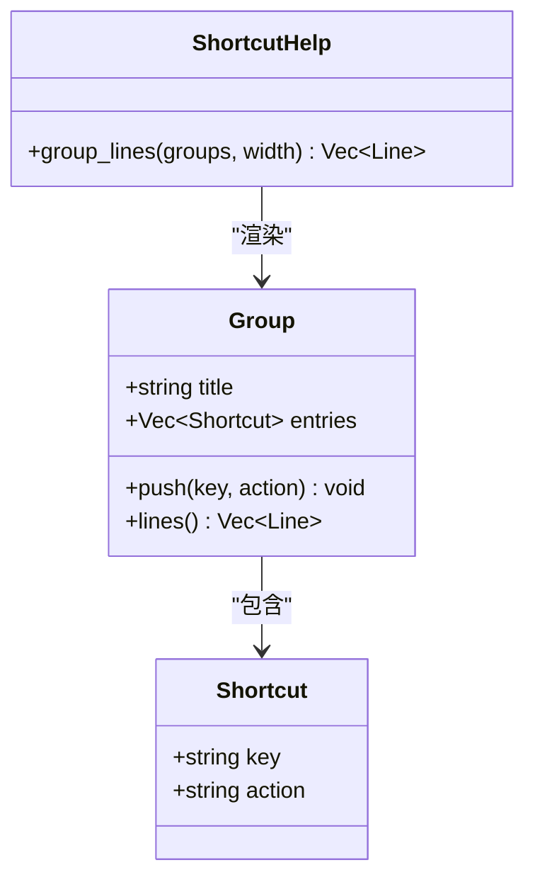
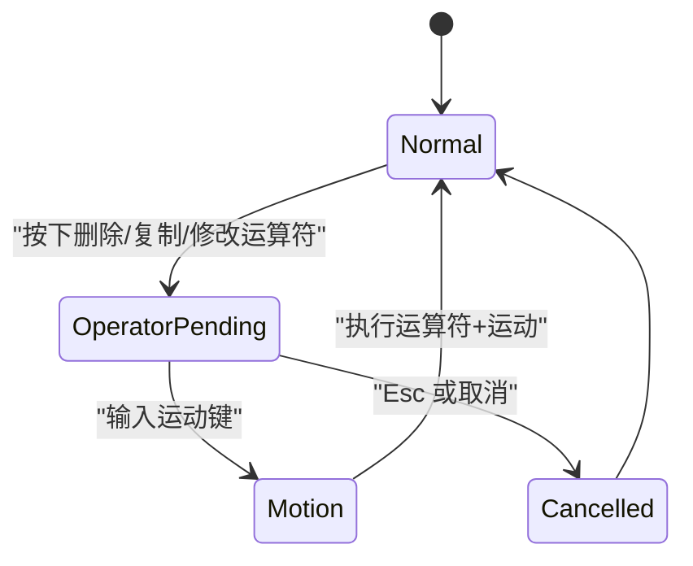
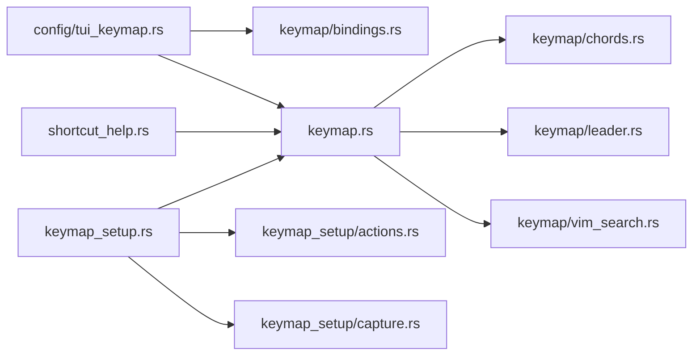
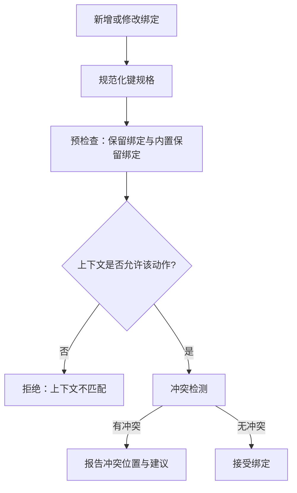

# 快捷键系统

<cite>
**本文引用的文件**   
- [keymap.rs](file://codex-rs/tui/src/keymap.rs)
- [bindings.rs](file://codex-rs/tui/src/keymap/bindings.rs)
- [chords.rs](file://codex-rs/tui/src/keymap/chords.rs)
- [leader.rs](file://codex-rs/tui/src/keymap/leader.rs)
- [tui_keymap.rs](file://codex-rs/config/src/tui_keymap.rs)
- [actions.rs](file://codex-rs/tui/src/keymap_setup/actions.rs)
- [capture.rs](file://codex-rs/tui/src/keymap_setup/capture.rs)
- [keymap_setup.rs](file://codex-rs/tui/src/keymap_setup.rs)
- [shortcut_help.rs](file://codex-rs/tui/src/shortcut_help.rs)
</cite>

## 目录
1. [引言](#引言)
2. [项目结构](#项目结构)
3. [核心组件](#核心组件)
4. [架构总览](#架构总览)
5. [详细组件分析](#详细组件分析)
6. [依赖关系分析](#依赖关系分析)
7. [性能与冲突检测](#性能与冲突检测)
8. [键盘布局适配与多语言支持](#键盘布局适配与多语言支持)
9. [故障排查指南](#故障排查指南)
10. [结论](#结论)

## 引言
本文件系统性地说明 TUI 中的快捷键系统：内置映射、用户自定义配置、按键组合注册与处理流程、快捷帮助界面、运动键实现、键盘布局适配与多语言支持，以及快捷键冲突检测和解决策略。该系统将“配置层”“运行时解析层”“交互式编辑界面”和“显示层”解耦，使快捷键既可由用户灵活定制，又能在多种上下文和复合操作中保持一致行为。

## 项目结构
快捷键相关代码分布在两个主要区域：
- 配置定义与规范化：`codex-rs/config/src/tui_keymap.rs`
- TUI 运行时键映射、复合键、交互编辑与帮助显示：`codex-rs/tui/src/keymap*`、`codex-rs/tui/src/keymap_setup*`、`codex-rs/tui/src/shortcut_help.rs`

**图表来源**
- [tui_keymap.rs:1-120](file://codex-rs/config/src/tui_keymap.rs#L1-L120)
- [keymap.rs:1-120](file://codex-rs/tui/src/keymap.rs#L1-L120)
- [chords.rs:1-120](file://codex-rs/tui/src/keymap/chords.rs#L1-L120)
- [keymap_setup.rs:1-60](file://codex-rs/tui/src/keymap_setup.rs#L1-L60)
- [shortcut_help.rs:1-40](file://codex-rs/tui/src/shortcut_help.rs#L1-L40)

**章节来源**
- [tui_keymap.rs:1-120](file://codex-rs/config/src/tui_keymap.rs#L1-L120)
- [keymap.rs:1-120](file://codex-rs/tui/src/keymap.rs#L1-L120)
- [keymap_setup.rs:1-60](file://codex-rs/tui/src/keymap_setup.rs#L1-L60)
- [shortcut_help.rs:1-40](file://codex-rs/tui/src/shortcut_help.rs#L1-L40)

## 核心组件
- 配置类型与规范化：`KeybindingSpec`、`KeybindingsSpec`、`TuiKeymap` 及其各上下文分组（全局、聊天、编辑器、Vim 等）。
- 运行时键映射：`RuntimeKeymap` 提供按上下文分组的动作绑定集合，并统一暴露给输入处理逻辑。
- 上下文与动作标识：`KeymapContext`、`KeymapActionId` 描述“哪个上下文中的哪个动作”。
- 复合键系统：`RuntimeChordKeymap`、`KeyChordMatcher` 负责两击键序列、共享前缀 leader 和超时控制。
- 交互式编辑：`keymap_setup` 模块提供选择动作、替换/添加/移除绑定、捕获按键或复合键的引导界面。
- 快捷帮助：`ShortcutHelp` 将当前可用快捷键渲染为多列帮助文本。

**章节来源**
- [tui_keymap.rs:1-300](file://codex-rs/config/src/tui_keymap.rs#L1-L300)
- [keymap.rs:1-200](file://codex-rs/tui/src/keymap.rs#L1-L200)
- [bindings.rs:1-120](file://codex-rs/tui/src/keymap/bindings.rs#L1-L120)
- [chords.rs:1-120](file://codex-rs/tui/src/keymap/chords.rs#L1-L120)
- [keymap_setup.rs:1-120](file://codex-rs/tui/src/keymap_setup.rs#L1-L120)
- [shortcut_help.rs:1-100](file://codex-rs/tui/src/shortcut_help.rs#L1-L100)

## 架构总览
快捷键系统遵循“配置驱动、上下文优先、分层校验”的设计：

**图表来源**
- [tui_keymap.rs:1-120](file://codex-rs/config/src/tui_keymap.rs#L1-L120)
- [keymap.rs:1-120](file://codex-rs/tui/src/keymap.rs#L1-L120)
- [keymap_setup.rs:1-120](file://codex-rs/tui/src/keymap_setup.rs#L1-L120)
- [chords.rs:1-120](file://codex-rs/tui/src/keymap/chords.rs#L1-L120)

## 详细组件分析

### 配置层：键规格与上下文
配置层定义用户可写的 `tui.keymap.*` 结构，包括：
- 全局键映射：窗口导航、会话切换、复制、清空终端、提交与队列等。
- 聊天键映射：语音开关、暂停推理强度、权限模式切换、异步问题导航等。
- 编辑器键映射：光标移动、删除、剪贴板操作等。
- Vim 相关键映射：普通模式、运算符待命模式、搜索模式、文本对象。

键规格支持单键、两击复合键，也支持数组形式的多个备选绑定。空列表表示显式解绑。

**图表来源**
- [tui_keymap.rs:1-300](file://codex-rs/config/src/tui_keymap.rs#L1-L300)

**章节来源**
- [tui_keymap.rs:1-300](file://codex-rs/config/src/tui_keymap.rs#L1-L300)

### 运行时键映射：上下文、动作与解析顺序
`RuntimeKeymap` 是运行时唯一使用的键映射形状，它已包含：
- 解析后的所有上下文绑定。
- 从配置到默认值的确定性优先级。
- 重复键校验结果。
- 与复合键系统的集成。

解析顺序为：
1. 上下文特定绑定。
2. 支持全局回退的动作使用 `tui.keymap.global`。
3. 内置默认值。

`KeymapContext` 表示运行时的作用域，例如全局、聊天、编辑器、Vim 正常模式、Vim 运算符模式、Vim 搜索模式、Vim 文本对象、分页器、列表、代理、审批等。`KeymapActionId` 把“上下文 + 动作名”稳定化，用于冲突检测、配置路径生成和 UI 展示。

**图表来源**
- [keymap.rs:1-120](file://codex-rs/tui/src/keymap.rs#L1-L120)
- [bindings.rs:1-120](file://codex-rs/tui/src/keymap/bindings.rs#L1-L120)

**章节来源**
- [keymap.rs:1-200](file://codex-rs/tui/src/keymap.rs#L1-L200)
- [bindings.rs:1-200](file://codex-rs/tui/src/keymap/bindings.rs#L1-L200)

### 复合键与共享前缀
复合键系统支持：
- 两击键序列，例如先按前缀键再按完成键。
- 共享前缀 leader，用于持久化的上下文感知菜单。
- 一秒钟超时；活动上下文变化时取消等待。
- 内部函数键令牌注入，让现有处理器无需改动即可响应复合键。

`KEY_CHORD_TIMEOUT` 控制普通复合键超时；leader 前缀在未完成或取消前保持挂起。`KeymapContextSet` 根据当前输入路径决定哪些动作可以激活，避免在其他上下文中误抢焦点。

**图表来源**
- [chords.rs:1-200](file://codex-rs/tui/src/keymap/chords.rs#L1-L200)
- [leader.rs:1-73](file://codex-rs/tui/src/keymap/leader.rs#L1-L73)

**章节来源**
- [chords.rs:1-200](file://codex-rs/tui/src/keymap/chords.rs#L1-L200)
- [leader.rs:1-73](file://codex-rs/tui/src/keymap/leader.rs#L1-L73)

### 交互式快捷键编辑
`keymap_setup` 提供 `/keymap` 命令对应的引导式编辑流程：
1. 选择一个动作。
2. 选择替换、添加、移除或使用 leader。
3. 捕获按键、两击复合键或 leader 后缀。
4. 复用运行时解析规则进行冲突检测。
5. 向应用层发送编辑事件，由上层决定是否保存和重载。

捕获界面支持三种模式：
- 单键捕获。
- 两击复合键捕获。
- leader 后缀捕获。

**图表来源**
- [keymap_setup.rs:1-120](file://codex-rs/tui/src/keymap_setup.rs#L1-L120)
- [capture.rs:1-201](file://codex-rs/tui/src/keymap_setup/capture.rs#L1-L201)
- [actions.rs:1-120](file://codex-rs/tui/src/keymap_setup/actions.rs#L1-L120)

**章节来源**
- [keymap_setup.rs:1-260](file://codex-rs/tui/src/keymap_setup.rs#L1-L260)
- [capture.rs:1-201](file://codex-rs/tui/src/keymap_setup/capture.rs#L1-L201)
- [actions.rs:1-260](file://codex-rs/tui/src/keymap_setup/actions.rs#L1-L260)

### 快捷帮助界面
快捷帮助将当前可用的快捷键组织成三个组，并按宽度自适应为三列、两列或一列。每组包含键标签和动作描述；主绑定来自运行时键映射，同时复合键系统可以提供辅助提示，例如语音静音提示。

**图表来源**
- [shortcut_help.rs:1-100](file://codex-rs/tui/src/shortcut_help.rs#L1-L100)

**章节来源**
- [shortcut_help.rs:1-100](file://codex-rs/tui/src/shortcut_help.rs#L1-L100)

### 运动键实现原理和使用场景
运动键属于 Vim 运算符待命模式的第二键，用于在被选操作（删除、复制、修改）之后确定操作范围。常见运动键包括：
- 方向运动：左、右、上、下。
- 词级运动：向前词、向后词、词尾。
- 行级运动：行首、行尾。
- 查找类运动：查找下一个字符、查找到某个字符之前。
- 文本对象：选择“内部”或“外部”文本对象。

当用户在普通模式下按下运算符键后，系统进入运算符待命状态；随后输入的运动键与当前运算符结合，形成完整编辑操作。

**图表来源**
- [keymap.rs:280-320](file://codex-rs/tui/src/keymap.rs#L280-L320)
- [keymap.rs:1270-1290](file://codex-rs/tui/src/keymap.rs#L1270-L1290)
- [keymap.rs:2020-2040](file://codex-rs/tui/src/keymap.rs#L2020-L2040)

**章节来源**
- [keymap.rs:280-320](file://codex-rs/tui/src/keymap.rs#L280-L320)
- [keymap.rs:1270-1290](file://codex-rs/tui/src/keymap.rs#L1270-L1290)
- [keymap.rs:2020-2040](file://codex-rs/tui/src/keymap.rs#L2020-L2040)

## 依赖关系分析
键映射系统的依赖关系如下：

**图表来源**
- [tui_keymap.rs:1-120](file://codex-rs/config/src/tui_keymap.rs#L1-L120)
- [bindings.rs:1-120](file://codex-rs/tui/src/keymap/bindings.rs#L1-L120)
- [keymap.rs:1-120](file://codex-rs/tui/src/keymap.rs#L1-L120)
- [chords.rs:1-120](file://codex-rs/tui/src/keymap/chords.rs#L1-L120)
- [leader.rs:1-73](file://codex-rs/tui/src/keymap/leader.rs#L1-L73)
- [keymap_setup.rs:1-120](file://codex-rs/tui/src/keymap_setup.rs#L1-L120)
- [actions.rs:1-120](file://codex-rs/tui/src/keymap_setup/actions.rs#L1-L120)
- [capture.rs:1-201](file://codex-rs/tui/src/keymap_setup/capture.rs#L1-L201)
- [shortcut_help.rs:1-100](file://codex-rs/tui/src/shortcut_help.rs#L1-L100)

**章节来源**
- [keymap.rs:1-120](file://codex-rs/tui/src/keymap.rs#L1-L120)
- [bindings.rs:1-120](file://codex-rs/tui/src/keymap/bindings.rs#L1-L120)
- [chords.rs:1-120](file://codex-rs/tui/src/keymap/chords.rs#L1-L120)
- [leader.rs:1-73](file://codex-rs/tui/src/keymap/leader.rs#L1-L73)
- [keymap_setup.rs:1-120](file://codex-rs/tui/src/keymap_setup.rs#L1-L120)

## 性能与冲突检测
- 冲突检测集中在运行时键映射层，避免在 UI 中重复实现。
- 同一动作在同一输入路径不允许出现多个冲突绑定。
- 复合键前缀会参与冲突检测，防止普通键与复合键前缀互相干扰。
- Leader 前缀默认使用受控键组合，避免拦截普通文本输入；若被其他绑定占用则自动降级。
- 某些上下文存在特殊重叠规则，例如聊天与列表、分页器与语音、侧边栏与列表等，这些规则由上下文重叠函数维护。

**图表来源**
- [bindings.rs:120-220](file://codex-rs/tui/src/keymap/bindings.rs#L120-L220)
- [chords.rs:120-220](file://codex-rs/tui/src/keymap/chords.rs#L120-L220)
- [leader.rs:1-73](file://codex-rs/tui/src/keymap/leader.rs#L1-L73)

**章节来源**
- [bindings.rs:120-220](file://codex-rs/tui/src/keymap/bindings.rs#L120-L220)
- [chords.rs:120-220](file://codex-rs/tui/src/keymap/chords.rs#L120-L220)
- [leader.rs:1-73](file://codex-rs/tui/src/keymap/leader.rs#L1-L73)

## 键盘布局适配与多语言支持
- 键规格在配置层进行规范化，别名如 `escape`、`pageup` 等会被转换为标准形式。
- 大写字母命令采用大小写兼容策略，以应对不同终端对 Shift 上报的差异。
- 快捷键显示标签使用统一的键绑定显示接口，确保跨平台终端呈现一致。
- 帮助界面按宽度自适应列数，便于在不同终端尺寸下可读。
- 多语言方面，键本身以标准化方式存储，用户可见的描述由动作描述和上下文标签提供；如需扩展本地化文案，应围绕动作描述和上下文标签进行扩展，而不是改变底层键规范。

**章节来源**
- [tui_keymap.rs:1-120](file://codex-rs/config/src/tui_keymap.rs#L1-L120)
- [keymap.rs:240-280](file://codex-rs/tui/src/keymap.rs#L240-L280)
- [shortcut_help.rs:1-100](file://codex-rs/tui/src/shortcut_help.rs#L1-L100)

## 故障排查指南
常见问题与定位建议：
- 按键没有触发预期动作：检查该动作是否在当前上下文有效，查看 `KeymapContextSet` 是否允许该动作。
- 复合键不生效：确认是否超过两击间隔，或活动上下文是否发生变化导致取消。
- Leader 前缀无效：确认未使用普通字符或可能拦截文本输入的键，避免与保留绑定冲突。
- 自定义绑定被忽略：检查是否使用了空列表显式解绑，或是否被更高层上下文抢先拦截。
- 冲突报错：根据错误信息中的配置路径定位具体上下文和动作，调整其中一个绑定。

实用步骤：
1. 打开 `/keymap` 界面，选择目标动作。
2. 查看当前绑定来源是默认还是自定义覆盖。
3. 尝试替换、添加备用绑定或使用 leader。
4. 观察捕获界面的错误提示。
5. 如仍失败，检查全局回退和内置保留绑定。

**章节来源**
- [keymap_setup.rs:120-260](file://codex-rs/tui/src/keymap_setup.rs#L120-L260)
- [capture.rs:1-201](file://codex-rs/tui/src/keymap_setup/capture.rs#L1-L201)
- [leader.rs:1-73](file://codex-rs/tui/src/keymap/leader.rs#L1-L73)

## 结论
快捷键系统通过清晰的配置模型、运行时解析、上下文约束和交互式编辑，实现了高内聚、低耦合的键映射体系。用户可在不影响核心处理逻辑的前提下灵活定制快捷键；系统同时提供复合键、leader 前缀、运动键、冲突检测和快捷帮助，以满足复杂交互场景。对于扩展需求，推荐优先通过 `TuiKeymap` 配置和动作描述机制进行调整，必要时再扩展上下文或动作定义。