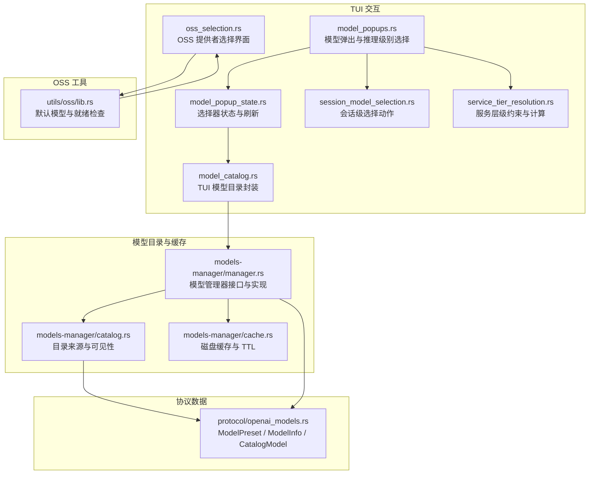
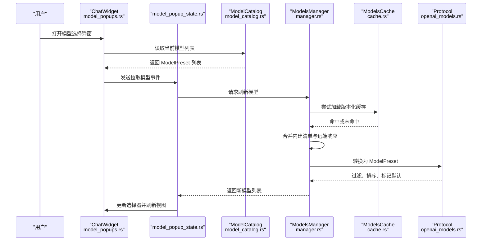
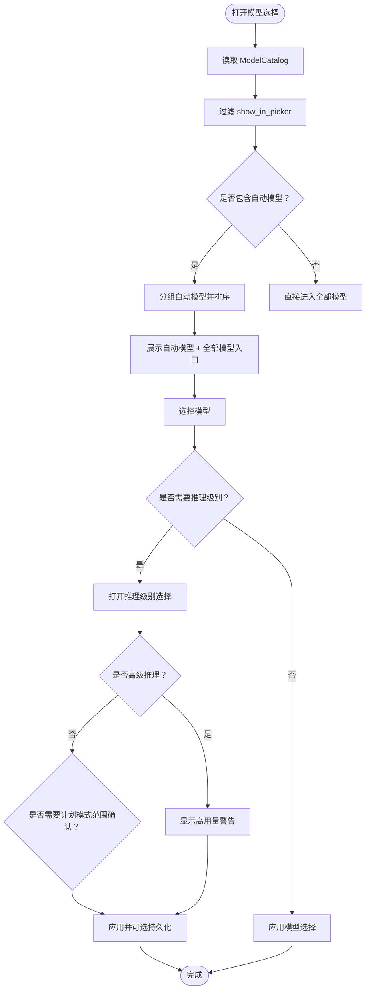
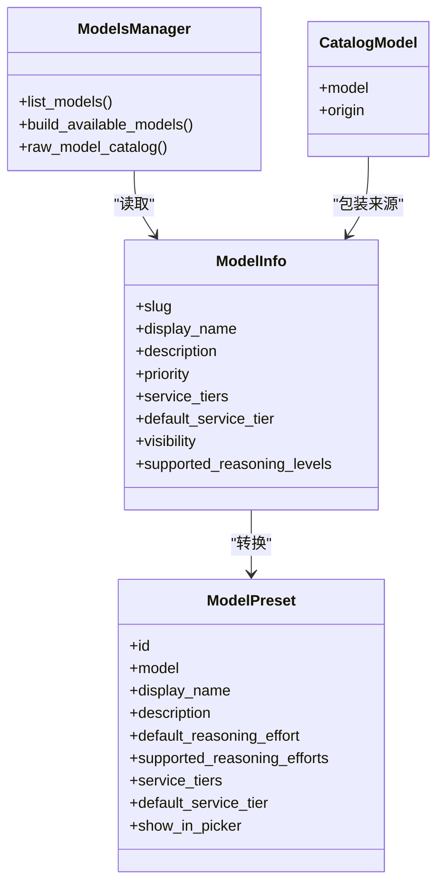
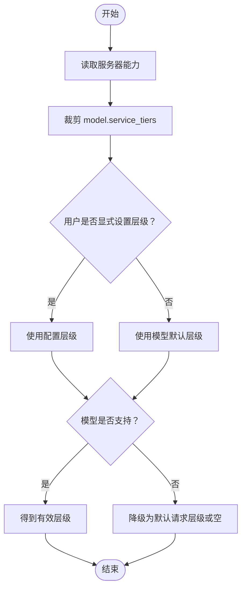
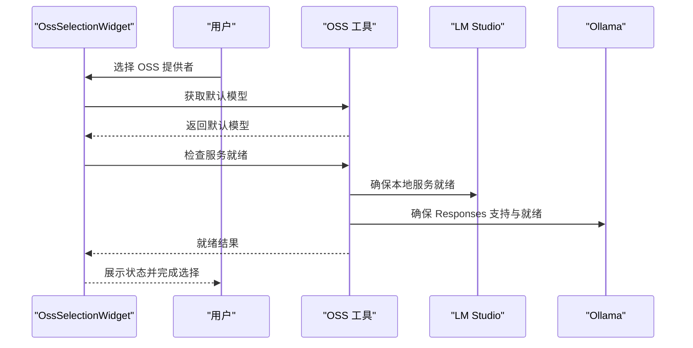
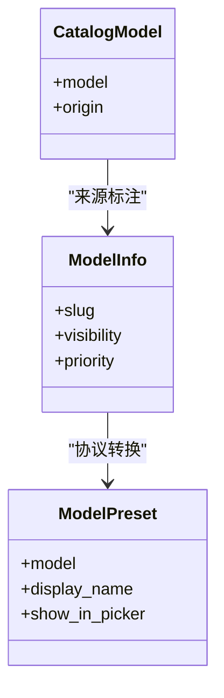
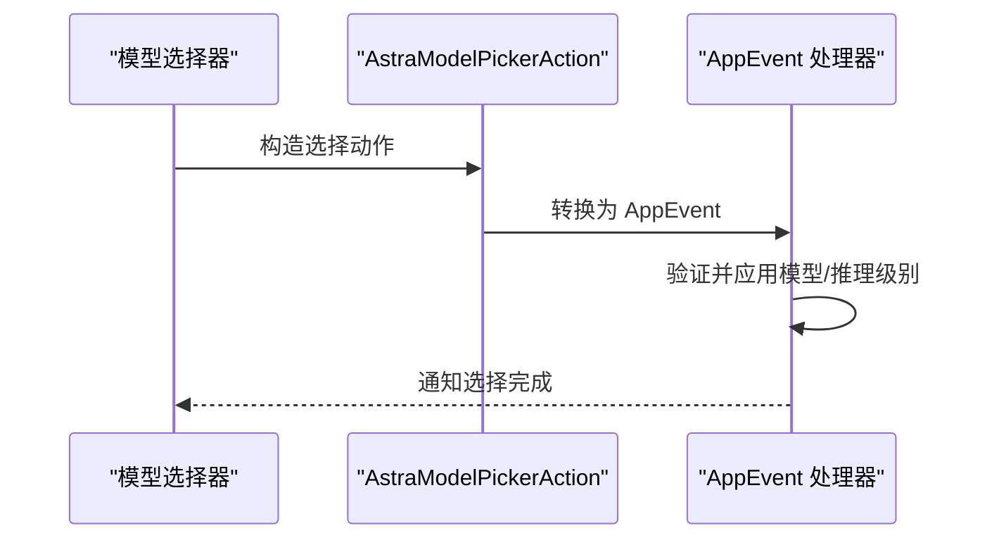
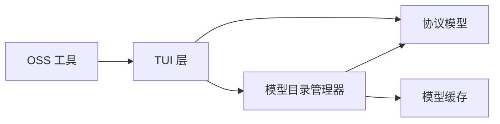

# 模型选择与配置

<cite>
**本文引用的文件**   
- [model_catalog.rs](file://codex-rs/tui/src/model_catalog.rs)
- [oss_selection.rs](file://codex-rs/tui/src/oss_selection.rs)
- [service_tier_resolution.rs](file://codex-rs/tui/src/service_tier_resolution.rs)
- [model_popups.rs](file://codex-rs/tui/src/chatwidget/model_popups.rs)
- [model_popup_state.rs](file://codex-rs/tui/src/chatwidget/model_popup_state.rs)
- [session_model_selection.rs](file://codex-rs/tui/src/chatwidget/session_model_selection.rs)
- [openai_models.rs](file://codex-rs/protocol/src/openai_models.rs)
- [catalog.rs](file://codex-rs/models-manager/src/catalog.rs)
- [manager.rs](file://codex-rs/models-manager/src/manager.rs)
- [cache.rs](file://codex-rs/models-manager/src/cache.rs)
- [lib.rs](file://codex-rs/utils/oss/src/lib.rs)
</cite>

## 目录
1. [简介](#简介)
2. [项目结构](#项目结构)
3. [核心组件](#核心组件)
4. [架构总览](#架构总览)
5. [详细组件分析](#详细组件分析)
6. [依赖关系分析](#依赖关系分析)
7. [性能与缓存优化](#性能与缓存优化)
8. [故障排查](#故障排查)
9. [结论](#结论)

## 简介
本文面向使用 Codex TUI 的用户与集成方，系统化说明“模型选择与配置”的完整链路：从终端界面的模型目录浏览、分类与过滤，到动态模型加载、服务层级解析、开源模型（OSS）选择与可用性检查，再到模型比较、差异化展示、缓存更新策略和最佳实践。文档以代码为依据，同时尽量用通俗语言解释关键流程。

## 项目结构
与模型选择与配置直接相关的代码分布在以下模块：
- TUI 交互层：模型弹出窗口、会话级选择、服务层级解析、OSS 选择界面。
- 协议与数据模型：ModelPreset、ModelInfo、CatalogModel、ModelOrigin。
- 模型目录管理：模型清单合并、来源标注、缓存读写、远端刷新。
- OSS 工具：本地 LM Studio / Ollama 默认模型与就绪检查。

**图表来源**
- [model_popups.rs:1-200](file://codex-rs/tui/src/chatwidget/model_popups.rs#L1-L200)
- [model_popup_state.rs:1-128](file://codex-rs/tui/src/chatwidget/model_popup_state.rs#L1-L128)
- [session_model_selection.rs:1-105](file://codex-rs/tui/src/chatwidget/session_model_selection.rs#L1-L105)
- [oss_selection.rs:1-200](file://codex-rs/tui/src/oss_selection.rs#L1-L200)
- [service_tier_resolution.rs:1-104](file://codex-rs/tui/src/service_tier_resolution.rs#L1-L104)
- [model_catalog.rs:1-76](file://codex-rs/tui/src/model_catalog.rs#L1-L76)
- [manager.rs:1-260](file://codex-rs/models-manager/src/manager.rs#L1-L260)
- [catalog.rs:1-81](file://codex-rs/models-manager/src/catalog.rs#L1-L81)
- [cache.rs:1-220](file://codex-rs/models-manager/src/cache.rs#L1-L220)
- [openai_models.rs:230-570](file://codex-rs/protocol/src/openai_models.rs#L230-L570)
- [lib.rs:1-62](file://codex-rs/utils/oss/src/lib.rs#L1-L62)

**章节来源**
- [model_popups.rs:1-200](file://codex-rs/tui/src/chatwidget/model_popups.rs#L1-L200)
- [manager.rs:1-260](file://codex-rs/models-manager/src/manager.rs#L1-L260)

## 核心组件
- TUI 模型目录封装：提供后端绑定、协作模式掩码、模型显示名映射、并发写保护。
- 模型弹出与选择：自动模型分组、“全部模型”入口、推理级别选择、计划模式范围提示。
- 会话级选择：区分“持久默认”和“仅会话”应用，支持服务层级传递。
- 服务层级解析：根据服务器能力与用户配置裁剪可用层级，计算有效层级。
- OSS 选择界面：启动前快速选择 LM Studio 或 Ollama，处理键位与状态。
- 模型目录管理器：合并内建清单与远端响应，按优先级排序、按鉴权过滤、标记默认项。
- 目录来源与可见性：区分内建、提供者、显式配置、合成来源，用于差异展示。
- 模型缓存：基于文件与 TTL 的版本化快照，支持身份隔离与 ETag 续期。
- OSS 工具：获取默认模型并保证本地服务就绪。

**章节来源**
- [model_catalog.rs:1-76](file://codex-rs/tui/src/model_catalog.rs#L1-L76)
- [model_popups.rs:1-200](file://codex-rs/tui/src/chatwidget/model_popups.rs#L1-L200)
- [session_model_selection.rs:1-105](file://codex-rs/tui/src/chatwidget/session_model_selection.rs#L1-L105)
- [service_tier_resolution.rs:1-104](file://codex-rs/tui/src/service_tier_resolution.rs#L1-L104)
- [oss_selection.rs:1-200](file://codex-rs/tui/src/oss_selection.rs#L1-L200)
- [manager.rs:260-520](file://codex-rs/models-manager/src/manager.rs#L260-L520)
- [catalog.rs:1-81](file://codex-rs/models-manager/src/catalog.rs#L1-L81)
- [cache.rs:1-220](file://codex-rs/models-manager/src/cache.rs#L1-L220)
- [lib.rs:1-62](file://codex-rs/utils/oss/src/lib.rs#L1-L62)

## 架构总览
下图展示了从 TUI 用户操作到模型列表刷新、渲染和应用的完整调用链。

**图表来源**
- [model_popups.rs:1-200](file://codex-rs/tui/src/chatwidget/model_popups.rs#L1-L200)
- [model_popup_state.rs:1-128](file://codex-rs/tui/src/chatwidget/model_popup_state.rs#L1-L128)
- [model_catalog.rs:1-76](file://codex-rs/tui/src/model_catalog.rs#L1-L76)
- [manager.rs:260-520](file://codex-rs/models-manager/src/manager.rs#L260-L520)
- [cache.rs:1-220](file://codex-rs/models-manager/src/cache.rs#L1-L220)
- [openai_models.rs:230-570](file://codex-rs/protocol/src/openai_models.rs#L230-L570)

## 详细组件分析

### 模型目录浏览与选择界面
- 自动模型分组：以 `codex-auto-` 开头的模型作为快捷自动模型，按固定顺序排列；其余进入“全部模型”。
- “全部模型”入口：在自动模型之外，允许用户浏览所有非自动模型。
- 推理级别选择：对支持多推理级别的模型，先选择基础级别，再进入高级推理（Max/Ultra）。
- 计划模式范围提示：当处于 Plan 模式且变更会影响全局或计划模式默认值时，引导用户选择作用域。
- Luna Reserve 特殊模型：临时切换当前线程而不持久保存默认。

**图表来源**
- [model_popups.rs:1-200](file://codex-rs/tui/src/chatwidget/model_popups.rs#L1-L200)
- [model_popups.rs:201-500](file://codex-rs/tui/src/chatwidget/model_popups.rs#L201-L500)
- [model_popups.rs:501-798](file://codex-rs/tui/src/chatwidget/model_popups.rs#L501-L798)

**章节来源**
- [model_popups.rs:1-200](file://codex-rs/tui/src/chatwidget/model_popups.rs#L1-L200)
- [model_popups.rs:201-500](file://codex-rs/tui/src/chatwidget/model_popups.rs#L201-L500)
- [model_popups.rs:501-798](file://codex-rs/tui/src/chatwidget/model_popups.rs#L501-L798)

### 动态模型加载机制与信息展示
- 模型来源：优先使用远端 `/models` 响应，失败或离线时回退到内建清单。
- 来源标注：每个模型可被标记为内建或提供者来源，用于差异化展示。
- 过滤与排序：按 priority 排序，按鉴权模式过滤，标记默认模型。
- 协议转换：将 ModelInfo 转换为 ModelPreset，携带 display_name、description、reasoning_effort、service_tiers、show_in_picker 等字段。

**图表来源**
- [openai_models.rs:230-570](file://codex-rs/protocol/src/openai_models.rs#L230-L570)
- [manager.rs:260-520](file://codex-rs/models-manager/src/manager.rs#L260-L520)
- [catalog.rs:1-81](file://codex-rs/models-manager/src/catalog.rs#L1-L81)

**章节来源**
- [openai_models.rs:230-570](file://codex-rs/protocol/src/openai_models.rs#L230-L570)
- [manager.rs:260-520](file://codex-rs/models-manager/src/manager.rs#L260-L520)
- [catalog.rs:1-81](file://codex-rs/models-manager/src/catalog.rs#L1-L81)

### 服务层级解析与模型可用性检查
- 服务端能力裁剪：根据服务器功能开关（如 fast_mode、ultrafast_mode）限制 service_tiers。
- 用户配置优先：若用户明确选择了 flex 或默认请求层级，则优先使用。
- 模型支持校验：只有当模型 metadata 声明支持该层级时才保留。
- 有效层级计算：结合配置、模型默认与服务端能力，输出最终 effective tier。

**图表来源**
- [service_tier_resolution.rs:1-104](file://codex-rs/tui/src/service_tier_resolution.rs#L1-L104)
- [openai_models.rs:230-570](file://codex-rs/protocol/src/openai_models.rs#L230-L570)

**章节来源**
- [service_tier_resolution.rs:1-104](file://codex-rs/tui/src/service_tier_resolution.rs#L1-L104)

### OSS（开源模型）选择与配置
- 启动前选择：提供 LM Studio 与 Ollama 两个选项，支持键盘导航、回车确认、ESC 默认行为。
- 提供者状态检测：根据运行状态展示 Running / NotRunning / Unknown。
- 默认模型映射：不同 OSS 提供者对应各自默认模型。
- 就绪检查：确保模型已下载且服务可响应，必要时进行 Responses API 能力检查。

**图表来源**
- [oss_selection.rs:1-200](file://codex-rs/tui/src/oss_selection.rs#L1-L200)
- [lib.rs:1-62](file://codex-rs/utils/oss/src/lib.rs#L1-L62)

**章节来源**
- [oss_selection.rs:1-200](file://codex-rs/tui/src/oss_selection.rs#L1-L200)
- [lib.rs:1-62](file://codex-rs/utils/oss/src/lib.rs#L1-L62)

### 模型比较与差异化展示
- 来源差异：通过 CatalogModel.origin 区分 Bundled 与 Provider，便于 UI 显示来源标签。
- 可见性控制：ModelInfo.visibility 与 ModelPreset.show_in_picker 决定模型是否在选择器中可见。
- 默认标记：Manager 会在构建可用模型时标记默认项，提升用户体验。
- 特殊模型展示：如 Luna Reserve 使用自定义显示名。

**图表来源**
- [catalog.rs:1-81](file://codex-rs/models-manager/src/catalog.rs#L1-L81)
- [openai_models.rs:230-570](file://codex-rs/protocol/src/openai_models.rs#L230-L570)
- [model_catalog.rs:1-76](file://codex-rs/tui/src/model_catalog.rs#L1-L76)

**章节来源**
- [catalog.rs:1-81](file://codex-rs/models-manager/src/catalog.rs#L1-L81)
- [openai_models.rs:230-570](file://codex-rs/protocol/src/openai_models.rs#L230-L570)
- [model_catalog.rs:1-76](file://codex-rs/tui/src/model_catalog.rs#L1-L76)

### 会话级选择与应用流程
- 选择动作类型：更新模型、应用带推理级别的选择、应用高级推理、会话级选择（不改变持久默认）。
- 会话级选择提示：提供快捷键提示与二级动作，避免误选高用量推理级别。
- 线程作用域：选择事件可绑定到具体线程，确保跨任务一致性。

**图表来源**
- [session_model_selection.rs:1-105](file://codex-rs/tui/src/chatwidget/session_model_selection.rs#L1-L105)
- [model_popups.rs:201-500](file://codex-rs/tui/src/chatwidget/model_popups.rs#L201-L500)

**章节来源**
- [session_model_selection.rs:1-105](file://codex-rs/tui/src/chatwidget/session_model_selection.rs#L1-L105)
- [model_popups.rs:201-500](file://codex-rs/tui/src/chatwidget/model_popups.rs#L201-L500)

## 依赖关系分析
- TUI 层依赖协议模型与目录管理器，但不直接访问网络。
- 模型目录管理器统一管理缓存、远端客户端、认证信息与目录来源。
- OSS 工具独立于 TUI 主循环，仅在需要时调用本地提供者准备逻辑。

**图表来源**
- [model_popups.rs:1-200](file://codex-rs/tui/src/chatwidget/model_popups.rs#L1-L200)
- [manager.rs:1-260](file://codex-rs/models-manager/src/manager.rs#L1-L260)
- [cache.rs:1-220](file://codex-rs/models-manager/src/cache.rs#L1-L220)
- [lib.rs:1-62](file://codex-rs/utils/oss/src/lib.rs#L1-L62)

**章节来源**
- [manager.rs:1-260](file://codex-rs/models-manager/src/manager.rs#L1-L260)
- [cache.rs:1-220](file://codex-rs/models-manager/src/cache.rs#L1-L220)

## 性能与缓存优化
- 缓存策略：
  - 使用文件缓存存储模型目录快照，TTL 默认 300 秒。
  - 按 originator 分片隔离缓存，避免共享后端用户混淆。
  - 支持 ETag 重验证与 TTL 续期，减少重复下载。
- 冷启动优化：
  - 首次启动优先使用内建清单，避免阻塞。
  - 远端刷新失败不会阻止 UI 正常工作。
- 并发与锁：
  - 目录管理器内部使用 RwLock 与 watch channel，避免频繁重建。
  - TUI 侧使用 Mutex<bool] 防止目录写入期间的不一致。
- 建议：
  - 在生产环境中启用磁盘缓存，并合理设置 TTL。
  - 在高并发场景下，尽量复用 SharedModelsManager。
  - 对高频刷新路径使用 try_list_models 避免阻塞。

**章节来源**
- [cache.rs:1-220](file://codex-rs/models-manager/src/cache.rs#L1-L220)
- [manager.rs:260-520](file://codex-rs/models-manager/src/manager.rs#L260-L520)
- [model_catalog.rs:1-76](file://codex-rs/tui/src/model_catalog.rs#L1-L76)

## 故障排查
- 模型列表可能过时：
  - 现象：选择器提示“模型列表可能过期，请重启应用服务器和 TUI”。
  - 原因：ProviderWrite 互斥量被占用或检测到后端可能变化。
  - 解决：等待写入完成或重启相关服务后重试。
- 模型选择不可用：
  - 现象：打开选择器时提示“模型选择尚未启用直到启动完成”。
  - 原因：会话尚未配置或目录正在更新。
  - 解决：等待启动完成后再次尝试。
- OSS 服务不可用：
  - 现象：本地 LM Studio/Ollama 未运行或模型未下载。
  - 解决：运行就绪检查并确保 Responses API 支持。

**章节来源**
- [model_popup_state.rs:1-128](file://codex-rs/tui/src/chatwidget/model_popup_state.rs#L1-L128)
- [model_popups.rs:1-200](file://codex-rs/tui/src/chatwidget/model_popups.rs#L1-L200)
- [lib.rs:1-62](file://codex-rs/utils/oss/src/lib.rs#L1-L62)

## 结论
Codex 的模型选择与配置体系通过清晰的职责划分实现了高可用与良好体验：TUI 负责交互与展示，模型目录管理器负责发现与缓存，协议层定义统一数据结构，OSS 工具提供本地模型支持。通过服务层级解析、来源标注、会话级选择和缓存策略，系统既能满足快速上手需求，也能支撑复杂的企业级部署。