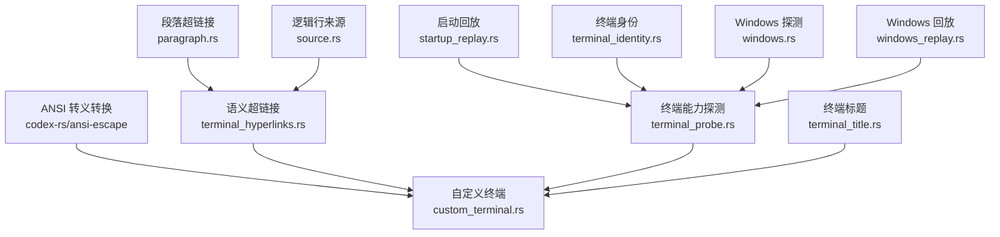
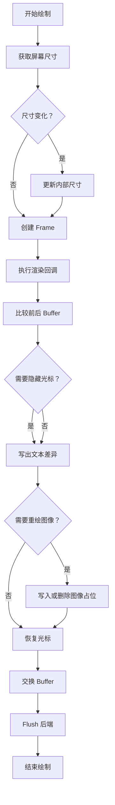
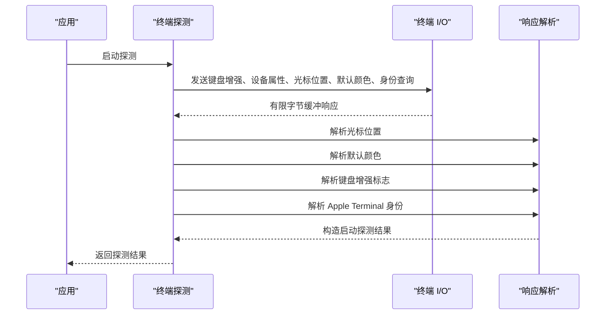
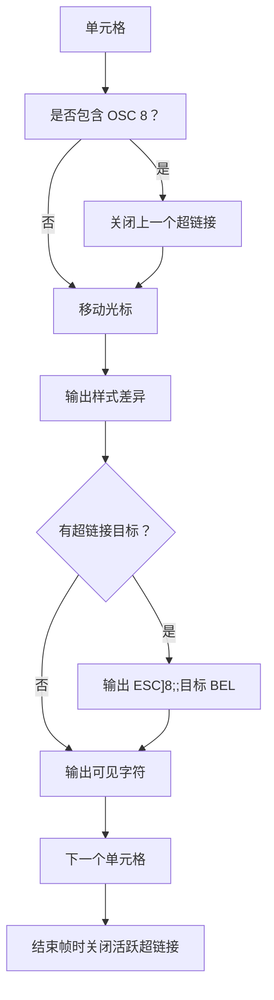
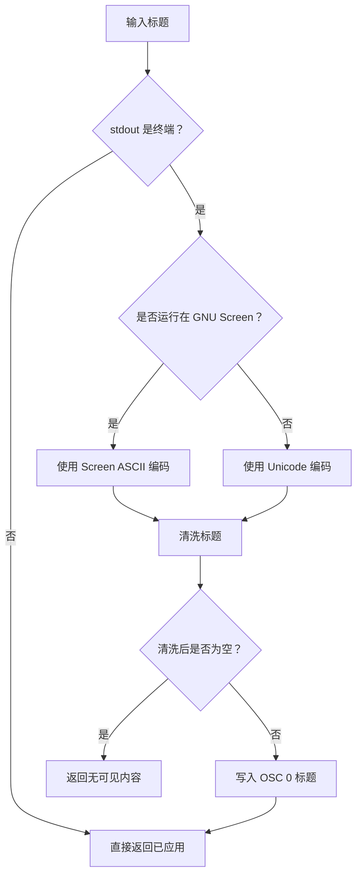
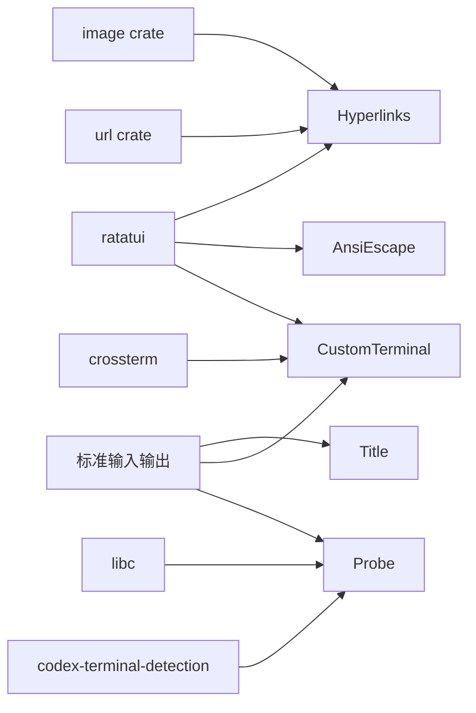

# 终端集成

<cite>
**本文引用的文件**   
- [lib.rs](file://codex-rs/ansi-escape/src/lib.rs)
- [custom_terminal.rs](file://codex-rs/tui/src/custom_terminal.rs)
- [terminal_hyperlinks.rs](file://codex-rs/tui/src/terminal_hyperlinks.rs)
- [paragraph.rs](file://codex-rs/tui/src/terminal_hyperlinks/paragraph.rs)
- [source.rs](file://codex-rs/tui/src/terminal_hyperlinks/source.rs)
- [terminal_probe.rs](file://codex-rs/tui/src/terminal_probe.rs)
- [startup_replay.rs](file://codex-rs/tui/src/terminal_probe/startup_replay.rs)
- [terminal_identity.rs](file://codex-rs/tui/src/terminal_probe/terminal_identity.rs)
- [windows.rs](file://codex-rs/tui/src/terminal_probe/windows.rs)
- [windows_replay.rs](file://codex-rs/tui/src/terminal_probe/windows_replay.rs)
- [terminal_title.rs](file://codex-rs/tui/src/terminal_title.rs)
</cite>

## 目录

1. [引言](#引言)
2. [项目结构与职责划分](#项目结构与职责划分)
3. [核心组件总览](#核心组件总览)
4. [自定义终端实现](#自定义终端实现)
5. [原生终端适配与能力探测](#原生终端适配与能力探测)
6. [超链接与点击跳转](#超链接与点击跳转)
7. [终端标题动态更新](#终端标题动态更新)
8. [大小调整与重排处理](#大小调整与重排处理)
9. [ANSI 转义序列处理与扩展支持](#ansi-转义序列处理与扩展支持)
10. [依赖关系分析](#依赖关系分析)
11. [性能特性与优化](#性能特性与优化)
12. [兼容性问题诊断与解决方案](#兼容性问题诊断与解决方案)
13. [结论](#结论)

## 引言

本项目的终端集成围绕三个目标展开：

- 在 TUI 渲染层提供比通用后端更可控的终端输出，包括光标、图像、超链接和清除行为。
- 通过轻量级探测机制判断当前终端是否支持键盘增强、默认颜色、设备属性等能力，并回退到保守模式。
- 将语义超链接从可见文本中分离出来，在写入终端缓冲区时再注入 OSC 8 超链接标记，避免影响布局、换行和复制逻辑。

这套设计既服务于 Codex TUI 的 transcript、工具输出、会话状态等界面，也支撑命令行模式下对 ANSI 转义文本的安全渲染。

## 项目结构与职责划分

终端相关代码主要分布在以下模块：

| 路径 | 职责 |
|---|---|
| `codex-rs/ansi-escape` | 将 ANSI 转义文本转换为 ratatui 文本对象，负责制表符展开、单行限制和多行警告。 |
| `codex-rs/tui/src/custom_terminal.rs` | 基于 ratatui 后端的自定义终端封装，负责帧缓冲、差异绘制、光标、视图区域、图像占位和 OSC 8 写入。 |
| `codex-rs/tui/src/terminal_hyperlinks.rs` | 定义语义超链接结构、URL 检测、布局映射、OSC 8 标注和缓冲区标记。 |
| `codex-rs/tui/src/terminal_hyperlinks/paragraph.rs` | 段落级超链接行集合及单元格标记辅助逻辑。 |
| `codex-rs/tui/src/terminal_hyperlinks/source.rs` | 逻辑行来源、包装策略和复制源元数据。 |
| `codex-rs/tui/src/terminal_probe.rs` | 启动期终端探测：光标位置、默认颜色、键盘增强、设备属性和 Apple Terminal over SSH 判断。 |
| `codex-rs/tui/src/terminal_probe/startup_replay.rs` | Unix 启动阶段探测字节回放，保证用户输入不被探测过程破坏。 |
| `codex-rs/tui/src/terminal_probe/terminal_identity.rs` | 解析终端身份响应，识别 Apple Terminal 等场景。 |
| `codex-rs/tui/src/terminal_probe/windows.rs` | Windows 平台探测实现。 |
| `codex-rs/tui/src/terminal_probe/windows_replay.rs` | Windows 平台启动回放适配。 |
| `codex-rs/tui/src/terminal_title.rs` | 终端窗口标题设置、清理和清洗。 |

**图表来源**
- [custom_terminal.rs:1-200](file://codex-rs/tui/src/custom_terminal.rs#L1-L200)
- [terminal_hyperlinks.rs:1-120](file://codex-rs/tui/src/terminal_hyperlinks.rs#L1-L120)
- [terminal_probe.rs:1-120](file://codex-rs/tui/src/terminal_probe.rs#L1-L120)
- [terminal_title.rs:1-60](file://codex-rs/tui/src/terminal_title.rs#L1-L60)

**章节来源**
- [lib.rs:1-66](file://codex-rs/ansi-escape/src/lib.rs#L1-L66)
- [custom_terminal.rs:1-200](file://codex-rs/tui/src/custom_terminal.rs#L1-L200)
- [terminal_hyperlinks.rs:1-120](file://codex-rs/tui/src/terminal_hyperlinks.rs#L1-L120)
- [terminal_probe.rs:1-120](file://codex-rs/tui/src/terminal_probe.rs#L1-L120)
- [terminal_title.rs:1-60](file://codex-rs/tui/src/terminal_title.rs#L1-L60)

## 核心组件总览

### ANSI 转义转换

ANSI 转换模块不是完整终端模拟器，而是把一段预期为单行的 ANSI 文本转为 ratatui `Text`。它做了两件事：

1. 将制表符替换为四个空格，避免转录视图中左侧前缀与制表符对齐冲突。
2. 调用底层 `ansi_to_tui` 解析器生成带样式的文本；如果多行或解析失败，会记录日志并在部分错误路径上 panic。

该模块适合用于“需要保留 ANSI 样式但不再模拟终端”的场景，例如转录输出、工具输出预览和调试信息。

**章节来源**
- [lib.rs:1-66](file://codex-rs/ansi-escape/src/lib.rs#L1-L66)

### 自定义终端

自定义终端是 ratatui `Backend` 之上的封装，核心职责包括：

- 维护双缓冲 `Buffer`。
- 计算前后帧差异，只发送必要的 Put 和 ClearToEnd 命令。
- 管理光标隐藏、显示、位置和样式。
- 管理视图区域和可见历史行数。
- 处理 Kitty/Sixel 图像占位。
- 在绘制过程中注入 OSC 8 超链接。
- 清理滚动区和可见区以应对外部终端操作。

它保留了 ratatui 的差异语义，同时加入了对超链接、图像和终端外部行为的补偿。

**章节来源**
- [custom_terminal.rs:1-200](file://codex-rs/tui/src/custom_terminal.rs#L1-L200)
- [custom_terminal.rs:600-1007](file://codex-rs/tui/src/custom_terminal.rs#L600-L1007)

### 语义超链接

超链接模块将 URL 或可信文件地址与可见文本列范围解耦。其关键思想是：

- 超链接不直接参与布局宽度计算。
- 布局完成后，再把 OSC 8 标记注入到最终缓冲区。
- 换行、缩进、前缀、复制源都保持独立，避免超链接破坏文本几何。

**章节来源**
- [terminal_hyperlinks.rs:1-120](file://codex-rs/tui/src/terminal_hyperlinks.rs#L1-L120)
- [terminal_hyperlinks.rs:600-750](file://codex-rs/tui/src/terminal_hyperlinks.rs#L600-L750)

### 终端能力探测

探测模块替代 crossterm 默认的长时间阻塞探测，采用短超时、非阻塞读取、字节预算和启动回放，确保：

- 不支持能力的终端不会卡住 TUI。
- 启动期间的用户输入不会被探测吞掉。
- 键盘增强、默认颜色、光标位置、设备属性、Apple Terminal over SSH 能尽量探测到。

**章节来源**
- [terminal_probe.rs:1-120](file://codex-rs/tui/src/terminal_probe.rs#L1-L120)
- [terminal_probe.rs:200-603](file://codex-rs/tui/src/terminal_probe.rs#L200-L603)

### 终端标题

标题模块负责：

- 安全地将模型输出、线程名、工作区路径等内容写入终端窗口标题。
- 清洗控制字符、双向格式字符、不可见字符。
- 在 GNU Screen 下强制 ASCII 输出。
- 使用 OSC 0 + BEL 终止符写入标题。
- 区分“未改变标题”和“清空标题”。

**章节来源**
- [terminal_title.rs:1-120](file://codex-rs/tui/src/terminal_title.rs#L1-L120)
- [terminal_title.rs:200-284](file://codex-rs/tui/src/terminal_title.rs#L200-L284)

## 自定义终端实现

自定义终端维护两个 buffer：当前 buffer 和上一个 buffer。每次绘制流程如下：

1. 获取后端尺寸。
2. 如果需要，触发 resize。
3. 创建 `Frame`，供渲染回调写入当前 buffer。
4. 比较前后 buffer，生成 `DrawCommand`。
5. 必要时隐藏光标。
6. 写出文本差异。
7. 写出或重绘图像占位。
8. 恢复光标位置或样式。
9. 交换 buffer 并 flush。

**图表来源**
- [custom_terminal.rs:600-1007](file://codex-rs/tui/src/custom_terminal.rs#L600-L1007)

#### 帧对象与视图区域

`Frame` 暴露：

- 视图区域 `viewport_area`。
- 可写 buffer 引用。
- 图片放置列表。
- 光标位置和样式设置方法。

视图区域变化时会重置 buffer 大小，并限制可见历史行数，避免内联模式下历史溢出视图顶部。

**章节来源**
- [custom_terminal.rs:1-200](file://codex-rs/tui/src/custom_terminal.rs#L1-L200)
- [custom_terminal.rs:200-599](file://codex-rs/tui/src/custom_terminal.rs#L200-L599)

#### 差异绘制

差异绘制分为两部分：

1. 行尾优化：找到每行最后一个有意义列，必要时用 `ClearToEnd` 替换多个空白 Put。
2. Ratatui 原生差异迭代：保留 Skip、AlwaysUpdate、ForcedWidth 和宽字符语义。

这种设计减少了尾部空白单元格的重复写入，同时保留复杂样式变更的正确性。

**章节来源**
- [custom_terminal.rs:600-1007](file://codex-rs/tui/src/custom_terminal.rs#L600-L1007)

#### 光标管理

自定义终端跟踪：

- 是否隐藏光标。
- 最后成功写入的光标样式。
- 最后已知光标位置。
- 由 Frame 请求的最终光标位置。

Drop 时会尝试恢复用户光标样式并显示光标，降低退出后终端光标状态异常的风险。

**章节来源**
- [custom_terminal.rs:1-200](file://codex-rs/tui/src/custom_terminal.rs#L1-L200)
- [custom_terminal.rs:600-1007](file://codex-rs/tui/src/custom_terminal.rs#L600-L1007)

## 原生终端适配与能力探测

### 探测入口

启动探测函数发送以下查询：

- 可选的键盘增强查询。
- 主设备属性查询。
- 光标位置查询。
- OSC 10 默认前景色查询。
- OSC 11 默认背景色查询。
- 条件性的 Apple Terminal 扩展身份查询。

所有查询共享一个较短的超时时间，并限制最大读取字节数，避免被恶意或异常终端响应拖慢启动。

**图表来源**
- [terminal_probe.rs:200-603](file://codex-rs/tui/src/terminal_probe.rs#L200-L603)

**章节来源**
- [terminal_probe.rs:1-120](file://codex-rs/tui/src/terminal_probe.rs#L1-L120)
- [terminal_probe.rs:200-603](file://codex-rs/tui/src/terminal_probe.rs#L200-L603)

### Unix 实现细节

Unix 端优先尝试复用 stdin/stdout 的文件描述符；若失败则回退到 `/dev/tty`。读取器设置为非阻塞模式，并使用 `poll` 等待响应。探测完成后恢复原始文件描述符标志。

关键点：

- 最大终端探测字节数为 1024。
- 启动探测最大字节数为 64 KiB。
- CSI 响应最多扫描 64 字节。
- 探测期间已消费字节会通过 startup replay 回放给 crossterm。

**章节来源**
- [terminal_probe.rs:120-200](file://codex-rs/tui/src/terminal_probe.rs#L120-L200)
- [terminal_probe.rs:200-603](file://codex-rs/tui/src/terminal_probe.rs#L200-L603)

### Windows 实现

Windows 平台通过条件编译模块提供探测能力，并与 Windows 回放模块配合。Windows 上标题写入不使用 WinAPI，而是走 ANSI 路径，因为自定义标题命令显式拒绝 WinAPI 执行。

**章节来源**
- [terminal_probe.rs:604-968](file://codex-rs/tui/src/terminal_probe.rs#L604-L968)
- [terminal_title.rs:120-200](file://codex-rs/tui/src/terminal_title.rs#L120-L200)

### 探测能力总结

| 能力 | 探测方式 | 回退策略 |
|---|---|---|
| 光标位置 | `ESC[6n` | 初始读取失败时使用原点或调用方提供的默认值。 |
| 默认前景色 | OSC 10 | 缺少任一颜色时返回 None。 |
| 默认背景色 | OSC 11 | 同上。 |
| 键盘增强 | `ESC[?u` | 超时或缺少响应时按已有信号保守推断。 |
| 主设备属性 | `ESC[c` | 作为键盘增强探测的回退依据。 |
| Apple Terminal over SSH | 扩展身份查询 | 仅在不处于 multiplexer 且存在 SSH 环境时查询。 |

**章节来源**
- [terminal_probe.rs:200-603](file://codex-rs/tui/src/terminal_probe.rs#L200-L603)
- [terminal_probe.rs:604-968](file://codex-rs/tui/src/terminal_probe.rs#L604-L968)

## 超链接与点击跳转

### 语义超链接模型

超链接由列范围、目标字符串和目标类型组成：

| 字段 | 含义 |
|---|---|
| `columns` | 超链接覆盖的显示列范围。 |
| `destination` | 目标 URL 或可信文件地址。 |
| `destination_kind` | Web 地址或受信任本地文件。 |

Web 地址必须能被解析为 http 或 https，并且包含 host。可信文件地址需通过严格验证，防止路径穿越、隐藏文件或任意协议滥用。

**章节来源**
- [terminal_hyperlinks.rs:1-120](file://codex-rs/tui/src/terminal_hyperlinks.rs#L1-L120)

### URL 检测

URL 检测以空白分割候选词，去除前导标点，再根据括号平衡和常见结尾标点裁剪尾部。随后尝试解析 URL，仅接受 http 或 https。

这避免了把普通单词误判为链接，也减少多余标点污染目标地址。

**章节来源**
- [terminal_hyperlinks.rs:600-750](file://codex-rs/tui/src/terminal_hyperlinks.rs#L600-L750)

### 布局与换行

超链接不参与 ratatui 布局测量。布局完成后：

- `remap_source_wrapped_line` 将包装后的片段映射回逻辑来源。
- `remap_wrapped_line` 在旧路径中通过文本匹配重新附加超链接范围。
- `mark_buffer_hyperlinks` 将 OSC 8 注入最终缓冲区。

这样，超链接可以在表格、前缀、缩进和折行后仍然正确对应可见列。

**章节来源**
- [terminal_hyperlinks.rs:200-600](file://codex-rs/tui/src/terminal_hyperlinks.rs#L200-L600)
- [terminal_hyperlinks.rs:750-950](file://codex-rs/tui/src/terminal_hyperlinks.rs#L750-L950)

### OSC 8 注入

在自定义终端绘制路径中，每个单元格符号可能携带 OSC 8 超链接包装。绘制器会：

1. 检查单元格符号是否包含 OSC 8。
2. 在切换超链接目标时关闭上一个超链接。
3. 移动光标。
4. 输出样式差异。
5. 输出目标地址和可见文本。
6. 在帧结束时关闭仍活跃的超链接。

**图表来源**
- [custom_terminal.rs:600-1007](file://codex-rs/tui/src/custom_terminal.rs#L600-L1007)

**章节来源**
- [custom_terminal.rs:1-200](file://codex-rs/tui/src/custom_terminal.rs#L1-L200)
- [custom_terminal.rs:600-1007](file://codex-rs/tui/src/custom_terminal.rs#L600-L1007)
- [terminal_hyperlinks.rs:750-950](file://codex-rs/tui/src/terminal_hyperlinks.rs#L750-L950)

## 终端标题动态更新

标题模块提供两个入口：

- `set_terminal_title`：写入清洗后的 OSC 0 标题。
- `clear_terminal_title`：清空当前管理的终端标题。

清洗规则包括：

- 丢弃控制字符。
- 丢弃双向控制和不可见格式化字符。
- 将连续空白压缩为单个空格。
- 限制最大可见字符数为 240。
- 在 GNU Screen 下将非 ASCII 字符替换为问号，并把活动动画字符映射为 ASCII 符号。

**图表来源**
- [terminal_title.rs:1-120](file://codex-rs/tui/src/terminal_title.rs#L1-L120)

**章节来源**
- [terminal_title.rs:1-120](file://codex-rs/tui/src/terminal_title.rs#L1-L120)
- [terminal_title.rs:200-284](file://codex-rs/tui/src/terminal_title.rs#L200-L284)

## 大小调整与重排处理

### 内部尺寸与视图区域

自定义终端维护：

- `last_known_screen_size`：上次已知后端尺寸。
- `viewport_area`：当前视图矩形。
- `visible_history_rows`：内联模式下视图上方可见的历史行数。

当 `draw_with_size` 检测到尺寸变化时，会调用 `resize` 更新内部状态。视图区域变化会重置 buffer 并限制可见历史行数。

**章节来源**
- [custom_terminal.rs:200-599](file://codex-rs/tui/src/custom_terminal.rs#L200-L599)
- [custom_terminal.rs:600-1007](file://codex-rs/tui/src/custom_terminal.rs#L600-L1007)

### 重排与滚动区清理

当外部程序修改终端内容时，自定义终端提供两种清理方式：

1. `clear_visible_screen`：定位光标、清空可见屏、刷新、重置历史行数并强制全量重绘。
2. `clear_scrollback_and_visible_screen_ansi`：使用单一 ANSI 序列重置滚动区、样式、光标、清屏和滚动区。

后者更适合某些终端对 `clear && printf '\\e[3J'` 组合更可靠的情况。

**章节来源**
- [custom_terminal.rs:600-1007](file://codex-rs/tui/src/custom_terminal.rs#L600-L1007)

### 图像与重绘

图像绘制与文本绘制分开处理。如果图像列表变化，或文本差异覆盖了图像区域，自定义终端会：

- 删除旧图像占位。
- 必要时使视图失效。
- 重新绘制图像。
- 在 tmux+kitty 场景中，为宠物精灵占位单元格设置 AlwaysUpdate，以便下次差异能恢复底层文本。

**章节来源**
- [custom_terminal.rs:600-1007](file://codex-rs/tui/src/custom_terminal.rs#L600-L1007)

## ANSI 转义序列处理与扩展支持

### 支持的扩展

| 扩展 | 使用位置 | 说明 |
|---|---|---|
| OSC 0 标题 | 终端标题模块 | 设置窗口标题，BEL 终止。 |
| OSC 10 / OSC 11 | 终端探测模块 | 查询默认前景色和背景色。 |
| OSC 8 超链接 | 自定义终端和超链接模块 | 包裹可见文本，提供可点击 URL。 |
| CSI `ESC[6n` | 终端探测模块 | 查询光标位置。 |
| CSI `ESC[c` | 终端探测模块 | 查询主设备属性。 |
| CSI `ESC[?u` | 终端探测模块 | 查询键盘增强支持。 |
| CSI `ESC[>c` | 终端探测模块 | 扩展终端身份查询。 |
| SGR 修饰符 | 自定义终端绘制器 | 加粗、斜体、下划线、反色、闪烁、删除线等。 |
| Kitty/Sixel 图像协议 | 自定义终端 | 图像占位、删除和重绘。 |

**章节来源**
- [terminal_probe.rs:200-603](file://codex-rs/tui/src/terminal_probe.rs#L200-L603)
- [custom_terminal.rs:600-1007](file://codex-rs/tui/src/custom_terminal.rs#L600-L1007)
- [terminal_title.rs:120-200](file://codex-rs/tui/src/terminal_title.rs#L120-L200)

### 解析边界与安全性

- OSC 颜色解析支持 BEL 和 ST 终止符。
- RGB 分量长度限制为 1~4 位十六进制。
- RGBA 会校验第四个通道。
- URL 目标禁止控制字符，并限制最大字节长度。
- 标题禁止双向控制、零宽字符、代理对控制等易被滥用的 Unicode 字符。

这些限制共同构成终端输出的最小可信边界。

**章节来源**
- [terminal_probe.rs:604-968](file://codex-rs/tui/src/terminal_probe.rs#L604-L968)
- [terminal_hyperlinks.rs:750-950](file://codex-rs/tui/src/terminal_hyperlinks.rs#L750-L950)
- [terminal_title.rs:200-284](file://codex-rs/tui/src/terminal_title.rs#L200-L284)

## 依赖关系分析

**图表来源**
- [custom_terminal.rs:1-200](file://codex-rs/tui/src/custom_terminal.rs#L1-L200)
- [terminal_hyperlinks.rs:1-120](file://codex-rs/tui/src/terminal_hyperlinks.rs#L1-L120)
- [terminal_probe.rs:120-200](file://codex-rs/tui/src/terminal_probe.rs#L120-L200)
- [terminal_title.rs:120-200](file://codex-rs/tui/src/terminal_title.rs#L120-L200)

### 耦合点

- 自定义终端强依赖 ratatui 的 buffer、style、cursor 和 backend 抽象。
- 超链接模块依赖 url、unicode_segmentation 和 image crate。
- 探测模块依赖 libc（Unix）和 codex-terminal-detection。
- 标题模块依赖 crossterm Command 抽象。

### 循环依赖风险

当前模块按职责分层：

- ansi-escape 无 TUI 依赖。
- terminal_hyperlinks 不反向依赖 terminal_probe。
- terminal_probe 不依赖 custom_terminal。
- terminal_title 只负责输出，不反向依赖其他终端子系统。

因此不存在明显的循环导入风险。

**章节来源**
- [custom_terminal.rs:1-200](file://codex-rs/tui/src/custom_terminal.rs#L1-L200)
- [terminal_hyperlinks.rs:1-120](file://codex-rs/tui/src/terminal_hyperlinks.rs#L1-L120)
- [terminal_probe.rs:1-120](file://codex-rs/tui/src/terminal_probe.rs#L1-L120)
- [terminal_title.rs:1-60](file://codex-rs/tui/src/terminal_title.rs#L1-L60)

## 性能特性与优化

| 场景 | 优化策略 |
|---|---|
| 帧绘制 | 双缓冲 + 差异比较 + 行尾 ClearToEnd 合并。 |
| 光标移动 | 只在必要时隐藏/显示光标，并缓存最后光标样式。 |
| 超链接 | 延迟注入 OSC 8，避免布局阶段计算超链接字节。 |
| 启动探测 | 短超时、非阻塞 poll、字节上限、批量查询。 |
| 标题输出 | 提前清洗和截断，避免过长标题造成终端卡顿。 |
| 图像绘制 | 仅在图像列表变化或文本覆盖图像时重绘。 |
| ANSI 解析 | 限制 CSI 扫描长度，避免长缓冲线性扫描退化。 |

这些优化共同降低了 TUI 在高频率更新、大量转录输出和弱终端环境下的负担。

**章节来源**
- [custom_terminal.rs:600-1007](file://codex-rs/tui/src/custom_terminal.rs#L600-L1007)
- [terminal_probe.rs:200-603](file://codex-rs/tui/src/terminal_probe.rs#L200-L603)
- [terminal_hyperlinks.rs:200-600](file://codex-rs/tui/src/terminal_hyperlinks.rs#L200-L600)

## 兼容性问题诊断与解决方案

### 症状一：启动后光标位置不正确

**原因：** PTY 不响应 `ESC[6n`。

**处理方式：** 自定义终端初始光标位置读取失败时记录警告，并回退到原点；也可由调用方传入已知光标位置。

**建议：** 在嵌套 PTY、容器或非交互环境中，不要依赖精确光标位置。

**章节来源**
- [custom_terminal.rs:1-200](file://codex-rs/tui/src/custom_terminal.rs#L1-L200)
- [terminal_probe.rs:200-603](file://codex-rs/tui/src/terminal_probe.rs#L200-L603)

### 症状二：终端颜色主题异常

**原因：** OSC 10 或 OSC 11 未响应，或部分终端返回不完整响应。

**处理方式：** 缺少任一颜色时返回 None，上层应使用保守默认主题。

**建议：** 对不支持 OSC 颜色的终端，不要假设前景色或背景色可用。

**章节来源**
- [terminal_probe.rs:604-968](file://codex-rs/tui/src/terminal_probe.rs#L604-L968)

### 症状三：键盘增强功能不稳定

**原因：** 终端返回主设备属性但未返回键盘增强标志，或两者顺序不同。

**处理方式：** 探测器分别检测键盘增强和设备属性，并在超时或缺少响应时保守推断。

**建议：** 如果终端没有明确支持键盘增强，应降级到基础键盘事件。

**章节来源**
- [terminal_probe.rs:200-603](file://codex-rs/tui/src/terminal_probe.rs#L200-L603)

### 症状四：终端标题乱码或被截断

**原因：** 标题包含控制字符、双向格式字符、超长内容，或运行在 GNU Screen 下。

**处理方式：** 清洗标题、压缩空白、限制长度；在 Screen 下强制 ASCII。

**建议：** 始终通过 `set_terminal_title` 写入标题，不要自行拼接 OSC 0。

**章节来源**
- [terminal_title.rs:1-120](file://codex-rs/tui/src/terminal_title.rs#L1-L120)
- [terminal_title.rs:200-284](file://codex-rs/tui/src/terminal_title.rs#L200-L284)

### 症状五：点击超链接无效

**原因：** 目标不是 http/https，或 URL 超过长度限制，或终端不支持 OSC 8。

**处理方式：** 过滤非法目标；在终端不支持时仍可显示文本，只是没有超链接语义。

**建议：** 在诊断日志中确认 URL 是否通过 `web_destination`，并检查终端是否支持 OSC 8。

**章节来源**
- [terminal_hyperlinks.rs:600-750](file://codex-rs/tui/src/terminal_hyperlinks.rs#L600-L750)
- [terminal_hyperlinks.rs:750-950](file://codex-rs/tui/src/terminal_hyperlinks.rs#L750-L950)

### 症状六：终端内容错位或残留

**原因：** 外部程序直接写入终端，绕过 ratatui buffer。

**处理方式：** 调用 `invalidate_viewport`、`clear_visible_screen` 或 `clear_scrollback_and_visible_screen_ansi` 强制重绘。

**建议：** 任何可能绕过 TUI 渲染的外部进程输出后，都应显式清理视图。

**章节来源**
- [custom_terminal.rs:600-1007](file://codex-rs/tui/src/custom_terminal.rs#L600-L1007)

## 结论

本项目终端集成的关键设计是“语义与呈现分离”：

- ANSI 转换模块负责将文本样式化，但不模拟完整终端。
- 自定义终端负责差异绘制、光标、视图区域、图像和 OSC 8 输出。
- 语义超链接模块负责 URL 检测和布局映射，只在最终缓冲区注入超链接标记。
- 终端探测模块使用短超时和字节预算探测能力，避免阻塞和不可靠终端拖垮启动。
- 标题模块负责安全输出，抵御控制字符和双向格式攻击。

这套架构在兼容性和性能之间取得平衡：不支持高级能力的终端可以稳定回退，而支持 OSC 8、Kitty/Sixel、键盘增强和 OSC 颜色的终端可以获得更好的交互体验。