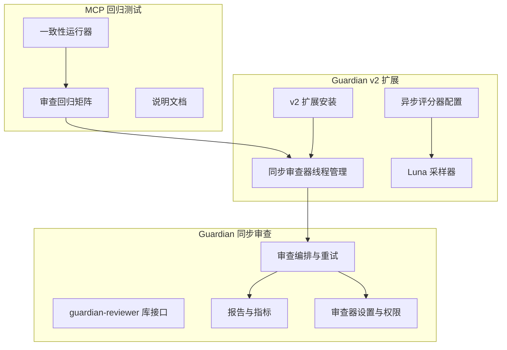
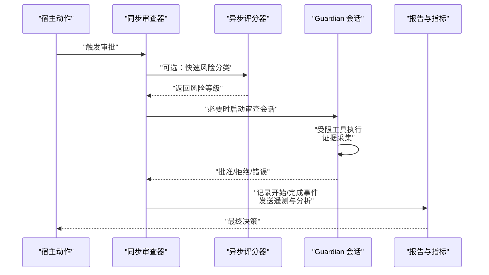
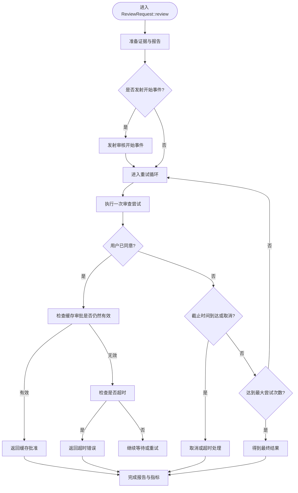
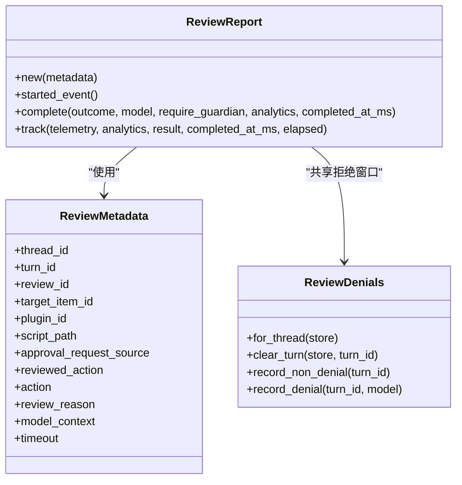
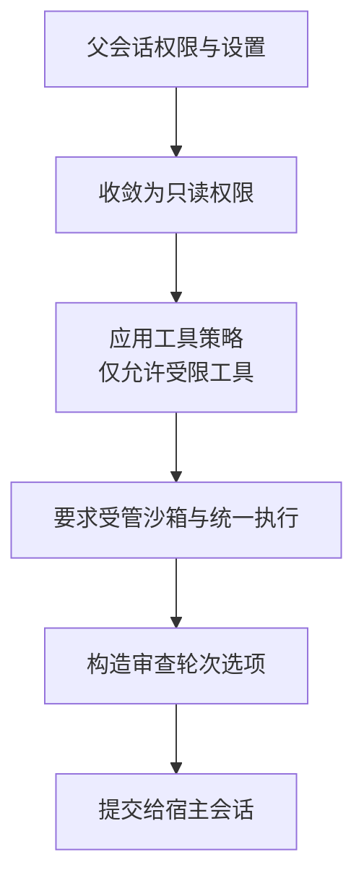
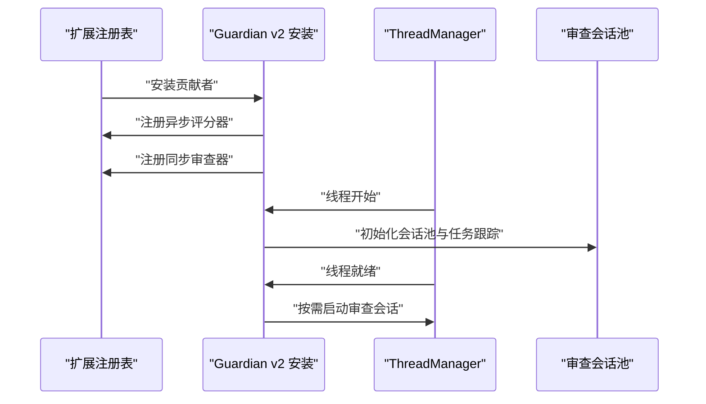
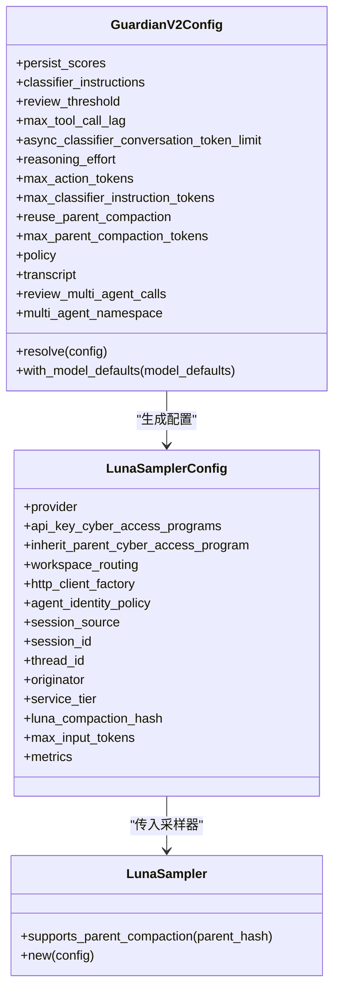
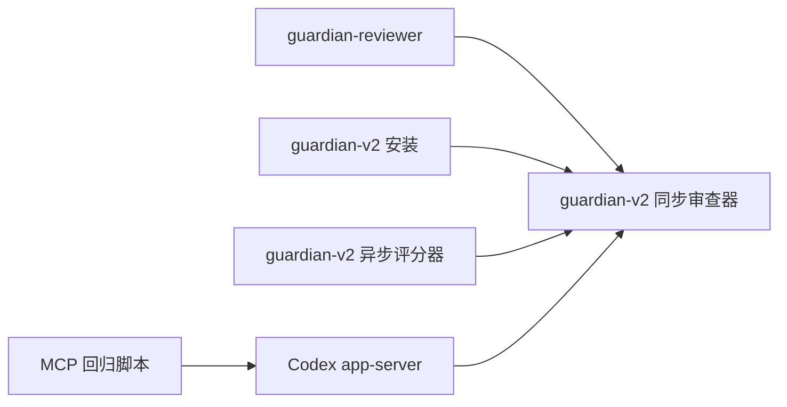
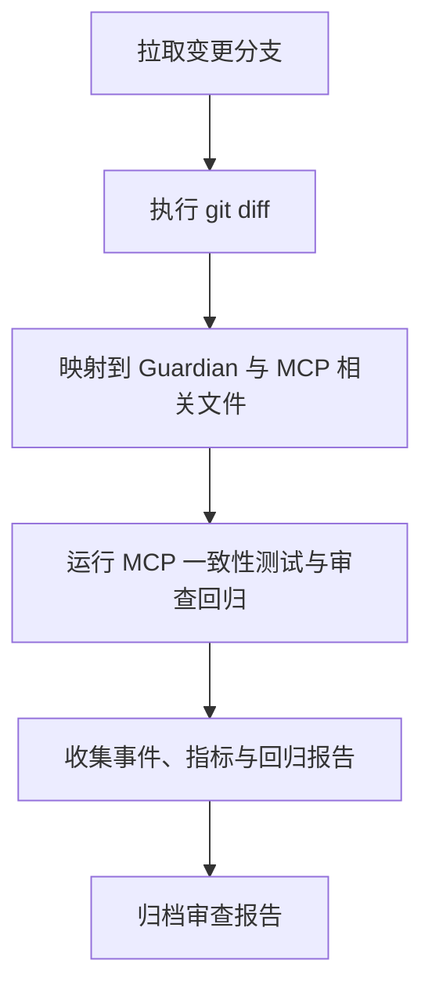
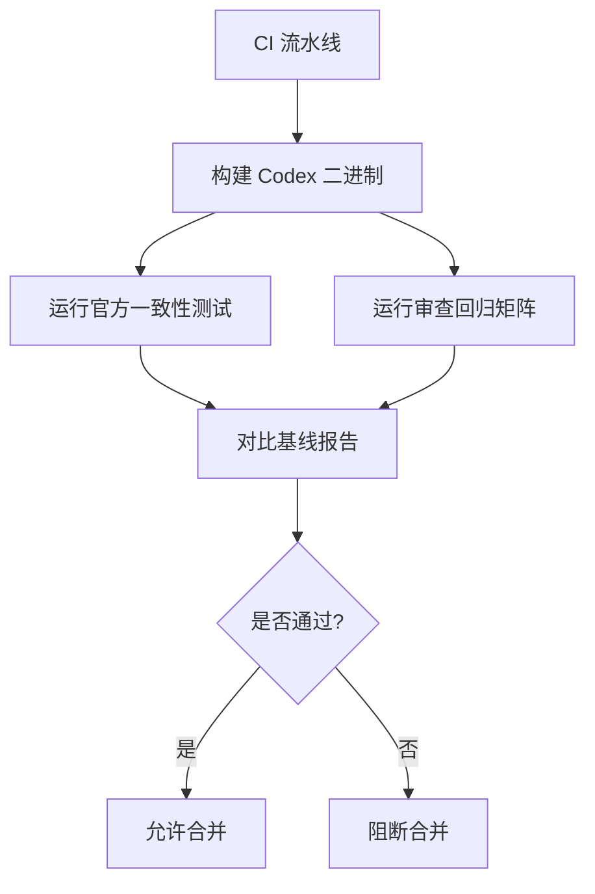

# 代码审查

<cite>
**本文引用的文件**   
- [codex-rs/ext/guardian-reviewer/src/lib.rs](file://codex-rs/ext/guardian-reviewer/src/lib.rs)
- [codex-rs/ext/guardian-reviewer/src/reporting.rs](file://codex-rs/ext/guardian-reviewer/src/reporting.rs)
- [codex-rs/ext/guardian-reviewer/src/review.rs](file://codex-rs/ext/guardian-reviewer/src/review.rs)
- [codex-rs/ext/guardian-reviewer/src/settings.rs](file://codex-rs/ext/guardian-reviewer/src/settings.rs)
- [codex-rs/ext/guardian-v2/src/lib.rs](file://codex-rs/ext/guardian-v2/src/lib.rs)
- [codex-rs/ext/guardian-v2/src/sync_reviewer/mod.rs](file://codex-rs/ext/guardian-v2/src/sync_reviewer/mod.rs)
- [codex-rs/ext/guardian-v2/src/async_scorer/config.rs](file://codex-rs/ext/guardian-v2/src/async_scorer/config.rs)
- [codex-rs/ext/guardian-v2/src/async_scorer/sampler.rs](file://codex-rs/ext/guardian-v2/src/async_scorer/sampler.rs)
- [scripts/mcp_conformance/README.md](file://scripts/mcp_conformance/README.md)
- [scripts/mcp_conformance/run_codex_compliance.py](file://scripts/mcp_conformance/run_codex_compliance.py)
- [scripts/mcp_conformance/review_regressions.py](file://scripts/mcp_conformance/review_regressions.py)
</cite>

## 目录
1. [引言](#引言)
2. [项目结构](#项目结构)
3. [核心组件](#核心组件)
4. [架构总览](#架构总览)
5. [详细组件分析](#详细组件分析)
6. [依赖关系分析](#依赖关系分析)
7. [性能与扩展性](#性能与扩展性)
8. [配置指南](#配置指南)
9. [报告与输出](#报告与输出)
10. [版本控制集成与变更影响评估](#版本控制集成与变更影响评估)
11. [CI/CD 流水线集成](#cicd-流水线集成)
12. [故障排查](#故障排查)
13. [结论](#结论)

## 引言
本仓库中的“代码审查”能力并非传统静态扫描工具，而是围绕守护式安全代理（Guardian）构建的运行时审查系统。它通过同步与异步两类审查器对模型调用、工具执行和外部访问进行风险判断，结合会话生命周期、权限策略、指标上报和回归测试矩阵，形成从变更检测、风险评估到报告输出的完整工作流。

核心要点包括：
- 同步审查器负责在需要审批的动作处触发 Guardian 会话，并支持重试、取消、缓存审批与拒绝熔断。
- 异步评分器使用专用推理模型对上下文进行快速风险分类，决定是否需要进入更严格的同步审查流程。
- 报告子系统统一产出事件、遥测指标和分析追踪数据，供内部分析与合规审计使用。
- MCP 一致性脚本提供生产级回归矩阵，覆盖多协议版本、传输方式、边界条件与审查相关场景。

## 项目结构
代码审查相关实现主要分布在以下模块：
- `codex-rs/ext/guardian-reviewer`：同步审查器核心逻辑，包括会话编排、证据采集、报告、设置与路由。
- `codex-rs/ext/guardian-v2`：扩展安装入口、同步审查器线程管理、异步评分器配置与采样。
- `scripts/mcp_conformance`：面向 Model Context Protocol 的一致性测试与生产回归矩阵。

**图表来源**
- [codex-rs/ext/guardian-reviewer/src/lib.rs:1-144](file://codex-rs/ext/guardian-reviewer/src/lib.rs#L1-L144)
- [codex-rs/ext/guardian-v2/src/lib.rs:1-22](file://codex-rs/ext/guardian-v2/src/lib.rs#L1-L22)
- [codex-rs/ext/guardian-v2/src/sync_reviewer/mod.rs:1-200](file://codex-rs/ext/guardian-v2/src/sync_reviewer/mod.rs#L1-L200)
- [codex-rs/ext/guardian-v2/src/async_scorer/config.rs:1-200](file://codex-rs/ext/guardian-v2/src/async_scorer/config.rs#L1-L200)
- [scripts/mcp_conformance/README.md:1-121](file://scripts/mcp_conformance/README.md#L1-L121)

**章节来源**
- [codex-rs/ext/guardian-reviewer/src/lib.rs:1-144](file://codex-rs/ext/guardian-reviewer/src/lib.rs#L1-L144)
- [codex-rs/ext/guardian-v2/src/lib.rs:1-22](file://codex-rs/ext/guardian-v2/src/lib.rs#L1-L22)
- [scripts/mcp_conformance/README.md:1-121](file://scripts/mcp_conformance/README.md#L1-L121)

## 核心组件
- 同步审查器：以 `ReviewRequest` 为中心，绑定待审批动作、证据、截止时间、取消令牌，并驱动重试与结果处理。
- 审查主机抽象：定义权限上下文、证据准备、授权验证、事件发射、中断与证据记录等宿主能力。
- 报告与指标：封装审查开始与完成事件，计算耗时，发送遥测与分析跟踪。
- 设置与权限：限制审查器可用工具、强制受管沙箱与统一执行，并将父进程权限收敛为只读。
- 异步评分器：基于 Luna 模型的无工具请求，生成风险分类，支持连接池、并发上限、压缩复用。
- MCP 回归：用 Python 脚本驱动真实 Codex app-server，覆盖 legacy、现代协议、stdio/http、OAuth 与边界场景。

**章节来源**
- [codex-rs/ext/guardian-reviewer/src/review.rs:1-200](file://codex-rs/ext/guardian-reviewer/src/review.rs#L1-L200)
- [codex-rs/ext/guardian-reviewer/src/reporting.rs:1-186](file://codex-rs/ext/guardian-reviewer/src/reporting.rs#L1-L186)
- [codex-rs/ext/guardian-reviewer/src/settings.rs:1-124](file://codex-rs/ext/guardian-reviewer/src/settings.rs#L1-L124)
- [codex-rs/ext/guardian-v2/src/async_scorer/sampler.rs:1-160](file://codex-rs/ext/guardian-v2/src/async_scorer/sampler.rs#L1-L160)
- [scripts/mcp_conformance/README.md:1-121](file://scripts/mcp_conformance/README.md#L1-L121)

## 架构总览
Guardian 审查由两条路径组成：
1. 异步评分路径：先通过 Luna 模型对上下文做轻量风险分类；高风险或策略要求时进入同步审查。
2. 同步审查路径：在审批点启动临时 Guardian 会话，执行受限工具、收集证据、做出批准或拒绝决策，并可被用户提前同意或取消。

**图表来源**
- [codex-rs/ext/guardian-reviewer/src/review.rs:1-200](file://codex-rs/ext/guardian-reviewer/src/review.rs#L1-L200)
- [codex-rs/ext/guardian-v2/src/async_scorer/sampler.rs:1-160](file://codex-rs/ext/guardian-v2/src/async_scorer/sampler.rs#L1-L160)
- [codex-rs/ext/guardian-reviewer/src/reporting.rs:1-186](file://codex-rs/ext/guardian-reviewer/src/reporting.rs#L1-L186)

## 详细组件分析

### 同步审查编排
同步审查的核心是 `ReviewRequest` 和 `ReviewHost`：
- `ReviewRequest::review` 会创建截止时间、准备证据、发射开始事件、按最大尝试次数重试，并在用户提前同意、超时或取消时作出相应处理。
- `ReviewHost` 暴露权限上下文、服务轮次、动作校验、证据准备、授权尝试、缓存审批有效性检查、事件发射、证据记录与轮次中断能力。
- 该实现将“选择 Guardian 结果”的职责交给底层会话，而自身专注编排、重试、取消、报告和度量。

**图表来源**
- [codex-rs/ext/guardian-reviewer/src/review.rs:1-200](file://codex-rs/ext/guardian-reviewer/src/review.rs#L1-L200)

**章节来源**
- [codex-rs/ext/guardian-reviewer/src/review.rs:1-200](file://codex-rs/ext/guardian-reviewer/src/review.rs#L1-L200)

### 报告与指标
`ReviewReport` 封装了审核开始与完成的生命周期：
- 构造时建立追踪上下文，可生成 `GuardianAssessmentEvent`。
- `complete` 方法填充完成时间、决策来源，并调用底层完成逻辑。
- `track` 方法统一发送指标与分析跟踪，同时维护每线程拒绝熔断窗口。
- `ReviewDenials` 统计连续拒绝与近期拒绝，超过阈值时发出警告并可能中断当前轮次。

**图表来源**
- [codex-rs/ext/guardian-reviewer/src/reporting.rs:1-186](file://codex-rs/ext/guardian-reviewer/src/reporting.rs#L1-L186)

**章节来源**
- [codex-rs/ext/guardian-reviewer/src/reporting.rs:1-186](file://codex-rs/ext/guardian-reviewer/src/reporting.rs#L1-L186)

### 设置、权限与工具策略
`settings.rs` 定义了审查器使用的工具策略、权限收敛与会话选项：
- 仅允许有限工具集，并要求受管沙箱与统一执行环境。
- 将父权限 profile 收敛为只读，对外部网络施加严格限制。
- 为每次审查轮次注入只读权限、禁止自动审批、指定协作模式与最终输出 JSON schema。

**图表来源**
- [codex-rs/ext/guardian-reviewer/src/settings.rs:1-124](file://codex-rs/ext/guardian-reviewer/src/settings.rs#L1-L124)

**章节来源**
- [codex-rs/ext/guardian-reviewer/src/settings.rs:1-124](file://codex-rs/ext/guardian-reviewer/src/settings.rs#L1-L124)

### v2 扩展安装与同步审查器线程管理
`guardian-v2` 作为扩展安装入口，注册异步评分器与同步审查器：
- `install` 将异步评分器和同步审查器安装到扩展注册表。
- 同步审查器在 ThreadManager 上管理审查会话，隔离会话、注入响应头、附加历史工具，并按配置决定是否启用。
- 当审批策略为“请求时审批”或“细粒度审批”，且启用自动审查时，会在线程就绪后触发审查任务。

**图表来源**
- [codex-rs/ext/guardian-v2/src/lib.rs:1-22](file://codex-rs/ext/guardian-v2/src/lib.rs#L1-L22)
- [codex-rs/ext/guardian-v2/src/sync_reviewer/mod.rs:1-200](file://codex-rs/ext/guardian-v2/src/sync_reviewer/mod.rs#L1-L200)

**章节来源**
- [codex-rs/ext/guardian-v2/src/lib.rs:1-22](file://codex-rs/ext/guardian-v2/src/lib.rs#L1-L22)
- [codex-rs/ext/guardian-v2/src/sync_reviewer/mod.rs:1-200](file://codex-rs/ext/guardian-v2/src/sync_reviewer/mod.rs#L1-L200)

### 异步评分器配置与采样
异步评分器用于快速风险分类，关键配置项包括：
- 分类指令、审查阈值、最大工具调用延迟、异步分类对话 token 上限。
- 推理努力、最大 action token、分类指令 token 上限、父压缩复用、父压缩 token 上限。
- 转录来源、图像包含、消息与工具 transcript 上限。
- 采样器支持连接池、并发上限、WebSocket/HTTP 连接、输入输出大小限制与队列容量控制。

**图表来源**
- [codex-rs/ext/guardian-v2/src/async_scorer/config.rs:1-200](file://codex-rs/ext/guardian-v2/src/async_scorer/config.rs#L1-L200)
- [codex-rs/ext/guardian-v2/src/async_scorer/sampler.rs:1-160](file://codex-rs/ext/guardian-v2/src/async_scorer/sampler.rs#L1-L160)

**章节来源**
- [codex-rs/ext/guardian-v2/src/async_scorer/config.rs:1-200](file://codex-rs/ext/guardian-v2/src/async_scorer/config.rs#L1-L200)
- [codex-rs/ext/guardian-v2/src/async_scorer/sampler.rs:1-160](file://codex-rs/ext/guardian-v2/src/async_scorer/sampler.rs#L1-L160)

## 依赖关系分析
- `guardian-reviewer` 提供同步审查核心 API、报告、设置与状态类型，被 `guardian-v2` 的同步审查器使用。
- `guardian-v2` 将异步评分器与同步审查器一起安装到扩展注册表，并通过 `ThreadManager` 管理会话生命周期。
- MCP 回归脚本不直接调用 Rust 审查器，而是通过真实 Codex 二进制驱动 app-server，从而端到端验证协议、传输与审查相关行为。

**图表来源**
- [codex-rs/ext/guardian-reviewer/src/lib.rs:1-144](file://codex-rs/ext/guardian-reviewer/src/lib.rs#L1-L144)
- [codex-rs/ext/guardian-v2/src/lib.rs:1-22](file://codex-rs/ext/guardian-v2/src/lib.rs#L1-L22)
- [scripts/mcp_conformance/README.md:1-121](file://scripts/mcp_conformance/README.md#L1-L121)

**章节来源**
- [codex-rs/ext/guardian-reviewer/src/lib.rs:1-144](file://codex-rs/ext/guardian-reviewer/src/lib.rs#L1-L144)
- [codex-rs/ext/guardian-v2/src/lib.rs:1-22](file://codex-rs/ext/guardian-v2/src/lib.rs#L1-L22)

## 性能与扩展性
- 重试与预算：同步审查支持最大尝试次数与截止时间，避免无限重试；报告记录实际耗时与 Unix 毫秒时间戳。
- 并发与连接池：异步评分器维护 WebSocket/HTTP 连接池，默认初始连接数与最大并发请求数可调，防止资源耗尽。
- Token 与转录限额：配置项控制 classifier 指令、action、对话长度、消息与工具转录 token，避免超大上下文导致延迟。
- 拒绝熔断：按轮次统计拒绝次数，连续拒绝过多时发出警告并可中断当前轮次，降低恶意或异常负载影响。
- 可扩展点：
  - 通过 `ReviewHost` 抽象接入不同宿主环境，定制证据采集与中断行为。
  - 通过 `GuardianV2Config` 调整异步评分策略与转录来源。
  - 通过 MCP 回归脚本新增测试用例与基线，覆盖新的协议版本或边界条件。

[本节为通用性能建议，不直接分析具体文件]

## 配置指南
与审查相关的配置主要集中在 Guardian v2 配置层与审查器设置中：

- 功能开关与策略加载
  - 从 `features.guardianv2` 读取特性配置，并合并模型默认值。
  - 通过 `GuardianPolicyLoader` 解析模型策略。
- 关键配置字段
  - `classifier_instructions`：分类器指令。
  - `review_threshold`：审查阈值，默认与遗留阈值不同。
  - `max_tool_call_lag`：最大工具调用延迟。
  - `async_classifier_conversation_token_limit`：异步分类对话 token 上限。
  - `reasoning_effort`：推理努力级别。
  - `max_action_tokens`：action 最大 token。
  - `max_classifier_instruction_tokens`：分类器指令 token 上限。
  - `reuse_parent_compaction`：复用父压缩。
  - `max_parent_compaction_tokens`：父压缩 token 上限。
  - `transcript.sources`：转录来源，如工具调用、工具输出、推理。
  - `transcript.include_images`：是否包含图像。
  - `transcript.max_message_entry_tokens`：消息条目 token 上限。
  - `transcript.max_tool_entry_tokens`：工具条目 token 上限。
  - `transcript.max_message_transcript_tokens`：消息转录 token 上限。
  - `transcript.max_tool_transcript_tokens`：工具转录 token 上限。
  - `transcript.max_recent_non_user_entries`：最近非用户条目数量上限。
- 审查器工具与权限
  - 仅允许受限工具，并要求受管沙箱与统一执行。
  - 将父权限收敛为只读，外部网络受限。
  - 为审查轮次注入只读权限、禁用自动审批、指定协作模式与最终输出 JSON schema。

**章节来源**
- [codex-rs/ext/guardian-v2/src/async_scorer/config.rs:1-200](file://codex-rs/ext/guardian-v2/src/async_scorer/config.rs#L1-L200)
- [codex-rs/ext/guardian-reviewer/src/settings.rs:1-124](file://codex-rs/ext/guardian-reviewer/src/settings.rs#L1-L124)

## 报告与输出
审查系统的报告输出不是传统 HTML 或 GitHub PR 评论格式，而是以结构化事件、遥测与分析跟踪为主：
- `ReviewReport` 产生 `GuardianAssessmentEvent`，包含审核原因、模型上下文、目标 item、插件、脚本路径、轮次 ID、开始与完成时间、决策来源、行动与风险评估信息。
- `track` 方法发送指标与分析跟踪，携带审核会话种类、批准来源、已审核动作、耗时等信息。
- `ReviewDenials` 维护拒绝熔断窗口，输出一次性警告，指示连续拒绝与近期拒绝次数，并可能中断当前轮次。

如果需要将审查结果导出到外部系统，推荐方案：
- 消费 `GuardianAssessmentEvent` 与指标数据，写入日志聚合平台或时序数据库。
- 在宿主层将事件转换为 JSON 文件，以便离线分析。
- 若需 GitHub PR 评论，可在 CI 中将结构化事件转换为 Markdown 表格或摘要，再调用 GitHub API 发布评论。

**章节来源**
- [codex-rs/ext/guardian-reviewer/src/reporting.rs:1-186](file://codex-rs/ext/guardian-reviewer/src/reporting.rs#L1-L186)
- [codex-rs/ext/guardian-reviewer/src/review.rs:1-200](file://codex-rs/ext/guardian-reviewer/src/review.rs#L1-L200)

## 版本控制集成与变更影响评估
仓库未提供 Git diff 分析或变更影响评估的直接实现，但可通过以下方式与版本控制系统集成：
- 在 CI 中检出分支与目标分支，执行 `git diff` 获取变更文件列表。
- 将变更文件映射到 Guardian 审查相关模块，例如：
  - 修改 `guardian-reviewer` 或 `guardian-v2` 时，必须运行 MCP 回归测试。
  - 修改配置或提示词时，应更新 Guardian v2 配置基线与测试快照。
  - 修改 MCP 服务端或客户端交互时，应运行一致性测试。
- 将审查事件与 CI 构建产物关联，保留每次审查的报告、指标与回归结果。

[本节为概念性集成流程，不直接分析具体文件]

## CI/CD 流水线集成
MCP 一致性测试与审查回归提供了可直接嵌入 CI 的工作流：

- 官方一致性测试
  - 使用 `run_codex_compliance.py` 运行上游 conformance 套件。
  - 支持指定 Codex 二进制、上游 Node.js 运行器、基准报告与输出报告路径。
  - 基线文件锁定上游修订、协议版本、传输与安全回归用例。
- 生产审查回归
  - 使用 `review_regressions.py` 针对真实 Codex app-server 运行审查相关矩阵。
  - 覆盖 legacy、现代协议、stdio/http、精确整数工具输入、分页游标、SSE 注释风暴等场景。
  - 基线文件确保旧失败仍可见，新失败与缺失用例会被标记。

**图表来源**
- [scripts/mcp_conformance/README.md:1-121](file://scripts/mcp_conformance/README.md#L1-L121)
- [scripts/mcp_conformance/run_codex_compliance.py:1-140](file://scripts/mcp_conformance/run_codex_compliance.py#L1-L140)
- [scripts/mcp_conformance/review_regressions.py:1-200](file://scripts/mcp_conformance/review_regressions.py#L1-L200)

**章节来源**
- [scripts/mcp_conformance/README.md:1-121](file://scripts/mcp_conformance/README.md#L1-L121)
- [scripts/mcp_conformance/run_codex_compliance.py:1-140](file://scripts/mcp_conformance/run_codex_compliance.py#L1-L140)
- [scripts/mcp_conformance/review_regressions.py:1-200](file://scripts/mcp_conformance/review_regressions.py#L1-L200)

## 故障排查
常见问题与定位建议：
- 审查被频繁拒绝
  - 检查 `ReviewDenials` 的连续拒绝与近期拒绝计数，确认是否触发熔断。
  - 查看 `GuardianAssessmentEvent` 的决策来源与风险评估，确认是否因高风险被拒。
- 审查超时
  - 检查 `ReviewDeadline` 与 `REVIEW_TIMEOUT`，确认是否配置过短。
  - 检查会话池与任务跟踪是否因父线程关闭而取消。
- 异步分类失败
  - 检查 Luna 模型提供者、认证策略、HTTP 客户端工厂与代理配置。
  - 检查输入 token 是否超出 `max_input_tokens`，输出是否超过 `MAX_OUTPUT_BYTES`。
- MCP 回归失败
  - 检查基线是否与上游修订一致。
  - 确认 legacy、现代协议与所需传输方式均被测试。
  - 查看完整 JSON 报告中 `success` 与 `regressionGate.success` 的区别。

**章节来源**
- [codex-rs/ext/guardian-reviewer/src/reporting.rs:1-186](file://codex-rs/ext/guardian-reviewer/src/reporting.rs#L1-L186)
- [codex-rs/ext/guardian-reviewer/src/review.rs:1-200](file://codex-rs/ext/guardian-reviewer/src/review.rs#L1-L200)
- [codex-rs/ext/guardian-v2/src/async_scorer/sampler.rs:1-160](file://codex-rs/ext/guardian-v2/src/async_scorer/sampler.rs#L1-L160)
- [scripts/mcp_conformance/README.md:1-121](file://scripts/mcp_conformance/README.md#L1-L121)

## 结论
本仓库的代码审查体系以 Guardian 为核心，结合同步审查与异步评分，实现对模型调用与工具执行的实时风险评估。其优势在于：
- 将审查嵌入会话生命周期，具备权限收敛、沙箱约束与证据采集能力。
- 通过指标与分析跟踪提供可观测性，便于审计与优化。
- 使用 MCP 一致性测试与生产回归矩阵保证协议稳定性与行为正确性。

对于企业或团队，建议：
- 明确 Guardian v2 配置策略，尤其是分类阈值、转录限额与推理努力。
- 将 MCP 一致性测试与审查回归纳入 CI，确保协议与行为稳定。
- 在宿主层将结构化事件转换为业务需要的报告格式，如 JSON 文件、日志平台与 PR 摘要。
- 谨慎扩展审查规则与插件，优先通过 `ReviewHost` 与 `GuardianV2Config` 可控扩展，而非直接修改核心编排逻辑。

[本节为总结性内容，不直接分析具体文件]