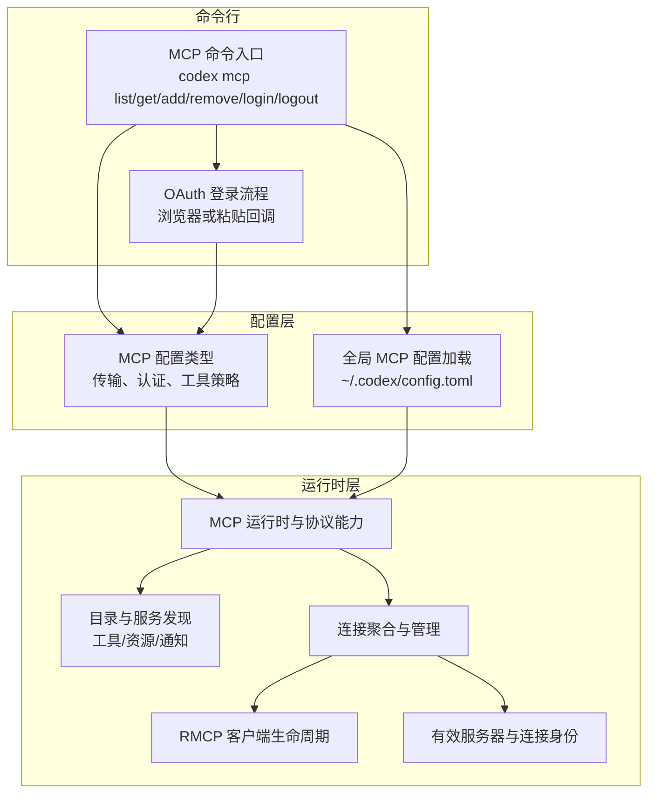
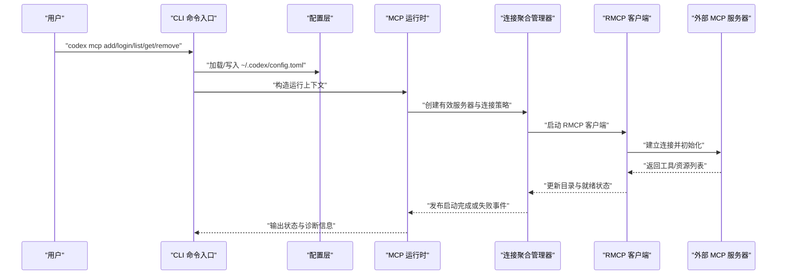
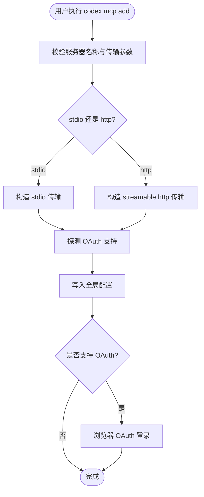
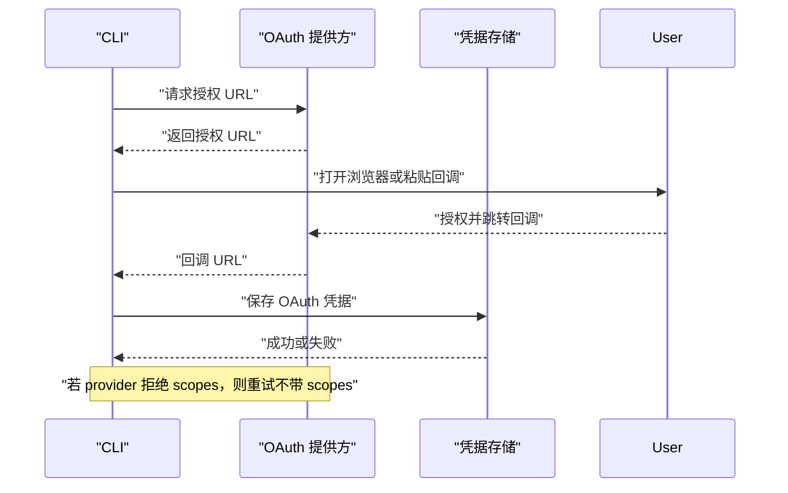
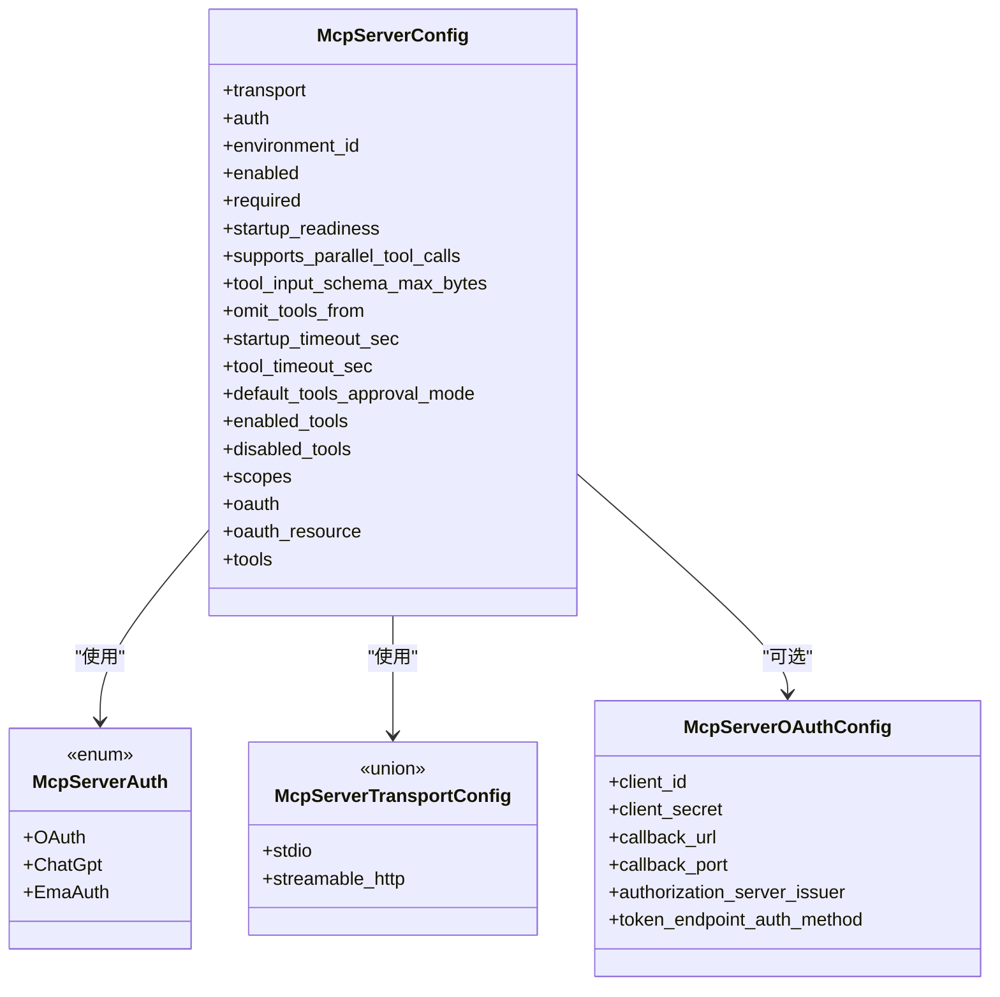
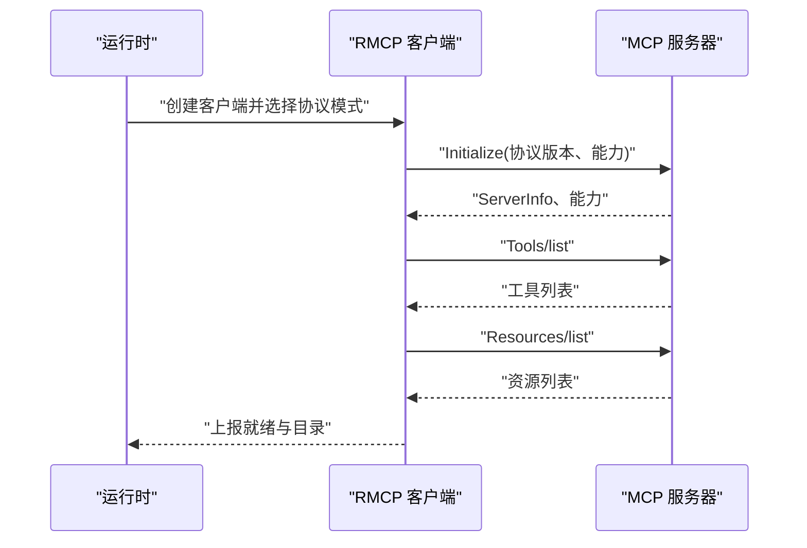
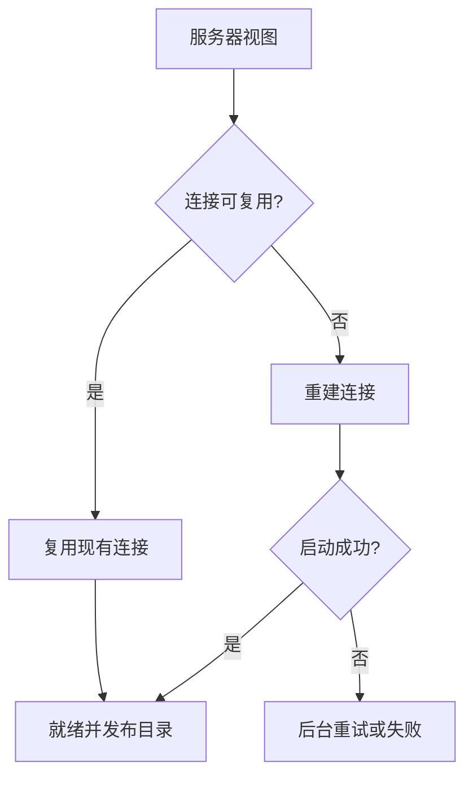
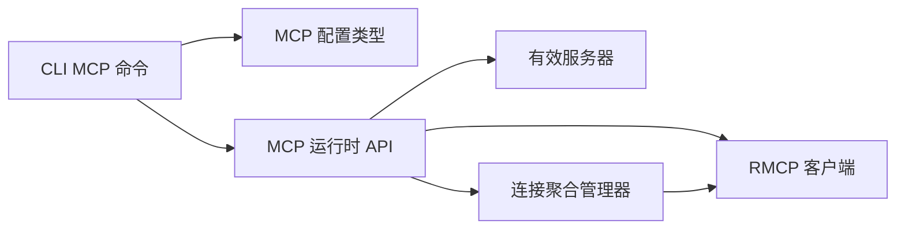

# MCP 服务器管理

<cite>
**本文引用的文件**   
- [codex-mcp README.md](file://codex-rs/codex-mcp/README.md)
- [CLI MCP 命令入口](file://codex-rs/cli/src/mcp_cmd.rs)
- [CLI OAuth 登录流程](file://codex-rs/cli/src/mcp_login.rs)
- [MCP 配置类型定义](file://codex-rs/config/src/mcp_types.rs)
- [全局 MCP 配置加载器](file://codex-rs/config/src/mcp_edit.rs)
- [MCP 运行时与协议能力](file://codex-rs/codex-mcp/src/lib.rs)
- [MCP 协议、权限与目录解析](file://codex-rs/codex-mcp/src/mcp/mod.rs)
- [MCP 连接聚合管理器](file://codex-rs/codex-mcp/src/connection_manager.rs)
- [MCP 客户端生命周期](file://codex-rs/codex-mcp/src/rmcp_client.rs)
- [有效服务器与连接身份](file://codex-rs/codex-mcp/src/server.rs)
</cite>

## 目录
1. [简介](#简介)
2. [项目结构](#项目结构)
3. [核心组件](#核心组件)
4. [架构总览](#架构总览)
5. [详细组件分析](#详细组件分析)
6. [依赖关系分析](#依赖关系分析)
7. [性能与可观测性](#性能与可观测性)
8. [故障排查](#故障排查)
9. [安全与权限控制](#安全与权限控制)
10. [结论](#结论)

## 简介
本文件面向 Codex 中 MCP（Model Context Protocol）服务器管理能力的技术文档，覆盖以下目标：
- 说明 `codex mcp` 子命令的用法，包括服务器注册、配置、认证和管理操作。
- 记录 MCP 协议的连接建立、消息交换和服务发现机制。
- 提供外部 MCP 服务器的集成示例和调试技巧。
- 给出安全配置和权限控制的指导，包括 OAuth、企业令牌、沙箱元数据以及工具审批策略。

## 项目结构
Codex 对 MCP 的支持分布在三个主要区域：
- CLI 层：`codex-rs/cli/src/mcp_cmd.rs` 与 `codex-rs/cli/src/mcp_login.rs`，负责用户交互、配置编辑与 OAuth 登录。
- 配置层：`codex-rs/config/src/mcp_types.rs` 与 `codex-rs/config/src/mcp_edit.rs`，定义 MCP 服务器 TOML 结构、传输方式、OAuth 与企业认证选项。
- MCP 运行时层：`codex-rs/codex-mcp/src/*`，实现协议模式、连接池、RMCP 客户端、工具目录、资源服务、事件流与沙箱元数据。

**图表来源**
- [CLI MCP 命令入口:1-200](file://codex-rs/cli/src/mcp_cmd.rs#L1-L200)
- [CLI OAuth 登录流程:1-120](file://codex-rs/cli/src/mcp_login.rs#L1-L120)
- [MCP 配置类型定义:1-120](file://codex-rs/config/src/mcp_types.rs#L1-L120)
- [全局 MCP 配置加载器:1-50](file://codex-rs/config/src/mcp_edit.rs#L1-L50)
- [MCP 运行时与协议能力:1-154](file://codex-rs/codex-mcp/src/lib.rs#L1-L154)
- [MCP 协议、权限与目录解析:1-120](file://codex-rs/codex-mcp/src/mcp/mod.rs#L1-L120)
- [MCP 连接聚合管理器:1-120](file://codex-rs/codex-mcp/src/connection_manager.rs#L1-L120)
- [MCP 客户端生命周期:1-120](file://codex-rs/codex-mcp/src/rmcp_client.rs#L1-L120)
- [有效服务器与连接身份:1-120](file://codex-rs/codex-mcp/src/server.rs#L1-L120)

**章节来源**
- [codex-mcp README.md:1-37](file://codex-rs/codex-mcp/README.md#L1-L37)
- [CLI MCP 命令入口:1-200](file://codex-rs/cli/src/mcp_cmd.rs#L1-L200)
- [CLI OAuth 登录流程:1-120](file://codex-rs/cli/src/mcp_login.rs#L1-L120)
- [MCP 配置类型定义:1-120](file://codex-rs/config/src/mcp_types.rs#L1-L120)
- [全局 MCP 配置加载器:1-50](file://codex-rs/config/src/mcp_edit.rs#L1-L50)
- [MCP 运行时与协议能力:1-154](file://codex-rs/codex-mcp/src/lib.rs#L1-L154)
- [MCP 协议、权限与目录解析:1-120](file://codex-rs/codex-mcp/src/mcp/mod.rs#L1-L120)
- [MCP 连接聚合管理器:1-120](file://codex-rs/codex-mcp/src/connection_manager.rs#L1-L120)
- [MCP 客户端生命周期:1-120](file://codex-rs/codex-mcp/src/rmcp_client.rs#L1-L120)
- [有效服务器与连接身份:1-120](file://codex-rs/codex-mcp/src/server.rs#L1-L120)

## 核心组件
- **CLI 命令模块**
  - `codex mcp list`：列出已配置的 MCP 服务器。
  - `codex mcp get <name>`：查看单个服务器配置。
  - `codex mcp add <name>`：向全局配置添加 stdio 或 Streamable HTTP 服务器；支持 OAuth 客户端注册参数。
  - `codex mcp remove <name>`：删除全局配置中的服务器条目。
  - `codex mcp login <name>`：对 Streamable HTTP 服务器执行 OAuth 登录；支持浏览器模式和粘贴回调模式。
  - `codex mcp logout <name>`：删除 MCP OAuth 凭据；企业 EMA 登录通过账户登录管理。

- **配置类型模块**
  - `McpServerConfig`：描述一个 MCP 服务器的完整配置，包括传输、认证、启动就绪、工具暴露策略、超时、批准模式等。
  - `McpServerAuth`：支持 OAuth、ChatGPT 会话、企业 EMA 认证三种模式。
  - `McpServerTransportConfig`：支持 stdio 与 Streamable HTTP 两种传输方式。
  - `McpServerOAuthConfig`：OAuth 客户端标识、密钥、回调地址、端口、企业授权服务器签发者等。

- **MCP 运行时模块**
  - 协议模式、工具目录、资源客户端、事件流、沙箱元数据、工具调用绑定、权限判定。
  - 对外导出 `McpRuntime`、`McpRuntimeContext`、`McpProtocolMode`、`McpStartupPolicy` 等关键类型。

**章节来源**
- [CLI MCP 命令入口:200-641](file://codex-rs/cli/src/mcp_cmd.rs#L200-L641)
- [CLI OAuth 登录流程:1-200](file://codex-rs/cli/src/mcp_login.rs#L1-L200)
- [MCP 配置类型定义:200-520](file://codex-rs/config/src/mcp_types.rs#L200-L520)
- [MCP 运行时与协议能力:1-154](file://codex-rs/codex-mcp/src/lib.rs#L1-L154)

## 架构总览
MCP 服务器管理的整体流程如下：
1. 用户通过 `codex mcp` 子命令操作配置或发起认证。
2. CLI 读取并写入全局配置 `~/.codex/config.toml`，校验字段并生成服务器条目。
3. 运行时根据配置构建“有效服务器”，决定认证策略、传输方式、环境、工具过滤等。
4. RMCP 客户端负责连接建立、初始化握手、工具/资源发现、工具调用与错误恢复。
5. 连接聚合管理器协调多个服务器的启动状态、目录缓存、工具可见性与事件发布。

**图表来源**
- [CLI MCP 命令入口:200-641](file://codex-rs/cli/src/mcp_cmd.rs#L200-L641)
- [MCP 配置类型定义:200-520](file://codex-rs/config/src/mcp_types.rs#L200-L520)
- [MCP 连接聚合管理器:1-260](file://codex-rs/codex-mcp/src/connection_manager.rs#L1-L260)
- [MCP 客户端生命周期:1-220](file://codex-rs/codex-mcp/src/rmcp_client.rs#L1-L220)

## 详细组件分析

### CLI 命令与配置管理
- **服务器注册**
  - `add` 支持两种传输：
    - `--command ...`：本地 stdio 服务器，可附加环境变量。
    - `--url`：Streamable HTTP 服务器，支持 `bearer-token-env-var`、`oauth-client-id`、`oauth-client-secret`、`oauth-client-registration`、`oauth-resource`。
  - 注册后自动尝试探测 OAuth 支持，并在支持时直接启动浏览器登录流程；若未知则提示后续手动登录。
- **服务器查询与删除**
  - `list` 与 `get` 从全局配置加载服务器清单。
  - `remove` 从配置中移除指定服务器。
- **登录与登出**
  - `login` 仅支持 Streamable HTTP 服务器；支持显式 scopes、浏览器模式或粘贴回调模式。
  - `logout` 针对普通 OAuth 或删除企业 EMA 范围；EMA 账号登录由 Codex 账户登录管理。

**图表来源**
- [CLI MCP 命令入口:200-641](file://codex-rs/cli/src/mcp_cmd.rs#L200-L641)

**章节来源**
- [CLI MCP 命令入口:200-641](file://codex-rs/cli/src/mcp_cmd.rs#L200-L641)
- [全局 MCP 配置加载器:1-50](file://codex-rs/config/src/mcp_edit.rs#L1-L50)

### OAuth 登录流程
- **登录模式**
  - 浏览器模式：CLI 打印授权 URL，等待回调。
  - 粘贴回调模式：在终端或非交互式输入中粘贴完整回调 URL。
- **Scope 重试机制**
  - 如果提供方拒绝发现的 scopes，CLI 会尝试不带 scopes 的第二次登录。
- **回调输入保护**
  - 限制回调长度，避免阻塞主流程；Ctrl-C 可取消登录。
- **回调地址解析**
  - 优先使用服务器配置的回调地址，否则回退到全局回调 URL；支持稳定回调 ID 与旧版重定向模式。

**图表来源**
- [CLI OAuth 登录流程:1-200](file://codex-rs/cli/src/mcp_login.rs#L1-L200)
- [CLI MCP 命令入口:200-641](file://codex-rs/cli/src/mcp_cmd.rs#L200-L641)

**章节来源**
- [CLI OAuth 登录流程:1-200](file://codex-rs/cli/src/mcp_login.rs#L1-L200)
- [CLI MCP 命令入口:200-641](file://codex-rs/cli/src/mcp_cmd.rs#L200-L641)

### 配置模型与字段语义
- **传输方式**
  - `stdio`：本地命令启动，支持 `env` 与 `cwd`。
  - `streamable_http`：HTTP 端点，支持 `bearer_token_env_var`、静态 `http_headers`、动态 `env_http_headers`、`http_headers_helper`。
- **认证模式**
  - `oauth`：使用已存储的 MCP OAuth 凭据。
  - `chatgpt`：复用 ChatGPT 会话；若无可用会话则可能回退到 OAuth。
  - `ema_auth`：企业 IdP 刷新令牌换取资源授权，不接受其他凭据回退。
- **启动与工具策略**
  - `startup_readiness`：`connection` 要求实时连接，`catalog` 允许使用已缓存工具目录。
  - `enabled_tools` / `disabled_tools`：工具白名单与黑名单。
  - `default_tools_approval_mode`：默认工具审批策略。
  - `tool_timeout_sec` / `startup_timeout_sec`：工具调用与启动超时。
- **OAuth 配置**
  - `client_id`、`client_secret`、`callback_url`、`callback_port`、`authorization_server_issuer`、`token_endpoint_auth_method`。
  - `scopes`：登录或令牌交换时请求的范围。
  - `oauth_resource`：RFC 8707 resource 参数。

**图表来源**
- [MCP 配置类型定义:200-520](file://codex-rs/config/src/mcp_types.rs#L200-L520)

**章节来源**
- [MCP 配置类型定义:200-520](file://codex-rs/config/src/mcp_types.rs#L200-L520)

### MCP 协议连接、消息交换与服务发现
- **协议模式**
  - 通过 `McpProtocolMode` 协商协议版本与能力；stdio 可通过环境变量控制协议模式。
- **连接建立**
  - RMCP 客户端负责选择传输、构建初始化参数、发送初始化请求、接收服务端信息与能力。
- **服务发现**
  - 列出工具与资源；支持分页与能力探测；对 `codex_apps` 等特殊服务器有独立处理逻辑。
- **事件与通知**
  - 启动状态、工具列表变化、资源变更、认证状态等事件通过运行时与连接管理器发布。

**图表来源**
- [MCP 客户端生命周期:1-220](file://codex-rs/codex-mcp/src/rmcp_client.rs#L1-L220)
- [MCP 协议、权限与目录解析:1-120](file://codex-rs/codex-mcp/src/mcp/mod.rs#L1-L120)

**章节来源**
- [MCP 客户端生命周期:1-220](file://codex-rs/codex-mcp/src/rmcp_client.rs#L1-L220)
- [MCP 协议、权限与目录解析:1-120](file://codex-rs/codex-mcp/src/mcp/mod.rs#L1-L120)

### 连接管理与工具可见性
- **连接聚合**
  - 每个服务器对应一个连接视图，包含协议模式、启动就绪、元数据、工具过滤器、目录刷新策略。
  - 支持连接重用与凭据一致性检查；当凭据变化或连接关闭时重建。
- **启动容错**
  - 启动失败时可进行后台重连；对认证相关错误与普通错误区分处理。
- **工具可见性**
  - 工具可按模型可见面过滤；对未信任连接器属性进行限制；支持插件归属与工具命名空间前缀。

**图表来源**
- [MCP 连接聚合管理器:1-260](file://codex-rs/codex-mcp/src/connection_manager.rs#L1-L260)
- [MCP 客户端生命周期:1-220](file://codex-rs/codex-mcp/src/rmcp_client.rs#L1-L220)

**章节来源**
- [MCP 连接聚合管理器:1-260](file://codex-rs/codex-mcp/src/connection_manager.rs#L1-L260)
- [MCP 客户端生命周期:1-220](file://codex-rs/codex-mcp/src/rmcp_client.rs#L1-L220)

### 沙箱元数据与执行环境
- **沙箱策略传递**
  - MCP 服务器通过实验能力声明支持接收沙箱元数据；Codex 在工具调用的 `_meta` 中注入策略值。
  - 同时保留旧名称以便迁移期兼容。
- **沙箱启动器**
  - 对于本地 stdio 服务器，Codex 可提供经校验的 CLI 路径，用于在受控环境中运行命令。
  - 远程或 HTTP 端点不共享文件系统，因此不提供启动器；需要启动器的服务器必须采用保守失败策略。
- **权限边界**
  - 工具参数不等于授权；应保留原始策略并拒绝权威变化后的重用。

**章节来源**
- [codex-mcp README.md:1-37](file://codex-rs/codex-mcp/README.md#L1-L37)

## 依赖关系分析
- **CLI 依赖配置与运行时**
  - `mcp_cmd.rs` 依赖 `codex_config` 与 `codex_core::McpManager`，并调用 `codex_mcp` 的 OAuth 支持与头部辅助函数。
- **配置类型被多模块复用**
  - `mcp_types.rs` 为 CLI、运行时、连接管理、RMCP 客户端共同提供数据结构。
- **运行时内部依赖**
  - `server.rs` 定义有效服务器与连接身份；`rmcp_client.rs` 负责客户端生命周期；`connection_manager.rs` 聚合连接、工具目录与启动状态。
  - `lib.rs` 统一导出运行时公共 API，供上层 Core 与 TUI 使用。

**图表来源**
- [CLI MCP 命令入口:1-200](file://codex-rs/cli/src/mcp_cmd.rs#L1-L200)
- [MCP 配置类型定义:1-120](file://codex-rs/config/src/mcp_types.rs#L1-L120)
- [MCP 运行时与协议能力:1-154](file://codex-rs/codex-mcp/src/lib.rs#L1-L154)
- [有效服务器与连接身份:1-120](file://codex-rs/codex-mcp/src/server.rs#L1-L120)
- [MCP 客户端生命周期:1-120](file://codex-rs/codex-mcp/src/rmcp_client.rs#L1-L120)
- [MCP 连接聚合管理器:1-120](file://codex-rs/codex-mcp/src/connection_manager.rs#L1-L120)

**章节来源**
- [CLI MCP 命令入口:1-200](file://codex-rs/cli/src/mcp_cmd.rs#L1-L200)
- [MCP 运行时与协议能力:1-154](file://codex-rs/codex-mcp/src/lib.rs#L1-L154)

## 性能与可观测性
- **目录缓存与延迟启动**
  - `startup_readiness = catalog` 允许使用已缓存工具目录满足启动条件，真实连接可在后台继续初始化。
  - 可选 MCP 服务器具有默认启动宽限期，减少非必需服务的启动阻塞。
- **工具调用超时**
  - 通过 `tool_timeout_sec` 控制单次工具调用耗时，防止长尾任务影响模型响应。
- **指标与诊断**
  - 连接数、工具列表耗时、Apps 刷新耗时等指标可用于监控。
  - 启动失败与认证失败事件可用于排障。

[本节为通用性能建议，不直接分析具体文件]

## 故障排查
- **常见错误与建议**
  - “未找到名为 X 的 MCP 服务器”：确认 `codex mcp add` 已正确写入全局配置。
  - “OAuth 登录仅支持 Streamable HTTP 服务器”：确认使用 `--url` 而非 `--command`。
  - “企业 MCP 授权由 Codex 账户登录管理”：使用账户登录而不是 `mcp login`。
  - “不支持的 bearer_token”：改为 `bearer_token_env_var`，避免将敏感令牌明文写入配置。
- **调试技巧**
  - 使用 `codex mcp list --json` 查看完整配置。
  - 检查 OAuth 回调地址是否与提供方注册的回调一致。
  - 对本地 stdio 服务器，验证命令可执行且环境变量正确。
  - 观察启动事件与工具目录是否成功加载。

**章节来源**
- [CLI MCP 命令入口:200-641](file://codex-rs/cli/src/mcp_cmd.rs#L200-L641)
- [全局 MCP 配置加载器:1-50](file://codex-rs/config/src/mcp_edit.rs#L1-L50)

## 安全与权限控制
- **认证策略**
  - OAuth：使用凭据存储；支持客户端注册策略与回调地址。
  - ChatGPT：复用会话，适用于可信第一方来源。
  - EMA：企业 IdP 刷新令牌换取资源授权，不接受其他凭据回退。
- **网络与安全头**
  - HTTP 服务器可使用静态 `http_headers` 或动态 `env_http_headers`；避免将 Authorization 头作为明文 `bearer_token` 配置。
- **工具审批与权限**
  - 默认审批策略可被 per-tool 设置覆盖；支持按模型可见面隐藏工具。
  - 沙箱策略随工具调用下发，保持策略不可变与权威一致。
- **凭据隔离**
  - 连接身份包含认证、传输、环境、OAuth 存储后端等字段，确保凭据变化触发必要重连。

**章节来源**
- [MCP 配置类型定义:200-520](file://codex-rs/config/src/mcp_types.rs#L200-L520)
- [有效服务器与连接身份:1-260](file://codex-rs/codex-mcp/src/server.rs#L1-L260)
- [MCP 协议、权限与目录解析:1-120](file://codex-rs/codex-mcp/src/mcp/mod.rs#L1-L120)

## 结论
Codex 的 MCP 服务器管理以 CLI 为入口、TOML 配置为中心、运行时连接与协议能力为核心支撑。通过清晰的传输与认证抽象、强大的连接聚合与目录缓存、以及对沙箱元数据的精细控制，系统既能满足外部 MCP 服务器的灵活集成，也能在企业级安全与权限约束下可靠运行。实际部署时，应优先使用环境变量承载敏感凭据、明确工具审批策略、并通过事件与指标持续监控 MCP 连接的稳定性。