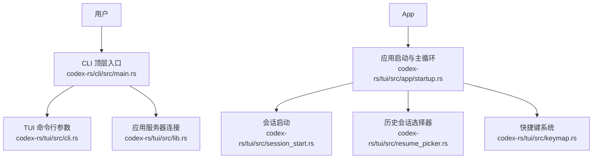
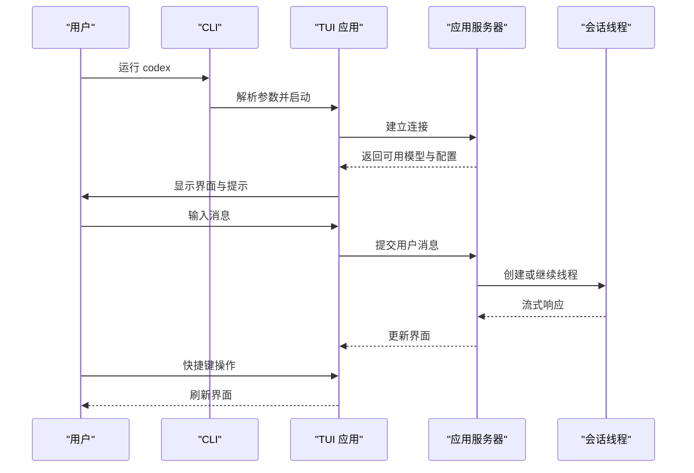
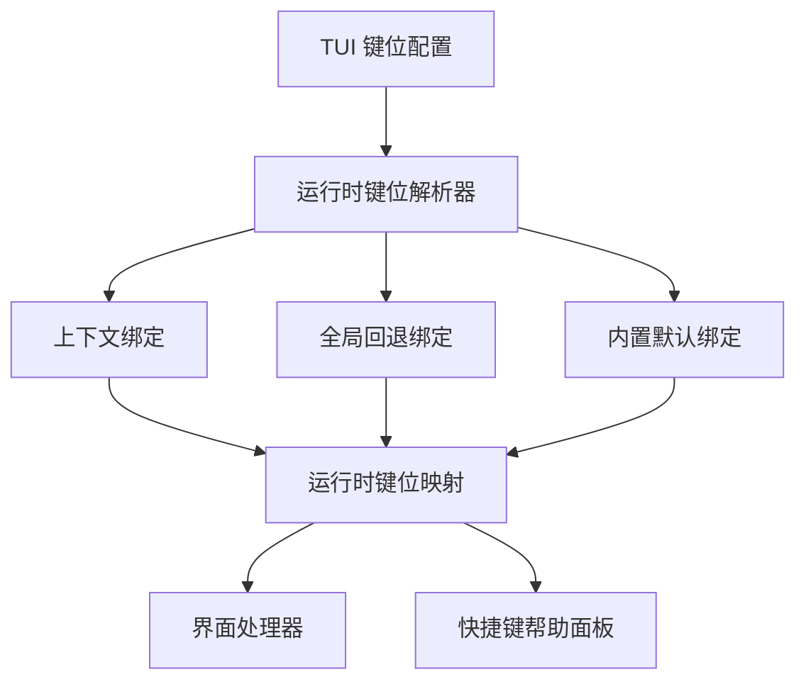
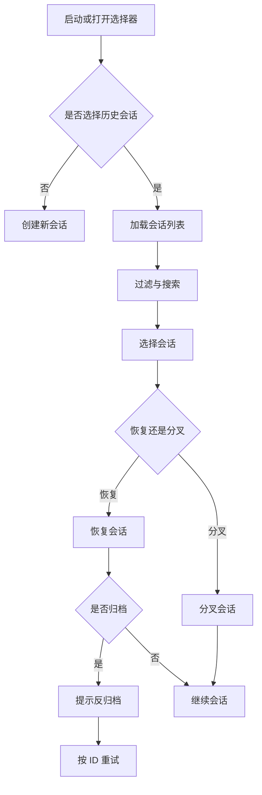
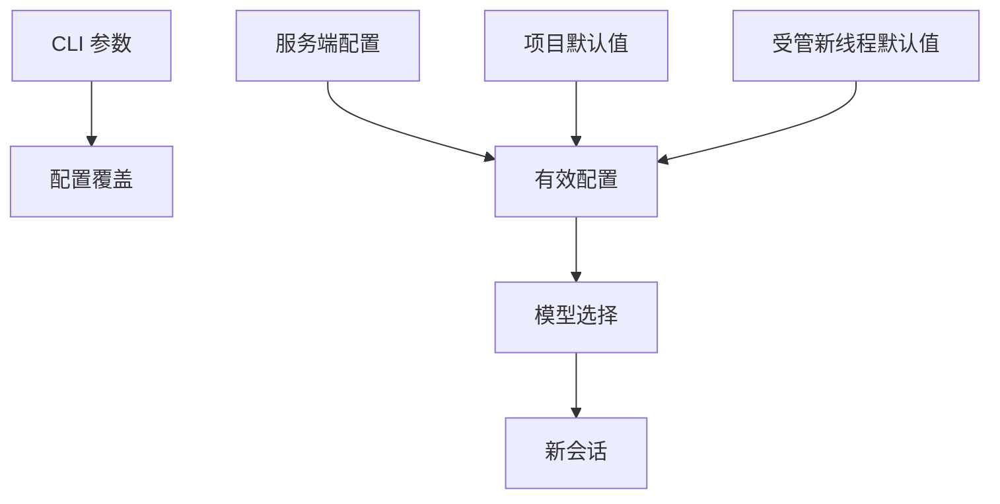
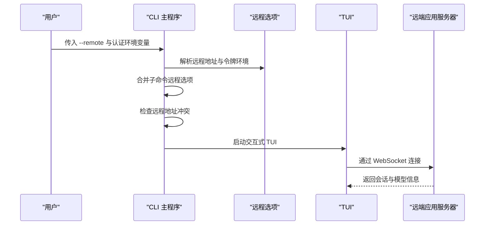
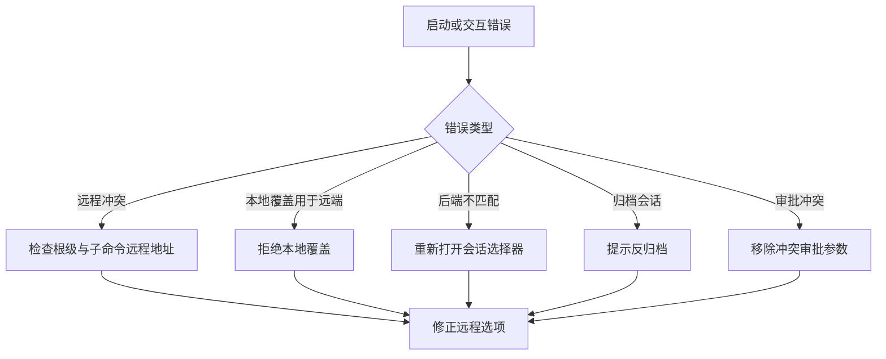

# 交互式模式

<cite>
**本文引用的文件**   
- [main.rs](file://codex-rs/cli/src/main.rs)
- [cli.rs](file://codex-rs/tui/src/cli.rs)
- [lib.rs](file://codex-rs/tui/src/lib.rs)
- [app/startup.rs](file://codex-rs/tui/src/app/startup.rs)
- [session_start.rs](file://codex-rs/tui/src/session_start.rs)
- [resume_picker.rs](file://codex-rs/tui/src/resume_picker.rs)
- [keymap.rs](file://codex-rs/tui/src/keymap.rs)
- [shortcut_help.rs](file://codex-rs/tui/src/shortcut_help.rs)
</cite>

## 目录
1. [引言](#引言)
2. [项目结构定位](#项目结构定位)
3. [如何启动交互式会话](#如何启动交互式会话)
4. [TUI 界面与基本操作](#tui-界面与基本操作)
5. [快捷键与交互流程](#快捷键与交互流程)
6. [会话管理功能](#会话管理功能)
7. [模型选择与配置覆盖](#模型选择与配置覆盖)
8. [远程连接与云端模式](#远程连接与云端模式)
9. [常见使用场景](#常见使用场景)
10. [错误处理与故障排查](#错误处理与故障排查)
11. [性能与体验特性](#性能与体验特性)
12. [结论](#结论)

## 引言
交互式模式是 Codex 的终端用户入口。默认情况下，直接运行 `codex` 会进入 TUI（基于终端的用户界面）；也可以传入提示文本、切换模型、开启搜索、指定工作目录，或通过远程选项连接到远端应用服务器。本文聚焦以下目标：

- 如何启动交互式会话。
- TUI 界面的视觉元素和基本操作。
- 快捷键体系与可定制键位。
- 会话创建、恢复、分叉、查看历史等生命周期管理。
- 模型选择、权限策略、配置覆盖。
- 本地守护进程与远程 WebSocket 连接。
- 常见任务的操作指南和排错建议。

## 项目结构定位
Codex 的交互式能力由两部分协作完成：

| 区域 | 职责 | 关键文件 |
|---|---|---|
| CLI 顶层命令 | 解析全局参数、子命令、远程选项、配置覆盖，并决定是否进入交互式模式 | [main.rs](file://codex-rs/cli/src/main.rs) |
| TUI 库接口 | 暴露 TUI 命令行参数、导出运行时类型、加载配置、连接后端、启动主循环 | [lib.rs](file://codex-rs/tui/src/lib.rs)、[cli.rs](file://codex-rs/tui/src/cli.rs) |
| TUI 应用主循环 | 编排启动、会话生命周期、事件分发、渲染、断开重连、退出汇总 | [app/startup.rs](file://codex-rs/tui/src/app/startup.rs)、[app.rs](file://codex-rs/tui/src/app.rs) |
| 会话启动逻辑 | 处理恢复、分叉、归档会话重试、取消启动 | [session_start.rs](file://codex-rs/tui/src/session_start.rs) |
| 历史会话选择器 | 列出、搜索、预览、归档/反归档会话 | [resume_picker.rs](file://codex-rs/tui/src/resume_picker.rs) |
| 快捷键系统 | 将配置转换为运行时键位映射，支持上下文、组合键、冲突校验 | [keymap.rs](file://codex-rs/tui/src/keymap.rs) |
| 快捷键帮助 | 把按键和操作组装成多列帮助面板 | [shortcut_help.rs](file://codex-rs/tui/src/shortcut_help.rs) |

**图表来源**
- [main.rs:970-1250](file://codex-rs/cli/src/main.rs#L970-L1250)
- [cli.rs:1-153](file://codex-rs/tui/src/cli.rs#L1-L153)
- [lib.rs:1-120](file://codex-rs/tui/src/lib.rs#L1-L120)
- [app/startup.rs:1-120](file://codex-rs/tui/src/app/startup.rs#L1-L120)
- [session_start.rs:1-164](file://codex-rs/tui/src/session_start.rs#L1-L164)
- [resume_picker.rs:1-120](file://codex-rs/tui/src/resume_picker.rs#L1-L120)
- [keymap.rs:1-120](file://codex-rs/tui/src/keymap.rs#L1-L120)

**章节来源**
- [main.rs:1-200](file://codex-rs/cli/src/main.rs#L1-L200)
- [lib.rs:1-120](file://codex-rs/tui/src/lib.rs#L1-L120)

## 如何启动交互式会话
### 默认启动
当没有显式子命令时，CLI 会把顶层选项转发给交互式 TUI。这意味着：

- 直接运行 `codex` 进入交互式界面。
- 如果提供位置参数，该值会被当作初始提示。
- 如果同时存在子命令，则忽略默认交互式选项。

### 带初始提示启动
可以在命令末尾附加提示内容。例如：

- `codex 帮我分析当前仓库的依赖风险`
- `codex 解释这段日志中的错误原因`

初始提示会在会话启动后交给聊天输入组件；它不是独立的“脚本模式”，而是交互式对话的第一条消息。

### 非交互式子命令不会进入 TUI
`exec`、`review`、`mcp`、`plugin` 等非交互式子命令走独立路径，不会打开 TUI。这些子命令还会检查是否意外传入了远程连接选项，并在某些场景下拒绝远程模式。

### 交互式相关命令行参数
| 参数或位置 | 含义 | 说明 |
|---|---|---|
| 无子命令 | 启动交互式 TUI | 这是默认行为 |
| `PROMPT` | 初始提示 | 作为第一条用户消息参与会话 |
| `--strict-config` | 严格配置文件 | 遇到未知字段时报错 |
| `-a, --ask-for-approval` | 命令执行审批策略 | 控制模型执行命令前是否需要人工批准 |
| `--search` | 启用实时网络搜索 | 使原生响应式 `web_search` 工具可用 |
| `--no-alt-screen` | 关闭备用屏幕 | 以内联模式运行，保留终端滚动历史 |
| `--no-daemon` | 不使用共享后台服务 | 即使已有守护进程也不复用 |
| `--remote` | 远程 WebSocket 地址 | 支持 `ws://`、`wss://`、`unix://`、`unix://PATH` |
| `--remote-auth-token-env` | 远程认证令牌环境变量名 | 从环境变量读取 bearer token |

上述参数主要来自：

- CLI 顶层参数与远程选项定义：[main.rs:970-1250](file://codex-rs/cli/src/main.rs#L970-L1250)
- TUI 自身参数：[cli.rs:1-153](file://codex-rs/tui/src/cli.rs#L1-L153)

**章节来源**
- [main.rs:1-200](file://codex-rs/cli/src/main.rs#L1-L200)
- [main.rs:970-1250](file://codex-rs/cli/src/main.rs#L970-L1250)
- [cli.rs:1-153](file://codex-rs/tui/src/cli.rs#L1-L153)

## TUI 界面与基本操作
### 主要视觉区域
TUI 是一个终端内的富交互界面，通常包含以下区域：

| 区域 | 作用 |
|---|---|
| 顶部状态栏 | 显示当前后端、模型、权限、连接状态、速率限制等信息 |
| 中央转储区 | 显示用户消息、助手回复、工具调用、补丁、系统通知等 |
| 底部输入框 | 编辑并提交对话草稿；支持粘贴、附件、斜杠命令、快捷面板 |
| 侧边栏 | 会话列表、代理中心、设置、历史记录、权限与模型选择等 |
| 弹窗与覆盖层 | 审批请求、问题回答、模型选择、配置面板、快捷键帮助等 |
| 底部提示行 | 展示当前上下文可用的快捷键 |

### 基本交互流程
1. 启动后，CLI 解析参数并准备配置。
2. TUI 连接本地或远程应用服务器。
3. 根据启动选项决定：
   - 直接进入新对话。
   - 打开代理中心。
   - 打开历史会话选择器。
   - 恢复或分叉指定会话。
4. 输入消息后，TUI 通过应用服务器发起线程启动或继续。
5. 流式响应、工具调用、审批、异步问题依次在界面中呈现。
6. 用户可通过快捷键切换焦点、撤销、中断、复制、退出。

**图表来源**
- [main.rs:1080-1250](file://codex-rs/cli/src/main.rs#L1080-L1250)
- [app/startup.rs:1-120](file://codex-rs/tui/src/app/startup.rs#L1-L120)

**章节来源**
- [app/startup.rs:1-120](file://codex-rs/tui/src/app/startup.rs#L1-L120)

## 快捷键与交互流程
### 快捷键解析优先级
TUI 的快捷键系统不是简单硬编码，而是从配置解析为运行时键位映射，并按以下顺序生效：

1. 上下文绑定：例如聊天输入、编辑器、列表、代理中心等不同区域的绑定。
2. 全局回退绑定：允许跨上下文复用的动作。
3. 内置默认绑定：未自定义时的兜底行为。

这保证了同一个键在不同界面上下文中可以有不同语义，同时避免冲突。

### 主要快捷键分组
| 分组 | 典型用途 |
|---|---|
| 应用级 | 切换主机、打开代理中心、打开转储、查找转储、复制、清屏、切换 Vim 模式、切换快速模式、切换原始输出、切换旁路对话 |
| 聊天级 | 打开预设菜单、语音开关、语音静音、中断当前回合、调整推理强度、切换权限模式、编辑排队消息、后退提问栈、跳过问题 |
| 输入框级 | 提交消息、排队草稿、打开快捷键面板、反向历史搜索、移动历史搜索结果 |
| 编辑器级 | 插入换行、光标移动、单词移动、删除、整行删除、剪切、粘贴 |
| Vim 模式 | 正常模式、运算符挂起、搜索、文本对象等 Vim 风格编辑 |
| 分页与列表 | 翻页、选择、确认、取消、模糊搜索等 |

### 快捷键帮助面板
快捷键帮助通过共享模块把按键与动作组织成三列、两列或一列布局，宽度不足时自动折行。它负责：

- 生成按键显示标签。
- 对齐列宽。
- 根据终端宽度决定列数。
- 用强调色高亮按键。

**图表来源**
- [keymap.rs:1-120](file://codex-rs/tui/src/keymap.rs#L1-L120)
- [shortcut_help.rs:1-100](file://codex-rs/tui/src/shortcut_help.rs#L1-L100)

**章节来源**
- [keymap.rs:1-120](file://codex-rs/tui/src/keymap.rs#L1-L120)
- [shortcut_help.rs:1-100](file://codex-rs/tui/src/shortcut_help.rs#L1-L100)

## 会话管理功能
### 新会话
启动时如果没有指定恢复目标，TUI 会准备新会话。默认模型可能来自：

- 配置中的模型。
- 服务端默认模型。
- 服务端可用模型列表中的首个或标记为默认的模型。

### 恢复会话
TUI 可以恢复之前保存的线程。恢复过程会：

- 确保会话属于当前后端。
- 按权限策略恢复会话。
- 如果是归档会话，提示用户反归档。
- 反归档后按会话 ID 重试恢复。

### 分叉会话
分叉用于从历史会话创建一个新分支，而不是在原会话上继续。适合“换个思路再试一次”。

### 历史会话选择器
历史选择器支持：

- 分页加载会话列表。
- 按当前工作目录、仓库范围或全部会话过滤。
- 按提供者、状态、排序键筛选。
- 预览最近转储片段。
- 对归档会话执行归档或反归档操作。

**图表来源**
- [resume_picker.rs:1-120](file://codex-rs/tui/src/resume_picker.rs#L1-L120)
- [session_start.rs:1-164](file://codex-rs/tui/src/session_start.rs#L1-L164)

**章节来源**
- [session_start.rs:1-164](file://codex-rs/tui/src/session_start.rs#L1-L164)
- [resume_picker.rs:1-120](file://codex-rs/tui/src/resume_picker.rs#L1-L120)

## 模型选择与配置覆盖
### 模型来源优先级
TUI 启动时会叠加多层模型信息：

1. CLI 提供的配置覆盖。
2. 服务端读取的有效配置。
3. 新项目默认值。
4. 受管的新线程默认值。
5. 服务端可用模型与默认模型。

最终选择的模型用于创建新线程或显示在界面中。

### 配置覆盖机制
顶层 CLI 会将 `--enable` 和 `--disable` 特性开关合并到配置覆盖中，并传递给所有子命令。TUI 也会把自身共享选项与根级配置合并。

### 审批与权限
用户可以通过 `-a, --ask-for-approval` 指定命令执行审批策略。注意：

- `dangerously_bypass_approvals_and_sandbox` 与 `auto_review` 会与 `--ask-for-approval` 冲突。
- 权限配置还涉及权限档案、沙箱写入规则、审阅者等更深层配置。

**图表来源**
- [app/startup.rs:1-120](file://codex-rs/tui/src/app/startup.rs#L1-L120)
- [main.rs:970-1250](file://codex-rs/cli/src/main.rs#L970-L1250)
- [cli.rs:1-153](file://codex-rs/tui/src/cli.rs#L1-L153)

**章节来源**
- [app/startup.rs:1-120](file://codex-rs/tui/src/app/startup.rs#L1-L120)
- [cli.rs:1-153](file://codex-rs/tui/src/cli.rs#L1-L153)
- [main.rs:970-1250](file://codex-rs/cli/src/main.rs#L970-L1250)

## 远程连接与云端模式
### 远程选项
CLI 定义了统一的远程选项结构，可用于交互式模式及相关子命令：

| 远程选项 | 作用 |
|---|---|
| `--remote` | 指定 WebSocket 地址，支持 `ws://host:port`、`wss://host:port`、`unix://`、`unix://PATH` |
| `--remote-auth-token-env` | 指定环境变量名，从中读取 bearer token |

这些选项会沿 CLI 层级传递，供 TUI 构建远程客户端连接。

### 远程模式下的限制
当使用 `codex agents` 打开代理中心时：

- 不允许携带初始提示或图片。
- 不允许把本地提供者、附加目录或沙箱写根目录等本地覆盖应用到远端服务器。
- 如果根级远程地址与 `agents` 子命令的远程地址不一致，会报错。

### 启动流程中的远程决策
CLI 会：

1. 解析根级远程选项。
2. 合并 `agents` 子命令的远程选项。
3. 拒绝冲突的远程地址。
4. 决定是否启动 TUI。
5. 将远程端点和认证环境变量传给 TUI。

**图表来源**
- [main.rs:970-1250](file://codex-rs/cli/src/main.rs#L970-L1250)

**章节来源**
- [main.rs:970-1250](file://codex-rs/cli/src/main.rs#L970-L1250)

## 常见使用场景
### 开始新对话
- 直接运行 `codex`。
- 或者传入初始提示：`codex 帮我重构当前项目的错误处理逻辑`。
- 如果需要禁用备用屏幕，使用 `--no-alt-screen`。
- 如果需要禁止复用守护进程，使用 `--no-daemon`。

### 切换模型
模型选择通常发生在：

- 启动阶段，由配置与服务端默认值决定。
- 对话过程中，通过聊天预设、模型选择面板或快捷键切换。
- 新会话创建时，由受管默认值与项目默认值叠加决定。

如果不确定当前模型，可查看顶部状态栏或使用界面中的模型选择入口。

### 查看历史会话
- 打开历史会话选择器。
- 使用过滤条件缩小范围。
- 滚动浏览会话摘要。
- 点击预览最近转储片段。
- 选择恢复或分叉。

### 恢复归档会话
如果目标会话处于归档状态，TUI 会提示用户：

- 取消。
- 退出。
- 反归档后重试。

反归档成功后，系统按会话 ID 重新尝试恢复。

### 中断正在执行的回合
如果模型正在思考或执行工具，可以使用聊天级快捷键中断当前回合。这会阻止后续流式输出继续推进。

### 复制结果
使用应用级复制快捷键，可以把最后一次助手回复复制到剪贴板。

### 退出交互式模式
TUI 会收集退出原因、令牌用量、会话 ID、断开信息和更新动作，并生成退出摘要。

**章节来源**
- [session_start.rs:1-164](file://codex-rs/tui/src/session_start.rs#L1-L164)
- [resume_picker.rs:1-120](file://codex-rs/tui/src/resume_picker.rs#L1-L120)
- [keymap.rs:1-120](file://codex-rs/tui/src/keymap.rs#L1-L120)

## 错误处理与故障排查
### 配置文件严格模式
如果启用了严格配置模式，且配置中包含当前版本不认识的字段，CLI/TUI 会报错。适合在自动化或 CI 环境中发现配置漂移。

### 远程地址冲突
当根级远程地址与 `agents` 子命令的远程地址不同时，CLI 会直接报错，避免连接目标不一致。

### 本地覆盖不能用于远端
在代理中心模式下，不能把本地提供者、附加目录、沙箱写根目录等本地覆盖应用到远端服务器。

### 历史会话后端不匹配
选择历史会话时，如果会话属于其他后端，会提示重新打开会话选择器。

### 归档会话无法直接恢复
归档会话需要先反归档。如果反归档失败或目标不是归档会话，TUI 会给出明确错误信息。

### 审批策略冲突
`dangerously_bypass_approvals_and_sandbox` 与 `auto_review` 不能与 `--ask-for-approval` 同时使用。

**图表来源**
- [main.rs:1080-1250](file://codex-rs/cli/src/main.rs#L1080-L1250)
- [session_start.rs:1-164](file://codex-rs/tui/src/session_start.rs#L1-L164)
- [cli.rs:1-153](file://codex-rs/tui/src/cli.rs#L1-L153)

**章节来源**
- [main.rs:1080-1250](file://codex-rs/cli/src/main.rs#L1080-L1250)
- [session_start.rs:1-164](file://codex-rs/tui/src/session_start.rs#L1-L164)
- [cli.rs:1-153](file://codex-rs/tui/src/cli.rs#L1-L153)

## 性能与体验特性
### 备用屏幕模式
默认情况下，TUI 会使用终端备用屏幕模式以获得完整界面体验。若希望保留终端滚动历史，可使用 `--no-alt-screen`。

### 守护进程模式
默认 TUI 可以与共享后台服务协作。若需要隔离运行或调试，可使用 `--no-daemon`。

### 网络搜索
启用 `--search` 后，模型可获得原生响应式 `web_search` 工具，无需每次调用都触发审批。

### 快捷键与输入优化
快捷键系统预先解析并验证冲突，避免运行时出现重复绑定。组合键、Vim 模式和编辑器专用键位分别管理，减少误触。

### 会话列表分页
历史会话列表采用分页加载和阈值预加载，避免一次性加载大量会话导致界面卡顿。

**章节来源**
- [cli.rs:1-153](file://codex-rs/tui/src/cli.rs#L1-L153)
- [keymap.rs:1-120](file://codex-rs/tui/src/keymap.rs#L1-L120)
- [resume_picker.rs:1-120](file://codex-rs/tui/src/resume_picker.rs#L1-L120)

## 结论
Codex 的交互式模式以 CLI 为入口，以 TUI 为核心交互界面，以应用服务器为计算与状态后端。用户可以直接启动对话、切换模型、管理历史会话，也可以通过远程选项连接到远端服务器。对于高级用户，TUI 提供了丰富的快捷键、配置覆盖、权限控制和会话生命周期管理能力。遇到问题时，优先检查远程地址、本地覆盖、审批策略和历史会话状态，这些是交互式模式中最常见的约束点。