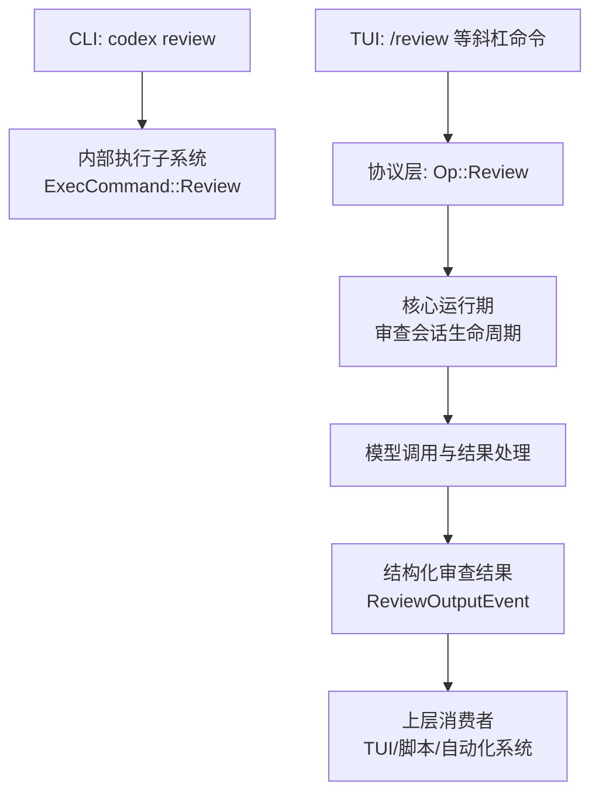
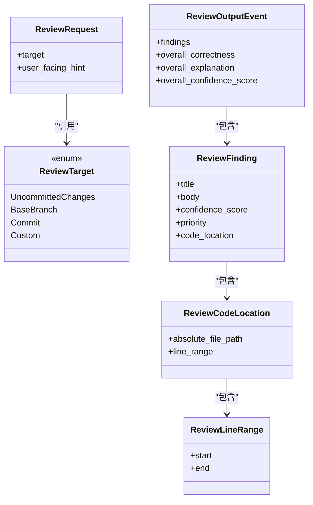
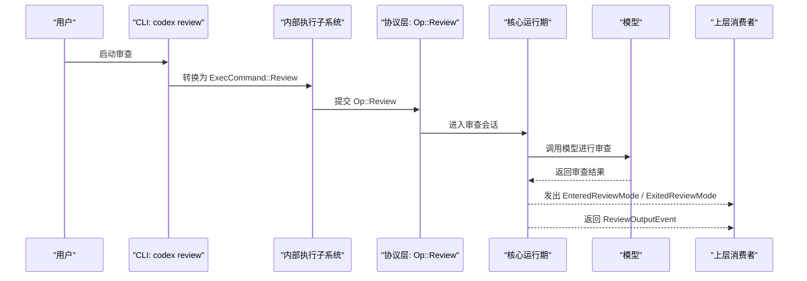
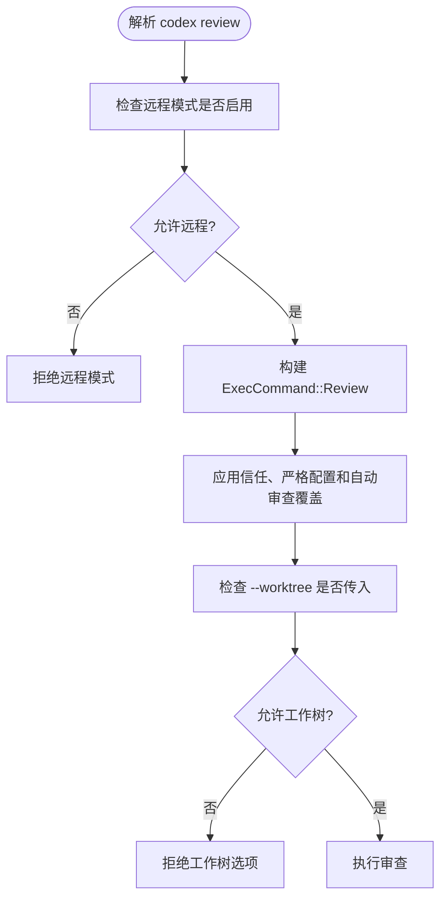
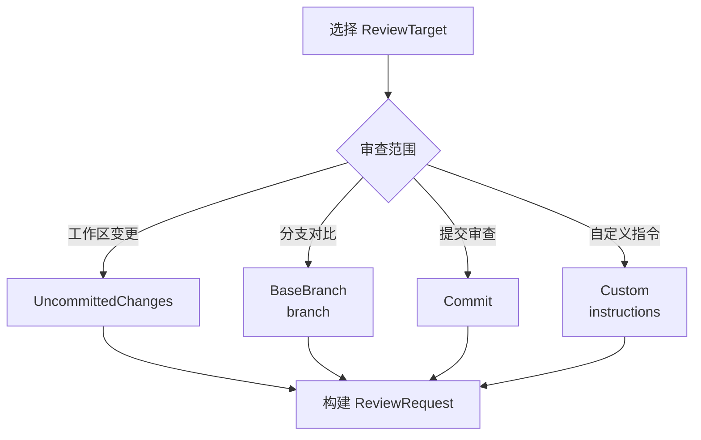
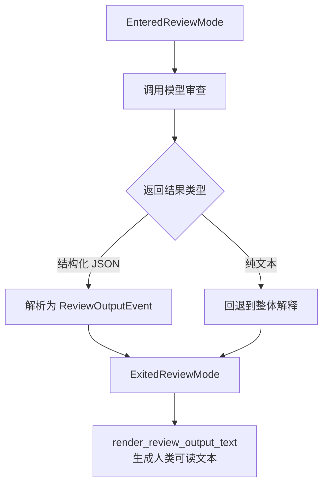
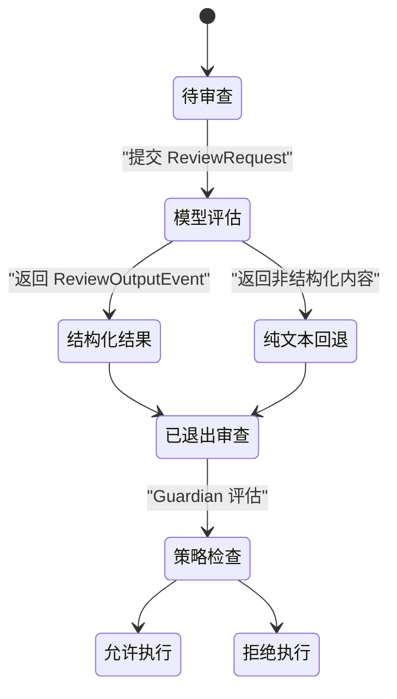
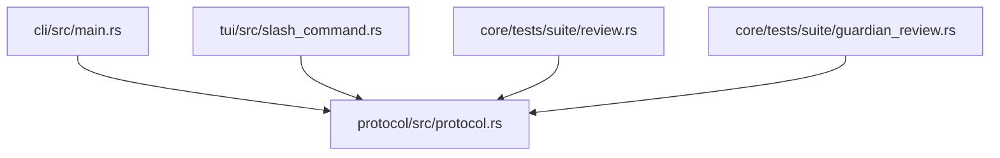

# 代码审查（review）

<cite>
**本文引用的文件**   
- [main.rs](file://codex-rs/cli/src/main.rs)
- [slash_command.rs](file://codex-rs/tui/src/slash_command.rs)
- [protocol.rs](file://codex-rs/protocol/src/protocol.rs)
- [review.rs](file://codex-rs/core/tests/suite/review.rs)
- [guardian_review.rs](file://codex-rs/core/tests/suite/guardian_review.rs)
- [README.md](file://scripts/mcp_conformance/README.md)
</cite>

## 目录
1. [简介](#简介)
2. [项目结构与审查入口](#项目结构与审查入口)
3. [核心组件与数据模型](#核心组件与数据模型)
4. [架构总览](#架构总览)
5. [详细组件分析](#详细组件分析)
6. [依赖关系分析](#依赖关系分析)
7. [性能与输出特性](#性能与输出特性)
8. [常见问题排查](#常见问题排查)
9. [结论](#结论)
10. [附录：使用示例与最佳实践](#附录使用示例与最佳实践)

## 简介
本文档面向需要理解并使用 Codex 代码审查功能的用户与维护者，重点说明 `review` 命令的语义、审查范围、输出结果结构、自动化集成方式以及策略定制要点。该功能在命令行、TUI 和协议层均有明确实现：CLI 提供非交互式审查入口；TUI 支持 `/review` 等斜杠命令；协议层定义了审查请求、目标类型、结构化审查结果以及生命周期事件。

## 项目结构与审查入口
Codex 的审查能力由多个层次协作完成：

- **CLI 层**：`codex review` 是顶层子命令之一，负责校验参数并把审查任务转交给内部执行子系统。
- **TUI 层**：提供 `/review` 和自动审查相关斜杠命令，用于交互场景中的审查触发和用户确认流程。
- **协议层**：定义 `Op::Review`、`ReviewRequest`、`ReviewTarget`、`ReviewOutputEvent` 等类型，统一表达“发起审查”和“返回结构化审查结果”。
- **核心测试与行为验证**：通过测试用例验证审查会话的生命周期、结构化结果解析、纯文本回退、分支差异审查等行为。

**图表来源**
- [main.rs:156-157](file://codex-rs/cli/src/main.rs#L156-L157)
- [main.rs:1173-1189](file://codex-rs/cli/src/main.rs#L1173-L1189)
- [slash_command.rs:101-101](file://codex-rs/tui/src/slash_command.rs#L101-L101)
- [protocol.rs:923-933](file://codex-rs/protocol/src/protocol.rs#L923-L933)

**章节来源**
- [main.rs:156-157](file://codex-rs/cli/src/main.rs#L156-L157)
- [main.rs:1173-1189](file://codex-rs/cli/src/main.rs#L1173-L1189)
- [slash_command.rs:101-101](file://codex-rs/tui/src/slash_command.rs#L101-L101)
- [protocol.rs:923-933](file://codex-rs/protocol/src/protocol.rs#L923-L933)

## 核心组件与数据模型
审查相关的核心类型集中在协议层，它们共同构成审查输入、审查目标和审查输出的契约。

| 类型 | 作用 | 关键字段或变体 |
|---|---|---|
| `Op::Review` | 向核心运行期提交一次审查操作 | 包含 `ReviewRequest` |
| `ReviewRequest` | 表示一次审查请求 | `target`、可选的 `user_facing_hint` |
| `ReviewTarget` | 指定审查范围 | `UncommittedChanges`、`BaseBranch`、`Commit`、`Custom` |
| `ReviewOutputEvent` | 审查会话结束时返回的结构化结果 | `findings`、`overall_correctness`、`overall_explanation`、`overall_confidence_score` |
| `ReviewFinding` | 单条审查发现 | `title`、`body`、`confidence_score`、`priority`、`code_location` |
| `ReviewCodeLocation` | 定位到具体文件和行号 | `absolute_file_path`、`line_range` |
| `ReviewLineRange` | 行号区间 | `start`、`end` |

**图表来源**
- [protocol.rs:3870-3945](file://codex-rs/protocol/src/protocol.rs#L3870-L3945)

**章节来源**
- [protocol.rs:3870-3945](file://codex-rs/protocol/src/protocol.rs#L3870-L3945)

## 架构总览
审查流程从用户入口开始，经过 CLI/TUI 解析后进入协议层，再由核心运行期创建审查会话并调用模型。模型返回的结果被封装为 `ReviewOutputEvent`，同时伴随审查模式的生命周期事件。

**图表来源**
- [main.rs:1173-1189](file://codex-rs/cli/src/main.rs#L1173-L1189)
- [protocol.rs:923-933](file://codex-rs/protocol/src/protocol.rs#L923-L933)
- [protocol.rs:1740-1744](file://codex-rs/protocol/src/protocol.rs#L1740-L1744)
- [protocol.rs:2290-2296](file://codex-rs/protocol/src/protocol.rs#L2290-L2296)

## 详细组件分析

### CLI 审查入口与约束
CLI 将 `codex review` 识别为一个独立子命令，并在内部将其转换为执行子系统的 `ExecCommand::Review`。它还会继承部分执行环境配置，例如信任策略、严格配置模式和自动审查配置覆盖。

需要注意的约束包括：

- `codex review` 不支持远程模式。
- `codex review` 不支持 `--worktree`，因为审查不是在工作树分支上下文中继续已有会话，而是以审查为中心的任务。
- 某些选项会因子命令不同而受限，例如与 Cyber 访问程序相关的提示会明确指出对 `review` 不适用。

**图表来源**
- [main.rs:1173-1189](file://codex-rs/cli/src/main.rs#L1173-L1189)
- [main.rs:2320-2322](file://codex-rs/cli/src/main.rs#L2320-L2322)

**章节来源**
- [main.rs:156-157](file://codex-rs/cli/src/main.rs#L156-L157)
- [main.rs:1173-1189](file://codex-rs/cli/src/main.rs#L1173-L1189)
- [main.rs:2320-2322](file://codex-rs/cli/src/main.rs#L2320-L2322)

### TUI 斜杠命令与自动审查
TUI 中 `/review` 是一个支持的斜杠命令，描述为“审查我的当前变更并查找问题”。此外还有自动审查相关命令，用于在自动审查被拒绝时批准重试。这些命令帮助用户在交互式环境中快速触发审查，而不必直接构造协议对象。

**章节来源**
- [slash_command.rs:101-101](file://codex-rs/tui/src/slash_command.rs#L101-L101)
- [slash_command.rs:152-152](file://codex-rs/tui/src/slash_command.rs#L152-L152)

### 审查目标与范围
`ReviewTarget` 定义了审查范围：

| 审查目标 | 含义 | 典型用法 |
|---|---|---|
| `UncommittedChanges` | 审查工作区未提交的变更，包括暂存、未暂存和未跟踪文件 | 本地修改完成后立即审查 |
| `BaseBranch` | 比较当前分支与指定基础分支之间的差异 | Pull Request 风格的分支对比 |
| `Commit` | 针对某个提交进行审查 | 基于历史提交或补丁审查 |
| `Custom` | 使用自定义指令描述审查范围 | 灵活控制审查上下文，例如只审查某模块或附带额外说明 |

审查请求本身还包含一个可选的面向用户的提示字段，可用于向模型传递额外背景信息。

**图表来源**
- [protocol.rs:3870-3891](file://codex-rs/protocol/src/protocol.rs#L3870-L3891)

**章节来源**
- [protocol.rs:3870-3891](file://codex-rs/protocol/src/protocol.rs#L3870-L3891)

### 结构化审查结果与解析
审查会话结束后，核心运行期会通过 `ExitedReviewMode` 等事件通知上层，并携带结构化审查结果 `ReviewOutputEvent`。每条 `ReviewFinding` 都包含标题、正文、置信度、优先级和代码位置，使上层能够渲染、过滤、归档或生成报告。

测试覆盖了以下关键行为：

- 审查会话会先发出进入审查模式的事件，再发出退出审查模式的事件。
- 如果模型返回结构化 JSON，会被解析为 `ReviewOutputEvent`。
- 如果模型仅返回纯文本，系统会使用回退逻辑，把纯文本放入整体解释字段。
- 审查结果可以转换为人类可读文本，便于日志、记录或 UI 展示。
- 审查会话不会继承父会话的历史消息，保持审查上下文隔离。

**图表来源**
- [review.rs:108-184](file://codex-rs/core/tests/suite/review.rs#L108-L184)
- [review.rs:470-477](file://codex-rs/core/tests/suite/review.rs#L470-L477)
- [review.rs:1208-1217](file://codex-rs/core/tests/suite/review.rs#L1208-L1217)

**章节来源**
- [protocol.rs:1740-1744](file://codex-rs/protocol/src/protocol.rs#L1740-L1744)
- [protocol.rs:2290-2296](file://codex-rs/protocol/src/protocol.rs#L2290-L2296)
- [protocol.rs:3905-3945](file://codex-rs/protocol/src/protocol.rs#L3905-L3945)
- [review.rs:108-184](file://codex-rs/core/tests/suite/review.rs#L108-L184)
- [review.rs:470-477](file://codex-rs/core/tests/suite/review.rs#L470-L477)
- [review.rs:1208-1217](file://codex-rs/core/tests/suite/review.rs#L1208-L1217)

### 安全策略与自动审查策略
审查不仅涉及“如何看代码”，也涉及“是否允许自动执行”。相关测试表明：

- 审查结果中可以体现 Guardian 评估，例如决策为拒绝。
- 可以通过会话设置调整审批评审器，从而区分人工评审与自动评审。
- 当启用 Guardian 策略时，审查流程可能与审批流程联动，影响后续动作是否被允许。

**图表来源**
- [guardian_review.rs:191-215](file://codex-rs/core/tests/suite/guardian_review.rs#L191-L215)
- [guardian_review.rs:228-234](file://codex-rs/core/tests/suite/guardian_review.rs#L228-L234)
- [guardian_review.rs:321-355](file://codex-rs/core/tests/suite/guardian_review.rs#L321-L355)

**章节来源**
- [guardian_review.rs:191-215](file://codex-rs/core/tests/suite/guardian_review.rs#L191-L215)
- [guardian_review.rs:228-234](file://codex-rs/core/tests/suite/guardian_review.rs#L228-L234)
- [guardian_review.rs:321-355](file://codex-rs/core/tests/suite/guardian_review.rs#L321-L355)

## 依赖关系分析
审查功能依赖多个模块协同：

- CLI 依赖主命令解析器和执行子系统。
- TUI 依赖斜杠命令注册和协议事件。
- 协议层是上游契约，所有审查类型都在此定义。
- 核心运行期负责会话生命周期、事件分发和模型交互。
- 测试套件验证审查行为、结果结构和策略交互。

**图表来源**
- [main.rs:1173-1189](file://codex-rs/cli/src/main.rs#L1173-L1189)
- [slash_command.rs:101-101](file://codex-rs/tui/src/slash_command.rs#L101-L101)
- [protocol.rs:923-933](file://codex-rs/protocol/src/protocol.rs#L923-L933)
- [review.rs:108-184](file://codex-rs/core/tests/suite/review.rs#L108-L184)
- [guardian_review.rs:191-215](file://codex-rs/core/tests/suite/guardian_review.rs#L191-L215)

**章节来源**
- [main.rs:1173-1189](file://codex-rs/cli/src/main.rs#L1173-L1189)
- [slash_command.rs:101-101](file://codex-rs/tui/src/slash_command.rs#L101-L101)
- [protocol.rs:923-933](file://codex-rs/protocol/src/protocol.rs#L923-L933)
- [review.rs:108-184](file://codex-rs/core/tests/suite/review.rs#L108-L184)
- [guardian_review.rs:191-215](file://codex-rs/core/tests/suite/guardian_review.rs#L191-L215)

## 性能与输出特性
- 审查结果是流式生成的，但上层通常会在会话结束时收到完整的 `ReviewOutputEvent`。
- 结构化结果包含置信度和优先级，适合做排序、过滤和阈值判定。
- 文本渲染函数会把整体解释和发现列表组合成人类可读文本，便于日志、终端输出和自动化报告。
- 审查会话与父会话历史隔离，避免污染主对话上下文，降低无关历史带来的上下文膨胀风险。

**章节来源**
- [review.rs:242-250](file://codex-rs/core/tests/suite/review.rs#L242-L250)
- [review.rs:1208-1217](file://codex-rs/core/tests/suite/review.rs#L1208-L1217)

## 常见问题排查
| 现象 | 可能原因 | 建议处理方式 |
|---|---|---|
| 使用 `--worktree` 时报错 | `codex review` 不支持工作树模式 | 改用普通交互会话或显式使用 `BaseBranch` 指定分支差异 |
| 远程模式下无法运行审查 | CLI 对 `review` 子命令限制远程模式 | 切换到本地运行或改用支持的命令 |
| 审查结果只有整段文字 | 模型没有返回结构化 JSON | 检查模型输出格式；系统会自动回退到整体解释字段 |
| 审查结果缺少代码位置 | 模型未提供 `code_location` 或行号信息 | 改进审查指令，要求模型按约定返回结构化结果 |
| 自动审查被拒绝 | Guardian 策略阻止了后续动作 | 使用自动审查批准流程或调整策略配置 |

**章节来源**
- [main.rs:2320-2322](file://codex-rs/cli/src/main.rs#L2320-L2322)
- [main.rs:1178-1182](file://codex-rs/cli/src/main.rs#L1178-L1182)
- [review.rs:470-477](file://codex-rs/core/tests/suite/review.rs#L470-L477)
- [guardian_review.rs:191-215](file://codex-rs/core/tests/suite/guardian_review.rs#L191-L215)

## 结论
Codex 的代码审查功能以协议为中心，CLI 和 TUI 分别提供非交互和交互入口。审查范围通过 `ReviewTarget` 精确表达，结果通过 `ReviewOutputEvent` 结构化返回，既适合人类阅读，也适合自动化消费。配合 Guardian 策略和审批评审器，审查不仅能“发现问题”，还能与安全策略联动，形成更可控的代码变更流程。

## 附录：使用示例与最佳实践

### Git diff 审查
- 使用 `UncommittedChanges` 审查工作区未提交变更。
- 使用 `BaseBranch` 指定基础分支，模拟 Pull Request 差异审查。
- 使用 `Commit` 针对特定提交生成审查报告。

参考实现路径：
- [review.rs:318-324](file://codex-rs/core/tests/suite/review.rs#L318-L324)
- [review.rs:1468-1475](file://codex-rs/core/tests/suite/review.rs#L1468-L1475)

**章节来源**
- [review.rs:318-324](file://codex-rs/core/tests/suite/review.rs#L318-L324)
- [review.rs:1468-1475](file://codex-rs/core/tests/suite/review.rs#L1468-L1475)

### 自定义审查指令
当内置范围不足以表达需求时，使用 `Custom` 并提供清晰指令，例如限定模块、强调安全规则、要求按模板输出发现项。

参考实现路径：
- [review.rs:95-104](file://codex-rs/core/tests/suite/review.rs#L95-L104)
- [review.rs:368-375](file://codex-rs/core/tests/suite/review.rs#L368-L375)

**章节来源**
- [review.rs:95-104](file://codex-rs/core/tests/suite/review.rs#L95-L104)
- [review.rs:368-375](file://codex-rs/core/tests/suite/review.rs#L368-L375)

### 审查结果解析与自动化集成
- 监听 `EnteredReviewMode` 和 `ExitedReviewMode` 以判断审查会话起止。
- 从 `ExitedReviewMode` 中提取 `ReviewOutputEvent`。
- 使用 `findings` 列表生成结构化报告，例如 JSON、Markdown 或表格。
- 根据 `confidence_score` 和 `priority` 设置告警阈值。
- 若模型仅返回纯文本，则从整体解释字段提取摘要。

参考实现路径：
- [review.rs:108-184](file://codex-rs/core/tests/suite/review.rs#L108-L184)
- [review.rs:242-250](file://codex-rs/core/tests/suite/review.rs#L242-L250)
- [review.rs:470-477](file://codex-rs/core/tests/suite/review.rs#L470-L477)

**章节来源**
- [review.rs:108-184](file://codex-rs/core/tests/suite/review.rs#L108-L184)
- [review.rs:242-250](file://codex-rs/core/tests/suite/review.rs#L242-L250)
- [review.rs:470-477](file://codex-rs/core/tests/suite/review.rs#L470-L477)

### 审查策略定制
- 通过会话设置调整审批评审器，区分人工评审与自动评审。
- 启用 Guardian 策略时，注意审查结果可能与审批决策联动。
- 在 CI 或自动化流水线中，结合策略配置和结构化审查结果，实现“发现问题即阻断”或“仅告警不阻断”的不同策略。

参考实现路径：
- [guardian_review.rs:191-215](file://codex-rs/core/tests/suite/guardian_review.rs#L191-L215)
- [guardian_review.rs:228-234](file://codex-rs/core/tests/suite/guardian_review.rs#L228-L234)
- [guardian_review.rs:321-355](file://codex-rs/core/tests/suite/guardian_review.rs#L321-L355)

**章节来源**
- [guardian_review.rs:191-215](file://codex-rs/core/tests/suite/guardian_review.rs#L191-L215)
- [guardian_review.rs:228-234](file://codex-rs/core/tests/suite/guardian_review.rs#L228-L234)
- [guardian_review.rs:321-355](file://codex-rs/core/tests/suite/guardian_review.rs#L321-L355)

### MCP 审查回归测试与生产审查门
MCP 合规脚本中包含专门的审查回归测试文档，说明如何运行生产审查回归、生成完整报告和提取压缩基线。这部分适合自动化团队在发布前验证审查相关协议和行为是否发生退化。

参考实现路径：
- [README.md:68-98](file://scripts/mcp_conformance/README.md#L68-L98)

**章节来源**
- [README.md:68-98](file://scripts/mcp_conformance/README.md#L68-L98)