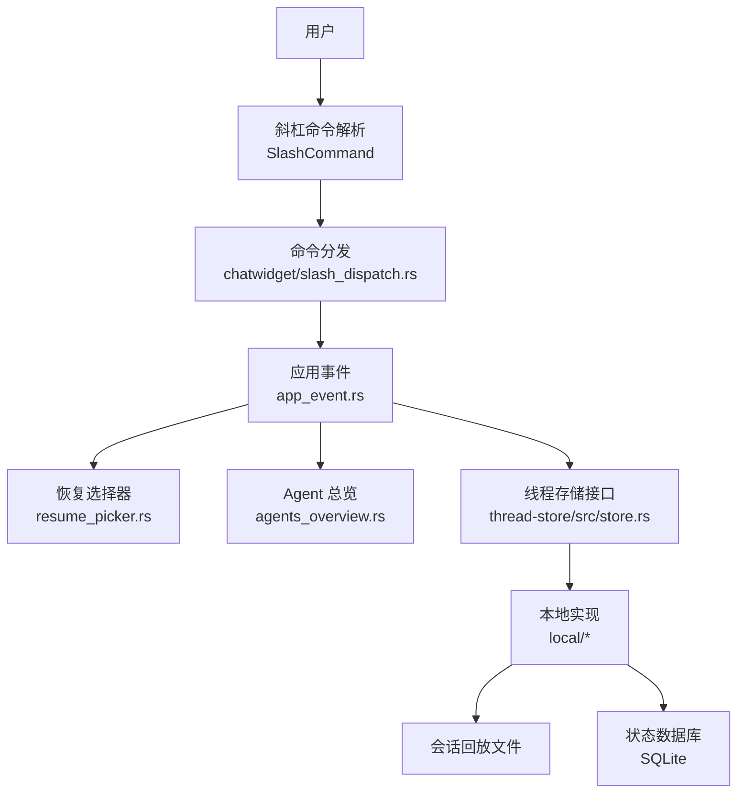
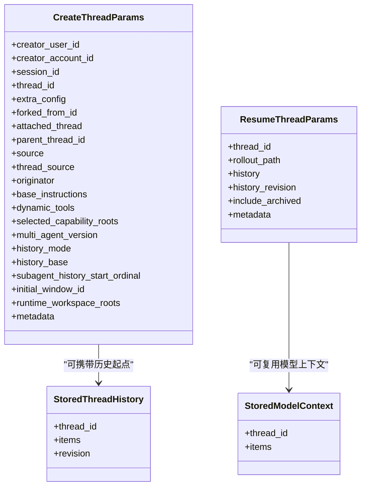
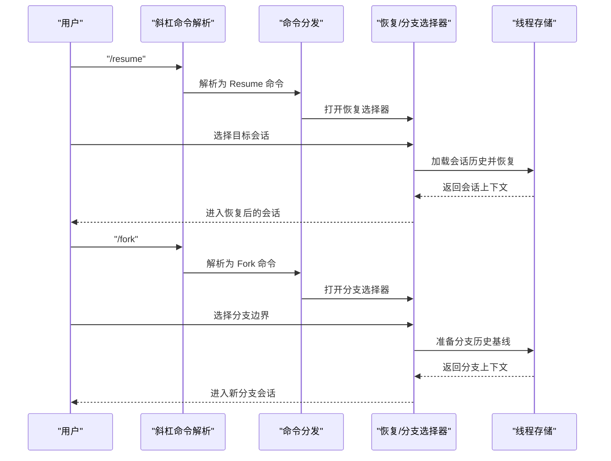
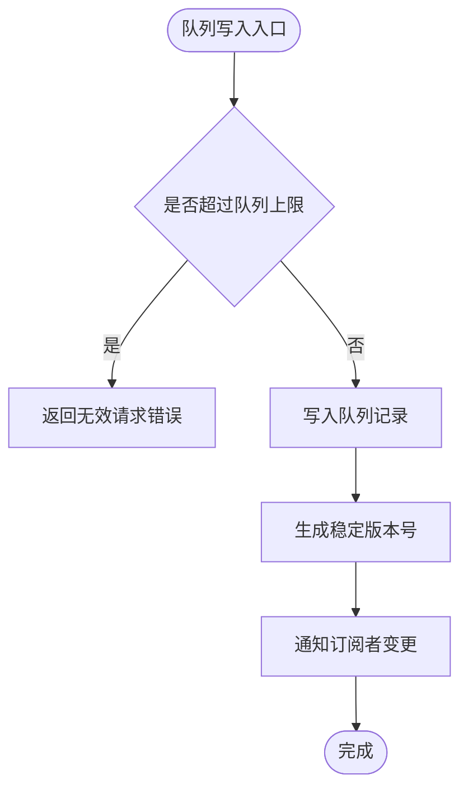
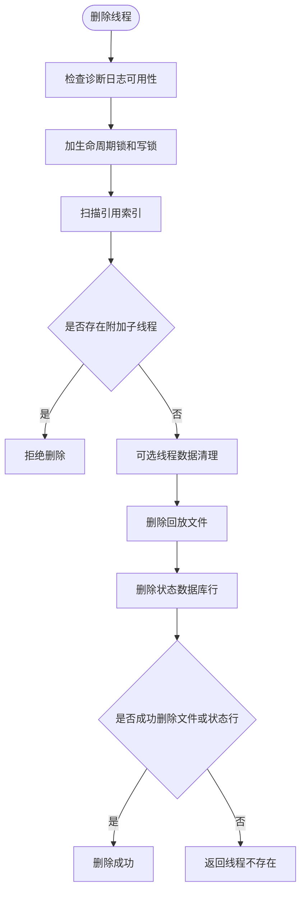
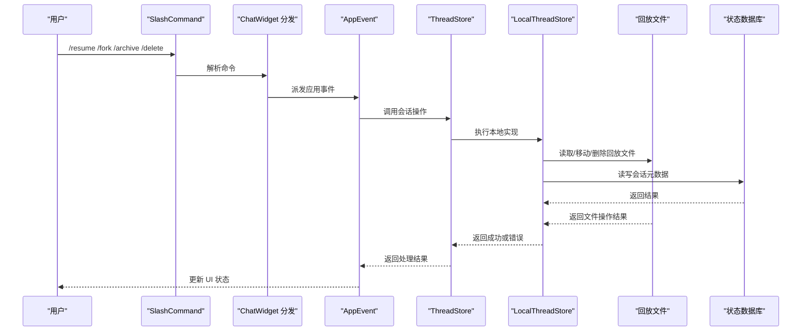
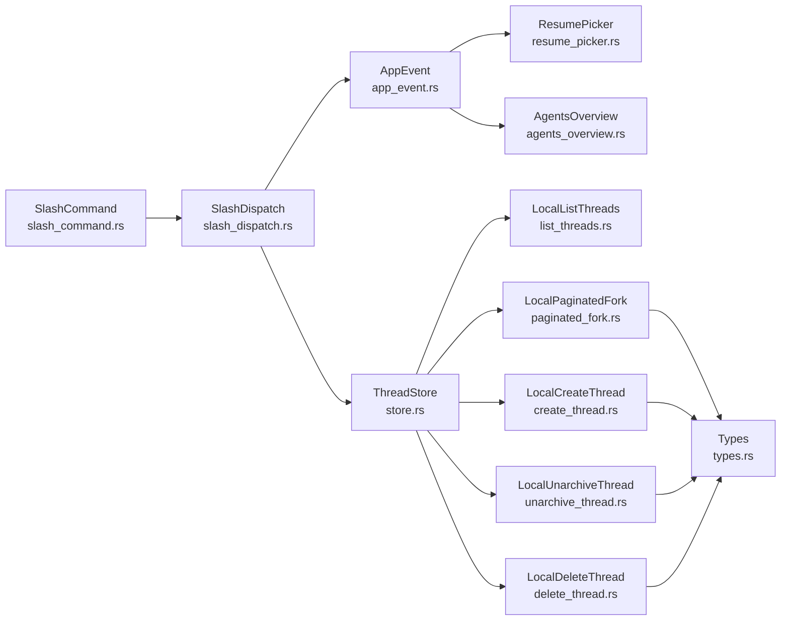

# 会话管理

<cite>
**本文引用的文件**   
- [slash_command.rs](file://codex-rs/tui/src/slash_command.rs)
- [slash_dispatch.rs](file://codex-rs/tui/src/chatwidget/slash_dispatch.rs)
- [resume_picker.rs](file://codex-rs/tui/src/resume_picker.rs)
- [agents_overview.rs](file://codex-rs/tui/src/app/agents_overview.rs)
- [agents_overview_actions.rs](file://codex-rs/tui/src/app/agents_overview_actions.rs)
- [app_event.rs](file://codex-rs/tui/src/app_event.rs)
- [types.rs](file://codex-rs/thread-store/src/types.rs)
- [store.rs](file://codex-rs/thread-store/src/store.rs)
- [list_threads.rs](file://codex-rs/thread-store/src/local/list_threads.rs)
- [create_thread.rs](file://codex-rs/thread-store/src/local/create_thread.rs)
- [paginated_fork.rs](file://codex-rs/thread-store/src/local/paginated_fork.rs)
- [unarchive_thread.rs](file://codex-rs/thread-store/src/local/unarchive_thread.rs)
- [delete_thread.rs](file://codex-rs/thread-store/src/local/delete_thread.rs)
- [queue_store.rs](file://codex-rs/thread-store/src/queue_store.rs)
</cite>

## 目录
1. [引言](#引言)
2. [项目结构中的会话相关位置](#项目结构中的会话相关位置)
3. [核心概念与生命周期](#核心概念与生命周期)
4. [命令总览：Agents、Resume、Fork、Queue、Archive、Unarchive、Delete](#命令总览agentsresumeforkqueuearchiveunarchivedelete)
5. [架构概览](#架构概览)
6. [详细组件分析](#详细组件分析)
7. [依赖关系分析](#依赖关系分析)
8. [性能与并发特性](#性能与并发特性)
9. [最佳实践](#最佳实践)
10. [故障排查](#故障排查)
11. [结论](#结论)

## 引言
本文面向 Codex 的“会话管理”能力，围绕 TUI 层的斜杠命令与线程存储层实现，系统说明以下主题：
- 如何创建、恢复、分支、归档、取消归档、删除会话。
- 如何使用 `Agents`、`Resume`、`Fork`、`Queue`、`Archive`、`Unarchive`、`Delete` 等命令。
- 会话数据结构、持久化路径、状态字段和队列存储机制。
- 生命周期管理的最佳实践和批量操作建议。

本说明尽量使用非技术语言解释流程，同时为开发者提供精确的文件级定位和调用关系图。

## 项目结构中的会话相关位置
会话管理横跨两个主要层次：
- **TUI 交互层**：负责用户输入解析、命令分发、选择器界面和事件派发。
- **线程存储层**：负责会话元数据、历史回放、归档目录、队列数据和一致性锁。

**图表来源**
- [slash_command.rs:1-120](file://codex-rs/tui/src/slash_command.rs#L1-L120)
- [slash_dispatch.rs:230-450](file://codex-rs/tui/src/chatwidget/slash_dispatch.rs#L230-L450)
- [resume_picker.rs](file://codex-rs/tui/src/resume_picker.rs)
- [agents_overview.rs](file://codex-rs/tui/src/app/agents_overview.rs)
- [store.rs](file://codex-rs/thread-store/src/store.rs)

**章节来源**
- [slash_command.rs:1-120](file://codex-rs/tui/src/slash_command.rs#L1-L120)
- [slash_dispatch.rs:230-450](file://codex-rs/tui/src/chatwidget/slash_dispatch.rs#L230-L450)

## 核心概念与生命周期
Codex 的“会话”以线程为核心单位，同时支持会话级别关联：
- `thread_id`：单个会话的唯一标识。
- `session_id`：根会话与其子代理共享的会话标识。
- `parent_thread_id`：父线程标识，用于子代理或侧会话归属。
- `forked_from_id`：分支来源线程标识。
- `attached_thread`：标记该线程是否被其他线程附加。
- `status`、`title`、`archived`：会话可见状态、标题和归档状态。
- `history_base`：分页历史继承起点，使分支能复用源会话历史片段。

关键参数类型定义在类型模块中：
- 创建会话参数包含模型、权限、工具、工作区、历史记录策略等上下文。
- 恢复会话参数指定已有线程、可选回放路径、已加载历史和是否允许归档会话。
- 追加历史项参数描述有序回放条目写入。
- 加载历史参数控制是否包含归档会话。

**图表来源**
- [types.rs:1-200](file://codex-rs/thread-store/src/types.rs#L1-L200)

**章节来源**
- [types.rs:1-200](file://codex-rs/thread-store/src/types.rs#L1-L200)

## 命令总览：Agents、Resume、Fork、Queue、Archive、Unarchive、Delete

### 命令入口与显示
所有以 `/` 开头的命令通过统一的枚举表示，并维护展示顺序和用户提示。与会话直接相关的命令包括：
- `/agents`：打开 Agent 命令中心。
- `/resume`：恢复已保存的聊天。
- `/fork`：分支当前聊天。
- `/archive`：归档当前会话。
- `/delete`：永久删除当前会话。
- `/new`：在对话中开启新会话。
- `/side`、`/btw`：启动侧会话。

这些命令由斜杠命令枚举提供名称、描述和是否支持内联参数的行为。

**章节来源**
- [slash_command.rs:1-120](file://codex-rs/tui/src/slash_command.rs#L1-L120)

### 命令分发行为
TUI 的命令分发层将用户输入转换为具体应用事件：
- `/archive`：弹出确认框；确认后发送归档当前线程事件。
- `/delete`：弹出确认框；确认后发送删除当前线程事件。
- `/resume`：打开恢复选择器。
- `/fork`：打开分支会话选择器。
- `/agents`：打开 Agent 总览。
- `/resume <id>`：根据 ID 或名称恢复特定会话。
- `/fork <name>`：按模式进行分支操作。

**图表来源**
- [slash_dispatch.rs:230-450](file://codex-rs/tui/src/chatwidget/slash_dispatch.rs#L230-L450)
- [paginated_fork.rs:1-200](file://codex-rs/thread-store/src/local/paginated_fork.rs#L1-L200)

**章节来源**
- [slash_dispatch.rs:230-450](file://codex-rs/tui/src/chatwidget/slash_dispatch.rs#L230-L450)

### Queue（队列）命令与行为
队列并非一个独立斜杠命令，而是会话内部的用户消息排队机制。队列支持：
- 变更版本监听。
- 自上次版本以来的变更通知。
- 向线程追加用户提交。
- 分页列出队列项。
- 更新或删除队列项。
- 原子重排队列顺序。

队列存储基于 SQLite 的 `SqliteQueueStore`，并通过本地适配层暴露给线程存储。当队列超过上限时，插入会返回无效请求错误；重排失败时会根据底层错误映射为用户不可用或内部错误。

**图表来源**
- [queue_store.rs:1-158](file://codex-rs/thread-store/src/queue_store.rs#L1-L158)

**章节来源**
- [queue_store.rs:1-158](file://codex-rs/thread-store/src/queue_store.rs#L1-L158)

### Archive（归档）与 Unarchive（取消归档）
归档会将会话从活跃目录移动到归档目录，取消归档则反向移动。取消归档流程包含：
- 对父线程及其子线程排序并去重后加生命周期锁。
- 获取写锁，扫描归档索引。
- 定位选中的归档回放路径。
- 计算目标日期目录并移动文件。
- 失败时尝试回滚已移动文件。
- 更新修改时间并标记未归档状态。
- 若状态数据库更新失败，仍尝试回滚文件系统变更。

注意：当前文档范围中未找到显式 `/archive` 或 `/unarchive` 的斜杠命令入口，但 TUI 存在归档确认弹窗和取消归档提示组件，表明归档/取消归档可通过 UI 流程触发，并由存储层执行实际持久化操作。

**章节来源**
- [slash_dispatch.rs:230-450](file://codex-rs/tui/src/chatwidget/slash_dispatch.rs#L230-L450)
- [unarchive_thread.rs:1-200](file://codex-rs/thread-store/src/local/unarchive_thread.rs#L1-L200)

### Delete（删除）
删除分为单线程删除和批量删除，核心约束包括：
- 不允许删除仍有附加子线程的会话。
- 先检查诊断日志可用性，再执行破坏性清理。
- 按线程 ID 排序并去重后加生命周期锁和写锁。
- 扫描引用索引，收集需要删除的回放文件。
- 可选地执行线程数据清理回调。
- 删除回放文件后删除状态数据库行。
- 若回放文件和状态行均未发现，返回“线程不存在”。

**图表来源**
- [delete_thread.rs:1-200](file://codex-rs/thread-store/src/local/delete_thread.rs#L1-L200)

**章节来源**
- [delete_thread.rs:1-200](file://codex-rs/thread-store/src/local/delete_thread.rs#L1-L200)

## 架构概览
会话管理的关键交互路径如下：

**图表来源**
- [slash_command.rs:1-120](file://codex-rs/tui/src/slash_command.rs#L1-L120)
- [slash_dispatch.rs:230-450](file://codex-rs/tui/src/chatwidget/slash_dispatch.rs#L230-L450)
- [store.rs](file://codex-rs/thread-store/src/store.rs)
- [types.rs:1-200](file://codex-rs/thread-store/src/types.rs#L1-L200)

## 详细组件分析

### 斜杠命令定义与展示
斜杠命令枚举集中定义命令名、序列化值、用户可见描述和内联参数支持规则。会话相关命令包括：
- `/resume`：描述为恢复已保存聊天，支持内联参数。
- `/fork`：描述为分支当前聊天，支持内联参数。
- `/archive`：描述为归档当前会话。
- `/delete`：描述为永久删除当前会话。
- `/agents`：描述为打开 Agent 命令中心。

**章节来源**
- [slash_command.rs:1-120](file://codex-rs/tui/src/slash_command.rs#L1-L120)

### 命令分发与 UI 行为
命令分发层负责把斜杠命令转为具体动作：
- 归档命令弹出确认视图，并根据当前任务运行状态给出不同提示。
- 删除命令明确说明会删除子代理和侧会话，且不可撤销。
- 恢复命令打开恢复选择器。
- 分支命令打开会话选择器。
- Agent 命令打开 Agent 总览。

**章节来源**
- [slash_dispatch.rs:230-450](file://codex-rs/tui/src/chatwidget/slash_dispatch.rs#L230-L450)

### 恢复选择器
恢复选择器负责：
- 列出可用会话。
- 搜索、排序和过滤。
- 分页加载。
- 预览会话内容。
- 根据后端或本地存储差异处理错误。

恢复流程最终会通过线程存储加载会话历史，并恢复模型上下文。

**章节来源**
- [resume_picker.rs](file://codex-rs/tui/src/resume_picker.rs)
- [types.rs:1-200](file://codex-rs/thread-store/src/types.rs#L1-L200)

### Agent 总览
Agent 总览通过应用事件打开，负责：
- 发现和管理 Agent 列表。
- 提供新建、切换、查看详情的入口。
- 与 Agent 中心视图协作渲染行、导航、输入和提示。

**章节来源**
- [slash_dispatch.rs:230-450](file://codex-rs/tui/src/chatwidget/slash_dispatch.rs#L230-L450)
- [agents_overview.rs](file://codex-rs/tui/src/app/agents_overview.rs)
- [agents_overview_actions.rs](file://codex-rs/tui/src/app/agents_overview_actions.rs)

### 线程存储接口与本地实现
线程存储接口统一了会话创建、恢复、历史加载、归档、分支、删除等操作。本地实现负责：
- 会话列表查询，支持活跃与归档集合。
- 会话创建参数封装。
- 分页分支准备和历史基线计算。
- 归档与取消归档的文件迁移。
- 删除前的附加子线程检查和引用检查。
- 状态数据库与回放文件的一致性维护。

**章节来源**
- [store.rs](file://codex-rs/thread-store/src/store.rs)
- [list_threads.rs](file://codex-rs/thread-store/src/local/list_threads.rs)
- [create_thread.rs](file://codex-rs/thread-store/src/local/create_thread.rs)
- [paginated_fork.rs:1-200](file://codex-rs/thread-store/src/local/paginated_fork.rs#L1-L200)
- [unarchive_thread.rs:1-200](file://codex-rs/thread-store/src/local/unarchive_thread.rs#L1-L200)
- [delete_thread.rs:1-200](file://codex-rs/thread-store/src/local/delete_thread.rs#L1-L200)

### 队列存储
队列存储抽象出有序、线程作用域的用户消息持久化。本地实现委托给状态数据库中的线程队列存储，并在上层错误中区分“超过最大队列项数”和一般内部错误。

**章节来源**
- [queue_store.rs:1-158](file://codex-rs/thread-store/src/queue_store.rs#L1-L158)

## 依赖关系分析

**图表来源**
- [slash_command.rs:1-120](file://codex-rs/tui/src/slash_command.rs#L1-L120)
- [slash_dispatch.rs:230-450](file://codex-rs/tui/src/chatwidget/slash_dispatch.rs#L230-L450)
- [store.rs](file://codex-rs/thread-store/src/store.rs)
- [list_threads.rs](file://codex-rs/thread-store/src/local/list_threads.rs)
- [create_thread.rs](file://codex-rs/thread-store/src/local/create_thread.rs)
- [paginated_fork.rs:1-200](file://codex-rs/thread-store/src/local/paginated_fork.rs#L1-L200)
- [unarchive_thread.rs:1-200](file://codex-rs/thread-store/src/local/unarchive_thread.rs#L1-L200)
- [delete_thread.rs:1-200](file://codex-rs/thread-store/src/local/delete_thread.rs#L1-L200)
- [types.rs:1-200](file://codex-rs/thread-store/src/types.rs#L1-L200)

**章节来源**
- [slash_command.rs:1-120](file://codex-rs/tui/src/slash_command.rs#L1-L120)
- [slash_dispatch.rs:230-450](file://codex-rs/tui/src/chatwidget/slash_dispatch.rs#L230-L450)
- [store.rs](file://codex-rs/thread-store/src/store.rs)

## 性能与并发特性
- **锁定顺序**：归档、取消归档和删除均对线程 ID 排序并去重，避免死锁。
- **生命周期锁与写锁分离**：分支准备阶段先保留生命周期锁，随后在持久化和血缘解析完成后继续持有，防止源会话被并发修改。
- **分页历史材料化**：分支准备会为祖先分段执行历史材料化，减少在线回放成本。
- **删除前置校验**：删除前检查诊断日志可用性、附加子线程和外部引用，降低误删风险。
- **队列变更版本**：队列通过变更版本号和变化通知机制减少轮询开销。

[本节为通用性能讨论，不直接分析具体代码行]

## 最佳实践
- **创建会话**：
  - 明确 `session_id` 与 `thread_id` 的职责：前者表示会话组，后者表示具体线程。
  - 设置合适的 `history_mode`、`base_instructions`、`dynamic_tools` 和 `selected_capability_roots`，避免后续频繁调整。
  - 如需复用历史片段，设置 `history_base`，以便分支高效继承。
- **恢复会话**：
  - 优先使用恢复选择器；必要时通过 `/resume <id>` 指定目标。
  - 如果会话可能位于归档目录，确保恢复参数允许包含归档会话。
- **分支会话**：
  - 使用 `/fork` 打开分支选择器，选择合适的分支边界。
  - 对于大型历史，等待历史材料化完成后再继续交互。
- **队列管理**：
  - 避免一次性提交过多用户消息，防止超过最大队列项数。
  - 使用重排接口保持队列顺序一致，避免部分更新导致顺序不一致。
- **归档与取消归档**：
  - 归档适合长期保留但不活跃使用的会话。
  - 取消归档会恢复文件并更新状态数据库；如失败应检查文件系统权限和状态数据库连接。
- **删除会话**：
  - 删除前确认没有附加子线程。
  - 批量删除时应分批执行，避免长时间持有锁。
  - 删除后检查状态数据库和回放文件是否一致。

[本节为通用指导，不直接分析具体代码行]

## 故障排查
- **无法删除会话**：
  - 检查是否存在附加子线程。
  - 检查诊断日志是否可用。
  - 检查是否有外部引用指向该线程或其回放文件。
- **分支失败**：
  - 检查是否缺少状态数据库。
  - 检查分支边界是否超出源历史范围。
  - 检查是否选择了正在进行的回合作为分支边界。
- **恢复失败**：
  - 检查恢复选择器的分页和搜索结果。
  - 检查会话是否存在于活跃或归档集合。
  - 检查历史回放文件的完整性。
- **队列写入失败**：
  - 检查是否超过最大队列项数。
  - 检查状态数据库中的线程队列是否可写。
  - 检查重排请求是否为完整排列。

**章节来源**
- [delete_thread.rs:1-200](file://codex-rs/thread-store/src/local/delete_thread.rs#L1-L200)
- [paginated_fork.rs:1-200](file://codex-rs/thread-store/src/local/paginated_fork.rs#L1-L200)
- [unarchive_thread.rs:1-200](file://codex-rs/thread-store/src/local/unarchive_thread.rs#L1-L200)
- [queue_store.rs:1-158](file://codex-rs/thread-store/src/queue_store.rs#L1-L158)

## 结论
Codex 的会话管理以线程为中心，结合会话标识、父子关系、分支历史和队列机制，形成完整的生命周期管理能力。TUI 层通过斜杠命令和选择器提供直观入口，线程存储层负责持久化、归档、分支和删除的一致性保证。在实际使用中，建议遵循创建、恢复、分支、队列、归档、取消归档、删除的最佳实践，并注意并发锁、历史材料化和状态数据库同步带来的性能和可靠性影响。