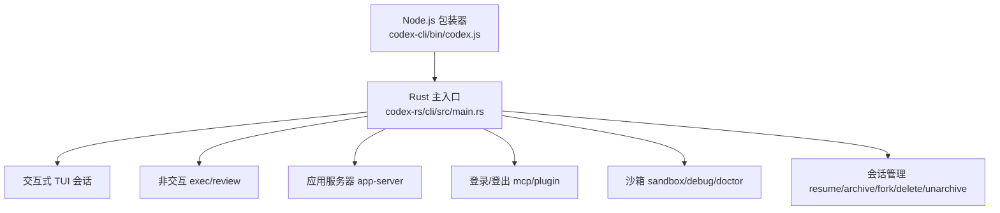
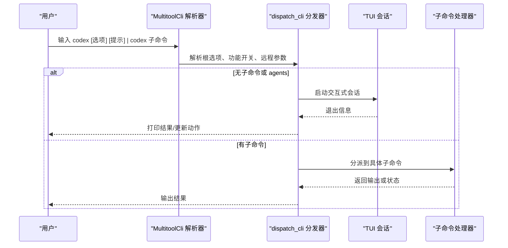
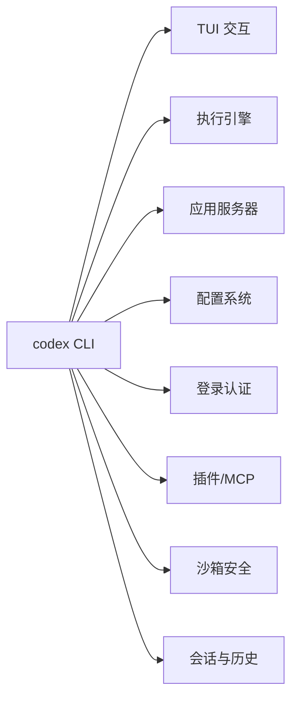
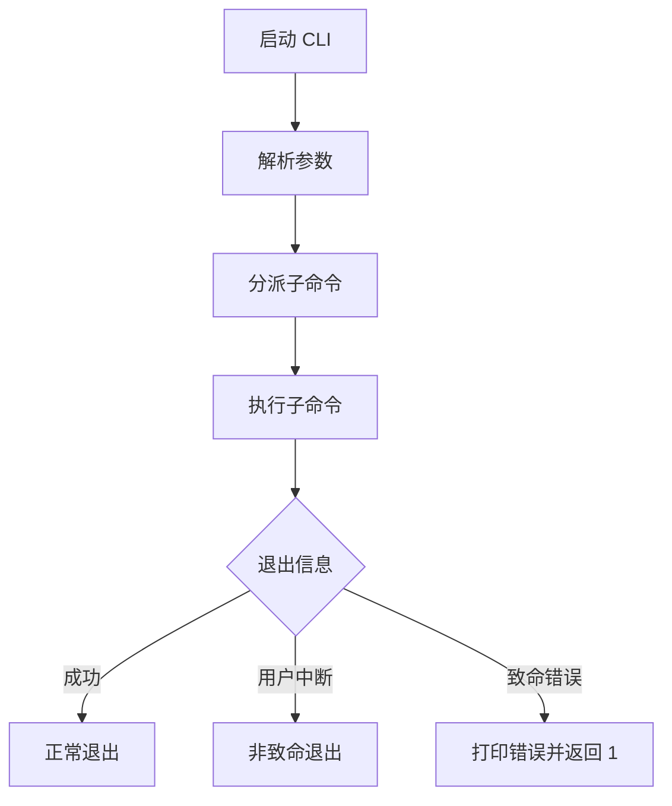

# 命令行参考

<cite>
**本文引用的文件**
- [codex-rs/cli/src/main.rs](file://codex-rs/cli/src/main.rs)
- [codex-rs/cli/Cargo.toml](file://codex-rs/cli/Cargo.toml)
- [codex-cli/package.json](file://codex-cli/package.json)
</cite>

## 目录
1. [简介](#简介)
2. [项目结构](#项目结构)
3. [核心命令总览](#核心命令总览)
4. [架构与入口流程](#架构与入口流程)
5. [详细命令参考](#详细命令参考)
6. [依赖关系分析](#依赖关系分析)
7. [性能与执行特性](#性能与执行特性)
8. [错误处理与返回码](#错误处理与返回码)
9. [常用组合与脚本化实践](#常用组合与脚本化实践)
10. [Tab 补全与命令历史](#tab-补全与命令历史)
11. [故障排除指南](#故障排除指南)
12. [结论](#结论)

## 简介
本参考文档面向 `codex` 命令行工具，覆盖主命令、子命令、参数、选项、标志、交互模式、非交互执行模式、代码审查模式等用法。它基于仓库中的 Rust CLI 实现和 Node.js 包装器进行分析，帮助你：
- 快速掌握 `codex` 的完整命令树。
- 在交互式会话、后台服务、沙箱、远程连接、插件管理、应用服务器管理等场景中正确使用参数。
- 编写可复用的脚本，理解输出格式、退出行为与常见错误。
- 使用 Tab 补全与命令历史提升效率。

## 项目结构
`codex` 的命令行入口由两部分组成：
- Node.js 包装器：`codex-cli/bin/codex.js`，通过 `package.json` 暴露 `codex` 可执行名。
- Rust 主程序：`codex-rs/cli/src/main.rs`，使用 clap 定义所有子命令并分派到具体模块。

**图表来源**
- [codex-cli/package.json:1-22](file://codex-cli/package.json#L1-L22)
- [codex-rs/cli/Cargo.toml:1-20](file://codex-rs/cli/Cargo.toml#L1-L20)
- [codex-rs/cli/src/main.rs:120-250](file://codex-rs/cli/src/main.rs#L120-L250)

**章节来源**
- [codex-cli/package.json:1-22](file://codex-cli/package.json#L1-L22)
- [codex-rs/cli/Cargo.toml:1-20](file://codex-rs/cli/Cargo.toml#L1-L20)
- [codex-rs/cli/src/main.rs:120-250](file://codex-rs/cli/src/main.rs#L120-L250)

## 核心命令总览
主命令为 `codex`。未指定子命令时，默认进入交互式终端界面；也可传入一个初始提示作为可选位置参数。

### 全局可用选项（根级别）
这些选项通常可通过根命令或支持继承的配置覆盖方式传入：
- `-c key=value`：配置键值覆盖。
- `--enable FEATURE`：启用某个功能开关。
- `--disable FEATURE`：禁用某个功能开关。
- `--profile NAME`：加载 v2 profile 配置文件（仅部分运行时命令支持）。
- `--strict-config`：遇到未知配置字段时报错（部分子命令不支持）。
- `--remote ADDR`：连接到远程应用服务器。
- `--remote-auth-token-env ENV_VAR`：从环境变量读取远程认证令牌。
- `--no-alt-screen`：禁用备用屏幕模式。
- `--no-daemon`：不使用后台守护进程（部分场景与远程连接冲突）。
- `--model MODEL`：选择模型。
- `--cwd DIR`：设置工作目录。
- `--add-dir PATH`：添加额外可写目录。
- `--image FILE`：附加图片。
- `--prompt TEXT`：提供初始文本提示。
- `--approval-policy POLICY`：审批策略。
- `--sandbox-mode MODE`：沙箱模式。
- `--web-search`：启用实时搜索相关行为。
- `--bypass-hook-trust`：绕过钩子信任。
- `--oss`：开发者/开源相关调试选项。

注意：不同子命令对以上选项的支持范围不同，某些子命令会拒绝远程模式、严格配置模式或工作树模式。

### 主要子命令一览
- `agents`：打开代理中心，浏览并切换会话。
- `exec`：非交互式执行任务。
- `review`：非交互式代码审查。
- `login` / `logout`：登录与登出管理。
- `mcp`：管理外部 MCP 服务器。
- `plugin`：管理 Codex 插件。
- `app-server`：实验性应用服务器及守护进程管理。
- `remote-control`：远程控制本地应用服务器。
- `completion`：生成 Shell 补全脚本。
- `update`：更新 Codex。
- `doctor`：诊断安装、配置、认证与运行环境。
- `sandbox`：在 Codex 提供的沙箱中运行命令。
- `debug`：调试工具集。
- `apply`：将 Agent 生成的最新差异应用到本地工作区。
- `resume`：恢复之前的交互式会话。
- `queue`：向已有会话排队消息。
- `archive` / `unarchive`：归档/解档保存的会话。
- `delete`：删除保存的会话。
- `fork`：分支上一个交互式会话。
- `cloud` / `cloud-tasks`：浏览 Cloud 任务并应用变更。
- `features`：查看、启用、禁用功能标志。
- 内部隐藏命令：`tcp-tunnel`、`responses-api-proxy`、`stdio-to-uds`、`exec-server`、`execpolicy check` 等。

**章节来源**
- [codex-rs/cli/src/main.rs:120-250](file://codex-rs/cli/src/main.rs#L120-L250)
- [codex-rs/cli/src/main.rs:250-450](file://codex-rs/cli/src/main.rs#L250-L450)

## 架构与入口流程
CLI 启动后，先解析根级参数、功能开关、远程选项和 TUI 参数，再根据是否指定子命令进行分发。无子命令时启动交互式 TUI；有子命令时调用对应处理器。

**图表来源**
- [codex-rs/cli/src/main.rs:120-250](file://codex-rs/cli/src/main.rs#L120-L250)
- [codex-rs/cli/src/main.rs:1200-1400](file://codex-rs/cli/src/main.rs#L1200-L1400)
- [codex-rs/cli/src/main.rs:1600-1750](file://codex-rs/cli/src/main.rs#L1600-L1750)

**章节来源**
- [codex-rs/cli/src/main.rs:120-250](file://codex-rs/cli/src/main.rs#L120-L250)
- [codex-rs/cli/src/main.rs:1200-1400](file://codex-rs/cli/src/main.rs#L1200-L1400)

## 详细命令参考

### 主命令：`codex`
语法：
- `codex [选项] [提示]`
- `codex [选项] <子命令> [子命令参数]`

说明：
- 未指定子命令时，默认进入交互式终端界面。
- `[提示]` 是可选位置参数，用于给交互式会话提供初始文本。
- 可使用全局选项控制配置、模型、工作目录、远程连接、审批策略、沙箱模式等。

示例：
- `codex`：启动交互式会话。
- `codex 帮我重构当前项目的日志模块`：启动交互式会话并附带初始提示。
- `codex --model gpt-5 --cwd . --add-dir ./logs 完成这个任务`：带配置覆盖的交互式会话。

**章节来源**
- [codex-rs/cli/src/main.rs:120-200](file://codex-rs/cli/src/main.rs#L120-L200)
- [codex-rs/cli/src/main.rs:250-450](file://codex-rs/cli/src/main.rs#L250-L450)

### 子命令：`agents`
用途：打开代理中心，浏览并切换会话。

常用选项：
- `--no-daemon`：使用嵌入式应用服务器启动代理概览。
- `--remote ADDR`：连接到远程应用服务器。
- `--cd DIR` / `-C DIR`：为新任务设置工作目录。
- `--no-alt-screen`：禁用备用屏幕模式。

限制：
- 不接受初始提示或图片。
- 不能将本地 provider 或额外目录覆盖应用到远程服务器。

示例：
- `codex agents`：打开代理中心。
- `codex agents --cd /project --no-alt-screen`：以指定目录启动代理中心。

**章节来源**
- [codex-rs/cli/src/main.rs:250-350](file://codex-rs/cli/src/main.rs#L250-L350)
- [codex-rs/cli/src/main.rs:1200-1350](file://codex-rs/cli/src/main.rs#L1200-L1350)

### 子命令：`exec`
用途：非交互式执行任务，支持多种任务类型。

重要点：
- 继承交互式会话的 exec-root 选项。
- 支持 `--strict-config` 继承。
- 会将根级配置覆盖前缀注入到 exec 配置中。
- 不允许与远程模式混用。

常见任务类型（由 `ExecCommand` 定义，见 Cargo 依赖）：
- 普通执行任务。
- `resume`：恢复会话（注意 `--worktree` 的限制）。
- `fork`：分支会话。
- `review`：代码审查。

示例：
- `codex exec fork --session-id UUID`：分支指定会话。
- `codex exec review --strict-config --trust`：非交互式代码审查。

**章节来源**
- [codex-rs/cli/Cargo.toml:20-60](file://codex-rs/cli/Cargo.toml#L20-L60)
- [codex-rs/cli/src/main.rs:1200-1350](file://codex-rs/cli/src/main.rs#L1200-L1350)
- [codex-rs/cli/src/main.rs:2200-2400](file://codex-rs/cli/src/main.rs#L2200-L2400)

### 子命令：`review`
用途：非交互式代码审查。

选项：
- `--strict-config`：遇到未知配置字段时报错。
- `--trust`：保存对该项目及未来对话的信任，包括沙箱外的 MCP 命令；即使使用临时模式也会持久化。

行为：
- 内部转换为 `codex exec review`。
- 不允许远程模式。

示例：
- `codex review --strict-config --trust`

**章节来源**
- [codex-rs/cli/src/main.rs:350-420](file://codex-rs/cli/src/main.rs#L350-L420)
- [codex-rs/cli/src/main.rs:1200-1350](file://codex-rs/cli/src/main.rs#L1200-L1350)

### 子命令：`login` / `logout`
用途：管理登录凭证。

`login` 选项：
- `--with-api-key`：从标准输入读取 API Key。
- `--with-access-token`：从标准输入读取访问令牌。
- `--device-auth`：使用设备码认证。
- `--experimental_issuer URL`：自定义 OAuth 签发者基础地址。
- `--experimental_client-id CLIENT_ID`：自定义 OAuth 客户端 ID。
- `status`：显示登录状态。

`logout`：移除存储的认证凭据。

示例：
- `echo "$OPENAI_API_KEY" | codex login --with-api-key`
- `codex login status`
- `codex logout`

**章节来源**
- [codex-rs/cli/src/main.rs:520-620](file://codex-rs/cli/src/main.rs#L520-L620)

### 子命令：`mcp`
用途：管理外部 MCP 服务器。

行为：
- 不允许远程模式。
- 支持根级配置覆盖。
- 包含 add/list/marketplace/remove 等子操作（由 `PluginCli` 与 `McpCli` 驱动）。

示例：
- `codex mcp list`
- `codex mcp add ...`

**章节来源**
- [codex-rs/cli/src/main.rs:1200-1350](file://codex-rs/cli/src/main.rs#L1200-L1350)

### 子命令：`plugin`
用途：管理 Codex 插件。

子操作：
- `add`：添加插件。
- `list`：列出插件。
- `marketplace`：市场管理。
- `remove`：移除插件。

限制：
- 不允许远程模式。
- 支持根级配置覆盖。

示例：
- `codex plugin list`
- `codex plugin marketplace search codex`

**章节来源**
- [codex-rs/cli/src/main.rs:1200-1350](file://codex-rs/cli/src/main.rs#L1200-L1350)

### 子命令：`app-server`
用途：实验性运行应用服务器及相关工具。

顶层选项：
- `--listen URL`：传输端点，支持 `stdio://`、`unix://`、`unix://PATH`、`ws://IP:PORT`、`off`。
- `--stdio`：等价于 `--listen stdio://`。
- `--analytics-default-enabled`：首次方使用时默认启用分析。
- `--auth`：WebSocket 认证参数。
- `--strict-config`：对应用服务器主进程有效。
- `--remote-control`：为当前进程启用远程控制。
- `--managed-daemon`：在受管守护进程关闭期间保存已加载线程。

子命令：
- `daemon bootstrap`：为 SSH 驱动的用法安装本地应用服务器管理。
- `daemon start`：启动本地守护进程。
- `daemon restart`：重启守护进程。
- `daemon update`：更新守护进程包。
- `daemon enable-remote-control` / `disable-remote-control`：启用/禁用远程控制。
- `daemon stop`：停止守护进程。
- `daemon version`：输出 CLI 与运行中的应用服务器版本 JSON。
- `proxy`：将 stdio 字节转发到运行的应用服务器控制套接字。
- `generate-ts`：生成 TypeScript 绑定。
- `generate-json-schema`：生成 JSON Schema。
- `generate-internal-json-schema`：生成内部 JSON Schema 工件。

示例：
- `codex app-server daemon start`
- `codex app-server daemon version`
- `codex app-server generate-ts -o ./ts-bindings`

**章节来源**
- [codex-rs/cli/src/main.rs:620-900](file://codex-rs/cli/src/main.rs#L620-L900)
- [codex-rs/cli/src/main.rs:1200-1646](file://codex-rs/cli/src/main.rs#L1200-L1646)

### 子命令：`remote-control`
用途：远程控制本地应用服务器。

限制：
- 不允许远程模式。
- 与 `--no-daemon` 结合时会调整行为。

示例：
- `codex remote-control ...`

**章节来源**
- [codex-rs/cli/src/main.rs:1646-1750](file://codex-rs/cli/src/main.rs#L1646-L1750)

### 子命令：`completion`
用途：生成 Shell 补全脚本。

选项：
- `shell`：目标 Shell，默认为 Bash。

示例：
- `codex completion bash > ~/.bash_codex_completion`
- `codex completion zsh >> ~/.zshrc`

**章节来源**
- [codex-rs/cli/src/main.rs:220-260](file://codex-rs/cli/src/main.rs#L220-L260)
- [codex-rs/cli/src/main.rs:2600-2689](file://codex-rs/cli/src/main.rs#L2600-L2689)

### 子命令：`update`
用途：更新到最新版本。

限制：
- 调试构建不可用。
- 需要检测到安装方式；否则需手动更新。

示例：
- `codex update`

**章节来源**
- [codex-rs/cli/src/main.rs:1000-1200](file://codex-rs/cli/src/main.rs#L1000-L1200)

### 子命令：`doctor`
用途：诊断本地安装、配置、认证和运行时健康。

示例：
- `codex doctor`

**章节来源**
- [codex-rs/cli/src/main.rs:120-200](file://codex-rs/cli/src/main.rs#L120-L200)

### 子命令：`sandbox`
用途：在 Codex 提供的沙箱中运行命令。

平台：
- macOS：Seatbelt。
- Linux：Landlock。
- Windows：Windows Sandbox。

子命令：
- `uninstall`：卸载沙箱相关组件。

限制：
- 不允许远程模式。

示例：
- `codex sandbox ls -la`
- `codex sandbox uninstall`

**章节来源**
- [codex-rs/cli/src/main.rs:450-520](file://codex-rs/cli/src/main.rs#L450-L520)
- [codex-rs/cli/src/main.rs:1750-1850](file://codex-rs/cli/src/main.rs#L1750-L1850)

### 子命令：`debug`
用途：调试工具集。

子命令：
- `models`：渲染模型目录 JSON。
- `app-server send-message-v2 USER_MESSAGE`：向应用服务器 V2 发送消息。
- `prompt-input [PROMPT] [--image FILE...]`：渲染模型可见提示输入列表 JSON。
- `trace-reduce TRACE_BUNDLE [--output FILE]`：重放 rollout trace bundle 并写入减少状态 JSON。
- `clear-memories`：重置本地记忆状态。

限制：
- 不允许远程模式。

示例：
- `codex debug models --bundled`
- `codex debug prompt-input "测试" --image a.png,b.png`
- `codex debug trace-reduce ./trace-bundle -o ./state.json`

**章节来源**
- [codex-rs/cli/src/main.rs:260-350](file://codex-rs/cli/src/main.rs#L260-L350)
- [codex-rs/cli/src/main.rs:1850-2000](file://codex-rs/cli/src/main.rs#L1850-L2000)

### 子命令：`apply`
用途：将 Agent 生成的最新差异以 `git apply` 形式应用到本地工作区。

限制：
- 不允许远程模式。
- 支持根级配置覆盖。

示例：
- `codex apply`

**章节来源**
- [codex-rs/cli/src/main.rs:200-220](file://codex-rs/cli/src/main.rs#L200-L220)
- [codex-rs/cli/src/main.rs:2000-2100](file://codex-rs/cli/src/main.rs#L2000-L2100)

### 子命令：`resume`
用途：恢复之前的交互式会话，默认显示选择器；可使用 `--last` 继续最近会话。

选项：
- `SESSION_ID`：会话 UUID 或名称。
- `--last`：直接继续最近会话。
- `--all`：显示所有会话。
- `--include-non-interactive`：包含非交互会话。
- `--remote ADDR`：远程连接。
- `--remote-auth-token-env ENV_VAR`：远程认证环境变量。

行为：
- 合并子命令级选项与根级配置覆盖。
- 最终启动交互式 TUI。

示例：
- `codex resume --last`
- `codex resume SESSION_UUID`
- `codex resume --all --include-non-interactive`

**章节来源**
- [codex-rs/cli/src/main.rs:350-420](file://codex-rs/cli/src/main.rs#L350-L420)
- [codex-rs/cli/src/main.rs:1600-1700](file://codex-rs/cli/src/main.rs#L1600-L1700)
- [codex-rs/cli/src/main.rs:2689-2750](file://codex-rs/cli/src/main.rs#L2689-L2750)

### 子命令：`queue`
用途：向已有会话排队消息。

行为：
- 支持远程连接。
- 支持根级配置覆盖。

示例：
- `codex queue SESSION_ID "追加一条消息"`

**章节来源**
- [codex-rs/cli/src/main.rs:200-220](file://codex-rs/cli/src/main.rs#L200-L220)
- [codex-rs/cli/src/main.rs:1600-1700](file://codex-rs/cli/src/main.rs#L1600-L1700)

### 子命令：`archive` / `unarchive`
用途：归档/解档保存的会话。

选项：
- `SESSION`：会话 UUID 或名称。
- `--remote ADDR`：远程连接。
- `--remote-auth-token-env ENV_VAR`：远程认证环境变量。
- `--strict-config`：严格配置模式。

示例：
- `codex archive SESSION_UUID`
- `codex unarchive SESSION_NAME`

**章节来源**
- [codex-rs/cli/src/main.rs:200-220](file://codex-rs/cli/src/main.rs#L200-L220)
- [codex-rs/cli/src/main.rs:420-520](file://codex-rs/cli/src/main.rs#L420-L520)
- [codex-rs/cli/src/main.rs:1600-1700](file://codex-rs/cli/src/main.rs#L1600-L1700)

### 子命令：`delete`
用途：永久删除保存的会话。

选项：
- `SESSION`：会话 UUID 或名称。
- `--force`：不提示删除，但要求 SESSION 为 UUID。
- `--remote ADDR`：远程连接。
- `--remote-auth-token-env ENV_VAR`：远程认证环境变量。

示例：
- `codex delete SESSION_UUID --force`

**章节来源**
- [codex-rs/cli/src/main.rs:520-560](file://codex-rs/cli/src/main.rs#L520-L560)
- [codex-rs/cli/src/main.rs:1600-1700](file://codex-rs/cli/src/main.rs#L1600-L1700)

### 子命令：`fork`
用途：分支上一个交互式会话。

选项：
- `SESSION_ID`：会话 UUID。
- `--last`：分支最近会话。
- `--all`：显示所有会话。
- `--remote ADDR`：远程连接。
- `--remote-auth-token-env ENV_VAR`：远程认证环境变量。

行为：
- 合并子命令级选项与根级配置覆盖。
- 最终启动交互式 TUI。

示例：
- `codex fork --last`
- `codex fork SESSION_UUID`

**章节来源**
- [codex-rs/cli/src/main.rs:560-620](file://codex-rs/cli/src/main.rs#L560-L620)
- [codex-rs/cli/src/main.rs:1600-1700](file://codex-rs/cli/src/main.rs#L1600-L1700)
- [codex-rs/cli/src/main.rs:2750-2800](file://codex-rs/cli/src/main.rs#L2750-L2800)

### 子命令：`cloud` / `cloud-tasks`
用途：浏览 Codex Cloud 任务并应用变更。

限制：
- 不允许远程模式。

示例：
- `codex cloud tasks list`
- `codex cloud-tasks apply TASK_ID`

**章节来源**
- [codex-rs/cli/src/main.rs:200-220](file://codex-rs/cli/src/main.rs#L200-L220)
- [codex-rs/cli/src/main.rs:1200-1350](file://codex-rs/cli/src/main.rs#L1200-L1350)

### 子命令：`features`
用途：查看、启用、禁用功能标志。

子命令：
- `list`：列出已知功能及其阶段和生效状态。
- `enable FEATURE`：在配置中启用功能。
- `disable FEATURE`：在配置中禁用功能。

限制：
- 不允许远程模式。

示例：
- `codex features list`
- `codex features enable unified_exec`
- `codex features disable web_search`

**章节来源**
- [codex-rs/cli/src/main.rs:1000-1100](file://codex-rs/cli/src/main.rs#L1000-L1100)
- [codex-rs/cli/src/main.rs:2100-2200](file://codex-rs/cli/src/main.rs#L2100-L2200)

### 内部隐藏命令
- `tcp-tunnel`：通过 HTTP/3 CONNECT 代理转发本地 TCP 套接字。
- `responses-api-proxy`：响应式 API 代理。
- `stdio-to-uds SO_PATH`：将 stdio 中继到 Unix 域套接字。
- `exec-server`：独立 exec-server 服务。
- `execpolicy check`：检查 execpolicy 文件。

这些命令通常不对外公开，主要用于开发、测试或集成。

**章节来源**
- [codex-rs/cli/src/main.rs:200-220](file://codex-rs/cli/src/main.rs#L200-L220)
- [codex-rs/cli/src/main.rs:1200-1400](file://codex-rs/cli/src/main.rs#L1200-L1400)

## 依赖关系分析
CLI 依赖大量内部模块，主要包括：
- TUI 交互层：`codex-tui`。
- 执行引擎：`codex-exec`。
- 应用服务器：`codex-app-server`、`codex-app-server-daemon`。
- 配置系统：`codex-config`、`codex-core`。
- 登录与认证：`codex-login`、`codex-websocket-auth`。
- 插件与 MCP：`codex-plugin`、`codex-mcp`。
- 沙箱与安全：`codex-sandboxing`、`codex-linux-sandbox`、`codex-windows-sandbox`。
- 历史与会话：`codex-history`、`codex-state`、`codex-thread-store`。
- 网络与协议：`codex-http-client`、`codex-protocol`、`codex-codex-backend-openapi-models`。

**图表来源**
- [codex-rs/cli/Cargo.toml:20-120](file://codex-rs/cli/Cargo.toml#L20-L120)

**章节来源**
- [codex-rs/cli/Cargo.toml:20-120](file://codex-rs/cli/Cargo.toml#L20-L120)

## 性能与执行特性
- 在 musl Linux x86_64/aarch64 上使用 jemalloc 分配器，提高内存性能。
- 交互式 TUI 的未来对象大小受到测试约束，避免栈帧过大影响调度。
- 更新机制在非调试构建中可用，并通过 PATH 解析确保跨平台稳定性。
- 应用服务器守护进程更新可能中断正在运行的工作，应谨慎使用。

**章节来源**
- [codex-rs/cli/Cargo.toml:100-120](file://codex-rs/cli/Cargo.toml#L100-L120)
- [codex-rs/cli/src/main.rs:2600-2689](file://codex-rs/cli/src/main.rs#L2600-L2689)
- [codex-rs/cli/src/main.rs:1000-1200](file://codex-rs/cli/src/main.rs#L1000-L1200)

## 错误处理与返回码
- 致命错误会通过 `AppExitInfo::fatal` 返回，CLI 打印错误并退出码 1。
- 用户请求退出或轮次中断不会视为致命错误。
- 远程认证配置错误会被识别为用法错误并提前终止。
- 数据库损坏或锁定会尝试自动备份并给出诊断指导；若不可恢复则终止。
- `codex update` 在调试构建中直接失败，并提示使用发布构建。
- 应用服务器强制退出时，CLI 返回 0，因为运行时清理可能等待阻塞 I/O。

**图表来源**
- [codex-rs/cli/src/main.rs:800-900](file://codex-rs/cli/src/main.rs#L800-L900)
- [codex-rs/cli/src/main.rs:2400-2600](file://codex-rs/cli/src/main.rs#L2400-L2600)

**章节来源**
- [codex-rs/cli/src/main.rs:800-900](file://codex-rs/cli/src/main.rs#L800-L900)
- [codex-rs/cli/src/main.rs:2400-2600](file://codex-rs/cli/src/main.rs#L2400-L2600)

## 常用组合与脚本化实践
- 非交互任务：
  - `codex exec fork --session-id UUID`
  - `codex exec review --strict-config --trust`
- 会话管理：
  - `codex resume --last`
  - `codex archive SESSION_UUID`
  - `codex delete SESSION_UUID --force`
  - `codex fork --last`
- 远程连接：
  - `codex --remote wss://host:port --remote-auth-token-env CODEX_ACCESS_TOKEN`
- 应用服务器：
  - `codex app-server daemon start`
  - `codex app-server daemon version`
- 功能开关：
  - `codex features list`
  - `codex features enable unified_exec`
- 调试：
  - `codex debug models --bundled`
  - `codex debug prompt-input "测试" --image a.png,b.png`

最佳实践：
- 在脚本中优先使用明确的位置参数和长选项，避免依赖顺序。
- 对敏感凭据使用环境变量并通过 `--with-api-key` 或 `--remote-auth-token-env` 传递。
- 对自动化任务使用 `--strict-config` 以便尽早发现配置问题。
- 对 CI/CD 环境使用 `--no-alt-screen` 和无终端交互模式。

**章节来源**
- [codex-rs/cli/src/main.rs:1200-1400](file://codex-rs/cli/src/main.rs#L1200-L1400)
- [codex-rs/cli/src/main.rs:1600-1750](file://codex-rs/cli/src/main.rs#L1600-L1750)
- [codex-rs/cli/src/main.rs:2100-2200](file://codex-rs/cli/src/main.rs#L2100-L2200)

## Tab 补全与命令历史
- 使用 `codex completion` 生成 Shell 补全脚本。
- 支持的 shell 类型由 clap_complete 提供，默认为 Bash。
- 将生成的补全脚本添加到 Shell 配置文件中，例如 `~/.bashrc` 或 `~/.zshrc`。
- 命令历史由 Shell 自身管理，无需 CLI 特殊配置。

示例：
- `codex completion bash`
- `codex completion zsh`
- `codex completion fish`

**章节来源**
- [codex-rs/cli/src/main.rs:220-260](file://codex-rs/cli/src/main.rs#L220-L260)
- [codex-rs/cli/src/main.rs:2600-2689](file://codex-rs/cli/src/main.rs#L2600-L2689)

## 故障排除指南
常见问题与解决：
- **无法启动交互式 TUI**：检查 `TERM` 是否为 `dumb`，并确保 stdin/stderr 为 TTY。
- **远程认证失败**：确认 `--remote-auth-token-env` 指向的环境变量已设置且非空，并且远程地址支持令牌认证。
- **数据库锁定或损坏**：遵循诊断指引，允许自动备份后重建本地状态。
- **更新失败**：确认使用的是发布构建；在 Windows 上确保 PATH 中存在绝对路径的可执行文件。
- **严格配置报错**：检查 `config.toml` 是否存在当前版本不支持的字段。
- **工作树限制**：`--worktree` 仅支持新交互式会话、`codex fork`、`codex exec` 和 `codex exec fork`。

**章节来源**
- [codex-rs/cli/src/main.rs:2400-2600](file://codex-rs/cli/src/main.rs#L2400-L2600)
- [codex-rs/cli/src/main.rs:2200-2400](file://codex-rs/cli/src/main.rs#L2200-L2400)
- [codex-rs/cli/src/main.rs:1000-1200](file://codex-rs/cli/src/main.rs#L1000-L1200)

## 结论
`codex` CLI 提供了一个统一的入口，既支持交互式会话，也支持非交互执行、代码审查、应用服务器管理、插件与 MCP 管理、沙箱运行等功能。通过合理的参数组合、远程配置和功能开关，你可以将其嵌入到日常开发、CI/CD 和自动化流程中。遇到问题时，优先检查终端环境、远程认证、严格配置和工作树限制，并利用诊断工具与更新机制进行修复。