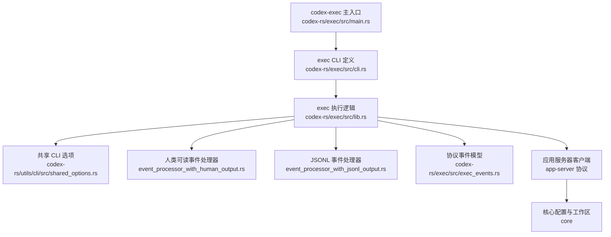
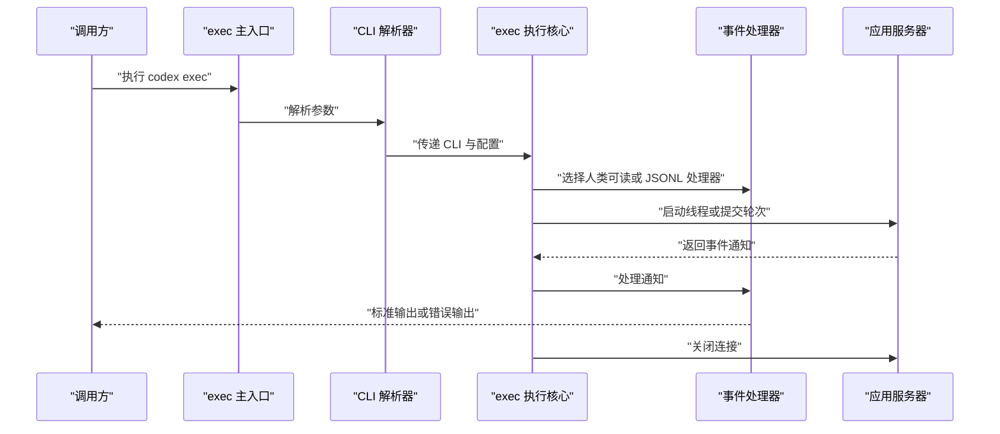
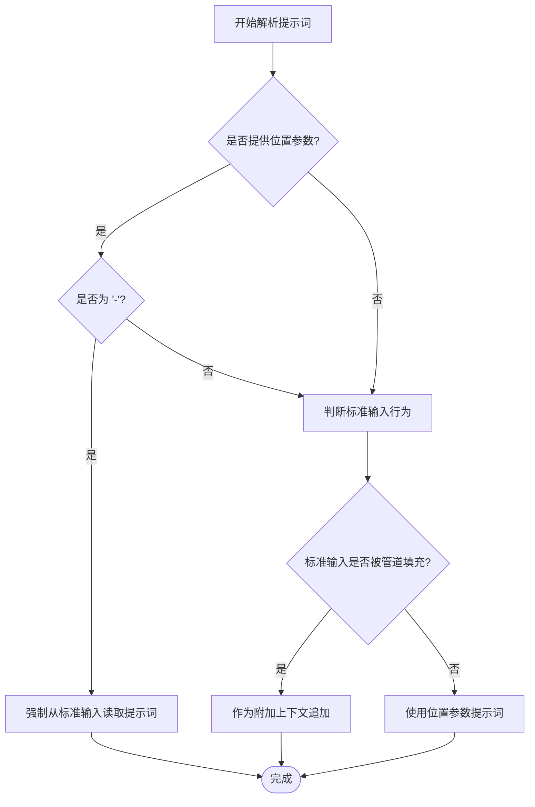
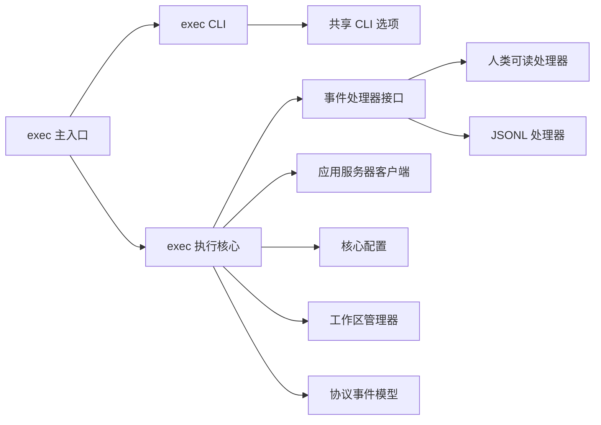

# 执行命令 (exec)

<cite>
**本文引用的文件**   
- [docs/exec.md](file://docs/exec.md)
- [codex-rs/cli/src/lib.rs](file://codex-rs/cli/src/lib.rs)
- [codex-rs/utils/cli/src/shared_options.rs](file://codex-rs/utils/cli/src/shared_options.rs)
- [codex-rs/exec/src/main.rs](file://codex-rs/exec/src/main.rs)
- [codex-rs/exec/src/cli.rs](file://codex-rs/exec/src/cli.rs)
- [codex-rs/exec/src/lib.rs](file://codex-rs/exec/src/lib.rs)
- [codex-rs/exec/src/event_processor.rs](file://codex-rs/exec/src/event_processor.rs)
- [codex-rs/exec/src/event_processor_with_human_output.rs](file://codex-rs/exec/src/event_processor_with_human_output.rs)
- [codex-rs/exec/src/event_processor_with_jsonl_output.rs](file://codex-rs/exec/src/event_processor_with_jsonl_output.rs)
- [codex-rs/exec/src/exec_events.rs](file://codex-rs/exec/src/exec_events.rs)
</cite>

## 目录

1. [简介](#简介)
2. [项目结构](#项目结构)
3. [核心组件](#核心组件)
4. [架构总览](#架构总览)
5. [详细组件分析](#详细组件分析)
6. [依赖关系分析](#依赖关系分析)
7. [性能考虑](#性能考虑)
8. [故障排查指南](#故障排查指南)
9. [结论](#结论)

## 简介

`codex exec` 是 Codex 的非交互执行入口。它用于在自动化、批处理和持续集成环境中启动一个“一次性”会话：把提示词发送给模型代理，让代理在工作区中生成代码、运行命令或修改文件，并把结果输出给调用方。

官方文档对外部说明的指向如下：

- 非交互模式概述位于仓库中的 `docs/exec.md`，并指向 OpenAI 开发者站点的非交互模式文档。

当前仓库中的公开文档没有直接列出完整参数表；完整的选项语义需要结合 CLI 定义和实现逻辑一起理解。

**章节来源**
- [docs/exec.md:1-3](file://docs/exec.md#L1-L3)

## 项目结构

`codex exec` 不是单一脚本，而是由多个 Rust crate 协作实现的：

| 路径 | 职责 |
|---|---|
| `codex-rs/exec` | 非交互执行的二进制入口、CLI 定义、事件处理器、工作区与线程管理逻辑。 |
| `codex-rs/cli` | 沙箱调试子命令（Seatbelt、Landlock、Windows 沙箱）等通用沙箱参数定义。 |
| `codex-rs/utils/cli` | 共享 CLI 选项，包括模型、沙箱、工作目录、工作树等跨命令复用参数。 |
| `codex-rs/exec-server` | 应用服务器层，负责线程、工具调用、进程执行、沙箱和网络策略。 |
| `codex-rs/core` | 配置加载、会话状态、Git 仓库、权限策略等核心能力。 |
| `codex-rs/protocol` | 协议类型、线程、轮次、使用量等数据结构。 |



**图表来源**
- [codex-rs/exec/src/main.rs:1-48](file://codex-rs/exec/src/main.rs#L1-L48)
- [codex-rs/exec/src/cli.rs:1-200](file://codex-rs/exec/src/cli.rs#L1-L200)
- [codex-rs/exec/src/lib.rs:273-360](file://codex-rs/exec/src/lib.rs#L273-L360)
- [codex-rs/utils/cli/src/shared_options.rs:1-200](file://codex-rs/utils/cli/src/shared_options.rs#L1-L200)

**章节来源**
- [codex-rs/exec/src/main.rs:1-48](file://codex-rs/exec/src/main.rs#L1-L48)
- [codex-rs/exec/src/cli.rs:1-200](file://codex-rs/exec/src/cli.rs#L1-L200)
- [codex-rs/utils/cli/src/shared_options.rs:1-200](file://codex-rs/utils/cli/src/shared_options.rs#L1-L200)

## 核心组件

### 非交互执行入口

`codex exec` 的实际二进制由 `codex-rs/exec/src/main.rs` 提供。它做了两件事：

1. 解析顶层配置覆盖和内部 `Cli`。
2. 根据程序名分发到普通 exec 流程或 Linux 沙箱专用流程。

当程序名为 `codex-linux-sandbox` 时，同一二进制会切换到独立分支；否则走正常的非交互执行流程。

**章节来源**
- [codex-rs/exec/src/main.rs:1-48](file://codex-rs/exec/src/main.rs#L1-L48)

### CLI 语法与子命令

`codex exec` 的命令语法定义为：

```
codex exec [选项] [提示词]
codex exec [选项] <子命令> [参数]
```

可用的子命令包括：

| 子命令 | 用途 | 关键行为 |
|---|---|---|
| 无子命令 | 创建新会话并提交提示词 | 默认非交互执行模式。 |
| `resume` | 恢复历史会话 | 支持按 ID 或最近一次会话恢复，并可附加图片与提示词。 |
| `fork` | 复制历史会话 | 支持按会话 ID 或线程名称复制，并可附加图片与提示词。 |
| `review` | 代码审查 | 支持未提交变更、指定基分支或指定提交。 |

对于 `resume`，存在一个特殊语义：如果使用了 `--last` 且没有显式提示词，则位置参数会被重新解释为提示词，而不是会话 ID。

**章节来源**
- [codex-rs/exec/src/cli.rs:1-200](file://codex-rs/exec/src/cli.rs#L1-L200)
- [codex-rs/exec/src/cli.rs:201-347](file://codex-rs/exec/src/cli.rs#L201-L347)

### 共享 CLI 选项

许多选项来自共享 CLI 定义，供交互式与非交互模式共用：

| 选项 | 简写 | 含义 |
|---|---:|---|
| `--image` | `-i` | 附加到初始提示词的图片文件，可重复。 |
| `--model` | `-m` | 指定使用的模型。 |
| `--oss` | — | 使用开源提供方。 |
| `--local-provider` | — | 指定本地提供方，如 LM Studio 或 Ollama。 |
| `--profile` | `-p` | 叠加用户配置 profile。 |
| `--sandbox` | `-s` | 选择沙箱策略。 |
| `--approve-for-me` | — | 自动审批并通过工作区写入沙箱处理审批请求。 |
| `--dangerously-bypass-approvals-and-sandbox` | — | 跳过确认和沙箱，仅适用于外部已隔离环境。 |
| `--dangerously-bypass-hook-trust` | — | 绕过钩子信任检查，仅适用于自动化场景。 |
| `--cd` | `-C` | 指定工作目录。 |
| `--worktree` | — | 在新托管 Git worktree 中运行。 |
| `--add-dir` | — | 增加可写目录。 |

这些选项通过 `SharedCliOptions` 暴露，并在 exec 中进一步组合、验证和转换。

**章节来源**
- [codex-rs/utils/cli/src/shared_options.rs:1-200](file://codex-rs/utils/cli/src/shared_options.rs#L1-L200)

### exec 专属选项

exec 模块还扩展了以下选项：

| 选项 | 简写 | 含义 |
|---|---:|---|
| `--strict-config` | — | 配置中出现未知字段时报错。 |
| `--thread-source` | — | 新建或分叉线程的来源分类。 |
| `--cyber-access-program` | — | 针对 OpenAI provider 的实验性访问程序控制。 |
| `--skip-git-repo-check` | — | 允许在非 Git 仓库中运行。 |
| `--trust` | — | 保存项目信任决策。 |
| `--ephemeral` | — | 不持久化会话文件。 |
| `--ignore-user-config` | — | 不加载用户配置，但认证仍使用 `$CODEX_HOME`。 |
| `--ignore-rules` | — | 不加载用户或项目的 execpolicy `.rules` 文件。 |
| `--output-schema` | — | 指定模型最终响应格式的 JSON Schema 文件。 |
| `--color` | — | 控制颜色输出：`auto`、`always`、`never`。 |
| `--json` | — | 以 JSONL 形式打印事件。 |
| `--output-last-message` | `-o` | 将代理最后一条消息写入文件。 |
| `PROMPT` | — | 位置参数形式的提示词。 |

注意：`--json` 还有别名 `--experimental-json`，表明其历史演进可能包含稳定性调整，但当前实现仍以 JSONL 事件流为主。

**章节来源**
- [codex-rs/exec/src/cli.rs:1-200](file://codex-rs/exec/src/cli.rs#L1-L200)

## 架构总览

非交互执行的整体流程可以概括为：



**图表来源**
- [codex-rs/exec/src/main.rs:1-48](file://codex-rs/exec/src/main.rs#L1-L48)
- [codex-rs/exec/src/lib.rs:273-360](file://codex-rs/exec/src/lib.rs#L273-L360)
- [codex-rs/exec/src/lib.rs:1275-1480](file://codex-rs/exec/src/lib.rs#L1275-L1480)

## 详细组件分析

### 提示词输入方式

exec 支持多种提示词输入方式：

1. **位置参数提示词**  
   `codex exec "请帮我重构这个函数"`。

2. **从标准输入读取提示词**  
   - 管道输入时，如果没有位置参数，则标准输入作为提示词。
   - 使用 `-` 作为位置参数时，强制从标准输入读取。
   - 同时提供位置参数和管道输入时，标准输入被追加为上下文块，而不是替代提示词。

3. **带图片的提示词**  
   通过 `--image` 附加图片文件，图片会在提示词前附加。

4. **恢复或复制会话时的提示词**  
   `resume` 和 `fork` 都支持在恢复或复制后发送额外提示词。

5. **审查模式的提示词**  
   `review` 可通过位置参数或 `-` 从标准输入读取自定义审查指令。



**图表来源**
- [codex-rs/exec/src/lib.rs:2468-2544](file://codex-rs/exec/src/lib.rs#L2468-L2544)

**章节来源**
- [codex-rs/exec/src/cli.rs:1-200](file://codex-rs/exec/src/cli.rs#L1-L200)
- [codex-rs/exec/src/cli.rs:201-347](file://codex-rs/exec/src/cli.rs#L201-L347)
- [codex-rs/exec/src/lib.rs:2468-2544](file://codex-rs/exec/src/lib.rs#L2468-L2544)

### 超时设置

在当前源码中，没有找到面向 `codex exec` 用户的 `--timeout` 参数定义。超时通常由更高层的应用服务器、网络客户端、重试机制或 CI/CD 平台控制，而不是直接暴露为 exec 子命令的参数。

这意味着：

- 不能假定 `codex exec --timeout 60` 可用。
- 超时相关行为应优先参考 CI/CD 平台的任务超时配置。
- 若需要精细控制，应关注应用服务器端、HTTP 客户端或远程执行环境的超时策略。

**章节来源**
- [codex-rs/exec/src/cli.rs:1-200](file://codex-rs/exec/src/cli.rs#L1-L200)
- [codex-rs/utils/cli/src/shared_options.rs:1-200](file://codex-rs/utils/cli/src/shared_options.rs#L1-L200)

### 工作目录配置

工作目录由 `--cd` 或 `-C` 控制。exec 会：

1. 接收 CLI 传入的工作目录。
2. 将其规范化为绝对路径。
3. 用于配置加载、工作树解析和后续线程运行的默认工作目录。
4. 在提交 `turn/start` 时，将默认工作目录传给服务端。

此外，`--worktree` 会创建一个托管 Git worktree，并将 exec 限制在受管工作区中。它与以下选项互斥或不兼容：

- 与 `--ignore-user-config` 不兼容。
- 与 `--ephemeral` 不兼容。
- 不支持 `resume`。
- 不支持 `review`。

**章节来源**
- [codex-rs/utils/cli/src/shared_options.rs:1-200](file://codex-rs/utils/cli/src/shared_options.rs#L1-L200)
- [codex-rs/exec/src/lib.rs:320-380](file://codex-rs/exec/src/lib.rs#L320-L380)
- [codex-rs/exec/src/lib.rs:1275-1480](file://codex-rs/exec/src/lib.rs#L1275-L1480)

### 沙箱选项

exec 的沙箱行为由共享 CLI 选项决定，核心选项包括：

| 选项 | 行为 |
|---|---|
| `--sandbox` | 显式选择沙箱策略。 |
| `--approve-for-me` | 自动审批，并使用工作区写入沙箱。 |
| `--dangerously-bypass-approvals-and-sandbox` | 完全跳过确认和沙箱，进入危险的全权限模式。 |
| `--dangerously-bypass-hook-trust` | 绕过钩子信任检查。 |

当启用 `--dangerously-bypass-approvals-and-sandbox` 时，exec 会把沙箱模式转换为危险全权限模式。该选项主要用于外部已经隔离的环境。

仓库中还定义了独立的沙箱调试命令，例如：

- Seatbelt（macOS）。
- Landlock（Linux）。
- Windows 受限令牌沙箱。

这些命令有自己的 `--sandbox-state-json`、`--permission-profile`、`--cd`、`--allow-unix-socket` 等平台特定选项，但它们与 `codex exec` 不同。

**章节来源**
- [codex-rs/utils/cli/src/shared_options.rs:1-200](file://codex-rs/utils/cli/src/shared_options.rs#L1-L200)
- [codex-rs/cli/src/lib.rs:1-191](file://codex-rs/cli/src/lib.rs#L1-L191)
- [codex-rs/exec/src/lib.rs:340-360](file://codex-rs/exec/src/lib.rs#L340-L360)

### 输出格式

exec 支持两种主要输出模式：

#### 人类可读模式

默认情况下，exec 使用人类可读输出：

- 标准错误用于进度、状态、命令执行摘要和渲染后的最终消息。
- 标准输出只保留最终消息，以便脚本能安全捕获模型回复。
- 颜色由 `--color` 控制，并根据终端能力自动推断。

人类可读处理器会渲染：

- 命令执行状态。
- MCP 工具调用状态。
- Web 搜索。
- 补丁应用状态。
- 代理消息。
- 推理摘要。
- 使用量信息。

#### JSONL 模式

使用 `--json` 或 `--experimental-json` 时，标准输出变为结构化 JSONL 事件流：

- 每个事件一行。
- 事件类型包括线程启动、轮次开始、轮次完成、轮次失败、项开始、项更新、项完成、错误等。
- 其他诊断信息仍写入标准错误。

JSONL 事件模型包括：

| 事件或类型 | 含义 |
|---|---|
| `thread.started` | 新线程启动。 |
| `turn.started` | 新轮次开始。 |
| `turn.completed` | 轮次成功完成，附带使用量。 |
| `turn.failed` | 轮次失败，附带错误事件。 |
| `item.started` | 某个项开始。 |
| `item.updated` | 项状态更新。 |
| `item.completed` | 项到达终态。 |
| `error` | 不可恢复的错误事件。 |

**章节来源**
- [codex-rs/exec/src/lib.rs:1-100](file://codex-rs/exec/src/lib.rs#L1-L100)
- [codex-rs/exec/src/event_processor_with_human_output.rs:1-200](file://codex-rs/exec/src/event_processor_with_human_output.rs#L1-L200)
- [codex-rs/exec/src/event_processor_with_jsonl_output.rs:1-200](file://codex-rs/exec/src/event_processor_with_jsonl_output.rs#L1-L200)
- [codex-rs/exec/src/exec_events.rs:1-200](file://codex-rs/exec/src/exec_events.rs#L1-L200)

### 返回码与错误处理

exec 的错误处理分为两类：

1. **调用阶段错误**  
   例如配置加载失败、参数冲突、工作树初始化失败等，通常会直接退出。

2. **执行阶段错误**  
   在事件循环中，exec 跟踪是否收到致命错误或失败的轮次。当轮次完成状态为失败或被中断时，会标记错误。

当前源码中没有看到明确的 `return_code` 变量或基于该变量的退出码映射逻辑。因此，不能简单断言所有失败都会返回固定的非零退出码；实际行为取决于具体错误路径和异常处理。

推荐在自动化中这样判断：

- 优先检查进程退出码。
- 对 JSONL 模式，还要检查标准输出事件流中是否存在 `turn.failed` 或 `error` 事件。
- 对人类可读模式，检查标准错误中的状态信息和是否写入了最终消息文件。

**章节来源**
- [codex-rs/exec/src/lib.rs:1275-1480](file://codex-rs/exec/src/lib.rs#L1275-L1480)
- [codex-rs/exec/src/event_processor.rs:1-47](file://codex-rs/exec/src/event_processor.rs#L1-L47)

## 依赖关系分析

exec 的核心依赖链如下：



**图表来源**
- [codex-rs/exec/src/main.rs:1-48](file://codex-rs/exec/src/main.rs#L1-L48)
- [codex-rs/exec/src/lib.rs:273-360](file://codex-rs/exec/src/lib.rs#L273-L360)
- [codex-rs/exec/src/event_processor.rs:1-47](file://codex-rs/exec/src/event_processor.rs#L1-L47)

**章节来源**
- [codex-rs/exec/src/main.rs:1-48](file://codex-rs/exec/src/main.rs#L1-L48)
- [codex-rs/exec/src/lib.rs:273-360](file://codex-rs/exec/src/lib.rs#L273-L360)
- [codex-rs/exec/src/event_processor.rs:1-47](file://codex-rs/exec/src/event_processor.rs#L1-L47)

## 性能考虑

以下是基于源码行为的通用建议：

1. **避免阻塞标准输出**  
   人类可读模式下，标准输出只应包含最终消息。任何中间日志都应写入标准错误，否则会污染脚本捕获的输出。

2. **优先使用 JSONL 模式进行自动化解析**  
   JSONL 提供更稳定的结构化数据，适合 CI/CD 消费。人类可读文本更适合人工查看。

3. **减少不必要的大图片**  
   `--image` 会附加到提示词中，增大请求体。批量任务中应避免附带过大图片。

4. **谨慎使用危险模式**  
   `--dangerously-bypass-approvals-and-sandbox` 会跳过沙箱和确认，虽然可能减少审批开销，但安全风险很高。仅在外部已隔离的环境中启用。

5. **合理使用工作树**  
   `--worktree` 会创建和管理临时 Git worktree，适合隔离任务，但会带来额外初始化成本。

6. **控制日志级别**  
   exec 默认隐藏 OpenTelemetry 自诊断日志，除非通过环境变量显式启用。CI 中应避免泄漏过多诊断信息。

7. **利用结构化输出做最小化处理**  
   如果只需要最终答案，可使用 `--output-last-message` 将结果写入文件，避免解析大量中间事件。

[本节为通用指导，不直接分析具体代码片段]

## 故障排查指南

### 常见参数冲突

| 问题 | 原因 | 处理方式 |
|---|---|---|
| `--trust` 与 `--ignore-user-config` 冲突 | 保存信任决策需要读取项目信任状态。 | 移除其中一个选项。 |
| `--worktree` 与 `--ignore-user-config` 冲突 | worktree 需要加载用户配置。 | 移除 `--ignore-user-config`。 |
| `--worktree` 与 `--ephemeral` 冲突 | worktree 需要持久化管理。 | 移除 `--ephemeral`。 |
| `--worktree` 与 `resume` 不兼容 | 恢复会话不支持 worktree。 | 不使用 `--worktree`。 |
| `--worktree` 与 `review` 不兼容 | 审查不支持 worktree。 | 不使用 `--worktree`。 |
| `--cyber-access-program` 与 `review` 不兼容 | 审查模式不支持该实验选项。 | 移除该选项。 |
| fork 时使用 `--cyber-access-program` 但没有提示词 | fork 必须提供提示词。 | 添加位置参数提示词或 `-`。 |

**章节来源**
- [codex-rs/exec/src/lib.rs:273-360](file://codex-rs/exec/src/lib.rs#L273-L360)

### 输出无法被脚本正确解析

如果脚本期望只捕获最终消息，请检查：

1. 是否启用了 `--json`。
2. 是否误把标准错误当作标准输出。
3. 是否同时传入了图片和标准输入，导致上下文混合。
4. 是否使用了人类可读模式却期望纯文本结果。

**章节来源**
- [codex-rs/exec/src/lib.rs:1-100](file://codex-rs/exec/src/lib.rs#L1-L100)
- [codex-rs/exec/src/lib.rs:2468-2544](file://codex-rs/exec/src/lib.rs#L2468-L2544)

### CI/CD 集成方案

推荐使用 JSONL 模式：

1. 使用 `codex exec --json` 启动任务。
2. 从标准输出解析 JSONL 事件。
3. 监听 `turn.completed` 表示成功，`turn.failed` 或 `error` 表示失败。
4. 如需最终答案，使用 `--output-last-message` 写入文件。
5. 通过 CI/CD 平台的任务超时控制整体执行时间。
6. 对高风险任务使用沙箱模式，不要在生产 CI 中直接使用危险模式。

示例思路（伪代码）：

```text
执行: codex exec --json --output-last-message result.txt "提示词"
解析标准输出: 读取 JSONL 行
判断: 是否出现 turn.failed 或 error
结果: 根据事件和进程退出码决定任务成功或失败
```

**章节来源**
- [codex-rs/exec/src/event_processor_with_jsonl_output.rs:1-200](file://codex-rs/exec/src/event_processor_with_jsonl_output.rs#L1-L200)
- [codex-rs/exec/src/exec_events.rs:1-200](file://codex-rs/exec/src/exec_events.rs#L1-L200)

### 批处理脚本编写建议

- 使用位置参数传入短提示词。
- 使用 `-` 从管道或文件注入长提示词。
- 使用 `--json` 做稳定解析。
- 使用 `--output-last-message` 提取最终结果。
- 使用 `--model` 固定模型，避免 CI 中模型漂移。
- 使用 `--sandbox` 明确沙箱策略。
- 避免在自动化中使用 `--dangerously-bypass-approvals-and-sandbox`。
- 如果需要隔离工作区，使用 `--worktree`，并确保 CI 具备 Git 支持。

[本节为通用指导，不直接分析具体代码片段]

## 结论

`codex exec` 是一个面向自动化的非交互执行入口，重点在于：

- 清晰区分人类可读输出和结构化 JSONL 输出。
- 灵活支持位置参数、标准输入和图片等多种提示词输入方式。
- 通过共享 CLI 选项统一模型、沙箱、工作目录和工作树等行为。
- 在 CI/CD 中优先使用 JSONL 模式和结构化事件进行可靠判断。
- 谨慎使用危险模式，确保自动化环境本身具备足够的安全边界。

当前仓库源码没有暴露 `--timeout` 参数，也没有统一的 `return_code` 映射逻辑。因此，在自动化中应同时关注进程退出码、JSONL 事件和最终消息文件，以获得最稳健的执行判断。