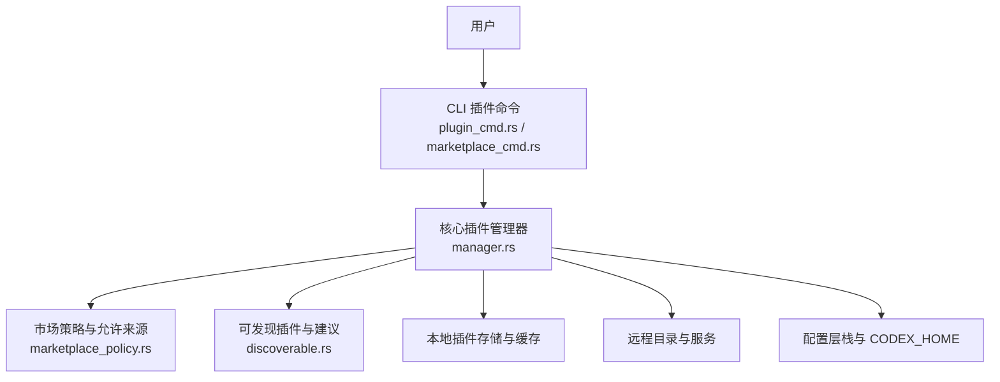
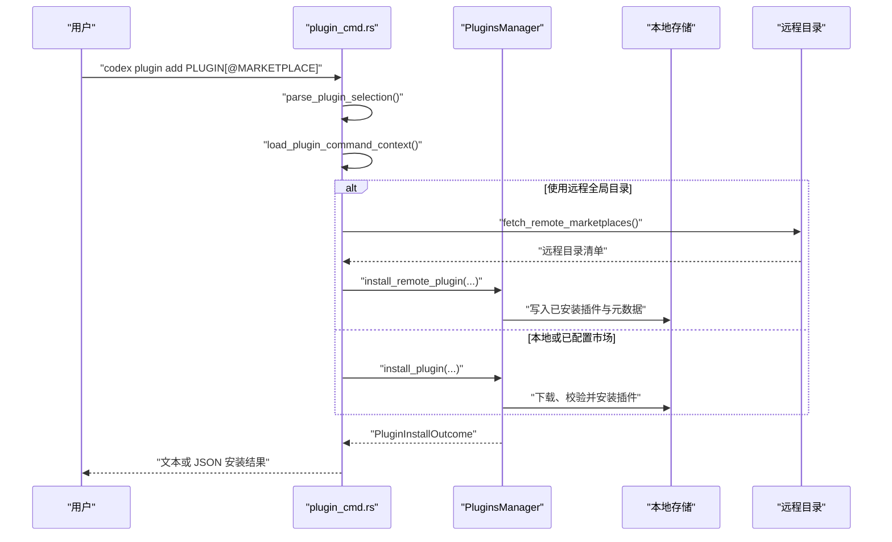
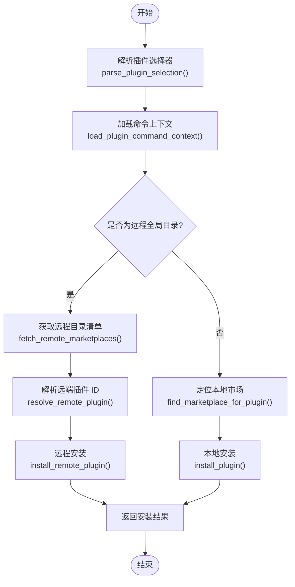

# 插件管理

<cite>
**本文引用的文件**   
- [plugin_cmd.rs](file://codex-rs/cli/src/plugin_cmd.rs)
- [marketplace_cmd.rs](file://codex-rs/cli/src/marketplace_cmd.rs)
- [manager.rs](file://codex-rs/core-plugins/src/manager.rs)
- [lib.rs](file://codex-rs/core-plugins/src/lib.rs)
- [marketplace_policy.rs](file://codex-rs/core-plugins/src/marketplace_policy.rs)
- [discoverable.rs](file://codex-rs/core-plugins/src/discoverable.rs)
</cite>

## 目录
1. [简介](#简介)
2. [项目结构](#项目结构)
3. [核心组件](#核心组件)
4. [架构总览](#架构总览)
5. [命令与子命令详解](#命令与子命令详解)
6. [插件搜索、发现与验证机制](#插件搜索发现与验证机制)
7. [插件生命周期与数据流](#插件生命周期与数据流)
8. [依赖管理与冲突解决](#依赖管理与冲突解决)
9. [自定义插件开发与发布指南](#自定义插件开发与发布指南)
10. [性能与可靠性](#性能与可靠性)
11. [故障排查](#故障排查)
12. [结论](#结论)

## 简介
本文件系统化说明 Codex 的插件管理体系，围绕 `codex plugin` 命令及其子命令展开。它覆盖：
- 插件安装、卸载、列表与远程全局目录操作；
- 市场源添加、列出、升级与移除；
- 插件的发现、搜索与校验策略；
- 配置层、本地缓存、远程服务之间的数据流；
- 依赖关系、版本与产品限制下的冲突处理；
- 如何开发、发布和集成自定义插件与市场源。

当前仓库中的 CLI 暴露了 `add`、`list`、`remove` 三个直接插件子命令，以及一个嵌套的 `marketplace` 子命令集合用于管理市场源。启用与禁用能力由底层管理器提供，CLI 目前通过“已安装/未安装”状态体现，并在 JSON 输出中保留 enabled 字段，便于上层 UI 或脚本驱动启用逻辑。

## 项目结构
插件相关代码主要分布在两个层次：
- CLI 层：负责解析用户命令、加载配置、认证上下文，并调用核心管理器执行操作。
- 核心插件层：实现市场发现、插件清单解析、安装与卸载、缓存、远程同步、策略约束等。

**图示来源**
- [plugin_cmd.rs:1-200](file://codex-rs/cli/src/plugin_cmd.rs#L1-L200)
- [marketplace_cmd.rs:1-120](file://codex-rs/cli/src/marketplace_cmd.rs#L1-L120)
- [manager.rs:727-1050](file://codex-rs/core-plugins/src/manager.rs#L727-L1050)

**章节来源**
- [plugin_cmd.rs:1-200](file://codex-rs/cli/src/plugin_cmd.rs#L1-L200)
- [marketplace_cmd.rs:1-120](file://codex-rs/cli/src/marketplace_cmd.rs#L1-L120)

## 核心组件
- CLI 插件命令入口与参数模型：定义 `PluginCli`、`PluginSubcommand`、`AddPluginArgs`、`ListPluginsArgs`、`RemovePluginArgs`，并提供 `run_plugin_add`、`run_plugin_list`、`run_plugin_remove` 等异步处理器。
- 市场源管理 CLI：`MarketplaceCli` 暴露 `add`、`list`、`upgrade`、`remove`，封装市场源的增删改查。
- 插件管理器：`PluginsManager` 是核心，提供安装、卸载、列出市场、推荐插件、远程安装、缓存刷新、有效插件加载等能力。
- 市场策略：`MarketplacePolicy` 根据配置要求限制市场源来源，过滤允许的市场名与插件配置。
- 可发现插件：`ToolSuggestPluginDiscoveryInput` 与 `ToolSuggestDiscoverablePlugin` 为工具建议与自动发现提供基础数据结构。
- 公共导出：`core-plugins/src/lib.rs` 集中导出管理器、策略、市场、远程、指标等模块对外 API。

**章节来源**
- [plugin_cmd.rs:1-200](file://codex-rs/cli/src/plugin_cmd.rs#L1-L200)
- [marketplace_cmd.rs:35-120](file://codex-rs/cli/src/marketplace_cmd.rs#L35-L120)
- [manager.rs:727-1050](file://codex-rs/core-plugins/src/manager.rs#L727-L1050)
- [marketplace_policy.rs:1-120](file://codex-rs/core-plugins/src/marketplace_policy.rs#L1-L120)
- [discoverable.rs:1-150](file://codex-rs/core-plugins/src/discoverable.rs#L1-L150)
- [lib.rs:1-136](file://codex-rs/core-plugins/src/lib.rs#L1-L136)

## 架构总览
以下时序图展示 `codex plugin add` 的典型流程：从 CLI 解析选择器到最终调用管理器完成安装并输出结果。

**图示来源**
- [plugin_cmd.rs:140-247](file://codex-rs/cli/src/plugin_cmd.rs#L140-L247)
- [plugin_cmd.rs:768-851](file://codex-rs/cli/src/plugin_cmd.rs#L768-L851)
- [manager.rs:2490-2558](file://codex-rs/core-plugins/src/manager.rs#L2490-L2558)

## 命令与子命令详解

### `codex plugin add`
- 作用：从已配置市场或远程全局目录安装插件。
- 输入：
  - `PLUGIN[@MARKETPLACE]`：支持 `<plugin>@<marketplace>` 形式；若省略 `@marketplace`，需配合 `--marketplace`。
  - `--marketplace MARKETPLACE`：指定市场名。
  - `--json`：以 JSON 输出安装结果。
- 行为要点：
  - 如果目标市场为远程全局目录，则优先拉取远程目录清单，必要时强制刷新缓存，再解析远端插件 ID 并调用远程安装接口。
  - 否则在本地已配置市场中查找插件并调用本地安装流程。
  - 输出包含插件 ID、名称、市场名、版本、安装路径与认证策略。

**章节来源**
- [plugin_cmd.rs:140-247](file://codex-rs/cli/src/plugin_cmd.rs#L140-L247)

### `codex plugin list`
- 作用：列出已配置市场与远程目录中的插件。
- 输入：
  - `--marketplace MARKETPLACE`：按市场过滤。
  - `--json`：JSON 输出。
  - `--available`（仅 JSON）：额外包含“可用但未安装”的插件。
- 行为要点：
  - 合并本地市场清单与远程目录清单。
  - 对本地市场快照进行确保加载，保证 installed/enabled/version 信息准确。
  - JSON 输出分为 `installed` 与 `available` 两类数组；人类可读模式按市场分段打印表格。

**章节来源**
- [plugin_cmd.rs:247-600](file://codex-rs/cli/src/plugin_cmd.rs#L247-L600)

### `codex plugin remove`
- 作用：卸载插件并清理本地缓存。
- 输入：
  - `PLUGIN[@MARKETPLACE]` 或 `PLUGIN --marketplace MARKETPLACE`。
  - `--json`：JSON 输出。
- 行为要点：
  - 远程全局目录：先构建远程已安装市场快照，再调用远程卸载接口，并处理缓存删除错误。
  - 非远程：直接调用本地卸载流程，清理存储与用户配置中的插件条目。

**章节来源**
- [plugin_cmd.rs:682-900](file://codex-rs/cli/src/plugin_cmd.rs#L682-L900)

### `codex plugin marketplace add`
- 作用：向配置中添加本地或 Git 市场源。
- 输入：
  - `SOURCE`：本地路径、`owner/repo[@ref]`、HTTPS/SSH Git URL。
  - `--ref REF`：Git 引用。
  - `--sparse PATH`：稀疏检出路径，可重复。
  - `--json`：JSON 输出。
- 行为：调用 `add_marketplace` 将市场源写入配置，并返回安装根目录与是否已存在。

**章节来源**
- [marketplace_cmd.rs:78-160](file://codex-rs/cli/src/marketplace_cmd.rs#L78-L160)

### `codex plugin marketplace list`
- 作用：列出当前 Codex 考虑的市场源及其根目录。
- 输入：`--json`。
- 行为：通过 `discover_marketplaces_for_config` 发现市场，并附带快照问题与来源映射。

**章节来源**
- [marketplace_cmd.rs:160-220](file://codex-rs/cli/src/marketplace_cmd.rs#L160-L220)

### `codex plugin marketplace upgrade`
- 作用：刷新已配置的 Git 市场快照。
- 输入：
  - 可选 `MARKETPLACE_NAME`：仅升级指定市场，省略则升级全部。
  - `--json`：JSON 输出。
- 行为：调用 `upgrade_configured_marketplaces_for_config`，随后触发非策展插件缓存重新安装与缓存失效清理。

**章节来源**
- [marketplace_cmd.rs:188-220](file://codex-rs/cli/src/marketplace_cmd.rs#L188-L220)
- [manager.rs:3090-3180](file://codex-rs/core-plugins/src/manager.rs#L3090-L3180)

### `codex plugin marketplace remove`
- 作用：按名称移除已配置市场源。
- 输入：`MARKETPLACE_NAME`，`--json`。
- 行为：调用 `remove_marketplace` 从配置中移除该市场。

**章节来源**
- [marketplace_cmd.rs:200-220](file://codex-rs/cli/src/marketplace_cmd.rs#L200-L220)

### 关于启用与禁用
- 底层管理器提供插件状态跟踪，CLI 的 `list` 输出中包含 `enabled` 字段，可用于判断启用状态。
- 启用/禁用的具体变更逻辑由配置层与管理器协作维护；当前 CLI 未直接暴露 `enable`/`disable` 子命令，但可通过配置文件或上层工具利用 `enabled` 字段与配置 API 实现。

**章节来源**
- [plugin_cmd.rs:247-600](file://codex-rs/cli/src/plugin_cmd.rs#L247-L600)
- [manager.rs:2490-2680](file://codex-rs/core-plugins/src/manager.rs#L2490-L2680)

## 插件搜索、发现与验证机制

### 搜索与列表
- 本地市场：`list_marketplaces_for_config` 扫描配置层中的市场源，结合策略过滤、产品限制与已安装状态，生成统一清单。
- 远程目录：`fetch_remote_marketplaces` 获取远程目录清单，支持缓存优先与强制刷新两种模式。
- 列表输出：CLI 将本地与远程清单合并，并按市场分组渲染，支持 JSON 结构化输出。

**章节来源**
- [plugin_cmd.rs:247-600](file://codex-rs/cli/src/plugin_cmd.rs#L247-L600)
- [manager.rs:2558-2680](file://codex-rs/core-plugins/src/manager.rs#L2558-L2680)

### 发现与建议
- `ToolSuggestPluginDiscoveryInput` 聚合插件配置、已配置插件 ID、禁用插件 ID、已加载应用连接器 ID。
- `list_tool_suggest_discoverable_plugins` 遍历本地市场与远程目录，筛选未安装且允许安装的插件，加载其元数据并构造可发现插件列表。
- 存在允许列表与回退策略，避免无关插件出现在工具建议中。

**章节来源**
- [discoverable.rs:1-150](file://codex-rs/core-plugins/src/discoverable.rs#L1-L150)

### 验证与安全策略
- 市场源限制：`MarketplacePolicy` 根据配置要求限制允许的市场源类型（Git URL、主机模式、本地路径）。
- 安装前校验：`validate_install` 校验目标市场根目录是否与配置一致，防止篡改或误装。
- 产品限制：管理器在安装、列出、策展刷新阶段会依据产品范围过滤插件，已准入的共享本地状态不受运行时再次过滤。
- 名称保留：保留名称与受管市场名校验，防止滥用内置市场名。

**章节来源**
- [marketplace_policy.rs:1-320](file://codex-rs/core-plugins/src/marketplace_policy.rs#L1-L320)
- [manager.rs:727-1050](file://codex-rs/core-plugins/src/manager.rs#L727-L1050)

## 插件生命周期与数据流

### 安装流程

**图示来源**
- [plugin_cmd.rs:140-247](file://codex-rs/cli/src/plugin_cmd.rs#L140-L247)
- [plugin_cmd.rs:768-851](file://codex-rs/cli/src/plugin_cmd.rs#L768-L851)

### 卸载流程
- 远程卸载：先通过远程服务标记卸载，再清理本地缓存与用户配置，记录分析事件。
- 本地卸载：直接调用 `uninstall_plugin`，后台任务卸载存储项并清理配置。

**章节来源**
- [plugin_cmd.rs:682-900](file://codex-rs/cli/src/plugin_cmd.rs#L682-L900)
- [manager.rs:2492-2558](file://codex-rs/core-plugins/src/manager.rs#L2492-L2558)

### 列表流程
- 合并本地市场与远程目录清单。
- 确保本地市场快照已加载，填充 installed/enabled/version/source 等信息。
- 输出人类可读表格或结构化 JSON。

**章节来源**
- [plugin_cmd.rs:247-600](file://codex-rs/cli/src/plugin_cmd.rs#L247-L600)

## 依赖管理与冲突解决

### 依赖与来源
- 插件来源包括本地路径、Git、NPM 包等，CLI JSON 输出明确区分不同 source 类型。
- 市场源可为本地目录或 Git 仓库，支持 ref 与稀疏检出，便于大型仓库只拉取所需子目录。

**章节来源**
- [plugin_cmd.rs:600-900](file://codex-rs/cli/src/plugin_cmd.rs#L600-L900)
- [marketplace_cmd.rs:78-160](file://codex-rs/cli/src/marketplace_cmd.rs#L78-L160)

### 冲突与去重
- 同一插件键 `<plugin>@<marketplace>` 在同一市场内去重，重复条目仅保留首个发现源。
- 产品限制下，不匹配产品的插件会被过滤。
- 当市场升级后，会触发非策展插件缓存强制重新安装，并清理相关缓存，避免旧快照残留导致的状态不一致。

**章节来源**
- [manager.rs:2558-2680](file://codex-rs/core-plugins/src/manager.rs#L2558-L2680)
- [manager.rs:3090-3180](file://codex-rs/core-plugins/src/manager.rs#L3090-L3180)

### 最佳实践
- 在受限环境中，先在配置中添加允许的市场源，再进行插件安装，避免策略拒绝。
- 对 Git 市场使用 `--ref` 与 `--sparse` 控制版本与体积，降低网络与磁盘开销。
- 安装前通过 `list` 检查插件的 installation/auth policy，确认是否需要认证或在安装时启用。

**章节来源**
- [marketplace_policy.rs:1-320](file://codex-rs/core-plugins/src/marketplace_policy.rs#L1-L320)
- [marketplace_cmd.rs:78-160](file://codex-rs/cli/src/marketplace_cmd.rs#L78-L160)

## 自定义插件开发与发布指南

### 开发要点
- 插件标识与来源：插件以 `<plugin>@<marketplace>` 形式标识；来源可以是本地路径、Git 仓库或 NPM 包。
- 清单与能力：插件应提供清单与能力描述，以便管理器解析 hooks、apps、skills、mcp server 等信息。
- 安全策略：遵循安装与认证策略，如需认证，应在安装或使用阶段正确配置。

**章节来源**
- [plugin_cmd.rs:600-900](file://codex-rs/cli/src/plugin_cmd.rs#L600-L900)
- [manager.rs:2558-2680](file://codex-rs/core-plugins/src/manager.rs#L2558-L2680)

### 发布步骤
- 将插件放入自有市场源（本地目录或 Git 仓库），并确保市场清单正确注册插件。
- 若希望被工具建议发现，请确保插件未被禁用且满足建议条件。
- 若面向远程目录，请按远程目录规范提交插件，并通过远程服务发布。

**章节来源**
- [discoverable.rs:1-150](file://codex-rs/core-plugins/src/discoverable.rs#L1-L150)
- [plugin_cmd.rs:247-600](file://codex-rs/cli/src/plugin_cmd.rs#L247-L600)

### 集成与验证
- 使用 `codex plugin list` 查看插件是否存在与状态。
- 使用 `codex plugin add` 安装并验证安装路径与策略。
- 使用 `codex plugin remove` 卸载并确认本地缓存清理。

**章节来源**
- [plugin_cmd.rs:140-247](file://codex-rs/cli/src/plugin_cmd.rs#L140-L247)
- [plugin_cmd.rs:682-900](file://codex-rs/cli/src/plugin_cmd.rs#L682-L900)

## 性能与可靠性
- 缓存机制：管理器维护已加载插件缓存、远程目录缓存与技能快照，减少重复 I/O 与网络请求。
- 并发控制：通过信号量与一次性锁保护关键路径，避免并发刷新导致的竞态。
- 健壮性：列表输出在处理管道中断时优雅降级；远程目录失败时可回退到缓存或空结果。
- 背景任务：启动时会尝试启动策展仓库同步与远程已安装插件同步，提升后续操作响应速度。

**章节来源**
- [manager.rs:727-1050](file://codex-rs/core-plugins/src/manager.rs#L727-L1050)
- [manager.rs:3050-3180](file://codex-rs/core-plugins/src/manager.rs#L3050-L3180)

## 故障排查
- 无法访问远程目录：检查是否启用插件与远程插件功能，以及是否已通过 ChatGPT 后端认证。
- 安装被策略拒绝：确认市场源已在配置中声明且符合允许来源规则。
- 列表为空：确认插件开关已启用，并检查市场快照是否已加载。
- 卸载失败：检查远程服务状态与本地存储权限，关注缓存删除错误。
- 市场升级无效：确认市场类型为 Git 市场，并使用正确的市场名或升级到全部。

**章节来源**
- [plugin_cmd.rs:768-900](file://codex-rs/cli/src/plugin_cmd.rs#L768-L900)
- [marketplace_policy.rs:1-320](file://codex-rs/core-plugins/src/marketplace_policy.rs#L1-L320)
- [manager.rs:2492-2558](file://codex-rs/core-plugins/src/manager.rs#L2492-L2558)

## 结论
Codex 的插件体系以 CLI 为入口，以 `PluginsManager` 为核心，结合市场策略、本地存储与远程目录，形成完整的插件生命周期管理能力。开发者可通过本地或 Git 市场发布插件，并通过 `list`、`add`、`remove` 等命令进行安装与治理。在受限环境与企业场景中，市场源限制与产品过滤提供了必要的安全边界。未来若扩展 `enable`/`disable` 子命令，可在现有 CLI 基础上增加对应处理器，复用管理器提供的状态与配置能力。