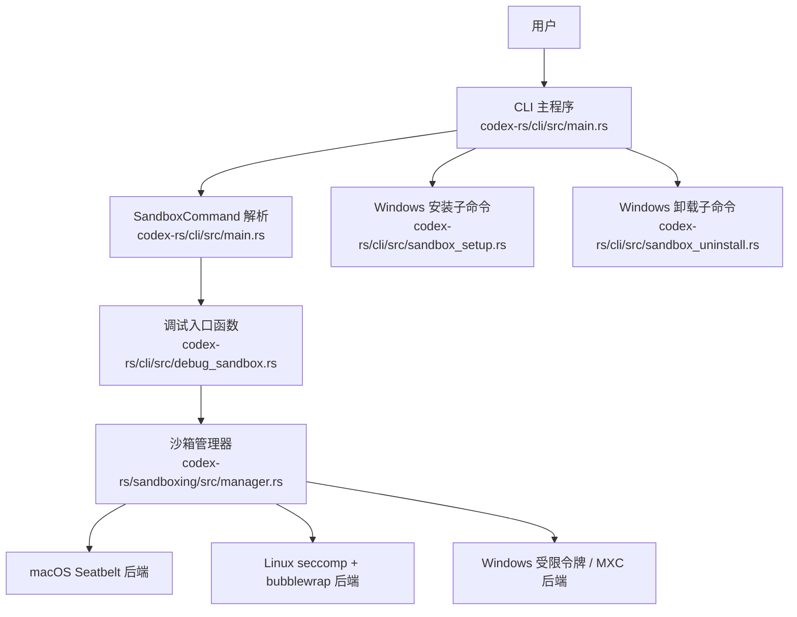
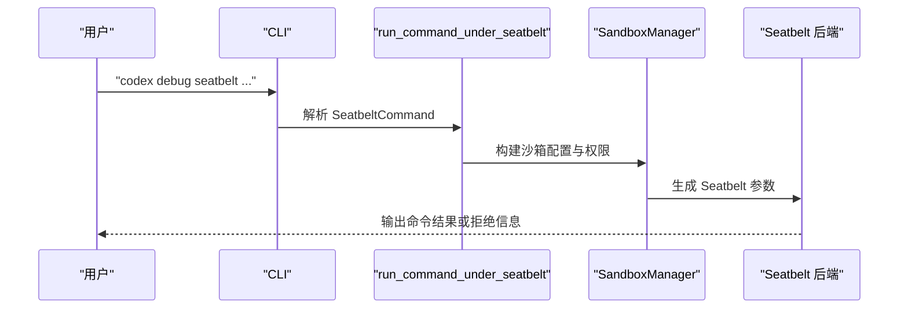
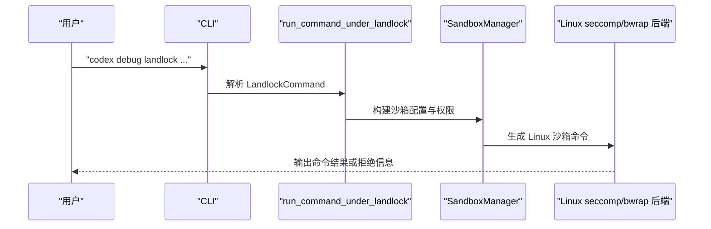
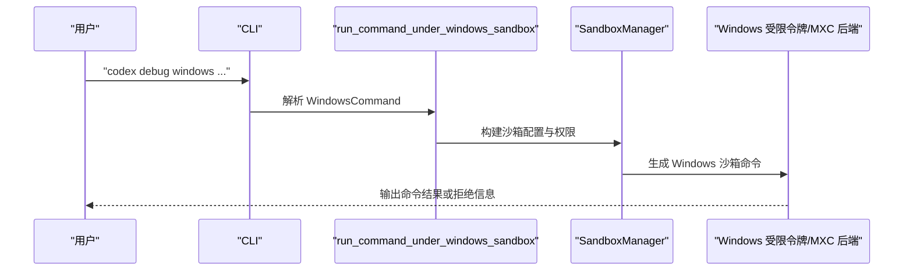
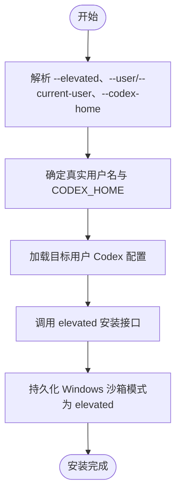
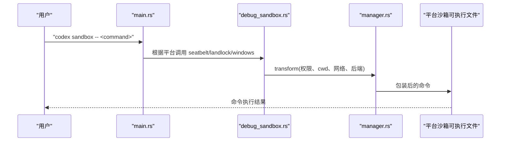
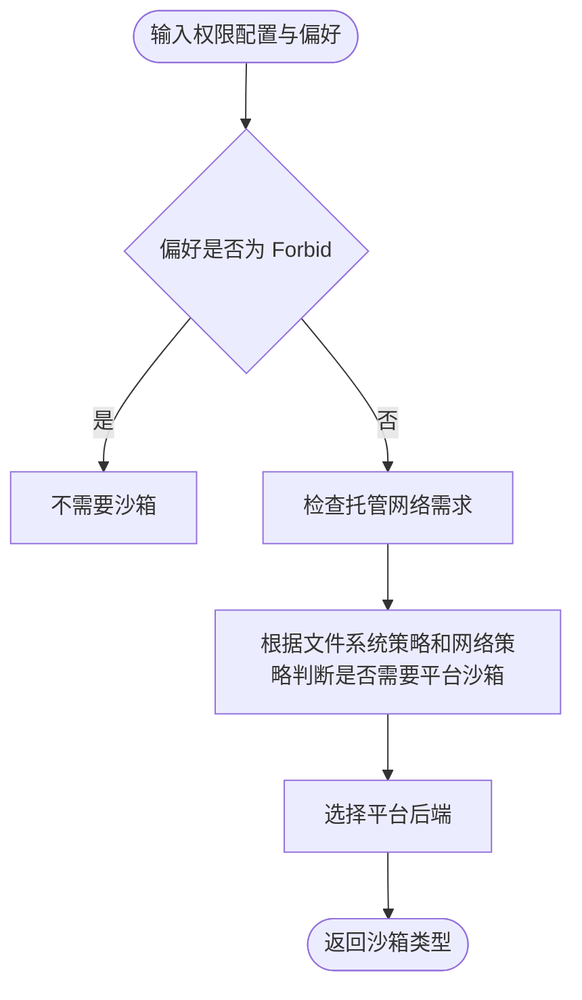
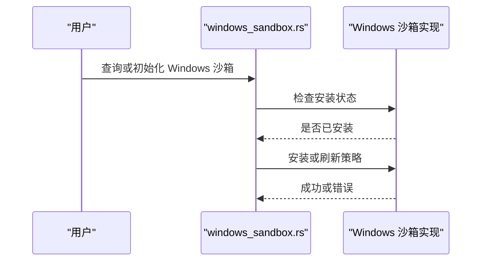

# 沙箱命令

<cite>
**本文引用的文件**   
- [sandbox.md](file://docs/sandbox.md)
- [main.rs](file://codex-rs/cli/src/main.rs)
- [lib.rs](file://codex-rs/cli/src/lib.rs)
- [debug_sandbox.rs](file://codex-rs/cli/src/debug_sandbox.rs)
- [sandbox_setup.rs](file://codex-rs/cli/src/sandbox_setup.rs)
- [sandbox_uninstall.rs](file://codex-rs/cli/src/sandbox_uninstall.rs)
- [manager.rs](file://codex-rs/sandboxing/src/manager.rs)
- [README.md](file://codex-rs/linux-sandbox/README.md)
- [windows_sandbox.rs](file://codex-rs/core/src/windows_sandbox.rs)
</cite>

## 目录
1. [引言](#引言)
2. [项目结构与定位](#项目结构与定位)
3. [沙箱命令总览](#沙箱命令总览)
4. [命令使用方法](#命令使用方法)
5. [沙箱创建、配置与销毁](#沙箱创建配置与销毁)
6. [安全策略、资源限制与网络隔离](#安全策略资源限制与网络隔离)
7. [平台差异与最佳实践](#平台差异与最佳实践)
8. [性能调优](#性能调优)
9. [故障排除](#故障排除)
10. [结论](#结论)

## 引言
本文件面向使用 `codex sandbox` 及相关调试子命令的用户和集成者，说明如何创建、配置、使用和销毁 Codex 提供的沙箱环境，并解释 Linux、macOS、Windows 三类后端的安全策略、资源限制和网络隔离方式。仓库主文档对沙箱与安全审批的入口说明位于公开文档中；本文在此基础上补充代码实现层面的命令结构、执行流程和可操作建议。

**章节来源**
- [sandbox.md:1-3](file://docs/sandbox.md#L1-L3)

## 项目结构与定位
`sandbox` 命令属于 CLI 多工具命令中的一个顶级子命令。其职责不是直接实现全部沙箱逻辑，而是：
- 解析用户参数；
- 根据当前操作系统选择对应沙箱后端；
- 调用统一的沙箱管理器构建最终进程启动请求；
- 在 Windows 上提供独立的安装与卸载子命令；
- 为 macOS、Linux、Windows 提供调试型入口，用于手动构造和运行受控命令。



**图示来源**
- [main.rs:190-191](file://codex-rs/cli/src/main.rs#L190-L191)
- [main.rs:470-503](file://codex-rs/cli/src/main.rs#L470-L503)
- [main.rs:1750-1810](file://codex-rs/cli/src/main.rs#L1750-L1810)
- [debug_sandbox.rs:1-1179](file://codex-rs/cli/src/debug_sandbox.rs#L1-L1179)
- [manager.rs:1-260](file://codex-rs/sandboxing/src/manager.rs#L1-L260)

**章节来源**
- [main.rs:190-191](file://codex-rs/cli/src/main.rs#L190-L191)
- [main.rs:470-503](file://codex-rs/cli/src/main.rs#L470-L503)
- [main.rs:1750-1810](file://codex-rs/cli/src/main.rs#L1750-L1810)
- [lib.rs:2-15](file://codex-rs/cli/src/lib.rs#L2-L15)

## 沙箱命令总览
`sandbox` 是一个平台选择器。它接收一组通用选项和一个待执行的命令，然后委托给：
- macOS：Seatbelt 沙箱；
- Linux：seccomp + bubblewrap 的 `codex-linux-sandbox` 后端；
- Windows：受限令牌沙箱或 MXC 沙箱；
- 其他平台：明确报错，不支持。

同时，CLI 还提供两个 Windows 专用子命令：
- `codex sandbox setup`：以管理员权限完成受管 Windows 沙箱安装；
- `codex sandbox uninstall`：清理旧版 Windows 沙箱账户和网络规则。

| 类别 | 命令或参数 | 作用 |
|---|---|---|
| 顶层命令 | `codex sandbox -- <host_command>` | 在当前主机沙箱后端下执行后续命令 |
| Windows 安装 | `codex sandbox setup --elevated [--user USER|--current-user] [--codex-home DIR]` | 安装或刷新受管 elevated Windows 沙箱 |
| Windows 卸载 | `codex sandbox uninstall` | 清理旧版 Windows 沙箱系统级配置 |
| macOS 调试 | `codex debug seatbelt ...` | 通过 Seatbelt 手动运行命令 |
| Linux 调试 | `codex debug landlock ...` | 通过 Landlock/seccomp 路径调试沙箱 |
| Windows 调试 | `codex debug windows ...` | 通过 Windows 受限令牌沙箱调试命令 |

**章节来源**
- [main.rs:190-191](file://codex-rs/cli/src/main.rs#L190-L191)
- [main.rs:470-503](file://codex-rs/cli/src/main.rs#L470-L503)
- [main.rs:1750-1810](file://codex-rs/cli/src/main.rs#L1750-L1810)
- [debug_sandbox.rs:1-1179](file://codex-rs/cli/src/debug_sandbox.rs#L1-L1179)
- [sandbox_setup.rs:1-230](file://codex-rs/cli/src/sandbox_setup.rs#L1-L230)
- [sandbox_uninstall.rs:1-21](file://codex-rs/cli/src/sandbox_uninstall.rs#L1-L21)

## 命令使用方法

### 基本语法
```text
codex sandbox [选项] -- 要运行的命令及参数
```

关键行为：
- `--` 之后的内容会被作为宿主命令传入目标沙箱后端。
- 若未指定子命令，CLI 会根据操作系统选择默认后端。
- 如果当前平台没有可用后端，CLI 会返回错误，提示该平台不支持 `codex sandbox`。

**章节来源**
- [main.rs:1750-1810](file://codex-rs/cli/src/main.rs#L1750-L1810)

### macOS：Seatbelt 调试入口
macOS 上的调试入口是 `codex debug seatbelt`，由统一调试函数封装：



**图示来源**
- [debug_sandbox.rs:37-88](file://codex-rs/cli/src/debug_sandbox.rs#L37-L88)

**章节来源**
- [debug_sandbox.rs:1-1179](file://codex-rs/cli/src/debug_sandbox.rs#L1-L1179)

### Linux：Landlock 调试入口
Linux 上的调试入口是 `codex debug landlock`，由统一调试函数封装：



**图示来源**
- [debug_sandbox.rs:90-125](file://codex-rs/cli/src/debug_sandbox.rs#L90-L125)

**章节来源**
- [debug_sandbox.rs:1-1179](file://codex-rs/cli/src/debug_sandbox.rs#L1-L1179)

### Windows：受限令牌调试入口
Windows 上的调试入口是 `codex debug windows`，由统一调试函数封装：



**图示来源**
- [debug_sandbox.rs:127-163](file://codex-rs/cli/src/debug_sandbox.rs#L127-L163)

**章节来源**
- [debug_sandbox.rs:1-1179](file://codex-rs/cli/src/debug_sandbox.rs#L1-L1179)

## 沙箱创建、配置与销毁

### 创建 Windows 受管沙箱
Windows 支持通过 `codex sandbox setup` 创建受管 elevated 沙箱。核心参数包括：

| 参数 | 是否必需 | 说明 |
|---|---:|---|
| `--elevated` | 是 | 当前实现要求必须启用 elevated 级别 |
| `--user USER` | 条件必需 | 指定部署后运行 Codex 的 Windows 用户；需要配合 `--codex-home` |
| `--current-user` | 否 | 使用当前环境变量中的用户名作为目标用户 |
| `--codex-home DIR` | 条件必需 | 指定目标用户的 CODEX_HOME；使用 `--user` 时必需 |

安装流程：
1. 解析目标用户和 CODEX_HOME；
2. 加载目标用户的 Codex 配置；
3. 调用底层 Windows 沙箱安装接口，写入系统级账户和网络规则；
4. 将 Codex 配置中的 Windows 沙箱模式持久化为 `elevated`；
5. 输出安装完成信息。



**图示来源**
- [sandbox_setup.rs:10-28](file://codex-rs/cli/src/sandbox_setup.rs#L10-L28)
- [sandbox_setup.rs:46-78](file://codex-rs/cli/src/sandbox_setup.rs#L46-L78)
- [sandbox_setup.rs:80-145](file://codex-rs/cli/src/sandbox_setup.rs#L80-L145)
- [sandbox_setup.rs:147-200](file://codex-rs/cli/src/sandbox_setup.rs#L147-L200)

**章节来源**
- [sandbox_setup.rs:1-230](file://codex-rs/cli/src/sandbox_setup.rs#L1-L230)
- [windows_sandbox.rs:241-265](file://codex-rs/core/src/windows_sandbox.rs#L241-L265)

### 销毁旧版 Windows 沙箱
`codex sandbox uninstall` 仅支持 Windows，用于移除旧版机器级账户和网络规则。它不会删除用户数据或 CODEX_HOME。

注意：
- 需要在停止使用该沙箱及其配置服务后以管理员权限运行；
- 非 Windows 平台会直接报错。

**章节来源**
- [sandbox_uninstall.rs:1-21](file://codex-rs/cli/src/sandbox_uninstall.rs#L1-L21)

### 普通主机命令进入沙箱
当用户使用 `codex sandbox -- <command>` 时，CLI 不直接创建新进程树，而是把参数交给各平台的调试入口函数，再由沙箱管理器生成实际可执行命令。



**图示来源**
- [main.rs:1750-1810](file://codex-rs/cli/src/main.rs#L1750-L1810)
- [debug_sandbox.rs:1-1179](file://codex-rs/cli/src/debug_sandbox.rs#L1-L1179)
- [manager.rs:360-560](file://codex-rs/sandboxing/src/manager.rs#L360-L560)

**章节来源**
- [main.rs:1750-1810](file://codex-rs/cli/src/main.rs#L1750-L1810)

## 安全策略、资源限制与网络隔离

### 沙箱类型选择
沙箱管理器根据权限配置和用户偏好决定是否需要沙箱，以及使用哪种后端：

| 偏好 | 含义 |
|---|---|
| `Auto` | 根据文件系统策略、网络策略和托管网络需求决定是否沙箱化 |
| `Require` | 必须沙箱化 |
| `Forbid` | 禁止沙箱化 |

平台默认后端：
- macOS：Seatbelt；
- Linux：seccomp + bubblewrap；
- Windows：若启用则使用受限令牌沙箱，否则无后端；
- 特殊：Windows MXC 可作为独立后端参与选择。



**图示来源**
- [manager.rs:1-120](file://codex-rs/sandboxing/src/manager.rs#L1-L120)
- [manager.rs:300-420](file://codex-rs/sandboxing/src/manager.rs#L300-L420)

**章节来源**
- [manager.rs:1-260](file://codex-rs/sandboxing/src/manager.rs#L1-L260)

### Linux 安全模型
Linux 后端以 bubblewrap 做文件和命名空间隔离，并以 seccomp 过滤系统调用。重要行为包括：
- 默认只读根文件系统；
- 通过绑定 writable roots 暴露必要写路径；
- 对 `.git`、`.codex` 等敏感子路径重新施加只读保护；
- 按路径特异性顺序应用读写拆分策略；
- 扩展只读 glob 规则时优先使用外部 `rg`，失败时回退内部 walker；
- 对用户命名空间、PID 命名空间和可选网络命名空间进行隔离；
- 在受限网络模式下阻止网络系统调用；
- 阻断 `AF_VSOCK` 和 `io_uring`；
- WSL2 走正常 bubblewrap 路径；WSL1 不支持 bubblewrap。

这些细节来自 Linux 沙箱 crate 的自述文档。

**章节来源**
- [README.md:1-124](file://codex-rs/linux-sandbox/README.md#L1-L124)

### macOS 安全模型
macOS 后端通过 Seatbelt 执行命令。CLI 调试入口支持：
- 注入托管网络上下文；
- 允许显式 AF_UNIX socket 根路径；
- 捕获并记录 macOS 沙箱拒绝事件；
- 处理继承终端场景下的 Unix socket 与终端注入防护。

**章节来源**
- [debug_sandbox.rs:1-1179](file://codex-rs/cli/src/debug_sandbox.rs#L1-L1179)

### Windows 安全模型
Windows 支持两类主要后端：
- 受限令牌沙箱；
- MXC 沙箱。

Windows 安装与运行时相关能力包括：
- 检测当前 Windows 沙箱是否已完成设置；
- 准备 elevated 沙箱；
- 安装受管 elevated 沙箱；
- 本地绑定策略与托管代理路由；
- 清理旧版 Windows 沙箱。



**图示来源**
- [windows_sandbox.rs:186-265](file://codex-rs/core/src/windows_sandbox.rs#L186-L265)

**章节来源**
- [windows_sandbox.rs:170-340](file://codex-rs/core/src/windows_sandbox.rs#L170-L340)

## 平台差异与最佳实践

### Linux
- 优先使用带 bubblewrap 的系统环境；
- 若 `bwrap` 缺失，CLI 会给出启动警告，并可能回退到内置辅助二进制；
- WSL2 可使用 bubblewrap；WSL1 不被支持；
- 对于需要严格文件系统隔离的策略，应确保 bubblewrap 可用；
- 可通过托管代理模式限制出站网络访问；
- 若发现子路径挂载或只读策略异常，应检查 permissions profile 中的 glob 规则和敏感子路径保护。

**章节来源**
- [README.md:1-124](file://codex-rs/linux-sandbox/README.md#L1-L124)

### macOS
- Seatbelt 仅在 macOS 可用；
- 调试时可开启日志输出，查看内核级沙箱拒绝事件；
- 若命令需要访问特定 Unix socket，需显式授权相应根路径；
- 继承终端的命令会受到终端注入防护。

**章节来源**
- [debug_sandbox.rs:1-1179](file://codex-rs/cli/src/debug_sandbox.rs#L1-L1179)

### Windows
- 推荐先运行 `codex sandbox setup --elevated` 完成受管安装；
- 使用 `--user` 时需同时提供 `--codex-home`；
- 使用 `--current-user` 时从环境变量获取用户名；
- 清理旧版沙箱时使用 `codex sandbox uninstall`；
- 托管网络通常需要 elevated 后端；
- 若命令因缺少本地绑定或代理路由失败，应检查网络代理配置和 Windows 沙箱策略刷新状态。

**章节来源**
- [sandbox_setup.rs:1-230](file://codex-rs/cli/src/sandbox_setup.rs#L1-L230)
- [sandbox_uninstall.rs:1-21](file://codex-rs/cli/src/sandbox_uninstall.rs#L1-L21)
- [windows_sandbox.rs:186-340](file://codex-rs/core/src/windows_sandbox.rs#L186-L340)

## 性能调优
虽然本节不直接分析具体源码，但可从现有架构推导以下调优方向：

| 方面 | 建议 |
|---|---|
| Linux bubblewrap 扫描 | 大仓库中 glob 扫描可能较慢，可通过权限配置限制扫描深度 |
| 沙箱后端选择 | 避免不必要的强制沙箱；使用 `Auto` 让管理器基于策略决策 |
| 网络代理 | 托管代理模式下，尽量复用已准备的代理上下文，减少重复初始化 |
| 工作目录策略 | 避免过宽的 writable roots；缩小命令 cwd 和 policy cwd 范围 |
| Windows 安装 | 安装完成后刷新策略，避免每次命令都触发完整预检 |
| 调试命令 | 使用 `codex debug` 系列命令逐步缩小问题，而不是直接扩大沙箱权限 |

**章节来源**
- [README.md:1-124](file://codex-rs/linux-sandbox/README.md#L1-L124)
- [manager.rs:300-560](file://codex-rs/sandboxing/src/manager.rs#L300-L560)

## 故障排除

### 常见错误与排查步骤

| 现象 | 可能原因 | 排查建议 |
|---|---|---|
| 在非 Windows 平台运行 `codex sandbox uninstall` | 该命令仅支持 Windows | 确认操作系统；不要在 Linux/macOS 上使用 |
| `codex sandbox` 报告当前平台不支持 | 当前平台没有可用后端 | 使用 `codex debug seatbelt`、`codex debug landlock` 或 `codex debug windows` 验证对应后端 |
| Windows elevated 沙箱未安装 | 未完成 `setup` 或策略未刷新 | 以管理员运行 `codex sandbox setup --elevated` |
| Windows 托管网络失败 | 未使用 elevated 后端或缺少代理路由 | 检查 `--elevated` 和代理配置 |
| Linux 命令被拒绝访问网络 | seccomp 或 bubblewrap 网络隔离生效 | 检查托管代理模式和受限网络策略 |
| Linux glob 规则未生效 | 外部 `rg` 不可用或扫描失败 | 检查 `rg` 可用性、glob 规则和工作区根路径 |
| macOS 无法访问 Unix socket | 未授权对应 socket 根路径 | 使用调试入口显式添加允许路径 |
| WSL1 无法使用 bubblewrap | WSL1 不支持所需用户命名空间 | 升级到 WSL2 或使用不受 bubblewrap 依赖的执行路径 |

**章节来源**
- [sandbox_uninstall.rs:1-21](file://codex-rs/cli/src/sandbox_uninstall.rs#L1-L21)
- [main.rs:1750-1810](file://codex-rs/cli/src/main.rs#L1750-L1810)
- [debug_sandbox.rs:1-1179](file://codex-rs/cli/src/debug_sandbox.rs#L1-L1179)
- [manager.rs:300-560](file://codex-rs/sandboxing/src/manager.rs#L300-L560)
- [README.md:1-124](file://codex-rs/linux-sandbox/README.md#L1-L124)
- [windows_sandbox.rs:186-340](file://codex-rs/core/src/windows_sandbox.rs#L186-L340)

## 结论
`sandbox` 命令是 Codex 跨平台沙箱能力的统一入口。它本身不负责实现所有隔离机制，而是将用户意图转换为统一的沙箱转换请求，再由 `SandboxManager` 选择 macOS Seatbelt、Linux seccomp/bubblewrap 或 Windows 受限令牌/MXC 后端。对日常用户而言，最重要的操作是：
- 使用 `codex sandbox -- <command>` 在受控环境中运行命令；
- 在 Windows 上通过 `codex sandbox setup` 完成 elevated 沙箱安装；
- 在 Windows 上通过 `codex sandbox uninstall` 清理旧版沙箱；
- 结合权限配置、托管网络和调试命令，平衡安全性、可用性与性能。