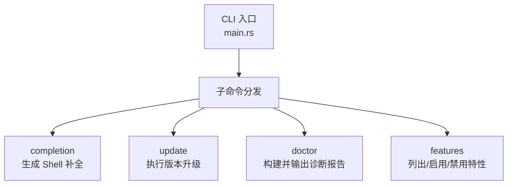
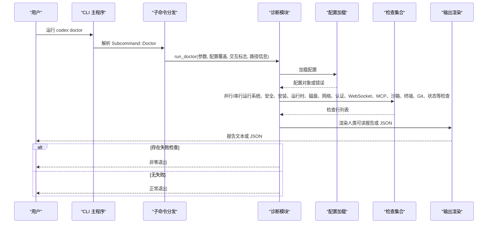
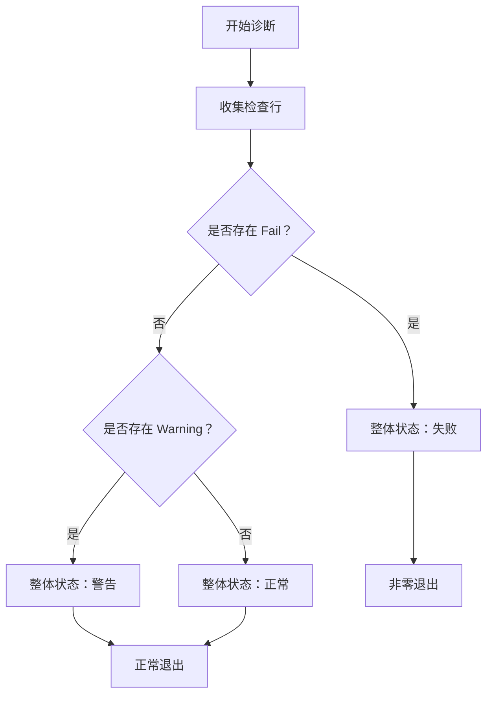
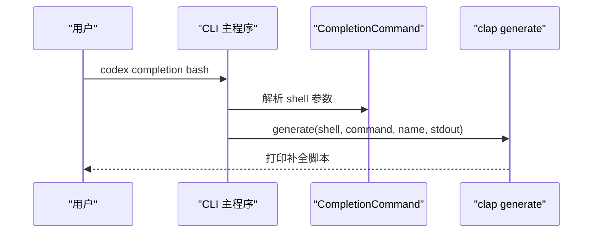
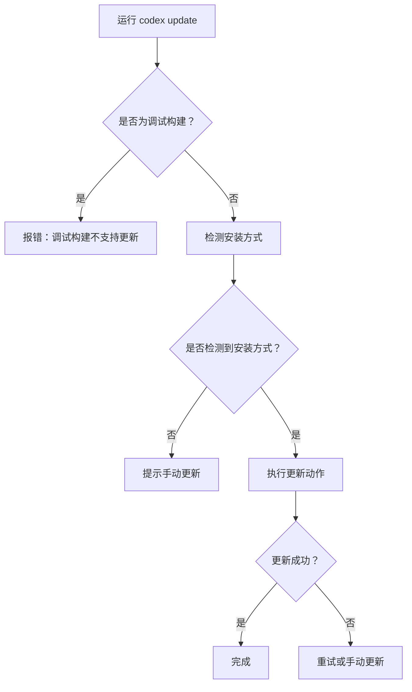
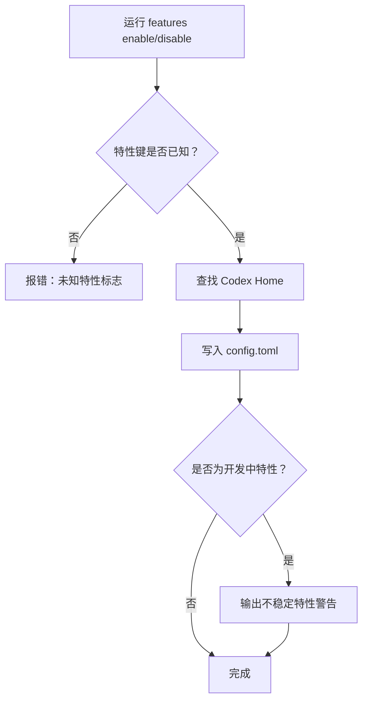
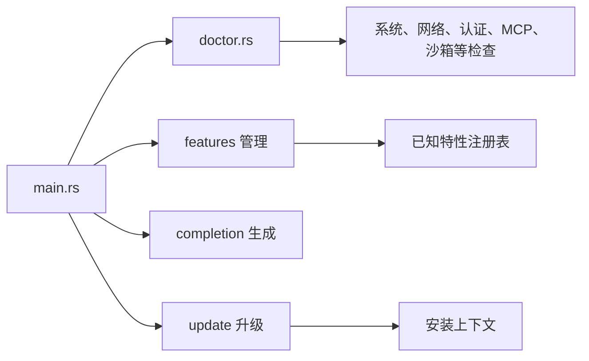

# 系统工具

<cite>
**本文引用的文件**   
- [codex-rs/cli/src/main.rs](file://codex-rs/cli/src/main.rs)
- [codex-rs/cli/src/doctor.rs](file://codex-rs/cli/src/doctor.rs)
</cite>

## 目录
1. [引言](#引言)
2. [项目结构](#项目结构)
3. [核心命令总览](#核心命令总览)
4. [架构总览](#架构总览)
5. [诊断工具 Doctor](#诊断工具-doctor)
6. [Shell 补全 Completion](#shell-补全-completion)
7. [版本升级 Update](#版本升级-update)
8. [功能特性 Features](#功能特性-features)
9. [依赖关系分析](#依赖关系分析)
10. [性能与可观测性](#性能与可观测性)
11. [故障排查指南](#故障排查指南)
12. [结论](#结论)

## 引言
本文面向 Codex 用户和运维人员，系统化说明以下系统维护命令：

- `codex doctor`：本地环境、配置、认证、网络、状态、终端、沙箱等健康检查。
- `codex completion`：为 Bash、Zsh、PowerShell、Fish 等 Shell 生成自动补全脚本。
- `codex update`：在受支持的发行安装中升级 Codex。
- `codex features`：列出、启用或禁用功能特性开关。

文档包含命令用法、输出解读、问题排查流程、修复建议、升级策略和功能开关管理方法。

## 项目结构
Codex 的命令行入口位于 Rust 子包 `codex-rs/cli`。四个系统维护命令统一由主 CLI 分发：

- `Subcommand::Completion`：生成 Shell 补全。
- `Subcommand::Update`：调用更新逻辑。
- `Subcommand::Doctor`：运行诊断报告。
- `Subcommand::Features`：管理功能开关。



**图表来源**
- [codex-rs/cli/src/main.rs:145-280](file://codex-rs/cli/src/main.rs#L145-L280)
- [codex-rs/cli/src/main.rs:1690-1740](file://codex-rs/cli/src/main.rs#L1690-L1740)

**章节来源**
- [codex-rs/cli/src/main.rs:145-280](file://codex-rs/cli/src/main.rs#L145-L280)
- [codex-rs/cli/src/main.rs:1690-1740](file://codex-rs/cli/src/main.rs#L1690-L1740)

## 核心命令总览

| 命令 | 用途 | 关键行为 | 退出码含义 |
|---|---|---|---|
| `codex completion` | 生成 Shell 自动补全脚本 | 解析目标 Shell，打印补全内容到标准输出 | 成功时正常退出；失败时返回错误 |
| `codex update` | 升级 Codex 安装 | 检测安装方式，调用更新动作；调试构建不可用 | 成功时正常退出；失败时非零退出 |
| `codex doctor` | 诊断本地安装与环境 | 读取配置，运行多项检查，输出人类可读或 JSON 报告 | 存在失败项时非零退出 |
| `codex features list` | 列出所有已知特性及其阶段和状态 | 加载配置，遍历已知特性集，按名称排序输出 | 成功时正常退出 |
| `codex features enable <name>` | 启用某特性 | 校验特性键，写入 `config.toml` | 成功时正常退出 |
| `codex features disable <name>` | 禁用某特性 | 校验特性键，写入 `config.toml` | 成功时正常退出 |

**章节来源**
- [codex-rs/cli/src/main.rs:145-280](file://codex-rs/cli/src/main.rs#L145-L280)
- [codex-rs/cli/src/main.rs:960-1070](file://codex-rs/cli/src/main.rs#L960-L1070)
- [codex-rs/cli/src/main.rs:1905-2075](file://codex-rs/cli/src/main.rs#L1905-L2075)
- [codex-rs/cli/src/main.rs:2800-2830](file://codex-rs/cli/src/main.rs#L2800-L2830)
- [codex-rs/cli/src/main.rs:885-900](file://codex-rs/cli/src/main.rs#L885-L900)
- [codex-rs/cli/src/doctor.rs:320-480](file://codex-rs/cli/src/doctor.rs#L320-L480)

## 架构总览
`codex` 使用 clap 定义子命令枚举，并通过异步分发函数处理参数、配置覆盖、远程模式限制和遥测记录。诊断工具通过模块化的检查器收集结果，最终汇总为整体状态。



**图表来源**
- [codex-rs/cli/src/main.rs:1690-1740](file://codex-rs/cli/src/main.rs#L1690-L1740)
- [codex-rs/cli/src/doctor.rs:320-480](file://codex-rs/cli/src/doctor.rs#L320-L480)

## 诊断工具 Doctor

### 命令选项
`codex doctor` 提供以下主要选项：

| 选项 | 含义 |
|---|---|
| `--json` | 输出脱敏后的机器可读 JSON 报告 |
| `--network-only` | 仅运行配置、网络环境、提供者 HTTP 和 Responses WebSocket 相关检查 |
| `--summary` | 仅显示分组检查结果和最终统计摘要 |
| `--all` | 在人类可读输出中展开长列表 |
| `--no-color` | 关闭人类可读输出的 ANSI 颜色 |
| `--ascii` | 使用 ASCII 状态标签和分隔符 |

内部还有一个隐藏参数用于文件系统探测，不对外暴露。

### 检查范围
默认诊断包括：

- **system**：基础系统信息。
- **endpoint protection**：端点防护状态。
- **installation**：安装方式和安装上下文。
- **runtime**：运行时能力。
- **search**：搜索能力。
- **disk**：磁盘与状态目录。
- **dev drive**：Windows 平台上的开发驱动器检查。
- **filesystem paths**：状态路径可访问性。
- **auth**：认证配置与凭据完整性。
- **updates**：更新可用性。
- **network**：代理和网络环境变量。
- **websocket**：Responses WebSocket 可达性。
- **MCP**：外部 MCP 服务器配置一致性。
- **sandbox**：沙箱能力。
- **terminal**：终端检测、尺寸、颜色、标题设置。
- **git**：Git 可用性。
- **state**：SQLite 状态数据库完整性。
- **thread inventory**：线程清单。
- **background server**：后台服务状态。
- **reachability**：Provider 可达性计划。

### 输出模型
诊断结果由若干检查行组成，每条检查具有：

- 类别：如 `config`、`auth`、`network`。
- 状态：`Ok`、`Warning`、`Fail`。
- 消息：人类可读摘要。
- 详情：可选详细数据。
- 修复建议：可选 remediation。

整体状态规则如下：

- 任意 `Fail` → 整体 `Fail`。
- 无 `Fail` 但有 `Warning` → 整体 `Warning`。
- 全部 `Ok` → 整体 `Ok`。



**图表来源**
- [codex-rs/cli/src/doctor.rs:891-900](file://codex-rs/cli/src/doctor.rs#L891-L900)

### 如何解读报告
- 如果整体状态为 `Fail`，命令会非零退出，适合脚本自动化判断。
- 如果整体状态为 `Warning`，通常表示存在可选问题或降级情况。
- 人类可读输出适合交互式排查；JSON 输出适合日志采集和问题附件。
- 每项检查应关注三类信息：状态、消息、修复建议。

### 典型排查流程
1. 先运行完整诊断：`codex doctor`。
2. 若只想验证网络和 API 连通性，使用 `--network-only`。
3. 若只需快速查看分组结果，使用 `--summary`。
4. 需要机器解析时，使用 `--json`。
5. 针对特定失败项，阅读其 remediation 字段。
6. 根据失败类别定位：
   - `auth`：检查登录状态、令牌、API Key 环境变量。
   - `network`：检查代理环境变量、HTTPS 可达性。
   - `websocket`：检查 Responses WebSocket 握手和 Beta Header。
   - `MCP`：检查 MCP 配置、传输类型、连接参数。
   - `state`：检查 SQLite 状态数据库是否损坏。
   - `sandbox`：检查沙箱二进制和权限。
   - `terminal`：检查终端类型、列宽、颜色、标题支持。

**章节来源**
- [codex-rs/cli/src/doctor.rs:225-480](file://codex-rs/cli/src/doctor.rs#L225-L480)
- [codex-rs/cli/src/doctor.rs:891-900](file://codex-rs/cli/src/doctor.rs#L891-L900)

## Shell 补全 Completion

### 命令用法
```text
codex completion [SHELL]
```

默认生成 Bash 补全；也可指定其他 Shell。

### 支持的 Shell
实现使用 clap 内置的 `generate` 能力，因此支持 clap 所声明的 Shell 枚举。常见包括：

- Bash
- Zsh
- PowerShell
- Fish

### 生成与配置示例
以下为通用步骤（具体文件名和路径因操作系统而异）：

1. 生成 Bash 补全：
   ```text
   codex completion bash > /etc/bash_completion.d/codex
   ```
2. 生成 Zsh 补全：
   ```text
   codex completion zsh > ~/.zfunc/_codex
   ```
3. 生成 PowerShell 补全：
   ```text
   codex completion powershell > codex.ps1
   ```
4. 生成 Fish 补全：
   ```text
   codex completion fish > ~/.config/fish/completions/codex.fish
   ```

### 工作机制
`print_completion` 会构造完整的 CLI 命令描述，并使用 clap 的 `generate` 将补全脚本写入标准输出。它不会修改系统文件或用户配置文件。



**图表来源**
- [codex-rs/cli/src/main.rs:2800-2830](file://codex-rs/cli/src/main.rs#L2800-L2830)

**章节来源**
- [codex-rs/cli/src/main.rs:181-250](file://codex-rs/cli/src/main.rs#L181-L250)
- [codex-rs/cli/src/main.rs:1707-1715](file://codex-rs/cli/src/main.rs#L1707-L1715)
- [codex-rs/cli/src/main.rs:2800-2830](file://codex-rs/cli/src/main.rs#L2800-L2830)

## 版本升级 Update

### 命令行为
`codex update` 主要用于在受支持的发行安装中升级 Codex。其核心流程：

1. 拒绝远程模式：该命令不是远程 TUI 操作。
2. 调用 `run_update_command`。
3. 调试构建直接报错，提示使用发布构建。
4. 获取当前安装方式对应的更新动作。
5. 在临时目录执行更新命令。
6. 向用户展示更新结果。

### 重要约束
- 调试构建不支持 `codex update`。
- 无法检测安装方式时会提示手动更新。
- Windows 上会从 PATH 解析绝对路径的更新命令。
- 更新命令需要绝对路径，相对路径会被忽略。

### 升级策略建议
- 优先使用发布构建版本进行升级。
- 如果自动升级失败，参考官方文档手动下载并替换二进制。
- 在企业环境中，可将发布构建纳入软件分发流程。
- 升级后重新运行 `codex doctor` 确认环境健康。



**图表来源**
- [codex-rs/cli/src/main.rs:885-900](file://codex-rs/cli/src/main.rs#L885-L900)
- [codex-rs/cli/src/main.rs:798-882](file://codex-rs/cli/src/main.rs#L798-L882)

**章节来源**
- [codex-rs/cli/src/main.rs:885-900](file://codex-rs/cli/src/main.rs#L885-L900)
- [codex-rs/cli/src/main.rs:798-882](file://codex-rs/cli/src/main.rs#L798-L882)
- [codex-rs/cli/src/main.rs:1717-1723](file://codex-rs/cli/src/main.rs#L1717-L1723)

## 功能特性 Features

### 命令总览
`codex features` 是一个功能开关管理命令，包含三个子命令：

| 子命令 | 作用 |
|---|---|
| `list` | 列出所有已知特性、阶段和当前生效状态 |
| `enable <name>` | 在 `config.toml` 中启用指定特性 |
| `disable <name>` | 在 `config.toml` 中禁用指定特性 |

### 特性阶段
特性具有以下阶段：

- **under development**：开发中，可能不完整且行为不稳定。
- **experimental**：实验阶段。
- **stable**：稳定可用。
- **deprecated**：已废弃。
- **removed**：已移除。

### 启用特性的注意事项
- 启用开发中特性时，CLI 会输出警告。
- 可通过配置项抑制不稳定特性警告。
- 特性键必须属于已知特性集合，否则会报“未知特性标志”。

### 配置写入行为
- `enable` 会将对应特性标记为启用。
- `disable` 会将对应特性标记为禁用。
- 两者都会写入 Codex Home 下的 `config.toml`。



**图表来源**
- [codex-rs/cli/src/main.rs:960-1070](file://codex-rs/cli/src/main.rs#L960-L1070)
- [codex-rs/cli/src/main.rs:1905-2075](file://codex-rs/cli/src/main.rs#L1905-L2075)

**章节来源**
- [codex-rs/cli/src/main.rs:960-1070](file://codex-rs/cli/src/main.rs#L960-L1070)
- [codex-rs/cli/src/main.rs:1905-2075](file://codex-rs/cli/src/main.rs#L1905-L2075)

## 依赖关系分析
四个系统命令共享以下基础设施：

- **CLI 参数解析**：clap 子命令枚举。
- **配置加载**：从 Codex Home 加载 `config.toml`。
- **特性系统**：`codex_features` 提供已知特性定义和阶段。
- **诊断框架**：`doctor.rs` 模块化检查器。
- **安装上下文**：用于判断安装方式、路径和平台能力。



**图表来源**
- [codex-rs/cli/src/main.rs:145-280](file://codex-rs/cli/src/main.rs#L145-L280)
- [codex-rs/cli/src/doctor.rs:320-480](file://codex-rs/cli/src/doctor.rs#L320-L480)

**章节来源**
- [codex-rs/cli/src/main.rs:145-280](file://codex-rs/cli/src/main.rs#L145-L280)
- [codex-rs/cli/src/main.rs:960-1070](file://codex-rs/cli/src/main.rs#L960-L1070)
- [codex-rs/cli/src/doctor.rs:320-480](file://codex-rs/cli/src/doctor.rs#L320-L480)

## 性能与可观测性
- `codex doctor` 设计为“读多写少”的诊断工具，不尝试修复问题，避免对本地状态造成副作用。
- 部分检查并发执行，但长时间检查仍会给出进度反馈。
- `--json` 输出适合自动化流水线、日志收集和工单附件。
- `--summary` 适合快速扫描大量机器时的紧凑输出。
- `--all` 适合需要完整上下文但不希望逐条展开的调试场景。

**章节来源**
- [codex-rs/cli/src/doctor.rs:320-480](file://codex-rs/cli/src/doctor.rs#L320-L480)

## 故障排查指南

### 常见问题与修复建议

| 现象 | 可能原因 | 建议操作 |
|---|---|---|
| `codex update` 报错调试构建不支持 | 当前二进制为 debug 构建 | 安装发布构建后再试 |
| 自动升级失败 | 未识别安装方式或 PATH 缺少绝对路径 | 手动下载发布版并按官方文档替换 |
| `codex doctor` 整体状态为 `Fail` | 至少一个检查失败 | 根据失败类别逐项修复 |
| `auth` 检查失败 | 登录失效、令牌缺失、API Key 配置异常 | 重新登录或检查环境变量 |
| `websocket` 检查失败 | Provider WebSocket 不可达或 Beta Header 配置异常 | 检查网络代理、防火墙、证书和 Provider 状态 |
| `MCP` 检查失败 | MCP 配置不一致或缺少必要输入 | 检查 MCP 服务器配置、传输类型和连接参数 |
| `state` 检查失败 | SQLite 状态数据库损坏 | 备份状态目录后尝试迁移或清理无效数据库 |
| `terminal` 检查失败 | 终端不支持颜色、标题或列宽过窄 | 切换到兼容终端或调整终端设置 |
| `features enable` 报错未知特性 | 特性名不在已知特性集合中 | 先运行 `codex features list` 查询合法特性名 |

### 推荐排错顺序
1. 运行 `codex doctor --summary` 快速判断整体健康。
2. 使用 `--json` 保存完整报告。
3. 对失败项逐一分析 remediation。
4. 对网络类问题使用 `--network-only` 隔离变量。
5. 修复后再次运行完整诊断。
6. 如果是特性问题，使用 `codex features list` 确认特性阶段和状态。
7. 如果是升级问题，优先确认安装方式和支持的更新路径。

**章节来源**
- [codex-rs/cli/src/doctor.rs:320-480](file://codex-rs/cli/src/doctor.rs#L320-L480)
- [codex-rs/cli/src/main.rs:885-900](file://codex-rs/cli/src/main.rs#L885-L900)
- [codex-rs/cli/src/main.rs:1905-2075](file://codex-rs/cli/src/main.rs#L1905-L2075)

## 结论
- `codex doctor` 是诊断本地环境的权威入口，输出结构化、可解释、可脚本化。
- `codex completion` 是 Shell 体验的基础设施，负责生成而不修改系统配置。
- `codex update` 是发布安装的升级入口，调试构建不可用，失败时应回退到手动升级。
- `codex features` 是功能开关的管理界面，启用开发中特性时需要谨慎，并注意不稳定警告。

合理使用这四个命令，可以覆盖大多数 Codex 安装、诊断、升级和功能调优场景。