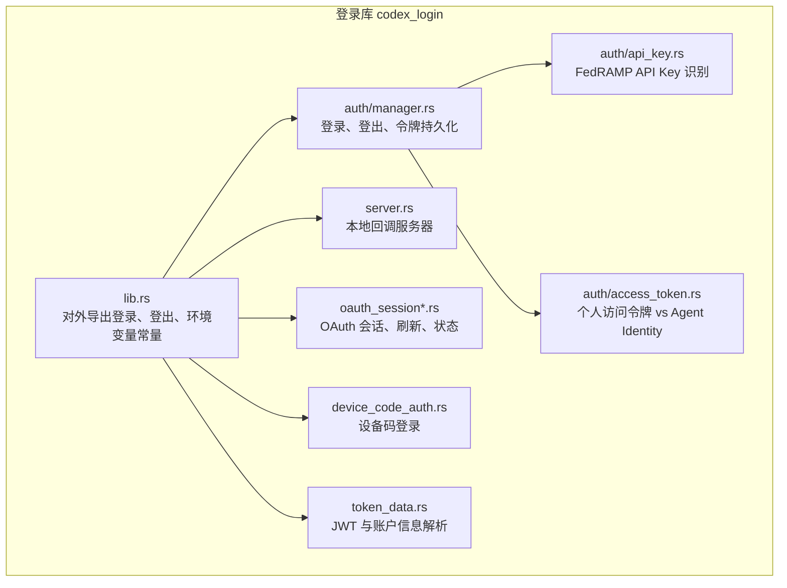
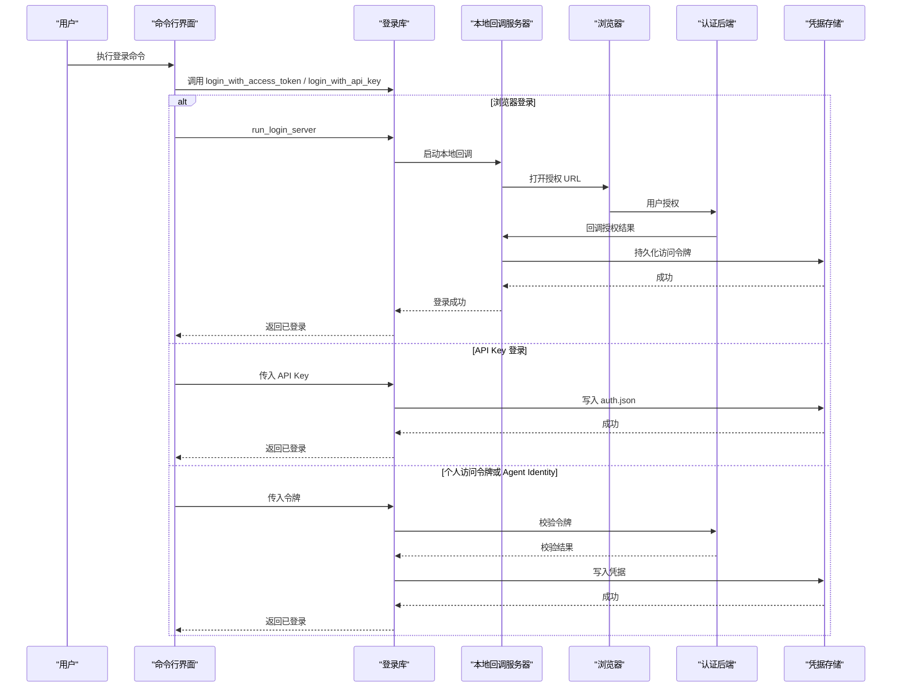
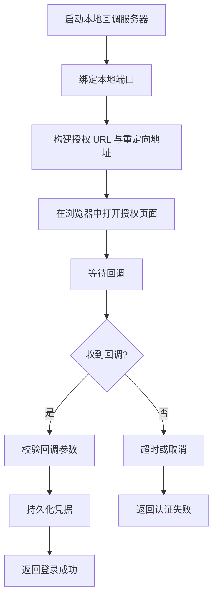
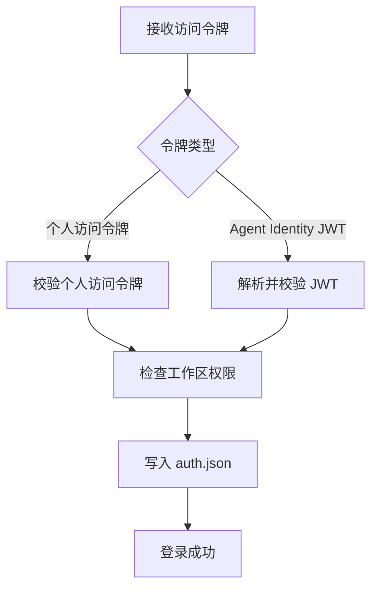
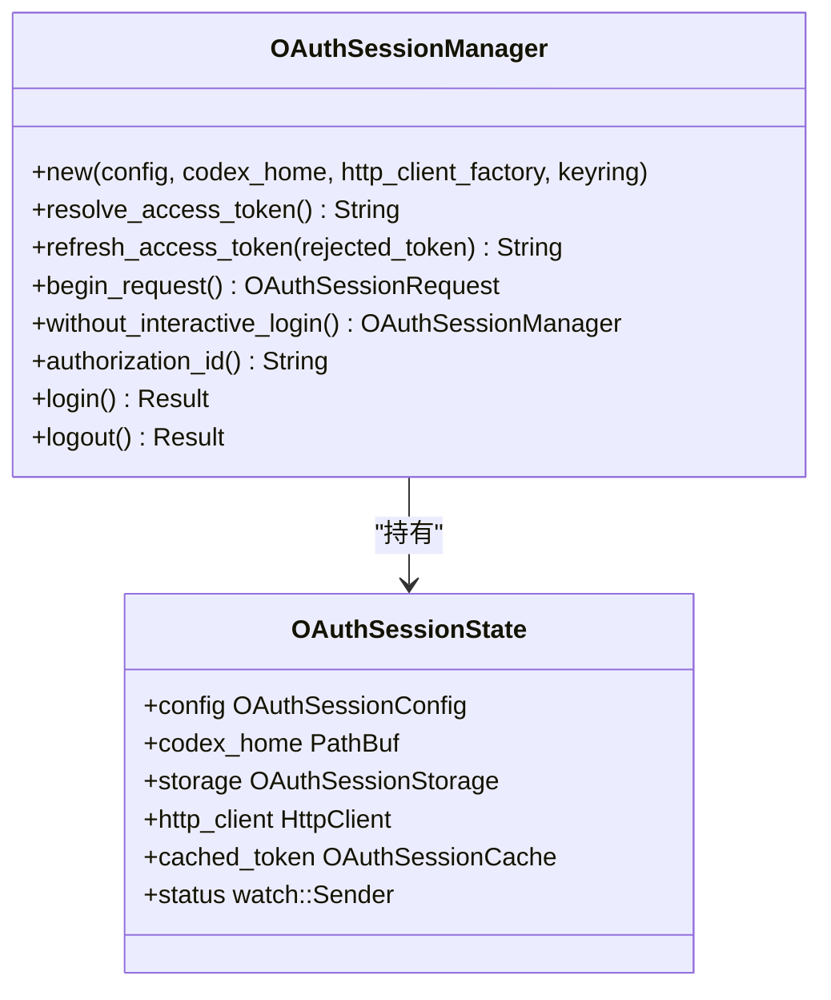
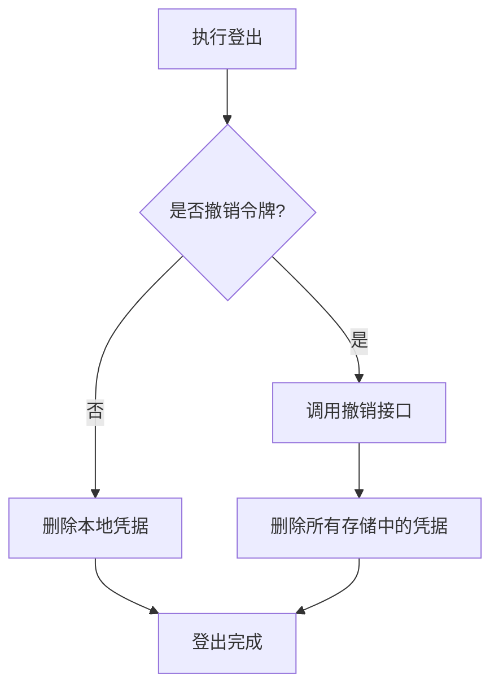
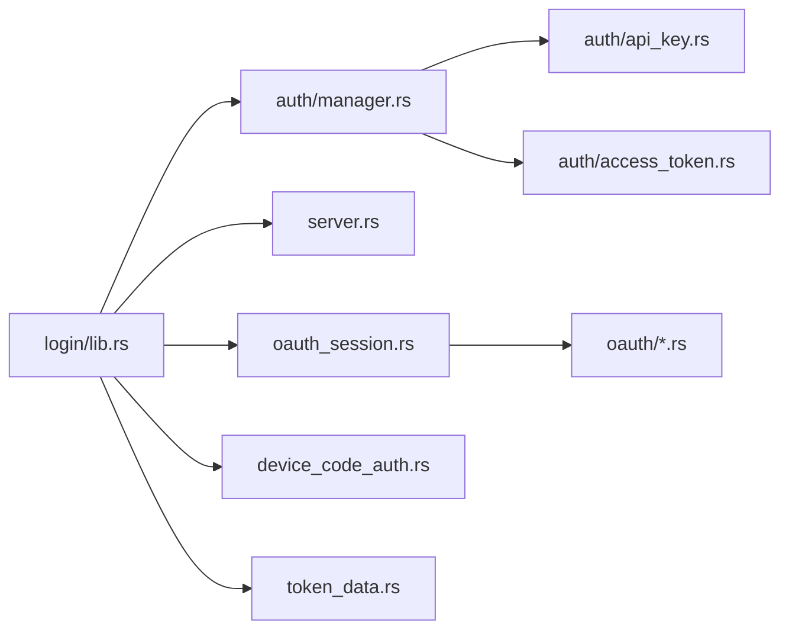

# 认证管理

<cite>
**本文引用的文件**   
- [codex-rs/login/src/lib.rs](file://codex-rs/login/src/lib.rs)
- [codex-rs/login/src/auth/mod.rs](file://codex-rs/login/src/auth/mod.rs)
- [codex-rs/login/src/auth/manager.rs](file://codex-rs/login/src/auth/manager.rs)
- [codex-rs/login/src/auth/change_state.rs](file://codex-rs/login/src/auth/change_state.rs)
- [codex-rs/login/src/auth/api_key.rs](file://codex-rs/login/src/auth/api_key.rs)
- [codex-rs/login/src/auth/access_token.rs](file://codex-rs/login/src/auth/access_token.rs)
- [codex-rs/login/src/server.rs](file://codex-rs/login/src/server.rs)
- [codex-rs/login/src/oauth_session.rs](file://codex-rs/login/src/oauth_session.rs)
- [codex-rs/login/src/oauth_session_login.rs](file://codex-rs/login/src/oauth_session_login.rs)
- [codex-rs/login/src/device_code_auth.rs](file://codex-rs/login/src/device_code_auth.rs)
- [codex-rs/login/src/token_data.rs](file://codex-rs/login/src/token_data.rs)
- [docs/authentication.md](file://docs/authentication.md)
</cite>

## 目录
1. [引言](#引言)
2. [项目结构](#项目结构)
3. [核心组件](#核心组件)
4. [架构总览](#架构总览)
5. [详细组件分析](#详细组件分析)
6. [依赖关系分析](#依赖关系分析)
7. [性能与并发特性](#性能与并发特性)
8. [企业环境配置与安全实践](#企业环境配置与安全实践)
9. [故障排除指南](#故障排除指南)
10. [结论](#结论)

## 引言
本文件面向使用 Codex 命令行工具的用户和系统集成者，系统说明登录、登出、令牌管理与刷新、清理等认证操作。文档覆盖以下能力：
- 浏览器登录与企业工作区登录流程
- API Key 登录
- 个人访问令牌与 Agent Identity 登录
- 设备码登录
- 访问令牌的生命周期、刷新策略与清理
- 企业场景下的认证配置与安全建议
- 常见认证失败的排查方法

仓库中的公开认证说明链接指向外部开发者文档；实现细节以 `codex-rs/login` 模块为准。

**章节来源**
- [docs/authentication.md:1-3](file://docs/authentication.md#L1-L3)

## 项目结构
认证相关代码集中在 Rust 包 `codex-rs/login`，对外暴露登录、登出、令牌刷新、本地回调服务、设备码登录、OAuth 会话管理等能力。关键组织方式如下：
- `auth/`：认证模式、凭据存储、工作区路由、API Key、个人访问令牌、Agent Identity、撤销逻辑
- `oauth/`：OAuth 客户端、授权码、PKCE、设备授权等底层协议实现
- `server.rs`：本地回调服务器，用于浏览器登录
- `oauth_session*.rs`：网关 OAuth 会话、状态广播、令牌刷新与登录控制
- `device_code_auth.rs`：设备码登录协议
- `token_data.rs`：JWT 载荷解析、账号信息提取、过期时间解析



**图示来源**
- [codex-rs/login/src/lib.rs:1-102](file://codex-rs/login/src/lib.rs#L1-L102)
- [codex-rs/login/src/auth/manager.rs:1070-1250](file://codex-rs/login/src/auth/manager.rs#L1070-L1250)
- [codex-rs/login/src/server.rs:1-200](file://codex-rs/login/src/server.rs#L1-L200)
- [codex-rs/login/src/oauth_session.rs:1-200](file://codex-rs/login/src/oauth_session.rs#L1-L200)
- [codex-rs/login/src/device_code_auth.rs:1-200](file://codex-rs/login/src/device_code_auth.rs#L1-L200)
- [codex-rs/login/src/token_data.rs:1-200](file://codex-rs/login/src/token_data.rs#L1-L200)
- [codex-rs/login/src/auth/api_key.rs:1-9](file://codex-rs/login/src/auth/api_key.rs#L1-L9)
- [codex-rs/login/src/auth/access_token.rs:1-18](file://codex-rs/login/src/auth/access_token.rs#L1-L18)

**章节来源**
- [codex-rs/login/src/lib.rs:1-102](file://codex-rs/login/src/lib.rs#L1-L102)
- [codex-rs/login/src/auth/mod.rs:1-32](file://codex-rs/login/src/auth/mod.rs#L1-L32)

## 核心组件
本节聚焦用户直接使用的认证入口：登录、登出、令牌读取与刷新、以及认证失败时的恢复路径。

### 认证模式与凭据类型
`CodexAuth` 是当前用户认证机制的统一表示，支持：
- API Key
- ChatGPT OAuth
- ChatGPT 已获取的访问令牌
- 自定义请求头
- Agent Identity
- 个人访问令牌
- Bedrock API Key
- Bedrock 访问密钥

该枚举决定后续请求如何携带凭证、如何刷新、以及如何判断身份归属。

**章节来源**
- [codex-rs/login/src/auth/manager.rs:1-200](file://codex-rs/login/src/auth/manager.rs#L1-L200)

### 环境变量与认证优先级
系统通过以下环境变量暴露认证输入：
- `CODEX_API_KEY`：Codex API Key
- `OPENAI_API_KEY`：OpenAI API Key
- `CODEX_ACCESS_TOKEN`：个人访问令牌或 Agent Identity JWT

这些常量由登录库统一导出，供 CLI、诊断、测试等模块复用。

**章节来源**
- [codex-rs/login/src/lib.rs:20-70](file://codex-rs/login/src/lib.rs#L20-L70)

### 令牌数据模型
`TokenData` 保存从 `auth.json` 中解析出的 OAuth 凭据与账户信息，包括：
- `access_token`
- `refresh_token`
- `oauth_provenance`（颁发方、客户端标识）
- `login_owner_id`（一次登录的身份标识，旋转后保持不变）
- `account_id`、`chatgpt_user_id`、计划类型、是否 FedRAMP 工作区等

JWT 载荷解析会安全地提取可选字段，避免因为不完整声明破坏整体登录。

**章节来源**
- [codex-rs/login/src/token_data.rs:1-200](file://codex-rs/login/src/token_data.rs#L1-L200)

## 架构总览
下图展示典型登录流程：CLI 调用登录库 → 选择认证方式 → 写入凭据 → 启动本地回调或服务端交互 → 完成持久化 → 返回可用身份。



**图示来源**
- [codex-rs/login/src/server.rs:1-200](file://codex-rs/login/src/server.rs#L1-L200)
- [codex-rs/login/src/auth/manager.rs:1122-1250](file://codex-rs/login/src/auth/manager.rs#L1122-L1250)
- [codex-rs/login/src/oauth_session.rs:1-200](file://codex-rs/login/src/oauth_session.rs#L1-L200)

## 详细组件分析

### 浏览器登录与本地回调服务器
浏览器登录通过本地回调服务器完成。服务器绑定本地端口，生成 PKCE 和 state，构建授权 URL，并在浏览器中打开。授权完成后，回调地址将授权结果返回给本地服务，服务再持久化凭据并通知上层。

关键点：
- 默认回调端口为 `1455`，回退端口为 `1457`
- 默认签发方为 `https://auth.openai.com`
- 回调处理分离用户可见错误与结构化日志，避免记录敏感查询参数
- 可通过 `ServerOptions` 控制工作区登录、成功页品牌、代理策略等



**图示来源**
- [codex-rs/login/src/server.rs:1-200](file://codex-rs/login/src/server.rs#L1-L200)

**章节来源**
- [codex-rs/login/src/server.rs:1-200](file://codex-rs/login/src/server.rs#L1-L200)

### API Key 登录
API Key 登录直接将 API Key 写入 `auth.json`，并设置认证模式为 `ApiKey`。它不会验证密钥是否有效，仅做凭据持久化；实际可用性由后续 API 调用判定。

支持点：
- 可识别 FedRAMP API Key 前缀
- 可与 `CODEX_API_KEY`、`OPENAI_API_KEY` 环境变量配合诊断

**章节来源**
- [codex-rs/login/src/auth/manager.rs:1122-1145](file://codex-rs/login/src/auth/manager.rs#L1122-L1145)
- [codex-rs/login/src/auth/api_key.rs:1-9](file://codex-rs/login/src/auth/api_key.rs#L1-L9)

### 个人访问令牌与 Agent Identity 登录
`login_with_access_token` 会根据令牌前缀区分两类凭据：
- 个人访问令牌：以特定前缀开头，经服务端校验后写入 `personal_access_token`
- Agent Identity JWT：解析为 Agent Identity 记录，经服务端校验后写入 `agent_identity`

两种模式都会进行工作区允许性检查，确保令牌属于允许的工作区范围。



**图示来源**
- [codex-rs/login/src/auth/manager.rs:1148-1250](file://codex-rs/login/src/auth/manager.rs#L1148-L1250)
- [codex-rs/login/src/auth/access_token.rs:1-18](file://codex-rs/login/src/auth/access_token.rs#L1-L18)

**章节来源**
- [codex-rs/login/src/auth/manager.rs:1148-1250](file://codex-rs/login/src/auth/manager.rs#L1148-L1250)
- [codex-rs/login/src/auth/access_token.rs:1-18](file://codex-rs/login/src/auth/access_token.rs#L1-L18)

### 设备码登录
设备码登录适用于无图形界面的终端或受限环境。流程如下：
1. 向 `/api/accounts/deviceauth/usercode` 请求用户代码与验证 URL
2. 提示用户在浏览器中打开验证 URL 并输入一次性代码
3. 轮询 `/api/accounts/deviceauth/token`，直到获得授权码或超时
4. 使用授权码完成后续 OAuth 流程并持久化凭据

注意：如果服务端未启用设备码登录，会返回明确的“未启用”错误。

```mermaid
sequenceDiagram
    participant CLI as "命令行"
    participant Device as "设备码登录模块"
    participant Server as "认证服务端"
    participant Browser as "用户浏览器"

    CLI->>Device: request_device_code()
    Device->>Server: POST /api/accounts/deviceauth/usercode
    Server-->>Device: 返回 user_code 与 interval
    Device-->>CLI: 显示验证 URL 与一次性代码
    CLI->>Browser: 打开验证 URL
    Browser->>Server: 用户输入一次性代码
    loop 轮询令牌
        Device->>Server: POST /api/accounts/deviceauth/token
        alt 尚未授权
            Server-->>Device: 403 或 404
            Device->>Device: 等待 interval
        else 授权成功
            Server-->>Device: 返回授权码与 PKCE 信息
            break
        end
    end
    Device->>Server: 完成后续令牌交换
    Server-->>Device: 返回访问令牌
    Device-->>CLI: 登录成功
```

**图示来源**
- [codex-rs/login/src/device_code_auth.rs:1-200](file://codex-rs/login/src/device_code_auth.rs#L1-L200)

**章节来源**
- [codex-rs/login/src/device_code_auth.rs:1-200](file://codex-rs/login/src/device_code_auth.rs#L1-L200)

### 访问令牌管理与刷新
OAuth 会话管理器负责：
- 解析并缓存访问令牌
- 在令牌过期或被拒绝时刷新
- 根据策略决定是否启动浏览器登录
- 广播登录状态变化

刷新策略包括：
- 过期时刷新
- 观察存储中的令牌并与缓存对比
- 在被拒绝后使用替换令牌刷新

当需要重新登录时，会话管理器可启动交互式浏览器登录；也可关闭自动交互，仅允许显式登录。



**图示来源**
- [codex-rs/login/src/oauth_session.rs:1-200](file://codex-rs/login/src/oauth_session.rs#L1-L200)

**章节来源**
- [codex-rs/login/src/oauth_session.rs:1-200](file://codex-rs/login/src/oauth_session.rs#L1-L200)
- [codex-rs/login/src/oauth_session_login.rs:1-200](file://codex-rs/login/src/oauth_session_login.rs#L1-L200)

### 登出与清理
提供两类登出接口：
- `logout`：删除本地凭据，不联系认证后端
- `logout_with_revoke`：先尝试撤销令牌，再删除所有存储中的凭据

此外，OAuth 会话管理器还提供本地登出方法，用于移除已持久化的 OAuth 授权。



**图示来源**
- [codex-rs/login/src/auth/manager.rs:1077-1119](file://codex-rs/login/src/auth/manager.rs#L1077-L1119)
- [codex-rs/login/src/oauth_session_login.rs:140-170](file://codex-rs/login/src/oauth_session_login.rs#L140-L170)

**章节来源**
- [codex-rs/login/src/auth/manager.rs:1077-1119](file://codex-rs/login/src/auth/manager.rs#L1077-L1119)
- [codex-rs/login/src/oauth_session_login.rs:140-170](file://codex-rs/login/src/oauth_session_login.rs#L140-L170)

### 认证变更状态与工作区约束
`AuthChangeState` 跟踪凭据、所有者、来源、登录版本等变更，帮助上层判断是否需要重新准备请求。工作区约束用于限制某些令牌只能用于允许的工作区。

**章节来源**
- [codex-rs/login/src/auth/change_state.rs:1-114](file://codex-rs/login/src/auth/change_state.rs#L1-L114)
- [codex-rs/login/src/auth/manager.rs:1210-1250](file://codex-rs/login/src/auth/manager.rs#L1210-L1250)

## 依赖关系分析
登录库依赖 HTTP 客户端、HTTP 代理策略、密钥环存储、OAuth 协议、JWT 解析与配置类型。对外导出的公共符号包括登录、登出、回调服务器、设备码、OAuth 会话、环境变量常量等。



**图示来源**
- [codex-rs/login/src/lib.rs:1-102](file://codex-rs/login/src/lib.rs#L1-L102)
- [codex-rs/login/src/auth/manager.rs:1-200](file://codex-rs/login/src/auth/manager.rs#L1-L200)
- [codex-rs/login/src/server.rs:1-200](file://codex-rs/login/src/server.rs#L1-L200)
- [codex-rs/login/src/oauth_session.rs:1-200](file://codex-rs/login/src/oauth_session.rs#L1-L200)
- [codex-rs/login/src/device_code_auth.rs:1-200](file://codex-rs/login/src/device_code_auth.rs#L1-L200)
- [codex-rs/login/src/token_data.rs:1-200](file://codex-rs/login/src/token_data.rs#L1-L200)

**章节来源**
- [codex-rs/login/src/lib.rs:1-102](file://codex-rs/login/src/lib.rs#L1-L102)

## 性能与并发特性
- 本地回调服务器运行在独立任务中，避免阻塞主线程
- OAuth 会话管理器使用缓存与后台刷新，减少重复网络开销
- 凭据存储写操作通过锁保护，避免并发写入导致不一致
- 登录状态变更通过广播通道推送，支持多个订阅者监听
- 设备码轮询使用可配置的间隔与最长等待时间，避免无限重试

这些设计适合在企业环境中稳定运行，同时保留足够的诊断信息以便运维排错。

[本节为通用性能说明，不直接分析具体代码行]

## 企业环境配置与安全实践

### 推荐认证方式
- 优先使用浏览器登录或设备码登录，避免在脚本中硬编码长期凭据
- 在无图形界面的 CI/CD 环境中使用设备码登录或短期令牌
- 对自动化场景使用受控的个人访问令牌或 Agent Identity，并结合工作区约束

### 企业工作区与 FedRAMP
- 若工作区要求走 FedRAMP 边缘，可使用对应前缀的 API Key 或通过 OAuth 会话管理器的企业工作区选项
- 通过 `is_fedramp_api_key` 可识别 FedRAMP API Key，但不应据此推断密钥有效性

### 环境变量管理
- 不要将 `CODEX_API_KEY`、`OPENAI_API_KEY`、`CODEX_ACCESS_TOKEN` 提交到代码仓库
- 使用操作系统密钥管理服务或 CI/CD 平台的机密管理功能注入环境变量
- 使用诊断工具检查是否存在意外泄露的环境变量

### 撤销与清理
- 定期执行带撤销的登出，使旧令牌失效
- 在多用户或多工作区机器上，明确选择要清理的凭据范围
- 对于临时环境，优先使用内存或短期凭据

**章节来源**
- [codex-rs/login/src/auth/api_key.rs:1-9](file://codex-rs/login/src/auth/api_key.rs#L1-L9)
- [codex-rs/login/src/auth/manager.rs:1077-1119](file://codex-rs/login/src/auth/manager.rs#L1077-L1119)
- [codex-rs/login/src/device_code_auth.rs:1-200](file://codex-rs/login/src/device_code_auth.rs#L1-L200)

## 故障排除指南

### 常见问题与定位思路

| 现象 | 可能原因 | 排查步骤 | 建议处理 |
|---|---|---|---|
| 浏览器登录无法打开 | 本地端口被占用或防火墙拦截 | 检查默认端口 `1455` 与回退端口 `1457` | 释放端口或调整网络策略 |
| 浏览器登录后仍提示未登录 | 回调未成功或凭据未持久化 | 查看本地回调是否收到回调、是否写入 `auth.json` | 重新执行登录，确认成功页 |
| API Key 登录成功但调用失败 | API Key 无效、过期或权限不足 | 使用诊断工具检查 API Key 可达性 | 更新 API Key 或申请权限 |
| 设备码登录提示未启用 | 服务端未启用设备码登录 | 检查服务端配置与服务器 URL | 改用浏览器登录或启用设备码 |
| 设备码轮询超时 | 未在 15 分钟内完成浏览器授权 | 重新获取一次性代码 | 在有效期内完成授权 |
| 令牌刷新失败 | 刷新令牌过期或授权方不可达 | 检查 `oauth_provenance` 与网络连通性 | 重新登录或使用撤销后清理 |
| 工作区令牌不匹配 | 令牌不属于允许的工作区 | 检查工作区 ID 与强制工作区配置 | 更换令牌或调整工作区策略 |
| 登出后仍能看到旧凭据 | 多存储后端或缓存未刷新 | 检查文件存储、密钥环与内存缓存 | 使用 `logout_with_revoke` 清理 |

### 快速诊断命令
- 检查当前认证模式与环境变量
- 检查 `auth.json` 是否存在及内容摘要
- 检查本地回调端口是否可用
- 检查设备码端点是否可访问

**章节来源**
- [codex-rs/login/src/server.rs:1-200](file://codex-rs/login/src/server.rs#L1-L200)
- [codex-rs/login/src/device_code_auth.rs:1-200](file://codex-rs/login/src/device_code_auth.rs#L1-L200)
- [codex-rs/login/src/auth/manager.rs:1077-1119](file://codex-rs/login/src/auth/manager.rs#L1077-L1119)
- [codex-rs/login/src/token_data.rs:1-200](file://codex-rs/login/src/token_data.rs#L1-L200)

## 结论
Codex 的认证体系围绕 `codex-rs/login` 构建，提供浏览器登录、API Key 登录、个人访问令牌与 Agent Identity 登录、设备码登录等多种方式，并通过 OAuth 会话管理器实现令牌刷新、状态广播与登录控制。企业用户应结合工作区策略、FedRAMP 支持与机密管理最佳实践，选择合适的认证方式，并定期清理与撤销不再需要的凭据。遇到认证失败时，优先检查本地回调、设备码端点、环境变量与存储后端，再结合诊断工具定位问题。

[本节为总结性内容，不直接分析具体代码行]