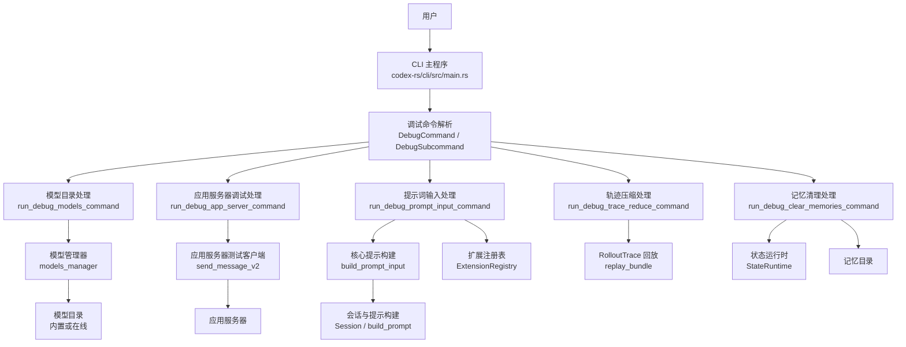
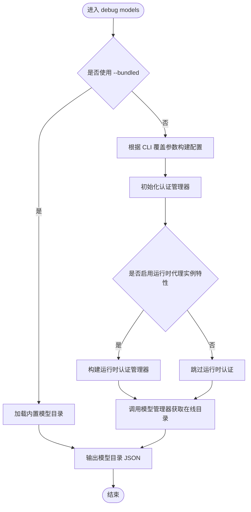
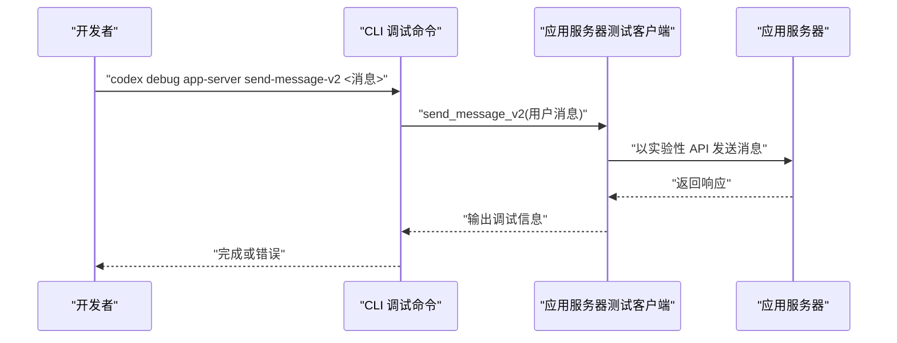
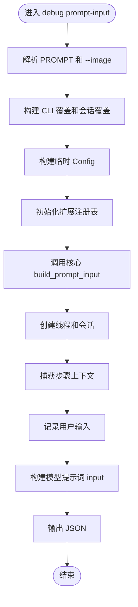
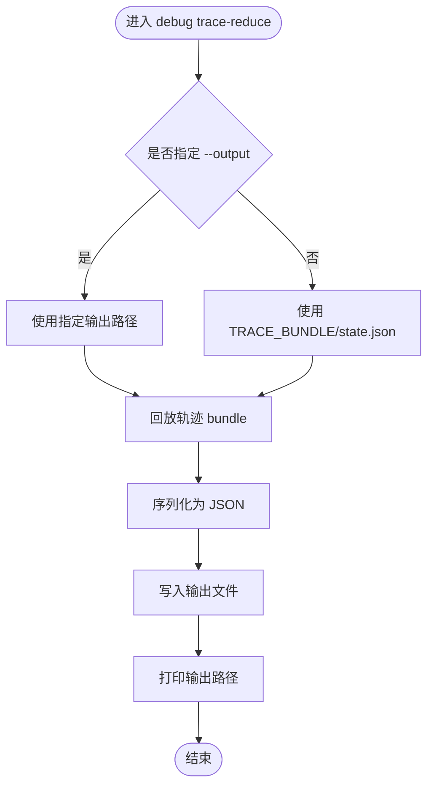
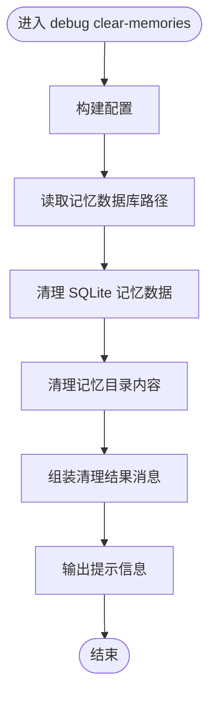
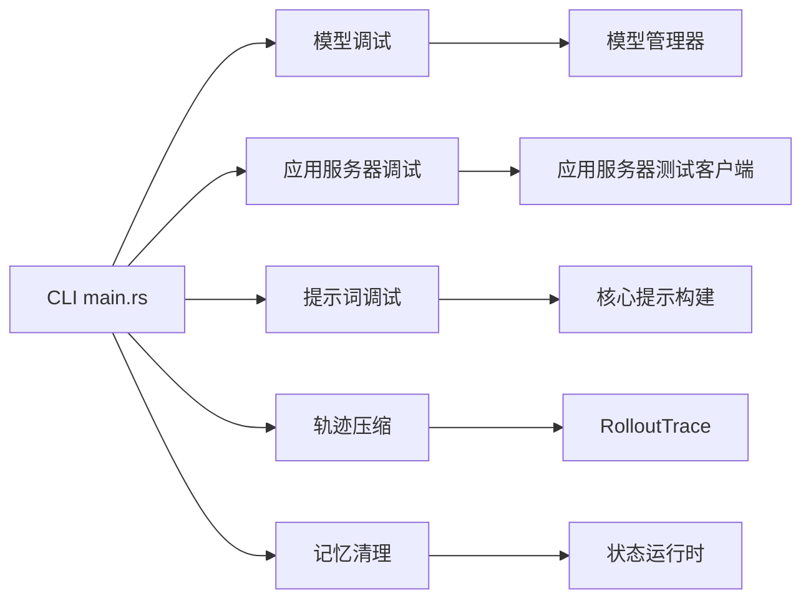

# 调试命令

<cite>
**本文引用的文件**
- [main.rs](file://codex-rs/cli/src/main.rs)
- [prompt_debug.rs](file://codex-rs/core/src/prompt_debug.rs)
- [lib.rs](file://codex-rs/app-server-test-client/src/lib.rs)
- [debug_models.rs](file://codex-rs/cli/tests/debug_models.rs)
- [debug_clear_memories.rs](file://codex-rs/cli/tests/debug_clear_memories.rs)
</cite>

## 目录
1. [引言](#引言)
2. [项目结构中的调试入口](#项目结构中的调试入口)
3. [核心组件与子命令总览](#核心组件与子命令总览)
4. [架构总览](#架构总览)
5. [详细组件分析](#详细组件分析)
6. [依赖关系分析](#依赖关系分析)
7. [调试输出解读](#调试输出解读)
8. [常见问题定位](#常见问题定位)
9. [开发者调试最佳实践](#开发者调试最佳实践)
10. [性能分析与诊断建议](#性能分析与诊断建议)
11. [结论](#结论)

## 引言
本文面向使用 Codex CLI 的开发者，系统化整理 `codex debug` 命令及其子命令的使用方法、内部实现路径、输出含义和故障定位技巧。重点覆盖以下能力：
- 模型目录调试：查看二进制内置或在线同步后的模型目录。
- 应用服务器调试：向应用服务器发送测试消息，验证消息协议与服务行为。
- 提示词输入调试：在真实配置和扩展环境下构建“模型可见”的提示词输入列表。
- 轨迹压缩调试：回放 RolloutTrace 包并输出简化状态 JSON。
- 记忆数据清理：重置本地记忆数据库与记忆目录，用于复现问题或清理污染数据。

## 项目结构中的调试入口
调试功能由 CLI 主程序集中定义和分发。其关键结构如下：
- `DebugCommand`：顶层调试命令容器，持有 `DebugSubcommand`。
- `DebugSubcommand`：具体子命令枚举，包含 `models`、`app-server`、`prompt-input`、`trace-reduce`、`clear-memories`。
- 各子命令对应独立的参数结构体和处理函数，例如：
  - `DebugModelsCommand`
  - `DebugAppServerCommand`
  - `DebugPromptInputCommand`
  - `DebugTraceReduceCommand`
  - `ClearMemories`

所有调试子命令都会通过统一的命令分发逻辑解析参数后调用对应的异步处理函数。

**章节来源**
- [main.rs:255-332](file://codex-rs/cli/src/main.rs#L255-L332)
- [main.rs:1813-1869](file://codex-rs/cli/src/main.rs#L1813-L1869)

## 核心组件与子命令总览
下表总结当前仓库中可用的调试子命令、用途、关键参数和主要输出。

| 子命令 | 用途 | 关键参数 | 主要输出 |
|---|---|---|---|
| `codex debug models` | 打印模型目录 JSON，便于检查可用模型、提供商、模态等 | `--bundled`：仅输出二进制内置目录 | 标准输出的 JSON |
| `codex debug app-server send-message-v2` | 向应用服务器发送 V2 测试消息，验证客户端到服务端的交互 | `USER_MESSAGE`：必填用户消息 | 应用服务器测试客户端返回的状态和响应日志 |
| `codex debug prompt-input` | 在当前配置下构造模型可见的提示词输入列表 | `PROMPT`、`--image`、以及全局 TUI/会话选项 | 标准输出的 JSON，表示模型接收到的 `input` |
| `codex debug trace-reduce` | 回放 RolloutTrace 包并生成简化状态 JSON | `TRACE_BUNDLE`、`--output` | 指定路径下的 JSON 文件路径 |
| `codex debug clear-memories` | 清除本地记忆数据库及记忆目录内容 | 无额外参数 | 清理结果提示信息 |

**章节来源**
- [main.rs:255-332](file://codex-rs/cli/src/main.rs#L255-L332)
- [main.rs:1813-1869](file://codex-rs/cli/src/main.rs#L1813-L1869)

## 架构总览
下图展示 `codex debug` 命令从 CLI 解析到具体后端组件的整体流程。

**图表来源**
- [main.rs:1813-1869](file://codex-rs/cli/src/main.rs#L1813-L1869)
- [main.rs:2063-2260](file://codex-rs/cli/src/main.rs#L2063-L2260)
- [prompt_debug.rs:27-131](file://codex-rs/core/src/prompt_debug.rs#L27-L131)
- [lib.rs:753-793](file://codex-rs/app-server-test-client/src/lib.rs#L753-L793)

## 详细组件分析

### 模型目录调试：`codex debug models`
该命令用于打印模型目录 JSON，帮助确认：
- 当前环境加载的是内置目录还是在线目录。
- 模型是否被过滤、禁用或受权限控制。
- 模型提供商、ID、显示名称、模态等信息是否符合预期。

实现要点：
- 如果传入 `--bundled`，直接读取二进制内置的模型目录响应。
- 否则，根据 CLI 覆盖参数构建配置，初始化认证管理器，并在启用特定特性时构造运行时认证，再调用模型管理器获取在线模型目录。
- 最终将模型目录序列化为 JSON 写入标准输出。

**图表来源**
- [main.rs:310-316](file://codex-rs/cli/src/main.rs#L310-L316)
- [main.rs:2186-2229](file://codex-rs/cli/src/main.rs#L2186-L2229)

测试用例表明：
- `--bundled` 会输出有效的 JSON，且 `models` 字段为数组。
- 默认模式即使没有显式认证也能成功输出模型目录 JSON。

**章节来源**
- [main.rs:310-316](file://codex-rs/cli/src/main.rs#L310-L316)
- [main.rs:2186-2229](file://codex-rs/cli/src/main.rs#L2186-L2229)
- [debug_models.rs:13-39](file://codex-rs/cli/tests/debug_models.rs#L13-L39)

### 应用服务器调试：`codex debug app-server send-message-v2`
该命令用于向应用服务器发送一条测试消息，常用于：
- 验证应用服务器是否可启动。
- 验证 WebSocket 或进程间通信是否正常。
- 快速复现某个用户消息在服务端的行为。

实现要点：
- 子命令只接受一个必填参数 `USER_MESSAGE`。
- 当前实现通过 `codex_app_server_test_client::send_message_v2` 启动 Codex 作为目标应用服务器，并发送 V2 消息。
- 该测试客户端内部会创建 `Endpoint::SpawnCodex`，并以实验性 API 方式执行消息发送流程。

**图表来源**
- [main.rs:281-297](file://codex-rs/cli/src/main.rs#L281-L297)
- [main.rs:952-960](file://codex-rs/cli/src/main.rs#L952-L960)
- [lib.rs:753-793](file://codex-rs/app-server-test-client/src/lib.rs#L753-L793)

**章节来源**
- [main.rs:281-297](file://codex-rs/cli/src/main.rs#L281-L297)
- [main.rs:952-960](file://codex-rs/cli/src/main.rs#L952-L960)
- [lib.rs:753-793](file://codex-rs/app-server-test-client/src/lib.rs#L753-L793)

### 提示词输入调试：`codex debug prompt-input`
这是最接近“真实对话上下文”的调试工具。它会在不进入完整运行循环的情况下，构造模型实际收到的 `input` 列表，便于排查：
- 系统提示、工作区上下文、技能、Git 归属、多环境变量复制等扩展是否被正确注入。
- 用户文本和图片如何组合成模型输入。
- 配置层对审批策略、沙箱模式、模型、CWD 等的影响。

实现要点：
- 支持从命令行追加 `PROMPT` 和多个 `--image`。
- 继承 TUI 层的会话选项、配置 profile、web_search 开关、审批策略和沙箱模式。
- 构建临时配置，并设置 `ephemeral = true`，避免持久化正常会话。
- 初始化认证管理器、扩展注册表，然后调用核心的 `build_prompt_input`。
- 最终输出 JSON，即模型侧看到的 `input` 列表。

**图表来源**
- [main.rs:299-316](file://codex-rs/cli/src/main.rs#L299-L316)
- [main.rs:2076-2185](file://codex-rs/cli/src/main.rs#L2076-L2185)
- [prompt_debug.rs:27-131](file://codex-rs/core/src/prompt_debug.rs#L27-L131)

**章节来源**
- [main.rs:299-316](file://codex-rs/cli/src/main.rs#L299-L316)
- [main.rs:2076-2185](file://codex-rs/cli/src/main.rs#L2076-L2185)
- [prompt_debug.rs:27-131](file://codex-rs/core/src/prompt_debug.rs#L27-L131)

### 轨迹压缩调试：`codex debug trace-reduce`
该命令用于回放 RolloutTrace 包，并将复杂轨迹转换为简化的状态 JSON。适用场景包括：
- 分析长会话的中间状态。
- 缩小问题范围，把大体积轨迹压缩为更易处理的 JSON。
- 配合自动化测试或回归分析使用。

实现要点：
- 必需参数 `TRACE_BUNDLE` 指向包含清单和轨迹数据的目录。
- 可选参数 `--output` 指定输出路径；默认写入 `TRACE_BUNDLE/state.json`。
- 内部调用 `replay_bundle` 回放轨迹，再序列化到文件。

**图表来源**
- [main.rs:332-341](file://codex-rs/cli/src/main.rs#L332-L341)
- [main.rs:2063-2075](file://codex-rs/cli/src/main.rs#L2063-L2075)

**章节来源**
- [main.rs:332-341](file://codex-rs/cli/src/main.rs#L332-L341)
- [main.rs:2063-2075](file://codex-rs/cli/src/main.rs#L2063-L2075)

### 记忆数据清理：`codex debug clear-memories`
该命令用于清理本地记忆相关数据，常用于：
- 复现记忆相关问题。
- 清除过期、损坏或污染的记忆条目。
- 在不删除整个会话历史的前提下，重置记忆子系统。

实现要点：
- 解析 CLI 覆盖参数并构建配置。
- 读取记忆数据库路径。
- 调用 `StateRuntime::clear_memory_data_in_sqlite_home` 清理 SQLite 中的记忆数据。
- 清理 `codex_home` 下的记忆目录内容。
- 输出清理结果，包括是否找到记忆数据库、清理了哪些路径。

**图表来源**
- [main.rs:2230-2260](file://codex-rs/cli/src/main.rs#L2230-L2260)

测试用例覆盖了两种典型场景：
- 同时存在状态数据库和记忆数据库时，清理后记忆表为空、作业记录被清空。
- 缺少状态数据库但存在记忆数据库时，仍能清理记忆数据库。

**章节来源**
- [main.rs:2230-2260](file://codex-rs/cli/src/main.rs#L2230-L2260)
- [debug_clear_memories.rs:1-185](file://codex-rs/cli/tests/debug_clear_memories.rs#L1-L185)

## 依赖关系分析
调试命令的依赖层次比较清晰：
- CLI 层负责参数解析和远程模式拦截。
- 模型调试依赖模型管理器和认证体系。
- 应用服务器调试依赖测试客户端库。
- 提示词调试依赖核心会话、提示构建、扩展系统和认证。
- 轨迹调试依赖 RolloutTrace 回放能力。
- 记忆清理依赖状态运行时和文件系统。

**图表来源**
- [main.rs:1813-1869](file://codex-rs/cli/src/main.rs#L1813-L1869)
- [main.rs:2063-2260](file://codex-rs/cli/src/main.rs#L2063-L2260)
- [prompt_debug.rs:27-131](file://codex-rs/core/src/prompt_debug.rs#L27-L131)
- [lib.rs:753-793](file://codex-rs/app-server-test-client/src/lib.rs#L753-L793)

**章节来源**
- [main.rs:1813-1869](file://codex-rs/cli/src/main.rs#L1813-L1869)
- [main.rs:2063-2260](file://codex-rs/cli/src/main.rs#L2063-L2260)

## 调试输出解读

### 模型目录 JSON
- 输出为标准 JSON。
- 通常包含 `models` 数组。
- 使用 `--bundled` 时，应看到二进制内置模型目录，不受网络或认证影响。
- 未使用 `--bundled` 时，可能触发在线同步，需关注认证、代理、模型访问权限和网络状态。

判断依据：
- 测试断言 `models` 字段为数组且非空。
- 无认证时仍可成功输出，说明默认行为优先保证可观测性。

**章节来源**
- [debug_models.rs:13-39](file://codex-rs/cli/tests/debug_models.rs#L13-L39)
- [main.rs:2186-2229](file://codex-rs/cli/src/main.rs#L2186-L2229)

### 应用服务器消息调试
- 输出主要由测试客户端决定，通常会打印初始化响应、线程恢复或消息发送结果。
- 如果应用服务器无法启动、端口占用、WebSocket 握手失败，错误会从测试客户端向上抛出。
- 该命令适合快速验证“用户消息是否能到达服务端”，但不等同于完整 TUI 会话。

**章节来源**
- [main.rs:952-960](file://codex-rs/cli/src/main.rs#L952-L960)
- [lib.rs:753-793](file://codex-rs/app-server-test-client/src/lib.rs#L753-L793)

### 提示词输入 JSON
- 输出是模型侧的 `input` 列表。
- 可用于检查：
  - 用户文本是否正确拼接。
  - 图片是否被识别为本地图像输入。
  - 扩展是否注入技能、Git 归属等上下文。
  - 系统提示、窗口增量工具、基础指令是否按预期参与构建。
- 如果输出不符合预期，应优先检查配置层、扩展注册表和会话上下文。

**章节来源**
- [main.rs:2076-2185](file://codex-rs/cli/src/main.rs#L2076-L2185)
- [prompt_debug.rs:27-131](file://codex-rs/core/src/prompt_debug.rs#L27-L131)

### 轨迹压缩输出
- 默认输出路径为 `TRACE_BUNDLE/state.json`。
- 输出内容为简化后的 RolloutTrace JSON。
- 若目录不存在、清单缺失、轨迹格式错误或序列化失败，会返回错误。

**章节来源**
- [main.rs:2063-2075](file://codex-rs/cli/src/main.rs#L2063-L2075)

### 记忆清理输出
- 输出包含是否清理了记忆数据库，以及清理后的记忆目录位置。
- 若未找到记忆数据库，会明确提示。
- 清理操作会修改本地状态，属于破坏性操作，应谨慎使用。

**章节来源**
- [main.rs:2230-2260](file://codex-rs/cli/src/main.rs#L2230-L2260)

## 常见问题定位

| 现象 | 可能原因 | 定位方法 |
|---|---|---|
| `debug models` 输出为空或模型数量异常 | 在线模型目录未刷新、认证失败、权限不足、代理或网络问题 | 先用 `--bundled` 确认内置目录有效，再切换到在线模式对比差异 |
| `debug prompt-input` 缺少图片或提示 | 命令行参数顺序错误、图片路径无效、TUI 层图片参数与子命令参数叠加逻辑不一致 | 单独传入 `PROMPT` 和 `--image`，并检查输出 JSON 中的用户输入项 |
| `debug app-server send-message-v2` 无法连接 | 应用服务器无法启动、端口冲突、WebSocket 协议不匹配 | 先确认 Codex 二进制可独立启动，再使用该命令发送短消息 |
| `debug trace-reduce` 找不到输出 | 未指定 `--output` 且目录不可写，或轨迹包不完整 | 检查 `TRACE_BUNDLE` 是否存在，显式指定 `--output` |
| `debug clear-memories` 后仍出现旧记忆 | 清理路径不对、多实例共享存储、外部进程仍在写入 | 确认 `CODEX_HOME` 或配置文件指向的目标目录，并停止相关进程 |

**章节来源**
- [debug_models.rs:13-39](file://codex-rs/cli/tests/debug_models.rs#L13-L39)
- [debug_clear_memories.rs:1-185](file://codex-rs/cli/tests/debug_clear_memories.rs#L1-L185)
- [main.rs:2063-2260](file://codex-rs/cli/src/main.rs#L2063-L2260)

## 开发者调试最佳实践
1. **先隔离问题范围**  
   使用 `debug models` 确认模型目录是否正确；使用 `debug prompt-input` 确认提示词构造是否合理；使用 `debug app-server send-message-v2` 确认服务端是否可触达。

2. **优先使用最小输入复现**  
   对 `debug prompt-input`，尽量传入单一 `PROMPT` 和一个 `--image`，逐步增加复杂度，以便定位是哪一部分上下文导致问题。

3. **区分内置目录与在线目录**  
   先用 `--bundled` 排除网络和认证干扰，再切换回默认模式观察差异。

4. **注意破坏性操作**  
   `debug clear-memories` 会清理本地记忆数据和目录，使用前确认备份或仅在隔离目录中运行。

5. **结合配置文件 Profile**  
   调试命令会继承 TUI 层的配置 profile、web_search、approval_policy、sandbox_mode 等选项，因此复现问题时务必带上相同配置。

6. **避免远程模式干扰**  
   调试命令在分发阶段会对远程模式进行限制，确保调试过程在本机环境中执行。

**章节来源**
- [main.rs:1813-1869](file://codex-rs/cli/src/main.rs#L1813-L1869)
- [main.rs:2076-2185](file://codex-rs/cli/src/main.rs#L2076-L2185)
- [main.rs:2186-2260](file://codex-rs/cli/src/main.rs#L2186-L2260)

## 性能分析与诊断建议
- **模型目录调试**：在线模式可能涉及网络请求和缓存刷新，首次运行较慢属于正常。可通过 `--bundled` 排除网络开销。
- **提示词调试**：会创建临时会话、初始化扩展和认证，不适合高频重复调用；批量分析时应缓存配置或减少无关扩展。
- **应用服务器调试**：每次调用可能启动新进程或建立连接，应避免在脚本中无限循环调用。
- **轨迹压缩**：适用于离线分析，不建议在交互式会话中频繁回放大型轨迹包。
- **记忆清理**：属于一次性修复手段，不应作为常规性能优化流程的一部分。

如果需要更细粒度的性能分析，可结合仓库中的其他诊断机制，例如 Doctor 工具、遥测和 RolloutTrace 本身，但 `codex debug` 提供的五个子命令已经覆盖最常见的“模型—提示—服务—状态”四段式排查路径。

[本节为通用指导，不直接分析具体代码文件]

## 结论
`codex debug` 是一组面向开发者和高级用户的诊断子命令集合，围绕模型目录、应用服务器、提示词输入、轨迹回放和记忆数据展开。掌握这些命令的使用方式、输出结构和内部调用链，可以快速定位模型配置、上下文注入、服务端交互和本地状态四类问题。对于长期维护者，建议把它们纳入自动化测试和回归分析流程，尤其适用于模型目录变更、提示词扩展行为和记忆子系统修复的验证。

[本节为总结性内容，不直接分析具体代码文件]