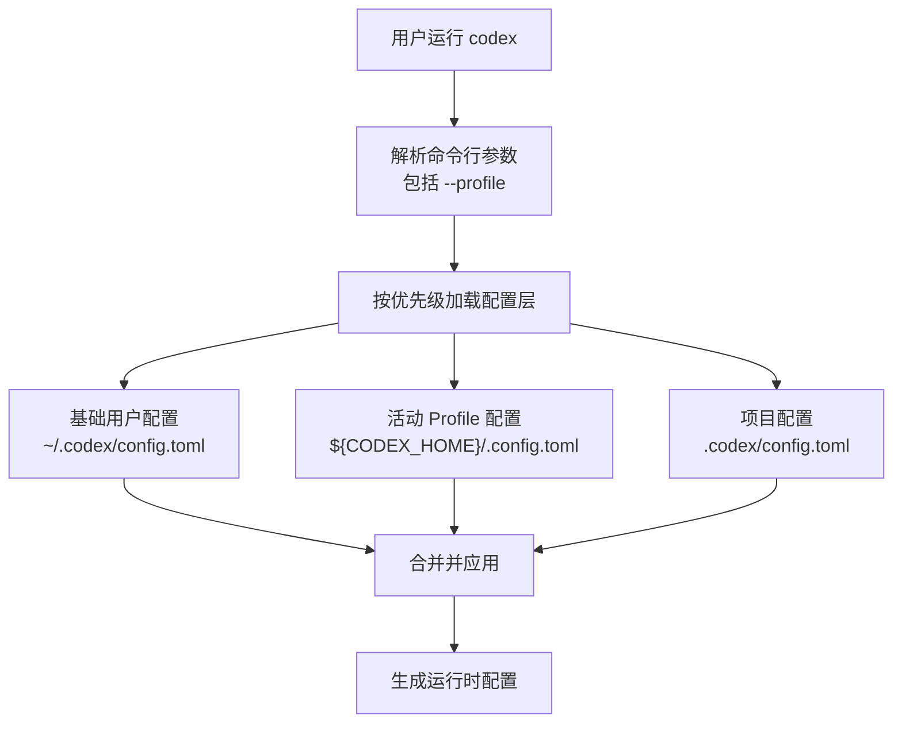
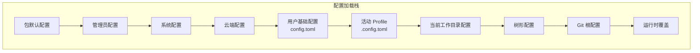
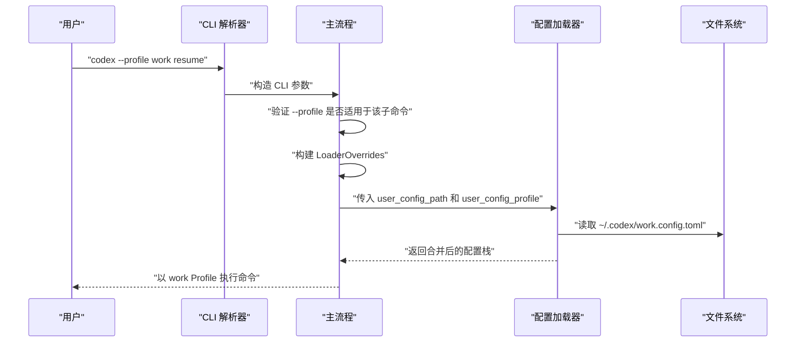
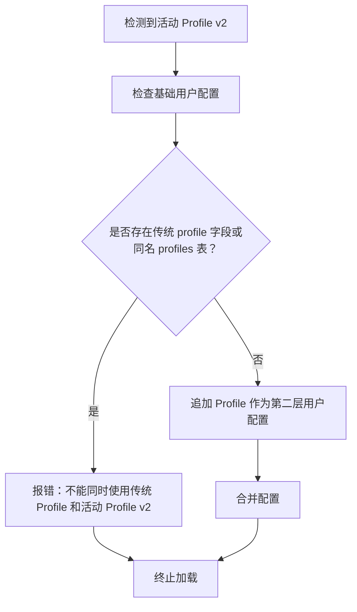
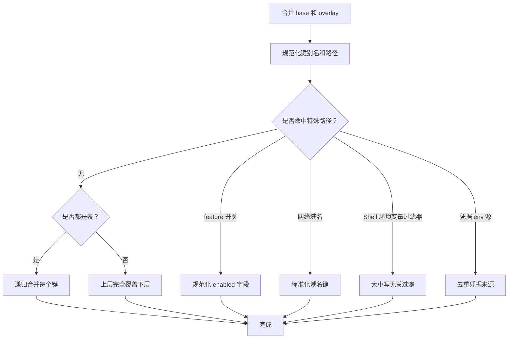
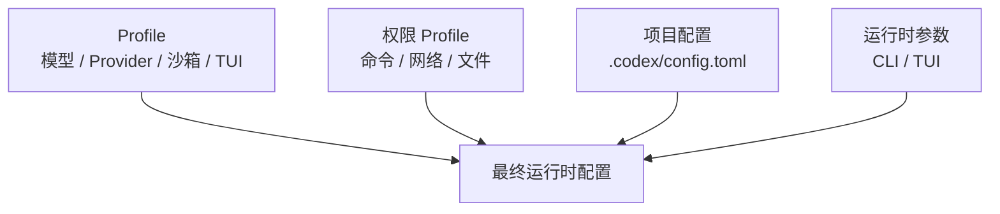

# Profile 管理

<cite>
**本文引用的文件**   
- [profile_toml.rs](file://codex-rs/config/src/profile_toml.rs)
- [config_toml.rs](file://codex-rs/config/src/config_toml.rs)
- [merge.rs](file://codex-rs/config/src/merge.rs)
- [loader/mod.rs](file://codex-rs/config/src/loader/mod.rs)
- [state.rs](file://codex-rs/config/src/state.rs)
- [lib.rs](file://codex-rs/cli/src/lib.rs)
- [main.rs](file://codex-rs/cli/src/main.rs)
</cite>

## 目录

1. [简介](#简介)
2. [Profile 概念与作用](#profile-概念与作用)
3. [配置加载顺序与 Profile 位置](#配置加载顺序与-profile-位置)
4. [profiles 配置段语法与字段定义](#profiles-配置段语法与字段定义)
5. [创建、切换与删除 Profile](#创建切换与删除-profile)
6. [Profile 继承与覆盖机制](#profile-继承与覆盖机制)
7. [与其他配置层的交互](#与其他配置层的交互)
8. [多环境最佳实践](#多环境最佳实践)
9. [使用场景与配置示例](#使用场景与配置示例)
10. [常见问题与故障排查](#常见问题与故障排查)
11. [结论](#结论)

## 简介

Profile 是 Codex 配置体系中的“可命名配置片段”。它允许你在同一台机器上维护多套运行配置，例如开发环境、测试环境和生产环境，并通过命令行参数或配置文件选择其中一套作为当前活动配置。

在代码中，Profile 分为两个相关但不同的概念：

- **传统 profiles 配置段**：位于 `~/.codex/config.toml` 的 `[profiles.<name>]` 表，配合顶层 `profile = "name"` 字段一起工作。
- **Profile v2（推荐）**：把每个 Profile 放到独立的 `${CODEX_HOME}/<name>.config.toml` 文件中，通过 CLI 的 `--profile` 参数激活。

项目源码更推荐使用 profile v2，因为它更符合“每个 Profile 只包含差异配置”的设计，也更容易避免传统配置段带来的歧义和冲突。

## Profile 概念与作用

Profile 的核心作用是：**为同一个 Codex 安装提供多个可选的配置视图**。

典型用途包括：

| 用途 | 说明 |
|---|---|
| 模型切换 | 开发时使用快速便宜模型，生产时使用更强模型 |
| Provider 切换 | 开发时指向本地或测试 Provider，生产时指向企业 Provider |
| 沙箱策略切换 | 开发时宽松执行，生产时启用严格沙箱 |
| 审批策略切换 | 开发时自动批准低风险命令，生产时强制人工审批 |
| TUI 行为切换 | 不同环境使用不同的界面布局或会话选择器样式 |
| 工具能力切换 | 某些 Profile 开启 web search、MCP、sandbox 等能力，另一些关闭 |
| 权限与网络策略切换 | 结合权限 Profile 控制命令执行、网络和文件系统访问范围 |

从类型定义看，`ConfigProfile` 是一个可序列化和反序列化的 TOML 结构体，表示一个完整的 Profile 配置单元。它不要求你重复所有全局设置；只需要声明你需要覆盖的值即可。



**图示来源**  
- [loader/mod.rs:120-138](file://codex-rs/config/src/loader/mod.rs#L120-L138)  
- [loader/mod.rs:293-339](file://codex-rs/config/src/loader/mod.rs#L293-L339)  
- [main.rs:2019-2042](file://codex-rs/cli/src/main.rs#L2019-L2042)

**章节来源**  
- [profile_toml.rs:1-83](file://codex-rs/config/src/profile_toml.rs#L1-L83)  
- [loader/mod.rs:120-138](file://codex-rs/config/src/loader/mod.rs#L120-L138)  
- [main.rs:2019-2042](file://codex-rs/cli/src/main.rs#L2019-L2042)

## 配置加载顺序与 Profile 位置

Codex 的配置不是从一个文件读取的，而是由多层配置叠加而成。越靠后的层优先级越高，可以覆盖前面的值。

官方文档描述的配置栈如下：

| 层级 | 路径或来源 | 作用 |
|---|---|---|
| 包默认配置 | 随安装包提供的默认配置 | 提供出厂默认值 |
| 管理员配置 | macOS 托管设备配置 | 企业管理端下发 |
| 系统配置 | `/etc/codex/config.toml` 或 Windows 程序数据目录下的对应文件 | 系统级默认配置 |
| 云端配置 | 企业托管的云端配置片段 | 云端下发的策略 |
| 用户基础配置 | `${CODEX_HOME}/config.toml` | 用户主配置 |
| 用户 Profile 配置 | `${CODEX_HOME}/<name>.config.toml` | 被选中的 Profile 覆盖层 |
| 当前工作目录配置 | `${PWD}/config.toml` | 项目内配置，不受信任时会被禁用 |
| 树形配置 | 父目录向上查找 `./.codex/config.toml` | 仓库级配置，不受信任时会被禁用 |
| Git 根配置 | `$(git rev-parse --show-toplevel)/.codex/config.toml` | 仓库根配置，不受信任时会被禁用 |
| 运行时配置 | CLI 参数、TUI 选择、服务端注入 | 最高优先级运行时覆盖 |

当启用 profile v2 时，Loader 会先加载基础用户配置，再把活动 Profile 对应的 `<name>.config.toml` 作为第二层用户配置叠加上去。这样 Profile 文件只需要写差异配置，不需要复制整个全局配置。



**图示来源**  
- [loader/mod.rs:120-138](file://codex-rs/config/src/loader/mod.rs#L120-L138)  
- [loader/mod.rs:293-339](file://codex-rs/config/src/loader/mod.rs#L293-L339)

**章节来源**  
- [loader/mod.rs:120-138](file://codex-rs/config/src/loader/mod.rs#L120-L138)  
- [loader/mod.rs:293-339](file://codex-rs/config/src/loader/mod.rs#L293-L339)

## profiles 配置段语法与字段定义

### 传统 profiles 配置段

传统方式是在 `~/.codex/config.toml` 中定义：

- 顶层 `profile`：字符串，表示要启用的 Profile 名称。
- 顶层 `profiles`：映射表，键为 Profile 名称，值为 `ConfigProfile` 对象。

`ConfigToml` 中与 Profile 相关的字段如下：

| 字段 | 类型 | 含义 |
|---|---|---|
| `profile` | 可选字符串 | 从 `profiles` 表中选择的活动 Profile 名称 |
| `profiles` | 字符串到 `ConfigProfile` 的映射 | 命名 Profile 集合 |

`ConfigProfile` 支持以下关键字段：

| 字段 | 类型 | 含义 |
|---|---|---|
| `model` | 可选字符串 | 指定使用的模型名称 |
| `service_tier` | 可选字符串 | 服务等级，例如 `default`、`priority`、`flex`，兼容旧值 `fast` |
| `model_provider` | 可选字符串 | 从 `model_providers` 映射中选择 Provider 键名 |
| `approval_policy` | 可选审批策略 | 控制执行命令前是否需要请求批准 |
| `approvals_reviewer` | 可选审批审查者 | 升级后审批请求的接收方 |
| `sandbox_mode` | 可选沙箱模式 | 控制命令执行是否进入沙箱以及沙箱强度 |
| `model_reasoning_effort` | 可选推理努力级别 | 模型推理资源投入 |
| `plan_mode_reasoning_effort` | 可选推理努力级别 | 计划模式的推理努力 |
| `model_reasoning_summary` | 可选摘要策略 | 推理过程摘要行为 |
| `model_verbosity` | 可选详细程度 | 输出详细程度 |
| `model_catalog_json` | 可选绝对路径 | 启动时加载的模型目录 JSON 文件 |
| `personality` | 可选人格设置 | 已废弃，不再影响风格 |
| `chatgpt_base_url` | 可选字符串 | ChatGPT 基地址 |
| `model_instructions_file` | 可选绝对路径 | 模型指令文件路径 |
| `js_repl_node_path` | 可选绝对路径 | 已废弃，忽略 |
| `js_repl_node_module_dirs` | 可选绝对路径数组 | 已废弃，忽略 |
| `experimental_compact_prompt_file` | 可选绝对路径 | 压缩提示词相关文件 |
| `include_permissions_instructions` | 可选布尔值 | 是否包含权限指令 |
| `include_apps_instructions` | 可选布尔值 | 是否包含应用指令 |
| `include_collaboration_mode_instructions` | 可选布尔值 | 是否包含协作模式指令 |
| `include_environment_context` | 可选布尔值 | 是否包含环境变量上下文 |
| `include_environment_context_time` | 可选布尔值 | 是否包含时间信息 |
| `experimental_use_unified_exec_tool` | 可选布尔值 | 统一执行工具开关 |
| `tools` | 可选工具配置 | 工具相关设置 |
| `web_search` | 可选 Web 搜索模式 | Web 搜索行为 |
| `analytics` | 可选分析配置 | 遥测和分析设置 |
| `tui` | 可选 TUI 配置 | 终端界面配置 |
| `windows` | 可选 Windows 配置 | Windows 平台配置 |
| `features` | 可选功能开关 | 按 Profile 启用的功能标志 |
| `oss_provider` | 可选字符串 | 开源模型 Provider 标识 |

TUI 子配置 `ProfileTui` 目前主要暴露：

| 字段 | 类型 | 含义 |
|---|---|---|
| `session_picker_view` | 可选会话选择器视图模式 | 恢复或分叉会话时的首选列表布局 |

**章节来源**  
- [profile_toml.rs:1-83](file://codex-rs/config/src/profile_toml.rs#L1-L83)  
- [config_toml.rs:165-370](file://codex-rs/config/src/config_toml.rs#L165-L370)

## 创建、切换与删除 Profile

### 创建 Profile

#### 方法一：创建 Profile v2 独立文件（推荐）

1. 确定 `CODEX_HOME`，通常是 `~/.codex`。
2. 新建一个 `<name>.config.toml` 文件，例如 `dev.config.toml`。
3. 只在文件中写入需要覆盖的字段，例如 `model`、`model_provider`、`sandbox_mode`、`approval_policy`。
4. 通过 CLI 参数 `--profile <name>` 使用该 Profile。

这种方式的优势是：

- Profile 文件只包含差异。
- 不会污染基础 `config.toml`。
- 便于版本控制和团队协作。

#### 方法二：使用传统 profiles 配置段

在 `~/.codex/config.toml` 中添加：

- `profile = "<name>"`
- `[profiles.<name>]` 表，并在其中填写所需字段。

注意：如果使用 profile v2 的 `--profile` 参数，而基础用户配置中仍存在同名传统 Profile，Loader 会报错，要求你把设置迁移到独立 Profile 文件中。

### 切换 Profile

CLI 支持的切换方式是使用 `--profile` 参数：

| 命令 | 含义 |
|---|---|
| `codex --profile dev resume` | 以 dev Profile 恢复会话 |
| `codex --profile test mcp list` | 以 test Profile 列出 MCP 服务器 |
| `codex --profile prod sandbox` | 以 prod Profile 执行沙箱相关操作 |
| `codex --profile dev debug prompt-input` | 以 dev Profile 调试提示输入 |

CLI 解析后会生成 `LoaderOverrides`，其中包含：

- `user_config_path`：指向 `${CODEX_HOME}/<name>.config.toml`
- `user_config_profile`：保存当前活动的 Profile 名称



**图示来源**  
- [lib.rs:65-67](file://codex-rs/cli/src/lib.rs#L65-L67)  
- [main.rs:2019-2042](file://codex-rs/cli/src/main.rs#L2019-L2042)  
- [main.rs:1966-1993](file://codex-rs/cli/src/main.rs#L1966-L1993)

### 删除 Profile

#### 删除 Profile v2 文件

直接删除 `${CODEX_HOME}/<name>.config.toml` 即可。如果以后想恢复，重新创建同名文件即可。

#### 删除传统 profiles 配置段

1. 打开 `~/.codex/config.toml`。
2. 删除 `profile = "<name>"`。
3. 删除 `[profiles.<name>]` 整块。
4. 如果希望保留基础配置，建议先把需要的字段移到新的 Profile v2 文件中，再清理传统配置。

**章节来源**  
- [lib.rs:65-67](file://codex-rs/cli/src/lib.rs#L65-L67)  
- [main.rs:2019-2042](file://codex-rs/cli/src/main.rs#L2019-L2042)  
- [main.rs:1966-1993](file://codex-rs/cli/src/main.rs#L1966-L1993)  
- [loader/mod.rs:306-324](file://codex-rs/config/src/loader/mod.rs#L306-L324)

## Profile 继承与覆盖机制

Profile 的覆盖机制有两层含义：

1. **配置层覆盖**：Profile v2 文件作为独立用户层，叠加在基础用户配置之上。
2. **字段级覆盖**：相同字段按“高优先级层覆盖低优先级层”的规则合并。

### 配置层覆盖

Loader 在发现活动 Profile 时，会执行以下检查：

- 如果基础用户配置中存在 `profile = "<name>"`，且等于当前活动 Profile，视为传统 Profile 选择。
- 如果基础用户配置中存在 `[profiles.<name>]`，也视为传统 Profile 存在。
- 在这两种情况下，使用 `--profile <name>` 都会失败，因为系统不允许同时存在传统 Profile 和活动 Profile v2。

这是为了防止“同一个 Profile 同时出现在配置文件和 CLI 中”，造成语义不清。



**图示来源**  
- [loader/mod.rs:306-324](file://codex-rs/config/src/loader/mod.rs#L306-L324)

### 字段级覆盖

底层合并逻辑使用通用的 TOML 合并函数。其核心规则是：

- 两个都是表时，递归合并键。
- 非表字段直接被上层覆盖。
- 新键会被插入到底层表中。
- 某些特殊路径有额外处理，例如结构化 feature 开关、网络域名、Shell 环境变量过滤器、凭据源去重等。

这意味着：

- 如果你只写 `model`，其他字段会从基础配置继承。
- 如果你写 `sandbox_mode`，它会覆盖基础配置中的对应值。
- 如果你写 `features.code_mode = true`，它会被规范化为结构化 feature 配置。



**图示来源**  
- [merge.rs:58-150](file://codex-rs/config/src/merge.rs#L58-L150)

**章节来源**  
- [loader/mod.rs:306-324](file://codex-rs/config/src/loader/mod.rs#L306-L324)  
- [merge.rs:58-150](file://codex-rs/config/src/merge.rs#L58-L150)

## 与其他配置层的交互

Profile 不是孤立存在的，它会与以下配置层共同决定最终行为：

| 配置层 | 与 Profile 的关系 |
|---|---|
| 包默认配置 | Profile 可覆盖默认值 |
| 管理员配置 | 企业策略可能限制某些字段或行为 |
| 系统配置 | 系统级默认值可被 Profile 覆盖 |
| 云端配置 | 云端下发的配置可能限制 Model、Provider、沙箱模式等 |
| 用户基础配置 | Profile 通常覆盖这里的内容 |
| 项目配置 | 项目配置可能进一步覆盖 Profile 的值，但受信任性和安全策略约束 |
| 运行时覆盖 | CLI 参数和 UI 选择具有最高优先级 |

此外，Profile 还会与权限 Profile 协同工作。虽然 `--permission-profile` 和 `--profile` 是两个不同概念，但它们经常一起使用：

- `--profile` 选择模型、Provider、沙箱模式等运行配置。
- `--permission-profile` 选择命令执行、网络、文件系统等权限策略。

CLI 定义中，`permissions_profile` 和 `cwd` 有依赖关系：`cwd` 通常需要配合权限 Profile 使用，因为工作目录会影响权限解析和项目信任判定。



**图示来源**  
- [lib.rs:56-84](file://codex-rs/cli/src/lib.rs#L56-L84)  
- [lib.rs:112-140](file://codex-rs/cli/src/lib.rs#L112-L140)

**章节来源**  
- [loader/mod.rs:120-138](file://codex-rs/config/src/loader/mod.rs#L120-L138)  
- [lib.rs:56-84](file://codex-rs/cli/src/lib.rs#L56-L84)  
- [lib.rs:112-140](file://codex-rs/cli/src/lib.rs#L112-L140)

## 多环境最佳实践

### 推荐目录结构

```text
~/.codex/
├── config.toml           # 公共基础配置
├── dev.config.toml       # 开发环境
├── test.config.toml      # 测试环境
└── prod.config.toml      # 生产环境
```

### 开发环境 Profile

适合目标：

- 更快的响应速度。
- 较低的成本。
- 较宽松的审批策略。
- 可选的沙箱模式。
- 方便调试和日志输出。

建议字段：

- `model`：快速模型。
- `model_provider`：本地或低成本 Provider。
- `sandbox_mode`：根据团队安全策略选择。
- `approval_policy`：对低风险命令自动批准。
- `model_verbosity`：更高详细度以便调试。

### 测试环境 Profile

适合目标：

- 稳定可复现的行为。
- 明确区分真实 API 调用与 Mock。
- 记录测试轨迹。
- 固定模型或 Provider。

建议字段：

- `model`：稳定可用的测试模型。
- `model_provider`：测试专用 Provider。
- `web_search`：关闭或限定范围。
- `approval_policy`：保持可控。
- `analytics`：根据测试策略决定是否采集。

### 生产环境 Profile

适合目标：

- 安全性优先。
- 合规性优先。
- 更强的沙箱隔离。
- 更严格的审批流程。
- 稳定的模型和服务等级。

建议字段：

- `model`：生产可用模型。
- `service_tier`：例如 `priority` 或 `flex`。
- `model_provider`：企业或生产 Provider。
- `sandbox_mode`：严格模式。
- `approval_policy`：人工审批。
- `web_search`：按需启用。
- `features`：仅启用必要功能。

### Profile 设计原则

| 原则 | 说明 |
|---|---|
| 最小化差异 | 每个 Profile 只写与环境相关的字段 |
| 公共配置下沉 | 把通用设置放在 `config.toml` |
| 明确环境边界 | 不要混用开发、测试、生产的密钥和 URL |
| 可审计 | 每个 Profile 应能解释为什么这样配置 |
| 可回滚 | Profile 文件应纳入版本控制，便于回退 |
| 避免传统 Profile 冲突 | 不要在基础配置中同时保留同名传统 Profile |
| 与权限 Profile 解耦 | 运行配置和权限策略分开维护 |

**章节来源**  
- [profile_toml.rs:1-83](file://codex-rs/config/src/profile_toml.rs#L1-L83)  
- [config_toml.rs:165-370](file://codex-rs/config/src/config_toml.rs#L165-L370)  
- [loader/mod.rs:306-324](file://codex-rs/config/src/loader/mod.rs#L306-L324)

## 使用场景与配置示例

### 场景一：本地开发切换模型

开发者希望在不修改全局配置的情况下，临时切换到另一个模型。

操作步骤：

1. 创建 `dev.config.toml`。
2. 在其中设置 `model` 和 `model_provider`。
3. 使用 `codex --profile dev resume` 启动。

效果：

- 只有 `dev` Profile 生效。
- 其他 Profile 不受影响。
- 全局 `config.toml` 保持不变。

### 场景二：测试环境关闭外部搜索

测试环境希望避免意外访问外部网络。

操作步骤：

1. 创建 `test.config.toml`。
2. 设置 `web_search` 为受限或关闭模式。
3. 设置 `sandbox_mode` 为测试合适的值。
4. 使用 `codex --profile test` 运行测试命令。

### 场景三：生产环境启用严格审批

生产环境希望所有敏感命令都需要人工审批。

操作步骤：

1. 创建 `prod.config.toml`。
2. 设置 `approval_policy` 为更严格策略。
3. 设置 `sandbox_mode` 为生产模式。
4. 设置 `model` 和 `model_provider` 为企业配置。
5. 使用 `codex --profile prod` 执行生产任务。

### 场景四：TUI 行为按环境调整

某些团队希望在不同环境中使用不同的会话选择器视图。

操作步骤：

1. 在 Profile 中设置 `tui.session_picker_view`。
2. 该设置只影响当前 Profile 下的 TUI 行为。
3. 其他 Profile 可以使用不同的视图模式。

**章节来源**  
- [profile_toml.rs:1-83](file://codex-rs/config/src/profile_toml.rs#L1-L83)  
- [lib.rs:65-67](file://codex-rs/cli/src/lib.rs#L65-L67)

## 常见问题与故障排查

### 问题一：使用 `--profile` 时报错，提示传统 Profile 冲突

**原因**：基础用户配置中仍然存在 `profile = "<name>"` 或 `[profiles.<name>]`。

**解决**：

1. 打开 `~/.codex/config.toml`。
2. 删除传统 Profile 选择字段。
3. 把需要的配置迁移到 `${CODEX_HOME}/<name>.config.toml`。
4. 再次使用 `--profile <name>`。

**章节来源**  
- [loader/mod.rs:306-324](file://codex-rs/config/src/loader/mod.rs#L306-L324)

### 问题二：Profile 没有生效

**可能原因**：

- Profile 文件名错误。
- Profile 名称与 CLI 参数不一致。
- 使用了不被支持的子命令。
- Profile 中没有设置预期字段。
- 被项目配置或运行时参数覆盖。

**排查步骤**：

1. 确认 `${CODEX_HOME}/<name>.config.toml` 存在。
2. 确认 `--profile` 名称正确。
3. 确认当前子命令允许使用 `--profile`。
4. 检查是否有更高优先级配置覆盖了你的字段。

**章节来源**  
- [main.rs:1966-1993](file://codex-rs/cli/src/main.rs#L1966-L1993)  
- [main.rs:2019-2042](file://codex-rs/cli/src/main.rs#L2019-L2042)

### 问题三：权限 Profile 和运行 Profile 混淆

**区别**：

- `--profile`：选择运行配置，如模型、Provider、沙箱模式。
- `--permission-profile`：选择权限策略，如命令执行、网络、文件系统访问。

**建议**：

- 不要把权限 Profile 当作运行 Profile 使用。
- 如果需要同时指定，分别使用对应参数。
- 注意 `cwd` 通常需要配合权限 Profile。

**章节来源**  
- [lib.rs:56-84](file://codex-rs/cli/src/lib.rs#L56-L84)  
- [lib.rs:112-140](file://codex-rs/cli/src/lib.rs#L112-L140)

### 问题四：合并结果不符合预期

**可能原因**：

- 你以为 Profile 会替换整个表，但它可能只是合并键。
- 某些字段被特殊合并逻辑处理。
- 项目配置或运行时参数覆盖了 Profile。

**建议**：

- 尽量让 Profile 只设置标量字段。
- 对于复杂结构，参考合并器的特殊路径规则。
- 查看最终有效用户配置，确认实际生效值。

**章节来源**  
- [merge.rs:58-150](file://codex-rs/config/src/merge.rs#L58-L150)  
- [state.rs:451-496](file://codex-rs/config/src/state.rs#L451-L496)

## 结论

Profile 是 Codex 配置体系的重要抽象，它让用户能够在同一环境中管理多套运行配置。现代实现推荐 Profile v2，即把每个 Profile 放在独立的 `${CODEX_HOME}/<name>.config.toml` 文件中，并通过 `--profile` 参数激活。

关键要点如下：

- Profile 用于切换模型、Provider、沙箱模式、审批策略、TUI 行为和功能开关。
- Profile v2 比传统 `profiles` 配置段更安全、更易维护。
- 配置加载遵循明确的优先级顺序，Profile 作为用户层叠加在基础配置之上。
- Profile 与传统 Profile 冲突时会报错，这是有意设计的保护机制。
- 多环境最佳实践是把公共配置下沉到基础配置，每个 Profile 只保留差异化字段。
- Profile 与权限 Profile、项目配置、运行时参数共同决定最终行为。

在实际工程中，建议将 Profile 文件纳入版本控制，并为开发、测试、生产环境建立清晰、可审计、可回滚的配置策略。