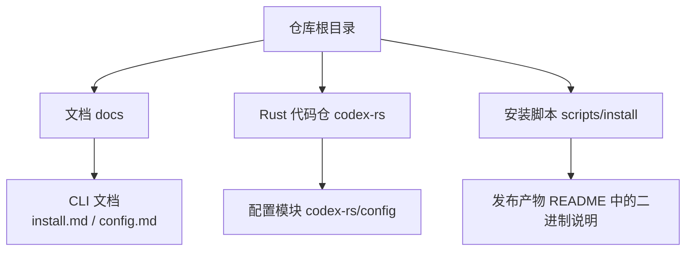
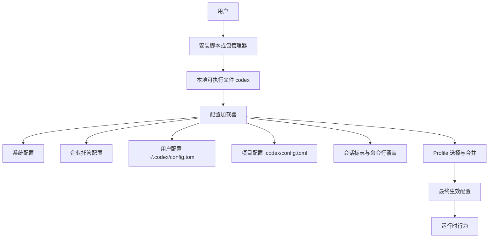
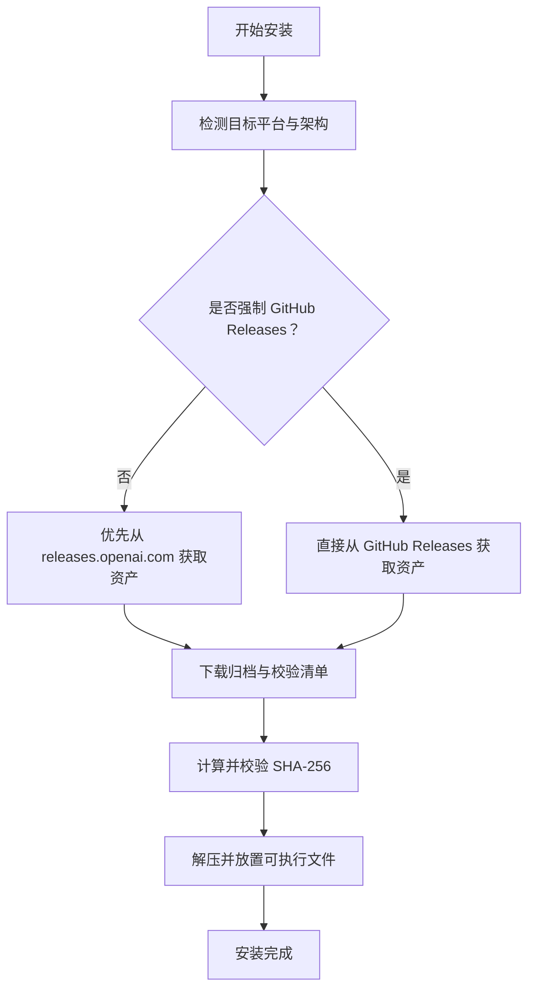
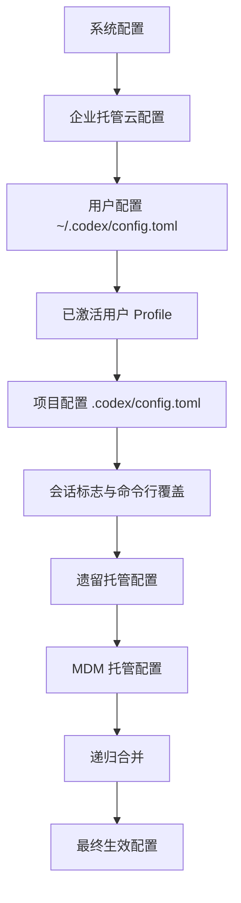
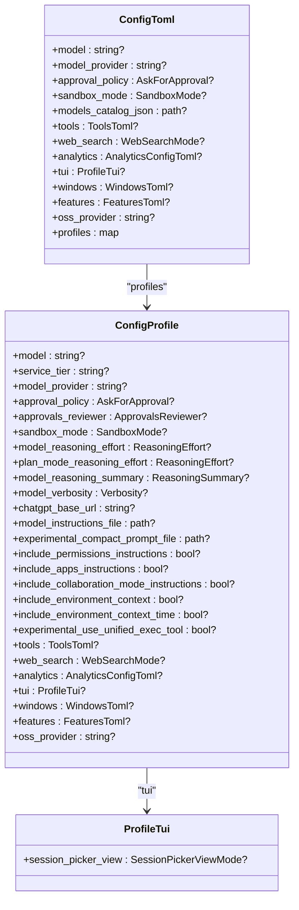

# 安装与配置

<cite>
**本文引用的文件**   
- [README.md](file://README.md)
- [docs/install.md](file://docs/install.md)
- [docs/config.md](file://docs/config.md)
- [codex-rs/config/defaults.toml](file://codex-rs/config/defaults.toml)
- [codex-rs/config/src/loader/README.md](file://codex-rs/config/src/loader/README.md)
- [codex-rs/config/src/profile_toml.rs](file://codex-rs/config/src/profile_toml.rs)
- [codex-rs/config/src/config_toml.rs](file://codex-rs/config/src/config_toml.rs)
- [codex-rs/config/src/loader/local.rs](file://codex-rs/config/src/loader/local.rs)
- [scripts/install/install.sh](file://scripts/install/install.sh)
</cite>

## 目录
1. [简介](#简介)
2. [项目结构](#项目结构)
3. [核心组件](#核心组件)
4. [架构总览](#架构总览)
5. [详细组件分析](#详细组件分析)
6. [依赖关系分析](#依赖关系分析)
7. [性能注意事项](#性能注意事项)
8. [故障排查指南](#故障排查指南)
9. [结论](#结论)
10. [附录：环境变量参考](#附录环境变量参考)

## 简介
本指南面向首次安装 Codex CLI 的用户和需要自定义运行环境的运维人员。内容覆盖支持的操作系统、多种安装方式（包管理器、源码编译、手动下载二进制）、配置文件层次与优先级、Profile 管理机制、常见环境变量、诊断命令，以及自定义模型提供商、网络与安全策略等典型场景。

Codex CLI 是一个在本地运行的编码代理；用户可通过 ChatGPT 账户或 API Key 使用，也可通过编辑器集成或独立桌面应用体验。

**章节来源**
- [README.md:1-81](file://README.md#L1-L81)

## 项目结构
仓库采用多语言多模块组织：
- 顶层提供快速开始说明、文档入口与构建脚本。
- `codex-rs` 是 Rust 实现主仓库，包含 CLI、配置系统、执行服务器、TUI、插件等大量子模块。
- `scripts/install` 提供跨平台安装脚本。
- `docs` 提供安装、配置、沙箱、权限等官方文档。

**图表来源**
- [README.md:1-81](file://README.md#L1-L81)
- [docs/install.md:1-65](file://docs/install.md#L1-L65)
- [docs/config.md:1-15](file://docs/config.md#L1-L15)
- [codex-rs/config/src/loader/README.md:1-90](file://codex-rs/config/src/loader/README.md#L1-L90)

**章节来源**
- [README.md:1-81](file://README.md#L1-L81)
- [docs/install.md:1-65](file://docs/install.md#L1-L65)

## 核心组件
本节聚焦安装与配置相关的关键部分：

- **安装器与包分发**
  - Shell 安装脚本负责从 releases.openai.com 或 GitHub Releases 下载归档并安装。
  - 支持 npm 全局安装、Homebrew cask 安装，以及直接下载平台二进制。
- **配置加载器**
  - 将系统级、企业托管、用户级、项目级、会话级等多层 TOML 合并为最终生效配置。
  - 每个键可追踪来源层，便于诊断。
- **Profile 机制**
  - 在用户配置中定义多个 Profile，用于切换模型、审批策略、沙箱模式等组合设置。
- **默认值**
  - 打包客户端内置固定默认值，如指令提示、凭证存储后端、ChatGPT 后端地址等。

**章节来源**
- [scripts/install/install.sh:1-120](file://scripts/install/install.sh#L1-L120)
- [scripts/install/install.sh:470-560](file://scripts/install/install.sh#L470-L560)
- [codex-rs/config/src/loader/README.md:1-90](file://codex-rs/config/src/loader/README.md#L1-L90)
- [codex-rs/config/src/profile_toml.rs:1-83](file://codex-rs/config/src/profile_toml.rs#L1-L83)
- [codex-rs/config/defaults.toml:1-18](file://codex-rs/config/defaults.toml#L1-L18)

## 架构总览
下图展示“安装与配置”在主流程中的位置：用户通过安装脚本或包管理器获得 `codex` 命令后，启动时由配置加载器读取多层配置，并根据 Profile 生成最终行为。

**图表来源**
- [codex-rs/config/src/loader/README.md:1-90](file://codex-rs/config/src/loader/README.md#L1-L90)
- [codex-rs/config/src/profile_toml.rs:1-83](file://codex-rs/config/src/profile_toml.rs#L1-L83)

## 详细组件分析

### 安装方式与支持平台
Codex 支持以下安装途径：

| 方式 | 适用平台 | 说明 |
|---|---|---|
| Shell 一键安装 | macOS、Linux | 使用 `curl` 管道安装脚本；Windows 使用 PowerShell 脚本。 |
| npm 全局安装 | macOS、Linux、Windows | 通过 `npm install -g @openai/codex` 安装。 |
| Homebrew cask | macOS | 通过 `brew install --cask codex` 安装。 |
| 手动下载二进制 | macOS、Linux | 从 GitHub Releases 下载对应平台的归档并重命名为 `codex`。 |
| 源码编译 | macOS、Linux、WSL2 | 克隆仓库并在 `codex-rs` 下使用 Cargo 构建。 |

#### 系统要求
- 操作系统：macOS 12+、Ubuntu 20.04+/Debian 10+，或 Windows 11 通过 WSL2。
- Git：可选但推荐，版本 2.23+，用于内置 PR 辅助功能。
- 内存：至少 4 GB，推荐 8 GB。

#### Shell 安装脚本要点
- 默认优先从 `releases.openai.com` 获取资源，若不可用则回退到 GitHub Releases。
- 可通过环境变量 `CODEX_INSTALLER_USE_RELEASES_OPENAI_COM=false` 强制使用 GitHub Releases。
- 安装路径默认为 `$HOME/.local/bin`，Codex Home 默认为 `$HOME/.codex`。
- 安装包校验使用 SHA-256，缺失校验工具时会报错退出。

**图表来源**
- [scripts/install/install.sh:1-120](file://scripts/install/install.sh#L1-L120)
- [scripts/install/install.sh:470-560](file://scripts/install/install.sh#L470-L560)

**章节来源**
- [README.md:1-81](file://README.md#L1-L81)
- [docs/install.md:1-65](file://docs/install.md#L1-L65)
- [scripts/install/install.sh:1-120](file://scripts/install/install.sh#L1-L120)
- [scripts/install/install.sh:470-560](file://scripts/install/install.sh#L470-L560)

### 源码编译安装
适合需要参与开发或定制构建的用户。

- 克隆仓库并进入 `codex-rs` 工作区。
- 安装 Rust 工具链及格式化、Lint、测试工具。
- 使用 `cargo build` 构建，`cargo run --bin codex` 启动 TUI。
- 使用 `just` 提供的命令进行格式化、修复、测试等常用任务。

注意事项：
- 常规本地运行避免使用 `--all-features`，以免增加构建时间与磁盘占用。
- 非交互模式 `codex exec` 默认日志级别为错误，可直接输出消息。

**章节来源**
- [docs/install.md:10-65](file://docs/install.md#L10-L65)

### 容器部署
当前仓库未提供官方 Dockerfile 或镜像构建说明；如需容器化部署，建议：
- 基于宿主系统安装的 `codex` 二进制，将其放入容器并挂载 `~/.codex` 作为持久卷。
- 通过容器环境变量传入认证令牌、代理地址等敏感信息。
- 在 CI 中使用脚本化安装步骤，而非依赖交互式安装。

由于仓库未提供容器部署的权威配置，本小节为通用实践建议，不引用具体源码。

### 配置文件结构与层次
Codex 的配置采用“上层覆盖下层”的多层 TOML 模型。最终生效配置由各层递归合并得到，并为每个键保留来源元数据，便于定位冲突。

优先级从高到低如下：
1. MDM 管理的遗留 `managed_config.toml`（逐步淘汰）。
2. 文件系统上的遗留 `managed_config.toml`（逐步淘汰）。
3. 会话标志与命令行覆盖，以点号路径写入 TOML。
4. 项目配置 `.codex/config.toml`。
5. 已激活的用户 Profile 配置。
6. 用户配置 `config.toml`。
7. 企业托管云配置束的各层。
8. 系统配置 `/etc/codex/config.toml` 或 Windows 系统配置路径。

内部实现按“低优先级在前、高优先级在后”的顺序保存层，以便后续层覆盖先前层。被禁用的层仍会向 UI 暴露，但不参与有效配置计算。

**图表来源**
- [codex-rs/config/src/loader/README.md:1-90](file://codex-rs/config/src/loader/README.md#L1-L90)

**章节来源**
- [codex-rs/config/src/loader/README.md:1-90](file://codex-rs/config/src/loader/README.md#L1-L90)

### Profile 管理机制
Profile 允许用户把一组配置选项封装成命名环境，例如“生产环境”“调试环境”“离线环境”。

#### Profile 能管理哪些选项
Profile 可集中声明以下常见配置：
- 模型名称、服务层级、模型提供商。
- 审批策略、自动审阅评审者。
- 沙箱模式、推理努力程度、推理摘要、模型详细程度。
- ChatGPT 后端地址、模型指令文件。
- 工具集、网页搜索模式、分析配置。
- TUI 界面偏好、Windows 专用设置。
- 特性开关集合。
- 开源模型提供商标识。

#### 如何创建与管理 Profile
建议在用户配置文件中定义 `profiles` 表，并为每个 Profile 指定所需字段。Profile 本身不包含完整配置，只声明希望覆盖的值；其余值来自其他配置层。

实际使用时：
- 在未显式选择 Profile 时，系统使用默认用户配置。
- 当某个 Profile 被激活时，该 Profile 的字段会覆盖更低优先级层的同名字段。
- Profile 内还包含 TUI 相关设置，例如会话选择器的视图模式。

**图表来源**
- [codex-rs/config/src/config_toml.rs:366-369](file://codex-rs/config/src/config_toml.rs#L366-L369)
- [codex-rs/config/src/profile_toml.rs:1-83](file://codex-rs/config/src/profile_toml.rs#L1-L83)

**章节来源**
- [codex-rs/config/src/profile_toml.rs:1-83](file://codex-rs/config/src/profile_toml.rs#L1-L83)
- [codex-rs/config/src/config_toml.rs:366-369](file://codex-rs/config/src/config_toml.rs#L366-L369)

### 默认配置与内置行为
打包客户端带有固定默认值，这些值影响行为，例如：
- 是否包含权限说明、应用说明、协作模式说明。
- 是否包含环境上下文及时间戳。
- CLI 与 MCP OAuth 凭证存储后端。
- 项目文档最大字节数、回退文件名列表。
- 后台终端超时、文件打开器、隐藏推理过程。
- ChatGPT 后端地址、项目根标记。
- 历史记录的持久化策略。

这些默认值可在更高层配置中覆盖。

**章节来源**
- [codex-rs/config/defaults.toml:1-18](file://codex-rs/config/defaults.toml#L1-L18)

### 常见配置场景示例

#### 自定义模型提供商
- 在用户配置或 Profile 中设置 `model_provider`，指向 `model_providers` 表中定义的提供商名称。
- 同时根据需要配置提供商认证信息、API 密钥、代理、地区等。
- 若使用开源模型提供商，可使用 `oss_provider` 指定提供商标识。

注意：保留提供商 ID 是受保护集合，不要随意覆盖内置提供商标识。

**章节来源**
- [codex-rs/config/src/config_toml.rs:1-120](file://codex-rs/config/src/config_toml.rs#L1-L120)
- [codex-rs/config/src/profile_toml.rs:1-83](file://codex-rs/config/src/profile_toml.rs#L1-L83)

#### 网络策略
- 通过配置中的网络代理相关字段控制出站请求。
- 对于受限网络环境，可结合需求层中的网络策略与权限策略限制访问范围。
- 若启用凭证代理或凭据屏蔽能力，需确保对应特性需求已被满足。

**章节来源**
- [codex-rs/config/src/loader/local.rs:130-170](file://codex-rs/config/src/loader/local.rs#L130-L170)

#### 安全策略
- 使用 `default_permissions` 选择内置或自定义权限 Profile。
- 通过 `permissions.filesystem.deny_read` 等字段合并拒绝规则。
- 在企业托管环境中，可通过需求层限制允许的审批策略、沙箱模式、网页搜索模式等。
- 管理员可将 `allow_managed_hooks_only=true` 放在 `requirements.toml` 中，仅允许托管钩子，忽略用户、项目和会话钩子配置。

**章节来源**
- [docs/config.md:1-15](file://docs/config.md#L1-L15)

## 依赖关系分析
配置加载器与 Profile 的关系可以概括为：

**图表来源**
- [codex-rs/config/src/loader/README.md:1-90](file://codex-rs/config/src/loader/README.md#L1-L90)
- [codex-rs/config/src/profile_toml.rs:1-83](file://codex-rs/config/src/profile_toml.rs#L1-L83)

**章节来源**
- [codex-rs/config/src/loader/README.md:1-90](file://codex-rs/config/src/loader/README.md#L1-L90)

## 性能注意事项
- 源码构建时避免使用 `--all-features`，可减少构建时间和 `target/` 目录体积。
- 配置层越多，合并与溯源开销越大；日常调试建议先精简配置，再逐步添加。
- 日志输出过多会影响 I/O 性能，建议仅在排障时提高日志级别。

[本节为通用指导，不直接分析具体源码文件]

## 故障排查指南

### 查看配置来源
配置加载器会为每个键维护来源元数据，可用于判断哪个层覆盖了某个值。若发现行为不符合预期，应先确认：
- 是否正确选择了 Profile。
- 项目配置是否意外覆盖了用户配置。
- 企业托管配置是否覆盖了本地设置。
- 命令行会话覆盖是否临时改变了行为。

**章节来源**
- [codex-rs/config/src/loader/README.md:1-90](file://codex-rs/config/src/loader/README.md#L1-L90)

### 日志与诊断
- 使用 `RUST_LOG` 控制 Rust 日志级别。
- 非交互模式 `codex exec` 默认使用错误级别日志，并直接输出消息。
- 可通过显式设置 `log_dir` 启用文本 TUI 日志，然后跟踪日志文件。
- 安装脚本会在缺少校验工具时明确报错，帮助定位环境问题。

**章节来源**
- [docs/install.md:54-65](file://docs/install.md#L54-L65)
- [scripts/install/install.sh:470-560](file://scripts/install/install.sh#L470-L560)

### 常见问题与建议
- **无法连接外部模型服务**：检查代理设置、网络策略、提供商认证。
- **权限不足或被拒绝**：确认 `default_permissions` 和 `permissions` 配置是否符合预期。
- **Profile 未生效**：检查 Profile 名称、字段拼写、是否被更高优先级层覆盖。
- **安装失败**：确认网络可达、校验工具可用、目标路径有写入权限。

[本节为通用故障排查建议，不直接分析具体源码文件]

## 结论
Codex 的安装与配置体系围绕“多来源、多层级、可溯源”的设计展开：
- 安装方式灵活，覆盖主流操作系统与包管理器。
- 配置系统支持系统、托管、用户、项目、会话、Profile 等多层叠加。
- Profile 让不同环境拥有清晰、可复用的配置组合。
- 默认值保证开箱即用，而丰富的高级选项支持企业化部署。

对于生产环境，建议优先使用托管配置和需求层统一约束；对于个人开发者，建议利用 Profile 管理不同工作流。

[本节为总结性内容，不直接分析具体源码文件]

## 附录：环境变量参考

| 变量 | 用途 | 说明 |
|---|---|---|
| `RUST_LOG` | 日志级别 | 控制 Rust 组件日志输出，例如调试、信息、警告、错误。 |
| `log_dir` | TUI 日志目录 | 显式设置后启用文本 TUI 日志文件，便于事后分析。 |
| `CODEX_RELEASE` | 安装版本 | Shell 安装脚本中决定要安装的版本。 |
| `CODEX_NON_INTERACTIVE` | 非交互安装 | 跳过交互式提示。 |
| `CODEX_INSTALL_DIR` | 安装目录 | 默认 `$HOME/.local/bin`。 |
| `CODEX_HOME` | Codex Home | 默认 `$HOME/.codex`，存放用户配置与状态。 |
| `CODEX_INSTALLER_USE_RELEASES_OPENAI_COM` | 发布源选择 | 设为 `false`、`0` 或 `no` 时强制使用 GitHub Releases。 |

**章节来源**
- [docs/install.md:54-65](file://docs/install.md#L54-L65)
- [scripts/install/install.sh:1-120](file://scripts/install/install.sh#L1-L120)