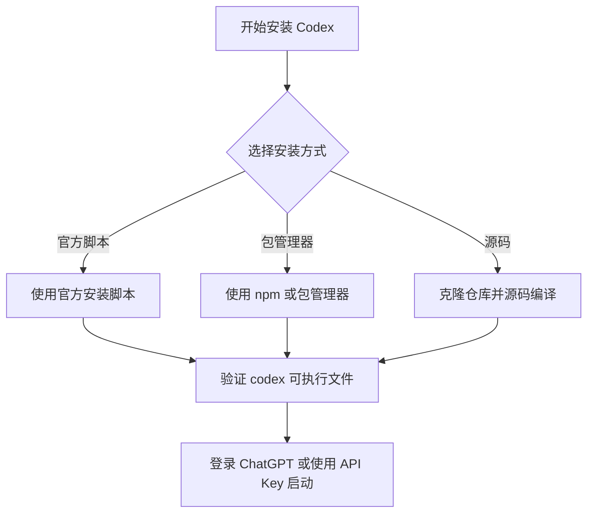
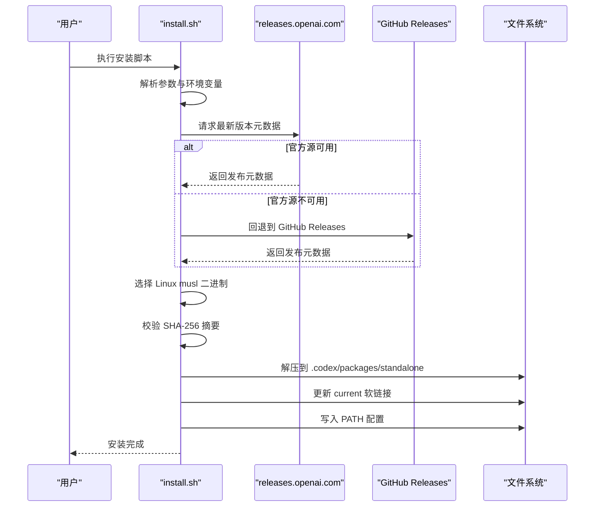
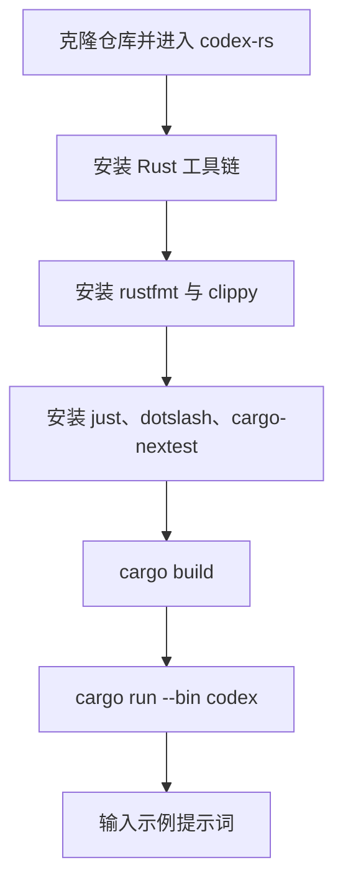
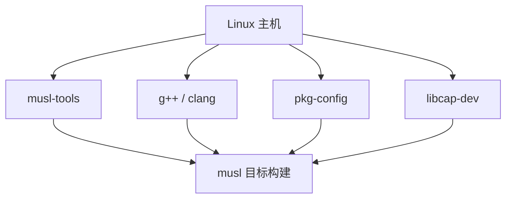
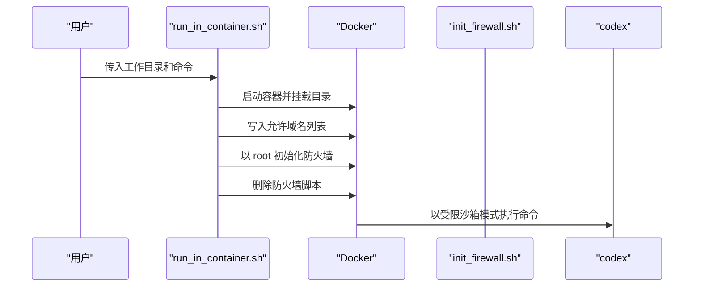
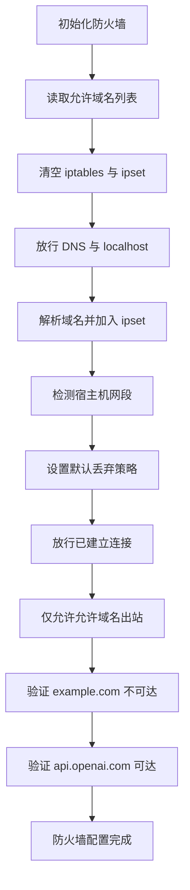

# Linux 安装指南

<cite>
**本文引用的文件**   
- [README.md](file://README.md)
- [docs/install.md](file://docs/install.md)
- [scripts/install/install.sh](file://scripts/install/install.sh)
- [codex-cli/scripts/init_firewall.sh](file://codex-cli/scripts/init_firewall.sh)
- [codex-cli/scripts/run_in_container.sh](file://codex-cli/scripts/run_in_container.sh)
- [.github/scripts/install-musl-build-tools.sh](file://.github/scripts/install-musl-build-tools.sh)
- [.github/dotslash-config.json](file://.github/dotslash-config.json)
</cite>

## 目录

1. [简介](#简介)
2. [支持的发行版与系统要求](#支持的发行版与系统要求)
3. [Linux 二进制包与架构说明](#linux-二进制包与架构说明)
4. [安装方式一：官方脚本安装](#安装方式一官方脚本安装)
5. [安装方式二：通过包管理器安装](#安装方式二通过包管理器安装)
6. [安装方式三：源码编译安装](#安装方式三源码编译安装)
7. [Linux 特有依赖项](#linux-特有依赖项)
8. [沙箱与容器部署](#沙箱与容器部署)
9. [防火墙与网络限制](#防火墙与网络限制)
10. [systemd 服务配置建议](#systemd-服务配置建议)
11. [musl libc 支持情况与兼容性](#musl-libc-支持情况与兼容性)
12. [常见问题排查](#常见问题排查)
13. [结论](#结论)

## 简介

本指南面向 Linux 用户，说明如何在 Ubuntu、Debian 等发行版上安装 Codex。仓库文档明确支持 **macOS 12+、Ubuntu 20.04+/Debian 10+**，以及通过 WSL2 的 Windows 11；同时提供 Git、内存等最低运行要求。Codex 在 Linux 上的主要形态包括：

- 官方提供的 musl 静态链接二进制压缩包。
- 通过 npm 安装的 `@openai/codex` CLI。
- 通过 Homebrew cask 安装（更偏向 macOS）。
- 从源码构建 Rust workspace。



**图表来源**   
- [README.md:17-58](file://README.md#L17-L58)
- [docs/install.md:3-12](file://docs/install.md#L3-L12)

**章节来源**   
- [README.md:17-58](file://README.md#L17-L58)
- [docs/install.md:3-12](file://docs/install.md#L3-L12)

## 支持的发行版与系统要求

### 支持的发行版

根据仓库安装文档，Linux 相关支持范围是：

| 类别 | 说明 |
| --- | --- |
| 操作系统 | Ubuntu 20.04 及以上、Debian 10 及以上 |
| Windows 替代方案 | Windows 11 通过 WSL2 运行 |
| 推荐环境 | 建议使用具有现代包管理器的发行版，便于安装 Git、curl、wget 等工具 |

### 系统要求

| 项目 | 要求 |
| --- | --- |
| 操作系统 | macOS 12+、Ubuntu 20.04+/Debian 10+，或 Windows 11 via WSL2 |
| Git | 可选但推荐；版本 2.23+ 用于内置 Pull Request 辅助功能 |
| 内存 | 至少 4 GB，推荐 8 GB |

这些要求来自项目的“Installing & building”文档，其中将 Linux 支持与 macOS、Windows WSL2 并列列出。

**章节来源**   
- [docs/install.md:3-12](file://docs/install.md#L3-L12)

## Linux 二进制包与架构说明

GitHub Release 中提供两个主要 Linux 架构的二进制压缩包：

| 目标架构 | 文件名模式 | 说明 |
| --- | --- | --- |
| x86_64 | `codex-x86_64-unknown-linux-musl.tar.gz` | 适用于传统 x86-64 Linux 系统 |
| arm64 | `codex-aarch64-unknown-linux-musl.tar.gz` | 适用于 ARM64 Linux 系统 |

压缩包名称中的 `unknown-linux-musl` 表示该二进制以 musl libc 为目标构建，通常具备更好的可移植性，不依赖宿主系统的 glibc 版本。每个压缩包只包含一个平台相关的可执行文件，解压后通常需要将文件名重命名为 `codex`。

此外，DotSlash 配置中还包含以下 Linux musl 产物：

- `codex-package-*-unknown-linux-musl.tar.zst`
- `codex-app-server-package-*-unknown-linux-musl.tar.zst`
- `codex-responses-api-proxy-*-unknown-linux-musl.zst`
- `bwrap-*-unknown-linux-musl.zst`

这说明官方发布流程不仅打包主 CLI，还打包应用服务器、响应代理和 bubblewrap 沙箱辅助程序。

```mermaid
graph TB
    Subgraph["Linux 发布产物"]
        CLI["CLI 二进制<br/>x86_64 / aarch64"]
        AppServer["应用服务器包"]
        ResponseProxy["响应代理"]
        Bubblewrap["bubblewrap 沙箱辅助程序"]
    end
    CLI --> DotSlash["DotSlash 自动下载"]
    AppServer --> DotSlash
    ResponseProxy --> DotSlash
    Bubblewrap --> DotSlash
```

**图表来源**   
- [README.md:33-58](file://README.md#L33-L58)
- [.github/dotslash-config.json:14-95](file://.github/dotslash-config.json#L14-L95)

**章节来源**   
- [README.md:33-58](file://README.md#L33-L58)
- [.github/dotslash-config.json:14-95](file://.github/dotslash-config.json#L14-L95)

## 安装方式一：官方脚本安装

官方脚本安装是最直接的 Linux 安装方式。仓库 README 给出了一行命令：

```shell
curl -fsSL https://chatgpt.com/codex/install.sh | sh
```

该脚本会：

1. 确定当前系统和架构。
2. 优先从 `https://releases.openai.com/codex` 获取发布元数据。
3. 如果该源不可用，则回退到 GitHub Releases。
4. 下载对应平台的 tar 包。
5. 校验归档摘要。
6. 解压到 `$HOME/.codex/packages/standalone` 下的版本目录。
7. 创建 `current` 软链接。
8. 把 `codex` 可执行文件放入 `$HOME/.local/bin`。
9. 修改 shell 配置文件，将安装目录加入 PATH。

### 环境变量控制

| 变量 | 默认值 | 作用 |
| --- | --- | --- |
| `CODEX_RELEASE` | `latest` | 指定要安装的版本号，或 `latest` |
| `CODEX_NON_INTERACTIVE` | `false` | 设为非空值时可跳过交互提示 |
| `CODEX_INSTALL_DIR` | `$HOME/.local/bin` | 安装可执行文件的目录 |
| `CODEX_HOME` | `$HOME/.codex` | Codex 家目录 |
| `CODEX_INSTALLER_USE_RELEASES_OPENAI_COM` | `true` | 是否优先使用 releases.openai.com |

### 强制使用 GitHub Releases

如果官方发布源不可用，可以设置环境变量强制使用 GitHub Releases：

```shell
curl -fsSL https://chatgpt.com/codex/install.sh | CODEX_INSTALLER_USE_RELEASES_OPENAI_COM=false sh
```

### 安装过程概览



**图表来源**   
- [scripts/install/install.sh:1-200](file://scripts/install/install.sh#L1-L200)
- [scripts/install/install.sh:540-620](file://scripts/install/install.sh#L540-L620)
- [scripts/install/install.sh:1125-1201](file://scripts/install/install.sh#L1125-L1201)

**章节来源**   
- [README.md:17-58](file://README.md#L17-L58)
- [scripts/install/install.sh:1-200](file://scripts/install/install.sh#L1-L200)
- [scripts/install/install.sh:540-620](file://scripts/install/install.sh#L540-L620)
- [scripts/install/install.sh:1125-1201](file://scripts/install/install.sh#L1125-L1201)

## 安装方式二：通过包管理器安装

### npm 安装

仓库 README 明确支持通过 npm 全局安装：

```shell
npm install -g @openai/codex
```

这种方式适合已经使用 Node.js/npm 环境的开发者。需要注意的是，npm 变体可能不包含某些 standalone 组件，例如独立的 `codex-exec-server` 可执行文件，但 CLI 仍可通过 `codex exec-server` 调用相关能力。

### Homebrew 安装

仓库也列出 Homebrew cask：

```shell
brew install --cask codex
```

不过该方法更适合 macOS 用户；Linux 上若未安装 Homebrew，不建议为仅安装 Codex 而引入额外包管理器。

### apt、dnf、pacman 等发行版包管理器

截至当前仓库内容，**没有提供官方维护的 apt、dnf、pacman 软件包**。因此：

- **apt（Ubuntu/Debian）**：不能直接使用 `apt install codex` 获得官方包。
- **dnf（Fedora/RHEL/CentOS）**：没有官方 Copr/Koji 源。
- **pacman（Arch Linux）**：没有官方 Arch 包。
- **Snap/AUR**：仓库未提供官方 snap 包或 AUR 包。

对于上述发行版，推荐优先级如下：

1. 使用官方脚本安装。
2. 下载 GitHub Release 中的 musl 二进制。
3. 使用 npm 安装 CLI。
4. 从源码编译。

**章节来源**   
- [README.md:17-58](file://README.md#L17-L58)
- [codex-cli/scripts/README.md:21-23](file://codex-cli/scripts/README.md#L21-L23)

## 安装方式三：源码编译安装

源码编译适用于需要自定义构建、调试底层代码或参与贡献的场景。仓库提供的工作区位于 `codex-rs`，并使用 Cargo/Bazel 构建系统。

### 基本步骤

1. 克隆仓库并进入 `codex-rs` 工作区根目录。
2. 安装 Rust 工具链。
3. 添加 `rustfmt` 和 `clippy` 组件。
4. 安装 `just`、`dotslash`、`cargo-nextest` 等辅助工具。
5. 执行 `cargo build` 构建 Codex。
6. 使用 `cargo run --bin codex` 启动 TUI。

### 常用开发命令

| 用途 | 命令 |
| --- | --- |
| 格式化代码 | `just fmt` |
| 修复 lint 问题 | `just fix -p <crate-you-touched>` |
| 运行单个 crate 测试 | `just test -p codex-tui` |
| 运行完整测试套件 | `just test` |

注意：常规本地运行应避免使用 `--all-features`，因为它会增加构建时间和 `target/` 目录占用。

### 源码编译流程图



**图表来源**   
- [docs/install.md:15-54](file://docs/install.md#L15-L54)

**章节来源**   
- [docs/install.md:15-54](file://docs/install.md#L15-L54)

## Linux 特有依赖项

### 基础运行时依赖

官方安装脚本要求系统中存在以下工具之一：

- `curl`
- `wget`

如果没有任一工具，安装脚本会直接报错退出。

校验归档时，脚本需要以下工具之一：

- `sha256sum`
- `shasum`
- `openssl`

缺少这些工具时，脚本会在尝试计算归档摘要时报错。

### 构建工具链依赖

从 `.github/scripts/install-musl-build-tools.sh` 可以看出，构建 musl 目标时需要安装：

| 依赖 | 用途 |
| --- | --- |
| `musl-tools` | 提供 `musl-gcc`、`musl-g++` 等 musl 工具链 |
| `pkg-config` | 帮助查找 libcap 等依赖 |
| `libcap-dev` | Linux capabilities 头文件和静态库 |
| `g++`、`clang` | C/C++ 编译器 |
| `libc++-dev`、`libc++abi-dev` | LLVM C++ 标准库开发文件 |
| `lld` | LLVM 链接器 |
| `xz-utils` | 解压缩 xz 归档 |
| `perl`、`make` | 构建 libcap 等第三方源码 |

脚本还会安装 Zig wrapper，并通过 Zig 的 `zig cc` 进行 musl 交叉编译，避免注入自身 CRT。



**图表来源**   
- [.github/scripts/install-musl-build-tools.sh:20-25](file://.github/scripts/install-musl-build-tools.sh#L20-L25)
- [.github/scripts/install-musl-build-tools.sh:41-55](file://.github/scripts/install-musl-build-tools.sh#L41-L55)

**章节来源**   
- [scripts/install/install.sh:540-575](file://scripts/install/install.sh#L540-L575)
- [.github/scripts/install-musl-build-tools.sh:20-55](file://.github/scripts/install-musl-build-tools.sh#L20-L55)

## 沙箱与容器部署

Codex 在 Linux 上涉及多个沙箱相关组件：

- `bwrap`：bubblewrap 沙箱辅助程序，随发布包提供。
- `codex-linux-sandbox`：Linux 沙箱实现。
- `sandboxing`：通用沙箱逻辑。
- `exec-server`：执行服务器，用于隔离代码执行环境。
- 容器脚本：用于在 Docker 中运行受限网络访问。

### 容器化运行脚本

`codex-cli/scripts/run_in_container.sh` 提供了一个容器运行入口，主要行为包括：

1. 根据工作目录生成唯一容器名。
2. 清理已有同名容器。
3. 使用 `docker run` 启动容器。
4. 传递 `OPENAI_API_KEY` 环境变量。
5. 添加 `NET_ADMIN` 和 `NET_RAW` 能力。
6. 挂载工作目录到容器内 `/app$WORK_DIR`。
7. 将允许访问的域名写入 `/etc/codex/allowed_domains.txt`。
8. 以 root 身份初始化防火墙。
9. 删除防火墙初始化脚本。
10. 以 `--sandbox workspace-write --ask-for-approval on-request` 模式运行命令。



**图表来源**   
- [codex-cli/scripts/run_in_container.sh:1-95](file://codex-cli/scripts/run_in_container.sh#L1-L95)

**章节来源**   
- [codex-cli/scripts/run_in_container.sh:1-95](file://codex-cli/scripts/run_in_container.sh#L1-L95)

## 防火墙与网络限制

`codex-cli/scripts/init_firewall.sh` 是一个面向容器的防火墙初始化脚本，用于限制 Codex 的网络访问。它不是 systemd 服务，也不由官方安装脚本自动启用。

### 脚本行为

1. 读取 `/etc/codex/allowed_domains.txt`。
2. 如果不存在，则回退到 `api.openai.com`。
3. 清空现有 iptables 规则和 ipset。
4. 放行 DNS 查询和 localhost。
5. 使用 `dig` 解析允许域名并加入 ipset。
6. 检测宿主机默认路由网段并放行。
7. 设置 INPUT、FORWARD、OUTPUT 默认策略为 DROP。
8. 放行已建立连接。
9. 仅允许出站访问允许的域名。
10. 对 TCP 发送 reset，对 UDP 发送 ICMP unreachable。
11. 验证无法访问 `example.com`。
12. 验证可以访问 `api.openai.com`。

### 适用场景

该脚本适合以下场景：

- 在容器中运行 Codex。
- 希望严格限制 Codex 的网络出口。
- 通过 `OPENAI_ALLOWED_DOMAINS` 环境变量指定允许域名。
- 使用 `codex-cli/scripts/run_in_container.sh` 自动化部署。

### 注意事项

- 脚本需要 `iptables`、`ipset`、`dig` 权限。
- 需要 `NET_ADMIN` 和 `NET_RAW` 能力。
- 如果 DNS 解析失败，脚本会直接报错。
- 如果无法访问 `api.openai.com`，脚本会认为防火墙配置失败。



**图表来源**   
- [codex-cli/scripts/init_firewall.sh:1-115](file://codex-cli/scripts/init_firewall.sh#L1-L115)

**章节来源**   
- [codex-cli/scripts/init_firewall.sh:1-115](file://codex-cli/scripts/init_firewall.sh#L1-L115)

## systemd 服务配置建议

当前仓库**没有提供官方 systemd service 单元文件**。也就是说，`codex.service`、`codex-app-server.service` 等文件不在仓库中，安装脚本也不会自动生成 systemd 服务。

如果你希望将 Codex 作为后台服务运行，需要根据实际部署需求自行编写 systemd 单元。仓库中与后台进程相关的内容包括：

- 安装脚本支持“daemon-only”模式，将包安装到 `packages/app-server-daemon`。
- 安装脚本会处理 `app-server daemon pid-update-loop`。
- 构建产物中包含 `codex-exec-server`。
- 日志输出遵循 Rust 的 `RUST_LOG` 环境变量。

### 推荐的 systemd 服务思路

由于没有官方单元文件，以下配置仅为运维建议，不是仓库自带的配置：

1. **服务账户**：为 Codex 创建专用系统账户，避免使用 root。
2. **工作目录**：使用 `$HOME/.codex` 作为 Codex 家目录。
3. **可执行文件路径**：指向 `$HOME/.local/bin/codex` 或独立发布的二进制。
4. **日志**：使用 journald 或重定向 stderr/stdout。
5. **环境变量**：根据需要设置 `OPENAI_API_KEY`、`RUST_LOG`、`CODEX_HOME`。
6. **网络访问**：若使用容器化部署，应配合防火墙脚本和网络策略。
7. **自动重启**：使用 `Restart=always` 保证服务恢复。
8. **资源限制**：结合 cgroup 限制 CPU、内存，避免长时间任务耗尽资源。

### 常见 systemd 字段说明

| 字段 | 建议 |
| --- | --- |
| `User` | 专用低权限账户 |
| `WorkingDirectory` | Codex 家目录或项目目录 |
| `ExecStart` | 调用 `codex`、`codex app-server` 或 `codex exec-server` |
| `Restart` | `always` 或 `on-failure` |
| `RestartSec` | 几秒延迟重启 |
| `Environment` | `OPENAI_API_KEY`、`RUST_LOG` |
| `StandardOutput` | `journal` 或文件路径 |
| `StandardError` | `journal` 或文件路径 |

**章节来源**   
- [scripts/install/install.sh:20-30](file://scripts/install/install.sh#L20-L30)
- [scripts/install/install.sh:1344-1439](file://scripts/install/install.sh#L1344-L1439)
- [README.md:58-81](file://README.md#L58-L81)

## musl libc 支持情况与兼容性

### 官方 Linux 二进制使用 musl

README 明确指出 Linux 发布产物使用 `unknown-linux-musl` 三元组：

- `codex-x86_64-unknown-linux-musl.tar.gz`
- `codex-aarch64-unknown-linux-musl.tar.gz`

这意味着官方预编译二进制以 musl libc 为目标，而不是依赖发行版的 glibc。这样做的好处是：

- 可在较新的发行版上运行。
- 可在较旧发行版上运行。
- 减少因 glibc 版本不匹配导致的动态加载错误。
- 更适合容器和跨发行版分发。

### musl 构建工具链

`.github/scripts/install-musl-build-tools.sh` 展示了 musl 构建的关键点：

- 安装 `musl-tools`。
- 使用 `musl-gcc` 或 `${arch}-linux-musl-gcc` 作为链接器。
- 通过 Zig wrapper 避免注入自身 CRT。
- 手动构建 libcap 静态库。
- 避免 glibc 头文件覆盖 musl 头文件。
- 支持 `x86_64-unknown-linux-musl` 和 `aarch64-unknown-linux-musl`。

### musl 与 glibc 差异

虽然仓库没有直接解释 musl 与 glibc 的差异，但从构建脚本可以看出：

- musl 构建需要额外的 C/C++ 工具链。
- musl 构建需要 libcap 静态库。
- musl 构建避免使用 glibc 头文件。
- musl 构建可能需要 Zig 包装编译器。
- musl 构建与发行版原生 glibc 工具链不同。

### 兼容性问题排查

如果遇到 musl 二进制无法运行的情况，应优先检查：

1. 是否下载了对应架构的 musl 二进制。
2. 是否赋予可执行权限。
3. 是否放在 PATH 中。
4. 是否在容器环境中启用了必要内核能力。
5. 是否需要安装 bubblewrap。
6. 是否需要调整防火墙或网络策略。

**章节来源**   
- [README.md:33-58](file://README.md#L33-L58)
- [.github/scripts/install-musl-build-tools.sh:20-55](file://.github/scripts/install-musl-build-tools.sh#L20-L55)
- [.github/scripts/install-musl-build-tools.sh:225-292](file://.github/scripts/install-musl-build-tools.sh#L225-L292)

## 常见问题排查

### 1. 安装脚本提示缺少 curl 或 wget

**现象**：安装脚本报错提示需要 curl 或 wget。

**原因**：脚本依赖 curl 或 wget 下载发布元数据和二进制。

**解决方法**：

```shell
sudo apt update && sudo apt install -y curl wget
```

或根据你的发行版安装相应包。

**章节来源**   
- [scripts/install/install.sh:100-140](file://scripts/install/install.sh#L100-L140)

### 2. 安装脚本提示缺少 sha256sum、shasum 或 openssl

**现象**：安装脚本无法校验下载归档。

**原因**：脚本需要计算并比对 SHA-256 摘要。

**解决方法**：

```shell
sudo apt update && sudo apt install -y coreutils
```

macOS 自带 `shasum`，Linux 通常由 `coreutils` 提供 `sha256sum`。

**章节来源**   
- [scripts/install/install.sh:540-575](file://scripts/install/install.sh#L540-L575)

### 3. 安装后找不到 codex 命令

**现象**：终端输入 `codex` 提示命令未找到。

**原因**：

- 安装目录未加入 PATH。
- 当前 shell 会话尚未重新加载配置文件。
- 使用了错误的 shell 配置文件。

**解决方法**：

1. 确认 `$HOME/.local/bin` 是否在 PATH 中。
2. 重新打开终端，或执行：

```shell
source ~/.bashrc
# 或
source ~/.zshrc
# 或
source ~/.profile
```

3. 如果仍未生效，检查脚本是否成功写入 profile 文件。

**章节来源**   
- [scripts/install/install.sh:575-620](file://scripts/install/install.sh#L575-L620)

### 4. 权限不足

**现象**：安装脚本无法写入 `$HOME/.local/bin` 或 `$HOME/.codex`。

**原因**：当前用户对目标目录无写权限。

**解决方法**：

- 确保 `$HOME` 属于当前用户。
- 不要使用 root 安装普通用户 CLI。
- 如果必须使用 root，请评估安全风险。

### 5. 防火墙阻止访问 OpenAI API

**现象**：容器或受限环境中无法访问 `api.openai.com`。

**原因**：`init_firewall.sh` 默认采用严格出站策略，只允许配置的域名。

**解决方法**：

1. 检查 `/etc/codex/allowed_domains.txt`。
2. 确保包含 `api.openai.com`。
3. 确保 DNS 解析正常。
4. 确保容器具备 `NET_ADMIN` 和 `NET_RAW` 能力。

**章节来源**   
- [codex-cli/scripts/init_firewall.sh:1-115](file://codex-cli/scripts/init_firewall.sh#L1-L115)
- [codex-cli/scripts/run_in_container.sh:60-95](file://codex-cli/scripts/run_in_container.sh#L60-L95)

### 6. 容器内缺少 bubblewrap 或沙箱依赖

**现象**：Codex 无法启动沙箱或执行环境。

**原因**：

- 容器镜像未包含 bubblewrap。
- 内核未启用所需安全特性。
- 权限不足。

**解决方法**：

- 使用官方发布包，其中包含 `bwrap`。
- 在构建容器镜像时安装 bubblewrap。
- 确保容器以足够权限运行。

**章节来源**   
- [.github/dotslash-config.json:87-95](file://.github/dotslash-config.json#L87-L95)
- [codex-cli/scripts/run_in_container.sh:60-95](file://codex-cli/scripts/run_in_container.sh#L60-L95)

### 7. 源码编译失败

**现象**：`cargo build` 失败。

**原因**：

- 未安装 Rust 工具链。
- 缺少 C/C++ 编译器。
- 缺少 musl 工具链或 libcap。
- 构建特征组合过宽导致资源不足。

**解决方法**：

1. 安装 Rust：

```shell
curl --proto '=https' --tlsv1.2 -sSf https://sh.rustup.rs | sh -s -- -y
source "$HOME/.cargo/env"
```

2. 安装构建依赖。
3. 避免使用 `--all-features` 进行日常构建。

**章节来源**   
- [docs/install.md:15-54](file://docs/install.md#L15-L54)
- [.github/scripts/install-musl-build-tools.sh:20-55](file://.github/scripts/install-musl-build-tools.sh#L20-L55)

## 结论

对于 Linux 用户，Codex 的安装路径可按优先级排序：

1. **首选**：官方脚本安装，适合大多数 Ubuntu 20.04+/Debian 10+ 用户。
2. **次选**：下载 GitHub Release 中的 musl 二进制，适合需要离线部署或精确版本控制的场景。
3. **Node.js 用户**：使用 npm 安装 `@openai/codex`。
4. **贡献者或高级用户**：克隆仓库并从源码构建。

Linux 上的关键注意事项包括：

- 官方二进制基于 musl libc，可移植性较强。
- 沙箱和容器部署需要 bubblewrap、iptables、ipset 等工具。
- 仓库未提供官方 apt/dnf/pacman 包。
- 仓库未提供官方 systemd 服务单元文件。
- 防火墙脚本适合容器或受限网络环境，不适合普通桌面环境随意启用。
- 若需要后台服务，应根据实际部署环境自行编写 systemd 配置。