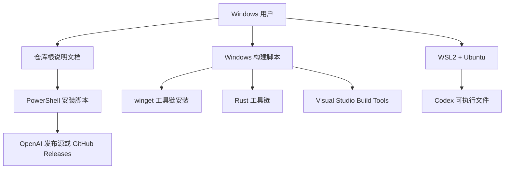
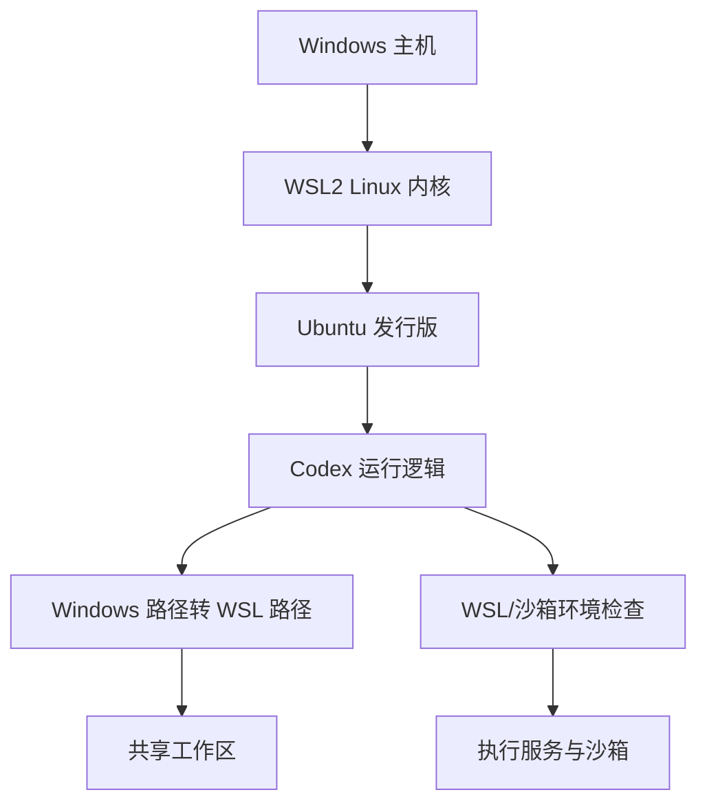
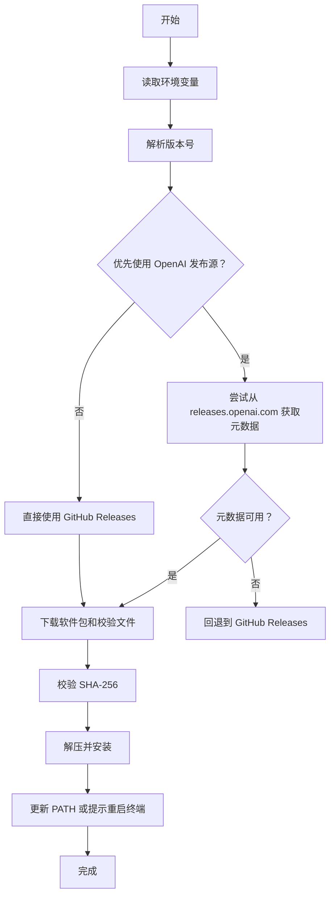
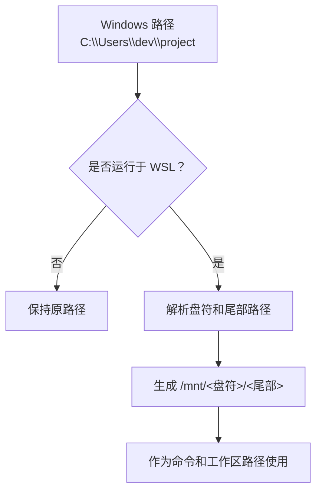
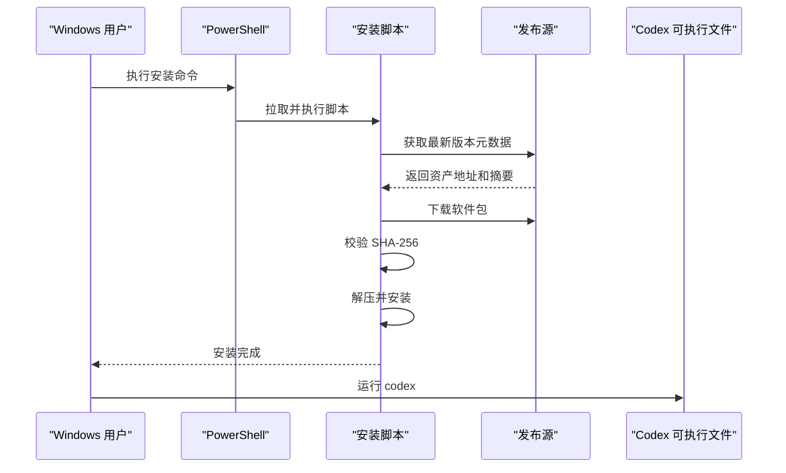

# Windows 安装指南

<cite>
**本文引用的文件**
- [README.md](file://README.md)
- [docs/install.md](file://docs/install.md)
- [scripts/install/install.ps1](file://scripts/install/install.ps1)
- [codex-rs/scripts/setup-windows.ps1](file://codex-rs/scripts/setup-windows.ps1)
- [codex-rs/cli/src/wsl_paths.rs](file://codex-rs/cli/src/wsl_paths.rs)
- [codex-rs/cli/src/main.rs](file://codex-rs/cli/src/main.rs)
</cite>

## 目录
1. [简介](#简介)
2. [项目结构与平台定位](#项目结构与平台定位)
3. [必须使用 WSL2 的原因](#必须使用-wsl2-的原因)
4. [Windows 环境准备](#windows-环境准备)
5. [安装 Codex：PowerShell 安装脚本](#安装-codexpowershell-安装脚本)
6. [WSL2 发行版与开发工具链准备](#wsl2-发行版与开发工具链准备)
7. [Windows 到 WSL2 的路径映射与权限模型](#windows-到-wsl2-的路径映射与权限模型)
8. [在原生 Windows 中集成和使用 Codex](#在原生-windows-中集成和使用-codex)
9. [编辑器集成](#编辑器集成)
10. [常见问题与排错](#常见问题与排错)
11. [性能与资源建议](#性能与资源建议)
12. [结论](#结论)

## 简介
本指南面向在 Windows 上安装和使用 Codex 的用户。仓库文档明确指出，Windows 支持的前提是“通过 WSL2 运行”。因此，本指南把重点放在：

- 为什么 Windows 安装需要 WSL2。
- 如何准备 Windows、WSL2 和 Ubuntu 发行版。
- 如何使用仓库提供的 PowerShell 安装脚本和构建脚本。
- 如何处理 Windows 与 WSL2 之间的路径、权限和沙箱差异。
- 如何在原生 Windows 环境中启动 Codex，并与 VS Code 等编辑器配合工作。

## 项目结构与平台定位
Codex 是一个本地运行的编码代理，提供命令行界面、桌面应用入口、IDE 集成以及云端版本。其安装入口在仓库根说明文件中给出；Windows 安装使用 PowerShell 脚本，Linux/macOS 使用 Shell 脚本。



**图表来源**
- [README.md:1-40](file://README.md#L1-L40)
- [scripts/install/install.ps1:1-60](file://scripts/install/install.ps1#L1-L60)
- [codex-rs/scripts/setup-windows.ps1:1-40](file://codex-rs/scripts/setup-windows.ps1#L1-L40)

**章节来源**
- [README.md:1-40](file://README.md#L1-L40)

## 必须使用 WSL2 的原因
仓库的“安装与构建”文档明确列出系统要求：macOS 12+、Ubuntu 20.04+/Debian 10+，或者 **Windows 11 通过 WSL2**。这说明官方对 Windows 的支持不是直接以原生 Windows 二进制作为唯一目标，而是强调 WSL2 是 Windows 上的受支持运行方式。

此外，代码中存在大量 WSL 相关实现，包括：

- 检测当前进程是否在 WSL 中运行。
- 将 Windows 绝对路径转换为 `/mnt/<盘符>/...` 形式的 WSL 挂载路径。
- 在非 Windows 分支中将命令参数按 WSL 路径规范化。
- 诊断信息中包含 `WSL_DISTRO_NAME`、`WSL_INTEROP` 等环境变量。
- Linux 沙箱测试中处理 WSLg、`/run/WSL`、bwrap/bubblewrap 等运行时约束。

这些实现共同说明：在 Windows 上使用 Codex 时，很多底层行为、路径解析、沙箱策略和终端交互都依赖 WSL 语义。



**图表来源**
- [docs/install.md:1-15](file://docs/install.md#L1-L15)
- [codex-rs/cli/src/wsl_paths.rs:1-35](file://codex-rs/cli/src/wsl_paths.rs#L1-L35)
- [codex-rs/cli/src/main.rs:840-865](file://codex-rs/cli/src/main.rs#L840-L865)

**章节来源**
- [docs/install.md:1-15](file://docs/install.md#L1-L15)
- [codex-rs/cli/src/wsl_paths.rs:1-35](file://codex-rs/cli/src/wsl_paths.rs#L1-L35)
- [codex-rs/cli/src/main.rs:840-865](file://codex-rs/cli/src/main.rs#L840-L865)

## Windows 环境准备
如果你准备从源码构建或参与开发，仓库提供了专门的 Windows 构建脚本。该脚本的主要职责是：

- 使用 winget 安装 Visual Studio 2022 Build Tools。
- 安装 Rustup 并配置指定版本的 Rust 工具链。
- 安装 Git、ripgrep、just、CMake。
- 安装 LLVM/Clang，并设置 `CC`、`CXX`、`LIBCLANG_PATH` 等变量。
- 进入 Visual Studio 开发环境后执行 `cargo build`。
- 可选跳过构建阶段。

### 管理员权限要求
脚本注释明确要求：**右键以“管理员身份运行” PowerShell**。原因是 Visual Studio Build Tools 的安装和修改通常需要管理员权限。

### 执行策略
脚本注释示例中使用 `powershell -ExecutionPolicy Bypass -File scripts/setup-windows.ps1`，说明在默认执行策略受限的环境中，需要通过 `-ExecutionPolicy Bypass` 临时绕过策略。

### 依赖清单
| 组件 | 作用 | 安装来源 |
|---|---|---|
| winget | Windows 包管理器 | 现代 Windows 10/11 预装 |
| Visual Studio 2022 Build Tools | MSVC 工具链和 Windows SDK | winget |
| Rustup | Rust 工具链管理 | winget |
| Git | 版本控制 | winget |
| ripgrep | 文本搜索辅助工具 | winget |
| just | 工作区任务助手 | winget |
| CMake | 原生库构建依赖 | winget |
| LLVM/Clang | 部分 crate/bindgen 需要 clang/libclang | winget |
| cargo-insta | 快照测试工具 | cargo（需 MSVC 链接器） |

**章节来源**
- [codex-rs/scripts/setup-windows.ps1:1-40](file://codex-rs/scripts/setup-windows.ps1#L1-L40)
- [codex-rs/scripts/setup-windows.ps1:120-246](file://codex-rs/scripts/setup-windows.ps1#L120-L246)

## 安装 Codex：PowerShell 安装脚本
仓库 README 给出了 Windows 安装命令：通过 PowerShell 远程获取并执行安装脚本。该脚本会从 OpenAI 的发布源下载打包好的 Codex 发布物，并在不可用时回退到 GitHub Releases。

### 基本安装命令
仓库说明中的 Windows 安装命令为：

```powershell
powershell -ExecutionPolicy ByPass -c "irm https://chatgpt.com/codex/install.ps1 | iex"
```

这里需要注意两个关键点：

1. 使用 `irm` 拉取脚本，再通过 `iex` 执行。
2. 通过 `-ExecutionPolicy ByPass` 允许脚本在当前会话执行。

### 安装源切换
安装脚本支持环境变量 `CODEX_INSTALLER_USE_RELEASES_OPENAI_COM`：

- 默认优先从 `releases.openai.com/codex` 获取发布元数据和资产。
- 如果设为 `false`、`0` 或 `no`，则强制使用 GitHub Releases。

示例中给出的切换方式是先设置环境变量，再调用安装脚本。

### 脚本核心行为
安装脚本的关键流程如下：



**图表来源**
- [scripts/install/install.ps1:1-120](file://scripts/install/install.ps1#L1-L120)
- [scripts/install/install.ps1:201-400](file://scripts/install/install.ps1#L201-L400)

### 安全校验
安装脚本在下载发布资产后会计算 SHA-256，并与发布元数据中的摘要比较。如果校验失败，会抛出错误。脚本还尝试从压缩包清单中提取特定资产的摘要，作为进一步完整性检查。

### 升级与现有安装
脚本包含查找已安装版本、清理残留安装工件、处理旧布局等功能。它还会根据当前安装的 `codex.exe` 输出版本信息进行判断，避免重复安装或损坏现有安装。

**章节来源**
- [README.md:15-40](file://README.md#L15-L40)
- [scripts/install/install.ps1:1-120](file://scripts/install/install.ps1#L1-L120)
- [scripts/install/install.ps1:201-400](file://scripts/install/install.ps1#L201-L400)

## WSL2 发行版与开发工具链准备
虽然安装脚本主要安装原生 Windows 环境的 Codex 发布包，但仓库文档仍然强调 Windows 通过 WSL2 运行。若你在 WSL2 中构建或运行 Codex，还需要准备 Ubuntu 发行版和 Linux 侧开发环境。

### 安装 WSL2 和 Ubuntu
推荐步骤：

1. 确认系统满足 Windows 11 要求，或使用支持 WSL2 的 Windows 10 版本。
2. 安装 WSL2。
3. 安装 Ubuntu 发行版。
4. 初始化发行版并设置用户名。
5. 进入发行版后更新系统包。

这一步属于通用 WSL2 准备流程，不依赖 Codex 源码结构。

### 在 WSL2 中安装开发工具
如果你需要在 WSL2 中编译 Codex，应在 Ubuntu 内安装：

- Git
- Rust 工具链
- `rustfmt`
- `clippy`
- `just`
- `cargo-nextest`

仓库安装文档给出了典型的 Linux/macOS 构建命令，可作为 WSL2 中 Ubuntu 环境下的参考。

### 在 WSL2 中运行 Codex
在 WSL2 中，你可以：

- 从源码构建后运行 `cargo run --bin codex -- "解释这个代码库"`。
- 使用已安装的 Codex 可执行文件运行交互式界面。
- 通过日志目录查看 TUI 诊断输出。

**章节来源**
- [docs/install.md:1-65](file://docs/install.md#L1-L65)

## Windows 到 WSL2 的路径映射与权限模型
### 路径映射
Codex 在 WSL 环境下会将 Windows 绝对路径转换为 WSL 挂载路径。例如：

- `C:\Temp\codex.zip` 对应 `/mnt/c/Temp/codex.zip`
- `D:/Work/codex.tgz` 对应 `/mnt/d/Work/codex.tgz`
- 非 Windows 路径保持不变

这一转换由 CLI 模块中的路径处理函数实现，用于确保在 WSL 中执行命令时传入正确的路径。



**图表来源**
- [codex-rs/cli/src/wsl_paths.rs:8-35](file://codex-rs/cli/src/wsl_paths.rs#L8-L35)

### 权限模型
Windows 文件和 WSL2 文件系统之间存在重要差异：

| 维度 | Windows | WSL2 Ubuntu |
|---|---|---|
| 路径分隔符 | `\` 或 `/` | `/` |
| 盘符 | `C:`、`D:` | `/mnt/c`、`/mnt/d` |
| 权限模型 | ACL | POSIX 权限 |
| 符号链接 | 支持但行为复杂 | 支持且更贴近 Linux |
| 可执行属性 | 扩展名决定 | 执行位决定 |
| 网络访问 | 原生进程 | 通过 interop 访问 Windows 程序有限制 |

因此，在 WSL2 中操作 Windows 磁盘上的项目时，应避免依赖 Windows 特有权限语义。例如：

- 不要在 WSL 中直接修改仅授予 Windows 用户权限的文件。
- 不要假设所有 `.exe` 可在 WSL 中直接运行。
- 不要把需要 Linux 沙箱的工具链放在 WSLg 特殊挂载路径下。

### 沙箱与 WSL 限制
Linux 沙箱测试显示，受限制沙箱不支持 `/mnt/wslg/distro` 这类路径，并要求使用主文件系统根下的对应路径。同时，测试也验证了 WSL interop、`WSL_INTEROP`、`/run/WSL` 等机制的存在和限制。

这意味着：

- 如果你在 WSL2 中启用图形功能，仍应让 Codex 的工作目录位于发行版内部文件系统。
- 不要让受限制沙箱直接访问 WSLg 或宿主 Windows 路径。
- 不要期望在受限环境中随意执行任意 Windows 程序。

**章节来源**
- [codex-rs/cli/src/wsl_paths.rs:1-59](file://codex-rs/cli/src/wsl_paths.rs#L1-L59)
- [codex-rs/linux-sandbox/tests/suite/sandbox.rs:270-365](file://codex-rs/linux-sandbox/tests/suite/sandbox.rs#L270-L365)
- [codex-rs/linux-sandbox/tests/suite/wslg_tests.rs:1-78](file://codex-rs/linux-sandbox/tests/suite/wslg_tests.rs#L1-L78)

## 在原生 Windows 中集成和使用 Codex
即使 Codex 在 Windows 上强调 WSL2 运行背景，安装脚本仍然会在原生 Windows 环境中安装可执行文件和相关工具。根据脚本分析，原生 Windows 安装可能涉及以下组件：

- `codex.exe`
- `rg.exe`
- `codex-command-runner.exe`
- `codex-windows-sandbox.exe`
- `codex-windows-sandbox-setup.exe`

这些文件名出现在安装脚本对“旧独立二进制布局”的检测逻辑中，说明原生 Windows 安装包不仅包含主程序，还包含 Windows 专用沙箱和命令执行相关组件。

### 典型使用流程


**图表来源**
- [README.md:15-40](file://README.md#L15-L40)
- [scripts/install/install.ps1:1-120](file://scripts/install/install.ps1#L1-L120)
- [scripts/install/install.ps1:201-400](file://scripts/install/install.ps1#L201-L400)

### 在 WSL2 中运行命令
在非 Windows 分支中，CLI 会对命令和参数进行 WSL 路径规范化。这表示当 Codex 在 WSL 中触发子命令时，会将 Windows 风格路径转换为 `/mnt/<盘符>` 形式，以便 WSL 内的工具链正确识别工作区。

**章节来源**
- [scripts/install/install.ps1:201-500](file://scripts/install/install.ps1#L201-L500)
- [codex-rs/cli/src/main.rs:840-865](file://codex-rs/cli/src/main.rs#L840-L865)
- [codex-rs/cli/src/wsl_paths.rs:8-35](file://codex-rs/cli/src/wsl_paths.rs#L8-L35)

## 编辑器集成
仓库根说明文件提到，如果你想把 Codex 集成到代码编辑器，可以前往 IDE 安装页面。支持的编辑器包括 VS Code、Cursor、Windsurf。

### VS Code 集成建议
在 Windows 上，推荐做法是：

1. 在 WSL2 中安装并使用 Codex，使工作区和终端语义符合 Linux 预期。
2. 使用 VS Code Remote - WSL 扩展连接到 Ubuntu 发行版。
3. 在 WSL 环境中打开你的项目目录。
4. 在 VS Code 终端中运行 Codex，避免 Windows 与 WSL 路径混用导致的问题。
5. 如需原生 Windows 集成，请遵循官方 IDE 安装指引，并确保路径、编码和杀毒软件不会干扰 WSL 文件访问。

### 工作区位置建议
- 优先把项目放在 WSL2 发行版内部文件系统，例如 `/home/<用户>/projects`。
- 尽量避免把大型项目放在 Windows 磁盘并通过 `/mnt/c` 频繁读写，因为跨文件系统 IO 性能较差。
- 如果项目必须在 Windows 磁盘，请确保文件编码、换行符和权限一致，并在 WSL 中以只读或低频写入方式使用。

**章节来源**
- [README.md:1-20](file://README.md#L1-L20)

## 常见问题与排错

### 问题一：PowerShell 执行策略阻止脚本运行
**现象**  
直接运行脚本时报错，提示不允许加载文件或脚本。

**解决方案**  
使用管理员 PowerShell，并以绕过执行策略的方式运行脚本。构建脚本示例使用了 `-ExecutionPolicy Bypass`。

**章节来源**
- [codex-rs/scripts/setup-windows.ps1:1-20](file://codex-rs/scripts/setup-windows.ps1#L1-L20)

### 问题二：缺少 winget
**现象**  
构建脚本提示找不到 winget。

**解决方案**  
升级到最新 Windows 10/11，或通过 Microsoft Store 安装 Windows 包管理器。

**章节来源**
- [codex-rs/scripts/setup-windows.ps1:140-160](file://codex-rs/scripts/setup-windows.ps1#L140-L160)

### 问题三：Visual Studio Build Tools 未安装或权限不足
**现象**  
MSVC 工具链缺失，无法编译原生依赖。

**解决方案**  
- 以管理员身份运行 PowerShell。
- 让脚本自动安装 Visual Studio 2022 Build Tools。
- 如已安装但未包含所需组件，脚本会尝试添加 VC Tools、ARM64 工具链和 Windows 11 SDK。

**章节来源**
- [codex-rs/scripts/setup-windows.ps1:60-120](file://codex-rs/scripts/setup-windows.ps1#L60-L120)
- [codex-rs/scripts/setup-windows.ps1:160-200](file://codex-rs/scripts/setup-windows.ps1#L160-L200)

### 问题四：cargo 不在 PATH 中
**现象**  
安装 rustup 后仍找不到 `cargo`。

**解决方案**  
- 重新打开终端。
- 手动将 `%USERPROFILE%\.cargo\bin` 加入 PATH。
- 脚本会尝试加载 `.cargo\env` 并添加到当前会话 PATH。

**章节来源**
- [codex-rs/scripts/setup-windows.ps1:40-60](file://codex-rs/scripts/setup-windows.ps1#L40-L60)
- [codex-rs/scripts/setup-windows.ps1:180-210](file://codex-rs/scripts/setup-windows.ps1#L180-L210)

### 问题五：Windows 到 WSL 路径不正确
**现象**  
在 WSL 中执行命令时，路径无法被工具链识别。

**解决方案**  
- 使用 WSL 中的路径，例如 `/mnt/c/Users/dev/project`。
- 让 Codex 自动进行路径规范化。
- 避免在 WSL 中混合使用 `C:\` 和 `/mnt/c`。

**章节来源**
- [codex-rs/cli/src/wsl_paths.rs:8-35](file://codex-rs/cli/src/wsl_paths.rs#L8-L35)

### 问题六：杀毒软件拦截下载或解压
**现象**  
安装脚本无法下载发布资产，或解压过程中被杀毒软件中断。

**解决方案**  
- 暂时将安装目录和下载目录加入杀毒软件白名单。
- 使用离线发布包手动安装。
- 检查脚本下载的 SHA-256 是否与发布元数据一致。

**章节来源**
- [scripts/install/install.ps1:201-260](file://scripts/install/install.ps1#L201-L260)

### 问题七：WSL2 内存占用过高
**现象**  
WSL2 进程占用大量物理内存，甚至影响 Windows 主机。

**解决方案**  
在 Windows 用户目录下创建或编辑 `.wslconfig`，调整 WSL2 最大内存。例如限制为 4GB 或 8GB，具体值取决于机器内存和项目规模。

这不是 Codex 独有问题，而是 WSL2 通用优化手段。

### 问题八：编码和换行符问题
**现象**  
Windows 编辑的文件在 WSL 中出现乱码、换行异常或 Git 差异异常。

**解决方案**  
- 统一使用 UTF-8。
- 在 WSL 中检查并修复换行符。
- 在项目根目录配置 Git 的 core.autocrlf 和 eol 策略。
- 避免在 Windows 和 WSL 之间频繁移动包含二进制或敏感编码的文件。

### 问题九：WSLg 或受限沙箱路径错误
**现象**  
沙箱构建失败，提示不支持 `/mnt/wslg/distro` 等路径。

**解决方案**  
- 将工作目录放在发行版内部文件系统。
- 不要将需要受限沙箱执行的命令指向 WSLg 或宿主 Windows 路径。
- 使用主文件系统根下的等效路径。

**章节来源**
- [codex-rs/linux-sandbox/tests/suite/wslg_tests.rs:60-78](file://codex-rs/linux-sandbox/tests/suite/wslg_tests.rs#L60-L78)

## 性能与资源建议
仓库文档指出最低内存为 4GB，推荐 8GB。结合 Windows + WSL2 的实际使用场景，建议：

- 普通使用：至少 8GB 物理内存。
- 构建和沙箱场景：建议 16GB 或以上。
- 将项目放在 WSL2 内部文件系统，减少跨文件系统 IO。
- 关闭不必要的后台杀毒扫描规则对 `/mnt/c` 的全量扫描。
- 合理配置 WSL2 内存上限，避免 WSL2 占满主机内存。
- 避免同时运行多个大型 Rust 构建、浏览器、虚拟机和 IDE。

**章节来源**
- [docs/install.md:1-15](file://docs/install.md#L1-L15)

## 结论
在 Windows 平台上安装和使用 Codex 时，应遵循以下原则：

1. **首选 WSL2**：仓库文档明确要求 Windows 通过 WSL2 运行。
2. **优先使用 WSL2 内部文件系统**：避免 `/mnt/c` 的频繁读写和权限差异。
3. **使用 PowerShell 安装脚本**：通过官方脚本安装原生 Windows 版本，或根据需要切换到 GitHub Releases。
4. **使用 Windows 构建脚本进行源码构建**：以管理员权限运行，确保 winget、Visual Studio Build Tools、Rust、Git 等依赖完整。
5. **注意路径和权限差异**：理解 Windows 路径与 WSL 路径的映射关系，避免误用 WSLg 或宿主路径。
6. **谨慎配置杀毒软件和内存限制**：防止误拦截和 WSL2 内存膨胀。
7. **通过官方 IDE 集成页接入编辑器**：优先在 WSL2 环境中使用 Codex，以获得更稳定的终端和路径行为。