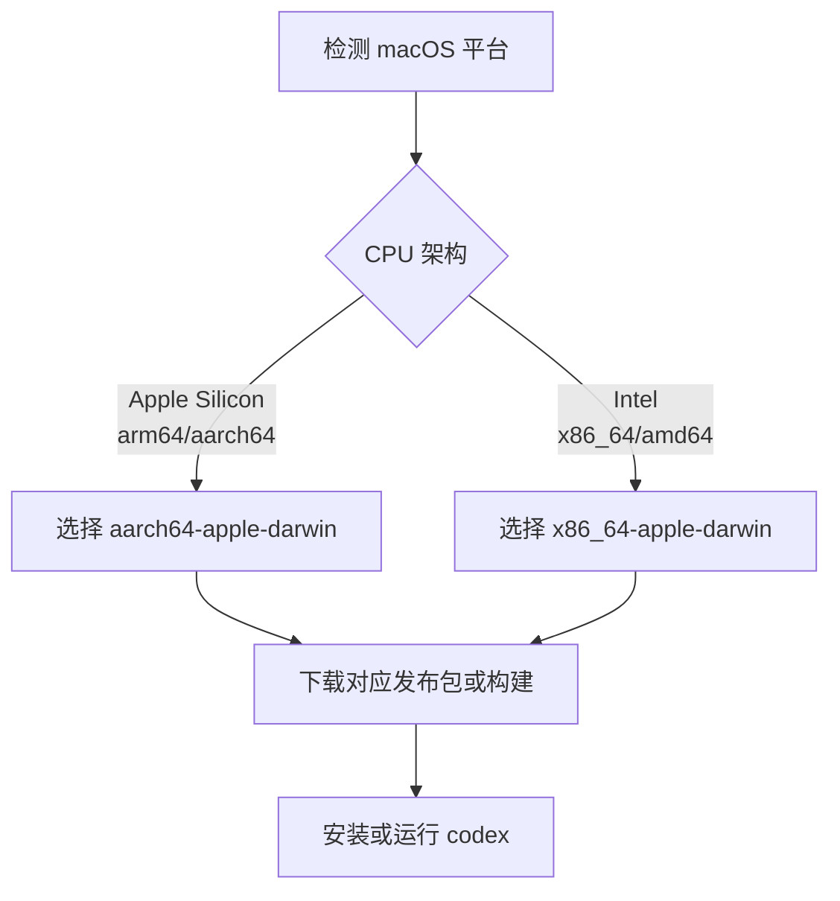
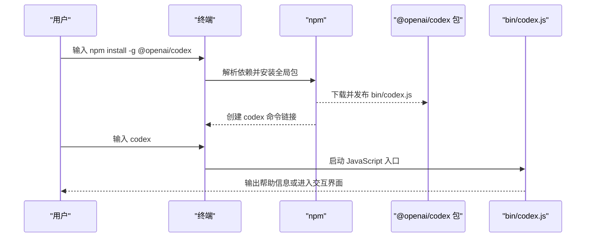
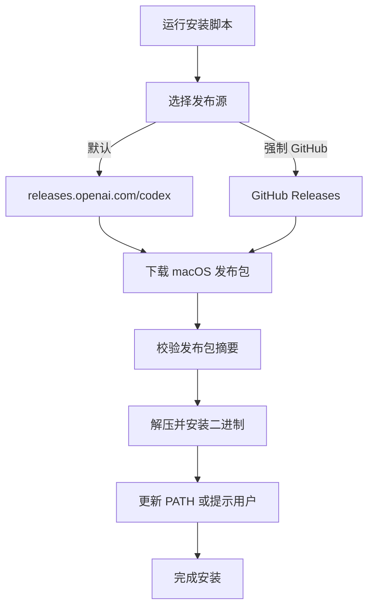
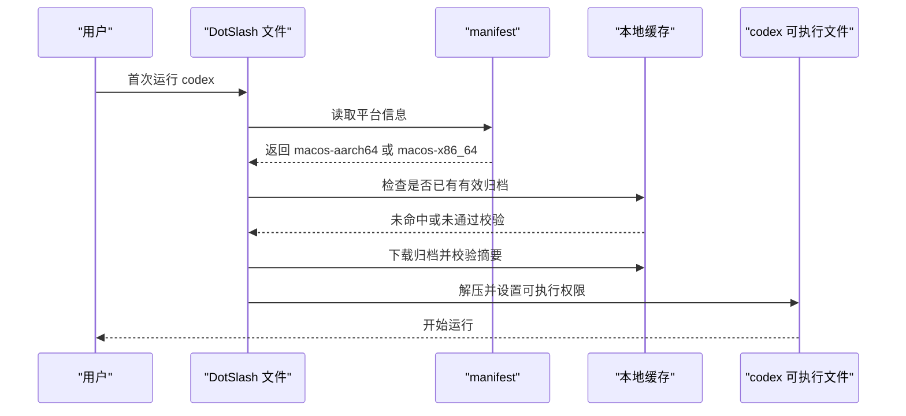
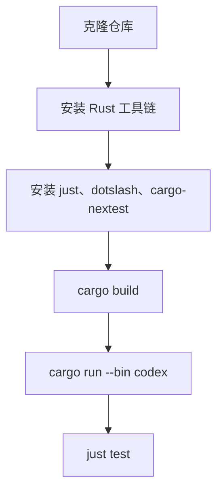
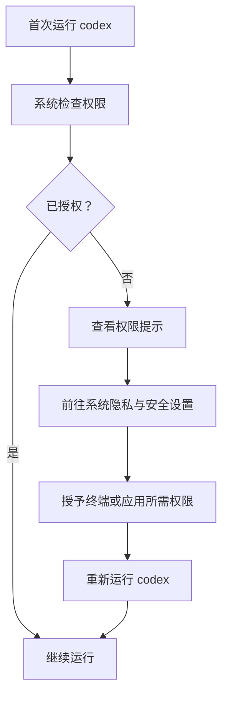

# macOS 安装指南

<cite>
**本文引用的文件**   
- [README.md](file://README.md)
- [docs/install.md](file://docs/install.md)
- [codex-cli/package.json](file://codex-cli/package.json)
- [scripts/install/install.sh](file://scripts/install/install.sh)
- [scripts/codex_package/targets.py](file://scripts/codex_package/targets.py)
- [scripts/codex_package/dotslash.py](file://scripts/codex_package/dotslash.py)
- [scripts/build_codex_package.py](file://scripts/build_codex_package.py)
- [codex-rs/cli/Cargo.toml](file://codex-rs/cli/Cargo.toml)
- [codex-rs/config/defaults.toml](file://codex-rs/config/defaults.toml)
- [codex-rs/config/src/config_toml.rs](file://codex-rs/config/src/config_toml.rs)
</cite>

## 目录
1. [简介](#简介)
2. [系统要求与架构支持](#系统要求与架构支持)
3. [推荐安装方式](#推荐安装方式)
4. [通过 npm 全局安装](#通过-npm-全局安装)
5. [使用官方安装包或 Homebrew](#使用官方安装包或-homebrew)
6. [通过 DotSlash 文件安装](#通过-dotslash-文件安装)
7. [从源码编译安装](#从源码编译安装)
8. [macOS 权限配置](#macos-权限配置)
9. [环境变量与网络代理](#环境变量与网络代理)
10. [验证安装](#验证安装)
11. [常见问题排查](#常见问题排查)
12. [总结](#总结)

## 简介
本指南面向 macOS 用户，说明如何在 macOS 12 及以上系统中安装 OpenAI Codex CLI。Codex CLI 是一个在本地运行的编码助手，既可以通过终端直接运行，也可以配合编辑器、桌面应用或云端服务使用。

仓库顶层文档提供了快速安装入口，并说明官方安装脚本默认从 `https://releases.openai.com/codex` 下载发布包，必要时回退到 GitHub Releases。仓库也提供 npm、Homebrew 和源码构建等多种安装路径。

**章节来源**
- [README.md:12-45](file://README.md#L12-L45)
- [README.md:47-81](file://README.md#L47-L81)

## 系统要求与架构支持
### 最低系统版本
根据仓库安装文档，Codex 的系统要求如下：
- 操作系统：macOS 12+、Ubuntu 20.04+/Debian 10+，或通过 WSL2 的 Windows 11
- Git：可选但推荐，用于内置拉取请求辅助功能，建议版本 2.23+
- 内存：至少 4 GB，推荐 8 GB

这些条件适用于在 macOS 上通过官方安装包、npm、Homebrew 或源码方式安装 Codex CLI。

**章节来源**
- [docs/install.md:3-13](file://docs/install.md#L3-L13)

### CPU 架构支持
Codex 为 Apple Silicon 和 Intel Mac 都提供预编译二进制包：
- Apple Silicon（M1/M2/M3）：对应 `aarch64-apple-darwin`
- Intel Mac：对应 `x86_64-apple-darwin`

仓库的目标映射将 macOS 主机架构解析为对应的 Cargo target：
- macOS + arm64 → `aarch64-apple-darwin`
- macOS + x86_64 → `x86_64-apple-darwin`

**图表来源**
- [scripts/codex_package/targets.py:94-104](file://scripts/codex_package/targets.py#L94-L104)
- [scripts/codex_package/targets.py:122-123](file://scripts/codex_package/targets.py#L122-L123)
- [scripts/codex_package/targets.py:166-169](file://scripts/codex_package/targets.py#L166-L169)

**章节来源**
- [scripts/codex_package/targets.py:94-104](file://scripts/codex_package/targets.py#L94-L104)
- [scripts/codex_package/targets.py:122-127](file://scripts/codex_package/targets.py#L122-L127)
- [scripts/codex_package/targets.py:166-169](file://scripts/codex_package/targets.py#L166-L169)

## 推荐安装方式
如果你希望最快地在 macOS 上获得 Codex CLI，推荐按以下优先级选择：
1. 官方一键安装脚本：适合大多数用户，自动下载合适的发布包。
2. Homebrew：适合已经使用 Homebrew 管理 macOS 软件的用户。
3. npm 全局安装：适合 Node.js 开发者。
4. 手动下载官方包：适合需要控制具体文件或安装路径的场景。
5. DotSlash 文件：适合希望在源码仓库中锁定可执行版本的行为。
6. 源码编译：适合开发者修改代码或自定义构建流程。

**章节来源**
- [README.md:12-45](file://README.md#L12-L45)

## 通过 npm 全局安装
### 前置条件
- 已安装 Node.js，版本需满足仓库定义的要求。
- npm 可用，且当前用户有写入全局模块目录的权限。

### 安装步骤
1. 打开 Terminal。
2. 运行 npm 全局安装命令：
   - `npm install -g @openai/codex`
3. 安装完成后，终端应可以直接调用 `codex`。

### 原理说明
`@openai/codex` 是仓库中的 npm 包，其入口命令为 `codex`，指向 `bin/codex.js`。该包声明 Node.js 引擎要求为 `>=16`，因此如果你的 Node.js 版本过低，可能无法安装或运行。

**图表来源**
- [codex-cli/package.json:1-22](file://codex-cli/package.json#L1-L22)

### 注意事项
- 如果提示权限不足，可尝试使用管理员权限重新安装，或使用符合你环境的 Node.js 包管理器。
- 如果 Node.js 版本过低，请先升级 Node.js 再安装。

**章节来源**
- [codex-cli/package.json:1-22](file://codex-cli/package.json#L1-L22)

## 使用官方安装包或 Homebrew
### 官方安装脚本
仓库 README 提供了一键安装命令，适用于 Mac 或 Linux：
- `curl -fsSL https://chatgpt.com/codex/install.sh | sh`

该脚本默认从 `https://releases.openai.com/codex` 下载发布包，并在元数据或资源下载失败时回退到 GitHub Releases。若希望强制使用 GitHub Releases，可以设置环境变量：
- `CODEX_INSTALLER_USE_RELEASES_OPENAI_COM=false`

安装脚本会将二进制文件放入用户目录下的安装位置，并将 `codex` 加入 PATH，以便直接调用。

**图表来源**
- [README.md:16-36](file://README.md#L16-L36)
- [scripts/install/install.sh:1-40](file://scripts/install/install.sh#L1-L40)

### Homebrew 安装
仓库 README 明确列出 Homebrew Cask 安装方式：
- `brew install --cask codex`

这种方式适合希望用 Homebrew 统一管理 macOS 应用的用户。

**章节来源**
- [README.md:16-36](file://README.md#L16-L36)

## 通过 DotSlash 文件安装
### 什么是 DotSlash
DotSlash 是一种轻量级机制，允许在源码仓库中包含一个“伪脚本”，实际运行时再根据目标平台下载并缓存真正的可执行文件。这样可以让不同平台的开发者保持相同的可执行行为，同时避免把大体积二进制提交进版本库。

### macOS 上的 DotSlash 支持
仓库的 DotSlash provisioned 配置包含 macOS 两个架构：
- `macos-aarch64`
- `macos-x86_64`

这意味着 macOS 用户可以通过 DotSlash 机制获取对应架构的可执行文件。

### 工作原理
1. 首次使用时，DotSlash 会根据当前平台查找匹配的 manifest。
2. 下载压缩包后校验大小和 SHA-256 摘要。
3. 解压出目标二进制文件。
4. 在非 Windows 平台上设置可执行权限。
5. 将结果缓存到临时目录，供后续复用。

**图表来源**
- [.github/dotslash-provisioned-config.json:1-16](file://.github/dotslash-provisioned-config.json#L1-L16)
- [scripts/codex_package/dotslash.py:23-66](file://scripts/codex_package/dotslash.py#L23-L66)
- [scripts/codex_package/dotslash.py:132-178](file://scripts/codex_package/dotslash.py#L132-L178)

### 适用场景
- 你希望仓库中的工具版本固定，而不是依赖每台机器单独安装的版本。
- 你希望通过脚本或自动化流程拉取最新匹配的二进制。
- 你在开发环境中需要确保所有贡献者使用相同版本的底层工具。

**章节来源**
- [docs/install.md:14-20](file://docs/install.md#L14-L20)
- [.github/dotslash-provisioned-config.json:1-16](file://.github/dotslash-provisioned-config.json#L1-L16)
- [scripts/codex_package/dotslash.py:23-66](file://scripts/codex_package/dotslash.py#L23-L66)
- [scripts/codex_package/dotslash.py:132-178](file://scripts/codex_package/dotslash.py#L132-L178)

## 从源码编译安装
源码编译适合开发者，或者需要自定义构建参数、调试底层行为的场景。

### 前置条件
- Git
- Rust 工具链
- `rustfmt`、`clippy`
- `just`
- `dotslash`
- `cargo-nextest`

### 编译步骤
1. 克隆仓库并进入 Rust workspace 根目录：
   - `git clone https://github.com/openai/codex.git`
   - `cd codex/codex-rs`
2. 安装 Rust 工具链和相关组件：
   - `curl --proto '=https' --tlsv1.2 -sSf https://sh.rustup.rs | sh -s -- -y`
   - `source "$HOME/.cargo/env"`
   - `rustup component add rustfmt`
   - `rustup component add clippy`
3. 安装工作区辅助工具：
   - `cargo install --locked just`
   - `cargo install --locked dotslash`
   - `cargo install --locked cargo-nextest`
4. 编译 Codex：
   - `cargo build`
5. 运行 TUI：
   - `cargo run --bin codex -- "explain this codebase to me"`
6. 格式化与修复：
   - `just fmt`
   - `just fix -p <crate-you-touch>`
7. 运行测试：
   - `just test -p codex-tui`
   - `just test`

注意：日常本地运行应避免使用 `--all-features`，因为它会增加构建时间和 `target/` 目录占用。

**图表来源**
- [docs/install.md:21-56](file://docs/install.md#L21-L56)

### 源码产物
Rust 侧的 CLI 二进制名称为 `codex`，由 `codex-rs/cli` crate 构建。Cargo 配置中声明了主二进制 `codex`，以及辅助二进制如 `logs_client`。

**章节来源**
- [docs/install.md:21-56](file://docs/install.md#L21-L56)
- [codex-rs/cli/Cargo.toml:1-18](file://codex-rs/cli/Cargo.toml#L1-L18)
- [codex-rs/cli/Cargo.toml:19-27](file://codex-rs/cli/Cargo.toml#L19-L27)

## macOS 权限配置
Codex CLI 在 macOS 上可能需要访问终端、文件系统或其他系统资源。常见权限问题包括：
- 终端拒绝某些交互式能力。
- 文件系统访问被限制，导致无法读写项目目录或日志目录。
- 安全策略阻止未签名或未来自可信来源的二进制执行。

### 一般建议
1. 首次运行 `codex` 后，留意系统弹出的权限请求。
2. 如果提示需要“辅助功能”或“屏幕录制”等权限，请在系统设置的隐私与安全选项中授予相应权限。
3. 如果提示需要“完全磁盘访问权限”，请根据需要授权给终端程序或 Finder。
4. 如果系统提示应用来自不受信任的开发者，可在“系统设置 > 隐私与安全性”中允许运行。

### 相关行为
仓库默认配置启用了权限说明指令，说明打包客户端会倾向于包含权限引导信息。此外，日志目录默认位于 `$CODEX_HOME/log`，SQLite 日志则位于 `sqlite_home`。

**图表来源**
- [codex-rs/config/defaults.toml:1-18](file://codex-rs/config/defaults.toml#L1-L18)
- [codex-rs/config/src/config_toml.rs:376-384](file://codex-rs/config/src/config_toml.rs#L376-L384)

**章节来源**
- [codex-rs/config/defaults.toml:1-18](file://codex-rs/config/defaults.toml#L1-L18)
- [codex-rs/config/src/config_toml.rs:376-384](file://codex-rs/config/src/config_toml.rs#L376-L384)

## 环境变量与网络代理
### 日志与环境变量
Codex 基于 Rust 实现，遵循 `RUST_LOG` 环境变量控制日志级别。TUI 默认将诊断记录保存在本地有限存储中；若显式设置 `log_dir`，则会启用明文 TUI 日志，便于排查问题。

常用环境变量：
- `RUST_LOG`：控制 Rust 层日志级别，例如 `debug`、`info`、`warn`、`error`。
- `log_dir`：指定 TUI 日志目录。
- `CODEX_HOME`：影响安装目录、缓存目录及日志目录的基础路径。
- `CODEX_SQLITE_HOME`：当未设置时使用 `CODEX_HOME`；否则可用于区分 SQLite 存储路径。
- `CODEX_INSTALLER_USE_RELEASES_OPENAI_COM`：控制官方安装脚本优先使用 releases.openai.com 还是 GitHub Releases。

日志默认位置：
- 非交互式模式默认使用较严格的日志级别。
- TUI 模式下可通过 `log_dir` 启用独立日志文件。

**章节来源**
- [docs/install.md:57-65](file://docs/install.md#L57-L65)
- [codex-rs/config/src/config_toml.rs:376-384](file://codex-rs/config/src/config_toml.rs#L376-L384)
- [README.md:24-36](file://README.md#L24-L36)

### 网络代理
如果你在受控网络环境中遇到连接问题，可以尝试以下思路：
- 配置系统代理，使终端和网络请求走代理。
- 如果通过 npm 安装，可配置 npm 代理。
- 如果通过 curl 或安装脚本下载发布包，确保代理能放行 `https://releases.openai.com/codex` 和 GitHub Releases。
- 如果需要在命令行中显式设置代理，可使用常见的 `http_proxy`、`https_proxy`、`all_proxy` 环境变量，但具体支持程度取决于使用的下载工具、npm、Rust 工具链或 Codex 内部 HTTP 客户端。

由于仓库的网络代理逻辑分布在多个模块中，建议在企业网络中先确认：
- 出站 HTTPS 是否可达。
- 是否需要 CA 证书导入。
- 是否需要为 curl、wget、npm、cargo 分别配置代理。

**章节来源**
- [scripts/install/install.sh:1-40](file://scripts/install/install.sh#L1-L40)
- [scripts/codex_package/dotslash.py:179-199](file://scripts/codex_package/dotslash.py#L179-L199)

## 验证安装
### 基础验证
安装完成后，可以在终端运行：
- `codex --version`
- `codex`

如果安装成功，终端应显示帮助信息或进入交互界面。

### 架构验证
如果不确定自己安装的是否匹配 CPU 架构，可以结合系统信息判断：
- Apple Silicon：通常对应 `aarch64-apple-darwin`。
- Intel Mac：通常对应 `x86_64-apple-darwin`。

仓库 README 还列出了 GitHub Release 中推荐的 macOS 文件名：
- Apple Silicon/arm64：`codex-aarch64-apple-darwin.tar.gz`
- x86_64（较老 Intel Mac）：`codex-x86_64-apple-darwin.tar.gz`

### 源码构建验证
如果是源码编译，可运行：
- `cargo run --bin codex -- "explain this codebase to me"`

这既能验证构建是否成功，也能触发一次最小化的 TUI 交互。

**章节来源**
- [README.md:47-81](file://README.md#L47-L81)
- [docs/install.md:43-56](file://docs/install.md#L43-L56)

## 常见问题排查
### 问题：权限拒绝
**现象**
- 提示无法执行二进制。
- 提示无法访问项目目录或日志目录。
- 系统弹窗要求授予隐私权限。

**处理建议**
1. 确认二进制具有可执行权限。
2. 在 macOS “系统设置 > 隐私与安全”中授予终端或应用所需权限。
3. 如果使用手动下载的 tar.gz，请解压后将二进制重命名为 `codex` 并赋予可执行权限。
4. 如果日志写入失败，检查 `CODEX_HOME` 和 `log_dir` 指向的目录是否可写。

**章节来源**
- [scripts/codex_package/dotslash.py:57-66](file://scripts/codex_package/dotslash.py#L57-L66)
- [codex-rs/config/src/config_toml.rs:376-384](file://codex-rs/config/src/config_toml.rs#L376-L384)

### 问题：网络超时或下载失败
**现象**
- 安装脚本或 npm 长时间无响应。
- 提示无法连接到 `releases.openai.com` 或 GitHub。
- DotSlash 下载归档失败。

**处理建议**
1. 检查网络连接和防火墙规则。
2. 配置系统或终端代理。
3. 对官方安装脚本，可强制使用 GitHub Releases：
   - `CODEX_INSTALLER_USE_RELEASES_OPENAI_COM=false`
4. 如果是企业环境，确认是否需要导入公司 CA 证书。
5. 重试安装，因为安装脚本具备回退机制。

**章节来源**
- [README.md:24-36](file://README.md#L24-L36)
- [scripts/install/install.sh:1-40](file://scripts/install/install.sh#L1-L40)
- [scripts/codex_package/dotslash.py:179-199](file://scripts/codex_package/dotslash.py#L179-L199)

### 问题：Apple Silicon 架构不匹配
**现象**
- 安装了错误架构的二进制。
- 运行时报架构错误或无法启动。

**处理建议**
1. 确认本机架构是 Apple Silicon 还是 Intel。
2. 下载或构建对应架构的版本：
   - Apple Silicon：`aarch64-apple-darwin`
   - Intel：`x86_64-apple-darwin`
3. 如果使用源码编译，确保当前主机能被正确识别为目标平台。

**章节来源**
- [scripts/codex_package/targets.py:94-104](file://scripts/codex_package/targets.py#L94-L104)
- [scripts/codex_package/targets.py:122-123](file://scripts/codex_package/targets.py#L122-L123)
- [scripts/codex_package/targets.py:166-169](file://scripts/codex_package/targets.py#L166-L169)

### 问题：npm 安装失败
**现象**
- 提示 Node.js 版本过低。
- 全局安装权限不足。

**处理建议**
1. 检查 Node.js 版本，确保满足 `>=16`。
2. 使用合适的全局安装目录权限。
3. 如果企业环境限制 npm，可改用官方安装脚本或 Homebrew。

**章节来源**
- [codex-cli/package.json:1-22](file://codex-cli/package.json#L1-L22)

### 问题：源码构建失败
**现象**
- 找不到 `just`、`dotslash` 或 `cargo-nextest`。
- 构建时间过长或磁盘空间不足。
- 测试无法运行。

**处理建议**
1. 按文档顺序安装 Rust 工具链和辅助工具。
2. 避免常规本地构建使用 `--all-features`。
3. 清理 `target/` 目录后再重新构建。
4. 使用 `just test -p codex-tui` 先运行项目内最快的测试。

**章节来源**
- [docs/install.md:21-56](file://docs/install.md#L21-L56)

## 总结
对于大多数 macOS 用户，推荐优先使用官方安装脚本或 Homebrew 安装 Codex CLI。如果你已经是 Node.js 开发者，可以使用 npm 全局安装；如果你希望源码仓库中锁定工具版本，可以使用 DotSlash；如果你是开发者，可以从源码编译。

安装成功后，请根据实际需求配置 macOS 权限、日志目录和网络代理，并通过 `codex` 命令验证安装是否生效。遇到问题时，优先检查网络连通性、架构匹配、权限配置和日志输出。