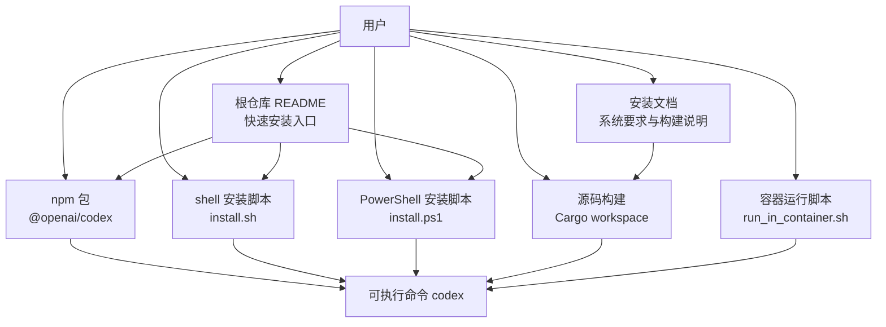
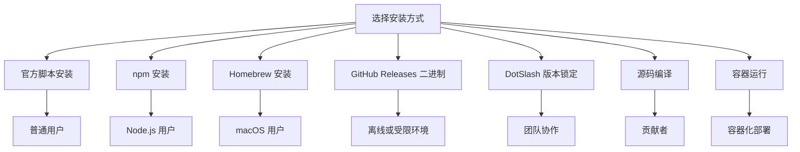

# 平台安装指南

<cite>
**本文引用的文件**   
- [README.md](file://README.md)
- [docs/install.md](file://docs/install.md)
- [codex-cli/package.json](file://codex-cli/package.json)
- [scripts/install/install.sh](file://scripts/install/install.sh)
- [scripts/install/install.ps1](file://scripts/install/install.ps1)
- [codex-rs/Cargo.toml](file://codex-rs/Cargo.toml)
- [codex-rs/rust-toolchain.toml](file://codex-rs/rust-toolchain.toml)
- [codex-cli/scripts/run_in_container.sh](file://codex-cli/scripts/run_in_container.sh)
</cite>

## 目录
1. [简介](#简介)
2. [项目结构与安装入口](#项目结构与安装入口)
3. [系统要求](#系统要求)
4. [支持平台与安装方式总览](#支持平台与安装方式总览)
5. [macOS 安装](#macos-安装)
6. [Linux Ubuntu/Debian 安装](#linux-ubuntudebian-安装)
7. [Windows WSL2 安装](#windows-wsl2-安装)
8. [包管理器安装](#包管理器安装)
9. [DotSlash 使用方式](#dotslash-使用方式)
10. [源码编译安装](#源码编译安装)
11. [容器化部署](#容器化部署)
12. [安装方式优缺点与适用场景](#安装方式优缺点与适用场景)
13. [常见问题排查](#常见问题排查)
14. [结论](#结论)

## 简介
本指南面向需要在 macOS、Linux（Ubuntu/Debian）和 Windows WSL2 上安装 Codex CLI 的用户，覆盖以下安装路径：
- 官方一键安装脚本
- npm 全局包安装
- Homebrew cask 安装
- GitHub Releases 手动下载二进制包
- DotSlash 轻量版本锁定
- Rust 源码编译安装
- 基于 Docker 的容器运行方式

Codex CLI 是 OpenAI 提供的本地编码代理工具，既可作为终端命令行工具运行，也可配合 ChatGPT 订阅或 API Key 使用。

**章节来源**
- [README.md:1-81](file://README.md#L1-L81)

## 项目结构与安装入口
本项目包含多个安装相关入口：
- 根仓库 README 提供快速开始命令，包括 curl 安装、PowerShell 安装、npm 安装和 Homebrew 安装。
- `docs/install.md` 定义系统要求、构建流程以及日志配置。
- `codex-cli/package.json` 暴露 npm 包名 `@openai/codex`，并将 `bin/codex.js` 映射为可执行命令 `codex`，要求 Node.js 版本不低于 16。
- `scripts/install/install.sh` 是 Linux/macOS 侧的一键安装脚本，负责解析版本、选择发行源、校验摘要、解压归档并安装到用户目录。
- `scripts/install/install.ps1` 是 Windows PowerShell 安装脚本，逻辑与 shell 脚本一致，但使用 PowerShell 实现。
- `codex-rs/Cargo.toml` 定义 Rust workspace，说明核心实现位于 `codex-rs`。
- `codex-rs/rust-toolchain.toml` 固定 Rust 工具链版本为 1.95.0，并启用 clippy、rustfmt、rust-src 组件。
- `codex-cli/scripts/run_in_container.sh` 提供在 Docker 容器中启动 Codex 的辅助脚本。



**图表来源**
- [README.md:1-81](file://README.md#L1-L81)
- [docs/install.md:1-65](file://docs/install.md#L1-L65)
- [codex-cli/package.json:1-22](file://codex-cli/package.json#L1-L22)
- [scripts/install/install.sh:1-150](file://scripts/install/install.sh#L1-L150)
- [scripts/install/install.ps1:1-200](file://scripts/install/install.ps1#L1-L200)
- [codex-rs/Cargo.toml:1-200](file://codex-rs/Cargo.toml#L1-L200)
- [codex-cli/scripts/run_in_container.sh:1-95](file://codex-cli/scripts/run_in_container.sh#L1-L95)

**章节来源**
- [README.md:1-81](file://README.md#L1-L81)
- [docs/install.md:1-65](file://docs/install.md#L1-L65)
- [codex-cli/package.json:1-22](file://codex-cli/package.json#L1-L22)
- [codex-rs/Cargo.toml:1-200](file://codex-rs/Cargo.toml#L1-L200)
- [codex-rs/rust-toolchain.toml:1-3](file://codex-rs/rust-toolchain.toml#L1-L3)
- [codex-cli/scripts/run_in_container.sh:1-95](file://codex-cli/scripts/run_in_container.sh#L1-L95)

## 系统要求
根据仓库中的安装文档，Codex CLI 的系统要求如下：

| 项目 | 要求 |
| --- | --- |
| 操作系统 | macOS 12+、Ubuntu 20.04+、Debian 10+，或 Windows 11 通过 WSL2 |
| Git | 可选但推荐；内置 PR 助手需要 Git 2.23+ |
| 内存 | 至少 4 GB，推荐 8 GB |

这些要求决定了你在不同平台上安装前需要准备的最低环境。例如，WSL2 环境下必须确保宿主系统是 Windows 11，且已启用 WSL2；Rust 源码构建则需要 Rust 工具链与 Cargo workspace 依赖。

**章节来源**
- [docs/install.md:1-20](file://docs/install.md#L1-L20)

## 支持平台与安装方式总览
Codex CLI 支持以下平台和安装方式：

| 平台 | 推荐安装方式 | 其他可用方式 |
| --- | --- | --- |
| macOS | 官方一键安装脚本、Homebrew cask、npm | GitHub Releases 二进制、源码编译 |
| Linux Ubuntu/Debian | 官方一键安装脚本、npm | GitHub Releases musl 二进制、源码编译 |
| Windows WSL2 | 官方 PowerShell 安装脚本、npm | GitHub Releases 二进制、WSL 内源码编译 |

对于普通开发者，推荐使用官方安装脚本或 npm 安装；对需要严格版本控制或离线环境的场景，可使用 GitHub Releases 或源码编译；对希望将 Codex 作为容器工作负载运行的场景，可使用 Docker 脚本。

**章节来源**
- [README.md:1-81](file://README.md#L1-L81)
- [docs/install.md:1-65](file://docs/install.md#L1-L65)

## macOS 安装

### 方法一：官方一键安装脚本
在 macOS 终端中执行以下命令：

```shell
curl -fsSL https://chatgpt.com/codex/install.sh | sh
```

该脚本会：
- 默认从 `https://releases.openai.com/codex` 获取发布元数据。
- 如果主发行源不可用，则回退到 GitHub Releases。
- 将二进制安装到 `~/.local/bin`，除非通过环境变量指定其他目录。
- 将 Codex 安装在 `~/.codex/packages/standalone` 下。

如果你希望强制使用 GitHub Releases，可以设置环境变量：

```shell
curl -fsSL https://chatgpt.com/codex/install.sh | CODEX_INSTALLER_USE_RELEASES_OPENAI_COM=false sh
```

### 方法二：Homebrew cask
如果你已经安装 Homebrew，可以直接使用：

```shell
brew install --cask codex
```

这种方式适合偏好 macOS 原生包管理器的用户。

### 方法三：npm 安装
如果你已安装 Node.js 16 或以上版本，可以使用：

```shell
npm install -g @openai/codex
```

安装后直接运行 `codex`。

### 方法四：GitHub Releases 手动安装
前往最新 GitHub Release，下载对应架构的二进制归档：
- Apple Silicon/arm64：`codex-aarch64-apple-darwin.tar.gz`
- x86_64：`codex-x86_64-apple-darwin.tar.gz`

解压后将单一可执行文件重命名为 `codex`，放入 PATH 中的目录即可。

**章节来源**
- [README.md:1-81](file://README.md#L1-L81)

## Linux Ubuntu/Debian 安装

### 方法一：官方一键安装脚本
在 Ubuntu 或 Debian 终端中执行：

```shell
curl -fsSL https://chatgpt.com/codex/install.sh | sh
```

脚本会优先尝试从 OpenAI 发行站点下载包，失败时回退到 GitHub Releases。它会在 `~/.local/bin` 下安装 `codex`，并把独立包放在 `~/.codex/packages/standalone`。

如果你没有 curl，脚本会尝试使用 wget；如果两者都不可用，则会提示缺少下载工具。

### 方法二：npm 安装
Node.js 16 及以上版本满足 npm 安装条件：

```shell
npm install -g @openai/codex
```

### 方法三：GitHub Releases musl 二进制
仓库说明中提到 Linux 发行版通常使用 musl 链接的二进制：
- x86_64：`codex-x86_64-unknown-linux-musl.tar.gz`
- arm64：`codex-aarch64-unknown-linux-musl.tar.gz`

下载后解压并重命名为 `codex`，放入 PATH 目录。

**章节来源**
- [README.md:1-81](file://README.md#L1-L81)
- [scripts/install/install.sh:1-150](file://scripts/install/install.sh#L1-L150)

## Windows WSL2 安装

### 前置条件
- 宿主机为 Windows 11。
- 已启用 WSL2。
- 在 WSL2 内部使用 Ubuntu 或 Debian 发行版。

### 方法一：WSL2 内使用 shell 安装脚本
进入 WSL2 终端后，执行与 Linux 相同的命令：

```shell
curl -fsSL https://chatgpt.com/codex/install.sh | sh
```

### 方法二：Windows PowerShell 安装脚本
在 Windows PowerShell 中执行：

```powershell
powershell -ExecutionPolicy ByPass -c "irm https://chatgpt.com/codex/install.ps1 | iex"
```

该脚本会：
- 默认优先使用 `https://releases.openai.com/codex`。
- 支持通过 `CODEX_INSTALLER_USE_RELEASES_OPENAI_COM` 切换为 GitHub Releases。
- 解析版本、下载归档、校验 SHA-256 摘要、解压并安装。

### 方法三：WSL2 内使用 npm 安装
在 WSL2 环境中安装 Node.js 16+ 后执行：

```shell
npm install -g @openai/codex
```

**章节来源**
- [README.md:1-81](file://README.md#L1-L81)
- [scripts/install/install.ps1:1-200](file://scripts/install/install.ps1#L1-L200)

## 包管理器安装

### npm 安装
Codex CLI 以 npm 包形式发布，包名为 `@openai/codex`。`package.json` 中将 `bin/codex.js` 注册为全局命令 `codex`，并要求 Node.js 版本大于等于 16。

安装命令：

```shell
npm install -g @openai/codex
```

优点：
- 适合已经使用 Node.js 生态的开发者。
- 可通过 npm 进行版本管理与更新。

限制：
- 底层实际行为由脚本引导到独立包或二进制，具体取决于发行布局。
- 如果系统中已有旧版 npm 管理的 `codex`，安装脚本可能保留已有安装并给出警告。

**章节来源**
- [README.md:1-81](file://README.md#L1-L81)
- [codex-cli/package.json:1-22](file://codex-cli/package.json#L1-L22)
- [scripts/install/test_install_sh.py:1-200](file://scripts/install/test_install_sh.py#L1-L200)

### Homebrew 安装
macOS 用户可使用 Homebrew cask 安装：

```shell
brew install --cask codex
```

这种方式适合不希望通过 npm 或脚本安装的用户。

**章节来源**
- [README.md:1-81](file://README.md#L1-L81)

## DotSlash 使用方式
DotSlash 是一种用于在源码库中引用可执行文件的机制。仓库安装文档指出，GitHub Release 中包含名为 `codex` 的 DotSlash 文件，可以让贡献者无论使用什么开发平台，都能通过轻量提交锁定同一版本的可执行文件。

典型用法：
- 在仓库中添加或更新 DotSlash 引用。
- 首次使用时，DotSlash 会拉取对应平台的预构建二进制。
- 所有开发者通过相同 DotSlash 文件获得一致的 Codex 版本。

适用场景：
- 团队希望统一工具版本。
- CI 或协作环境需要可重复执行的工具链。
- 不想把二进制直接提交到仓库。

注意：DotSlash 本身不是 Codex 的安装方式，而是仓库级工具版本锁定机制。

**章节来源**
- [docs/install.md:1-30](file://docs/install.md#L1-L30)

## 源码编译安装

### 环境准备
源码编译基于 Rust workspace，核心代码位于 `codex-rs`。你需要：
- Git
- Rust 工具链
- Cargo
- optional：just、cargo-nextest、dotslash

### 步骤
1. 克隆仓库并进入 Rust workspace：

```shell
git clone https://github.com/openai/codex.git
cd codex/codex-rs
```

2. 安装 Rust 工具链及相关组件：

```shell
curl --proto '=https' --tlsv1.2 -sSf https://sh.rustup.rs | sh -s -- -y
source "$HOME/.cargo/env"
rustup component add rustfmt
rustup component add clippy
```

3. 安装 workspace 辅助工具：

```shell
cargo install --locked just
cargo install --locked dotslash
cargo install --locked cargo-nextest
```

4. 构建 Codex：

```shell
cargo build
```

5. 启动 TUI 并传入示例提示：

```shell
cargo run --bin codex -- "explain this codebase to me"
```

6. 常用开发命令：

```shell
just fmt
just fix -p <crate-you-touch>
just test -p codex-tui
just test
```

### Rust 工具链版本
仓库固定使用 Rust 1.95.0，并启用 clippy、rustfmt、rust-src 组件。如果你的系统 Rust 版本不一致，建议通过 rustup 切换到指定通道。

**章节来源**
- [docs/install.md:20-65](file://docs/install.md#L20-L65)
- [codex-rs/Cargo.toml:1-200](file://codex-rs/Cargo.toml#L1-L200)
- [codex-rs/rust-toolchain.toml:1-3](file://codex-rs/rust-toolchain.toml#L1-L3)

## 容器化部署

### 使用现有容器运行脚本
仓库提供了一个辅助脚本 `codex-cli/scripts/run_in_container.sh`，可在 Docker 中启动 Codex 并挂载工作目录。

基本用法：

```shell
./codex-cli/scripts/run_in_container.sh "codex your prompt"
```

带工作目录参数：

```shell
./codex-cli/scripts/run_in_container.sh --work_dir /path/to/project "codex analyze project"
```

该脚本的行为包括：
- 读取 `WORKSPACE_ROOT_DIR` 或使用当前目录作为工作目录。
- 读取 `OPENAI_ALLOWED_DOMAINS`，默认允许 `api.openai.com`。
- 生成唯一容器名称并清理残留容器。
- 启动容器时添加 `NET_ADMIN` 和 `NET_RAW` 能力。
- 将工作目录挂载到容器内的 `/app` 下。
- 写入允许域名列表到 `/etc/codex/allowed_domains.txt`。
- 初始化防火墙脚本并在执行后删除。
- 最终在容器中以沙箱模式运行 Codex：`codex --sandbox workspace-write --ask-for-approval on-request`。

### 自定义 Dockerfile 参考
仓库未提供公开的 `Dockerfile`，但可以基于上述脚本推断容器应具备的能力：
- 基础镜像应支持 bash、curl 或 wget。
- 需要安装或预置 Codex 二进制。
- 需要允许访问 OpenAI API 域名。
- 需要支持沙箱工作区写入模式。

一个概念性 Dockerfile 结构可以是：

```dockerfile
FROM ubuntu:latest

RUN apt-get update && \
    apt-get install -y curl bash && \
    rm -rf /var/lib/apt/lists/*

COPY codex /usr/local/bin/codex
RUN chmod +x /usr/local/bin/codex

ENV OPENAI_API_KEY=""
ENV OPENAI_ALLOWED_DOMAINS="api.openai.com"

WORKDIR /app

ENTRYPOINT ["codex"]
CMD ["--help"]
```

这只是一个概念示例，并非仓库官方 Dockerfile。实际部署时应结合 `run_in_container.sh` 的安全模型、域名白名单和沙箱行为进行调整。

**章节来源**
- [codex-cli/scripts/run_in_container.sh:1-95](file://codex-cli/scripts/run_in_container.sh#L1-L95)

## 安装方式优缺点与适用场景

| 安装方式 | 优点 | 缺点 | 适用场景 |
| --- | --- | --- | --- |
| 官方一键安装脚本 | 自动处理版本、发行源、摘要校验、路径安装 | 需要网络访问发行站点或 GitHub | 大多数 macOS/Linux/WSL2 用户 |
| npm 安装 | 适合 Node.js 用户，便于版本管理 | 依赖 Node.js 16+，可能与其他 npm 包冲突 | 前端或全栈开发者 |
| Homebrew cask | macOS 原生体验，命令简洁 | 仅适用于 macOS | macOS 用户 |
| GitHub Releases 二进制 | 可离线分发，适合受限环境 | 需手动下载、重命名、加入 PATH | 运维、CI、离线环境 |
| DotSlash | 仓库级版本锁定，跨平台一致 | 首次使用仍需下载二进制 | 团队协作、CI |
| 源码编译 | 可定制构建、调试底层逻辑 | 构建时间长，依赖复杂 | 贡献者、高级用户 |
| Docker 脚本 | 隔离运行、可复用工作目录 | 需要 Docker 运行时，网络与安全权限需注意 | 容器化工作流、安全隔离 |



[无图表来源，因为该图为概念性分类图]

## 常见问题排查

### 无法连接发行站点
现象：
- 安装脚本报错无法下载元数据或资产。
- 提示 GitHub release 元数据缺失。

原因：
- 企业代理或防火墙阻止了 `releases.openai.com`。
- GitHub Releases 被限流或暂时不可用。

解决：
- 设置 `CODEX_INSTALLER_USE_RELEASES_OPENAI_COM=false` 强制使用 GitHub Releases。
- 检查代理、DNS、TLS 设置。
- 确认网络可达 `https://api.github.com/repos/openai/codex/releases`。

**章节来源**
- [README.md:1-81](file://README.md#L1-L81)
- [scripts/install/install.sh:1-150](file://scripts/install/install.sh#L1-L150)
- [scripts/install/install.ps1:1-200](file://scripts/install/install.ps1#L1-L200)
- [scripts/install/test_install_sh.py:1-200](file://scripts/install/test_install_sh.py#L1-L200)

### 找不到 curl 或 wget
现象：
- 安装脚本输出“需要 curl 或 wget”。

原因：
- 系统未安装 curl 或 wget。

解决：
- 安装 curl 或 wget。
- 使用包管理器安装，例如 `apt install curl` 或 `yum install curl`。

**章节来源**
- [scripts/install/install.sh:1-150](file://scripts/install/install.sh#L1-L150)

### npm 安装的 codex 与独立安装冲突
现象：
- 安装脚本提示保留已存在的 npm 管理的 Codex。

原因：
- 系统中已有 npm 全局安装的 `codex`。

解决：
- 卸载旧版 npm 包：`npm uninstall -g @openai/codex`。
- 或者让安装脚本保留现有安装，避免破坏现有工作流。

**章节来源**
- [scripts/install/test_install_sh.py:1-200](file://scripts/install/test_install_sh.py#L1-L200)

### Git 版本过低
现象：
- 内置 PR 助手或 Git 相关功能异常。

原因：
- Git 版本低于 2.23。

解决：
- 升级 Git 到 2.23 或更高版本。
- 在 Linux 上使用包管理器升级 Git。
- 在 macOS 上使用 Homebrew 升级 Git。

**章节来源**
- [docs/install.md:1-20](file://docs/install.md#L1-L20)

### 内存不足导致构建或运行失败
现象：
- 源码编译时间很长、被系统杀死。
- 交互式 TUI 或 exec 模式响应缓慢。

原因：
- 内存低于推荐值。

解决：
- 增加系统内存或 WSL2 内存限制。
- 关闭其他占用内存的程序。
- 避免常规本地运行使用 `--all-features`，以减少构建时间和磁盘占用。

**章节来源**
- [docs/install.md:1-20](file://docs/install.md#L1-L20)

### 容器中没有工作目录或权限问题
现象：
- 容器内找不到项目文件。
- 执行命令时报权限错误。

原因：
- 未正确设置 `WORKSPACE_ROOT_DIR` 或工作目录路径。
- 容器内路径与宿主路径不一致。

解决：
- 显式传递 `--work_dir`。
- 确认 `WORKSPACE_ROOT_DIR` 指向有效绝对路径。
- 检查 Docker 是否成功挂载卷。

**章节来源**
- [codex-cli/scripts/run_in_container.sh:1-95](file://codex-cli/scripts/run_in_container.sh#L1-L95)

## 结论
Codex CLI 提供了多种安装方式，以适应不同用户群体和部署环境：
- 普通用户首选官方安装脚本或 npm 安装。
- macOS 用户可优先使用 Homebrew。
- 受控环境可选择 GitHub Releases 或源码编译。
- 团队协作可使用 DotSlash 锁定版本。
- 容器化场景可基于现有脚本扩展 Dockerfile 和编排配置。

在实际选择时，应综合考虑网络可用性、版本一致性、安全策略、性能需求和维护成本。对于生产或 CI 环境，建议优先采用可验证、可复现的安装方式，例如 GitHub Releases 或源码构建，并结合日志与诊断配置进行排错。