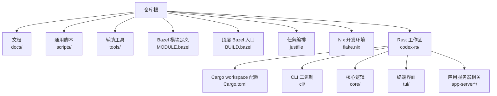
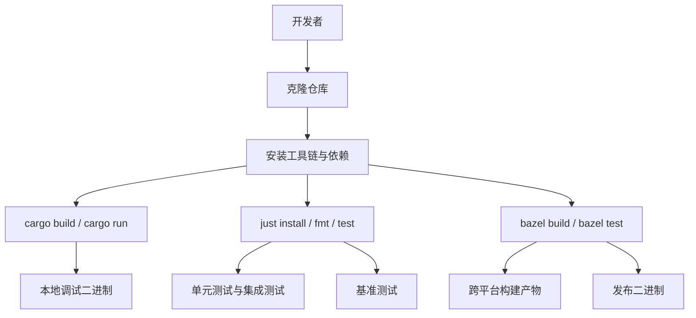
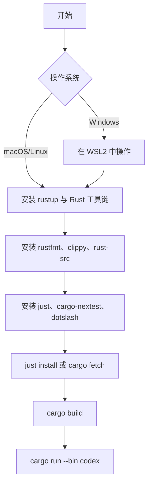
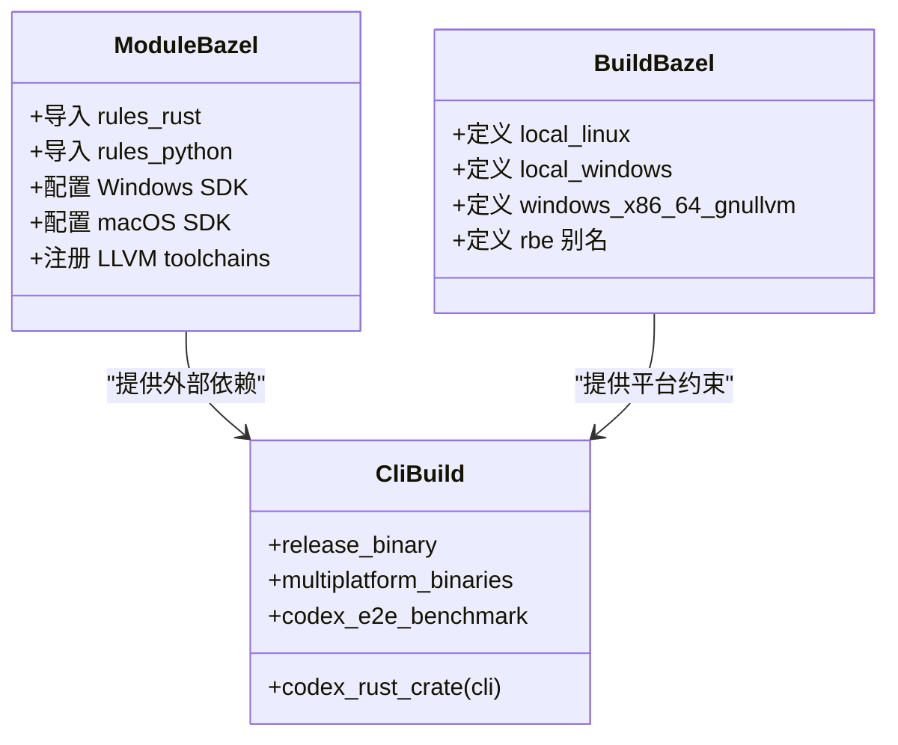
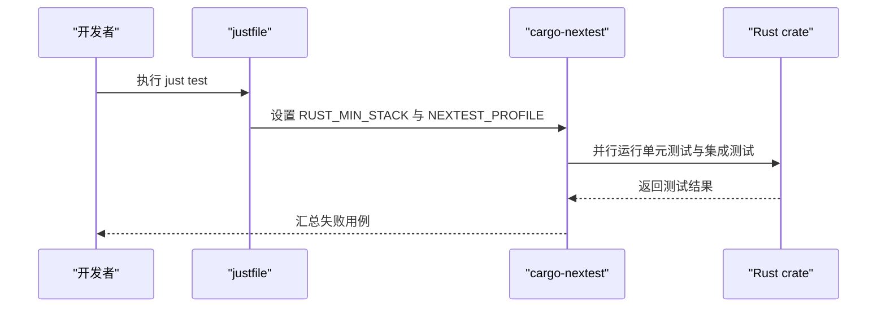
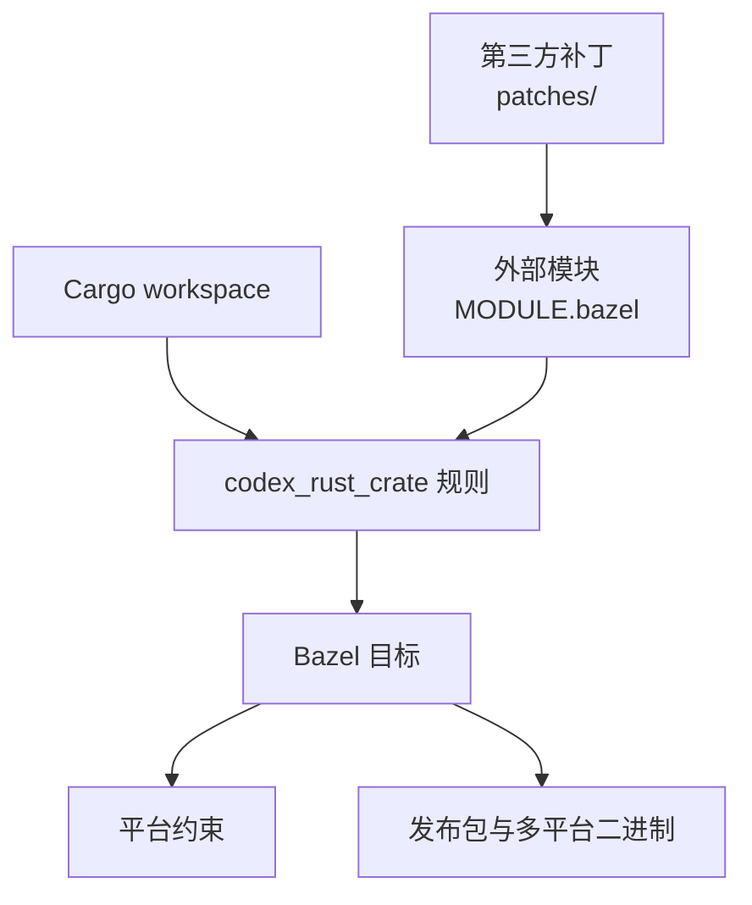
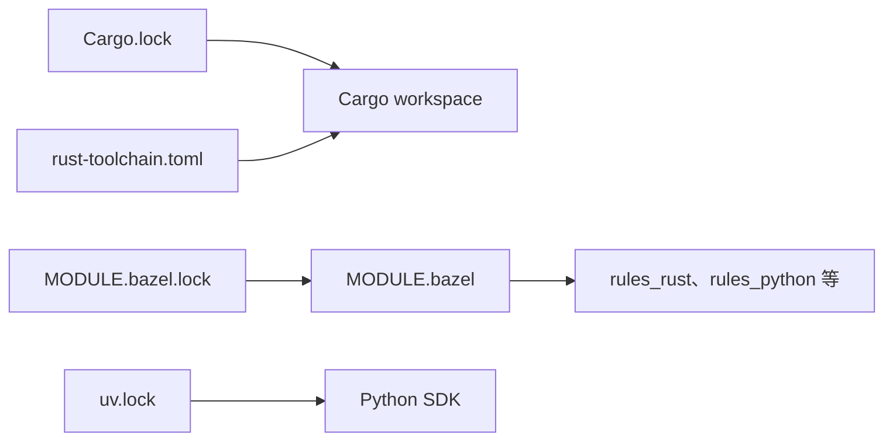
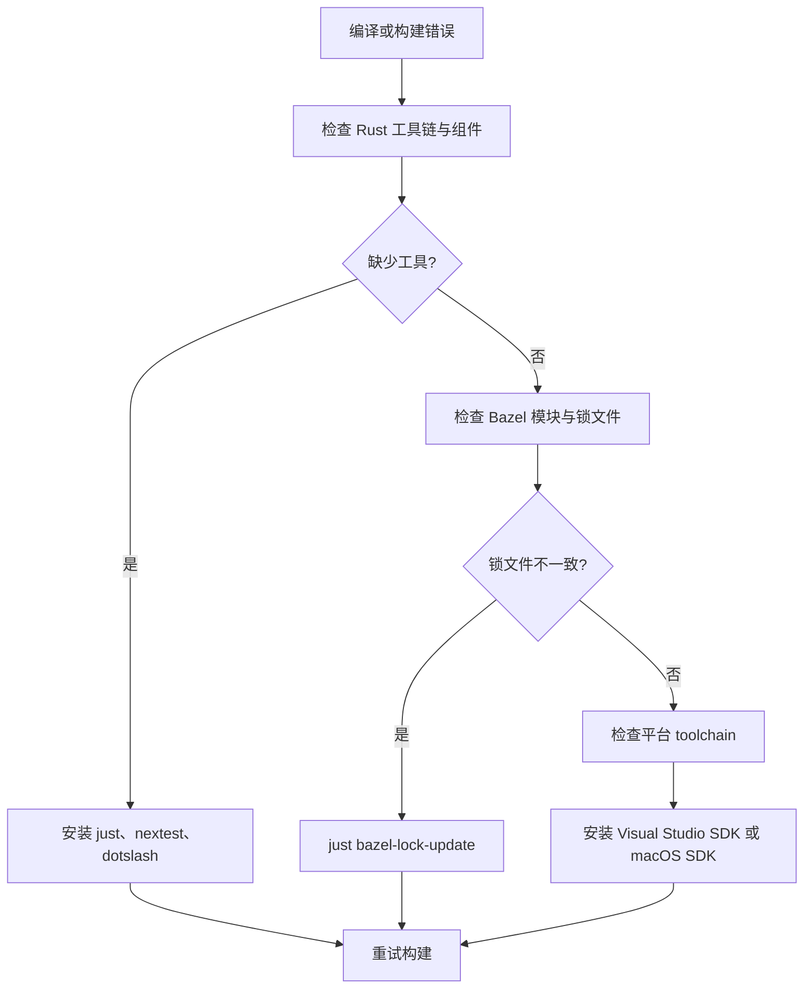
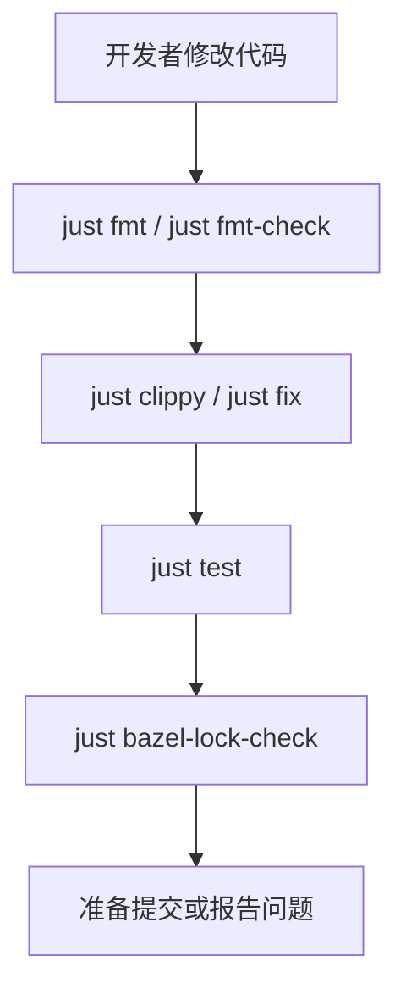

# 源码编译安装

<cite>
**本文引用的文件**
- [README.md](file://README.md)
- [docs/install.md](file://docs/install.md)
- [docs/contributing.md](file://docs/contributing.md)
- [justfile](file://justfile)
- [codex-rs/Cargo.toml](file://codex-rs/Cargo.toml)
- [codex-rs/rust-toolchain.toml](file://codex-rs/rust-toolchain.toml)
- [codex-rs/docs/bazel.md](file://codex-rs/docs/bazel.md)
- [MODULE.bazel](file://MODULE.bazel)
- [BUILD.bazel](file://BUILD.bazel)
- [codex-rs/cli/BUILD.bazel](file://codex-rs/cli/BUILD.bazel)
- [scripts/format.py](file://scripts/format.py)
- [codex-rs/rustfmt.toml](file://codex-rs/rustfmt.toml)
- [ruff.toml](file://ruff.toml)
- [codex-rs/clippy.toml](file://codex-rs/clippy.toml)
- [flake.nix](file://flake.nix)
</cite>

## 目录
1. [简介](#简介)
2. [项目结构](#项目结构)
3. [核心组件](#核心组件)
4. [架构总览](#架构总览)
5. [详细组件分析](#详细组件分析)
6. [依赖分析](#依赖分析)
7. [性能与构建优化](#性能与构建优化)
8. [故障排查指南](#故障排查指南)
9. [参与开发流程](#参与开发流程)
10. [结论](#结论)

## 简介
本仓库是 OpenAI Codex CLI 的源码仓库。它同时支持两种主流构建方式：
- 基于 Cargo 的快速本地开发与调试；
- 基于 Bazel 的可重复、跨平台、可远程执行的工程化构建。

对于大多数开发者，推荐先使用 Cargo + just 完成日常编译、测试和调试；当需要跨平台产物、远程执行或稳定复现 CI 行为时，再切换到 Bazel 工作流。

## 项目结构
仓库根目录包含顶层配置、文档、脚本和多语言 SDK；主要 Rust 代码集中在 `codex-rs` 子目录中，采用 Cargo workspace 组织大量 crate；Bazel 规则位于仓库根 `bazel/`、`MODULE.bazel`、`BUILD.bazel` 和各 crate 下的 `BUILD.bazel`。

**图示来源**
- [MODULE.bazel:1-40](file://MODULE.bazel#L1-L40)
- [BUILD.bazel:1-40](file://BUILD.bazel#L1-L40)
- [codex-rs/Cargo.toml:1-40](file://codex-rs/Cargo.toml#L1-L40)
- [justfile:1-20](file://justfile#L1-L20)

**章节来源**
- [README.md:1-81](file://README.md#L1-L81)
- [docs/install.md:1-65](file://docs/install.md#L1-L65)

## 核心组件
- Rust 工具链：由 `rust-toolchain.toml` 锁定版本，并启用 `clippy`、`rustfmt`、`rust-src`。
- Cargo workspace：在 `codex-rs/Cargo.toml` 中声明所有 crate，统一 edition 为 2024。
- just 任务：仓库根 `justfile` 提供 `install`、`fmt`、`test`、`bench`、`bazel-*` 等常用命令。
- Bazel 构建系统：通过 `MODULE.bazel` 引入 rules_rust、rules_python、windows_support、llvm 等模块，并在各 crate 的 `BUILD.bazel` 中使用 `codex_rust_crate` 封装 Rust 目标。
- Python 与 SDK：Python 脚本用于格式化、打包和辅助构建；Python SDK 使用 uv 管理依赖。
- Nix flake：提供跨平台开发 shell，安装 Rust、OpenSSL、CMake、Clang 等依赖。

**章节来源**
- [codex-rs/rust-toolchain.toml:1-3](file://codex-rs/rust-toolchain.toml#L1-L3)
- [codex-rs/Cargo.toml:1-40](file://codex-rs/Cargo.toml#L1-L40)
- [justfile:1-20](file://justfile#L1-L20)
- [MODULE.bazel:1-60](file://MODULE.bazel#L1-L60)
- [codex-rs/docs/bazel.md:1-40](file://codex-rs/docs/bazel.md#L1-L40)
- [flake.nix:1-87](file://flake.nix#L1-L87)

## 架构总览
下图展示从源码到可执行产物、测试与发布包的主要路径。

**图示来源**
- [docs/install.md:18-65](file://docs/install.md#L18-L65)
- [justfile:60-120](file://justfile#L60-L120)
- [codex-rs/docs/bazel.md:41-131](file://codex-rs/docs/bazel.md#L41-L131)

## 详细组件分析

### 开发环境与前置依赖
推荐的最小系统要求：
- macOS 12+、Ubuntu 20.04+/Debian 10+，或 Windows 11（WSL2）。
- Git 2.23+（可选但推荐）。
- 内存至少 4GB，建议 8GB。

必须安装的依赖：
- Rust 工具链：rustup、rustc、cargo。
- Rust 组件：`rustfmt`、`clippy`、`rust-src`（由 `rust-toolchain.toml` 指定）。
- just：用于运行仓库提供的开发任务。
- cargo-nextest：用于快速并行测试。
- dotslash：用于运行仓库内 DotSlash 工具（例如 buildifier）。

典型初始化步骤：
1. 克隆仓库并进入 `codex-rs`。
2. 安装 rustup 并激活环境变量。
3. 添加 `rustfmt`、`clippy`。
4. 安装 `just`、`dotslash`、`cargo-nextest`。
5. 使用 `just install` 触发 `cargo fetch`，预拉取依赖。
6. 使用 `cargo build` 编译，或使用 `cargo run --bin codex` 直接运行。

**图示来源**
- [docs/install.md:1-65](file://docs/install.md#L1-L65)
- [codex-rs/rust-toolchain.toml:1-3](file://codex-rs/rust-toolchain.toml#L1-L3)
- [justfile:80-110](file://justfile#L80-L110)

**章节来源**
- [docs/install.md:1-65](file://docs/install.md#L1-L65)
- [codex-rs/rust-toolchain.toml:1-3](file://codex-rs/rust-toolchain.toml#L1-L3)

### Cargo workspace 结构与 Rust 构建
`codex-rs/Cargo.toml` 声明了完整的 workspace members，包括 CLI、TUI、core、exec-server、app-server、config、state、tools、utils 等大量 crate。workspace 使用 resolver 2，edition 统一为 2024。

常见 Cargo 操作：
- 全量构建：`cargo build`
- 运行 CLI：`cargo run --bin codex`
- 运行特定 crate：`cargo run -p <crate-name>`
- 运行测试：`cargo test -p <crate-name>`
- 运行基准：`cargo bench --workspace --bench '*'`

justfile 中提供了更高层的命令：
- `just c`：等价于 `cargo run --bin codex`。
- `just exec`：运行 `codex exec`。
- `just clippy`：运行 clippy。
- `just fix`：自动修复部分 clippy 问题。
- `just bench-smoke`：以最小方式验证基准测试是否可启动。

**章节来源**
- [codex-rs/Cargo.toml:1-40](file://codex-rs/Cargo.toml#L1-L40)
- [justfile:20-60](file://justfile#L20-L60)
- [justfile:110-140](file://justfile#L110-L140)

### Bazel 构建系统与规则
Bazel 是仓库的“生产级”构建后端。其职责包括：
- 管理 rules_rust、rules_python、rules_foreign_cc、windows_support、llvm 等外部模块；
- 提供跨平台 toolchain；
- 将 Cargo workspace 映射为 Bazel 目标；
- 提供 e2e benchmark、release binary、multiplatform binaries 等扩展规则。

顶层模块定义 `MODULE.bazel` 引入：
- bazel_lib、bazel_skylib、platforms；
- protobuf、llvm、windows_support；
- apple_support、rules_cc、rules_platform、rules_pkg；
- aws-lc、rules_rs、rules_foreign_cc、rules_python；
- 并通过 windows_sdk、osx extensions 配置 Windows SDK 与 macOS SDK。

顶层 `BUILD.bazel` 定义本地平台约束与 toolchain 别名，例如：
- `local_linux`：标记 glibc 兼容；
- `local_windows`、`local_windows_msvc`：区分 gnullvm 与 MSVC ABI；
- `windows_x86_64_gnullvm`、`windows_x86_64_msvc`：跨平台目标约束；
- `rbe`：远程执行平台别名。

CLI crate 的 `codex-rs/cli/BUILD.bazel` 展示了如何将 Cargo crate 包装为 Bazel 目标：
- `codex_rust_crate` 创建 `cli` 目标；
- 通过 `binaries_with_commit`、`extra_binaries`、`test_data_extra` 定制构建；
- 暴露 `release_binary`、`multiplatform_binaries`；
- 提供 `codex_e2e_benchmark` 端到端基准目标。

**图示来源**
- [MODULE.bazel:1-120](file://MODULE.bazel#L1-L120)
- [BUILD.bazel:1-78](file://BUILD.bazel#L1-L78)
- [codex-rs/cli/BUILD.bazel:1-60](file://codex-rs/cli/BUILD.bazel#L1-L60)

**章节来源**
- [codex-rs/docs/bazel.md:1-131](file://codex-rs/docs/bazel.md#L1-L131)
- [MODULE.bazel:1-120](file://MODULE.bazel#L1-L120)
- [BUILD.bazel:1-78](file://BUILD.bazel#L1-L78)
- [codex-rs/cli/BUILD.bazel:1-60](file://codex-rs/cli/BUILD.bazel#L1-L60)

### 不同平台的构建参数与选项
- Linux：
  - 默认使用 glibc 兼容的 Rust toolchain；
  - 可通过 `--compilation_mode=opt` 生成优化构建；
  - 远程执行需配合 `.bazelrc` 中的 BuildBuddy 配置。
- macOS：
  - 通过 `osx` extension 获取 SDK 与 framework；
  - WebRTC 相关链接标志由 `MACOS_WEBRTC_RUSTC_LINK_FLAGS` 注入。
- Windows：
  - 支持 gnullvm 与 MSVC 两种 ABI；
  - 需要接受 Visual Studio EULA 环境变量；
  - 使用 `windows_sdk` extension 下载固定版本的 Windows SDK。

常用 Bazel 命令：
- `just bazel-test`：运行全部 Bazel 测试；
- `just bazel-clippy`：运行 Bazel 侧 clippy；
- `bazel test --compilation_mode=opt ...`：优化构建后执行测试；
- `just build-for-release`：构建发布二进制集合。

**章节来源**
- [BUILD.bazel:1-78](file://BUILD.bazel#L1-L78)
- [MODULE.bazel:1-120](file://MODULE.bazel#L1-L120)
- [codex-rs/cli/BUILD.bazel:1-60](file://codex-rs/cli/BUILD.bazel#L1-L60)
- [codex-rs/docs/bazel.md:41-131](file://codex-rs/docs/bazel.md#L41-L131)
- [justfile:140-205](file://justfile#L140-L205)

### 调试与测试
#### 单元测试与集成测试
推荐使用 nextest：
- `just test`：在工作区级别运行全部测试；
- `just test -p codex-tui`：运行指定 crate 的测试；
- `just test-github-scripts`：运行 GitHub Actions 中的 Python 测试。

nextest 的工作方式：
- 设置 `RUST_MIN_STACK` 提高栈空间；
- 设置 `NEXTEST_PROFILE=local`；
- 使用 `--no-fail-fast` 确保全部用例都执行。

**图示来源**
- [justfile:100-120](file://justfile#L100-L120)

**章节来源**
- [justfile:100-120](file://justfile#L100-L120)

#### 性能测试与基准测试
- `just bench`：运行 workspace 下所有命名基准；
- `just bench-smoke`：仅验证基准程序能启动；
- `just bench-e2e`：使用 Bazel opt 构建执行端到端宏基准；
- `just bench-e2e-smoke`：使用 fastbuild 模式验证端到端基准路径。

**章节来源**
- [justfile:120-140](file://justfile#L120-L140)

#### 日志与诊断
- 使用 `RUST_LOG` 控制日志级别；
- 通过 `log_dir` 配置开启 TUI 明文日志；
- 可使用 `tail` 观察日志输出。

**章节来源**
- [docs/install.md:40-65](file://docs/install.md#L40-L65)

### 构建系统的组成部分
- Cargo workspace：作为 crate 与 feature 的唯一事实来源；
- Bazel modules：`MODULE.bazel` 声明外部依赖与 toolchain；
- 自定义规则：`defs.bzl` 暴露 `codex_rust_crate`，封装 rust_library、rust_binary、rust_test；
- 平台约束：`BUILD.bazel` 定义本地与跨平台约束；
- 发布规则：`bazel/rules/runtime_package.bzl`、`bazel/platforms/release_binaries.bzl` 负责打包与多平台产物；
- 第三方补丁：`patches/` 目录包含针对 rules_rust、V8、ring、protobuf 等的补丁。

**图示来源**
- [codex-rs/docs/bazel.md:1-40](file://codex-rs/docs/bazel.md#L1-L40)
- [MODULE.bazel:1-120](file://MODULE.bazel#L1-L120)
- [BUILD.bazel:1-78](file://BUILD.bazel#L1-L78)

**章节来源**
- [codex-rs/docs/bazel.md:1-131](file://codex-rs/docs/bazel.md#L1-L131)
- [MODULE.bazel:1-120](file://MODULE.bazel#L1-L120)
- [BUILD.bazel:1-78](file://BUILD.bazel#L1-L78)

## 依赖分析
- Rust 依赖：
  - 由 `codex-rs/Cargo.toml` 声明 workspace members；
  - 由 `codex-rs/Cargo.lock` 锁定具体版本；
  - 由 `codex-rs/rust-toolchain.toml` 锁定 Rust channel 与组件。
- Bazel 依赖：
  - 由 `MODULE.bazel` 声明 rules_rust、rules_python、rules_foreign_cc、aws-lc、windows_support、llvm 等；
  - 由 `MODULE.bazel.lock` 锁定 Bazel 模块版本；
  - 通过 `just bazel-lock-update` 与 `just bazel-lock-check` 同步锁文件。
- Python 依赖：
  - `sdk/python/pyproject.toml` 与 `uv.lock` 管理 Python SDK；
  - `scripts/pyproject.toml` 与 `uv.lock` 管理脚本工具。

**图示来源**
- [codex-rs/Cargo.toml:1-40](file://codex-rs/Cargo.toml#L1-L40)
- [codex-rs/rust-toolchain.toml:1-3](file://codex-rs/rust-toolchain.toml#L1-L3)
- [MODULE.bazel:1-120](file://MODULE.bazel#L1-L120)
- [justfile:160-180](file://justfile#L160-L180)

**章节来源**
- [codex-rs/Cargo.toml:1-40](file://codex-rs/Cargo.toml#L1-L40)
- [codex-rs/rust-toolchain.toml:1-3](file://codex-rs/rust-toolchain.toml#L1-L3)
- [MODULE.bazel:1-120](file://MODULE.bazel#L1-L120)
- [justfile:160-180](file://justfile#L160-L180)

## 性能与构建优化
- 避免在生产构建中使用 `--all-features`：会增加构建时间与 `target/` 占用。
- 使用 nextest：并行执行测试，更快反馈。
- 使用 Bazel opt 构建：适合端到端基准与发布前验证。
- 使用 BuildBuddy 缓存与远程执行：提升团队构建速度（需要 API key）。
- 使用 Nix flake：保证本地依赖一致，减少环境问题。

[本节为通用指导，不直接分析具体文件]

## 故障排查指南

### 常见编译错误与解决
- 缺少 Rust 组件：
  - 现象：无法运行 clippy 或 rustfmt。
  - 解决：运行 `rustup component add rustfmt clippy rust-src`。
- 缺少 just 或 cargo-nextest：
  - 现象：`just` 命令不存在，或 `just test` 报错找不到 nextest。
  - 解决：`cargo install --locked just` 与 `cargo install --locked cargo-nextest`。
- Bazel 模块锁不一致：
  - 现象：CI 或同事构建失败，提示 MODULE.bazel.lock 过时。
  - 解决：`just bazel-lock-update` 更新锁文件并提交。
- Windows 工具链问题：
  - 现象：MSVC 或 gnullvm toolchain 不可用。
  - 解决：确认已安装 Visual Studio 并接受 EULA；检查 `MODULE.bazel` 中 `msvc_runtime` 与 `windows_sdk` 配置。
- macOS WebRTC 链接失败：
  - 现象：链接阶段报错。
  - 解决：确认 `MACOS_WEBRTC_RUSTC_LINK_FLAGS` 被正确传入。
- OpenSSL 或 Clang 缺失：
  - 现象：原生依赖编译失败。
  - 解决：使用 Nix flake 或安装 pkg-config、openssl、cmake、clang。

**图示来源**
- [docs/install.md:18-65](file://docs/install.md#L18-L65)
- [justfile:80-120](file://justfile#L80-L120)
- [MODULE.bazel:1-120](file://MODULE.bazel#L1-L120)
- [codex-rs/docs/bazel.md:41-131](file://codex-rs/docs/bazel.md#L41-L131)

**章节来源**
- [docs/install.md:18-65](file://docs/install.md#L18-L65)
- [justfile:80-180](file://justfile#L80-L180)
- [MODULE.bazel:1-120](file://MODULE.bazel#L1-L120)
- [codex-rs/docs/bazel.md:41-131](file://codex-rs/docs/bazel.md#L41-L131)

## 参与开发流程
仓库明确不接受外部 Pull Request，社区贡献主要通过 issue 反馈问题、日志与分析。不过开发者仍可在本地遵循统一的代码质量流程：

- 代码格式化：
  - `just fmt`：格式化 justfile、Rust、Bazel/Starlark、Python SDK 与 Python 脚本；
  - `just fmt-check`：只检查格式，不修改文件。
- Rust 格式化：
  - 使用 `rustfmt`，edition 2024，imports_granularity = Item；
  - 配置文件位于 `codex-rs/rustfmt.toml`。
- Lint 与修复：
  - `just clippy`：运行 clippy；
  - `just fix`：自动修复部分 clippy 问题；
  - clippy 规则位于 `codex-rs/clippy.toml`。
- Python 代码质量：
  - 使用 ruff 进行 lint 与格式化；
  - 根级 `ruff.toml` 排除 `sdk/python` 与 `codex-rs/vendor`；
  - Python SDK 使用 uv 管理依赖与格式化上下文。
- 提交前检查建议：
  - 运行 `just fmt-check`；
  - 运行 `just clippy`；
  - 运行 `just test` 或针对性测试；
  - 如改动涉及依赖，运行 `just bazel-lock-check`。

**图示来源**
- [justfile:60-100](file://justfile#L60-L100)
- [scripts/format.py:1-120](file://scripts/format.py#L1-L120)
- [codex-rs/rustfmt.toml:1-4](file://codex-rs/rustfmt.toml#L1-L4)
- [codex-rs/clippy.toml:1-32](file://codex-rs/clippy.toml#L1-L32)
- [ruff.toml:1-1](file://ruff.toml#L1-L1)

**章节来源**
- [docs/contributing.md:1-39](file://docs/contributing.md#L1-L39)
- [justfile:60-100](file://justfile#L60-L100)
- [scripts/format.py:1-120](file://scripts/format.py#L1-L120)
- [codex-rs/rustfmt.toml:1-4](file://codex-rs/rustfmt.toml#L1-L4)
- [codex-rs/clippy.toml:1-32](file://codex-rs/clippy.toml#L1-L32)
- [ruff.toml:1-1](file://ruff.toml#L1-L1)

## 结论
Codex CLI 源码构建围绕 Cargo workspace 与 Bazel 双引擎展开：前者适合快速迭代，后者适合稳定复现与跨平台发布。推荐的新手路径是：
1. 安装 Rust 工具链与 just、cargo-nextest；
2. 使用 `just install`、`cargo build`、`cargo run --bin codex`；
3. 使用 `just test`、`just clippy`、`just fmt` 维持代码质量；
4. 当需要跨平台产物或远程构建时，再学习 `MODULE.bazel`、`BUILD.bazel` 与 `codex_rust_crate` 规则。

遇到问题时，优先检查工具链版本、依赖锁文件、平台 toolchain 以及日志输出；如需帮助，可通过仓库 issue 提供复现步骤与环境信息。

[本节为总结性内容，不直接分析具体文件]