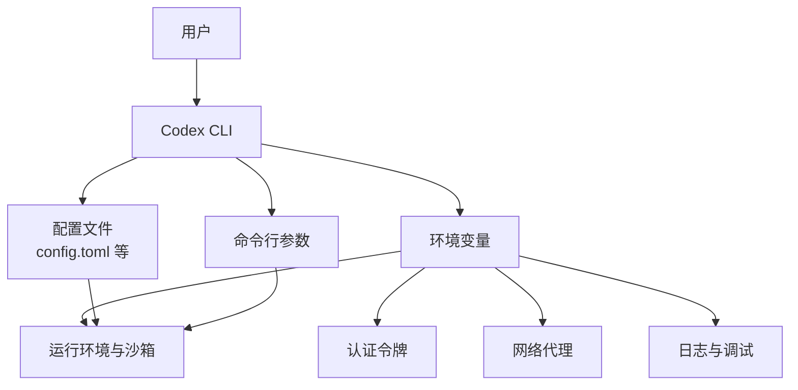
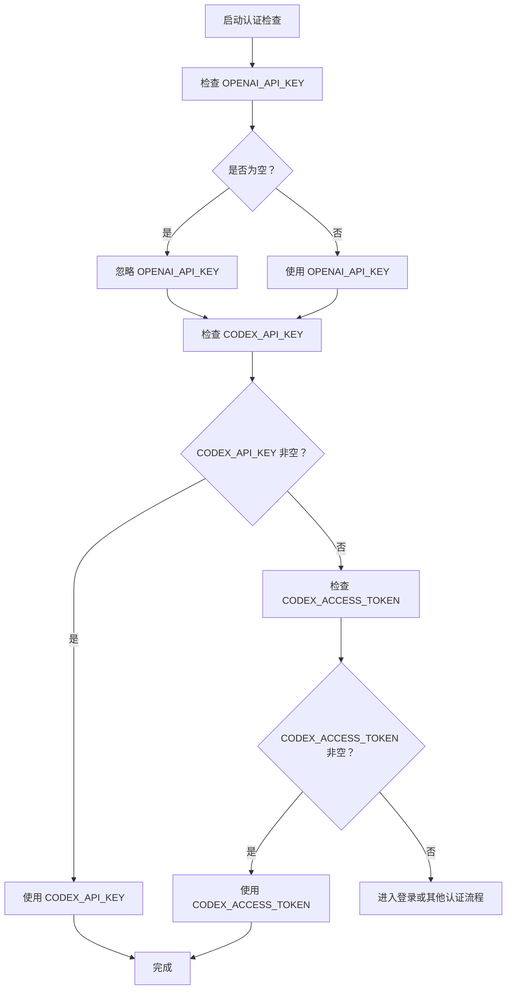
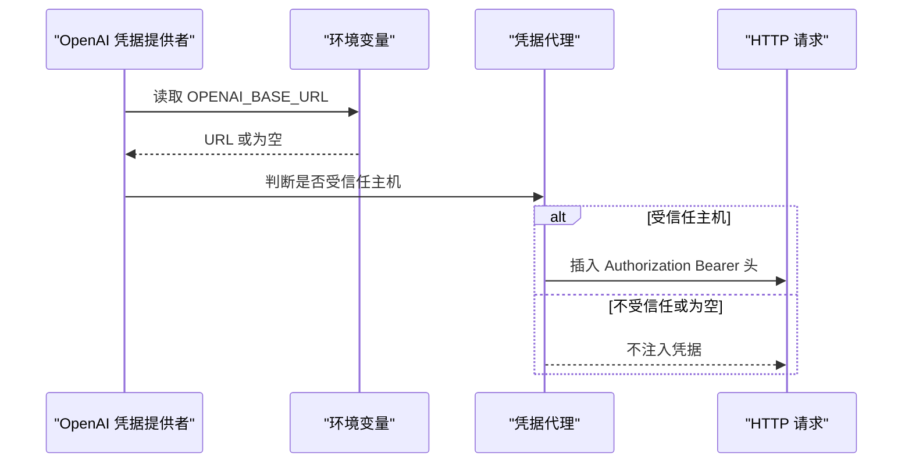
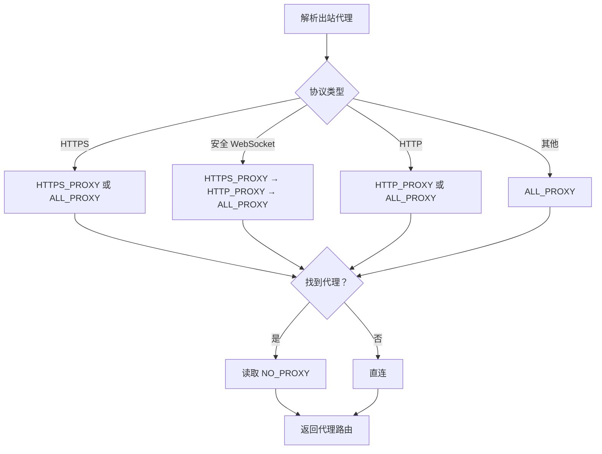
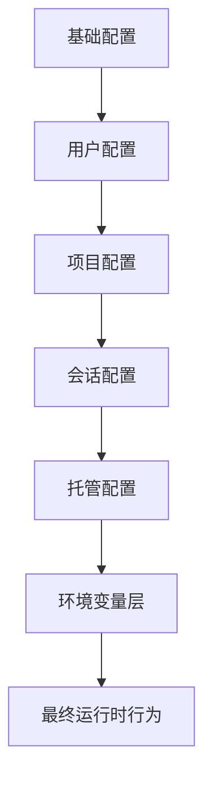

# 环境变量配置

<cite>
**本文引用的文件**   
- [codex-rs/login/src/auth/manager.rs](file://codex-rs/login/src/auth/manager.rs)
- [codex-rs/network-proxy/src/credential_broker/providers/openai.rs](file://codex-rs/network-proxy/src/credential_broker/providers/openai.rs)
- [codex-rs/http-client/src/outbound_proxy.rs](file://codex-rs/http-client/src/outbound_proxy.rs)
- [codex-rs/cli/src/doctor.rs](file://codex-rs/cli/src/doctor.rs)
- [codex-rs/cli/src/main.rs](file://codex-rs/cli/src/main.rs)
- [codex-rs/tui/src/debug_config.rs](file://codex-rs/tui/src/debug_config.rs)
- [codex-rs/core/src/spawn.rs](file://codex-rs/core/src/spawn.rs)
- [codex-rs/app-server-daemon/src/background_command.rs](file://codex-rs/app-server-daemon/src/background_command.rs)
- [codex-rs/app-server/src/lib.rs](file://codex-rs/app-server/src/lib.rs)
- [codex-rs/app-server/src/main.rs](file://codex-rs/app-server/src/main.rs)
- [codex-rs/config/src/loader/tests.rs](file://codex-rs/config/src/loader/tests.rs)
- [docs/config.md](file://docs/config.md)
- [docs/authentication.md](file://docs/authentication.md)
</cite>

## 目录
1. [简介](#简介)
2. [项目结构与配置来源](#项目结构与配置来源)
3. [环境变量总览](#环境变量总览)
4. [认证令牌与环境变量](#认证令牌与环境变量)
5. [网络代理与证书环境变量](#网络代理与证书环境变量)
6. [日志、调试与诊断环境变量](#日志调试与诊断环境变量)
7. [运行环境控制与环境隔离](#运行环境控制与环境隔离)
8. [优先级与覆盖规则](#优先级与覆盖规则)
9. [不同环境的配置示例](#不同环境的配置示例)
10. [敏感信息安全管理最佳实践](#敏感信息安全管理最佳实践)
11. [验证与诊断方法](#验证与诊断方法)
12. [常见问题排查](#常见问题排查)
13. [结论](#结论)

## 简介
本文件是 Codex 项目中“环境变量配置”的完整参考。它从代码实现出发，汇总所有由 Rust 后端和命令行组件直接读取的环境变量，包括：

- 认证令牌：`OPENAI_API_KEY`、`CODEX_API_KEY`、`CODEX_ACCESS_TOKEN` 等。
- 网络代理：`HTTP_PROXY`、`HTTPS_PROXY`、`NO_PROXY`、`ALL_PROXY`。
- OpenAI 相关上下文：`OPENAI_BASE_URL`。
- 日志级别：`RUST_LOG`。
- 路径与运行时行为：`CODEX_HOME`、`CODEX_SANDBOX`、`CODEX_SANDBOX_NETWORK_DISABLED` 等。
- App Server 管理配置开关：`CODEX_APP_SERVER_MANAGED_CONFIG_PATH`、`CODEX_APP_SERVER_DISABLE_MANAGED_CONFIG`。
- 远程客户端鉴权：`CODEX_REMOTE_AUTH_TOKEN`、`CODEX_REMOTE_TOKEN`。

需要特别注意：**`CHATGPT_TOKEN` 不是当前代码库中显式声明并直接作为主认证入口的环境变量**。登录文档指向外部认证说明，而核心 Rust 代码主要使用 `OPENAI_API_KEY`、`CODEX_API_KEY` 和 `CODEX_ACCESS_TOKEN`。

**章节来源**
- [docs/config.md:1-15](file://docs/config.md#L1-L15)
- [docs/authentication.md:1-3](file://docs/authentication.md#L1-L3)

## 项目结构与配置来源
Codex 的配置来源包含多个层次：

| 来源 | 作用 | 与本文的关系 |
|---|---|---|
| 用户配置文件 | 用户级、项目级、会话级配置 | 文档引用外部配置参考；环境变量用于补充或覆盖部分行为 |
| 环境变量 | 进程级配置、CI/CD、容器、系统服务 | 本文重点 |
| 命令行参数 | 单次命令覆盖 | 与文档中的远程令牌、API Key 输入方式有关 |
| 平台与系统设置 | 如 Windows WinHTTP 代理、终端变量 | 影响代理解析和诊断输出 |
| 托管配置层 | App Server 的 managed config | 通过特定 `CODEX_APP_SERVER_*` 环境变量控制 |

[本图为概念结构图，不映射具体源码文件]

**章节来源**
- [docs/config.md:1-15](file://docs/config.md#L1-L15)

## 环境变量总览
以下表格汇总了代码中明确读取或使用的关键环境变量。

| 环境变量 | 类别 | 是否必需 | 默认行为 | 说明 |
|---|---|---:|---|---|
| `OPENAI_API_KEY` | 认证 | 视后端而定 | 未设置时可能触发登录流程或使用其他凭据 | OpenAI API Key；登录模块将其视为空值即忽略 |
| `CODEX_API_KEY` | 认证 | 视场景而定 | 未设置时不生效 | Codex 自有 API Key |
| `CODEX_ACCESS_TOKEN` | 认证 | 视场景而定 | 未设置时不生效 | Codex Access Token，常用于 Agent Identity 或远端鉴权 |
| `HTTP_PROXY` | 网络 | 否 | 直连 | HTTP 出站代理 |
| `HTTPS_PROXY` | 网络 | 否 | 直连 | HTTPS 出站代理 |
| `NO_PROXY` | 网络 | 否 | 无排除规则 | 不走代理的目标主机列表 |
| `ALL_PROXY` | 网络 | 否 | 直连 | 通用代理回退 |
| `OPENAI_BASE_URL` | OpenAI 上下文 | 否 | 使用默认 OpenAI 主机 | 用于受信任凭据代理的主机绑定 |
| `RUST_LOG` | 日志 | 否 | 使用应用默认日志级别 | 标准 Rust 日志过滤表达式 |
| `CODEX_HOME` | 路径 | 推荐 | 通常为用户目录下的 `.codex` | Codex 用户数据根目录 |
| `CODEX_SANDBOX` | 沙箱 | 否 | 非沙箱模式 | 测试或调试用沙箱标记 |
| `CODEX_SANDBOX_NETWORK_DISABLED` | 沙箱 | 否 | 允许网络 | 在子进程中禁用网络 |
| `CODEX_APP_SERVER_MANAGED_CONFIG_PATH` | App Server | 否 | 不使用该路径 | 指定托管配置路径 |
| `CODEX_APP_SERVER_DISABLE_MANAGED_CONFIG` | App Server | 否 | 启用托管配置 | 禁用托管配置层 |
| `CODEX_REMOTE_AUTH_TOKEN` | 远程客户端 | 视连接目标而定 | 可能需要交互式认证 | 远程 WebSocket 客户端鉴权令牌 |
| `CODEX_REMOTE_TOKEN` | 远程客户端 | 视实现版本而定 | 可能不被识别 | 部分帮助文本中出现，但主逻辑更常用 `CODEX_REMOTE_AUTH_TOKEN` |

**章节来源**
- [codex-rs/login/src/auth/manager.rs:1049-1070](file://codex-rs/login/src/auth/manager.rs#L1049-L1070)
- [codex-rs/network-proxy/src/credential_broker/providers/openai.rs:1-25](file://codex-rs/network-proxy/src/credential_broker/providers/openai.rs#L1-L25)
- [codex-rs/http-client/src/outbound_proxy.rs:387-400](file://codex-rs/http-client/src/outbound_proxy.rs#L387-L400)
- [codex-rs/core/src/spawn.rs:21-26](file://codex-rs/core/src/spawn.rs#L21-L26)
- [codex-rs/app-server/src/main.rs:27-28](file://codex-rs/app-server/src/main.rs#L27-L28)
- [codex-rs/cli/src/main.rs:4470-4572](file://codex-rs/cli/src/main.rs#L4470-L4572)

## 认证令牌与环境变量
### 支持的认证环境变量
当前代码中明确定义并读取的认证环境变量包括：

| 环境变量 | 常量或来源 | 行为 |
|---|---|---|
| `OPENAI_API_KEY` | `OPENAI_API_KEY_ENV_VAR` | 读取后去除首尾空白；空字符串会被当作不存在 |
| `CODEX_API_KEY` | `CODEX_API_KEY_ENV_VAR` | 非空时才生效 |
| `CODEX_ACCESS_TOKEN` | `CODEX_ACCESS_TOKEN_ENV_VAR` | 非空时才生效 |

**图表来源**
- [codex-rs/login/src/auth/manager.rs:1049-1070](file://codex-rs/login/src/auth/manager.rs#L1049-L1070)

**章节来源**
- [codex-rs/login/src/auth/manager.rs:1049-1070](file://codex-rs/login/src/auth/manager.rs#L1049-L1070)

### 关于 `CHATGPT_TOKEN`
在当前仓库中未发现显式定义名为 `CHATGPT_TOKEN` 的环境变量常量或读取逻辑。认证文档将用户引导至官方认证页面，因此不应把 `CHATGPT_TOKEN` 视作本项目稳定的环境变量接口。若第三方脚本依赖该名称，应优先改用代码中实际使用的 `OPENAI_API_KEY`、`CODEX_API_KEY` 或 `CODEX_ACCESS_TOKEN`。

**章节来源**
- [docs/authentication.md:1-3](file://docs/authentication.md#L1-L3)

### OpenAI 凭据代理上下文
`OPENAI_BASE_URL` 被用作 OpenAI 凭据提供者的上下文变量。当它指向受信任的凭据代理主机时，会影响凭据注入与请求头替换的行为；否则不会建立可信主机绑定。

**图表来源**
- [codex-rs/network-proxy/src/credential_broker/providers/openai.rs:1-44](file://codex-rs/network-proxy/src/credential_broker/providers/openai.rs#L1-L44)

**章节来源**
- [codex-rs/network-proxy/src/credential_broker/providers/openai.rs:1-44](file://codex-rs/network-proxy/src/credential_broker/providers/openai.rs#L1-L44)

## 网络代理与证书环境变量
### 出站代理优先级
HTTP 客户端根据协议类型选择代理环境变量：

| 协议类型 | 环境变量优先级 |
|---|---|
| HTTPS | `HTTPS_PROXY` → `ALL_PROXY` |
| 安全 WebSocket | `HTTPS_PROXY` → `HTTP_PROXY` → `ALL_PROXY` |
| HTTP | `HTTP_PROXY` → `ALL_PROXY` |
| 其他 | `ALL_PROXY` |

若未找到代理地址，则走直连。`NO_PROXY` 会作为排除列表传入代理路由。

**图表来源**
- [codex-rs/http-client/src/outbound_proxy.rs:387-400](file://codex-rs/http-client/src/outbound_proxy.rs#L387-L400)

**章节来源**
- [codex-rs/http-client/src/outbound_proxy.rs:387-400](file://codex-rs/http-client/src/outbound_proxy.rs#L387-L400)

### 诊断工具中的代理显示
CLI 诊断模块会把 `HTTP_PROXY`、`HTTPS_PROXY`、`ALL_PROXY`、`NO_PROXY` 纳入环境信息收集范围，便于定位网络连通性问题。TUI 调试配置也会打印代理相关信息，例如 `HTTP_PROXY` 和 `ALL_PROXY`。

**章节来源**
- [codex-rs/cli/src/doctor.rs:120-123](file://codex-rs/cli/src/doctor.rs#L120-L123)
- [codex-rs/tui/src/debug_config.rs:50-51](file://codex-rs/tui/src/debug_config.rs#L50-L51)

## 日志、调试与诊断环境变量
### `RUST_LOG`
`RUST_LOG` 是 Rust 生态的标准日志过滤器。Codex 的多处测试和内部组件使用它控制日志级别，例如：

- 测试中使用 `warn`、`info`、`trace`、`error` 等过滤规则。
- App Server 注释说明可通过 `RUST_LOG` 控制日志级别，并通过 JSON 日志选项切换输出格式。

典型用法：

| 用途 | 示例值 |
|---|---|
| 关闭大部分日志 | `off` |
| 仅看警告及以上 | `warn` |
| 查看某模块信息日志 | `codex_app_server=info` |
| 查看详细跟踪日志 | `codex_=trace` |

**章节来源**
- [codex-rs/app-server/src/lib.rs:737-737](file://codex-rs/app-server/src/lib.rs#L737-L737)
- [codex-rs/cli/tests/exec_server.rs:532-532](file://codex-rs/cli/tests/exec_server.rs#L532-L532)
- [codex-rs/app-server-test-client/src/lib.rs:631-631](file://codex-rs/app-server-test-client/src/lib.rs#L631-L631)

### 其他调试相关变量
| 环境变量 | 用途 |
|---|---|
| `TERM` | 终端能力检测，诊断工具会读取 |
| `CODEX_TUI_RECORD_SESSION` | TUI 会话录制开关（测试与诊断场景） |
| `CODEX_TUI_SESSION_LOG_PATH` | TUI 会话日志路径（测试与诊断场景） |
| `CODEX_TUI_DISABLE_KEYBOARD_ENHANCEMENT` | 关闭 TUI 键盘增强 |
| `CODEX_TUI_STARTUP_INPUT_PTY_DIR` | TUI 启动输入 PTY 测试路径 |
| `CODEX_TUI_CAUGHT_PANIC_PTY_CHILD` | TUI panic 捕获测试辅助 |

这些变量主要用于测试、调试和诊断，不建议在生产环境中随意开启。

**章节来源**
- [codex-rs/cli/src/doctor.rs:3157-3157](file://codex-rs/cli/src/doctor.rs#L3157-L3157)
- [codex-rs/tui/src/session_log.rs:85-92](file://codex-rs/tui/src/session_log.rs#L85-L92)
- [codex-rs/tui/src/tui/keyboard_modes.rs:22-22](file://codex-rs/tui/src/tui/keyboard_modes.rs#L22-L22)
- [codex-rs/tui/src/tui_startup_tests.rs:73-73](file://codex-rs/tui/src/tui_startup_tests.rs#L73-L73)
- [codex-rs/tui/src/tui_panic_tests.rs:58-58](file://codex-rs/tui/src/tui_panic_tests.rs#L58-L58)

## 运行环境控制与环境隔离
### `CODEX_HOME`
`CODEX_HOME` 是 Codex 用户数据根目录的核心环境变量。App Server 后台命令会读取它，以确定状态和数据位置。

**章节来源**
- [codex-rs/app-server-daemon/src/background_command.rs:16-16](file://codex-rs/app-server-daemon/src/background_command.rs#L16-L16)

### 沙箱相关变量
| 环境变量 | 含义 |
|---|---|
| `CODEX_SANDBOX` | 表示当前处于某种沙箱或测试网络环境 |
| `CODEX_SANDBOX_NETWORK_DISABLED` | 在子进程或执行环境中禁用网络 |

**章节来源**
- [codex-rs/core/src/spawn.rs:21-26](file://codex-rs/core/src/spawn.rs#L21-L26)

### App Server 托管配置变量
| 环境变量 | 含义 |
|---|---|
| `CODEX_APP_SERVER_MANAGED_CONFIG_PATH` | 指定 App Server 托管配置路径 |
| `CODEX_APP_SERVER_DISABLE_MANAGED_CONFIG` | 禁用托管配置层 |

**章节来源**
- [codex-rs/app-server/src/main.rs:27-28](file://codex-rs/app-server/src/main.rs#L27-L28)

## 优先级与覆盖规则
### 环境变量与配置文件的优先级
Codex 的配置体系包含多层配置，包括用户配置、项目配置、会话配置和托管配置。环境变量并不总是“最高优先级”，其作用范围取决于具体子系统：

1. **认证凭据**：环境变量 `OPENAI_API_KEY`、`CODEX_API_KEY`、`CODEX_ACCESS_TOKEN` 由登录模块直接读取；如果为空，则可能被忽略并进入登录流程。
2. **网络代理**：HTTP 客户端按协议类型读取 `HTTP_PROXY`、`HTTPS_PROXY`、`ALL_PROXY`、`NO_PROXY`。
3. **日志级别**：`RUST_LOG` 由日志框架解析，通常独立于 TOML 配置。
4. **路径与运行时行为**：`CODEX_HOME`、`CODEX_SANDBOX` 等变量决定运行时行为，可绕过部分配置文件逻辑。
5. **托管配置**：App Server 的托管配置可通过环境变量启用或禁用。

此外，配置加载测试中存在对 `shell_environment_policy.set` 中设置 `OPENAI_API_KEY` 的用例，说明某些配置层还可以向子进程注入环境变量。

[本图为概念优先级图，不映射具体源码文件]

**章节来源**
- [codex-rs/config/src/loader/tests.rs:126-126](file://codex-rs/config/src/loader/tests.rs#L126-L126)
- [codex-rs/login/src/auth/manager.rs:1049-1070](file://codex-rs/login/src/auth/manager.rs#L1049-L1070)
- [codex-rs/http-client/src/outbound_proxy.rs:387-400](file://codex-rs/http-client/src/outbound_proxy.rs#L387-L400)

## 不同环境的配置示例
以下为基于代码行为的推荐配置思路。请结合部署平台的安全策略调整。

### 本地开发
- 使用 `OPENAI_API_KEY` 或 `CODEX_API_KEY` 进行快速认证。
- 如需调试日志，设置 `RUST_LOG=warn,codex_=info`。
- 如需自定义代理，设置 `HTTPS_PROXY` 或 `HTTP_PROXY`。
- 如需限制日志输出，可将 `RUST_LOG` 设置为 `off` 或较高级别。

注意：不要将密钥写入脚本历史或提交到版本库。

### CI/CD
- 使用 CI 平台的 Secret 管理 `OPENAI_API_KEY`、`CODEX_API_KEY`、`CODEX_ACCESS_TOKEN`。
- 避免在日志中暴露令牌；必要时只打印是否存在，不打印值。
- 使用 `RUST_LOG=warn` 或 `error` 减少 CI 日志噪音。
- 若 CI 有企业代理，设置 `HTTPS_PROXY` 和 `NO_PROXY`。

### 生产部署
- 通过容器编排平台或系统服务注入 `CODEX_HOME`、`CODEX_SANDBOX_NETWORK_DISABLED` 等变量。
- 使用受控的代理配置，并配合 `NO_PROXY` 排除内网地址。
- 使用 `RUST_LOG` 控制生产日志级别，并结合结构化日志或集中式日志系统。
- 如需禁用托管配置，使用 `CODEX_APP_SERVER_DISABLE_MANAGED_CONFIG`。

### 远程客户端连接
- 使用 `CODEX_REMOTE_AUTH_TOKEN` 传递远端认证令牌。
- 帮助文本中也出现 `CODEX_REMOTE_TOKEN`，但主逻辑更明确使用 `CODEX_REMOTE_AUTH_TOKEN`，建议以主逻辑为准。

**章节来源**
- [codex-rs/cli/src/main.rs:4470-4572](file://codex-rs/cli/src/main.rs#L4470-L4572)
- [codex-rs/core/src/spawn.rs:21-26](file://codex-rs/core/src/spawn.rs#L21-L26)
- [codex-rs/app-server/src/main.rs:27-28](file://codex-rs/app-server/src/main.rs#L27-L28)

## 敏感信息安全管理最佳实践
### 密钥存储
- 将 `OPENAI_API_KEY`、`CODEX_API_KEY`、`CODEX_ACCESS_TOKEN` 存储在 CI Secret、密钥管理服务、容器编排 Secret 或操作系统安全凭据存储中。
- 不要将密钥写入 `config.toml`、脚本、README、commit message 或错误报告正文。

### 权限控制
- 限制 `CODEX_HOME` 所在目录的访问权限，防止其他用户读取会话、缓存或凭据文件。
- 在生产服务器上使用最小权限账户运行 Codex 进程。
- 限制代理凭据和环境变量的可见范围，避免子进程意外泄露。

### 日志与诊断脱敏
- 诊断工具已具备对部分敏感信息的处理逻辑，但仍应避免主动打印密钥。
- 使用 `RUST_LOG` 控制详细程度，避免在生产环境输出 trace 级别日志。
- 上传反馈或故障包前，确认不包含真实密钥。

### 代理凭据安全
- 代理地址中包含用户名密码时，应评估风险，优先考虑域名白名单、证书固定或专用代理通道。
- 使用 `NO_PROXY` 排除内网服务，避免敏感流量经过外部代理。

[本节为通用安全实践，不直接分析具体源码文件]

## 验证与诊断方法
### 使用 CLI 诊断
CLI 诊断功能会检查认证环境变量和网络相关环境变量。可用于确认：

- `OPENAI_API_KEY`、`CODEX_API_KEY`、`CODEX_ACCESS_TOKEN` 是否被检测到。
- `HTTP_PROXY`、`HTTPS_PROXY`、`ALL_PROXY`、`NO_PROXY` 是否被正确识别。
- `CODEX_HOME` 是否可用。

**章节来源**
- [codex-rs/cli/src/doctor.rs:120-123](file://codex-rs/cli/src/doctor.rs#L120-L123)
- [codex-rs/cli/src/doctor.rs:1239-1241](file://codex-rs/cli/src/doctor.rs#L1239-L1241)
- [codex-rs/cli/src/doctor.rs:2713-2717](file://codex-rs/cli/src/doctor.rs#L2713-L2717)

### 使用 TUI 调试配置
TUI 调试配置会打印代理相关环境变量，便于快速发现 `HTTP_PROXY`、`ALL_PROXY` 等设置问题。

**章节来源**
- [codex-rs/tui/src/debug_config.rs:50-51](file://codex-rs/tui/src/debug_config.rs#L50-L51)

### 手动验证步骤
1. 在干净 shell 中设置环境变量。
2. 运行 `codex doctor` 查看诊断输出。
3. 检查认证相关条目是否显示存在。
4. 检查代理相关条目是否与预期一致。
5. 若仍失败，临时提高 `RUST_LOG` 详细级别观察日志。
6. 确认 `CODEX_HOME` 指向预期目录。

### 远程客户端验证
使用带 `CODEX_REMOTE_AUTH_TOKEN` 的命令连接远端服务，若令牌无效或缺失，应看到认证错误或提示。

**章节来源**
- [codex-rs/cli/src/main.rs:4470-4572](file://codex-rs/cli/src/main.rs#L4470-L4572)

## 常见问题排查
### 设置了 `OPENAI_API_KEY` 但仍提示未认证
可能原因：

- 值为空字符串或仅空白字符，登录模块会忽略。
- 使用了错误的变量名，例如 `CHATGPT_TOKEN`。
- 子进程未继承父进程环境变量。
- 认证流程选择了其他凭据来源。

排查建议：

- 确认环境变量非空。
- 使用 `codex doctor` 查看是否检测到 `OPENAI_API_KEY`。
- 检查是否通过配置文件或托管配置覆盖了认证行为。

**章节来源**
- [codex-rs/login/src/auth/manager.rs:1049-1070](file://codex-rs/login/src/auth/manager.rs#L1049-L1070)
- [codex-rs/cli/src/doctor.rs:1239-1241](file://codex-rs/cli/src/doctor.rs#L1239-L1241)

### 代理不生效
可能原因：

- 使用了错误协议对应的变量，例如 HTTPS 请求却只设置 `HTTP_PROXY`。
- `ALL_PROXY` 被更具体的变量覆盖。
- `NO_PROXY` 排除了目标主机。
- 企业代理要求特定格式或认证方式。

排查建议：

- 检查 `HTTPS_PROXY`、`HTTP_PROXY`、`ALL_PROXY`。
- 检查 `NO_PROXY` 是否包含目标域名。
- 使用 `codex doctor` 查看代理环境变量。
- 临时降低 `RUST_LOG` 级别，观察网络相关日志。

**章节来源**
- [codex-rs/http-client/src/outbound_proxy.rs:387-400](file://codex-rs/http-client/src/outbound_proxy.rs#L387-L400)
- [codex-rs/cli/src/doctor.rs:120-123](file://codex-rs/cli/src/doctor.rs#L120-L123)

### `CODEX_HOME` 路径异常
可能原因：

- 未设置 `CODEX_HOME`，导致使用默认路径。
- 多用户系统中路径权限不正确。
- 容器或 CI 环境中未挂载或配置正确的用户目录。

排查建议：

- 显式设置 `CODEX_HOME`。
- 检查目录权限。
- 使用诊断工具确认解析结果。

**章节来源**
- [codex-rs/app-server-daemon/src/background_command.rs:16-16](file://codex-rs/app-server-daemon/src/background_command.rs#L16-L16)

### 远程令牌无效
可能原因：

- 使用了 `CODEX_REMOTE_TOKEN`，但主逻辑期望 `CODEX_REMOTE_AUTH_TOKEN`。
- 令牌过期或未授权。
- 远端服务端未接受该令牌来源。

排查建议：

- 优先使用 `CODEX_REMOTE_AUTH_TOKEN`。
- 检查远端服务配置和权限。
- 结合 `RUST_LOG` 查看认证流程日志。

**章节来源**
- [codex-rs/cli/src/main.rs:4470-4572](file://codex-rs/cli/src/main.rs#L4470-L4572)

## 结论
Codex 的环境变量设计围绕认证、网络、日志、路径和运行行为展开。核心要点如下：

- 认证主要依赖 `OPENAI_API_KEY`、`CODEX_API_KEY`、`CODEX_ACCESS_TOKEN`。
- 网络代理遵循 HTTP/HTTPS/WSS 的变量优先级，并支持 `NO_PROXY`。
- `RUST_LOG` 是控制日志输出的标准方式。
- `CODEX_HOME`、`CODEX_SANDBOX`、`CODEX_SANDBOX_NETWORK_DISABLED` 控制运行路径和沙箱行为。
- App Server 托管配置可通过 `CODEX_APP_SERVER_MANAGED_CONFIG_PATH` 和 `CODEX_APP_SERVER_DISABLE_MANAGED_CONFIG` 控制。
- 远程客户端应使用 `CODEX_REMOTE_AUTH_TOKEN`。
- 生产环境应严格管理密钥、日志和代理配置，并使用诊断工具持续验证环境变量是否正确生效。