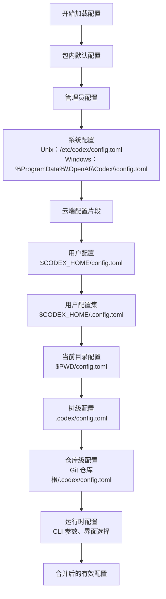
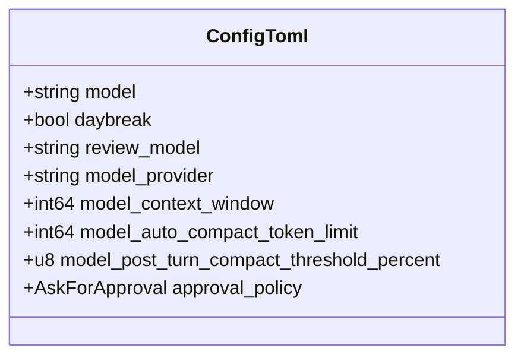
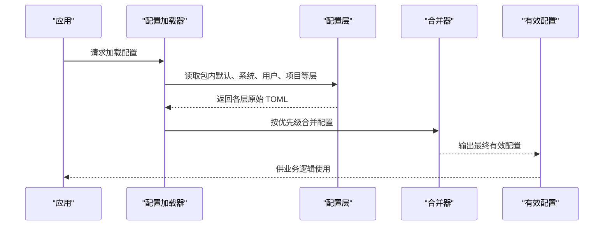
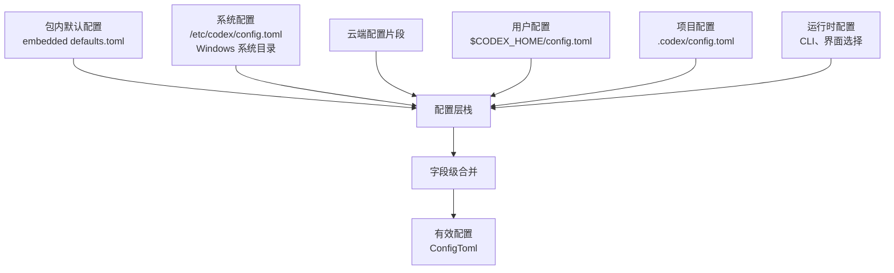

# 基础配置

<cite>
**本文引用的文件**   
- [lib.rs](file://codex-rs/config/src/lib.rs)
- [loader/mod.rs](file://codex-rs/config/src/loader/mod.rs)
- [loader/local.rs](file://codex-rs/config/src/loader/local.rs)
- [config_toml.rs](file://codex-rs/config/src/config_toml.rs)
- [types.rs](file://codex-rs/config/src/types.rs)
- [overrides.rs](file://codex-rs/config/src/overrides.rs)
- [defaults.toml](file://codex-rs/config/defaults.toml)
- [config.md](file://docs/config.md)
- [example-config.md](file://docs/example-config.md)
</cite>

## 目录
1. [简介](#简介)
2. [配置文件位置与查找顺序](#配置文件位置与查找顺序)
3. [配置文件语法与数据类型](#配置文件语法与数据类型)
4. [全局配置项说明](#全局配置项说明)
5. [默认值来源与覆盖规则](#默认值来源与覆盖规则)
6. [常用配置场景示例](#常用配置场景示例)
7. [常见基础配置错误与解决方法](#常见基础配置错误与解决方法)
8. [架构总览](#架构总览)
9. [结论](#结论)

## 简介
本文面向首次使用 Codex 的用户，解释 `config.toml` 的基本结构、位置和查找顺序，并重点说明以下全局配置项：
- `model`
- `model_provider`
- `approval_policy`
- `daybreak`

同时说明默认值的来源、配置层覆盖规则、TOML 语法约定，以及常见的基础配置错误和排错方法。更详细的官方文档链接可在仓库文档中查看。

**章节来源**
- [config.md:1-15](file://docs/config.md#L1-L15)
- [example-config.md:1-3](file://docs/example-config.md#L1-L3)

## 配置文件位置与查找顺序
Codex 的配置由多个“层”叠加而成；后加载的层可以覆盖前一层中的同名字段。核心原则是：**越靠近运行时的配置，优先级越高**。

### 完整配置层顺序（从最低到最高）
| 层级 | 含义 | 典型路径或来源 |
|---|---|---|
| 包内默认配置 | 打包时嵌入的固定默认值 | 程序内置默认 TOML |
| 管理员配置 | 企业托管策略 | macOS 受管偏好设置；Windows 系统级 requirements |
| 系统配置 | 全系统共享默认值 | Unix：`/etc/codex/config.toml`；Windows：`%ProgramData%\OpenAI\Codex\config.toml` |
| 云端配置 | 企业管理云配置片段 | 通过云配置 Bundle 注入 |
| 用户配置 | 当前用户的 `config.toml` | `${CODEX_HOME}/config.toml` |
| 用户配置集 | 按名称选择的附加配置 | `${CODEX_HOME}/<name>.config.toml` |
| 当前目录配置 | 启动工作目录下的本地配置 | `${PWD}/config.toml` |
| 树级配置 | 向上递归查找 `.codex/config.toml` | 项目树中的 `.codex/config.toml` |
| 仓库级配置 | Git 仓库根目录下的 `.codex/config.toml` | `$(git rev-parse --show-toplevel)/.codex/config.toml` |
| 运行时配置 | 命令行参数、界面选择等 | CLI `--config`、模型选择器等 |

注意：
- 项目相关层（当前目录、树级、仓库级）在目录不可信时会被加载但禁用，防止项目内容影响敏感设置。
- 某些安全相关字段在项目本地配置中被显式禁止，例如 `model_provider`、`model_providers`、`profile`、`profiles`、`openai_base_url`、`chatgpt_base_url`、`notify`、`experimental_realtime_webrtc_call_base_url`、`experimental_realtime_ws_base_url`、`otel` 等。

**图表来源**
- [loader/mod.rs:106-144](file://codex-rs/config/src/loader/mod.rs#L106-L144)
- [loader/mod.rs:147-188](file://codex-rs/config/src/loader/mod.rs#L147-L188)

**章节来源**
- [loader/mod.rs:84-85](file://codex-rs/config/src/loader/mod.rs#L84-L85)
- [loader/mod.rs:106-144](file://codex-rs/config/src/loader/mod.rs#L106-L144)
- [loader/mod.rs:147-188](file://codex-rs/config/src/loader/mod.rs#L147-L188)
- [loader/local.rs:173-235](file://codex-rs/config/src/loader/local.rs#L173-L235)

## 配置文件语法与数据类型
`config.toml` 使用 TOML 格式。该语言具有以下常用特性：
- 顶层键表示配置项，例如 `model = "..."`。
- 嵌套表用 `[section]` 声明，例如 `[history]`。
- 布尔值写为 `true` 或 `false`。
- 数字可以是整数或浮点数。
- 字符串使用双引号包裹。
- 列表使用方括号 `[]`。
- 可选字段通常对应 Rust 中的 `Option<T>`；未填写时使用默认值或上层配置值。

Codex 内部使用强类型结构体反序列化 TOML，因此字段名必须匹配定义；未知字段可能被视为无效或忽略，具体行为取决于解析阶段和严格模式。

**章节来源**
- [config_toml.rs:168-204](file://codex-rs/config/src/config_toml.rs#L168-L204)
- [types.rs:128-178](file://codex-rs/config/src/types.rs#L128-L178)

## 全局配置项说明
以下字段属于 `ConfigToml` 顶层结构，是普通用户最常接触的全局配置项。

| 字段 | 类型 | 作用 | 备注 |
|---|---|---|---|
| `model` | 可选字符串 | 指定默认使用的模型名称 | 若未设置，则由提供商、配置层和运行时选择逻辑决定最终模型 |
| `model_provider` | 可选字符串 | 从 `model_providers` 映射中选择使用的提供商名称 | 项目本地配置中可能被禁止 |
| `approval_policy` | 可选审批策略枚举 | 控制命令执行前的确认方式 | 对应底层 `AskForApproval` 类型 |
| `daybreak` | 可选布尔值 | 为新线程和非交互式轮次设置 Daybreak 的默认偏好 | 用于控制是否启用 Daybreak 相关功能 |

这些字段都是可选的；如果省略，则不会强制覆盖其他层的值。

**图表来源**
- [config_toml.rs:168-204](file://codex-rs/config/src/config_toml.rs#L168-L204)

**章节来源**
- [config_toml.rs:168-204](file://codex-rs/config/src/config_toml.rs#L168-L204)

## 默认值来源与覆盖规则
### 默认值来源
1. **包内默认配置**  
   打包时嵌入的默认 TOML 提供部分基础值，例如历史持久化策略、文件打开器、项目根标记等。它位于源码资源中，并在加载流程中作为最低优先级的“包内默认层”。

2. **代码默认值**  
   当某个字段未出现在任何配置层时，Rust 结构体的 `Default` 实现或显式默认函数会提供默认值。例如：
   - `History.persistence` 默认保存所有历史记录。
   - `AuthCredentialsStoreMode` 默认使用文件存储。
   - `OAuthCredentialsStoreMode` 默认自动选择存储后端。

3. **上层配置值**  
   如果某层省略了某个可选字段，更高优先级的层可以继续提供该值。

4. **运行时覆盖**  
   CLI 参数和界面选择会生成运行时覆盖层，优先级最高。

### 覆盖规则
- 配置层按上述顺序合并，后加载层覆盖先加载层。
- 对结构化字段，合并可能按字段级别进行，而不是简单整体替换。
- 命令行覆盖通过路径映射将短选项转换为 TOML 路径，并直接写入最终值。
- 项目本地配置存在安全白名单限制，不能随意覆盖敏感字段。

**图表来源**
- [loader/mod.rs:147-188](file://codex-rs/config/src/loader/mod.rs#L147-L188)
- [overrides.rs:1-99](file://codex-rs/config/src/overrides.rs#L1-L99)

**章节来源**
- [defaults.toml:1-18](file://codex-rs/config/defaults.toml#L1-L18)
- [loader/mod.rs:147-188](file://codex-rs/config/src/loader/mod.rs#L147-L188)
- [types.rs:128-178](file://codex-rs/config/src/types.rs#L128-L178)
- [overrides.rs:1-99](file://codex-rs/config/src/overrides.rs#L1-L99)

## 常用配置场景示例
以下示例不展示完整配置文件内容，而是列出推荐的最小配置组合和位置建议。

### 场景一：仅指定默认模型
适合刚开始使用 Codex 的用户。
- 在 `${CODEX_HOME}/config.toml` 中设置 `model`。
- 不设置 `model_provider` 时，系统会根据可用提供商和默认策略选择模型。

推荐配置项：
- `model`

### 场景二：指定模型提供商
适合需要切换 OpenAI、Bedrock、本地 Ollama 等提供商的场景。
- 在 `${CODEX_HOME}/config.toml` 中设置 `model_provider`。
- 确保已在 `model_providers` 中定义对应提供商配置。
- 如需同时指定模型，可配合 `model`。

推荐配置项：
- `model_provider`
- 可选：`model`

### 场景三：调整命令执行审批策略
适合希望减少交互或增强安全的用户。
- 在 `${CODEX_HOME}/config.toml` 中设置 `approval_policy`。
- 常见策略包括始终询问、自动批准、根据上下文判断等，具体取值以底层 `AskForApproval` 类型为准。

推荐配置项：
- `approval_policy`

### 场景四：开启或关闭 Daybreak
适合实验性功能用户。
- 在 `${CODEX_HOME}/config.toml` 中设置 `daybreak`。
- 若所选模型没有访问权限，Daybreak 会被禁用。

推荐配置项：
- `daybreak`

### 配置文件放置建议
| 用途 | 推荐位置 |
|---|---|
| 个人默认配置 | `${CODEX_HOME}/config.toml` |
| 按任务切换的配置集 | `${CODEX_HOME}/<name>.config.toml` |
| 项目临时调试配置 | `${PWD}/config.toml` 或 `.codex/config.toml` |
| 全系统默认配置 | `/etc/codex/config.toml` 或 Windows 系统 ProgramData 路径 |

**章节来源**
- [config_toml.rs:168-204](file://codex-rs/config/src/config_toml.rs#L168-L204)
- [loader/mod.rs:106-144](file://codex-rs/config/src/loader/mod.rs#L106-L144)

## 常见基础配置错误与解决方法
| 问题 | 原因 | 解决方法 |
|---|---|---|
| 设置了 `model` 但模型未生效 | 被更高优先级层覆盖，或运行时选择了不同模型 | 检查命令行参数、界面选择、项目本地配置、仓库级配置 |
| 设置了 `model_provider` 但报错 | 未在 `model_providers` 中定义，或使用了保留提供商 ID | 检查提供商映射；避免使用保留提供商 ID |
| `approval_policy` 值无效 | 使用了不支持的枚举值 | 使用底层 `AskForApproval` 支持的合法值 |
| `daybreak` 未生效 | 所选模型没有访问权限 | 检查模型权限；无权限时 Daybreak 会被禁用 |
| 项目配置无法覆盖敏感字段 | 项目本地配置被禁止修改安全相关字段 | 改用用户配置、系统配置或管理员配置层 |
| 配置加载失败 | TOML 语法错误或字段类型不匹配 | 检查键名、类型、嵌套表结构 |
| 找不到 `config.toml` | 环境变量或路径不正确 | 确认 `CODEX_HOME` 和实际工作目录 |

**章节来源**
- [loader/mod.rs:106-144](file://codex-rs/config/src/loader/mod.rs#L106-L144)
- [config_toml.rs:168-204](file://codex-rs/config/src/config_toml.rs#L168-L204)
- [types.rs:128-178](file://codex-rs/config/src/types.rs#L128-L178)

## 架构总览
下图展示基础配置在 Codex 配置系统中的位置：用户编写的 `config.toml` 只是整个配置栈中的一层，最终生效值由包内默认、系统、云端、用户、项目、运行时等多层合并而成。

**图表来源**
- [loader/mod.rs:106-144](file://codex-rs/config/src/loader/mod.rs#L106-L144)
- [config_toml.rs:168-204](file://codex-rs/config/src/config_toml.rs#L168-L204)
- [defaults.toml:1-18](file://codex-rs/config/defaults.toml#L1-L18)

**章节来源**
- [lib.rs:57-60](file://codex-rs/config/src/lib.rs#L57-L60)
- [loader/mod.rs:106-144](file://codex-rs/config/src/loader/mod.rs#L106-L144)
- [config_toml.rs:168-204](file://codex-rs/config/src/config_toml.rs#L168-L204)

## 结论
- `config.toml` 是 Codex 用户配置的核心入口，但并非唯一来源。
- 最常用且最稳定的做法是将 `model`、`model_provider`、`approval_policy`、`daybreak` 放在 `${CODEX_HOME}/config.toml` 中。
- 如果配置不生效，优先检查更高优先级层和运行时参数是否覆盖了你的设置。
- 遇到语法或类型错误时，应回到 TOML 结构和字段类型定义处排查。
- 更完整的官方配置文档、高级配置和示例配置可在仓库文档中找到链接。