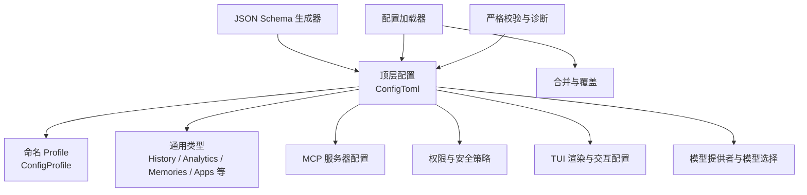
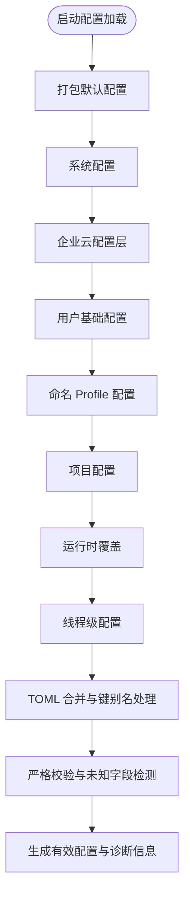
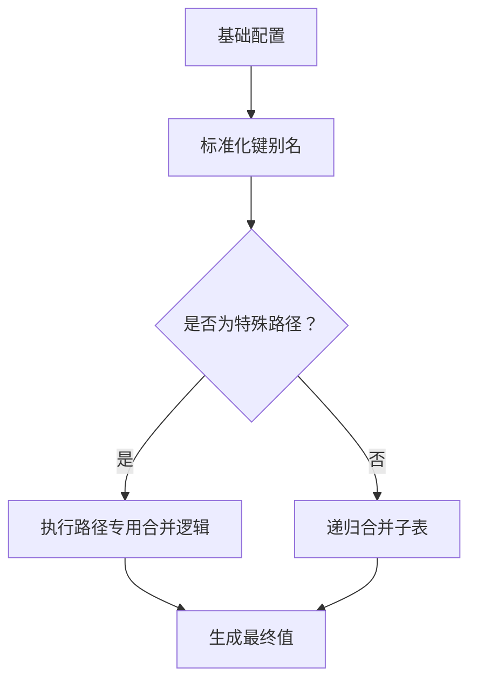
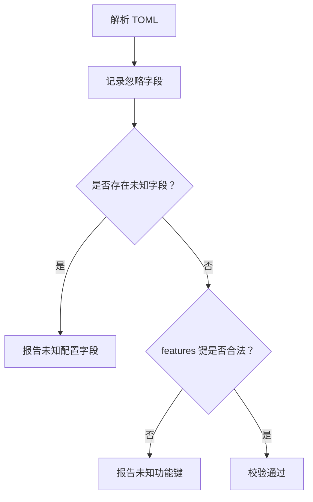
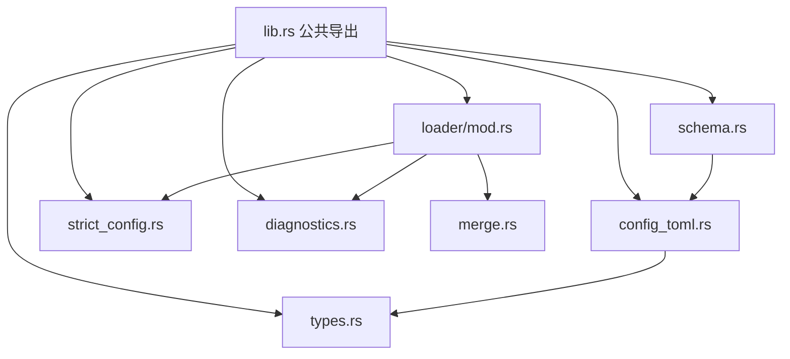

# 配置文件详解

<cite>
**本文引用的文件**   
- [config_toml.rs](file://codex-rs/config/src/config_toml.rs)
- [profile_toml.rs](file://codex-rs/config/src/profile_toml.rs)
- [types.rs](file://codex-rs/config/src/types.rs)
- [schema.rs](file://codex-rs/config/src/schema.rs)
- [loader/mod.rs](file://codex-rs/config/src/loader/mod.rs)
- [merge.rs](file://codex-rs/config/src/merge.rs)
- [strict_config.rs](file://codex-rs/config/src/strict_config.rs)
- [diagnostics.rs](file://codex-rs/config/src/diagnostics.rs)
- [lib.rs](file://codex-rs/config/src/lib.rs)
- [defaults.toml](file://codex-rs/config/defaults.toml)
- [config.md](file://docs/config.md)
</cite>

## 目录
1. [简介](#简介)
2. [项目结构](#项目结构)
3. [核心组件](#核心组件)
4. [架构总览](#架构总览)
5. [详细组件分析](#详细组件分析)
6. [依赖关系分析](#依赖关系分析)
7. [性能与行为特性](#性能与行为特性)
8. [故障排查指南](#故障排查指南)
9. [结论](#结论)
10. [附录：配置字段参考](#附录配置字段参考)

## 简介
本文档面向 Codex 的 `config.toml` 配置文件，提供完整参考说明。内容涵盖：
- 配置文件的结构、字段定义和数据类型；
- 全局配置、用户配置、项目配置的层次结构与优先级规则；
- 模型设置、网络配置、安全策略、TUI 等关键配置域；
- 配置验证机制、错误诊断与常见错误修复方式；
- 常见使用场景示例，包括自定义模型提供商、代理设置、沙箱模式等；
- 动态配置更新机制与热重载能力的边界说明。

该文档同时解释 `requirements.toml` 与 `managed_config.toml` 等需求层对最终有效配置的影响，但重点仍围绕用户可编辑的 `config.toml`。

## 项目结构
Codex 的配置系统位于 Rust crate `codex-rs/config` 中，核心由以下部分组成：
- 顶层配置结构体与 TOML 反序列化定义；
- 命名 profile 配置结构体；
- 通用类型、枚举和默认值；
- JSON Schema 生成器；
- 配置加载器、层级合并、严格校验与诊断工具；
- 打包默认配置。

**图表来源**
- [config_toml.rs:201-550](file://codex-rs/config/src/config_toml.rs#L201-L550)
- [profile_toml.rs:1-83](file://codex-rs/config/src/profile_toml.rs#L1-L83)
- [types.rs:201-594](file://codex-rs/config/src/types.rs#L201-L594)
- [schema.rs:1-200](file://codex-rs/config/src/schema.rs#L1-L200)
- [loader/mod.rs:201-480](file://codex-rs/config/src/loader/mod.rs#L201-L480)
- [merge.rs:1-200](file://codex-rs/config/src/merge.rs#L1-L200)
- [strict_config.rs:1-200](file://codex-rs/config/src/strict_config.rs#L1-L200)
- [diagnostics.rs:1-200](file://codex-rs/config/src/diagnostics.rs#L1-L200)

**章节来源**
- [lib.rs:1-200](file://codex-rs/config/src/lib.rs#L1-L200)
- [config_toml.rs:201-550](file://codex-rs/config/src/config_toml.rs#L201-L550)
- [profile_toml.rs:1-83](file://codex-rs/config/src/profile_toml.rs#L1-L83)
- [types.rs:201-594](file://codex-rs/config/src/types.rs#L201-L594)
- [schema.rs:1-200](file://codex-rs/config/src/schema.rs#L1-L200)
- [loader/mod.rs:201-480](file://codex-rs/config/src/loader/mod.rs#L201-L480)
- [merge.rs:1-200](file://codex-rs/config/src/merge.rs#L1-L200)
- [strict_config.rs:1-200](file://codex-rs/config/src/strict_config.rs#L1-L200)
- [diagnostics.rs:1-200](file://codex-rs/config/src/diagnostics.rs#L1-L200)

## 核心组件
### 顶层配置对象 `ConfigToml`
`ConfigToml` 是 `config.toml` 的主结构体，承载绝大多数用户级设置。其职责包括：
- 模型选择与上下文窗口控制；
- 审批策略、审阅者、自动审阅；
- 浏览器与计算机使用能力开关；
- Shell 环境策略、登录 Shell 限制；
- 沙箱模式、工作区写权限、内置权限档案；
- 通知命令、开发者指令、模型指令文件；
- ChatGPT 与 OpenAI 后端地址；
- CLI 与 MCP OAuth 凭证存储后端；
- MCP 服务器列表与企业级 EMA 认证；
- 模型提供者扩展、模型目录 JSON；
- 历史持久化、日志目录、SQLite 状态目录；
- TUI 交互设置、代理原因显示隐藏；
- Web 搜索模式、工具建议、Agent 与目标设置；
- Memories 子系统、Skills、Hooks、Plugins、Marketplaces；
- 功能开关 `features`、稳定性警告抑制；
- 项目根标记、启动时检查更新、兼容性快照字段；
- 分析与反馈开关、应用连接器默认策略等。

**章节来源**
- [config_toml.rs:201-550](file://codex-rs/config/src/config_toml.rs#L201-L550)

### 命名 Profile 配置对象 `ConfigProfile`
`ConfigProfile` 表示可在 `profiles.<name>` 中定义的独立配置单元，用于在不同会话或任务间切换模型、审批策略、沙箱模式、推理强度、提示词文件和 TUI 偏好等。它支持：
- 模型与服务等级；
- 模型提供者；
- 审批策略与审阅者；
- 沙箱模式、推理努力、计划模式推理努力；
- 模型推理摘要与详细程度；
- 模型目录 JSON 与模型指令文件；
- 是否注入权限与应用协作指令；
- 已弃用字段兼容；
- 工具配置、Web 搜索模式；
- 分析、TUI、Windows 特定设置；
- 功能开关；
- 开源模型提供者别名。

**章节来源**
- [profile_toml.rs:1-83](file://codex-rs/config/src/profile_toml.rs#L1-L83)

### 通用类型与默认值
`types.rs` 提供大量基础类型，例如：
- 文件打开器枚举；
- 历史持久化模式；
- 分析与反馈开关；
- 工具建议与禁用工具；
- Memories 配置与生效后配置；
- 应用连接器默认策略、单应用策略、账户链接策略；
- OTEL 协议枚举；
- Windows 沙箱模式与相关布尔开关；
- 多种枚举类型如服务等级、工具暴露面、Web 搜索模式等。

这些类型被 `ConfigToml`、`ConfigProfile` 及其他配置模块复用，确保配置项的数据类型一致且具备 JSON Schema。

**章节来源**
- [types.rs:201-594](file://codex-rs/config/src/types.rs#L201-L594)

## 架构总览
配置加载过程是一个多阶段流水线：先从打包默认配置开始，再依次叠加系统配置、企业云配置、用户配置、命名 Profile、项目配置，最后加入运行时覆盖和线程级配置。最终结果会经过合并、约束校验、未知字段检测与诊断输出。

**图表来源**
- [loader/mod.rs:201-480](file://codex-rs/config/src/loader/mod.rs#L201-L480)
- [merge.rs:1-200](file://codex-rs/config/src/merge.rs#L1-L200)
- [strict_config.rs:1-200](file://codex-rs/config/src/strict_config.rs#L1-L200)
- [diagnostics.rs:1-200](file://codex-rs/config/src/diagnostics.rs#L1-L200)

**章节来源**
- [loader/mod.rs:201-480](file://codex-rs/config/src/loader/mod.rs#L201-L480)

## 详细组件分析

### 配置层级与优先级
Codex 将配置分为多个层级，每个后续层级可以覆盖前一层的同名字段。整体优先级从低到高如下：
1. 打包默认配置；
2. 企业管理配置；
3. 系统配置；
4. 企业云配置层；
5. 用户基础配置；
6. 选定的命名 Profile 配置；
7. 当前工作目录及父目录中的项目配置；
8. Git 仓库根目录中的项目配置；
9. 运行时覆盖；
10. 线程级配置。

对于项目配置，如果目录不可信，某些项目层会被加载但禁用，不会改变敏感设置如模型提供者、认证 URL、遥测等。

**图表来源**
- [loader/mod.rs:201-480](file://codex-rs/config/src/loader/mod.rs#L201-L480)

**章节来源**
- [loader/mod.rs:201-480](file://codex-rs/config/src/loader/mod.rs#L201-L480)

### 配置合并策略
TOML 配置通过递归表合并进行融合，高优先级层覆盖低优先级层。合并过程中还会处理特殊路径：
- 功能开关支持布尔值与结构化启用对象之间的双向兼容；
- 网络域名配置会规范化主机名；
- Shell 环境变量过滤支持新旧两种表示形式，并在切换时移除冲突字段；
- 结构化特征路径下的凭据环境变量会按源去重；
- 键别名会在合并前标准化。

**图表来源**
- [merge.rs:1-200](file://codex-rs/config/src/merge.rs#L1-L200)

**章节来源**
- [merge.rs:1-200](file://codex-rs/config/src/merge.rs#L1-L200)

### 配置验证与严格模式
配置在反序列化和合并后会进入严格校验流程：
- 使用忽略字段追踪发现未知字段；
- 针对 `tui` 子树做二次校验，防止扁平化的通知配置绕过检测；
- 针对 `features` 子树只允许已知功能键；
- 所有错误都会映射到具体文件、行号和列号；
- 当合并后的配置失效时，会尝试定位第一个实际出错的文件范围。

**图表来源**
- [strict_config.rs:1-200](file://codex-rs/config/src/strict_config.rs#L1-L200)
- [diagnostics.rs:1-200](file://codex-rs/config/src/diagnostics.rs#L1-L200)

**章节来源**
- [strict_config.rs:1-200](file://codex-rs/config/src/strict_config.rs#L1-L200)
- [diagnostics.rs:1-200](file://codex-rs/config/src/diagnostics.rs#L1-L200)

### JSON Schema 生成
配置系统通过 `schema.rs` 为 `ConfigToml` 和相关结构生成 JSON Schema。它会：
- 将 `features` 映射到已知功能键及其对应配置结构；
- 保留遗留功能键以便向后兼容；
- 为部分字段注入自定义 Schema 描述；
- 排除内部实现细节，仅暴露用户可见配置结构。

**章节来源**
- [schema.rs:1-200](file://codex-rs/config/src/schema.rs#L1-L200)

### 打包默认配置
打包默认配置是内置的最低优先级配置，通常包含产品行为相关的默认值，例如：
- 是否注入权限、应用、协作模式指令；
- 是否注入环境上下文；
- CLI 与 MCP 凭证存储后端；
- 项目文档大小上限；
- 背景终端超时；
- 文件打开器；
- 是否隐藏 Agent 推理；
- ChatGPT 后端地址；
- 项目根标记；
- 历史持久化策略。

这些默认值可通过更高优先级配置覆盖。

**章节来源**
- [defaults.toml:1-18](file://codex-rs/config/defaults.toml#L1-L18)
- [loader/mod.rs:201-260](file://codex-rs/config/src/loader/mod.rs#L201-L260)

## 依赖关系分析
`config` crate 的核心依赖关系如下：

**图表来源**
- [lib.rs:1-200](file://codex-rs/config/src/lib.rs#L1-L200)
- [config_toml.rs:201-550](file://codex-rs/config/src/config_toml.rs#L201-L550)
- [types.rs:201-594](file://codex-rs/config/src/types.rs#L201-L594)
- [loader/mod.rs:201-480](file://codex-rs/config/src/loader/mod.rs#L201-L480)
- [schema.rs:1-200](file://codex-rs/config/src/schema.rs#L1-L200)
- [strict_config.rs:1-200](file://codex-rs/config/src/strict_config.rs#L1-L200)
- [diagnostics.rs:1-200](file://codex-rs/config/src/diagnostics.rs#L1-L200)
- [merge.rs:1-200](file://codex-rs/config/src/merge.rs#L1-L200)

**章节来源**
- [lib.rs:1-200](file://codex-rs/config/src/lib.rs#L1-L200)

## 性能与行为特性
- 配置加载是异步的，避免阻塞主线程；
- 项目根发现与信任决策基于当前工作目录和项目标记；
- 合并操作采用原地修改与递归遍历，时间复杂度与配置树深度和分支数相关；
- 严格校验会在反序列化后额外扫描忽略字段，增加少量开销；
- 诊断工具会维护文本位置信息，便于用户快速定位错误；
- 历史、Logs、SQLite 目录等路径配置会影响磁盘 I/O，应合理设置以避免过大日志或状态文件。

[本节为一般性说明，不直接分析具体代码片段]

## 故障排查指南
### 常见配置错误类型
- TOML 语法错误；
- 字段类型错误；
- 未知字段；
- 非法功能键；
- 合并后配置无效；
- 项目目录不可信导致配置被禁用；
- 命名 Profile 与旧式 `profile` 字段冲突。

### 诊断信息结构
诊断错误通常包含：
- 出错文件路径；
- 起始行与列；
- 结束行与列；
- 人类可读的错误消息；
- 原始 TOML 解析错误（可选）。

### 排查步骤
1. 查看报错中的文件路径和行列号；
2. 检查该文件中对应字段是否拼写正确；
3. 确认 `features` 下是否使用了已知功能键；
4. 检查 `tui` 下是否存在不支持的子字段；
5. 若涉及项目配置，确认当前目录是否可信；
6. 若使用 `--profile`，确认没有同时使用旧式 `profile` 字段；
7. 清理或调整 `requirements.toml` 和 `managed_config.toml`，避免管理端强制覆盖。

**章节来源**
- [diagnostics.rs:1-200](file://codex-rs/config/src/diagnostics.rs#L1-L200)
- [strict_config.rs:1-200](file://codex-rs/config/src/strict_config.rs#L1-L200)
- [loader/mod.rs:201-480](file://codex-rs/config/src/loader/mod.rs#L201-L480)

## 结论
Codex 的配置系统以 `ConfigToml` 为核心，结合命名 Profile、多层加载、严格校验和丰富诊断，提供了灵活而安全的配置能力。用户应优先通过 `config.toml` 管理个人偏好，并通过 `requirements.toml` 和企业管理配置施加组织级约束。理解配置层级、合并规则和校验机制，有助于减少配置错误并提高排错效率。

[本节为总结性内容，不直接分析具体代码片段]

## 附录：配置字段参考

### 模型与提供者
- `model`：默认模型标识；
- `review_model`：审查功能使用的模型；
- `model_provider`：选择的模型提供者；
- `model_context_window`：上下文窗口大小；
- `model_auto_compact_token_limit`：自动压缩阈值；
- `model_auto_compact_token_limit_scope`：自动压缩作用范围；
- `model_post_turn_compact_threshold_percent`：回合结束后压缩阈值百分比；
- `model_reasoning_effort`：推理努力；
- `plan_mode_reasoning_effort`：计划模式推理努力；
- `model_reasoning_summary`：推理摘要；
- `model_verbosity`：模型详细程度；
- `model_instructions_file`：模型指令文件路径；
- `model_catalog_json`：模型目录 JSON 路径；
- `openai_base_url`：OpenAI 提供者基础地址；
- `chatgpt_base_url`：ChatGPT 后端地址；
- `services_tier`：服务等级请求 ID；
- `oss_provider`：开源模型提供者别名。

**章节来源**
- [config_toml.rs:201-550](file://codex-rs/config/src/config_toml.rs#L201-L550)
- [profile_toml.rs:1-83](file://codex-rs/config/src/profile_toml.rs#L1-L83)

### 审批与安全
- `approval_policy`：命令执行审批策略；
- `approvals_reviewer`：审批审阅者；
- `auto_review`：自动审阅策略；
- `guardian`：Guardian 策略加载器相关；
- `sandbox_mode`：沙箱模式；
- `sandbox_workspace_write`：工作区写权限配置；
- `default_permissions`：默认权限档案；
- `permissions`：命名权限档案；
- `allow_login_shell`：是否允许登录 Shell；
- `shell_environment_policy`：Shell 环境变量策略；
- `project_root_markers`：项目根标记；
- `trust_level`：信任级别；
- `force_login_method`：强制登录方法；
- `forced_chatgpt_workspace_id`：限制 ChatGPT 工作区。

**章节来源**
- [config_toml.rs:201-550](file://codex-rs/config/src/config_toml.rs#L201-L550)

### 网络与代理
- `network`：网络约束与域名权限；
- `http_client`：HTTP 客户端相关；
- `proxy`：代理相关；
- `experimental_realtime_ws_base_url`：实时 WebSocket 基础地址；
- `experimental_realtime_webrtc_call_base_url`：实时 WebRTC 调用基础地址；
- `experimental_realtime_ws_model`：实时 WebSocket 模型；
- `experimental_realtime_ws_backend_prompt`：实时 WebSocket 后端提示；
- `experimental_realtime_ws_startup_context`：实时 WebSocket 启动上下文；
- `experimental_realtime_start_instructions`：实时启动指令。

**章节来源**
- [config_toml.rs:201-550](file://codex-rs/config/src/config_toml.rs#L201-L550)

### 认证与凭证
- `cli_auth_credentials_store`：CLI 认证凭证存储后端；
- `mcp_oauth_credentials_store`：MCP OAuth 凭证存储后端；
- `mcp_oauth_callback_port`：MCP OAuth 回调端口；
- `mcp_oauth_callback_url`：MCP OAuth 回调地址；
- `mcp_optional_startup_grace_ms`：MCP 可选服务器启动等待时间；
- `mcp_enterprise_managed_auth`：企业级 EMA 认证配置。

**章节来源**
- [config_toml.rs:201-550](file://codex-rs/config/src/config_toml.rs#L201-L550)

### MCP 与插件
- `mcp_servers`：MCP 服务器列表；
- `plugins`：插件默认与单个插件配置；
- `marketplaces`：市场条目；
- `tools`：工具配置；
- `tool_suggest`：工具建议配置；
- `apps`：应用连接器配置；
- `skills`：技能配置；
- `hooks`：生命周期钩子配置。

**章节来源**
- [config_toml.rs:201-550](file://codex-rs/config/src/config_toml.rs#L201-L550)

### 存储、日志与状态
- `history.persistence`：历史持久化策略；
- `history.max_bytes`：历史文件大小上限；
- `sqlite_home`：SQLite 状态目录；
- `log_dir`：日志目录；
- `background_terminal_max_timeout`：后台终端最大超时；
- `thread_unload_delay_secs`：线程卸载延迟。

**章节来源**
- [config_toml.rs:201-550](file://codex-rs/config/src/config_toml.rs#L201-L550)
- [types.rs:201-594](file://codex-rs/config/src/types.rs#L201-L594)

### TUI 与交互
- `tui`：TUI 交互、键盘绑定、鼠标滚动、渲染等设置；
- `hide_agent_reasoning`：隐藏 Agent 推理；
- `show_raw_agent_reasoning`：显示原始 Agent 推理；
- `file_opener`：URI 文件打开器；
- `notify`：通知外部命令；
- `instructions`：系统指令；
- `developer_instructions`：开发者指令；
- `include_permissions_instructions`：注入权限指令；
- `include_apps_instructions`：注入应用指令；
- `include_collaboration_mode_instructions`：注入协作模式指令；
- `include_environment_context`：注入环境上下文；
- `include_environment_context_time`：环境上下文包含时间。

**章节来源**
- [config_toml.rs:201-550](file://codex-rs/config/src/config_toml.rs#L201-L550)

### 分析与反馈
- `analytics.enabled`：是否启用 OpenAI 分析；
- `feedback.enabled`：是否启用反馈收集；
- `otel`：OTEL 遥测配置；
- `check_for_update_on_startup`：启动时检查更新。

**章节来源**
- [config_toml.rs:201-550](file://codex-rs/config/src/config_toml.rs#L201-L550)
- [types.rs:201-594](file://codex-rs/config/src/types.rs#L201-L594)

### 功能开关与项目设置
- `features`：集中式功能开关；
- `suppress_unstable_features_warning`：抑制不稳定功能警告；
- `projects`：项目配置映射；
- `web_search`：Web 搜索模式；
- `agents`：Agent 相关设置；
- `goals`：目标相关设置；
- `memories`：Memories 子系统设置；
- `ghost_snapshot`：兼容字段；
- `disable_paste_burst`：粘贴突发限制；
- `os`：操作系统相关配置；
- `windows.sandbox`：Windows 沙箱模式；
- `windows.allow_mxc`：是否允许 MXC。

**章节来源**
- [config_toml.rs:201-550](file://codex-rs/config/src/config_toml.rs#L201-L550)
- [types.rs:201-594](file://codex-rs/config/src/types.rs#L201-L594)

### 常见配置场景示例

#### 自定义模型提供商
在 `model_providers` 中添加第三方模型提供者，并配合 `model_provider` 选择默认提供者。注意保留内置提供者 ID，不要覆盖受保护 ID。

**章节来源**
- [config_toml.rs:201-550](file://codex-rs/config/src/config_toml.rs#L201-L550)

#### 代理设置
在网络相关配置中设置代理、域名权限、头注入等，使 Codex 的请求符合企业网络策略。

**章节来源**
- [config_toml.rs:201-550](file://codex-rs/config/src/config_toml.rs#L201-L550)

#### 沙箱模式
通过 `sandbox_mode` 和 `sandbox_workspace_write` 控制执行环境的安全级别，并结合 `permissions` 和 `default_permissions` 精细控制文件系统访问。

**章节来源**
- [config_toml.rs:201-550](file://codex-rs/config/src/config_toml.rs#L201-L550)

#### 动态配置更新与热重载
配置加载器支持多层合并与运行时覆盖，但 `config.toml` 本身不是持续监听的热重载配置。真正支持动态更新的主要是企业云配置包和运行时会话级覆盖。若需要热更新，应通过管理端配置或运行时 API 调整，而不是直接修改 `config.toml`。

**章节来源**
- [loader/mod.rs:201-480](file://codex-rs/config/src/loader/mod.rs#L201-L480)

#### 外部文档参考
官方文档进一步说明了基础配置、高级配置和完整配置参考的位置，以及托管 Hook 的行为。

**章节来源**
- [config.md:1-15](file://docs/config.md#L1-L15)