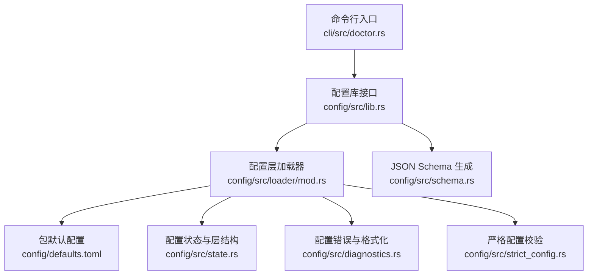
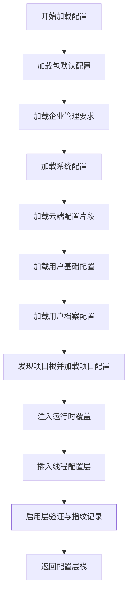
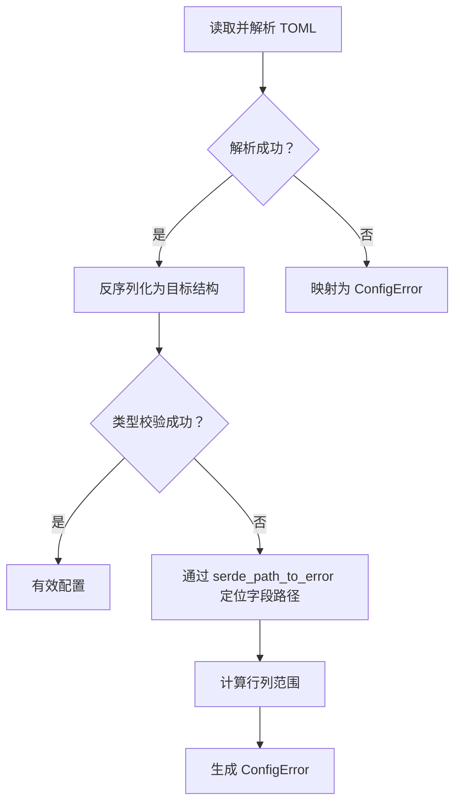
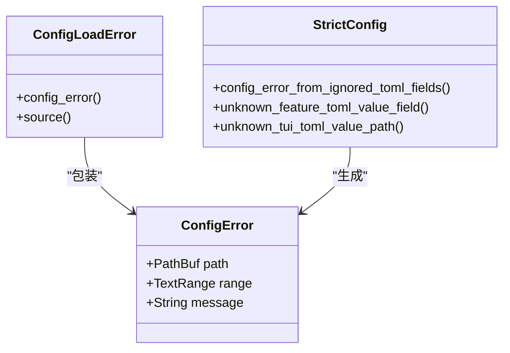
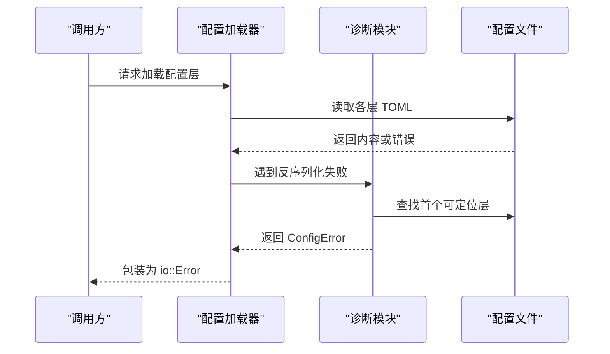
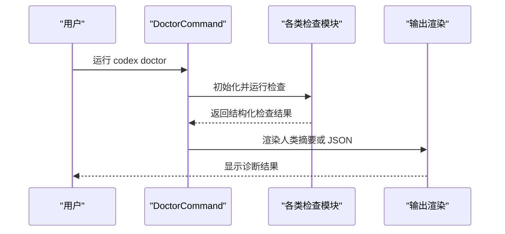

# 配置验证与调试

<cite>
**本文引用的文件**   
- [codex-rs/config/src/lib.rs](file://codex-rs/config/src/lib.rs)
- [codex-rs/config/src/loader/mod.rs](file://codex-rs/config/src/loader/mod.rs)
- [codex-rs/config/defaults.toml](file://codex-rs/config/defaults.toml)
- [codex-rs/config/src/state.rs](file://codex-rs/config/src/state.rs)
- [codex-rs/config/src/diagnostics.rs](file://codex-rs/config/src/diagnostics.rs)
- [codex-rs/config/src/strict_config.rs](file://codex-rs/config/src/strict_config.rs)
- [codex-rs/config/src/schema.rs](file://codex-rs/config/src/schema.rs)
- [codex-rs/cli/src/doctor.rs](file://codex-rs/cli/src/doctor.rs)
- [docs/config.md](file://docs/config.md)
</cite>

## 目录
1. [简介](#简介)
2. [项目结构与职责边界](#项目结构与职责边界)
3. [配置加载流程](#配置加载流程)
4. [语法检查、类型验证与依赖关系验证](#语法检查类型验证与依赖关系验证)
5. [错误处理机制](#错误处理机制)
6. [调试模式与诊断工具](#调试模式与诊断工具)
7. [常见配置错误排查](#常见配置错误排查)
8. [性能分析与优化建议](#性能分析与优化建议)
9. [使用 doctor 命令进行系统诊断](#使用-doctor-命令进行系统诊断)
10. [结论](#结论)

## 简介
本文面向 Codex 的配置系统与诊断能力，重点说明：
- 配置文件如何从包默认值、系统、云端、用户、工作区和运行时等多个来源合并。
- TOML 语法、字段类型、未知字段和特征开关如何被校验。
- 配置加载失败时如何定位到具体文件和行列位置。
- 如何使用 `doctor` 命令对安装环境、配置、网络、沙箱等进行只读诊断。
- 在配置相关错误中应优先收集哪些信息，以及如何避免误改用户状态。

## 项目结构与职责边界
Codex 的配置逻辑主要集中在 `codex-rs/config` 模块中，CLI 的 `doctor` 命令则位于 `codex-rs/cli`。



**图表来源**
- [codex-rs/cli/src/doctor.rs:1-120](file://codex-rs/cli/src/doctor.rs#L1-L120)
- [codex-rs/config/src/lib.rs:1-120](file://codex-rs/config/src/lib.rs#L1-L120)
- [codex-rs/config/src/loader/mod.rs:1-120](file://codex-rs/config/src/loader/mod.rs#L1-L120)
- [codex-rs/config/defaults.toml:1-18](file://codex-rs/config/defaults.toml#L1-L18)
- [codex-rs/config/src/state.rs:1-120](file://codex-rs/config/src/state.rs#L1-L120)
- [codex-rs/config/src/diagnostics.rs:1-80](file://codex-rs/config/src/diagnostics.rs#L1-L80)
- [codex-rs/config/src/strict_config.rs:1-60](file://codex-rs/config/src/strict_config.rs#L1-L60)
- [codex-rs/config/src/schema.rs:1-40](file://codex-rs/config/src/schema.rs#L1-L40)

**章节来源**
- [codex-rs/config/src/lib.rs:1-120](file://codex-rs/config/src/lib.rs#L1-L120)
- [docs/config.md:1-15](file://docs/config.md#L1-L15)

## 配置加载流程
配置加载由 `load_config_layers_state` 统一编排。它把多个来源按优先级组合为 `ConfigLayerStack`，并记录每个层的来源、版本、禁用原因以及原始 TOML，以便后续诊断。

### 配置层优先级
配置层按从低到高顺序构建，最终高层覆盖低层：
1. **包默认配置**：打包进二进制或随包发布的默认值。
2. **管理要求层**：企业托管的 `requirements.toml`。
3. **系统配置**：Unix 上 `/etc/codex/config.toml`，Windows 上程序数据目录下的配置。
4. **云端配置片段**：企业管理云配置 bundle 中的配置层。
5. **用户配置**：`${CODEX_HOME}/config.toml`。
6. **用户配置档案**：`${CODEX_HOME}/<name>.config.toml`。
7. **当前目录配置**：`${PWD}/config.toml`（未信任目录可能禁用）。
8. **仓库配置**：Git 根下的 `.codex/config.toml`（未信任目录可能禁用）。
9. **运行时覆盖**：CLI 参数、UI 选择等会话级覆盖。
10. **线程配置层**：按线程上下文插入的专用配置层。



**图表来源**
- [codex-rs/config/src/loader/mod.rs:120-210](file://codex-rs/config/src/loader/mod.rs#L120-L210)
- [codex-rs/config/src/loader/mod.rs:200-600](file://codex-rs/config/src/loader/mod.rs#L200-L600)
- [codex-rs/config/src/state.rs:1-120](file://codex-rs/config/src/state.rs#L1-L120)

### 关键入口与数据结构
- `load_config_layers_state`：核心异步加载函数，负责收集所有层、合并策略、项目信任决策和启动警告。
- `ConfigLoadOptions`：控制是否忽略用户配置、项目配置、托管要求等加载行为。
- `LoaderOverrides`：测试和高级场景下覆盖包默认路径、用户配置路径、系统配置路径等。
- `ConfigLayerEntry`：单个配置层，包含名称、TOML 值、版本、禁用原因和可选原始 TOML。
- `ConfigLayerStack`：最终合并后的配置栈，支持云端绑定、已应用配置服务器、执行策略规则忽略标记。

**章节来源**
- [codex-rs/config/src/loader/mod.rs:120-210](file://codex-rs/config/src/loader/mod.rs#L120-L210)
- [codex-rs/config/src/loader/mod.rs:200-600](file://codex-rs/config/src/loader/mod.rs#L200-L600)
- [codex-rs/config/src/state.rs:1-120](file://codex-rs/config/src/state.rs#L1-L120)

## 语法检查、类型验证与依赖关系验证

### TOML 语法检查
配置解析使用 TOML 解析器；当解析失败时，诊断模块会尝试将底层错误映射为人类可读的文件路径、行号和列号。

- `config_error_from_toml`：将 TOML 解析错误转换为 `ConfigError`。
- `format_config_error`：输出“文件:行:列: 消息”，并附带原行内容和定位符。
- `text_range_from_span`：把字节范围转为基于 1 的行/列坐标。



**图表来源**
- [codex-rs/config/src/diagnostics.rs:1-120](file://codex-rs/config/src/diagnostics.rs#L1-L120)
- [codex-rs/config/src/diagnostics.rs:200-320](file://codex-rs/config/src/diagnostics.rs#L200-L320)

### 类型验证
配置值会被反序列化为 Rust 结构体。如果字段类型不匹配、枚举值非法或嵌套结构不符合预期，`serde_path_to_error` 会把错误路径映射回 TOML 键路径，再结合源码中的 `Document` 获取精确 span。

典型验证点包括：
- `[features]` 中的特征开关必须是布尔值或对应结构体。
- TUI 配置字段必须属于 `Tui` 定义的有效字段。
- MCP、权限、模型提供者、安全策略等子表必须符合各自结构体。

**章节来源**
- [codex-rs/config/src/diagnostics.rs:80-200](file://codex-rs/config/src/diagnostics.rs#L80-L200)
- [codex-rs/config/src/schema.rs:1-120](file://codex-rs/config/src/schema.rs#L1-L120)

### 未知字段与严格配置
`strict_config.rs` 利用 `serde_ignored` 检测未被结构体消费的字段，从而报告“未知配置字段”。该模块还会：
- 检测未知 `features` 键。
- 检测未知 `tui` 字段。
- 将未知字段路径还原为 TOML 中的 span，生成带行列信息的错误。

严格配置模式常用于：
- 包默认配置。
- 企业管理配置。
- 测试夹具。
- 需要暴露未知字段错误的诊断场景。



**图表来源**
- [codex-rs/config/src/diagnostics.rs:1-80](file://codex-rs/config/src/diagnostics.rs#L1-L80)
- [codex-rs/config/src/strict_config.rs:1-120](file://codex-rs/config/src/strict_config.rs#L1-L120)

### 依赖关系验证
配置不仅检查自身语法和类型，还参与以下依赖关系验证：
- **项目根发现**：根据 `project_root_markers` 查找 Git 仓库或其他项目标记。
- **目录信任**：未信任目录会禁用项目配置层。
- **凭证代理与企业策略**：受托管配置影响凭证存储、网络策略和执行策略。
- **线程配置上下文**：线程级配置与工作区目录关联。
- **Shell 环境变量过滤策略**：在启用层验证阶段检查。

这些依赖会在加载过程中触发错误或警告，例如：
- 项目根标记配置无效。
- 未信任目录仍启用了敏感项目配置。
- 托管要求与本地配置冲突。

**章节来源**
- [codex-rs/config/src/loader/mod.rs:200-600](file://codex-rs/config/src/loader/mod.rs#L200-L600)
- [codex-rs/config/src/state.rs:120-240](file://codex-rs/config/src/state.rs#L120-L240)

## 错误处理机制
配置系统的错误处理强调“可定位、可解释、尽量不修改用户状态”。

### 错误类型
- `ConfigError`：携带文件路径、文本范围和人类可读消息。
- `ConfigLoadError`：包装 `ConfigError` 和底层 `toml::de::Error`，实现标准错误链。
- `io::Error`：外部调用方通常收到 IO 错误，其 `source()` 可回溯到配置错误。

### 错误来源定位
当合并后配置在 schema 或反序列化阶段失败时，系统会尝试找到“第一个有实际文件的层”的错误，而不是直接抛出模糊的“合并配置错误”。

- `first_layer_config_error` / `first_layer_config_error_from_entries`：遍历配置层，跳过禁用层，尝试用目标结构体解析每层原始 TOML。
- `config_error_from_typed_toml`：先解析 TOML，再用 `serde_path_to_error` 反序列化，最后把字段路径映射为行列范围。
- `span_for_config_path` / `span_for_toml_key_path`：从 `toml_edit::Document` 中提取 key 或值的 span。



**图表来源**
- [codex-rs/config/src/loader/mod.rs:200-600](file://codex-rs/config/src/loader/mod.rs#L200-L600)
- [codex-rs/config/src/diagnostics.rs:120-240](file://codex-rs/config/src/diagnostics.rs#L120-L240)

### 错误格式化
`format_config_error` 输出类似如下格式：
```
路径:行:列: 错误消息
   | 原文行
   |     ^^^^^^ 定位符
```

这使开发者可以直接定位到具体配置键，而不只是看到“某个配置字段类型错误”。

**章节来源**
- [codex-rs/config/src/diagnostics.rs:1-120](file://codex-rs/config/src/diagnostics.rs#L1-L120)
- [codex-rs/config/src/diagnostics.rs:240-360](file://codex-rs/config/src/diagnostics.rs#L240-L360)

## 调试模式与诊断工具
配置调试主要围绕两类能力：
1. **配置解析与严格校验**：帮助发现语法错误、类型错误和未知字段。
2. **doctor 命令**：对安装、配置、认证、终端、文件系统路径、网络、沙箱等进行只读诊断。

### 配置调试要点
- 开启严格配置时，未知字段更容易被暴露。
- 诊断模块会保留原始 TOML 和 base_dir，使相对路径在错误信息中语义一致。
- 对于云端配置、会话标志等非文件层，诊断模块使用显示名称作为路径来源。

### 调试入口
- `ConfigLoadOptions.strict_config`：控制是否启用严格配置行为。
- `LoaderOverrides`：在测试和诊断场景中替换包默认路径、用户配置路径、系统配置路径等。
- `diagnostics.rs` 提供统一的错误构造和格式化方法。

**章节来源**
- [codex-rs/config/src/state.rs:1-120](file://codex-rs/config/src/state.rs#L1-L120)
- [codex-rs/config/src/diagnostics.rs:1-120](file://codex-rs/config/src/diagnostics.rs#L1-L120)

## 常见配置错误排查

### 未知字段
**现象**
- 提示“unknown configuration field”。
- 错误指向 `features`、`tui` 或某个子表中的键。

**原因**
- 使用了旧版字段名。
- 拼写错误。
- 字段不属于当前结构体定义。
- 在严格配置模式下更敏感。

**排查步骤**
1. 查看错误输出的文件和行列。
2. 确认字段是否属于 `features`、`profiles`、`tui`、`mcp`、`security` 等区域。
3. 对照官方配置参考文档，确认字段是否已废弃或改名。
4. 若不确定，临时关闭严格配置以缩小问题范围。

**章节来源**
- [codex-rs/config/src/strict_config.rs:1-120](file://codex-rs/config/src/strict_config.rs#L1-L120)
- [codex-rs/config/src/diagnostics.rs:200-360](file://codex-rs/config/src/diagnostics.rs#L200-L360)

### 类型错误
**现象**
- 期望布尔值却写入字符串或表格。
- 数组元素类型不符。
- 嵌套表缺少必填字段。

**原因**
- 手动编辑 TOML 时类型写错。
- 复制粘贴了其他环境的配置片段。
- 不同版本 Codex 的结构体定义发生变化。

**排查步骤**
1. 根据行列定位到具体键。
2. 检查是否为 `[features]` 中非布尔值。
3. 检查 TUI、MCP、权限、网络等子表结构是否符合预期。
4. 使用 JSON Schema 或官方配置参考辅助校对。

**章节来源**
- [codex-rs/config/src/schema.rs:1-120](file://codex-rs/config/src/schema.rs#L1-L120)
- [codex-rs/config/src/diagnostics.rs:80-200](file://codex-rs/config/src/diagnostics.rs#L80-L200)

### 项目根与信任问题
**现象**
- 项目配置未生效。
- 出现项目信任相关警告。
- 某些敏感字段在项目配置中被拒绝。

**原因**
- 当前目录不是受信任 Git 仓库。
- 项目根标记配置不正确。
- 托管策略禁止项目配置覆盖敏感设置。

**排查步骤**
1. 确认是否在 Git 仓库根目录。
2. 检查 `project_root_markers` 是否正确。
3. 查看是否启用了未信任目录的项目配置层。
4. 检查托管要求是否覆盖了项目配置。

**章节来源**
- [codex-rs/config/src/loader/mod.rs:200-600](file://codex-rs/config/src/loader/mod.rs#L200-L600)

### 配置文件不存在或路径异常
**现象**
- 配置加载失败。
- 错误提示找不到文件或父目录。

**原因**
- 自定义 `user_config_path` 或 `system_config_path` 指向不存在的路径。
- 包默认配置路径缺失。
- 相对路径无法正确解析。

**排查步骤**
1. 检查 `LoaderOverrides` 或测试夹具中的路径。
2. 确认 `${CODEX_HOME}` 是否存在且可写。
3. 检查相对路径是否依赖正确的 base_dir。

**章节来源**
- [codex-rs/config/src/state.rs:1-120](file://codex-rs/config/src/state.rs#L1-L120)
- [codex-rs/config/src/loader/mod.rs:200-600](file://codex-rs/config/src/loader/mod.rs#L200-L600)

## 性能分析与优化建议

### 配置加载的性能特征
- 配置加载是 I/O 密集型操作，涉及多个文件读取、TOML 解析和反序列化。
- 多层合并会产生额外内存和 CPU 开销，尤其是大型 `features`、`mcp`、`hooks`、`rules` 配置。
- 项目根发现和信任判断可能在磁盘和网络受限环境中增加延迟。
- 云端配置 bundle 和企业托管配置会增加远程或集中式配置的解析成本。

### 优化建议
1. **减少不必要的配置层**：仅在需要时使用项目级配置，避免过深的工作区树扫描。
2. **精简 `features` 表**：只启用必要功能，避免大量无用字段触发未知字段检测。
3. **避免重复定义**：用户配置优先于项目配置，不要把相同设置同时写在多处。
4. **谨慎使用托管配置**：企业管理配置会影响所有层，应保持最小可用集合。
5. **避免频繁重建配置栈**：长时间运行的进程应复用已加载的配置栈，除非配置确实变化。
6. **限制日志和诊断输出**：在生产环境中避免打印完整配置内容，防止敏感信息和性能开销。

[本节为通用性能指导，不直接分析特定代码行]

## 使用 doctor 命令进行系统诊断
`doctor` 命令用于生成只读诊断报告，涵盖安装环境、配置、认证、终端、文件系统路径、网络、沙箱、线程库存和更新检查。

### 设计原则
- **只读为主**：检查过程不应修复用户状态或启动长期服务。
- **可序列化**：检查结果可输出为人类可读摘要和机器可读 JSON。
- **路径安全**：PATH 等不受信路径只能检查，不能执行其中选定的程序。
- **渐进进度**：慢检查会展示进度，避免长时间无反馈。



**图表来源**
- [codex-rs/cli/src/doctor.rs:1-120](file://codex-rs/cli/src/doctor.rs#L1-L120)
- [codex-rs/cli/src/doctor.rs:160-220](file://codex-rs/cli/src/doctor.rs#L160-L220)

### 常用选项
- `--json`：输出脱敏后的机器可读报告。
- `--network-only`：仅运行配置、网络环境、模型提供者 HTTP 和 Responses WebSocket 检查。
- `--summary`：仅显示分组检查结果和统计摘要。
- `--all`：展开长列表，便于详细排查。
- `--no-color`：禁用 ANSI 颜色。
- `--ascii`：使用 ASCII 状态标签和分隔符。

### 与配置的关系
doctor 会加载配置，但不会修改配置。它特别关注：
- 配置是否能被正确加载。
- 配置中的网络、代理、认证、模型提供者是否可达。
- 配置中的文件系统路径是否安全。
- 沙箱、终端、线程配置是否合理。

**章节来源**
- [codex-rs/cli/src/doctor.rs:1-220](file://codex-rs/cli/src/doctor.rs#L1-L220)

## 结论
Codex 的配置系统通过分层加载、严格校验和精细诊断，把“哪里错了”和“为什么错”尽可能明确地交给用户和开发者。对于配置问题，推荐优先使用：
- 配置错误输出中的文件、行、列信息。
- 严格配置模式下的未知字段检测。
- `doctor --network-only --json` 快速定位网络和认证相关问题。
- 官方配置文档与 JSON Schema 参考核对字段合法性。

对于生产环境，应避免随意扩大配置层范围，保持配置最小化、可审计，并在出现问题时优先收集 doctor 报告和配置错误信息，而不是立即盲目修改配置。