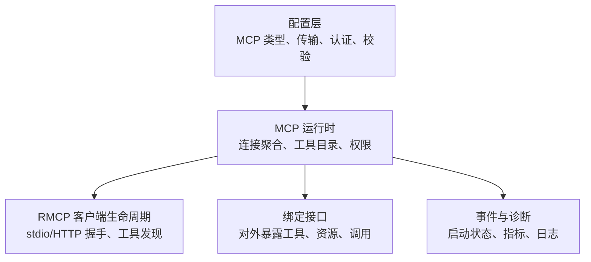
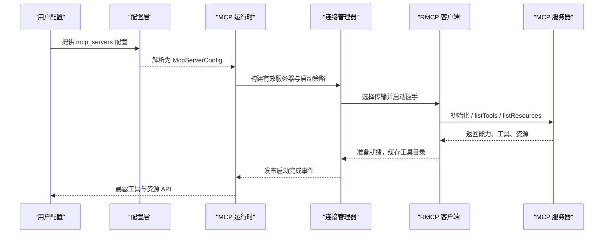
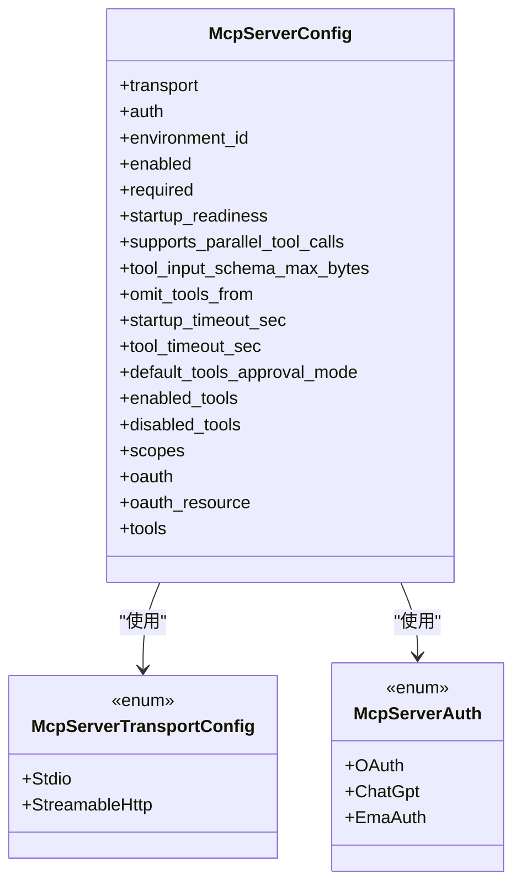
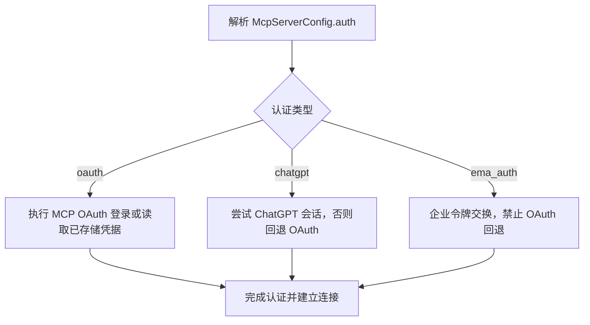
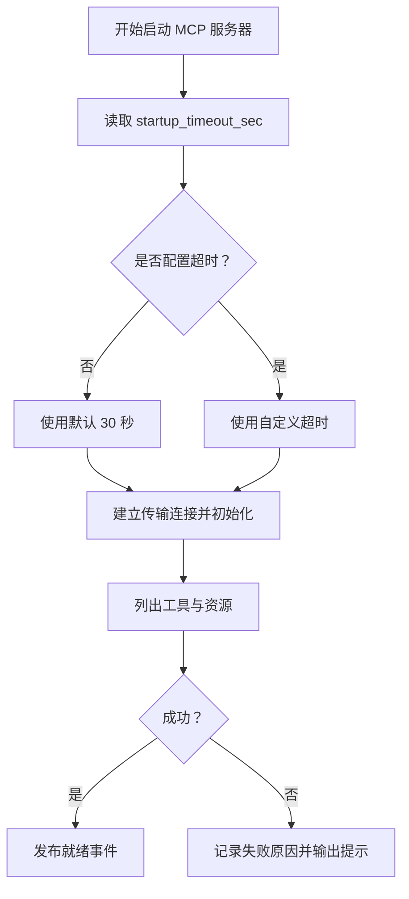
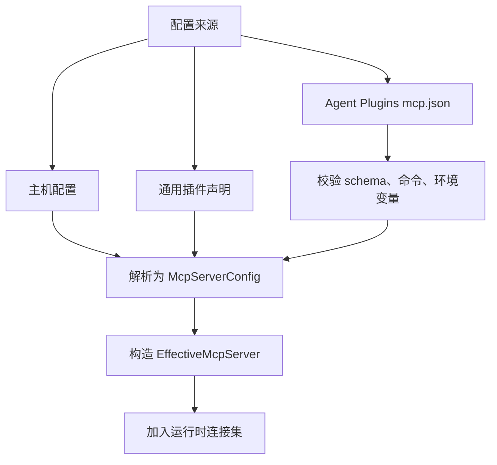
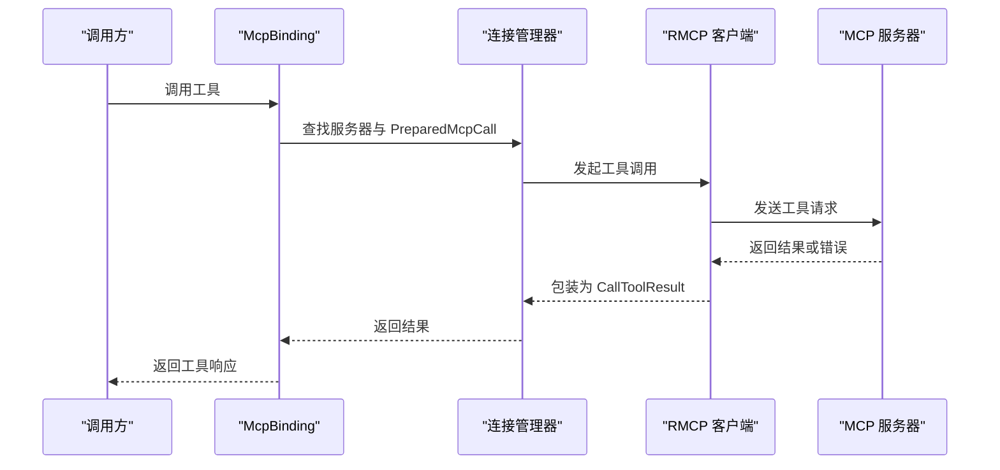
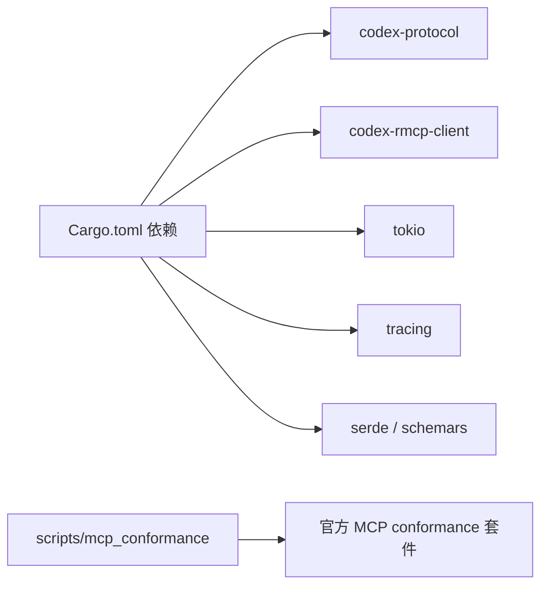
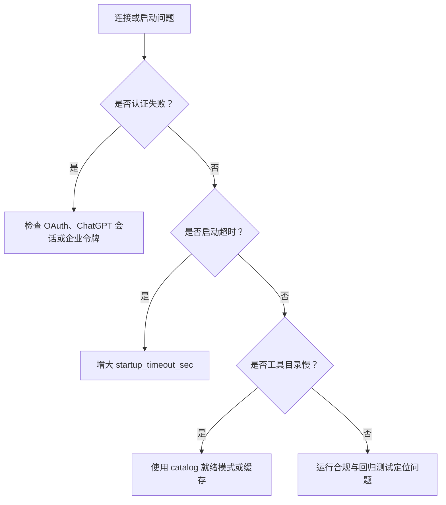

# MCP 服务器配置

<cite>
**本文引用的文件**
- [codex-mcp/README.md](file://codex-rs/codex-mcp/README.md)
- [Cargo.toml](file://codex-rs/codex-mcp/Cargo.toml)
- [lib.rs](file://codex-rs/codex-mcp/src/lib.rs)
- [mcp_types.rs](file://codex-rs/config/src/mcp_types.rs)
- [plugin_config.rs](file://codex-rs/codex-mcp/src/plugin_config.rs)
- [agent_plugin_config.rs](file://codex-rs/codex-mcp/src/agent_plugin_config.rs)
- [mod.rs](file://codex-rs/codex-mcp/src/mcp/mod.rs)
- [server.rs](file://codex-rs/codex-mcp/src/server.rs)
- [startup.rs](file://codex-rs/codex-mcp/src/connection_manager/startup.rs)
- [connection_manager.rs](file://codex-rs/codex-mcp/src/connection_manager.rs)
- [rmcp_client.rs](file://codex-rs/codex-mcp/src/rmcp_client.rs)
- [binding.rs](file://codex-rs/codex-mcp/src/binding.rs)
- [README.md](file://scripts/mcp_conformance/README.md)
</cite>

## 目录
1. [简介](#简介)
2. [项目结构](#项目结构)
3. [核心组件](#核心组件)
4. [架构总览](#架构总览)
5. [详细组件分析](#详细组件分析)
6. [依赖关系分析](#依赖关系分析)
7. [性能与超时](#性能与超时)
8. [调试与故障排查](#调试与故障排查)
9. [结论](#结论)
10. [附录：常见 MCP 服务器配置示例](#附录常见-mcp-服务器配置示例)

## 简介
本文档说明本仓库中 Model Context Protocol 客户端运行时如何发现、配置和连接 MCP 服务器，并覆盖以下主题：
- 协议传输类型：stdio 与 Streamable HTTP；WebSocket 未作为受支持的独立传输暴露。
- 认证方式：OAuth、ChatGPT 会话、企业令牌交换等。
- 超时设置：启动超时、工具调用超时、可选服务启动宽限。
- 服务器发现与注册：插件声明、Agent Plugins 规范、运行时解析与生效。
- 工具定义、资源访问、消息格式、错误处理。
- 调试与性能监控：合规测试、诊断指标、连接状态、日志提示。

## 项目结构
MCP 相关实现主要集中在两个位置：
- `codex-rs/config`：集中定义 MCP 配置模型、传输枚举、认证字段、校验与反序列化逻辑。
- `codex-rs/codex-mcp`：实现 MCP 运行时、连接管理、RMCP 客户端生命周期、工具目录、权限、沙箱元数据、事件流与绑定接口。

**图表来源**
- [mcp_types.rs:1-200](file://codex-rs/config/src/mcp_types.rs#L1-L200)
- [lib.rs:1-154](file://codex-rs/codex-mcp/src/lib.rs#L1-L154)
- [rmcp_client.rs:1-120](file://codex-rs/codex-mcp/src/rmcp_client.rs#L1-L120)
- [binding.rs:1-120](file://codex-rs/codex-mcp/src/binding.rs#L1-L120)

**章节来源**
- [Cargo.toml:1-64](file://codex-rs/codex-mcp/Cargo.toml#L1-L64)
- [lib.rs:1-154](file://codex-rs/codex-mcp/src/lib.rs#L1-L154)

## 核心组件
- 配置模型：定义 MCP 服务器的传输、认证、启动策略、工具白名单/黑名单、超时、批准策略等。
- 运行时入口：导出 `McpRuntime`、`McpBinding`、工具快照、事件流、OAuth、认证状态、沙箱元数据等。
- 连接管理器：聚合多个 MCP 服务器的连接、启动状态、工具目录缓存、资源列表与通知刷新。
- RMCP 客户端：负责 stdio 或 Streamable HTTP 的握手、初始化、工具发现、分页、重试与断开恢复。
- 绑定层：将运行时的工具目录与连接封装成可被上层采样步骤使用的不可变句柄。

**章节来源**
- [lib.rs:1-154](file://codex-rs/codex-mcp/src/lib.rs#L1-L154)
- [connection_manager.rs:1-120](file://codex-rs/codex-mcp/src/connection_manager.rs#L1-L120)
- [rmcp_client.rs:1-120](file://codex-rs/codex-mcp/src/rmcp_client.rs#L1-L120)
- [binding.rs:1-120](file://codex-rs/codex-mcp/src/binding.rs#L1-L120)

## 架构总览
下图展示配置到连接的端到端流程：配置由配置层建模，运行时根据环境、认证、插件来源构建有效服务器，随后通过 RMCP 客户端建立连接，完成工具发现，并向上层暴露工具与资源。

**图表来源**
- [mcp_types.rs:200-500](file://codex-rs/config/src/mcp_types.rs#L200-L500)
- [startup.rs:1-143](file://codex-rs/codex-mcp/src/connection_manager/startup.rs#L1-L143)
- [rmcp_client.rs:200-450](file://codex-rs/codex-mcp/src/rmcp_client.rs#L200-L450)
- [connection_manager.rs:1-200](file://codex-rs/codex-mcp/src/connection_manager.rs#L1-L200)

## 详细组件分析

### 配置模型与传输类型
配置模型使用统一的 `McpServerConfig` 表达一个 MCP 服务器。它包含：
- 传输：`Stdio` 或 `StreamableHttp`。
- 认证：`oauth`、`chatgpt`、`ema_auth`。
- 启动策略：是否启用、是否必需、启动就绪模式、启动超时。
- 工具控制：默认审批模式、启用/禁用工具列表、每工具预算。
- OAuth 参数：客户端标识、回调地址、作用域、企业授权发行者等。

**图表来源**
- [mcp_types.rs:200-500](file://codex-rs/config/src/mcp_types.rs#L200-L500)
- [mcp_types.rs:500-720](file://codex-rs/config/src/mcp_types.rs#L500-L720)

#### 传输类型说明
- **stdio**：通过命令、参数、环境变量和工作目录启动本地子进程。适合文件系统、Git、数据库 CLI 等集成。
- **Streamable HTTP**：通过 URL 发起请求，支持 bearer token 环境变量、静态 HTTP 头、从环境变量解析的 HTTP 头、以及本地仅用的动态头部生成器。
- **WebSocket**：当前公开配置中未出现 WebSocket 传输枚举；合规脚本提及“localhost HTTP”，但未在配置模型中将 WebSocket 作为独立传输类型暴露。

**章节来源**
- [mcp_types.rs:500-720](file://codex-rs/config/src/mcp_types.rs#L500-L720)
- [server.rs:1-120](file://codex-rs/codex-mcp/src/server.rs#L1-L120)

### 认证方式
配置中的 `auth` 字段决定认证策略：
- `oauth`：使用 MCP OAuth 登录流程，可配置客户端标识、密钥、回调端口、回调 URL、作用域、企业授权发行者等。
- `chatgpt`：优先使用当前 ChatGPT 会话；若不可用，则回退到已存储的 OAuth 凭据。
- `ema_auth`：与企业身份提供商进行令牌交换；不允许普通 OAuth 回退或替代凭据。

此外，HTTP 传输可通过 `bearer_token_env_var` 注入 Bearer Token，或通过 `http_headers`、`env_http_headers`、`http_headers_helper` 传递认证头。

**图表来源**
- [mcp_types.rs:200-500](file://codex-rs/config/src/mcp_types.rs#L200-L500)
- [startup.rs:1-143](file://codex-rs/codex-mcp/src/connection_manager/startup.rs#L1-L143)

**章节来源**
- [mcp_types.rs:1-200](file://codex-rs/config/src/mcp_types.rs#L1-L200)
- [mcp_types.rs:200-500](file://codex-rs/config/src/mcp_types.rs#L200-L500)
- [server.rs:1-120](file://codex-rs/codex-mcp/src/server.rs#L1-L120)

### 超时与启动策略
- `startup_timeout_sec`：用于启动 MCP 客户端、握手、初始工具发现；默认值为 30 秒。
- `tool_timeout_sec`：每个 MCP 工具调用的超时时间；默认值也为 300 秒。
- `optional_mcp_startup_grace`：运行时对可选 MCP 服务器的共享等待宽限；零表示不共享宽限，按各服务器配置处理。
- `startup_readiness`：
  - `connection`：需要活连接才能视为就绪。
  - `catalog`：允许使用有效缓存的工具目录启动，但实际工具调用仍需连接。

**图表来源**
- [rmcp_client.rs:120-220](file://codex-rs/codex-mcp/src/rmcp_client.rs#L120-L220)
- [startup.rs:1-143](file://codex-rs/codex-mcp/src/connection_manager/startup.rs#L1-L143)
- [connection_manager.rs:120-220](file://codex-rs/codex-mcp/src/connection_manager.rs#L120-L220)

**章节来源**
- [rmcp_client.rs:120-220](file://codex-rs/codex-mcp/src/rmcp_client.rs#L120-L220)
- [startup.rs:1-143](file://codex-rs/codex-mcp/src/connection_manager/startup.rs#L1-L143)
- [mcp_types.rs:200-500](file://codex-rs/config/src/mcp_types.rs#L200-L500)

### 服务器发现与注册
Codex 支持多种 MCP 服务器来源：
- 主机配置：`config` 模块解析 TOML/JSON 配置，生成 `McpServerConfig`。
- 插件声明：通用插件 MCP 文件支持两种形状，分别解析为服务器映射。
- Agent Plugins 规范：从 `mcp.json` 读取 `stdio` 与 `streamable-http`，忽略不支持的 SSE 类型，并做路径、环境变量与保留变量校验。
- 执行器环境：可在执行器上下文中规范化相对工作目录与环境变量绑定。

**图表来源**
- [plugin_config.rs:1-200](file://codex-rs/codex-mcp/src/plugin_config.rs#L1-L200)
- [agent_plugin_config.rs:1-200](file://codex-rs/codex-mcp/src/agent_plugin_config.rs#L1-L200)
- [server.rs:1-120](file://codex-rs/codex-mcp/src/server.rs#L1-L120)

**章节来源**
- [plugin_config.rs:1-200](file://codex-rs/codex-mcp/src/plugin_config.rs#L1-L200)
- [agent_plugin_config.rs:1-200](file://codex-rs/codex-mcp/src/agent_plugin_config.rs#L1-L200)

### 工具定义、消息格式与错误处理
- 工具定义：通过 RMCP 客户端的 `listTools` 获取，并按服务器名称、工具名称、模型可见性过滤与重命名。
- 资源访问：通过 `listResources`、`listResourceTemplates`、`readResource` 暴露资源能力；部分服务器可能跳过模板列举。
- 消息格式：使用 `rmcp::model` 中的 `InitializeRequestParams`、`Tool`、`Resource`、`ReadResourceRequestParams` 等类型。
- 错误处理：启动失败会分类为认证要求、重新认证、超时、未知错误；同时生成面向用户的恢复提示，包括 GitHub MCP 的特定建议。

**图表来源**
- [binding.rs:120-220](file://codex-rs/codex-mcp/src/binding.rs#L120-L220)
- [connection_manager.rs:200-320](file://codex-rs/codex-mcp/src/connection_manager.rs#L200-L320)
- [rmcp_client.rs:200-350](file://codex-rs/codex-mcp/src/rmcp_client.rs#L200-L350)

**章节来源**
- [binding.rs:1-200](file://codex-rs/codex-mcp/src/binding.rs#L1-L200)
- [connection_manager.rs:1-300](file://codex-rs/codex-mcp/src/connection_manager.rs#L1-L300)
- [startup.rs:1-143](file://codex-rs/codex-mcp/src/connection_manager/startup.rs#L1-L143)

### 沙箱元数据与执行上下文
MCP 服务器可以声明 `codex/sandbox-state` 能力以接收调用级沙箱策略。Codex 会在请求 `_meta` 中提供：
- `codex/sandbox-state`：传递给 `codex sandbox --sandbox-state-json` 的不透明策略。
- `codex/sandbox-launcher`：仅在本地 stdio 可用时提供验证过的 Codex CLI 路径。
- 迁移字段 `codex/sandbox-state-meta` 仍兼容，但新实现应优先使用前者。

该机制确保工具调用不会把模型输入当作执行权威，并在长期子进程或缓存中保持策略一致性。

**章节来源**
- [codex-mcp/README.md:1-37](file://codex-rs/codex-mcp/README.md#L1-L37)

## 依赖关系分析
- 配置层依赖 `codex_protocol`、`codex_utils_path_uri`、`schemars`、`serde` 等，用于生成 JSON Schema 与类型安全反序列化。
- 运行时依赖 `codex-rmcp-client`、`rmcp`、`tokio`、`tracing`、`futures` 等，用于异步连接、工具发现、遥测与日志。
- 合规测试脚本依赖上游 MCP conformance suite，覆盖 legacy、intermediate、modern 协议版本及 stdio、HTTP、OAuth 场景。

**图表来源**
- [Cargo.toml:1-64](file://codex-rs/codex-mcp/Cargo.toml#L1-L64)
- [README.md](file://scripts/mcp_conformance/README.md#L1-L121)

**章节来源**
- [Cargo.toml:1-64](file://codex-rs/codex-mcp/Cargo.toml#L1-L64)
- [README.md](file://scripts/mcp_conformance/README.md#L1-L121)

## 性能与超时
- 默认启动超时：30 秒。
- 默认工具调用超时：300 秒。
- 可选服务启动宽限：由运行时配置中的 `optional_mcp_startup_grace` 控制；为零则不使用共享宽限。
- 工具目录缓存：Codex Apps 服务器支持非阻塞发现与缓存；其他服务器可按 `startup_readiness = catalog` 允许缓存目录参与启动就绪判断。
- 连接复用与回退：连接管理器会尽量复用已有连接，并在必要时保留旧连接作为回退，避免重复启动。
- 指标与遥测：启动耗时、工具列表耗时、Apps 刷新耗时等指标通过 `emit_duration` 上报。

**章节来源**
- [rmcp_client.rs:120-220](file://codex-rs/codex-mcp/src/rmcp_client.rs#L120-L220)
- [connection_manager.rs:1-200](file://codex-rs/codex-mcp/src/connection_manager.rs#L1-L200)
- [mcp/mod.rs:1-120](file://codex-rs/codex-mcp/src/mcp/mod.rs#L1-L120)

## 调试与故障排查
常见问题与建议：
- 认证缺失：
  - 对于 OAuth 服务器，提示运行 `codex mcp login <服务器名>`。
  - 对于 EMA 服务器，提示在企业提供者处登录后新建线程。
  - 对于 GitHub MCP，提示添加个人访问令牌环境变量并配置 `bearer_token_env_var`。
- 启动超时：
  - 如果错误信息包含“timed out handshaking”或“MCP client startup timed out”，应调整对应服务器的 `startup_timeout_sec`。
- 工具目录加载缓慢：
  - 考虑将可选服务器设为非必需，或使用 `startup_readiness = catalog` 允许缓存目录。
- 合规测试：
  - 使用 `scripts/mcp_conformance/run_codex_compliance.py` 运行官方 MCP 客户端合规测试。
  - 使用 `scripts/mcp_conformance/review_regressions.py` 运行生产审查回归矩阵。

**图表来源**
- [startup.rs:1-143](file://codex-rs/codex-mcp/src/connection_manager/startup.rs#L1-L143)
- [README.md](file://scripts/mcp_conformance/README.md#L1-L121)

**章节来源**
- [startup.rs:1-143](file://codex-rs/codex-mcp/src/connection_manager/startup.rs#L1-L143)
- [README.md](file://scripts/mcp_conformance/README.md#L1-L121)

## 结论
本项目的 MCP 客户端运行时围绕统一配置模型、连接管理与 RMCP 客户端生命周期展开。它支持 stdio 与 Streamable HTTP 两种传输，提供 OAuth、ChatGPT 会话与企业令牌交换三种认证路径，并通过启动超时、工具超时与启动就绪策略平衡可靠性和可用性。插件系统与 Agent Plugins 规范扩展了服务器发现与注册能力，配合沙箱元数据和严格的凭据策略，使 MCP 工具能够在受限环境中安全执行。合规测试与诊断指标为持续改进提供了基础。

## 附录：常见 MCP 服务器配置示例
以下为基于代码模型的常见配置方向，便于理解而非直接复制粘贴具体配置内容：

- 文件系统 MCP（stdio）
  - 传输：`stdio`
  - 关键字段：`command`、可选 `args`、可选 `env`、可选 `cwd`
  - 适用场景：本地文件系统访问、命令行工具集成

- Git MCP（stdio 或 HTTP）
  - 传输：`stdio` 或 `StreamableHttp`
  - 关键字段：`command`（stdio）、`url`、`bearer_token_env_var`（HTTP）
  - 适用场景：仓库操作、提交历史、分支管理

- 数据库 MCP（HTTP）
  - 传输：`StreamableHttp`
  - 关键字段：`url`、`bearer_token_env_var`、可选 `http_headers`
  - 适用场景：远程数据库查询、只读数据探索

- 企业集成 MCP（EMA）
  - 认证：`ema_auth`
  - 关键字段：`oauth.token_endpoint_auth_method`、`oauth.client_secret`、`oauth.authorization_server_issuer`
  - 适用场景：企业身份提供商令牌交换

- 本地开发 MCP（stdio）
  - 传输：`stdio`
  - 关键字段：`startup_timeout_sec`、`tool_timeout_sec`、`startup_readiness = catalog`
  - 适用场景：快速开发、本地工具链、可接受较慢启动

以上示例字段均来源于 `McpServerTransportConfig`、`McpServerAuth`、`McpServerOAuthConfig`、`RawMcpServerConfig` 等配置类型定义。

**章节来源**
- [mcp_types.rs:200-720](file://codex-rs/config/src/mcp_types.rs#L200-L720)
- [server.rs:1-120](file://codex-rs/codex-mcp/src/server.rs#L1-L120)