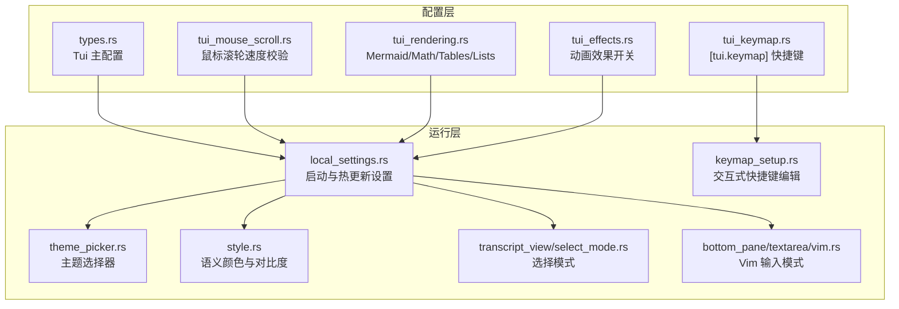
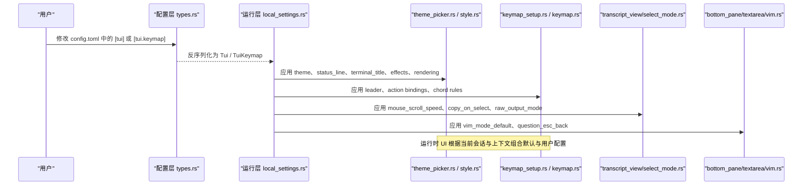
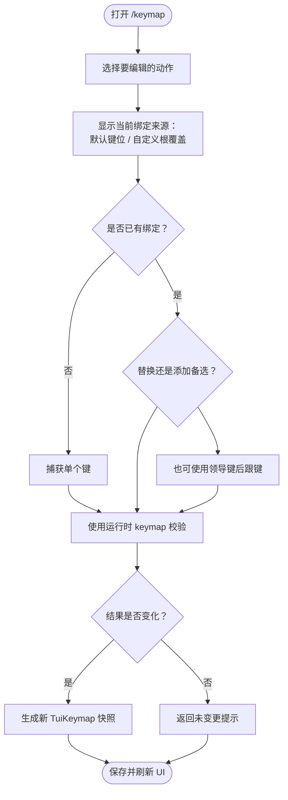
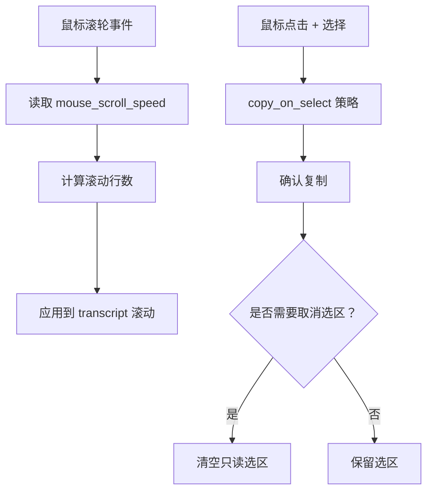
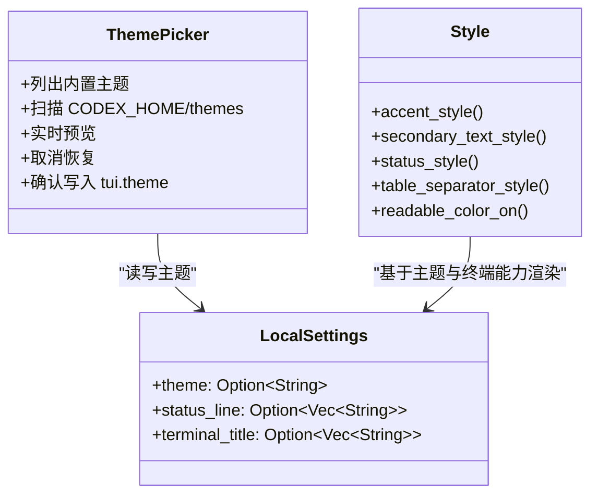
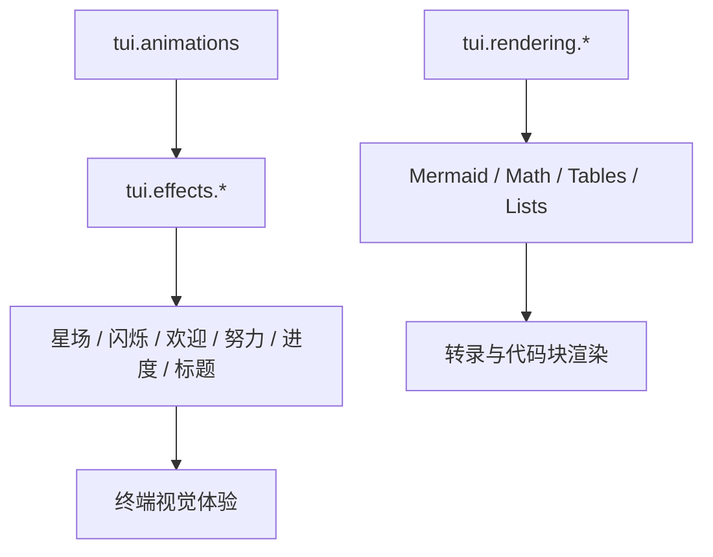
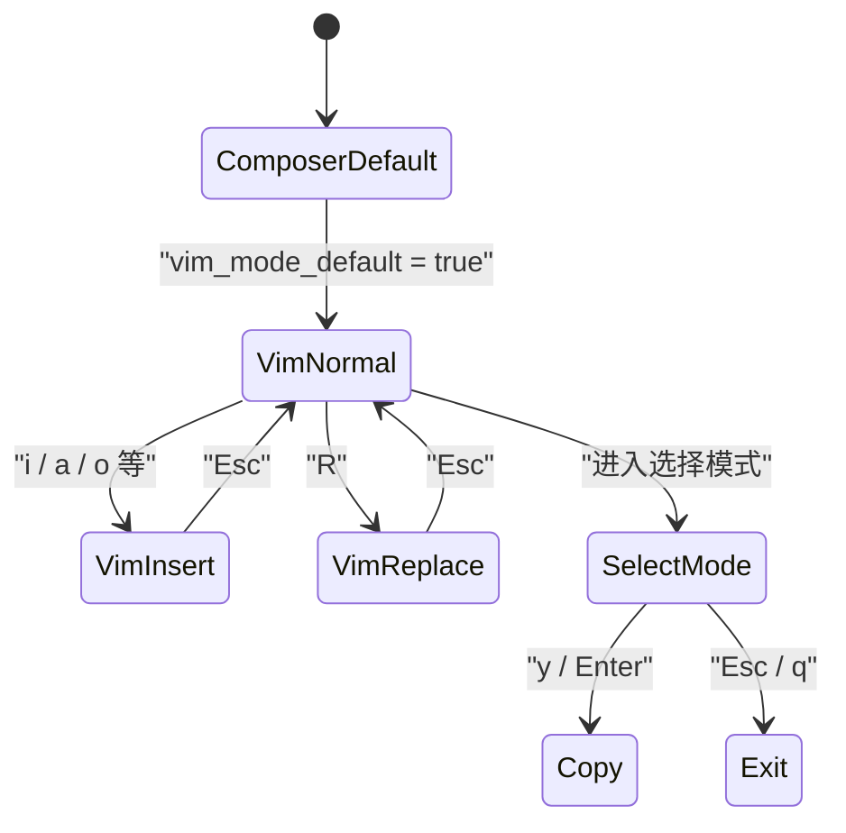
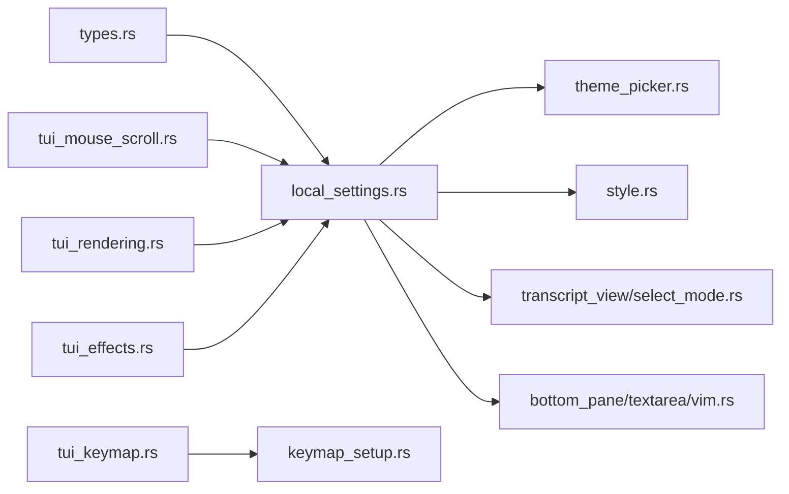

# TUI 界面定制

<cite>
**本文引用的文件**   
- [tui_keymap.rs](file://codex-rs/config/src/tui_keymap.rs)
- [tui_mouse_scroll.rs](file://codex-rs/config/src/tui_mouse_scroll.rs)
- [tui_rendering.rs](file://codex-rs/config/src/tui_rendering.rs)
- [tui_effects.rs](file://codex-rs/config/src/tui_effects.rs)
- [types.rs](file://codex-rs/config/src/types.rs)
- [lib.rs](file://codex-rs/config/src/lib.rs)
- [theme_picker.rs](file://codex-rs/tui/src/theme_picker.rs)
- [style.rs](file://codex-rs/tui/src/style.rs)
- [local_settings.rs](file://codex-rs/tui/src/local_settings.rs)
- [keymap_setup.rs](file://codex-rs/tui/src/keymap_setup.rs)
- [transcript_view/select_mode.rs](file://codex-rs/tui/src/transcript_view/select_mode.rs)
- [transcript_view/select_mode/motion.rs](file://codex-rs/tui/src/transcript_view/select_mode/motion.rs)
- [bottom_pane/textarea/vim.rs](file://codex-rs/tui/src/bottom_pane/textarea/vim.rs)
</cite>

## 目录
1. [引言](#引言)
2. [项目结构](#项目结构)
3. [核心组件](#核心组件)
4. [架构总览](#架构总览)
5. [详细组件分析](#详细组件分析)
6. [依赖关系分析](#依赖关系分析)
7. [性能考虑](#性能考虑)
8. [故障诊断指南](#故障诊断指南)
9. [结论](#结论)
10. [附录：界面定制示例](#附录界面定制示例)

## 引言
本文件面向 Codex TUI（终端用户界面）使用者与维护者，系统性说明如何个性化界面体验。内容覆盖快捷键映射、鼠标滚轮速度、主题与样式、渲染选项、动画与视觉效果、布局与行为开关，并提供 Vim 风格键位、深色主题、性能优化等可操作示例。文档同时解释配置加载路径、运行时生效机制，以及常见问题排查方法。

## 项目结构
TUI 界面定制涉及两个主要层次：

- 配置层（`codex-rs/config`）：定义 `[tui]` 下的所有可配置项、类型校验、默认值与 JSON Schema。
- 运行层（`codex-rs/tui/src`）：读取配置并驱动快捷键、主题、滚动、Vim 模式、选择模式、状态栏、标题、动画等界面行为。

**图表来源**
- [types.rs:876-1020](file://codex-rs/config/src/types.rs#L876-L1020)
- [tui_keymap.rs:1-120](file://codex-rs/config/src/tui_keymap.rs#L1-L120)
- [tui_mouse_scroll.rs:1-26](file://codex-rs/config/src/tui_mouse_scroll.rs#L1-L26)
- [tui_rendering.rs:1-31](file://codex-rs/config/src/tui_rendering.rs#L1-L31)
- [tui_effects.rs:1-37](file://codex-rs/config/src/tui_effects.rs#L1-L37)
- [local_settings.rs:1-260](file://codex-rs/tui/src/local_settings.rs#L1-L260)
- [theme_picker.rs:1-120](file://codex-rs/tui/src/theme_picker.rs#L1-L120)
- [style.rs:1-120](file://codex-rs/tui/src/style.rs#L1-L120)
- [keymap_setup.rs:1-120](file://codex-rs/tui/src/keymap_setup.rs#L1-L120)
- [transcript_view/select_mode.rs:1-120](file://codex-rs/tui/src/transcript_view/select_mode.rs#L1-L120)
- [bottom_pane/textarea/vim.rs:1-120](file://codex-rs/tui/src/bottom_pane/textarea/vim.rs#L1-L120)

**章节来源**
- [types.rs:876-1020](file://codex-rs/config/src/types.rs#L876-L1020)
- [lib.rs:40-60](file://codex-rs/config/src/lib.rs#L40-L60)

## 核心组件
TUI 定制的核心由以下配置对象组成：

| 配置对象 | 职责 | 关键属性 | 默认行为 |
|---|---|---|---|
| `Tui` | TUI 主配置容器 | `animations`、`effects`、`rendering`、`vim_mode_default`、`raw_output_mode`、`fullscreen_transcript`、`sidebar_width_percent`、`mouse_scroll_speed`、`copy_on_select`、`right_click_paste`、`alternate_screen`、`status_line`、`terminal_title`、`theme`、`pet`、`session_picker_view`、`agents_overview_grouping`、`resume_cwd`、`quick_dials`、`model_availability_nux`、`notification_settings`、`default_hosts` | 多数布尔项启用；主题、侧边栏宽度、标题项等为可选 |
| `TuiKeymap` | `[tui.keymap]` 快捷键定义 | `leader`、`submit`、`toggle_vim_mode`、`toggle_fast_mode`、`toggle_raw_output`、`find_transcript`、`open_external_editor`、`clear_terminal`、`focus_main_composer`、`focus_sidebar_content`、`focus_sidebar_tabs`、`close_sidebar_tab`、`sidebar_up/down`、`resize_panes`、`move_divider_left/right`、`toggle_pane_zoom`、`open_agents`、`open_transcript`、`select_transcript`、`focus_activity`、`change_host`、`hide_pane`、`minimize/maximize/equalize_pane_width`、`copy` 等 | 通过运行时 keymap 解析提供内置默认绑定 |
| `TuiMouseScrollSpeed` | 鼠标滚轮速度 | `Option<f64>`，必须为正有限数 | 未设置时按每事件一行滚动 |
| `TuiRendering` | 富内容渲染开关 | `mermaid`、`math`、`tables`、`lists` | 全部默认启用 |
| `TuiEffects` | 视觉动画开关 | `starfield`、`shimmer`、`welcome`、`effort`、`progress`、`title` | 全部默认启用，但受顶层 `animations` 控制 |

**章节来源**
- [types.rs:876-1020](file://codex-rs/config/src/types.rs#L876-L1020)
- [tui_keymap.rs:1-200](file://codex-rs/config/src/tui_keymap.rs#L1-L200)
- [tui_mouse_scroll.rs:1-26](file://codex-rs/config/src/tui_mouse_scroll.rs#L1-L26)
- [tui_rendering.rs:1-31](file://codex-rs/config/src/tui_rendering.rs#L1-L31)
- [tui_effects.rs:1-37](file://codex-rs/config/src/tui_effects.rs#L1-L37)

## 架构总览
TUI 的自定义能力从配置层进入运行层，最终影响快捷键、主题、渲染和交互行为。

**图表来源**
- [types.rs:876-1020](file://codex-rs/config/src/types.rs#L876-L1020)
- [local_settings.rs:1-260](file://codex-rs/tui/src/local_settings.rs#L1-L260)
- [theme_picker.rs:1-120](file://codex-rs/tui/src/theme_picker.rs#L1-L120)
- [style.rs:1-120](file://codex-rs/tui/src/style.rs#L1-L120)
- [keymap_setup.rs:1-120](file://codex-rs/tui/src/keymap_setup.rs#L1-L120)
- [transcript_view/select_mode.rs:1-120](file://codex-rs/tui/src/transcript_view/select_mode.rs#L1-L120)
- [bottom_pane/textarea/vim.rs:1-120](file://codex-rs/tui/src/bottom_pane/textarea/vim.rs#L1-L120)

## 详细组件分析

### 快捷键映射与键盘绑定
快捷键系统分为两部分：

1. **配置文件契约**：`[tui.keymap]` 使用强类型结构体定义作用域与动作，支持单键、多键序列、替代绑定列表，并对未知字段进行严格检查。
2. **运行时解析与编辑器**：TUI 提供 `/keymap` 引导式界面，展示当前有效绑定、允许替换、添加备选、移除自定义绑定，并通过运行时 keymap 规则验证冲突。

关键点：

- 支持“领导键”前缀，例如先按下配置的 `leader`，再按一个后续键，形成两击键序。
- 每个 action 支持多个候选绑定；空列表表示显式解绑。
- 快捷键字符串会标准化为规范形式，避免别名歧义。
- 最大函数键编号与最大键序长度在配置层固定，防止不合法输入。
- 常用动作包括提交、切换 Vim 模式、切换快速模式、原始输出、查找转录、复制、清除终端、打开外部编辑器、焦点转移、面板缩放与分割线移动等。

**图表来源**
- [keymap_setup.rs:1-120](file://codex-rs/tui/src/keymap_setup.rs#L1-L120)
- [tui_keymap.rs:1-200](file://codex-rs/config/src/tui_keymap.rs#L1-L200)

**章节来源**
- [tui_keymap.rs:1-200](file://codex-rs/config/src/tui_keymap.rs#L1-L200)
- [keymap_setup.rs:1-120](file://codex-rs/tui/src/keymap_setup.rs#L1-L120)

### 鼠标滚轮与选择行为
鼠标滚轮速度通过 `tui.mouse_scroll_speed` 控制：

- 类型为可选正有限浮点数。
- 数值大于 1 会加速滚动，小于 1 会减速。
- 底层实现以“每次滚轮事件一行”为基准进行缩放。

选择与复制行为也受 TUI 配置影响：

- `tui.copy_on_select` 控制释放鼠标时是否自动复制所选文本。
- `tui.copy_on_select_clear_selection` 决定是否在复制确认后取消只读区域的选区。
- `tui.right_click_paste` 控制右键粘贴回退策略。
- `tui.raw_output_mode` 用于开启复制友好的原始输出模式。

**图表来源**
- [tui_mouse_scroll.rs:1-26](file://codex-rs/config/src/tui_mouse_scroll.rs#L1-L26)
- [types.rs:920-980](file://codex-rs/config/src/types.rs#L920-L980)
- [local_settings.rs:120-220](file://codex-rs/tui/src/local_settings.rs#L120-L220)

**章节来源**
- [tui_mouse_scroll.rs:1-26](file://codex-rs/config/src/tui_mouse_scroll.rs#L1-L26)
- [types.rs:920-980](file://codex-rs/config/src/types.rs#L920-L980)
- [local_settings.rs:120-220](file://codex-rs/tui/src/local_settings.rs#L120-L220)

### 主题与样式
主题相关能力包括：

- `tui.theme`：指定语法高亮主题名称；未设置时根据终端环境自动检测浅色或深色主题。
- `/theme` 命令：列出内置主题及 `$CODEX_HOME/themes` 下的自定义 `.tmTheme` 文件，支持实时预览、取消恢复、确认持久化。
- `style.rs` 提供语义色、对比度、选择填充、辅助文本、状态色、分隔线等，尽量适配已知背景与终端调色板。

**图表来源**
- [theme_picker.rs:1-120](file://codex-rs/tui/src/theme_picker.rs#L1-L120)
- [theme_picker.rs:560-631](file://codex-rs/tui/src/theme_picker.rs#L560-L631)
- [style.rs:1-120](file://codex-rs/tui/src/style.rs#L1-L120)
- [types.rs:980-1010](file://codex-rs/config/src/types.rs#L980-L1010)

**章节来源**
- [theme_picker.rs:1-120](file://codex-rs/tui/src/theme_picker.rs#L1-L120)
- [theme_picker.rs:560-631](file://codex-rs/tui/src/theme_picker.rs#L560-L631)
- [style.rs:1-120](file://codex-rs/tui/src/style.rs#L1-L120)
- [types.rs:980-1010](file://codex-rs/config/src/types.rs#L980-L1010)

### 渲染选项与视觉效果
渲染与动画是两个独立层级：

- `tui.rendering`：控制 Mermaid 图、数学表达式、表格、列表等富内容渲染。关闭后会保留更贴近源文本的表现。
- `tui.effects`：控制星场、闪烁、欢迎画面、推理努力动画、进度指示、标题闪烁等视觉效果。
- `tui.animations`：作为动画总开关；即使某个 effect 设为 true，若总开关关闭也不会播放。

**图表来源**
- [tui_rendering.rs:1-31](file://codex-rs/config/src/tui_rendering.rs#L1-L31)
- [tui_effects.rs:1-37](file://codex-rs/config/src/tui_effects.rs#L1-L37)
- [types.rs:880-910](file://codex-rs/config/src/types.rs#L880-L910)

**章节来源**
- [tui_rendering.rs:1-31](file://codex-rs/config/src/tui_rendering.rs#L1-L31)
- [tui_effects.rs:1-37](file://codex-rs/config/src/tui_effects.rs#L1-L37)
- [types.rs:880-910](file://codex-rs/config/src/types.rs#L880-L910)

### 界面布局与行为
TUI 的布局和行为可通过以下配置定制：

| 配置项 | 作用 | 典型用途 |
|---|---|---|
| `tui.fullscreen_transcript` | 是否拥有全屏转录区 | 关闭时可能回退到内联模式 |
| `tui.sidebar_width_percent` | 停靠侧栏宽度百分比 | 调宽侧栏查看工具或代理信息 |
| `tui.alternate_screen` | 是否使用终端备用屏幕 | 需要保留原生终端滚动历史时可禁用 |
| `tui.status_line` | 状态栏元素顺序 | 自定义模型、工作目录、线程名等显示 |
| `tui.status_line_use_colors` | 状态栏是否使用主题色 | 配合主题获得更好一致性 |
| `tui.terminal_title` | 终端窗口/标签页标题项 | 显示活动、线程名、项目名称 |
| `tui.session_picker_view` | 恢复/分叉会话选择器的布局 | 偏好紧凑或详细信息 |
| `tui.agents_overview_grouping` | 代理概览分组方式 | 按会话、任务或工具组织 |
| `tui.resume_cwd` | 恢复会话时的当前工作目录策略 | 与工作区一致或保持上次位置 |
| `tui.quick_dials` | 快捷拨号配置 | 快速触发常用操作 |
| `tui.model_availability_nux` | 模型可用性新手引导 | 首次遇到模型不可用时提示 |
| `tui.pet` / `tui.pet_anchor` | 终端宠物 ID 与锚点 | 装饰性宠物跟随 composer 或固定位置 |
| `tui.auto_recap` | 失去焦点时自动生成会话摘要 | 减少手动 `/recap` 频率 |
| `tui.show_tooltips` / `tui.show_server_version_notice` | 启动提示与服务器版本通知 | 减少干扰或增强信息可见性 |
| `tui.disable_paste_burst` | 禁用粘贴风暴检测 | 大量粘贴时直接插入字符 |
| `tui.vim_mode_default` | 默认进入 Vim Normal 模式 | 适合 Vim 用户 |
| `tui.question_esc_back` | 异步问题中 Esc 返回 composer | 保留草稿并回到输入 |
| `tui.raw_output_mode` | 原始输出模式 | 复制友好转录 |

**章节来源**
- [types.rs:910-1020](file://codex-rs/config/src/types.rs#L910-L1020)
- [local_settings.rs:120-260](file://codex-rs/tui/src/local_settings.rs#L120-L260)

### Vim 风格键位与转录选择模式
Vim 风格定制包含两层：

1. **Composer Vim 模式**：`tui.vim_mode_default` 可在启动时进入 Normal 模式；Normal、Insert、Replace 三种模式分别处理运动、输入与覆盖写入。
2. **转录选择模式**：类似 pager 的行为，支持上下翻页、半页滚动、跳转首尾、单词移动、行首行尾、全选与交换选择端点。

**图表来源**
- [bottom_pane/textarea/vim.rs:1-120](file://codex-rs/tui/src/bottom_pane/textarea/vim.rs#L1-L120)
- [transcript_view/select_mode.rs:1-120](file://codex-rs/tui/src/transcript_view/select_mode.rs#L1-L120)
- [transcript_view/select_mode/motion.rs:1-120](file://codex-rs/tui/src/transcript_view/select_mode/motion.rs#L1-L120)

**章节来源**
- [bottom_pane/textarea/vim.rs:1-120](file://codex-rs/tui/src/bottom_pane/textarea/vim.rs#L1-L120)
- [transcript_view/select_mode.rs:1-120](file://codex-rs/tui/src/transcript_view/select_mode.rs#L1-L120)
- [transcript_view/select_mode/motion.rs:1-120](file://codex-rs/tui/src/transcript_view/select_mode/motion.rs#L1-L120)

## 依赖关系分析
TUI 定制的关键依赖如下：

- `config/src/types.rs` 是所有 TUI 配置的集中定义，其他 TUI 子模块通常不直接解析 TOML，而是通过 `LocalSettings` 获取已合并的配置。
- `tui_keymap.rs` 与 `tui_mouse_scroll.rs`、`tui_rendering.rs`、`tui_effects.rs` 提供具体字段类型与约束。
- `theme_picker.rs` 依赖语法高亮主题解析、终端宽度判断、配置编辑事件。
- `style.rs` 依赖终端调色板探测、前景背景色推断与对比度计算。
- `local_settings.rs` 负责把 `Config` 映射到 TUI 本地设置，并在宿主偏好、无障碍模式、alternate screen 限制等情况下修正行为。
- `keymap_setup.rs` 依赖运行时 keymap 解析，保证 UI 展示的绑定与实际行为一致。

**图表来源**
- [types.rs:876-1020](file://codex-rs/config/src/types.rs#L876-L1020)
- [tui_keymap.rs:1-120](file://codex-rs/config/src/tui_keymap.rs#L1-L120)
- [tui_mouse_scroll.rs:1-26](file://codex-rs/config/src/tui_mouse_scroll.rs#L1-L26)
- [tui_rendering.rs:1-31](file://codex-rs/config/src/tui_rendering.rs#L1-L31)
- [tui_effects.rs:1-37](file://codex-rs/config/src/tui_effects.rs#L1-L37)
- [local_settings.rs:1-260](file://codex-rs/tui/src/local_settings.rs#L1-L260)
- [theme_picker.rs:1-120](file://codex-rs/tui/src/theme_picker.rs#L1-L120)
- [style.rs:1-120](file://codex-rs/tui/src/style.rs#L1-L120)
- [keymap_setup.rs:1-120](file://codex-rs/tui/src/keymap_setup.rs#L1-L120)
- [transcript_view/select_mode.rs:1-120](file://codex-rs/tui/src/transcript_view/select_mode.rs#L1-L120)
- [bottom_pane/textarea/vim.rs:1-120](file://codex-rs/tui/src/bottom_pane/textarea/vim.rs#L1-L120)

**章节来源**
- [lib.rs:40-60](file://codex-rs/config/src/lib.rs#L40-L60)
- [types.rs:876-1020](file://codex-rs/config/src/types.rs#L876-L1020)
- [local_settings.rs:1-260](file://codex-rs/tui/src/local_settings.rs#L1-L260)

## 性能考虑
TUI 的性能与体验可以通过以下维度调整：

- **关闭不必要动画**：将 `tui.animations` 设为 false，或逐个关闭 `tui.effects` 中的 `starfield`、`shimmer`、`welcome`、`effort`、`progress`、`title`。
- **降低富内容渲染开销**：关闭 `tui.rendering` 中的 `mermaid`、`math`、`tables`、`lists`，可减少复杂 Markdown 渲染成本。
- **优化滚动体验**：适当调整 `tui.mouse_scroll_speed`，避免过快的累积滚动造成卡顿；必要时结合 `tui.raw_output_mode` 提升复制友好性。
- **减少终端缓冲压力**：在不需要 alternate screen 的场景下，将 `tui.alternate_screen` 设置为 `never`，可保留原生终端滚动历史，避免频繁切换屏幕缓冲区。
- **减少粘贴风暴检测开销**：将 `tui.disable_paste_burst` 设为 true，可在大量粘贴时直接插入字符，避免缓冲与占位符替换。
- **精简状态栏与标题**：合理设置 `tui.status_line` 与 `tui.terminal_title`，避免过多动态项导致频繁重绘。

**章节来源**
- [tui_effects.rs:1-37](file://codex-rs/config/src/tui_effects.rs#L1-L37)
- [tui_rendering.rs:1-31](file://codex-rs/config/src/tui_rendering.rs#L1-L31)
- [tui_mouse_scroll.rs:1-26](file://codex-rs/config/src/tui_mouse_scroll.rs#L1-L26)
- [types.rs:880-1020](file://codex-rs/config/src/types.rs#L880-L1020)
- [local_settings.rs:120-260](file://codex-rs/tui/src/local_settings.rs#L120-L260)

## 故障诊断指南

### 快捷键无效或冲突
- 检查是否已在 `[tui.keymap]` 中为对应 action 设置了空列表，这会显式解绑该 action。
- 使用 `/keymap` 查看当前绑定来源是默认键位还是自定义根覆盖。
- 如果使用了领导键，确认 `leader` 已正确绑定；否则“使用领导键”选项会被禁用。
- 注意多击键序最多支持两击，且最大函数键编号有限制。
- 如果替换后仍无变化，可能是新绑定与全局或其他作用域绑定冲突，应通过运行时 keymap 解析确认。

**章节来源**
- [tui_keymap.rs:1-200](file://codex-rs/config/src/tui_keymap.rs#L1-L200)
- [keymap_setup.rs:1-120](file://codex-rs/tui/src/keymap_setup.rs#L1-L120)

### 主题未生效或预览异常
- 确认 `tui.theme` 是否为合法的 kebab-case 主题名。
- 如果使用 `/theme`，退出时按 Esc 或 Ctrl+C 会恢复打开前的主题快照。
- 自定义主题应放在 `$CODEX_HOME/themes` 下，并使用 `.tmTheme` 格式。
- 若主题名不存在，选择器会回退到当前已配置或默认主题。
- 终端调色板能力会影响颜色表现；低能力终端可能无法精确还原 RGB 强调色。

**章节来源**
- [theme_picker.rs:1-120](file://codex-rs/tui/src/theme_picker.rs#L1-L120)
- [theme_picker.rs:560-631](file://codex-rs/tui/src/theme_picker.rs#L560-L631)
- [style.rs:430-506](file://codex-rs/tui/src/style.rs#L430-L506)
- [types.rs:990-1010](file://codex-rs/config/src/types.rs#L990-L1010)

### 鼠标滚轮过快或过慢
- 检查 `tui.mouse_scroll_speed` 是否为正有限数；非法值会在配置加载阶段报错。
- 建议先设为 `1.0`，再根据习惯微调。
- 如果滚动与选择行为不符合预期，同时检查 `tui.copy_on_select` 与 `tui.copy_on_select_clear_selection`。

**章节来源**
- [tui_mouse_scroll.rs:1-26](file://codex-rs/config/src/tui_mouse_scroll.rs#L1-L26)
- [types.rs:940-970](file://codex-rs/config/src/types.rs#L940-L970)

### Vim 模式行为异常
- 如果希望默认进入 Normal 模式，设置 `tui.vim_mode_default` 为 true。
- 如果希望在异步问题中按 Esc 返回 composer，确保 `tui.question_esc_back` 为 true。
- 转录选择模式与 Vim 输入模式是两个子系统：选择模式更偏向 pager 导航，Vim 模式更偏向编辑器输入。

**章节来源**
- [bottom_pane/textarea/vim.rs:1-120](file://codex-rs/tui/src/bottom_pane/textarea/vim.rs#L1-L120)
- [transcript_view/select_mode.rs:1-120](file://codex-rs/tui/src/transcript_view/select_mode.rs#L1-L120)
- [types.rs:920-940](file://codex-rs/config/src/types.rs#L920-L940)

### 界面闪烁或卡顿
- 优先关闭 `tui.animations` 或 `tui.effects`。
- 关闭 `tui.rendering.mermaid`、`tui.rendering.math`、`tui.rendering.tables`、`tui.rendering.lists` 以降低渲染复杂度。
- 调整 `tui.raw_output_mode`、`tui.alternate_screen`、`tui.disable_paste_burst` 以减少终端缓冲与输入处理开销。

**章节来源**
- [tui_effects.rs:1-37](file://codex-rs/config/src/tui_effects.rs#L1-L37)
- [tui_rendering.rs:1-31](file://codex-rs/config/src/tui_rendering.rs#L1-L31)
- [types.rs:880-1020](file://codex-rs/config/src/types.rs#L880-L1020)

## 结论
Codex TUI 的界面定制以 `[tui]` 为中心，将快捷键、鼠标、主题、渲染、动画、布局与行为拆分为可组合的配置单元。配置层提供强类型与严格校验，运行层通过 `LocalSettings` 将这些配置映射到实际 UI 行为。推荐用户在调试问题时优先缩小范围：先确认快捷键、主题、渲染、动画四个层面，再逐步调整布局与交互细节。

## 附录：界面定制示例

### 示例一：Vim 风格键位
目标：默认进入 Vim Normal 模式，并为常用操作配置 Vim 风格的领导键。

- 在 `config.toml` 的 `[tui]` 中启用默认 Vim 模式。
- 在 `[tui.keymap]` 中配置 `leader`，并为 `toggle_vim_mode`、`submit`、`toggle_raw_output`、`find_transcript` 等动作设置首选键。
- 使用 `/keymap` 验证绑定来源，并确保没有显式空列表解绑这些动作。

**章节来源**
- [types.rs:920-940](file://codex-rs/config/src/types.rs#L920-L940)
- [tui_keymap.rs:120-200](file://codex-rs/config/src/tui_keymap.rs#L120-L200)
- [keymap_setup.rs:1-120](file://codex-rs/tui/src/keymap_setup.rs#L1-L120)

### 示例二：深色主题
目标：强制使用深色语法高亮主题，并优化状态栏与标题。

- 在 `[tui]` 中设置 `theme` 为期望的主题名。
- 如需在终端标题显示活动、线程名与项目名称，设置 `tui.terminal_title`。
- 如需状态栏显示模型、工作目录与线程名，设置 `tui.status_line`，并可启用 `tui.status_line_use_colors`。
- 通过 `/theme` 预览不同主题，确认效果后再保存。

**章节来源**
- [types.rs:980-1010](file://codex-rs/config/src/types.rs#L980-L1010)
- [theme_picker.rs:1-120](file://codex-rs/tui/src/theme_picker.rs#L1-L120)
- [style.rs:1-120](file://codex-rs/tui/src/style.rs#L1-L120)

### 示例三：性能优化设置
目标：降低动画与富内容渲染开销，改善大会话滚动体验。

- 将 `tui.animations` 设为 false，或仅保留必要的 `tui.effects`。
- 关闭 `tui.rendering.mermaid`、`tui.rendering.math`、`tui.rendering.tables`、`tui.rendering.lists`。
- 调整 `tui.mouse_scroll_speed` 为接近 1.0 的值，避免极端加速。
- 如需复制友好输出，启用 `tui.raw_output_mode`。
- 如不需要 alternate screen，设置 `tui.alternate_screen` 为 `never`。

**章节来源**
- [tui_effects.rs:1-37](file://codex-rs/config/src/tui_effects.rs#L1-L37)
- [tui_rendering.rs:1-31](file://codex-rs/config/src/tui_rendering.rs#L1-L31)
- [tui_mouse_scroll.rs:1-26](file://codex-rs/config/src/tui_mouse_scroll.rs#L1-L26)
- [types.rs:880-1020](file://codex-rs/config/src/types.rs#L880-L1020)