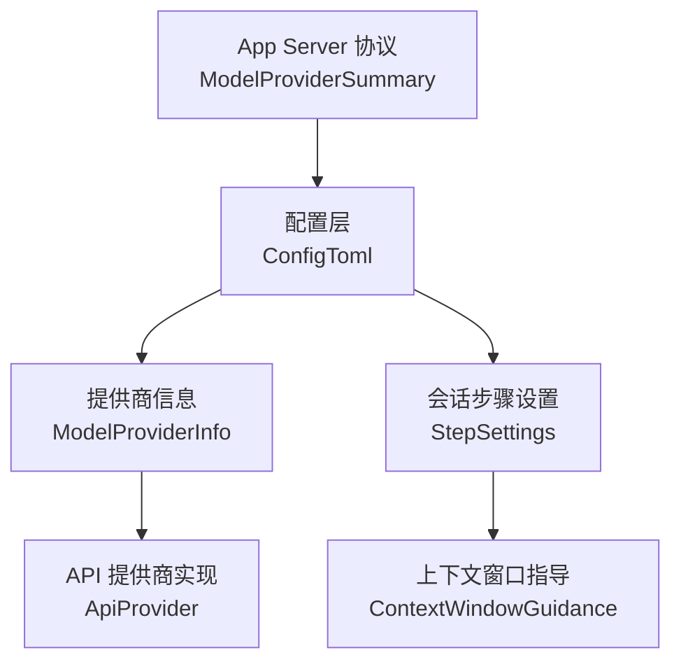
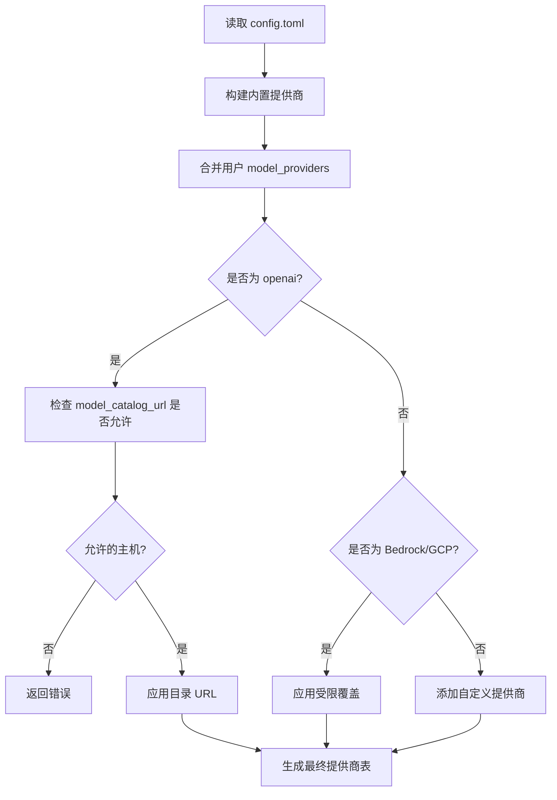
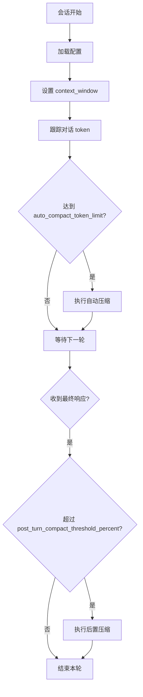
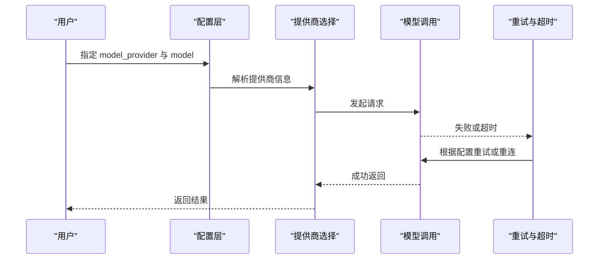

# 模型配置

<cite>
**本文引用的文件**
- [config_toml.rs](file://codex-rs/config/src/config_toml.rs)
- [profile_toml.rs](file://codex-rs/config/src/profile_toml.rs)
- [lib.rs](file://codex-rs/model-provider-info/src/lib.rs)
- [model_provider.rs](file://codex-rs/app-server-protocol/src/protocol/v2/model_provider.rs)
- [step_settings.rs](file://codex-rs/core/src/session/step_settings.rs)
- [context_window_guidance.rs](file://codex-rs/core/src/context/world_state/context_window_guidance.rs)
- [auto_compact_window.rs](file://codex-rs/core/src/state/auto_compact_window.rs)
- [compact_remote_v2_attempt.rs](file://codex-rs/core/src/compact_remote_v2_attempt.rs)
- [defaults.toml](file://codex-rs/config/defaults.toml)
</cite>

## 目录
1. [引言](#引言)
2. [项目结构中的模型配置位置](#项目结构中的模型配置位置)
3. [核心概念与数据模型](#核心概念与数据模型)
4. [model_providers 配置段总览](#model_providers-配置段总览)
5. [内置提供商](#内置提供商)
6. [自定义提供商](#自定义提供商)
7. [模型参数：上下文窗口、自动压缩与后置压缩](#模型参数上下文窗口自动压缩与后置压缩)
8. [模型选择策略与默认值](#模型选择策略与默认值)
9. [不同提供商的配置示例](#不同提供商的配置示例)
10. [性能优化与安全限制](#性能优化与安全限制)
11. [优先级、负载均衡与故障转移](#优先级负载均衡与故障转移)
12. [故障排查](#故障排查)
13. [结论](#结论)

## 引言
本文面向需要深入理解 Codex 中“模型配置”的用户，重点说明以下内容：
- `model_providers` 配置段的作用、内置提供商和自定义提供商的写法。
- 模型级参数如 `context_window`、`auto_compact_token_limit`、`post_turn_compact_threshold_percent` 的含义与影响范围。
- 模型选择机制、默认提供商、配置文件优先级。
- OpenAI、Anthropic（通过网关）、本地 Ollama/LM Studio 等场景的配置方式。
- 请求重试、流式连接、超时、鉴权、能力开关等安全与性能相关设置。
- 多提供商场景下的优先级、负载分流思路及故障转移行为。

## 项目结构中的模型配置位置
模型配置并非集中在单一文件中，而是由多个模块共同构成：
- 顶层配置字段定义在配置加载层，包括模型选择、提供商选择、上下文窗口、自动压缩阈值等。
- 提供商定义集中在提供商信息模块，描述每个提供商的名称、基础地址、鉴权方式、能力、重试与超时等。
- 会话执行层使用模型上下文窗口与压缩阈值参与对话压缩决策。
- App Server 协议层暴露提供商列表与可编辑的设置补丁，供上层界面或自动化流程使用。

**图示来源**
- [config_toml.rs:201-550](file://codex-rs/config/src/config_toml.rs#L201-L550)
- [lib.rs:149-512](file://codex-rs/model-provider-info/src/lib.rs#L149-L512)
- [step_settings.rs:178-202](file://codex-rs/core/src/session/step_settings.rs#L178-L202)
- [model_provider.rs:1-200](file://codex-rs/app-server-protocol/src/protocol/v2/model_provider.rs#L1-L200)

**章节来源**
- [config_toml.rs:201-550](file://codex-rs/config/src/config_toml.rs#L201-L550)
- [lib.rs:577-853](file://codex-rs/model-provider-info/src/lib.rs#L577-L853)
- [model_provider.rs:1-200](file://codex-rs/app-server-protocol/src/protocol/v2/model_provider.rs#L1-L200)

## 核心概念与数据模型
### 配置层字段
配置层提供以下与模型直接相关的顶层字段：
- `model`：覆盖默认模型名称。
- `model_provider`：从 `model_providers` 映射中选择使用的提供商键。
- `model_context_window`：模型上下文窗口大小，单位为 token。
- `model_auto_compact_token_limit`：触发自动压缩的 token 阈值。
- `model_auto_compact_token_limit_scope`：自动压缩阈值的适用范围。
- `model_post_turn_compact_threshold_percent`：单次最终响应后触发压缩的百分比阈值，取值范围 0–100；省略或为 0 表示禁用该后置压缩。

这些字段位于配置主结构中，并带有 JSON Schema 校验和可选默认值。

**章节来源**
- [config_toml.rs:201-550](file://codex-rs/config/src/config_toml.rs#L201-L550)

### 会话步骤中的模型参数
会话步骤对象会保存模型相关上下文参数，其中包含：
- `context_window`：当前模型上下文窗口。
- `auto_compact_token_limit`：当前自动压缩 token 上限。

这两个字段会从配置层解析到会话步骤中，并在后续上下文构建和压缩阶段生效。

**章节来源**
- [step_settings.rs:178-202](file://codex-rs/core/src/session/step_settings.rs#L178-L202)

### 提供商信息模型
提供商信息由 `ModelProviderInfo` 描述，关键字段包括：
- `name`：友好显示名。
- `base_url`：OpenAI 兼容 API 基础地址。
- `model_catalog_url`：Codex 原生模型目录端点。
- `env_key`：存储 API 密钥的环境变量名。
- `experimental_bearer_token`：不推荐直接配置的 Bearer Token。
- `auth`：命令式鉴权配置。
- `gateway_oauth`：网关 OAuth 配置。
- `aws`：AWS SigV4 认证配置。
- `project_id`、`location`、`credential_file`：GCP 相关字段。
- `wire_api`：期望的线协议。
- `capabilities`：能力覆盖，例如是否支持网络搜索、WebSocket、Cyber Access Programs。
- `query_params`、`http_headers`、`env_http_headers`：请求参数与 HTTP 头。
- `request_max_retries`、`stream_max_retries`、`stream_idle_timeout_ms`、`websocket_connect_timeout_ms`：重试与超时控制。
- `requires_openai_auth`、`supports_websockets`、`supports_standalone_web_search`：能力与鉴权行为。

**章节来源**
- [lib.rs:149-512](file://codex-rs/model-provider-info/src/lib.rs#L149-L512)

## model_providers 配置段总览
`model_providers` 是 `ConfigToml` 中的一个字符串到提供商信息的映射，用于扩展或补充内置提供商。关键规则如下：
- 用户定义的条目会合并到内置提供商列表中。
- 内置提供商 ID 一般不可被完全覆盖。
- OpenAI 提供商只允许调整模型目录 URL，且必须是允许的 ChatGPT 主机。
- Amazon Bedrock 与 GCP 提供商允许有限字段覆盖。
- 其他未知 ID 会被当作自定义提供商加入。

配置层还声明了保留的内置提供商 ID 集合，防止用户意外覆盖受管标识。

**图示来源**
- [lib.rs:757-853](file://codex-rs/model-provider-info/src/lib.rs#L757-L853)
- [config_toml.rs:201-550](file://codex-rs/config/src/config_toml.rs#L201-L550)

**章节来源**
- [config_toml.rs:201-550](file://codex-rs/config/src/config_toml.rs#L201-L550)
- [lib.rs:757-853](file://codex-rs/model-provider-info/src/lib.rs#L757-L853)

## 内置提供商
系统内置以下提供商：
- OpenAI：默认使用 Responses 协议，支持 WebSocket 和独立网络搜索，需要 OpenAI 或 ChatGPT 鉴权。
- Amazon Bedrock：通过 AWS SigV4 认证，不使用普通 OpenAI API Key。
- Amazon Bedrock Runtime：与 Bedrock 类似，但标识不同。
- GCP：Vertex AI 相关路径，可通过项目 ID、区域、凭据文件和命令鉴权配置。
- Ollama：本地开源模型服务，默认端口由环境变量或固定端口决定。
- LM Studio：本地开源模型服务，默认端口由环境变量或固定端口决定。

这些提供商由 `built_in_model_providers` 构建，并通过 `merge_configured_model_providers` 与用户配置合并。

**章节来源**
- [lib.rs:571-671](file://codex-rs/model-provider-info/src/lib.rs#L571-L671)
- [lib.rs:757-853](file://codex-rs/model-provider-info/src/lib.rs#L757-L853)

## 自定义提供商
自定义提供商适合以下场景：
- 第三方 OpenAI 兼容服务。
- 需要自定义鉴权命令、OAuth、HTTP 头或查询参数的服务。
- 需要将 Anthropic 等服务暴露为 OpenAI 兼容接口的网关。

自定义提供商的关键配置项：
- `base_url`：OpenAI 兼容推理端点。
- `env_key`：API 密钥环境变量名。
- `auth`：命令式鉴权，可替代 `env_key`、Bearer Token 或 `requires_openai_auth`。
- `gateway_oauth`：网关 OAuth 配置，常用于前端或 App Server 管理的身份。
- `http_headers`、`env_http_headers`：固定头或基于环境变量的头。
- `query_params`：附加到基础地址的查询参数。
- `capabilities`：覆盖能力，如是否支持 WebSocket、网络搜索、Cyber Access Programs。
- `request_max_retries`、`stream_max_retries`、`stream_idle_timeout_ms`、`websocket_connect_timeout_ms`：重试与超时。

App Server 协议层还提供 `ProviderSettingsPatch`，用于通过接口更新自定义网关、Bedrock 或 GCP 设置，同时保留敏感字段的安全处理。

**章节来源**
- [lib.rs:149-512](file://codex-rs/model-provider-info/src/lib.rs#L149-L512)
- [model_provider.rs:1-200](file://codex-rs/app-server-protocol/src/protocol/v2/model_provider.rs#L1-L200)

## 模型参数：上下文窗口、自动压缩与后置压缩
### 上下文窗口
`model_context_window` 用于指定模型上下文窗口大小，单位为 token。它会被传递到会话步骤中，作为上下文窗口容量参考。实际上下文管理还会结合历史消息、工具输出、系统提示等动态计算可用空间。

### 自动压缩 token 上限
`model_auto_compact_token_limit` 表示当对话 token 达到该阈值时触发自动压缩。`model_auto_compact_token_limit_scope` 控制该阈值应用于完整上下文还是仅当前压缩窗口内的尾部 token。

### 后置压缩百分比
`model_post_turn_compact_threshold_percent` 表示在一次最终响应后，如果可用上下文超过阈值百分比，则触发压缩。取值范围为 0–100；省略或为 0 表示禁用该后置压缩逻辑。

**图示来源**
- [step_settings.rs:178-202](file://codex-rs/core/src/session/step_settings.rs#L178-L202)
- [context_window_guidance.rs](file://codex-rs/core/src/context/world_state/context_window_guidance.rs)
- [auto_compact_window.rs](file://codex-rs/core/src/state/auto_compact_window.rs)
- [compact_remote_v2_attempt.rs](file://codex-rs/core/src/compact_remote_v2_attempt.rs)

**章节来源**
- [config_toml.rs:201-550](file://codex-rs/config/src/config_toml.rs#L201-L550)
- [step_settings.rs:178-202](file://codex-rs/core/src/session/step_settings.rs#L178-L202)

## 模型选择策略与默认值
### 顶层选择
配置层提供两个与模型选择直接相关的字段：
- `model`：覆盖默认模型名称。
- `model_provider`：选择 `model_providers` 中的提供商键。

此外，默认配置中包含一些通用行为，例如隐藏代理推理、ChatGPT 基础地址、项目根标记等。

### Profile 级别选择
Profile 是用户可组合的一组配置单元，也可指定：
- `model`
- `model_provider`
- `service_tier`
- `model_reasoning_effort`
- `model_reasoning_summary`
- `model_verbosity`
- `model_instructions_file`
- `model_catalog_json`
- `oss_provider`

Profile 使得同一机器上可以切换不同模型、提供商、沙箱模式或 TUI 行为。

### 默认提供商
内置提供商由 `built_in_model_providers` 创建。默认情况下，OpenAI 提供商通常具有更高可见性，但是否真正作为默认取决于运行时选择逻辑、登录状态、能力检查和上层 UI 或服务器选择策略。配置中仍可显式指定 `model_provider`。

**章节来源**
- [config_toml.rs:201-550](file://codex-rs/config/src/config_toml.rs#L201-L550)
- [profile_toml.rs:1-83](file://codex-rs/config/src/profile_toml.rs#L1-L83)
- [defaults.toml:1-18](file://codex-rs/config/defaults.toml#L1-L18)
- [lib.rs:571-671](file://codex-rs/model-provider-info/src/lib.rs#L571-L671)

## 不同提供商的配置示例
以下为典型场景的配置思路。为避免泄露敏感信息，示例中不包含真实密钥值。

### OpenAI
- 使用内置 `openai` 提供商。
- 如需更改模型目录发现地址，可在 `model_providers.openai` 中设置 `model_catalog_url`，但该地址必须为允许的 HTTPS ChatGPT 主机。
- 推理仍使用全局 `openai_base_url` 或默认 OpenAI 地址。
- 若需组织或项目头，可使用 `env_http_headers` 注入 `OPENAI_ORGANIZATION`、`OPENAI_PROJECT`。

### Anthropic 或其他 OpenAI 兼容网关
- 将 Anthropic 或其他厂商的服务包装成 OpenAI 兼容网关。
- 在 `model_providers` 中添加自定义键，设置 `base_url` 为网关地址。
- 通过 `env_key` 指向包含网关 API Key 的环境变量。
- 如需额外请求头，配置 `http_headers` 或 `env_http_headers`。
- 若网关要求 OAuth，可使用 `gateway_oauth` 配合 App Server 或前端流程。

### Amazon Bedrock
- 使用内置 `amazon-bedrock` 或 `amazon-bedrock-runtime`。
- 通过 `aws.profile`、`aws.region`、`aws.credential_export`、`aws.auth_refresh` 配置 AWS 认证。
- 注意：AWS 认证不能与 `env_key`、`experimental_bearer_token`、`auth`、`requires_openai_auth` 混用。
- AWS 认证不支持 WebSocket 升级，因此 `supports_websockets` 不应启用。

### Google Cloud Vertex AI
- 使用内置 `gcp` 提供商。
- 通过 `project_id`、`location`、`credential_file` 或命令式 `auth` 配置。
- `credential_file` 必须是绝对路径。
- 仅允许覆盖 `base_url`、`auth`、`http_headers`、`project_id`、`location`、`credential_file`。

### 本地 Ollama 或 LM Studio
- 使用内置 `ollama` 或 `lmstudio`。
- 默认地址来自环境变量 `CODEX_OSS_BASE_URL`，否则回退到本地端口。
- 可通过环境变量 `CODEX_OSS_PORT` 调整本地端口。
- 适用于不需要远程鉴权的本地推理服务。

**章节来源**
- [lib.rs:571-671](file://codex-rs/model-provider-info/src/lib.rs#L571-L671)
- [lib.rs:757-918](file://codex-rs/model-provider-info/src/lib.rs#L757-L918)
- [config_toml.rs:201-550](file://codex-rs/config/src/config_toml.rs#L201-L550)

## 性能优化与安全限制
### 请求重试与流式连接
- `request_max_retries`：最大 HTTP 请求重试次数，有内部最大值限制。
- `stream_max_retries`：流式响应断开后的重连尝试次数，有内部最大值限制。
- `stream_idle_timeout_ms`：流式响应空闲超时时间。
- `websocket_connect_timeout_ms`：WebSocket 连接超时时间。

默认实现会为非 429 错误启用服务端 5xx 重试和传输重试，但不自动重试 429。

### 鉴权安全
- 优先使用 `env_key` 从环境变量读取密钥。
- 避免直接使用 `experimental_bearer_token`。
- 使用命令式 `auth` 或 AWS SigV4、GCP ADC 等方式减少硬编码密钥。
- 对 AWS 和命令式鉴权进行严格冲突校验，禁止不安全或矛盾的组合。
- 对 GCP 凭据文件路径进行绝对路径校验。

### 能力与安全边界
- `requires_openai_auth`：决定是否展示登录流程。
- `supports_websockets`：是否支持 WebSocket 传输。
- `supports_standalone_web_search`：是否支持独立网络搜索。
- `capabilities.cyber_access_programs`：是否允许特定 Cyber Access Programs。
- `http_headers` 与 `env_http_headers`：用于注入必要请求头，但应谨慎处理敏感值。

**章节来源**
- [lib.rs:149-512](file://codex-rs/model-provider-info/src/lib.rs#L149-L512)
- [lib.rs:513-918](file://codex-rs/model-provider-info/src/lib.rs#L513-L918)

## 优先级、负载均衡与故障转移
### 配置优先级
- 内置提供商由系统初始化。
- 用户 `model_providers` 与内置提供商合并。
- `model_provider` 选择具体提供商键。
- `model` 选择具体模型名称。
- Profile 可叠加一组模型与行为偏好。

### 提供商选择顺序
Codex 不会简单按 `model_providers` 哈希表插入顺序做负载均衡。更准确的行为是：
- 先确定所选提供商键。
- 再根据模型名称、提供商能力、鉴权状态、服务层级和上层 UI 或服务端逻辑选择具体模型。
- 内置提供商与自定义提供商统一进入提供商选择流程，但内置提供商的 ID 通常不可被任意覆盖。

### 负载均衡
仓库中没有看到通用的“多提供商轮询”负载均衡实现。常见做法是：
- 通过多个 Profile 或外部编排器，在不同线程或会话中切换到不同 `model_provider`。
- 通过上游网关聚合多个后端，Codex 只对接一个 `base_url`。
- 使用 App Server 提供的提供商列表与设置补丁，由上层界面引导用户选择。

### 故障转移
- 单提供商故障时，可依赖重试与流式重连。
- 若需要跨提供商故障转移，建议在上层实现：检测失败后切换到另一个 Profile 或另一个 `model_provider`。
- 对于 AWS 和命令式鉴权，配置验证会在启动阶段阻止明显错误的组合，从而减少运行时随机失败。

**图示来源**
- [config_toml.rs:201-550](file://codex-rs/config/src/config_toml.rs#L201-L550)
- [lib.rs:513-918](file://codex-rs/model-provider-info/src/lib.rs#L513-L918)

**章节来源**
- [lib.rs:757-853](file://codex-rs/model-provider-info/src/lib.rs#L757-L853)
- [lib.rs:513-918](file://codex-rs/model-provider-info/src/lib.rs#L513-L918)

## 故障排查
### 常见配置错误
- 自定义 OpenAI 提供商使用了不允许的 `model_catalog_url` 主机。
- Bedrock 或 GCP 提供商修改了不允许的字段。
- AWS 认证与 `env_key`、`experimental_bearer_token`、`auth`、`requires_openai_auth` 混用。
- GCP `credential_file` 不是绝对路径。
- 命令式 `auth.command` 为空或与 AWS refresh 命令不一致。
- 启用了 AWS 认证却同时开启 WebSocket 能力。

### 调试建议
- 检查 `model_provider` 是否指向存在的 `model_providers` 键。
- 确认 `env_key` 对应环境变量已设置且非空。
- 确认 `base_url` 可达，且与服务端支持的线协议一致。
- 检查 `request_max_retries`、`stream_max_retries`、`stream_idle_timeout_ms`、`websocket_connect_timeout_ms` 是否符合网络条件。
- 使用 App Server 的提供商列表接口查看提供商摘要，避免直接打印敏感字段。

**章节来源**
- [lib.rs:149-512](file://codex-rs/model-provider-info/src/lib.rs#L149-L512)
- [lib.rs:757-918](file://codex-rs/model-provider-info/src/lib.rs#L757-L918)
- [model_provider.rs:1-200](file://codex-rs/app-server-protocol/src/protocol/v2/model_provider.rs#L1-L200)

## 结论
Codex 的模型配置体系以 `model_providers` 为核心，将内置提供商与自定义提供商统一建模为 `ModelProviderInfo`。用户可通过配置文件或 App Server 协议层调整提供商地址、鉴权方式、HTTP 头、能力与重试超时。模型参数如上下文窗口、自动压缩阈值和后置压缩百分比，则在会话执行层参与上下文管理与压缩决策。

在实际部署中：
- 首选内置提供商和受管鉴权方式。
- 使用 Profile 区分不同业务或环境的模型选择。
- 对性能敏感场景调优重试、流式超时与压缩阈值。
- 对高可用场景采用上层编排或网关聚合实现多提供商分流与故障转移。