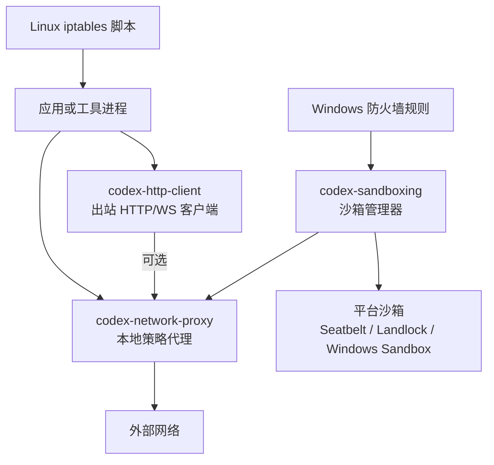
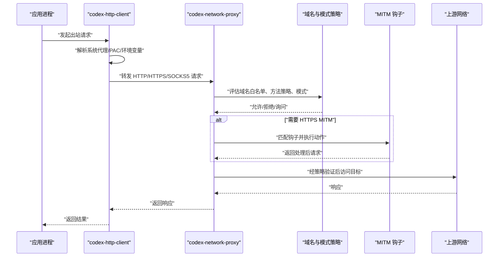
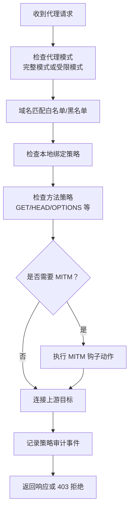
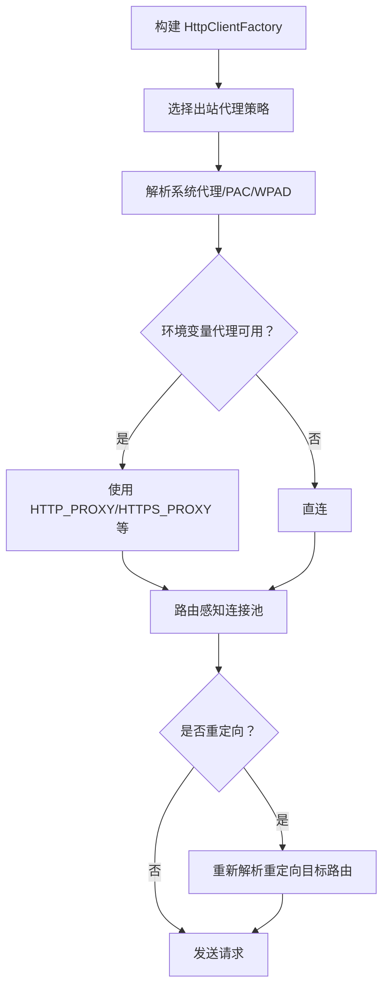
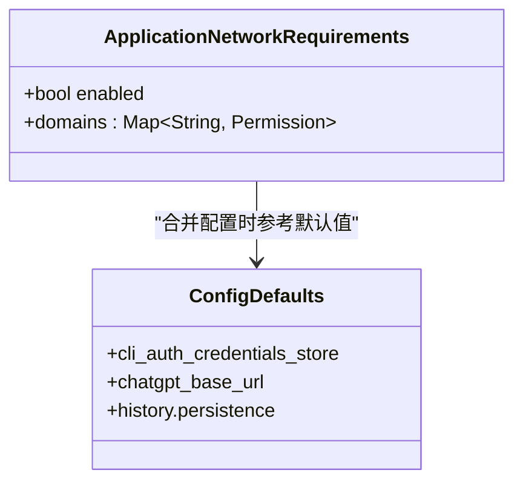
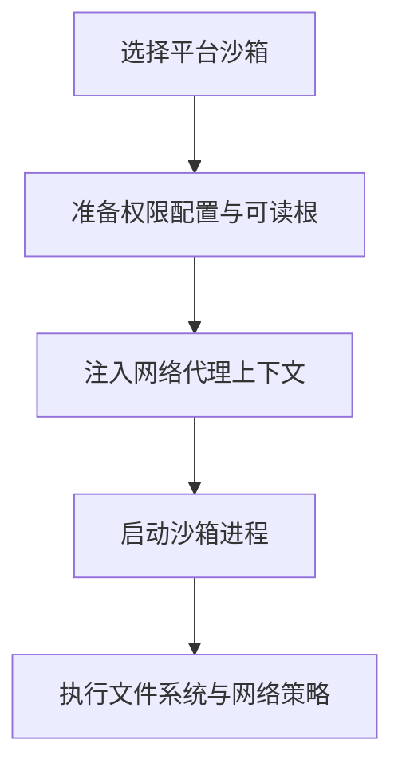
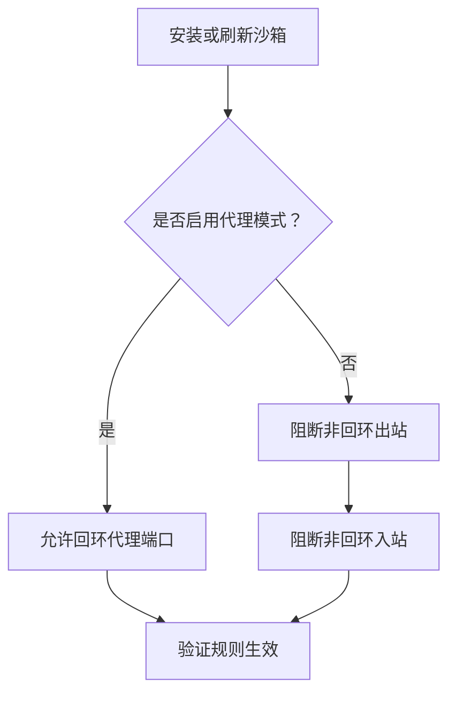
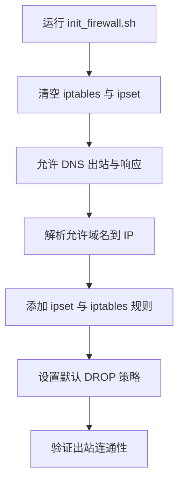
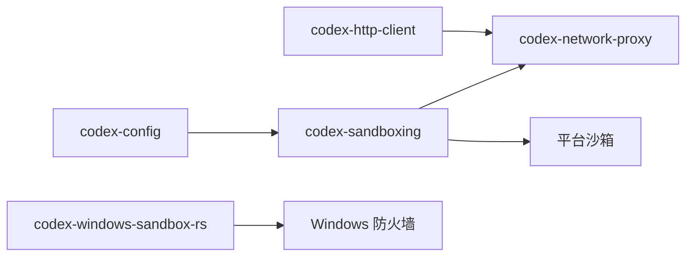
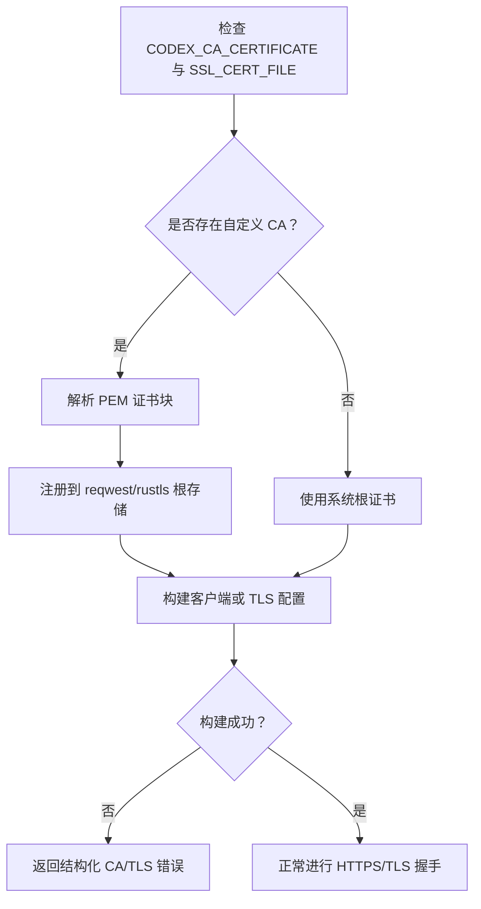

# 网络与安全配置

<cite>
**本文引用的文件**   
- [codex-rs/network-proxy/README.md](file://codex-rs/network-proxy/README.md)
- [codex-rs/network-proxy/src/lib.rs](file://codex-rs/network-proxy/src/lib.rs)
- [codex-rs/http-client/README.md](file://codex-rs/http-client/README.md)
- [codex-rs/http-client/src/outbound_proxy.rs](file://codex-rs/http-client/src/outbound_proxy.rs)
- [codex-rs/http-client/src/custom_ca.rs](file://codex-rs/http-client/src/custom_ca.rs)
- [codex-rs/config/defaults.toml](file://codex-rs/config/defaults.toml)
- [codex-rs/config/src/application_requirements.rs](file://codex-rs/config/src/application_requirements.rs)
- [codex-rs/sandboxing/src/manager.rs](file://codex-rs/sandboxing/src/manager.rs)
- [codex-rs/windows-sandbox-rs/src/setup_provisioning/firewall.rs](file://codex-rs/windows-sandbox-rs/src/setup_provisioning/firewall.rs)
- [codex-cli/scripts/init_firewall.sh](file://codex-cli/scripts/init_firewall.sh)
</cite>

## 目录
1. [简介](#简介)
2. [项目结构与相关模块](#项目结构与相关模块)
3. [核心安全组件](#核心安全组件)
4. [架构总览](#架构总览)
5. [详细组件分析](#详细组件分析)
6. [依赖关系分析](#依赖关系分析)
7. [性能与连接复用](#性能与连接复用)
8. [HTTPS、TLS 与证书管理](#httpstls-与证书管理)
9. [企业环境配置示例](#企业环境配置示例)
10. [故障排除指南](#故障排除指南)
11. [安全审计与合规建议](#安全审计与合规建议)
12. [结论](#结论)

## 简介
本文面向需要在生产与企业环境中部署 Codex 的用户和运维人员，系统性说明以下能力：
- 网络访问控制：域名白名单、协议与方法限制、本地绑定策略、上游代理。
- 代理设置：系统代理、PAC/WPAD、环境变量代理、SOCKS5、HTTP/HTTPS 代理。
- 防火墙配置：Linux `iptables` 脚本、Windows 防火墙离线模式规则。
- 安全策略：权限配置、沙箱模式、执行策略映射、MITM 钩子与凭据处理。
- HTTPS/TLS：自定义根证书、系统根证书、证书错误诊断。
- 故障排除与安全审计：代理拒绝原因、OTEL 审计事件、连接与 TLS 问题定位。

该文档不直接粘贴源码，而是通过“章节来源”指向仓库中的具体实现位置，便于进一步查阅代码。

## 项目结构与相关模块
Codex 的网络与安全能力分布在多个 Rust crate 中，并按职责划分：
- `codex-network-proxy`：本地网络策略代理，负责允许/拒绝策略、MITM、凭据替换、SOCKS5、HTTP/HTTPS 代理。
- `codex-http-client`：统一出站 HTTP/WS 客户端封装，负责代理路由、系统代理解析、重定向、敏感头保护、自定义 CA。
- `codex-config`：权限配置与默认值，包括应用层网络要求、默认行为等。
- `codex-sandboxing`：跨平台沙箱协调器，将网络代理、文件系统策略、平台沙箱集成到进程启动流程。
- `codex-windows-sandbox-rs`：Windows 沙箱安装与防火墙策略，支持离线模式和代理端口白名单。
- `codex-cli/scripts/init_firewall.sh`：Linux 端最小化出站网络防火墙脚本。

**图表来源**
- [codex-rs/network-proxy/README.md:1-120](file://codex-rs/network-proxy/README.md#L1-L120)
- [codex-rs/http-client/README.md:1-126](file://codex-rs/http-client/README.md#L1-L126)
- [codex-rs/sandboxing/src/manager.rs:1-120](file://codex-rs/sandboxing/src/manager.rs#L1-L120)
- [codex-rs/windows-sandbox-rs/src/setup_provisioning/firewall.rs:1-120](file://codex-rs/windows-sandbox-rs/src/setup_provisioning/firewall.rs#L1-L120)
- [codex-cli/scripts/init_firewall.sh:1-115](file://codex-cli/scripts/init_firewall.sh#L1-L115)

**章节来源**
- [codex-rs/network-proxy/README.md:1-120](file://codex-rs/network-proxy/README.md#L1-L120)
- [codex-rs/http-client/README.md:1-126](file://codex-rs/http-client/README.md#L1-L126)
- [codex-rs/sandboxing/src/manager.rs:1-120](file://codex-rs/sandboxing/src/manager.rs#L1-L120)
- [codex-rs/windows-sandbox-rs/src/setup_provisioning/firewall.rs:1-120](file://codex-rs/windows-sandbox-rs/src/setup_provisioning/firewall.rs#L1-L120)
- [codex-cli/scripts/init_firewall.sh:1-115](file://codex-cli/scripts/init_firewall.sh#L1-L115)

## 核心安全组件
- **本地网络策略代理**：提供 HTTP 与 SOCKS5 监听，按域名白名单/黑名单、方法策略、模式（完整模式或只读受限模式）决定是否放行请求；支持 MITM、凭据注入、Unix Socket 白名单等高级策略。
- **统一出站客户端**：集中构建 reqwest 客户端，避免短连接分散连接池；支持系统代理、PAC/WPAD、环境变量代理、直连回退，以及重定向时重新选择路由。
- **沙箱管理器**：根据平台选择 Seatbelt、Landlock、Windows Sandbox 等后端，并注入受管网络上下文、额外可读根路径等权限。
- **Windows 防火墙策略**：在离线模式下为指定用户 SID 建立出站/入站阻断规则，或在代理模式下仅允许特定回环代理端口。
- **Linux 防火墙脚本**：基于 `iptables` 和 `ipset`，只允许 DNS、本机网段和预解析的允许域名 IP，其余出站默认拒绝。

**章节来源**
- [codex-rs/network-proxy/README.md:1-120](file://codex-rs/network-proxy/README.md#L1-L120)
- [codex-rs/http-client/README.md:1-126](file://codex-rs/http-client/README.md#L1-L126)
- [codex-rs/sandboxing/src/manager.rs:1-120](file://codex-rs/sandboxing/src/manager.rs#L1-L120)
- [codex-rs/windows-sandbox-rs/src/setup_provisioning/firewall.rs:1-120](file://codex-rs/windows-sandbox-rs/src/setup_provisioning/firewall.rs#L1-L120)
- [codex-cli/scripts/init_firewall.sh:1-115](file://codex-cli/scripts/init_firewall.sh#L1-L115)

## 架构总览
下图展示一次典型受控出站请求的生命周期：客户端先经过统一 HTTP 客户端进行代理路由选择，再进入本地策略代理，由域名策略、模式策略、MITM 钩子和凭据策略共同决定最终是否允许访问外部网络。

**图表来源**
- [codex-rs/http-client/src/outbound_proxy.rs:1-120](file://codex-rs/http-client/src/outbound_proxy.rs#L1-L120)
- [codex-rs/network-proxy/README.md:1-120](file://codex-rs/network-proxy/README.md#L1-L120)

**章节来源**
- [codex-rs/http-client/src/outbound_proxy.rs:1-120](file://codex-rs/http-client/src/outbound_proxy.rs#L1-L120)
- [codex-rs/network-proxy/README.md:1-120](file://codex-rs/network-proxy/README.md#L1-L120)

## 详细组件分析

### 网络策略代理
`codex-network-proxy` 是 Codex 的本地网络策略强制代理，默认暴露 HTTP 与 SOCKS5 监听，并在托管运行时中承担以下职责：
- 域名级访问控制：支持精确域名、通配符和 deny 条目；若没有 allow 条目则默认阻止。
- 模式控制：完整模式允许所有方法；受限模式只允许只读访问，并限制非 HTTPS 的 SOCKS5 UDP 和 TCP。
- MITM 钩子：在 CONNECT 终止后可按主机、方法和路径前缀匹配，执行如剥离认证头等动作。
- 凭据处理：支持凭据代理和敏感头替换，避免泄露。
- Unix Socket 白名单：macOS 下可通过请求头白名单 Unix Socket，其他平台拒绝。
- OTEL 审计：每次策略决策可输出结构化审计事件，包含决策来源、目标地址、传输协议、方法等字段。

**图表来源**
- [codex-rs/network-proxy/README.md:1-120](file://codex-rs/network-proxy/README.md#L1-L120)

**章节来源**
- [codex-rs/network-proxy/README.md:1-120](file://codex-rs/network-proxy/README.md#L1-L120)
- [codex-rs/network-proxy/src/lib.rs:1-140](file://codex-rs/network-proxy/src/lib.rs#L1-L140)

### 出站代理与路由策略
`codex-http-client` 是 workspace 内统一的 reqwest 集成入口，负责：
- 代理策略选择：`RespectSystemProxy` 优先使用系统代理与 PAC/WPAD，其次使用环境变量代理，最后直连；`ReqwestDefault` 保留底层行为，不应作为新调用点的默认选择。
- 路由感知连接池：对每个 URL 解析代理路由，缓存最多 16 个传输客户端，避免把不同目的地的请求混入同一连接池。
- 重定向处理：在尊重系统代理模式下，客户端自行跟随重定向，逐跳解析路由，并在源变更时移除敏感头。
- 敏感头保护：可选择保护 ChatGPT Cookie 等敏感头部不被带到其他源。
- 失败分类：区分代理解析不可用、连接超时、代理认证失败、TLS 错误、无效代理配置等类别，便于监控与排障。

**图表来源**
- [codex-rs/http-client/README.md:1-126](file://codex-rs/http-client/README.md#L1-L126)
- [codex-rs/http-client/src/outbound_proxy.rs:1-180](file://codex-rs/http-client/src/outbound_proxy.rs#L1-L180)

**章节来源**
- [codex-rs/http-client/README.md:1-126](file://codex-rs/http-client/README.md#L1-L126)
- [codex-rs/http-client/src/outbound_proxy.rs:1-180](file://codex-rs/http-client/src/outbound_proxy.rs#L1-L180)

### 权限与应用网络要求
Codex 的配置层将权限策略与默认值分离，并提供应用层网络要求：
- 应用网络要求默认启用，且未列出域名时拒绝访问，适合企业环境默认“白名单优先”。
- 域名校验要求 ASCII 域名，不允许 URL、端口或通配符，并做大小写规范化与重复检测。
- 默认配置中包含 CLI 认证凭据存储方式、ChatGPT Base URL、历史持久化等基础默认值。

**图表来源**
- [codex-rs/config/src/application_requirements.rs:1-73](file://codex-rs/config/src/application_requirements.rs#L1-L73)
- [codex-rs/config/defaults.toml:1-18](file://codex-rs/config/defaults.toml#L1-L18)

**章节来源**
- [codex-rs/config/src/application_requirements.rs:1-73](file://codex-rs/config/src/application_requirements.rs#L1-L73)
- [codex-rs/config/defaults.toml:1-18](file://codex-rs/config/defaults.toml#L1-L18)

### 沙箱与执行策略集成
`sandboxing` 模块协调不同平台的沙箱后端，并将网络代理、权限配置文件、工作区根路径、额外可读根路径等信息注入到被沙箱化的进程中：
- 平台选择：macOS 使用 Seatbelt，Linux 使用 Landlock/seccomp，Windows 可使用 Windows Sandbox。
- 托管 MITM CA：当启用托管 MITM 时，沙箱策略会添加额外的可读根路径，使沙箱内进程能读取受管 CA bundle。
- 网络上下文：沙箱命令可携带 `ManagedNetworkSandboxContext`，让受管进程通过本地策略代理访问网络。
- 错误类型：包括缺失 Linux 沙箱可执行文件、MXC 准备失败、Seatbelt 不可用、Windows 沙箱准备失败等。

**图表来源**
- [codex-rs/sandboxing/src/manager.rs:1-120](file://codex-rs/sandboxing/src/manager.rs#L1-L120)

**章节来源**
- [codex-rs/sandboxing/src/manager.rs:1-120](file://codex-rs/sandboxing/src/manager.rs#L1-L120)

### Windows 防火墙与离线模式
Windows 沙箱安装程序通过 COM 接口操作 Windows 防火墙，实现两类关键行为：
- 离线模式：为非回环出站/入站流量创建阻断规则，防止沙箱进程直接访问外网。
- 代理模式：仅允许特定回环代理端口，同时清除旧规则，保证从代理模式切换到严格离线模式时不会 fail-open。

**图表来源**
- [codex-rs/windows-sandbox-rs/src/setup_provisioning/firewall.rs:1-120](file://codex-rs/windows-sandbox-rs/src/setup_provisioning/firewall.rs#L1-L120)

**章节来源**
- [codex-rs/windows-sandbox-rs/src/setup_provisioning/firewall.rs:1-120](file://codex-rs/windows-sandbox-rs/src/setup_provisioning/firewall.rs#L1-L120)

### Linux 防火墙脚本
`init_firewall.sh` 提供一个保守的出站网络限制脚本：
- 清理现有 `iptables` 规则和 `ipset`。
- 允许 DNS 查询与响应、本地回环。
- 将允许域名的 A 记录解析到 `ipset`，只允许这些目标 IP 出站。
- 设置默认 DROP 策略，并通过 ESTABLISHED/RELATED 允许已建立连接。
- 验证无法访问任意示例站点，但应能访问 OpenAI API。

**图表来源**
- [codex-cli/scripts/init_firewall.sh:1-115](file://codex-cli/scripts/init_firewall.sh#L1-L115)

**章节来源**
- [codex-cli/scripts/init_firewall.sh:1-115](file://codex-cli/scripts/init_firewall.sh#L1-L115)

## 依赖关系分析
- `codex-http-client` 依赖 reqwest 和 rustls，但不鼓励上层 crate 直接构造 reqwest 客户端，以避免绕过代理、CA、重定向和敏感头策略。
- `codex-network-proxy` 依赖 rustls 通过 Rama 的 TLS 后端，避免 BoringSSL/OpenSSL 符号冲突；它还可嵌入到托管运行时，暴露策略决策回调。
- `codex-sandboxing` 依赖 `codex_protocol` 的沙箱类型与权限模型，并组合 `codex_network_proxy` 提供的托管网络上下文。
- `codex-windows-sandbox-rs` 依赖 Windows Firewall COM 接口和操作系统身份、ACL、令牌机制。

**图表来源**
- [codex-rs/sandboxing/src/manager.rs:1-120](file://codex-rs/sandboxing/src/manager.rs#L1-L120)
- [codex-rs/network-proxy/src/lib.rs:1-140](file://codex-rs/network-proxy/src/lib.rs#L1-L140)
- [codex-rs/http-client/src/outbound_proxy.rs:1-120](file://codex-rs/http-client/src/outbound_proxy.rs#L1-L120)
- [codex-rs/windows-sandbox-rs/src/setup_provisioning/firewall.rs:1-120](file://codex-rs/windows-sandbox-rs/src/setup_provisioning/firewall.rs#L1-L120)

**章节来源**
- [codex-rs/sandboxing/src/manager.rs:1-120](file://codex-rs/sandboxing/src/manager.rs#L1-L120)
- [codex-rs/network-proxy/src/lib.rs:1-140](file://codex-rs/network-proxy/src/lib.rs#L1-L140)
- [codex-rs/http-client/src/outbound_proxy.rs:1-120](file://codex-rs/http-client/src/outbound_proxy.rs#L1-L120)
- [codex-rs/windows-sandbox-rs/src/setup_provisioning/firewall.rs:1-120](file://codex-rs/windows-sandbox-rs/src/setup_provisioning/firewall.rs#L1-L120)

## 性能与连接复用
- 连接池：`codex-http-client` 推荐复用长生命周期客户端或 `RouteAwareClientPool`，避免每次请求创建短连接导致连接池碎片化。
- 路由缓存：在尊重系统代理模式下，连接池按解析后的路由缓存传输客户端，最多 16 个，既复用连接又避免跨目的地误用。
- 系统代理缓存：系统代理成功与不可用的结果有 TTL 缓存，减少频繁探测系统代理带来的开销。
- 重定向优化：由客户端自行跟踪重定向并逐跳解析路由，比底层库默认行为更可控，同时减少敏感头泄漏风险。

最佳实践：
- 为固定目的地构建一次客户端。
- 对多目的地或可能重定向的服务使用 `RouteAwareClientPool`。
- 避免为每个请求新建 `HttpClientFactory` 或连接池。
- 使用带日志脱敏的构造函数处理可能包含凭证的请求。

**章节来源**
- [codex-rs/http-client/README.md:1-126](file://codex-rs/http-client/README.md#L1-L126)
- [codex-rs/http-client/src/outbound_proxy.rs:1-180](file://codex-rs/http-client/src/outbound_proxy.rs#L1-L180)

## HTTPS、TLS 与证书管理
Codex 的 TLS 与证书策略集中在 `codex-http-client` 的自定义 CA 模块中：
- 环境变量优先级：`CODEX_CA_CERTIFICATE` 优先于 `SSL_CERT_FILE`。
- PEM 兼容性：支持 OpenSSL 风格的 `TRUSTED CERTIFICATE` 标签及包含 CRL 的 bundle。
- 错误分类：读取失败、无效 CA 文件、注册证书失败、构建 reqwest 客户端失败、rustls 注册失败等。
- 系统根证书：当未设置自定义 CA 环境变量时，使用系统根证书。
- Websocket 支持：提供 rustls 配置构建路径，确保 websocket TLS 也遵循相同的企业根 CA 策略。

**图表来源**
- [codex-rs/http-client/src/custom_ca.rs:1-120](file://codex-rs/http-client/src/custom_ca.rs#L1-L120)

**章节来源**
- [codex-rs/http-client/src/custom_ca.rs:1-120](file://codex-rs/http-client/src/custom_ca.rs#L1-L120)

## 企业环境配置示例

### 企业代理与域名白名单
在企业环境中，通常要求：
- 所有出站流量经过公司代理或网关。
- 仅允许访问业务域名，禁止本地私有网络或非预期目标。
- 对 HTTPS 流量启用 MITM 以进行安全扫描或合规检查。

推荐步骤：
1. 在权限配置中启用网络代理，并设置 `proxy_url`、`socks_url`、`mode`、`allow_upstream_proxy`、`dangerously_allow_non_loopback_proxy`、`allow_local_binding` 等参数。
2. 配置域名白名单，例如允许 `*.openai.com`、`localhost`、`127.0.0.1`、`::1`，并显式 deny 可疑域名。
3. 如需 HTTPS MITM，启用托管 MITM CA，并确保受管 CA bundle 可被沙箱进程读取。
4. 使用 `HTTP_PROXY`、`HTTPS_PROXY`、`WS_PROXY`、`WSS_PROXY`、`ALL_PROXY` 将客户端流量指向本地代理。

**章节来源**
- [codex-rs/network-proxy/README.md:1-120](file://codex-rs/network-proxy/README.md#L1-L120)

### Linux 最小化出站防火墙
适用于服务器或 CI 环境：
- 使用 `init_firewall.sh` 清理并重建防火墙规则。
- 将允许域名写入 `/etc/codex/allowed_domains.txt`。
- 确认脚本能解析域名并仅允许其 IP 出站。
- 验证无法访问任意示例站点，但能访问 OpenAI API。

**章节来源**
- [codex-cli/scripts/init_firewall.sh:1-115](file://codex-cli/scripts/init_firewall.sh#L1-L115)

### Windows 离线模式与代理模式
适用于 Windows 沙箱：
- 如果要求沙箱完全离线，启用离线阻断规则，阻止非回环出站与入站。
- 如果要求沙箱只能通过本地代理访问网络，启用代理模式并仅允许配置的代理端口。
- 切换模式时确保旧规则被清理，避免 fail-open。

**章节来源**
- [codex-rs/windows-sandbox-rs/src/setup_provisioning/firewall.rs:1-120](file://codex-rs/windows-sandbox-rs/src/setup_provisioning/firewall.rs#L1-L120)

## 故障排除指南

### 代理拒绝与调试
当请求被本地策略代理拒绝时，代理会返回 403，并通过 `x-proxy-error` 指出拒绝原因：
- `blocked-by-allowlist`：域名不在白名单。
- `blocked-by-denylist`：域名被显式拒绝。
- `blocked-by-method-policy`：方法不符合受限模式策略。
- `blocked-by-policy`：其他策略拒绝。

排查建议：
- 检查域名白名单是否包含目标主机。
- 检查是否处于受限模式，而请求使用了不允许的方法。
- 如果使用 WSS，确认 CONNECT 目标也通过域名策略。
- 检查 `allow_local_binding` 是否关闭，导致本地绑定被拒绝。
- 查看 OTEL 审计事件，确认策略决策来源与目标地址。

**章节来源**
- [codex-rs/network-proxy/README.md:1-120](file://codex-rs/network-proxy/README.md#L1-L120)

### 系统代理与 PAC/WPAD 问题
- 如果系统代理不可用，`codex-http-client` 会降级到环境变量代理或直连。
- 使用 `RespectSystemProxy` 时，注意重定向可能改变目标，需重新解析路由。
- macOS 上系统代理探测可能触发平台配置访问，测试环境建议使用隔离进程。

**章节来源**
- [codex-rs/http-client/README.md:1-126](file://codex-rs/http-client/README.md#L1-L126)
- [codex-rs/http-client/src/outbound_proxy.rs:1-180](file://codex-rs/http-client/src/outbound_proxy.rs#L1-L180)

### TLS 与自定义 CA 错误
常见错误场景：
- 自定义 CA 文件不存在或路径为空。
- CA 文件不是有效 PEM，或缺少 `CERTIFICATE` 块。
- 某个证书无法注册到 reqwest 或 rustls 根存储。
- 使用系统根证书时 TLS 握手仍失败，可能是中间证书链不完整。

排查建议：
- 确认 `CODEX_CA_CERTIFICATE` 或 `SSL_CERT_FILE` 指向有效的 PEM bundle。
- 检查证书链是否包含中间证书。
- 在不受沙箱影响的环境中单独验证证书有效性。
- 对于 websocket，确保 rustls 配置也加载了相同 CA。

**章节来源**
- [codex-rs/http-client/src/custom_ca.rs:1-120](file://codex-rs/http-client/src/custom_ca.rs#L1-L120)

### 沙箱与权限问题
常见问题：
- 缺少 Linux 沙箱可执行文件。
- macOS 上 Seatbelt 不可用或未正确准备。
- Windows 上沙箱准备失败或防火墙规则未生效。
- 沙箱内进程无法读取托管 MITM CA bundle。

排查建议：
- 检查平台沙箱是否可用。
- 确认权限配置文件已编译并通过管道生成。
- 在沙箱外先验证网络策略，再逐步缩小到沙箱内问题。
- 查看沙箱转换错误类型，定位是策略、路径还是平台后端问题。

**章节来源**
- [codex-rs/sandboxing/src/manager.rs:1-120](file://codex-rs/sandboxing/src/manager.rs#L1-L120)

## 安全审计与合规建议
- 使用 `codex-network-proxy` 的 OTEL 审计事件，收集 `codex.network_proxy.policy_decision`，关注决策来源、目标地址、传输协议、HTTP 方法、是否由 decider 覆盖等字段。
- 在生产环境中默认启用域名白名单，不配置任何 allow 条目时应拒绝所有出站。
- 在企业网络中优先使用受管代理，并通过 MITM 钩子限制敏感头泄露。
- 对沙箱化进程启用平台沙箱，并结合文件系统最小权限原则。
- 定期审查防火墙规则，确保离线模式不会因旧规则残留而开放非预期端口。

**章节来源**
- [codex-rs/network-proxy/README.md:1-120](file://codex-rs/network-proxy/README.md#L1-L120)
- [codex-rs/windows-sandbox-rs/src/setup_provisioning/firewall.rs:1-120](file://codex-rs/windows-sandbox-rs/src/setup_provisioning/firewall.rs#L1-L120)

## 结论
Codex 的网络与安全配置围绕“默认拒绝、白名单优先、最小权限、可审计”展开：
- 网络访问控制由 `codex-network-proxy` 统一管理，结合域名策略、方法策略、模式控制和 MITM 钩子。
- 出站 HTTP/WS 由 `codex-http-client` 统一封装，确保代理路由、连接池、重定向和敏感头策略一致。
- 沙箱管理器将网络策略与平台沙箱能力结合，限制进程对文件系统和网络的访问。
- Windows 与 Linux 分别提供防火墙策略与脚本，满足离线模式和企业出站限制需求。
- HTTPS/TLS 通过环境变量与自定义 CA bundle 适配企业中间人代理或内部 CA。

在实际部署中，建议先从最严格的策略开始，逐步放宽白名单和端口，并通过代理审计事件和连接日志持续验证网络安全边界。