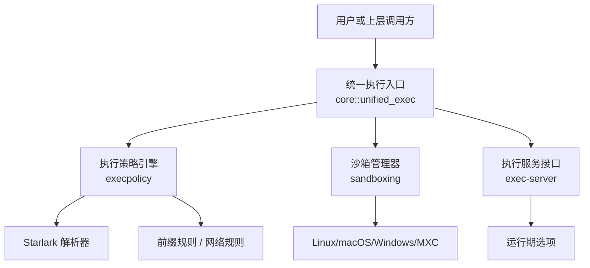
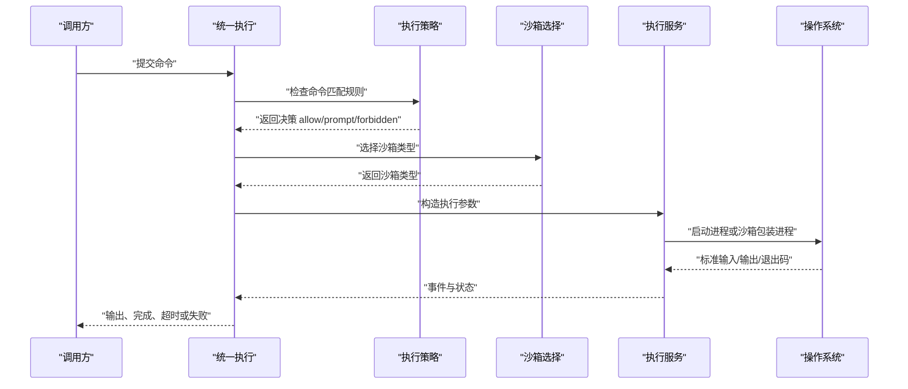
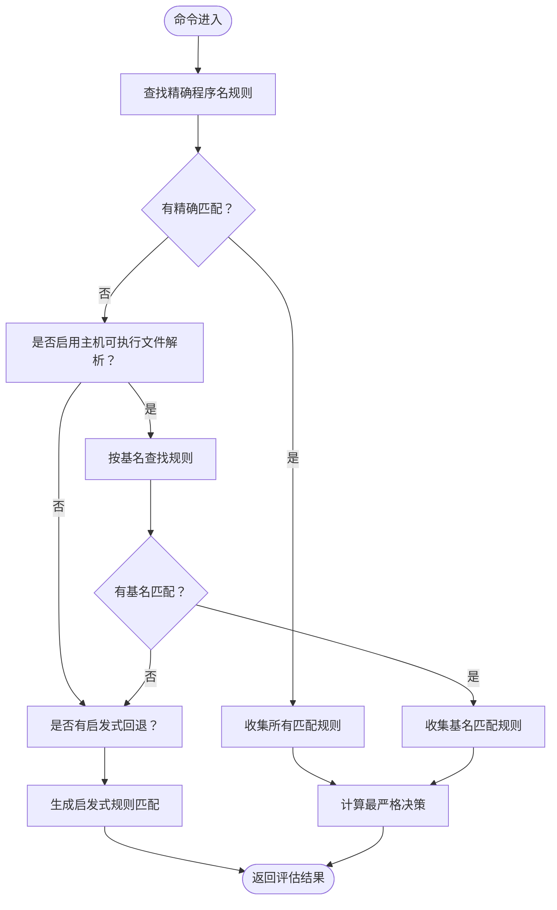
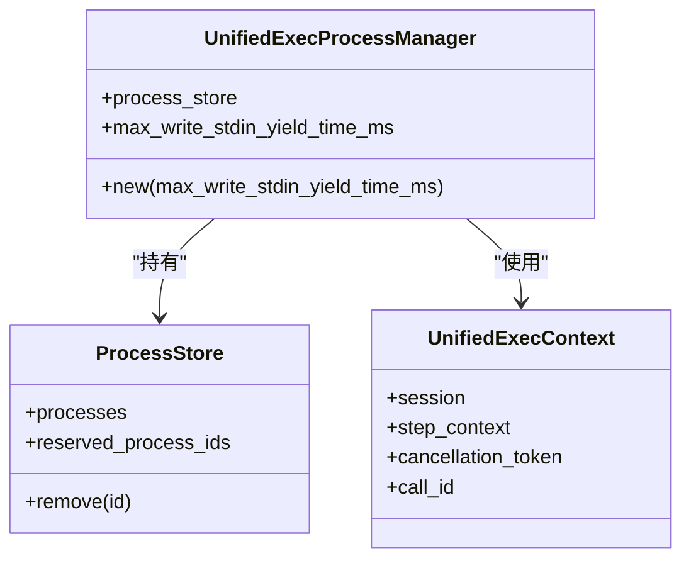
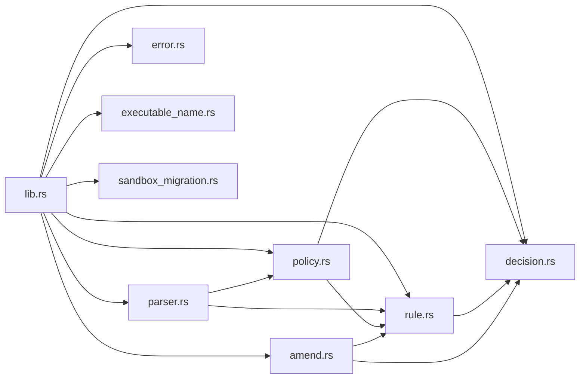

# 高级执行配置

<cite>
**本文引用的文件**   
- [codex-rs/execpolicy/src/lib.rs](file://codex-rs/execpolicy/src/lib.rs)
- [codex-rs/execpolicy/src/parser.rs](file://codex-rs/execpolicy/src/parser.rs)
- [codex-rs/execpolicy/src/policy.rs](file://codex-rs/execpolicy/src/policy.rs)
- [codex-rs/execpolicy/src/rule.rs](file://codex-rs/execpolicy/src/rule.rs)
- [codex-rs/execpolicy/src/decision.rs](file://codex-rs/execpolicy/src/decision.rs)
- [codex-rs/execpolicy/src/executable_name.rs](file://codex-rs/execpolicy/src/executable_name.rs)
- [codex-rs/execpolicy/src/amend.rs](file://codex-rs/execpolicy/src/amend.rs)
- [codex-rs/execpolicy/src/error.rs](file://codex-rs/execpolicy/src/error.rs)
- [codex-rs/execpolicy/src/sandbox_migration.rs](file://codex-rs/execpolicy/src/sandbox_migration.rs)
- [codex-rs/config/src/requirements_exec_policy.rs](file://codex-rs/config/src/requirements_exec_policy.rs)
- [codex-rs/core/src/unified_exec/mod.rs](file://codex-rs/core/src/unified_exec/mod.rs)
- [codex-rs/core/src/unified_exec/process_manager.rs](file://codex-rs/core/src/unified_exec/process_manager.rs)
- [codex-rs/exec-server/src/runtime_options.rs](file://codex-rs/exec-server/src/runtime_options.rs)
- [codex-rs/exec-server/src/sandbox_selection.rs](file://codex-rs/exec-server/src/sandbox_selection.rs)
- [codex-rs/sandboxing/src/lib.rs](file://codex-rs/sandboxing/src/lib.rs)
- [codex-rs/sandboxing/src/manager.rs](file://codex-rs/sandboxing/src/manager.rs)
</cite>

## 目录
1. [引言](#引言)
2. [项目结构](#项目结构)
3. [核心组件](#核心组件)
4. [架构总览](#架构总览)
5. [详细组件分析](#详细组件分析)
6. [依赖关系分析](#依赖关系分析)
7. [性能与并发特性](#性能与并发特性)
8. [故障排查指南](#故障排查指南)
9. [结论](#结论)
10. [附录：执行策略语法与场景示例](#附录执行策略语法与场景示例)

## 引言
本文面向需要精细控制代码执行环境的高级用户，重点说明以下能力：
- 执行策略语言 execpolicy 的语法、匹配规则与决策语义。
- 沙箱模式选择、平台实现与网络访问控制。
- 多进程执行、并发上限、超时处理、输出缓冲等运行时约束。
- 通过 requirements 配置合并策略、使用托管命令规则和网络规则。
- CI/CD、批量处理与安全隔离场景的配置建议与排错方法。

需要特别注意：execpolicy 主要定义“允许哪些命令、如何审批或拒绝”，并不直接提供系统级内存限制、CPU 配额等操作系统资源限制；后者通常由底层沙箱、容器编排或操作系统 cgroup 机制提供。

## 项目结构
与“高级执行配置”最相关的仓库子模块包括：
- `codex-rs/execpolicy`：执行策略解析器、Starlark 规则引擎、决策与结果序列化。
- `codex-rs/config`：将 `requirements.toml` 中的规则转换为内部 Policy。
- `codex-rs/core`：统一执行入口，负责审批、沙箱选择、PTY 会话、进程管理、输出缓冲和超时。
- `codex-rs/exec-server`：远程或本地执行服务，负责参数传递、沙箱选择和运行期选项。
- `codex-rs/sandboxing`：跨平台沙箱抽象，包含 Linux、macOS、Windows 及 MXC 相关类型。

**图表来源**
- [codex-rs/core/src/unified_exec/mod.rs:1-200](file://codex-rs/core/src/unified_exec/mod.rs#L1-L200)
- [codex-rs/execpolicy/src/lib.rs:1-33](file://codex-rs/execpolicy/src/lib.rs#L1-L33)
- [codex-rs/sandboxing/src/lib.rs:1-110](file://codex-rs/sandboxing/src/lib.rs#L1-L110)
- [codex-rs/exec-server/src/runtime_options.rs:1-82](file://codex-rs/exec-server/src/runtime_options.rs#L1-L82)

**章节来源**
- [codex-rs/core/src/unified_exec/mod.rs:1-200](file://codex-rs/core/src/unified_exec/mod.rs#L1-L200)
- [codex-rs/execpolicy/src/lib.rs:1-33](file://codex-rs/execpolicy/src/lib.rs#L1-L33)
- [codex-rs/sandboxing/src/lib.rs:1-110](file://codex-rs/sandboxing/src/lib.rs#L1-L110)
- [codex-rs/exec-server/src/runtime_options.rs:1-82](file://codex-rs/exec-server/src/runtime_options.rs#L1-L82)

## 核心组件
本节聚焦执行配置中最关键的几个模块。

### 执行策略引擎 execpolicy
- 提供 Starlark 风格的 `prefix_rule` 与可选的 `host_executable` 元数据。
- 支持 `allow`、`prompt`、`prompt-user`、`forbidden` 四种决策。
- 支持精确程序名匹配、可选的主机可执行文件基名回退、Unicode 规范大小写不敏感匹配。
- 提供 CLI 子命令检查命令是否匹配策略，并输出 JSON 评估结果。
- 支持追加策略文件的辅助函数，以及迁移旧版 allow 规则的工具。

关键数据结构与职责：
- `PolicyParser`：解析 Starlark 策略文件，构建内部规则集合。
- `Policy`：保存程序到规则的映射、网络规则、主机可执行文件路径映射，并提供匹配 API。
- `PrefixRule` / `PrefixPattern`：命令前缀匹配模式，支持替代 token 与规范化匹配。
- `Decision`：命令决策枚举。
- `Evaluation` / `RuleMatch`：匹配结果与最终决策。

**章节来源**
- [codex-rs/execpolicy/src/parser.rs:1-200](file://codex-rs/execpolicy/src/parser.rs#L1-L200)
- [codex-rs/execpolicy/src/policy.rs:1-200](file://codex-rs/execpolicy/src/policy.rs#L1-L200)
- [codex-rs/execpolicy/src/rule.rs:1-200](file://codex-rs/execpolicy/src/rule.rs#L1-L200)
- [codex-rs/execpolicy/src/decision.rs:1-30](file://codex-rs/execpolicy/src/decision.rs#L1-L30)
- [codex-rs/execpolicy/src/lib.rs:1-33](file://codex-rs/execpolicy/src/lib.rs#L1-L33)

### requirements 配置转换
`requirements.toml` 中的 `[rules]` 会被转换为内部 Policy，用于与其他配置合并并取最严格决策。该层禁止在 requirements 中使用 `allow` 决策，因为合并语义要求显式审批或拒绝。

关键点：
- `RequirementsExecPolicyToml` 对应 TOML 配置。
- `to_policy()` 把 pattern token 与 decision 转换为内部 PrefixRule。
- 支持 `canonical_matching` 和 justification。

**章节来源**
- [codex-rs/config/src/requirements_exec_policy.rs:1-200](file://codex-rs/config/src/requirements_exec_policy.rs#L1-L200)

### 统一执行入口 core::unified_exec
统一执行负责把“用户想执行的命令”转化为带审批、沙箱、TTY、网络代理和输出缓冲的实际进程启动流程。

关键常量与行为：
- `MAX_UNIFIED_EXEC_PROCESSES = 64`：统一执行上下文中的并发进程上限。
- 输出缓冲默认最大字节数与 token 数。
- 后台终端会话默认超时时间。
- 对沙箱网络代理拒绝进行提示与重试。

**章节来源**
- [codex-rs/core/src/unified_exec/mod.rs:1-200](file://codex-rs/core/src/unified_exec/mod.rs#L1-L200)

### 执行服务 exec-server 与运行期选项
exec-server 接收来自 core 的执行请求，负责：
- 组装 `ExecParams`（命令、工作目录、环境变量策略、沙箱类型等）。
- 注入线程信息、工具调用标识。
- 根据运行期选项决定 Linux PID 命名空间、MXC 偏好等。

**章节来源**
- [codex-rs/core/src/unified_exec/process_manager.rs:1-250](file://codex-rs/core/src/unified_exec/process_manager.rs#L1-L250)
- [codex-rs/exec-server/src/runtime_options.rs:1-82](file://codex-rs/exec-server/src/runtime_options.rs#L1-L82)

### 沙箱抽象 sandboxing
sandboxing 提供跨平台沙箱类型与选择逻辑：
- Linux：seccomp / bubblewrap。
- macOS：Seatbelt。
- Windows：受限令牌、MXC。
- 暴露 `SandboxType`、`SandboxExecRequest`、`SandboxTransformRequest` 等结构。

**章节来源**
- [codex-rs/sandboxing/src/lib.rs:1-110](file://codex-rs/sandboxing/src/lib.rs#L1-L110)
- [codex-rs/sandboxing/src/manager.rs:100-250](file://codex-rs/sandboxing/src/manager.rs#L100-L250)
- [codex-rs/exec-server/src/sandbox_selection.rs:1-46](file://codex-rs/exec-server/src/sandbox_selection.rs#L1-L46)

## 架构总览
下图展示一次典型命令执行的配置与控制流：

**图表来源**
- [codex-rs/core/src/unified_exec/mod.rs:1-200](file://codex-rs/core/src/unified_exec/mod.rs#L1-L200)
- [codex-rs/execpolicy/src/policy.rs:201-595](file://codex-rs/execpolicy/src/policy.rs#L201-L595)
- [codex-rs/sandboxing/src/manager.rs:100-250](file://codex-rs/sandboxing/src/manager.rs#L100-L250)
- [codex-rs/core/src/unified_exec/process_manager.rs:1-250](file://codex-rs/core/src/unified_exec/process_manager.rs#L1-L250)

## 详细组件分析

### 执行策略语法与匹配规则
execpolicy 当前支持的规则形式包括：
- `prefix_rule(pattern=[...], decision=?, justification=?, match=?, not_match?, canonical_matching=?)`
- 可选 `host_executable(name=..., paths=[...])` 用于限定绝对路径回退到基名规则的条件。

匹配顺序与语义：
1. 先尝试精确程序名匹配。
2. 若启用主机可执行文件解析且无精确匹配，则按基名回退。
3. 若仍无匹配，可调用启发式回退函数得到单一 `HeuristicsRuleMatch`。
4. 多个匹配规则的最终决策是最严格的：`forbidden > prompt-user > prompt > allow`。

**图表来源**
- [codex-rs/execpolicy/src/policy.rs:201-595](file://codex-rs/execpolicy/src/policy.rs#L201-L595)
- [codex-rs/execpolicy/src/rule.rs:1-200](file://codex-rs/execpolicy/src/rule.rs#L1-L200)

#### 决策语义
- `Allow`：无需额外审批即可执行。
- `Prompt`：向配置的审阅者请求审批；若审批策略为从不，则拒绝。
- `PromptUser`：需要独立于审阅者的实时人工决策。
- `Forbidden`：无条件阻止。

注意：在 `requirements.toml` 中不允许使用 `allow` 决策，因为 requirements 会被合并，而合并采用“最严格优先”语义。

**章节来源**
- [codex-rs/execpolicy/src/decision.rs:1-30](file://codex-rs/execpolicy/src/decision.rs#L1-L30)
- [codex-rs/config/src/requirements_exec_policy.rs:1-200](file://codex-rs/config/src/requirements_exec_policy.rs#L1-L200)

#### 主机可执行文件与白名单语义
execpolicy 没有传统意义上的“命令白名单”字段，但可以通过以下方式实现类似效果：
- 使用 `prefix_rule` 明确列出允许的完整命令前缀。
- 使用 `host_executable` 限制绝对路径回退到基名规则时只允许特定路径。
- 对不允许的命令使用 `forbidden` 或 `prompt`。
- 使用 `match` 与 `not_match` 作为加载时验证用例。

**章节来源**
- [codex-rs/execpolicy/src/policy.rs:201-595](file://codex-rs/execpolicy/src/policy.rs#L201-L595)
- [codex-rs/execpolicy/src/executable_name.rs:1-29](file://codex-rs/execpolicy/src/executable_name.rs#L1-L29)
- [codex-rs/execpolicy/src/rule.rs:201-319](file://codex-rs/execpolicy/src/rule.rs#L201-L319)

#### 网络规则
execpolicy 还支持网络规则，用于声明对某些主机或协议的允许、提示或拒绝。网络规则会参与“已编译网络域”的允许/拒绝集合比较，并在快照或需求一致性检查中发挥作用。

协议支持：
- `http`
- `https`、`https_connect`、`http-connect`
- `socks5_tcp`
- `socks5_udp`

**章节来源**
- [codex-rs/execpolicy/src/rule.rs:1-200](file://codex-rs/execpolicy/src/rule.rs#L1-L200)
- [codex-rs/execpolicy/src/policy.rs:201-595](file://codex-rs/execpolicy/src/policy.rs#L201-L595)

### 多进程执行与并发控制
统一执行模块维护进程存储与会话复用，同时设置全局并发上限：
- `MAX_UNIFIED_EXEC_PROCESSES = 64`。
- 输出缓冲限制避免无限增长。
- 后台终端会话具有默认超时。
- 写入 stdin 时存在 yield 时间下限与上限，用于平衡交互响应与 CPU 占用。

**图表来源**
- [codex-rs/core/src/unified_exec/mod.rs:1-200](file://codex-rs/core/src/unified_exec/mod.rs#L1-L200)

**章节来源**
- [codex-rs/core/src/unified_exec/mod.rs:1-200](file://codex-rs/core/src/unified_exec/mod.rs#L1-L200)

### 超时与失败处理
统一执行与执行服务均使用异步超时机制：
- 统一执行侧对后台终端会话、输出读取、stdin 写入等场景设置超时。
- 执行服务客户端存在连接超时与初始化超时。
- 恢复与刷新流程中存在多次超时保护。

注意：这些超时是应用层异步超时，不是操作系统进程的硬终止信号；实际进程生命周期还取决于沙箱、TTY、管道和网络代理。

**章节来源**
- [codex-rs/core/src/unified_exec/process_manager.rs:1-250](file://codex-rs/core/src/unified_exec/process_manager.rs#L1-L250)
- [codex-rs/exec-server/src/client_recovery.rs:370-447](file://codex-rs/exec-server/src/client_recovery.rs#L370-L447)

### 沙箱模式与平台实现
沙箱选择由 exec-server 与 sandboxing 共同完成：
- exec-server 根据权限配置、Windows 沙箱级别、MXC 支持情况选择初始沙箱类型。
- sandboxing 暴露 `SandboxType`，并在不同平台上映射到具体后端。
- 当启用到托管网络的受控网络需求时，沙箱选择可能更严格。

常见沙箱类型：
- 无沙箱。
- Linux seccomp。
- macOS Seatbelt。
- Windows 受限令牌。
- Windows MXC。

**章节来源**
- [codex-rs/exec-server/src/sandbox_selection.rs:1-46](file://codex-rs/exec-server/src/sandbox_selection.rs#L1-L46)
- [codex-rs/sandboxing/src/lib.rs:1-110](file://codex-rs/sandboxing/src/lib.rs#L1-L110)
- [codex-rs/sandboxing/src/manager.rs:100-250](file://codex-rs/sandboxing/src/manager.rs#L100-L250)

### 策略修改与迁移
execpolicy 提供两种辅助能力：
- 追加允许的前缀规则或网络规则到策略文件。
- 迁移旧版 allow 规则：移除不再支持的精确 allow 规则，并在 codex home 下写入一次性迁移标记。

**章节来源**
- [codex-rs/execpolicy/src/amend.rs:1-200](file://codex-rs/execpolicy/src/amend.rs#L1-L200)
- [codex-rs/execpolicy/src/sandbox_migration.rs:1-123](file://codex-rs/execpolicy/src/sandbox_migration.rs#L1-L123)

## 依赖关系分析
execpolicy 模块之间的依赖如下：

**图表来源**
- [codex-rs/execpolicy/src/lib.rs:1-33](file://codex-rs/execpolicy/src/lib.rs#L1-L33)
- [codex-rs/execpolicy/src/parser.rs:1-200](file://codex-rs/execpolicy/src/parser.rs#L1-L200)
- [codex-rs/execpolicy/src/policy.rs:1-200](file://codex-rs/execpolicy/src/policy.rs#L1-L200)
- [codex-rs/execpolicy/src/rule.rs:1-200](file://codex-rs/execpolicy/src/rule.rs#L1-L200)
- [codex-rs/execpolicy/src/decision.rs:1-30](file://codex-rs/execpolicy/src/decision.rs#L1-L30)
- [codex-rs/execpolicy/src/amend.rs:1-200](file://codex-rs/execpolicy/src/amend.rs#L1-L200)
- [codex-rs/execpolicy/src/error.rs:1-101](file://codex-rs/execpolicy/src/error.rs#L1-L101)
- [codex-rs/execpolicy/src/executable_name.rs:1-29](file://codex-rs/execpolicy/src/executable_name.rs#L1-L29)
- [codex-rs/execpolicy/src/sandbox_migration.rs:1-123](file://codex-rs/execpolicy/src/sandbox_migration.rs#L1-L123)

**章节来源**
- [codex-rs/execpolicy/src/lib.rs:1-33](file://codex-rs/execpolicy/src/lib.rs#L1-L33)

## 性能与并发特性
- 并发上限：统一执行最多维护 64 个进程。
- 输出缓冲：默认最大约 1 MiB 字节，token 数量按近似比例限制。
- Yield 控制：写入 stdin 时使用最小/最大 yield 时间，避免频繁轮询导致 CPU 抖动。
- 超时控制：后台终端会话默认超时、异步恢复与刷新流程存在多处超时保护。
- 策略匹配：前缀规则匹配复杂度大致与规则数量和命令长度线性相关；基名回退会增加少量文件系统名称解析成本。

优化建议：
- 合理拆分策略文件，避免单文件规则过多。
- 对高频命令使用前缀规则精确匹配，减少基名回退。
- 控制并发任务数量，避免超过 64 个统一执行进程。
- 使用输出截断策略，防止大量日志拖慢 I/O。

[本节为通用性能讨论，不直接分析具体源码行]

## 故障排查指南

### 策略无法匹配命令
常见问题：
- 命令使用了绝对路径，但未启用主机可执行文件解析。
- 基名回退被 `host_executable` 限制，实际路径不在允许列表中。
- Unicode 大小写不敏感匹配未开启，但命令使用了不同大小写。
- `match` 或 `not_match` 用例与实际命令不一致。

排查步骤：
1. 确认是否使用 `--resolve-host-executables` 或相应 API 选项。
2. 检查 `host_executable` 声明是否包含实际绝对路径。
3. 如需忽略大小写，使用 `canonical_matching=True`。
4. 使用 CLI 检查策略匹配结果，观察 `matchedRules` 与 `decision`。

**章节来源**
- [codex-rs/execpolicy/src/policy.rs:201-595](file://codex-rs/execpolicy/src/policy.rs#L201-L595)
- [codex-rs/execpolicy/src/executable_name.rs:1-29](file://codex-rs/execpolicy/src/executable_name.rs#L1-L29)

### 命令被拒绝或反复提示
常见问题：
- 策略中设置了 `forbidden`。
- 策略中设置了 `prompt` 或 `prompt-user`，但审阅策略不允许自动批准。
- requirements 合并后出现更严格决策。

排查步骤：
1. 查看最终 `decision` 是否为 `forbidden`。
2. 检查是否混入了 `prompt-user`。
3. 检查 requirements 配置是否强制要求审批。

**章节来源**
- [codex-rs/execpolicy/src/decision.rs:1-30](file://codex-rs/execpolicy/src/decision.rs#L1-L30)
- [codex-rs/config/src/requirements_exec_policy.rs:1-200](file://codex-rs/config/src/requirements_exec_policy.rs#L1-L200)

### 沙箱启动失败
常见问题：
- 目标平台不支持所选沙箱类型。
- Linux 缺少 bubblewrap 或 seccomp 支持。
- macOS 缺少 Seatbelt。
- Windows 不支持 MXC 或受限令牌。
- 网络代理或证书信任链配置错误。

排查步骤：
1. 查看选择的 `SandboxType`。
2. 检查平台兼容性。
3. 检查 exec-server 是否具备所需能力。
4. 查看沙箱违反记录和网络代理拒绝消息。

**章节来源**
- [codex-rs/sandboxing/src/lib.rs:1-110](file://codex-rs/sandboxing/src/lib.rs#L1-L110)
- [codex-rs/exec-server/src/sandbox_selection.rs:1-46](file://codex-rs/exec-server/src/sandbox_selection.rs#L1-L46)
- [codex-rs/core/src/unified_exec/process_manager.rs:1-250](file://codex-rs/core/src/unified_exec/process_manager.rs#L1-L250)

### 进程超时或无输出
常见问题：
- 后台终端会话超时。
- 输出缓冲区过大导致延迟。
- stdin 写入 yield 时间过长。
- 执行服务连接或初始化超时。

排查步骤：
1. 检查后台终端超时配置。
2. 检查输出截断策略。
3. 调整写入 yield 时间。
4. 检查执行服务客户端超时。

**章节来源**
- [codex-rs/core/src/unified_exec/mod.rs:1-200](file://codex-rs/core/src/unified_exec/mod.rs#L1-L200)
- [codex-rs/core/src/unified_exec/process_manager.rs:1-250](file://codex-rs/core/src/unified_exec/process_manager.rs#L1-L250)

## 结论
execpolicy 提供了基于前缀规则和主机可执行文件元数据的命令控制能力，结合 requirements 配置可实现策略合并与托管决策。统一执行模块提供多进程并发上限、输出缓冲、超时控制和沙箱选择。对于真正的系统级资源限制，应结合操作系统沙箱、容器或编排平台的能力，而不是仅依赖 execpolicy。

在实际部署中，建议：
- 使用 execpolicy 精确控制允许执行的命令和审批流程。
- 使用 requirements 强化安全边界，禁止隐式 allow。
- 使用沙箱限制进程权限、网络和文件系统访问。
- 使用并发上限、输出截断和超时控制保障稳定性。
- 在 CI/CD 和批量场景中，优先使用非交互式策略检查与离线策略验证。

[本节为总结性内容，不直接分析具体源码行]

## 附录：执行策略语法与场景示例

### execpolicy 语法要点
- `prefix_rule`：命令前缀匹配，支持替代 token、决策、理由、匹配用例、非匹配用例、规范化大小写匹配。
- `host_executable`：限定绝对路径回退到基名规则的可执行程序列表。
- 决策值：`allow`、`prompt`、`prompt-user`、`forbidden`。
- 最终决策：多个匹配规则中取最严格决策。

参考位置：
- [codex-rs/execpolicy/README.md](file://codex-rs/execpolicy/README.md)
- [codex-rs/execpolicy/src/parser.rs:1-200](file://codex-rs/execpolicy/src/parser.rs#L1-L200)
- [codex-rs/execpolicy/src/policy.rs:201-595](file://codex-rs/execpolicy/src/policy.rs#L201-L595)

### 复杂执行场景建议

#### CI/CD 集成
- 使用 `forbidden` 阻止危险命令。
- 使用 `prompt` 触发审阅流程。
- 使用 `match` 与 `not_match` 验证策略。
- 使用 CLI 在非交互式模式下校验命令。

#### 批量处理
- 使用 `check_multiple` 类 API 批量评估命令。
- 控制并发不超过 64。
- 使用输出截断和超时保护长任务。

#### 安全隔离
- 启用平台沙箱。
- 使用托管网络需求限制出站访问。
- 使用 `host_executable` 限制可执行路径。
- 避免在 requirements 中使用 `allow`。

[本节为概念性指导，不直接分析具体源码行]