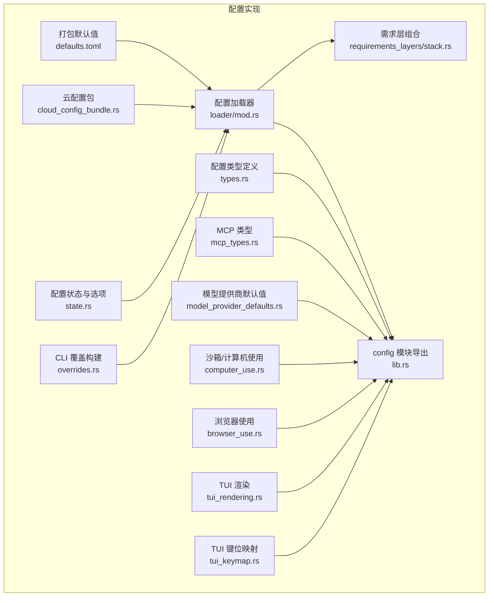
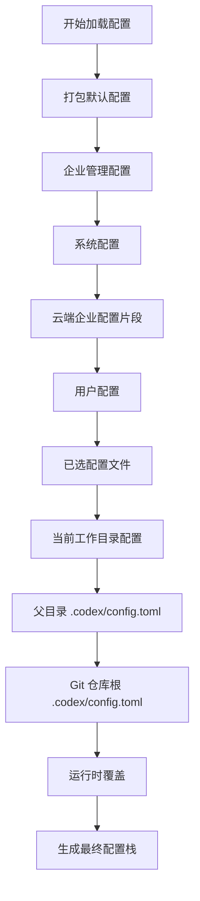
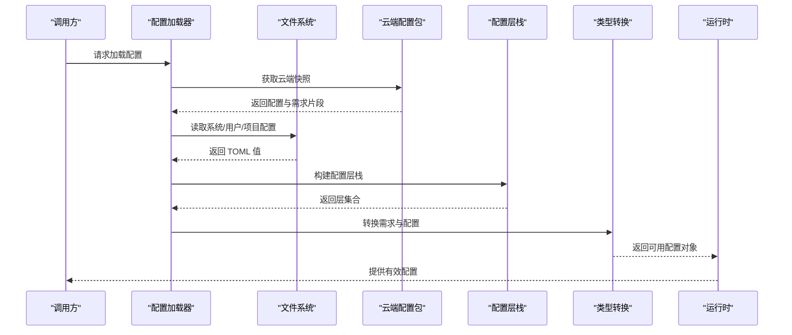
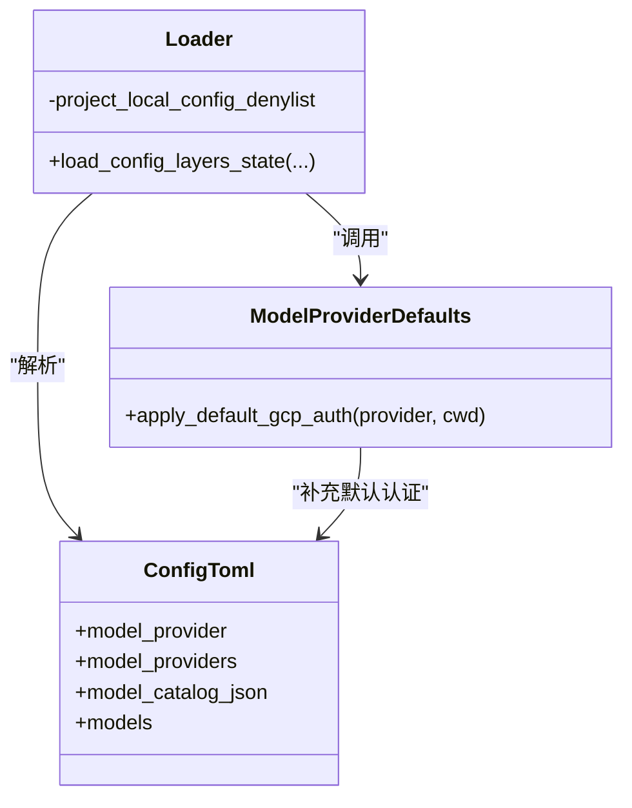
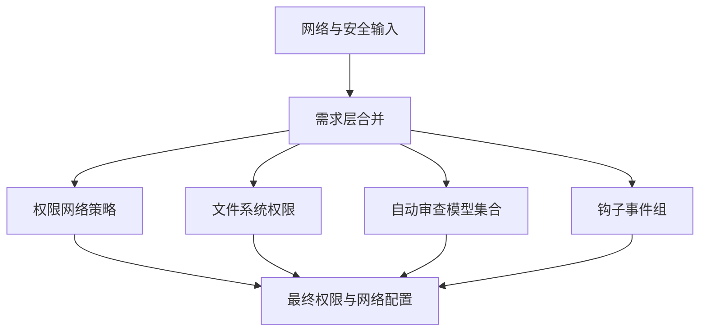
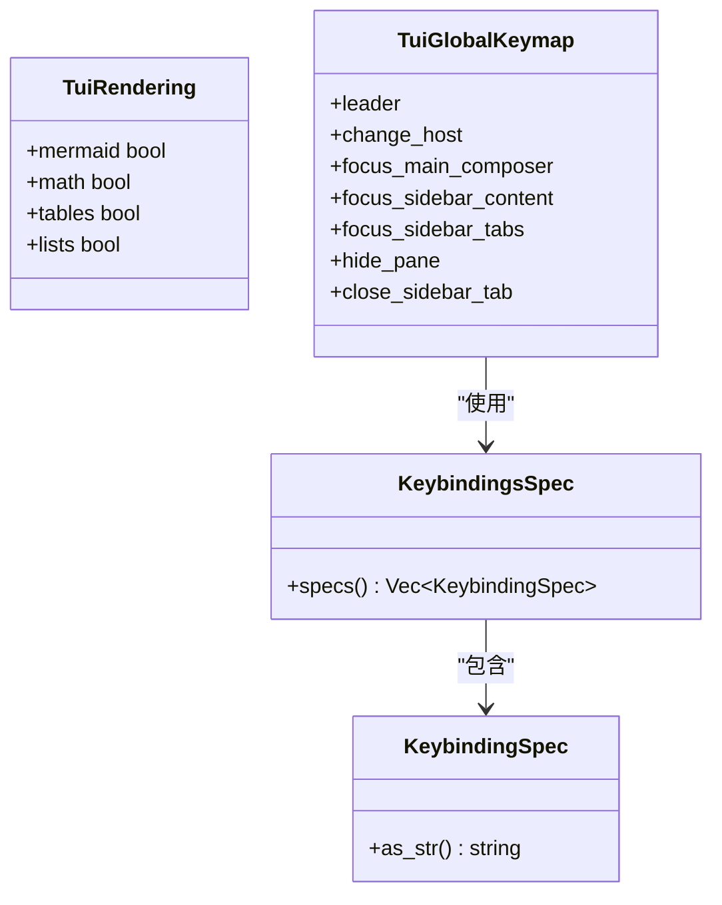
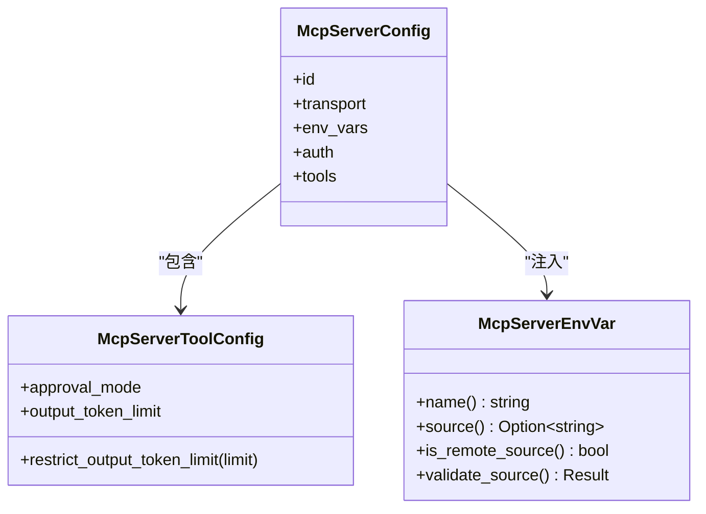
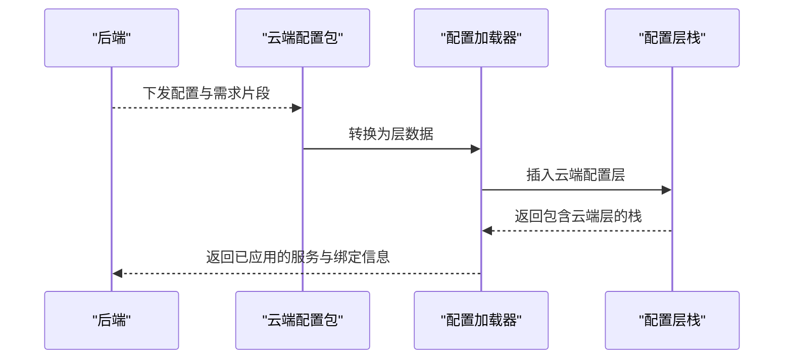
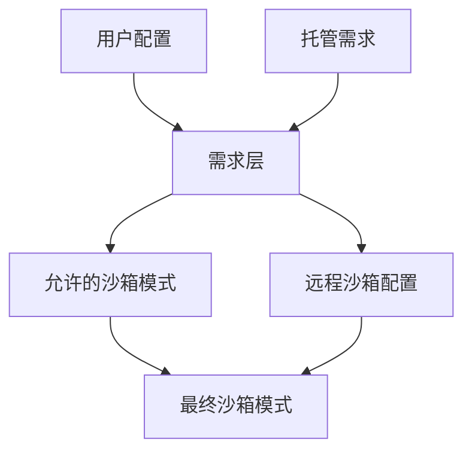
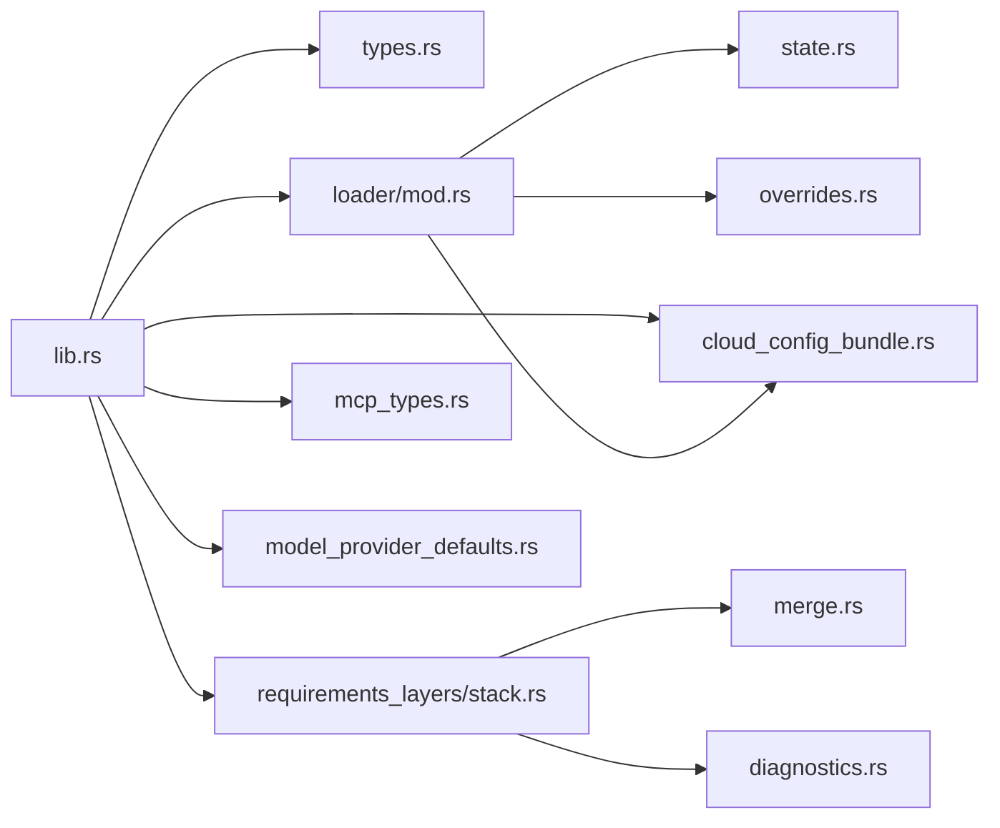

# 高级配置

<cite>
**本文引用的文件**   
- [docs/config.md](file://docs/config.md)
- [defaults.toml](file://codex-rs/config/defaults.toml)
- [lib.rs](file://codex-rs/config/src/lib.rs)
- [types.rs](file://codex-rs/config/src/types.rs)
- [loader/mod.rs](file://codex-rs/config/src/loader/mod.rs)
- [state.rs](file://codex-rs/config/src/state.rs)
- [overrides.rs](file://codex-rs/config/src/overrides.rs)
- [stack.rs](file://codex-rs/config/src/requirements_layers/stack.rs)
- [cloud_config_bundle.rs](file://codex-rs/config/src/cloud_config_bundle.rs)
- [mcp_types.rs](file://codex-rs/config/src/mcp_types.rs)
- [model_provider_defaults.rs](file://codex-rs/config/src/model_provider_defaults.rs)
- [computer_use.rs](file://codex-rs/config/src/computer_use.rs)
- [browser_use.rs](file://codex-rs/config/src/browser_use.rs)
- [tui_rendering.rs](file://codex-rs/config/src/tui_rendering.rs)
- [tui_keymap.rs](file://codex-rs/config/src/tui_keymap.rs)
</cite>

## 目录
1. [引言](#引言)
2. [项目结构](#项目结构)
3. [核心组件](#核心组件)
4. [架构总览](#架构总览)
5. [详细组件分析](#详细组件分析)
6. [依赖关系分析](#依赖关系分析)
7. [性能与行为特征](#性能与行为特征)
8. [故障排查指南](#故障排查指南)
9. [结论](#结论)
10. [附录：高级配置场景清单](#附录高级配置场景清单)

## 引言
本“高级配置”文档面向需要深入控制 Codex 行为的用户与系统管理员，重点覆盖以下主题：
- 配置层次结构与优先级规则。
- 模型提供商配置、网络策略与安全限制。
- TUI 自定义（键位映射、渲染偏好）。
- MCP 服务器配置与企业级托管要求。
- 动态配置更新机制、热重载能力与运行时覆盖。
- 高级使用场景示例：自定义代理、沙箱模式、浏览器与计算机使用策略。
- 配置验证与调试技巧。

该仓库将基础配置说明指向外部开发者文档；完整的高级配置参考也位于同一系列文档中。当前代码库中的 Rust 配置模块提供了这些功能的实现基础。

**章节来源**
- [docs/config.md:1-15](file://docs/config.md#L1-L15)

## 项目结构
Codex 的配置体系主要由 `codex-rs/config` 模块实现，围绕“配置层”“需求层”“类型定义”“加载器”“云配置包”“MCP 类型”等子模块组织：
- 顶层导出集中在 `lib.rs`，对外暴露所有可配置的 TOML 结构体、错误类型和公共 API。
- 类型定义集中在 `types.rs`，包括认证存储、历史、遥测、应用、TUI、MCP 等结构。
- 配置加载流程在 `loader/mod.rs`，负责从打包默认值、系统、云、用户、项目、会话等多个层级组装配置栈。
- “需求层”组合逻辑在 `requirements_layers/stack.rs`，用于合并企业或托管强约束。
- 云端配置包在 `cloud_config_bundle.rs`，把后端下发的配置与需求片段转换为本地层。
- MCP 服务器相关类型在 `mcp_types.rs`。
- 模型提供商默认行为在 `model_provider_defaults.rs`。
- 安全与执行相关配置（沙箱、浏览器、计算机使用）分别由 `computer_use.rs`、`browser_use.rs` 及相关文件管理。
- TUI 自定义集中在 `tui_rendering.rs` 与 `tui_keymap.rs`。

**图表来源**
- [lib.rs:1-200](file://codex-rs/config/src/lib.rs#L1-L200)
- [types.rs:1-120](file://codex-rs/config/src/types.rs#L1-L120)
- [loader/mod.rs:1-200](file://codex-rs/config/src/loader/mod.rs#L1-L200)
- [stack.rs:1-60](file://codex-rs/config/src/requirements_layers/stack.rs#L1-L60)
- [cloud_config_bundle.rs:1-80](file://codex-rs/config/src/cloud_config_bundle.rs#L1-L80)
- [mcp_types.rs:1-60](file://codex-rs/config/src/mcp_types.rs#L1-L60)
- [model_provider_defaults.rs:1-27](file://codex-rs/config/src/model_provider_defaults.rs#L1-L27)
- [computer_use.rs:1-39](file://codex-rs/config/src/computer_use.rs#L1-L39)
- [browser_use.rs:1-26](file://codex-rs/config/src/browser_use.rs#L1-L26)
- [tui_rendering.rs:1-31](file://codex-rs/config/src/tui_rendering.rs#L1-L31)
- [tui_keymap.rs:1-40](file://codex-rs/config/src/tui_keymap.rs#L1-L40)
- [defaults.toml:1-18](file://codex-rs/config/defaults.toml#L1-L18)
- [state.rs:1-60](file://codex-rs/config/src/state.rs#L1-L60)
- [overrides.rs:1-40](file://codex-rs/config/src/overrides.rs#L1-L40)

**章节来源**
- [lib.rs:1-200](file://codex-rs/config/src/lib.rs#L1-L200)

## 核心组件
### 配置层与优先级
配置从多个来源按固定顺序叠加，低优先级提供默认值，高优先级进行覆盖或扩展。主要顺序为：
1. 打包默认配置。
2. 企业管理配置。
3. 系统配置。
4. 云端企业配置片段。
5. 用户配置。
6. 已选配置文件。
7. 当前工作目录配置。
8. 父目录 `.codex/config.toml`。
9. Git 仓库根 `.codex/config.toml`。
10. 运行时覆盖，例如命令行参数或 UI 选择。

此外，需求层用于表达管理员或企业强制的“允许/拒绝”范围，其组合顺序与配置层一致，但部分字段采用特殊合并策略。

**图表来源**
- [loader/mod.rs:120-220](file://codex-rs/config/src/loader/mod.rs#L120-L220)

**章节来源**
- [loader/mod.rs:100-220](file://codex-rs/config/src/loader/mod.rs#L100-L220)

### 配置加载状态与选项
配置加载过程通过 `ConfigLoadOptions` 控制：
- 是否忽略托管配置。
- 是否忽略登录需求。
- 是否忽略用户配置。
- 是否忽略项目配置。
- 是否忽略用户和项目执行策略规则。
- 是否启用严格配置校验。
- 云端配置包加载器。

`LoaderOverrides` 进一步允许测试或宿主程序注入包路径、用户路径、系统路径、托管路径等。

**章节来源**
- [state.rs:1-120](file://codex-rs/config/src/state.rs#L1-L120)

### CLI 覆盖构建
CLI 覆盖以点号路径形式写入 TOML，并支持结构化特性路径的特殊处理：布尔值会被包装成 `enabled` 字段，表值会合并到已有表中。

**章节来源**
- [overrides.rs:1-99](file://codex-rs/config/src/overrides.rs#L1-L99)

## 架构总览
整体配置架构由“加载器 + 层栈 + 需求组合 + 类型转换 + 运行时访问”组成：
- 加载器负责发现文件、解析 TOML、应用严格配置、处理项目信任。
- 层栈记录每个来源的名称、版本、禁用原因、原始 TOML 与钩子目录。
- 需求组合负责合并托管与用户需求，保留字段来源信息。
- 类型转换将 TOML 投影为强类型配置，并应用默认值。
- 运行时可通过配置快照读取有效值，并可附加云绑定、已应用服务、EMA 取消上下文等元数据。

**图表来源**
- [loader/mod.rs:200-600](file://codex-rs/config/src/loader/mod.rs#L200-L600)
- [cloud_config_bundle.rs:1-120](file://codex-rs/config/src/cloud_config_bundle.rs#L1-L120)
- [state.rs:60-180](file://codex-rs/config/src/state.rs#L60-L180)

## 详细组件分析

### 模型提供商配置
模型提供商配置涉及：
- 全局模型提供商选择。
- 多提供商列表。
- 提供商默认行为，例如 GCP 命令认证默认值。
- 模型目录 JSON。
- 模型需求与平台限制。

关键实现点：
- `types.rs` 导出大量配置结构，包含模型、记忆、遥测、应用、TUI、MCP 等。
- `model_provider_defaults.rs` 在无显式认证时提供 GCP 命令认证默认值，并使用工作目录作为 cwd，避免进程 cwd 被删除后失效。
- `loader/mod.rs` 对模型相关字段有项目本地配置黑名单，防止项目配置决定敏感行为，如 OpenAI 或 ChatGPT 基础地址、模型提供商、遥测等。

**图表来源**
- [types.rs:1-120](file://codex-rs/config/src/types.rs#L1-L120)
- [model_provider_defaults.rs:1-27](file://codex-rs/config/src/model_provider_defaults.rs#L1-L27)
- [loader/mod.rs:140-180](file://codex-rs/config/src/loader/mod.rs#L140-L180)

**章节来源**
- [model_provider_defaults.rs:1-27](file://codex-rs/config/src/model_provider_defaults.rs#L1-L27)
- [loader/mod.rs:140-180](file://codex-rs/config/src/loader/mod.rs#L140-L180)
- [types.rs:1-120](file://codex-rs/config/src/types.rs#L1-L120)

### 网络策略与安全设置
网络与安全相关配置包括：
- 网络代理。
- 域名权限。
- Unix Socket 权限。
- 头部注入。
- 文件系统权限。
- 沙箱模式。
- 远程沙箱配置。
- 凭据存储模式。
- OAuth 凭据存储模式。
- 主机名策略。
- 外壳环境策略。
- Guardian 策略。

关键点：
- `types.rs` 定义了凭据存储模式、OAuth 存储模式、Windows 沙箱模式、历史持久化、遥测、应用与工具审批策略等。
- `stack.rs` 在需求层合并时保留 `network`、`permissions.filesystem`、`auto_review.required_on_models`、`hooks` 等字段的来源与合并语义。
- `loader/mod.rs` 在项目发现阶段结合托管配置、凭证代理信任信息与需求层计算项目信任。

**图表来源**
- [stack.rs:200-360](file://codex-rs/config/src/requirements_layers/stack.rs#L200-L360)
- [types.rs:120-300](file://codex-rs/config/src/types.rs#L120-L300)

**章节来源**
- [stack.rs:200-360](file://codex-rs/config/src/requirements_layers/stack.rs#L200-L360)
- [types.rs:120-300](file://codex-rs/config/src/types.rs#L120-L300)

### TUI 自定义
TUI 自定义分为两类：
- 渲染偏好：Mermaid、数学公式、表格、列表符号。
- 键位映射：全局键位、聊天、编辑器、批准、Vim 操作符与搜索、列表、分页器等上下文。

实现要点：
- `tui_rendering.rs` 定义渲染开关，默认全部启用。
- `tui_keymap.rs` 定义键位规范、归一化别名、最大函数键、最大连击按键数，以及各上下文的键位结构。
- 未知字段会在严格配置下报告，但键位解析本身不处理冲突与分发优先级。

**图表来源**
- [tui_rendering.rs:1-31](file://codex-rs/config/src/tui_rendering.rs#L1-L31)
- [tui_keymap.rs:1-120](file://codex-rs/config/src/tui_keymap.rs#L1-L120)

**章节来源**
- [tui_rendering.rs:1-31](file://codex-rs/config/src/tui_rendering.rs#L1-L31)
- [tui_keymap.rs:1-120](file://codex-rs/config/src/tui_keymap.rs#L1-L120)

### MCP 服务器配置
MCP 服务器配置包括：
- 服务器标识与身份匹配。
- 传输配置。
- 环境变量注入。
- OAuth 与企业 EMA 认证。
- 工具级审批与输出 token 预算。
- 启用/禁用原因。

实现要点：
- `mcp_types.rs` 定义 MCP 服务器配置、工具配置、环境变量、OAuth 配置、禁用原因等。
- 环境变量支持名称、带 source 的配置项，source 可为 `local` 或 `remote`，并提供校验方法。
- 工具级输出 token 预算可在外部收紧，但不改变审批策略。

**图表来源**
- [mcp_types.rs:1-180](file://codex-rs/config/src/mcp_types.rs#L1-L180)

**章节来源**
- [mcp_types.rs:1-180](file://codex-rs/config/src/mcp_types.rs#L1-L180)

### 动态配置更新与热重载
动态配置更新主要体现在云端配置包与配置快照机制：
- `CloudConfigBundle` 承载后端下发的配置与需求片段。
- `CloudConfigBundleLayers` 将其转换为配置层与需求层，并按插入顺序保留优先级。
- `ConfigLayerStack` 保存云绑定、已应用服务、EMA 取消上下文等运行时元数据，便于后续动态替换或查询。
- 加载器在启动时拉取云端快照，并在层栈中插入云端配置层。

**图表来源**
- [cloud_config_bundle.rs:1-200](file://codex-rs/config/src/cloud_config_bundle.rs#L1-L200)
- [loader/mod.rs:200-320](file://codex-rs/config/src/loader/mod.rs#L200-L320)
- [state.rs:180-260](file://codex-rs/config/src/state.rs#L180-L260)

**章节来源**
- [cloud_config_bundle.rs:1-200](file://codex-rs/config/src/cloud_config_bundle.rs#L1-L200)
- [loader/mod.rs:200-320](file://codex-rs/config/src/loader/mod.rs#L200-L320)
- [state.rs:180-260](file://codex-rs/config/src/state.rs#L180-L260)

### 沙箱模式与执行策略
沙箱模式与执行策略由需求层与配置层共同决定：
- 允许的沙箱模式由需求层限制。
- Windows 支持提升、非提升与 MXC 模式。
- 远程沙箱配置在每个需求层内评估后再合并。
- 执行策略受 `RequirementsExecPolicy` 与托管需求影响。

**图表来源**
- [stack.rs:1-60](file://codex-rs/config/src/requirements_layers/stack.rs#L1-L60)
- [types.rs:240-320](file://codex-rs/config/src/types.rs#L240-L320)

**章节来源**
- [stack.rs:1-60](file://codex-rs/config/src/requirements_layers/stack.rs#L1-L60)
- [types.rs:240-320](file://codex-rs/config/src/types.rs#L240-L320)

### 浏览器使用策略
浏览器使用策略允许：
- 控制浏览器历史记录访问。
- 设置默认源策略。
- 针对特定源的下载、上传、CDP 访问权限。

**章节来源**
- [browser_use.rs:1-26](file://codex-rs/config/src/browser_use.rs#L1-L26)

### 计算机使用策略
计算机使用策略允许：
- 设置默认应用访问策略。
- macOS 上按 bundle ID 白名单/黑名单。
- Windows 上按 AUMID 或可执行文件授权。

**章节来源**
- [computer_use.rs:1-39](file://codex-rs/config/src/computer_use.rs#L1-L39)

## 依赖关系分析
配置模块内部依赖关系清晰：
- `lib.rs` 是聚合层，导出所有对外类型。
- `types.rs` 提供基础类型，供其他模块引用。
- `loader/mod.rs` 依赖 `state.rs`、`cloud_config_bundle.rs`、`overrides.rs`、`merge.rs`、`diagnostics.rs`、`strict_config.rs` 等。
- `requirements_layers/stack.rs` 依赖 `merge.rs`、`diagnostics.rs`、`host_name.rs` 等。
- `mcp_types.rs` 依赖协议类型与红色字符串工具。
- `model_provider_defaults.rs` 依赖模型提供商信息与绝对路径工具。

**图表来源**
- [lib.rs:1-200](file://codex-rs/config/src/lib.rs#L1-L200)
- [loader/mod.rs:1-60](file://codex-rs/config/src/loader/mod.rs#L1-L60)
- [stack.rs:1-60](file://codex-rs/config/src/requirements_layers/stack.rs#L1-L60)
- [cloud_config_bundle.rs:1-80](file://codex-rs/config/src/cloud_config_bundle.rs#L1-L80)
- [mcp_types.rs:1-60](file://codex-rs/config/src/mcp_types.rs#L1-L60)
- [model_provider_defaults.rs:1-27](file://codex-rs/config/src/model_provider_defaults.rs#L1-L27)
- [state.rs:1-60](file://codex-rs/config/src/state.rs#L1-L60)
- [overrides.rs:1-40](file://codex-rs/config/src/overrides.rs#L1-L40)

**章节来源**
- [lib.rs:1-200](file://codex-rs/config/src/lib.rs#L1-L200)

## 性能与行为特征
- 配置加载是异步的，适合在应用启动阶段批量拉取云端配置。
- 需求层合并采用低到高顺序折叠常规字段，再高到低处理钩子、规则、权限与自动审查模型，确保高优先级来源在输出中可见。
- 遥测配置支持指标与追踪导出器分离， exporter 原子性替换，tracestate 成员按 key 合并。
- 项目本地配置对敏感字段有黑名单保护，避免项目目录决定认证、模型、遥测等。
- 默认值来自打包配置，确保开箱即用且行为稳定。

[本节为一般性指导，无需具体文件分析]

## 故障排查指南
### 常见配置问题定位
- 检查配置来源：使用层元数据确认值来自用户、项目、系统、云端或运行时覆盖。
- 严格配置模式：开启严格配置后可获得未知字段、非法值、非法路径等更精确诊断。
- 需求层冲突：查看需求组合错误中的字段、现有来源与进入来源，帮助定位托管与用户配置冲突。
- 项目信任问题：当项目未找到标记或未授权时，项目层可能被禁用。
- 云端配置包错误：关注云端加载错误码，例如认证、超时、请求失败、无效包、内部错误。

### 调试技巧
- 使用 `ConfigLoadOptions.strict_config` 开启严格配置。
- 使用 `LoaderOverrides` 注入测试路径，隔离托管配置。
- 检查 `ConfigLayerEntry.raw_toml()` 与 `raw_toml_base_dir()` 获取原始 TOML 与相对路径基准。
- 通过 `ConfigLayerMetadata` 与 `format_config_layer_source` 输出来源信息。
- 使用 `first_layer_config_error_from_entries` 获取第一个层中的配置错误，辅助定位首个失败点。

**章节来源**
- [stack.rs:1-60](file://codex-rs/config/src/requirements_layers/stack.rs#L1-L60)
- [cloud_config_bundle.rs:120-200](file://codex-rs/config/src/cloud_config_bundle.rs#L120-L200)
- [state.rs:120-260](file://codex-rs/config/src/state.rs#L120-L260)

## 结论
Codex 的高级配置体系以“多层叠加 + 需求约束 + 类型转换 + 云端动态更新”为核心设计。它既保证企业可管可控，又保留用户在用户层、项目层与运行时的灵活定制能力。理解配置层次、需求合并规则、MCP 与企业 EMA 认证、浏览器与计算机使用策略、TUI 自定义与严格配置诊断，是掌握高级配置的关键。

[本节为总结性内容，无需具体文件分析]

## 附录：高级配置场景清单
- 自定义代理：通过网络代理配置与域名权限限制外部请求。
- 沙箱模式：根据需求层允许的模式选择提升、非提升或 MXC 模式。
- 浏览器使用策略：控制历史记录、下载、上传与 CDP 访问。
- 计算机使用策略：按应用标识或可执行文件授权桌面交互。
- MCP 服务器：配置传输、环境变量、OAuth、工具预算与禁用原因。
- 动态配置：依赖云端配置包进行企业级配置下发与热更新。
- 调试与验证：启用严格配置、检查层来源、查看需求组合错误、使用原始 TOML 与基准路径。

[本节为概念性清单，无需具体文件分析]