# 开发指南

<cite>
**本文引用的文件**   
- [README.md](file://README.md)
- [docs/contributing.md](file://docs/contributing.md)
- [docs/install.md](file://docs/install.md)
- [SECURITY.md](file://SECURITY.md)
- [justfile](file://justfile)
- [flake.nix](file://flake.nix)
- [codex-rs/default.nix](file://codex-rs/default.nix)
- [codex-rs/rust-toolchain.toml](file://codex-rs/rust-toolchain.toml)
- [codex-rs/Cargo.toml](file://codex-rs/Cargo.toml)
- [MODULE.bazel](file://MODULE.bazel)
- [scripts/format.py](file://scripts/format.py)
- [codex-rs/clippy.toml](file://codex-rs/clippy.toml)
- [codex-rs/rustfmt.toml](file://codex-rs/rustfmt.toml)
- [ruff.toml](file://ruff.toml)
- [.github/workflows/bazel.yml](file://.github/workflows/bazel.yml)
- [.github/workflows/repo-checks.yml](file://.github/workflows/repo-checks.yml)
- [.github/workflows/rust-ci.yml](file://.github/workflows/rust-ci.yml)
- [.github/workflows/rust-ci-full.yml](file://.github/workflows/rust-ci-full.yml)
- [scripts/build_codex_package.py](file://scripts/build_codex_package.py)
</cite>

## 目录
1. [简介](#简介)
2. [项目结构](#项目结构)
3. [核心组件](#核心组件)
4. [架构总览](#架构总览)
5. [详细组件分析](#详细组件分析)
6. [依赖关系分析](#依赖关系分析)
7. [性能与构建优化](#性能与构建优化)
8. [测试指南](#测试指南)
9. [调试与诊断](#调试与诊断)
10. [代码规范与质量门禁](#代码规范与质量门禁)
11. [提交、拉取请求与审查流程](#提交拉取请求与审查流程)
12. [构建与打包任务](#构建与打包任务)
13. [持续集成与质量门禁](#持续集成与质量门禁)
14. [故障排查](#故障排查)
15. [结论](#结论)

## 简介
本仓库是 OpenAI Codex CLI 的本地编码代理实现，主要语言为 Rust，配合 Bazel、Nix、Python、Node.js 工具链进行构建、测试和发布。仓库提供 TUI、CLI、服务端协议、沙箱执行、插件生态、SDK 以及多平台构建能力。

- 快速入口：安装后直接运行 `codex`；也可通过编辑器集成或桌面应用体验。
- 文档导航：根 README 指向官方文档、贡献说明和安装构建文档。
- 安全与合规：漏洞报告走 Bugcrowd 安全计划，不在公开 Issue 中披露安全问题。

**章节来源**
- [README.md:1-81](file://README.md#L1-L81)
- [SECURITY.md:1-17](file://SECURITY.md#L1-L17)

## 项目结构
仓库采用“多语言、多工作区”的组织方式：

- 顶层
  - Bazel 模块与工作区定义：`MODULE.bazel`、`bazel/`、`.bazelrc`、`.bazelignore`。
  - Nix 开发环境：`flake.nix`、`codex-rs/default.nix`。
  - 通用脚本：`scripts/`（包构建、格式化、CI 辅助）。
  - Node.js/Pnpm 工作区：`package.json`、`pnpm-workspace.yaml`、`pnpm-lock.yaml`。
  - Python 配置：`ruff.toml`、`scripts/pyproject.toml`。
- Rust 主工作区：`codex-rs/`
  - 以 Cargo workspace 组织大量 crate，涵盖 CLI、TUI、协议、状态、沙箱、工具、插件等。
  - 使用 Bazel 作为跨平台构建系统，并通过自定义规则集成 Rust、V8、语音运行时等。
- SDK：`sdk/python/`、`sdk/typescript/`、`sdk/python-runtime/`。
- 第三方依赖与补丁：`third_party/`、`patches/`。
- GitHub Actions：`.github/workflows/` 覆盖 Rust CI、Bazel CI、Python SDK、发布流水线等。

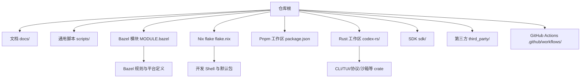

**图表来源**
- [MODULE.bazel:1-200](file://MODULE.bazel#L1-L200)
- [flake.nix:1-87](file://flake.nix#L1-L87)
- [codex-rs/Cargo.toml:1-120](file://codex-rs/Cargo.toml#L1-L120)

**章节来源**
- [README.md:1-81](file://README.md#L1-L81)
- [MODULE.bazel:1-200](file://MODULE.bazel#L1-L200)
- [flake.nix:1-87](file://flake.nix#L1-L87)
- [codex-rs/Cargo.toml:1-120](file://codex-rs/Cargo.toml#L1-L120)

## 核心组件
- Rust 工具链
  - 固定版本：Rust 1.95.0，并启用 clippy、rustfmt、rust-src。
  - 工作区统一 edition=2024，license=Apache-2.0。
- Bazel 构建系统
  - 使用 rules_rs、rules_python、rules_foreign_cc、llvm、windows_support 等模块。
  - 管理 V8、语音运行时、Windows SDK、macOS SDK、MSVC runtime 等依赖。
- Nix 开发环境
  - 提供多平台 devShell，预装 rustc、clang、openssl、cmake、pkg-config 等。
  - 默认包输出 `codex-rs`，便于在 Nix 环境中直接构建。
- 通用脚本
  - 格式化工具聚合器 `scripts/format.py`，统一调用 just、rustfmt、buildifier、ruff、uv。
  - 包构建入口 `scripts/build_codex_package.py`，调用 `scripts/codex_package/cli.py`。

**章节来源**
- [codex-rs/rust-toolchain.toml:1-3](file://codex-rs/rust-toolchain.toml#L1-L3)
- [codex-rs/Cargo.toml:1-40](file://codex-rs/Cargo.toml#L1-L40)
- [MODULE.bazel:1-200](file://MODULE.bazel#L1-L200)
- [flake.nix:1-87](file://flake.nix#L1-L87)
- [scripts/format.py:1-200](file://scripts/format.py#L1-L200)
- [scripts/build_codex_package.py:1-16](file://scripts/build_codex_package.py#L1-L16)

## 架构总览
从开发者视角看，Codex 的构建与开发链路如下：

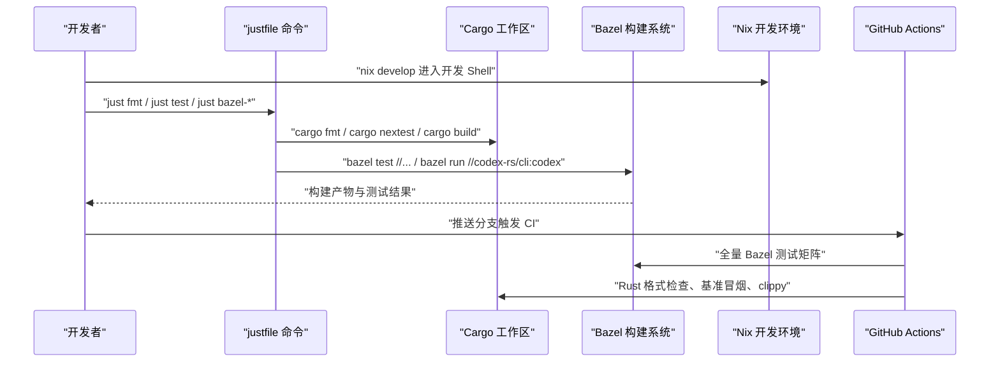

**图表来源**
- [justfile:1-200](file://justfile#L1-L200)
- [MODULE.bazel:1-200](file://MODULE.bazel#L1-L200)
- [flake.nix:1-87](file://flake.nix#L1-L87)
- [.github/workflows/rust-ci.yml:1-200](file://.github/workflows/rust-ci.yml#L1-L200)
- [.github/workflows/bazel.yml:1-200](file://.github/workflows/bazel.yml#L1-L200)

## 详细组件分析

### Rust 工具链与工作区
- 工具链锁定
  - `codex-rs/rust-toolchain.toml` 固定 channel=1.95.0，并包含 clippy、rustfmt、rust-src。
- 工作区
  - `codex-rs/Cargo.toml` 声明 workspace members，列举数十个内部 crate，如 cli、tui、core、protocol、exec-server、sandboxing 等。
  - 统一 edition=2024，license=Apache-2.0。
- 构建入口
  - `just c` 等价于 `cargo run --bin codex`。
  - `just install` 在非 Windows 下会显示活跃 toolchain 并执行 `cargo fetch`。

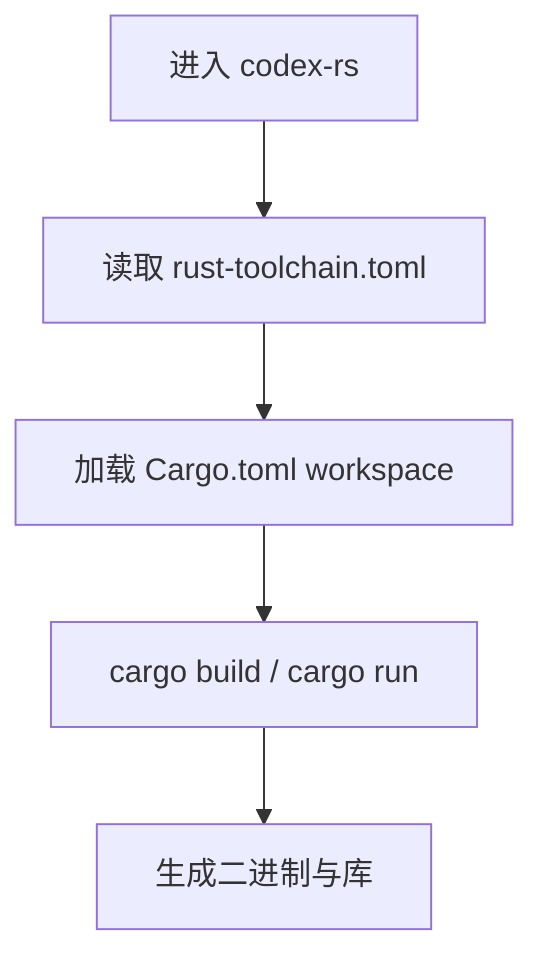

**图表来源**
- [codex-rs/rust-toolchain.toml:1-3](file://codex-rs/rust-toolchain.toml#L1-L3)
- [codex-rs/Cargo.toml:1-120](file://codex-rs/Cargo.toml#L1-L120)
- [justfile:1-60](file://justfile#L1-L60)

**章节来源**
- [codex-rs/rust-toolchain.toml:1-3](file://codex-rs/rust-toolchain.toml#L1-L3)
- [codex-rs/Cargo.toml:1-120](file://codex-rs/Cargo.toml#L1-L120)
- [justfile:1-60](file://justfile#L1-L60)

### Bazel 构建系统与模块
- 模块入口
  - `MODULE.bazel` 引入 rules_rs、rules_python、rules_foreign_cc、llvm、windows_support 等，并配置 MSVC runtime、Windows SDK、macOS SDK。
- 工具链与平台
  - 注册 llvm toolchains，配置 Apple frameworks 与 libraries。
  - 通过 patches 目录修复特定依赖的兼容性问题。
- 构建目标
  - 通过 `bazel test //...` 执行全部测试（排除 argument-comment-lint tag）。
  - 通过 `just bazel-codex` 运行 CLI，或通过 `just build-for-release` 构建发布二进制。

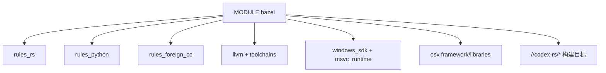

**图表来源**
- [MODULE.bazel:1-200](file://MODULE.bazel#L1-L200)

**章节来源**
- [MODULE.bazel:1-200](file://MODULE.bazel#L1-L200)
- [justfile:120-200](file://justfile#L120-L200)

### Nix 开发环境
- 开发 Shell
  - `flake.nix` 提供 x86_64/aarch64 Linux 与 Darwin 的 devShell，安装 rust、clang、openssl、cmake、pkg-config。
  - 设置 CC/CXX=clang，适配 BoringSSL 编译与避免 GCC 警告。
- 默认包
  - `codex-rs/default.nix` 基于 rustPlatform.buildRustPackage 构建 `codex-rs`，处理 openssl/pkg-config/libcap 等依赖，并在 release commit 时注入版本号。

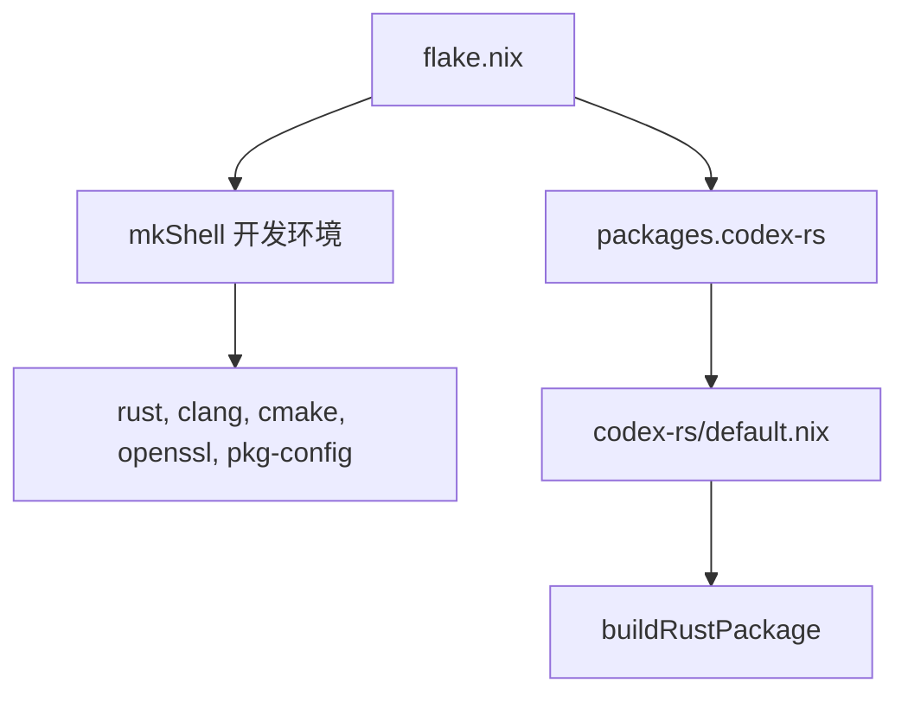

**图表来源**
- [flake.nix:1-87](file://flake.nix#L1-L87)
- [codex-rs/default.nix:1-55](file://codex-rs/default.nix#L1-L55)

**章节来源**
- [flake.nix:1-87](file://flake.nix#L1-L87)
- [codex-rs/default.nix:1-55](file://codex-rs/default.nix#L1-L55)

### 格式化工具与多语言规范
- 统一格式化入口
  - `scripts/format.py` 聚合以下格式化器：
    - Justfile 自身格式化。
    - Rust：rustfmt，edition=2024，imports_granularity=Item，skip_children=true。
    - Bazel/Starlark：buildifier（通过 dotslash），仅对 BUILD/MODULE.bazel/*.bzl/*.sky 等文件。
    - Python SDK：uv + ruff（check/fix+format）。
    - Python 脚本：uv + ruff（check/fix+format）。
- 根级 Ruff 排除
  - `ruff.toml` 排除 `sdk/python` 与 `codex-rs/vendor`，由各自子工程维护 lint 配置。

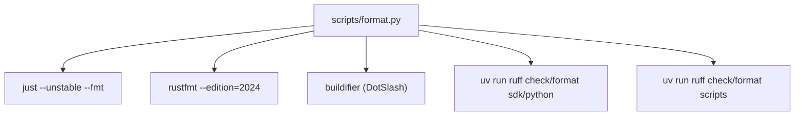

**图表来源**
- [scripts/format.py:1-200](file://scripts/format.py#L1-L200)
- [ruff.toml:1-1](file://ruff.toml#L1-L1)

**章节来源**
- [scripts/format.py:1-200](file://scripts/format.py#L1-L200)
- [ruff.toml:1-1](file://ruff.toml#L1-L1)
- [codex-rs/rustfmt.toml:1-4](file://codex-rs/rustfmt.toml#L1-L4)

### 测试框架与测试策略
- Rust 单元测试与集成测试
  - 推荐通过 `just test` 使用 nextest，设置 `RUST_MIN_STACK=8388608` 与 `NEXTEST_PROFILE=local`。
  - 可通过 `-p <crate>` 指定 crate 运行，避免 `--all-features` 提升速度。
- 基准测试
  - `just bench` 运行所有 benchmark targets。
  - `just bench-smoke` 确保基准可启动。
  - `just bench-e2e` 通过 Bazel 运行端到端宏基准，使用 opt 构建。
- Bazel 测试
  - `bazel test --test_tag_filters=-argument-comment-lint //...` 执行全部测试。
  - CI 中按平台矩阵执行 Bazel 测试，并对 Windows 分片并行。

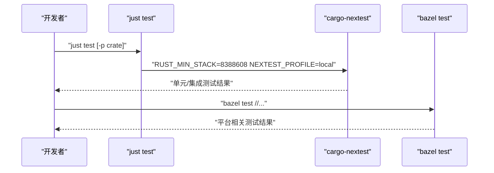

**图表来源**
- [justfile:60-140](file://justfile#L60-L140)
- [.github/workflows/bazel.yml:1-200](file://.github/workflows/bazel.yml#L1-L200)

**章节来源**
- [justfile:60-140](file://justfile#L60-L140)
- [.github/workflows/bazel.yml:1-200](file://.github/workflows/bazel.yml#L1-L200)

### 调试技巧与性能分析
- 日志与诊断
  - 遵循 Rust 的 `RUST_LOG` 环境变量控制日志级别。
  - TUI 默认将诊断写入有界本地存储；可通过配置显式设置 `log_dir`，生成明文日志文件。
- 堆栈与内存
  - 本地测试建议保留 `RUST_MIN_STACK=8388608`，避免部分异步或深度递归场景栈溢出。
- 性能基准
  - 使用 `just bench` 与 `just bench-e2e` 评估变更影响；CI 中也运行基准冒烟测试。

**章节来源**
- [docs/install.md:1-65](file://docs/install.md#L1-L65)
- [justfile:60-140](file://justfile#L60-L140)

## 依赖关系分析
- 外部依赖
  - Rust：通过 `rust-toolchain.toml` 固定版本与组件。
  - Bazel：通过 `MODULE.bazel` 管理 rules_rs、rules_python、rules_foreign_cc、llvm、windows_support 等。
  - Python：通过 uv 管理 SDK 与脚本依赖，ruff 负责 lint/format。
  - Node.js：通过 pnpm 管理前端与工具链依赖。
- 内部依赖
  - Rust workspace 内 crate 之间通过 path dependency 组织，cli/tui/core/protocol/exec-server/sandboxing 为核心子系统。
- CI 依赖
  - GitHub Actions 通过多个 workflow 组合形成完整质量门禁。

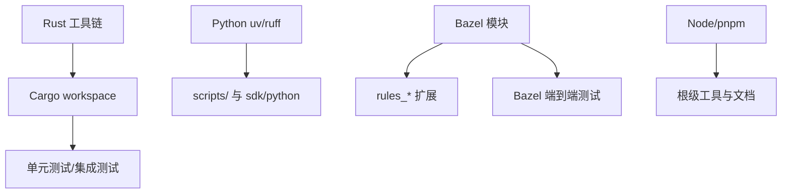

**图表来源**
- [codex-rs/rust-toolchain.toml:1-3](file://codex-rs/rust-toolchain.toml#L1-L3)
- [MODULE.bazel:1-200](file://MODULE.bazel#L1-L200)
- [ruff.toml:1-1](file://ruff.toml#L1-L1)

**章节来源**
- [codex-rs/rust-toolchain.toml:1-3](file://codex-rs/rust-toolchain.toml#L1-L3)
- [MODULE.bazel:1-200](file://MODULE.bazel#L1-L200)
- [ruff.toml:1-1](file://ruff.toml#L1-L1)

## 性能与构建优化
- 本地构建
  - 优先使用 `just test -p <crate>` 而非 `--all-features`，减少构建时间与磁盘占用。
  - 使用 `just bench-smoke` 快速验证基准是否可启动。
- CI 缓存
  - Rust CI 使用 sccache（部分平台关闭以避免混架构归档问题）。
  - Bazel CI 保存 repository cache，减少重复下载。
- 发布构建
  - 使用 `just build-for-release` 通过 Bazel 构建发布二进制，保证与生产一致。

**章节来源**
- [justfile:60-200](file://justfile#L60-L200)
- [.github/workflows/rust-ci-full.yml:1-200](file://.github/workflows/rust-ci-full.yml#L1-L200)
- [.github/workflows/bazel.yml:1-200](file://.github/workflows/bazel.yml#L1-L200)

## 测试指南
- 单元测试与集成测试
  - 在 `codex-rs` 下的各 crate 中使用 Rust 原生测试。
  - 推荐使用 nextest：`just test` 或 `just test -p codex-tui`。
- 端到端与宏基准
  - Bazel 端到端基准：`just bench-e2e` 与 `just bench-e2e-smoke`。
- Python 脚本测试
  - `just test-github-scripts` 运行 `.github/scripts` 下的 Python unittest。
- Bazel 测试
  - `bazel test //...` 运行全部测试（排除 argument-comment-lint tag）。

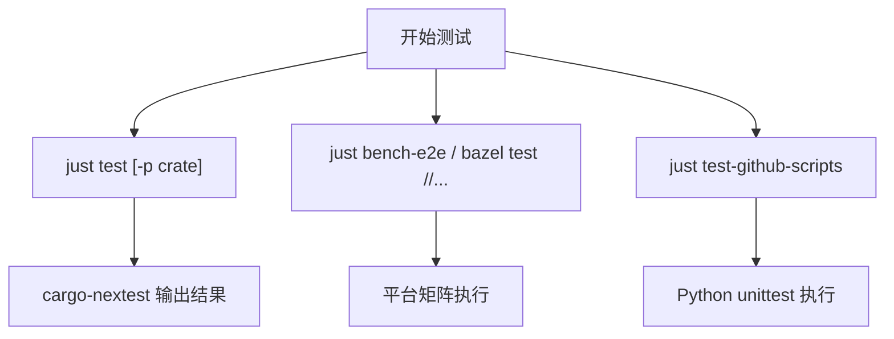

**图表来源**
- [justfile:60-140](file://justfile#L60-L140)
- [.github/workflows/bazel.yml:1-200](file://.github/workflows/bazel.yml#L1-L200)

**章节来源**
- [justfile:60-140](file://justfile#L60-L140)
- [.github/workflows/bazel.yml:1-200](file://.github/workflows/bazel.yml#L1-L200)

## 调试与诊断
- 日志级别
  - 使用 `RUST_LOG` 控制日志输出，参考 Rust env_logger 文档。
- TUI 日志文件
  - 设置 `log_dir` 配置项，启用明文日志文件，便于离线分析。
- 终端与栈大小
  - 保持 `RUST_MIN_STACK=8388608`，避免复杂交互场景崩溃。
- 网络与安全边界
  - 参考 Agent 批准与安全文档了解沙箱、审批和网络控制。

**章节来源**
- [docs/install.md:1-65](file://docs/install.md#L1-L65)
- [SECURITY.md:1-17](file://SECURITY.md#L1-L17)

## 代码规范与质量门禁
- Rust 规范
  - `rustfmt.toml`：edition=2024，imports_granularity=Item。
  - `clippy.toml`：禁用部分 ANSI 颜色 API，强制通过 codex-state 访问 SQLite，扩大 large-error-threshold。
- Python 规范
  - `ruff.toml`：排除 `sdk/python` 与 `codex-rs/vendor`，由子工程维护。
- 统一格式化
  - `scripts/format.py`：聚合 just、rustfmt、buildifier、ruff、uv，支持 `--check`。
- 根级检查
  - `just fmt` / `just fmt-check`：统一格式化与检查。
  - `just fix`：clippy --fix。

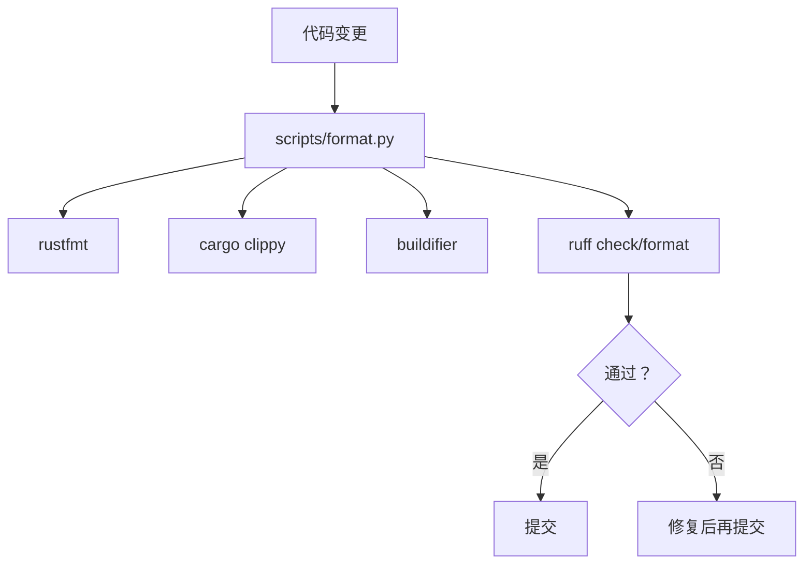

**图表来源**
- [scripts/format.py:1-200](file://scripts/format.py#L1-L200)
- [codex-rs/rustfmt.toml:1-4](file://codex-rs/rustfmt.toml#L1-L4)
- [codex-rs/clippy.toml:1-32](file://codex-rs/clippy.toml#L1-L32)
- [ruff.toml:1-1](file://ruff.toml#L1-L1)

**章节来源**
- [scripts/format.py:1-200](file://scripts/format.py#L1-L200)
- [codex-rs/rustfmt.toml:1-4](file://codex-rs/rustfmt.toml#L1-L4)
- [codex-rs/clippy.toml:1-32](file://codex-rs/clippy.toml#L1-L32)
- [ruff.toml:1-1](file://ruff.toml#L1-L1)

## 提交、拉取请求与审查流程
- 社区贡献政策
  - 项目不接受外部代码贡献或拉取请求；欢迎通过 issue 提交 bug 报告、根因分析与功能需求。
- 问题报告要求
  - 包括清晰复现步骤、期望与实际行为、版本与环境信息、日志与诊断信息、根因分析与潜在修复思路。
- 安全漏洞
  - 通过 Bugcrowd 安全计划报告，不在公开 issue 中披露。

**章节来源**
- [docs/contributing.md:1-39](file://docs/contributing.md#L1-L39)
- [SECURITY.md:1-17](file://SECURITY.md#L1-L17)

## 构建与打包任务
- 常用 just 命令
  - `just c`：运行 `cargo run --bin codex`。
  - `just exec`：运行 `codex exec`。
  - `just tui-with-exec-server`：启动 TUI 并与 exec-server 联动。
  - `just file-search`：运行文件搜索二进制。
  - `just code-mode-host`：源码模式主机。
  - `just assemble-codex-package`：构建本地 Codex 包。
  - `just app-server-test-client`：构建 CLI 并运行 app-server 测试客户端。
  - `just fmt` / `just fmt-check`：统一格式化。
  - `just fix` / `just clippy`：clippy 修复与检查。
  - `just install`：安装依赖并 fetch。
  - `just test`：nextest 测试。
  - `just bench` / `just bench-smoke`：基准测试。
  - `just bench-e2e` / `just bench-e2e-smoke`：Bazel 端到端基准。
  - `just bazel-codex` / `just bazel-code-mode-host`：通过 Bazel 运行。
  - `just bazel-lock-update` / `just bazel-lock-check`：更新与校验 Bazel lock。
  - `just bazel-test` / `just bazel-clippy` / `just bazel-argument-comment-lint`：Bazel 测试与 lint。
  - `just build-for-release`：构建发布二进制。
  - `just write-config-schema` / `just write-app-server-schema` / `just write-hooks-schema`：再生成 schema。
  - `just argument-comment-lint` / `just argument-comment-lint-from-source`：参数注释 lint。
- 包构建入口
  - `scripts/build_codex_package.py` 调用 `scripts/codex_package/cli.py` 的主函数。

**章节来源**
- [justfile:1-200](file://justfile#L1-L200)
- [scripts/build_codex_package.py:1-16](file://scripts/build_codex_package.py#L1-L16)

## 持续集成与质量门禁
- Rust CI
  - `rust-ci.yml`：检测变更路径，执行 format、bench-smoke、cargo-shear、argument-comment-lint 等。
  - `rust-ci-full.yml`：全量 CI，含多平台 voice inputs、lint/build 矩阵、argument-comment-lint prebuilt。
- Bazel CI
  - `bazel.yml`：多平台测试矩阵（macOS、Linux、Windows），校验 rusty_v8 MODULE.bazel 校验和与 lock 文件，上传执行日志，保存 repository cache。
- 仓库级检查
  - `repo-checks.yml`：验证 Cargo manifests 继承、tui 不直接导入 core、Bazel clippy flags 匹配、Python 发布解析、安装包构建、安装器测试、macOS 签名与公证、README ASCII 与 ToC、格式与 Prettier。

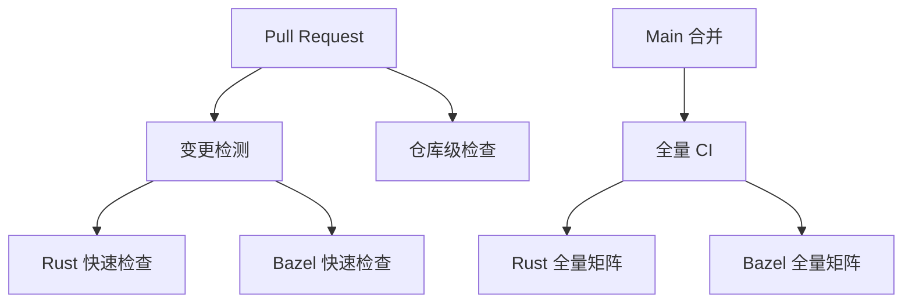

**图表来源**
- [.github/workflows/rust-ci.yml:1-200](file://.github/workflows/rust-ci.yml#L1-L200)
- [.github/workflows/rust-ci-full.yml:1-200](file://.github/workflows/rust-ci-full.yml#L1-L200)
- [.github/workflows/bazel.yml:1-200](file://.github/workflows/bazel.yml#L1-L200)
- [.github/workflows/repo-checks.yml:1-78](file://.github/workflows/repo-checks.yml#L1-L78)

**章节来源**
- [.github/workflows/rust-ci.yml:1-200](file://.github/workflows/rust-ci.yml#L1-L200)
- [.github/workflows/rust-ci-full.yml:1-200](file://.github/workflows/rust-ci-full.yml#L1-L200)
- [.github/workflows/bazel.yml:1-200](file://.github/workflows/bazel.yml#L1-L200)
- [.github/workflows/repo-checks.yml:1-78](file://.github/workflows/repo-checks.yml#L1-L78)

## 故障排查
- 无法运行 nextest
  - 安装 `cargo-nextest`，并确保使用 `just test` 而非 `cargo test`，以获得一致的栈大小与配置文件。
- 构建失败或依赖缺失
  - 使用 `just install` 或 `cargo fetch` 拉取依赖；若使用 Nix，请通过 `nix develop` 进入开发 Shell。
- Bazel 模块锁不一致
  - 运行 `just bazel-lock-update` 更新 `MODULE.bazel.lock`，并按提示提交锁文件。
- 格式化不通过
  - 运行 `just fmt` 自动修复；若仍失败，检查 `scripts/format.py` 调用的工具链是否正确安装。
- CI 阻塞
  - 查看对应 workflow 日志，确认是否触发了 argument-comment-lint、cargo-shear、benchmark smoke 或 Bazel 测试失败。

**章节来源**
- [justfile:60-200](file://justfile#L60-L200)
- [.github/workflows/bazel.yml:1-200](file://.github/workflows/bazel.yml#L1-L200)
- [.github/workflows/rust-ci.yml:1-200](file://.github/workflows/rust-ci.yml#L1-L200)

## 结论
本项目以 Rust 为核心，结合 Bazel 与 Nix 提供跨平台构建与开发环境，并通过 GitHub Actions 实施严格的质量门禁。开发者应优先使用 `just` 提供的统一命令进行格式化、测试、基准与构建；遵循 Rust 与 Python 的 lint 规范；在提交前确保本地构建与测试通过。对于社区反馈，请以 issue 形式提供详尽的问题描述与分析，安全问题则通过 Bugcrowd 渠道报告。